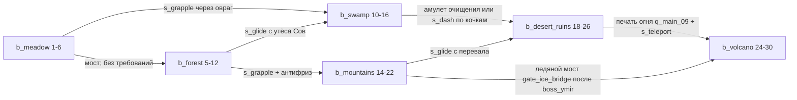

# VR-atu Open World — дизайн-документ v5 (единый файл)

## Обзор
Открытый мир «VR Тир» (`?mode=openworld`), разбитый на 6 этажей в духе SAO: казахские поселения, башни и врата этажей (I), рельеф по биомам, опасности, туман войны, мини-карта и телепорт (J), 32 моба с ролями, телеграфами и зонами попадания (K), 6 боссов этажей с аренами, фазами и мировыми событиями (L), опыт, уровни 1–30, инвентарь, лут с аффиксами, крафт, магазин, квесты и сохранения (M), мечи и 17 мечевых навыков `ssk_` (N). Сюда же входят магия стихий (F), казахское оформление (G) и управление v2 с радиалом (H). Мультиплеер и старые режимы не затрагиваются.

## Быстрая установка
1. Сохраните этот файл как `VR-ATU-OPENWORLD-DESIGN-v5.md` рядом с репозиторием `VR-atu`.
2. Скопируйте блок кода из раздела **D** (`install-openworld.mjs`) в одноимённый файл рядом с этим `.md`.
3. Выполните (Node 20+): `node install-openworld.mjs --repo VR-atu VR-ATU-OPENWORLD-DESIGN-v5.md`
   Установщик раскладывает все блоки, у которых заголовок состоит из номера и пути в обратных кавычках (при одинаковом пути побеждает последний блок), затем запускает `node --test` и валидаторы `defs`, `fantasy-extras`, `spawn`, `spells`, `kz`, `melee`. Повторный запуск безопасен. `--check` сверяет файлы без записи, `--uninstall` откатывает установку.
4. Откройте `index.html?mode=openworld&autostart`.

## Управление (ПК)
WASD — движение · мышь — обзор · ЛКМ — огонь или удар · ПКМ — блок/парирование (у меча: направление навыка) · Shift — рывок · Ctrl — спринт · Пробел — прыжок · удерживать V — радиал навыков и заклинаний · Q/E/X/Z — слоты навыков · T — скан · R — перезарядка · F — взаимодействие · Tab — карта мира и телепорт · G — переключение меч/огнестрел · B — следующий меч · I/K/L — инвентарь, навыки, квесты · 1–3 — оружие · U — глифы (только при включённом `advancedGlyphs`). На телефоне есть сенсорные кнопки. VR-раскладка описана в разделе H.

## Этажи 1–6
| Этаж | Биом | Уровни | Хаб | Босс (открывает следующий этаж) |
|---|---|---|---|---|
| 1 | Луга Рассвета (Сарыарқа жайлауы) | 1–6 | `poi_hub_dawnford` | `boss_slime_king` |
| 2 | Шепчущий лес (Алтай орманы) | 5–12 | `poi_hub_rootvale` | `boss_rotroot` |
| 3 | Гнилая топь (Арал сазы) | 10–16 | `poi_hub_stilt_market` | `boss_hydra_tinara` |
| 4 | Пики Стужи (Хан Тәңірі шыңдары) | 14–22 | `poi_hub_pass_camp` | `boss_ymir` |
| 5 | Солнечные руины (Шарын шатқалы) | 18–26 | `poi_hub_mirage_oasis` | `boss_akhmaret` |
| 6 | Сердце Пепла (Отты тау) | 24–30 | `poi_hub_ash_forge` | `boss_ignarok` (финал) |

## Важно для интеграции (v5)
- Единственный источник истины для ворот — `zones.js` (J): `isGateOpen`, `markBossDefeated`, `floorUnlocked`. `FloorLock` из I делегирует ему, а `buildings.fastTravel` вызывает `zones.travel`, так что система телепорта одна.
- Порядок хуков после `window.__OW = api;`: I → J → K → L → M → обёртка аффиксов → N. Обёртки `ow.mobs` выстраиваются в цепочку K→L→аффиксы и не затирают друг друга.
- `mobs.applyStatus` добавлен: burn/poison пока наносятся одним суммарным ударом. `api.viewModel` выведен в `api`.
- Раздел 7 устарел, актуальная раскладка в разделе H. Казахские тексты нужно проверить носителем языка.
- Отладка: `?owfloors=6`, `?owfresh`, `?owboss=<id>`, `window.__OW_BOSS.kill()`.

## Оглавление
0–E — исходный дизайн и срез v1–v2 · F — магия · G — казахская тема · H — управление · I — здания · J — этажи и зоны · K — монстры · L — боссы · M — прогрессия · N — мечи.
Префиксы ID: `sp_ fu_ rn_ gl_ art_ mnt_ pet_ gad_ wnd_ lgv_ cos_ sec_ pai_ ssk_`.

---

# VR-atu Open World — дизайн-документ v2 (единый файл)

## Быстрая установка

1. Сохраните этот файл как `VR-ATU-OPENWORLD-DESIGN-v2.md` рядом с репозиторием `VR-atu`.
2. Скопируйте блок кода из раздела **D** (`install-openworld.mjs`) в файл `install-openworld.mjs` рядом с этим `.md`.
3. Одна команда (Node 20+):
   ```
   node install-openworld.mjs --repo VR-atu VR-ATU-OPENWORLD-DESIGN-v2.md
   ```
   Установщик извлекает все блоки кода, заголовок которых — только номер + один путь в обратных кавычках (последний с одинаковым путём побеждает), раскладывает их по репо, патчит точки подключения, запускает `node --check`, валидаторы и `node --test`. Повторный запуск безопасен; откат: `--uninstall`. Проверка без записи: `--dry-run`.

## Оглавление v2
- 0–… — v1: дизайн, мир, урон, оружие, навыки, предметы, мобы, боссы, модули (без изменений)
- A. Фантастические штуки (артефакты, маунты, питомцы, гаджеты, чудеса, легендарки, косметика, секреты)
- B. Спавн в открытом мире
- C. Модели (процедурные low-poly + GLB-генератор)
- D. Быстрая установка (`install-openworld.mjs`)
- E. Играбельный срез

## Реестр префиксов ID (дополнение v2)
`art_` артефакты · `mnt_` маунты · `pet_` питомцы · `gad_` гаджеты · `wnd_` чудеса мира · `lgv_` легендарные формы оружия · `cos_` косметика · `sec_` секреты · `pai_` (часть A, см. реестр в A). Префиксы v1 — без изменений.

**Важно для интеграции:**
- Хит-зоны в `js/world/mobs.js` рассчитаны на примитивные заглушки — подогнать под процедурные модели (`js/world/procedural-models.js`).
- В старом `js/main.js` добавить ранний выход при `?mode=openworld` (`if (new URLSearchParams(location.search).get('mode')==='openworld') return;`), чтобы легаси-сцена не стартовала параллельно.

**Палитра моделей:** массив `PALETTE` в `js/world/procedural-models.js` — расшифровка раскладки 8×8 из части 1; при расхождении с `THEME` заменить hex-значения (индексы не менять).

---

# VR-atu · Открытый мир: единый дизайн-документ (арт, мир, бой, оружие, навыки, враги)

> **Что это.** Один самодостаточный файл для переноса в основную сессию и слияния с `main`. В нём собраны пять разделов (арт/UI/звук, открытый мир, оружие, навыки и прогрессия, враги) и базовый план, сведённые в **один канон**: противоречия устранены, ID сквозные, у всех данных есть готовые ES-модули (раздел 8), валидатор перекрёстных ссылок и тесты `node --test`.
> **Статус.** Только план. Репозиторий `ansa-music/VR-atu` не менялся: нет коммитов, веток и PR. Все модули из раздела 8 проверены вне репозитория: `node --check`, импорт, `tools/validate-defs.mjs`, балансовые скрипты, 21 тест — всё зелёное (см. 0.9).
> **Язык.** Текст на русском, идентификаторы кода на английском. Время указано в Asia/Qyzylorda (UTC+5).

---

## Оглавление

- 0. Шапка: рамки, канон, порядок внедрения
  - 0.1 Назначение и рамки
  - 0.2 Факты о репозитории (`main` @ `4e75bc6`, 19.10.2026)
  - 0.3 Канон (одна строка — одно решение)
  - 0.4 Реестр префиксов ID
  - 0.5 Разрешённые конфликты
  - 0.6 Дорожная карта
  - 0.7 Раскладка модулей и точки встраивания
  - 0.8 План тестов (`node --test tests/`)
  - 0.9 Критерии приёмки
- 1. Арт-дирекшн, графика, UI/UX, звук
  - 1.1 Визуальные столпы
  - 1.2 Цвет
  - 1.3 Графическая технология (Three.js r160, без сборки)
  - 1.4 UI/UX
  - 1.5 Модели и анимации
  - 1.6 Звук
  - 1.7 Производство ассетов (без покупок, пайплайн как в репо)
  - 1.8 Порядок внедрения графики и UI (после слияния текущего большого пуша)
  - 1.9 Риски и открытые вопросы раздела
- 2. Открытый мир, исследование и техника
  - 2.1 Что есть в коде сейчас (точки опоры)
  - 2.2 Размер и раскладка мира
  - 2.3 Биомы
  - 2.4 Точки интереса (49 POI)
  - 2.5 Ограничения проходимости (метроидвания-лайт)
  - 2.6 Основная сюжетная линия (12 квестов + 6 дополнительных)
  - 2.7 Смена дня и ночи, погода
  - 2.8 Динамические события
  - 2.9 Быстрое перемещение
  - 2.10 Карта, компас и маркеры (диегетически в VR)
  - 2.11 Сохранение
  - 2.12 Сундуки, коллекционки, крафт
  - 2.13 ТЕХНИКА
- 3. Ядро боя: формула, ресурсы, статусы
  - 3.1 Формула урона (порядок фиксирован)
  - 3.2 Ресурсы игрока (L1)
  - 3.3 Потолки (`CAPS`)
  - 3.4 Кривая уровня (`LEVEL_CURVE`)
  - 3.5 Статусы (`STATUSES`)
  - 3.6 Визуальный язык урона
- 4. Оружие: 20 видов
  - 4.0 Правила, общие для всего оружия (по канону)
  - 4.1 Карточки оружия
  - 4.2 Сводная таблица баланса
  - 4.3 DPS и TTK (вывод `node tools/check-weapons.mjs`)
  - 4.4 Ступени улучшения и редкость
  - 4.5 Моды и насадки (14, совместимы между классами)
  - 4.6 Экономика патронов и энергии
  - 4.7 Сочетания с навыками и статусами (для раздела навыков)
  - 4.8 Производительность и модели (Quest)
- 5. Навыки, прогрессия, предметы, крафт
  - 5.1 Ресурсы и масштабирование
  - 5.2 Двадцать навыков: сводка
  - 5.3 Карточки навыков
  - 5.4 Матрица совместимости 20×20
  - 5.5 Именные комбо (18)
  - 5.6 Правила набора (loadout)
  - 5.7 Очки навыков, ранги и таланты
  - 5.8 Уровни 1–30: кривая опыта
  - 5.9 Экипировка: аффиксы под потолки формулы
  - 5.10 Крафт и валюты (обзор)
  - 5.11 Управление: сводка по платформам
  - 5.A Предметы, крафт, прогрессия — единый реестр
- 6. Враги: мобы, элиты, боссы, события, ИИ, спавн
  - 6.1 Итог раздела
  - 6.2 Соглашения
  - 6.3 Формула масштабирования по уровню
  - 6.4 Бестиарий по биомам (полные данные — `MOBS`, Приложение)
  - 6.5 Элитные аффиксы (`ELITE_AFFIXES`)
  - 6.6 Архитектура ИИ для Three.js без сборки
  - 6.7 Боссы (`BOSSES`)
  - 6.8 Бродячие минибоссы и мировые события (`WORLD_EVENTS`)
  - 6.9 Спавн-директор и плотность
  - 6.10 Таблицы спавна по биомам (`SPAWN_TABLES`)
  - 6.11 Проверка баланса (вывод `node tools/check-enemies.mjs`)
- 7. Единая раскладка управления (`INPUT_MAP`)
- 8. Приложение: ES-модули, валидатор, тесты
- 9. Открытые вопросы (с рекомендуемыми значениями по умолчанию)

---

# 0. Шапка: рамки, канон, порядок внедрения

## 0.1 Назначение и рамки

- **Цель.** Превратить VR-тир в **одиночную игру с открытым миром** в стилизованной тун-графике. Мир состоит из 6 биомов (1536×1536 м). В нём 49 точек интереса (POI), 32 вида мобов, 6 боссов, 2 бродячих минибосса и 12 мировых событий. Игроку доступны 20 видов оружия, 20 навыков в 4 архетипах, крафт, экипировка с аффиксами, уровни 1–30 и NG+.
- **Платформы.** VR (Quest, WebXR), ПК, телефон, Arduino-джойстик (`J,x,y,b`). У каждого действия есть ввод на всех четырёх (раздел 7).
- **Вне рамок.** Мультиплеер и PvP (`js/multiplayer*.js`, `js/pvp-*.js`, `server/`) не трогаем и в режиме `world` не импортируем.
- **Не ломать.** Текущие режимы «Тир» (`range`) и «Фэнтези» (`fantasy`), мультиплеер и существующие тесты (`pvp*.test.js`, `weapon-rules.test.js`) работают как раньше. Открытый мир — новый режим `world` с динамическим импортом. Новый баланс (HP 150, щит) действует **только** в `world`, а PvP остаётся на `WEAPON_RULES`, пока не будет отдельного решения.
- **Без сборки.** Three.js r160 через importmap. Все новые файлы — ES-модули, данные — чистые замороженные объекты без Three.js. Их можно импортировать и в браузере, и в Node.

## 0.2 Факты о репозитории (`main` @ `4e75bc6`, 19.10.2026)

| Что | Где | Что нужно для мира |
|---|---|---|
| Монолит игры (~1700 строк): цикл, движение, `ARENA`, коллайдеры | `js/main.js` | режим `world`: движение около стр. 1235, `staticColliders`/`hittables` на стр. 502–519, `setAnimationLoop` на стр. 1562 (п. 0.7) |
| Three.js r160 | `vendor/three.module.js`, `vendor/addons/webxr/VRButton.js` | **добавить** из r160 `examples/jsm`: `addons/loaders/GLTFLoader.js`, `addons/utils/BufferGeometryUtils.js`, `addons/utils/SkeletonUtils.js` (P0), `addons/libs/meshopt_decoder.module.js` (P1), postprocessing (P2, только `pc_high` вне XR) |
| Importmap | `index.html` | добавить `"three/addons/": "./vendor/addons/"` |
| 16 GLB-моделей (загрузчика нет) | `assets/models/*.glb`, генератор `generate_assets.py` | пересобрать на атлас палитры 256² (п. 1.3.3) |
| Пресеты качества low/medium/high, `lowerQuality` | `js/quality.js` | новые id `quest/phone/pc_low/pc_high` (старые остаются алиасами), таблица — `js/render/quality-presets.js` |
| Оружие: 5 стволов, баллистика | `js/arsenal.js`, `js/guns.js`, `js/weapon.js`, `js/ballistics.js` | `legacyId` в `WEAPONS` связывает 5 старых стволов с новыми карточками |
| Урон PvP (сервер) | `server/weapon-rules.js` (`calculateDamage`) | не меняем; `shared/damage.js` повторяет его шаг падения с дистанцией |
| VR-кобуры, хват, комфорт | `js/vr-holsters.js`, `js/vr-handling.js`, `js/vr-comfort.js` | новые ключи комфорта, `comfort.fade(t)` |
| Фэнтези-наруч, скрижали, синтез звука | `js/fantasy/{bracer,ui,audio}.js` | таблички «Карта/Квест/Сумка/Навыки» |
| Ввод | `js/touch.js`, `js/mk.js`, `arduino/` | `shared/defs/input-map.js`; прошивка Arduino не меняется |

## 0.3 Канон (одна строка — одно решение)

| Параметр | Значение | Где в коде |
|---|---|---|
| Режим | одиночный открытый мир, `?mode=world` | `js/main.js` |
| Игрок L1 | HP 150 (потолок 330), щит 75 (+15/с через 3 с), энергия 100 (+8/с, макс. 130), выносливость 100 (+25/с через 0,8 с), ульта 100 | `PLAYER_BASE` |
| Типы урона | `physical, fire, frost, lightning, arcane, poison` (без `true`/`kinetic`/`shock`) | `DAMAGE_TYPES` |
| Формула | base → falloff → zone → attacker (≤ +50 %) → charge → vuln (≤ +30 %) → mitigation (≤ 75 %) → shield → HP → statuses | `shared/damage.js` |
| Зоны | пуля: голова ×2,0; прочее: ×1,5; AoE ×1,0; конечности ×0,75; голова в сумме ≤ 2,4 | `ZONE`, `CAPS.headZoneMax` |
| Статусы | 6 шт.: `st_burn, st_chill, st_freeze, st_shock, st_poison, st_stagger`; контроль ≤ 1 с, после него иммунитет | `STATUSES` |
| Кривая уровня | `levelMul(L) = 1 + 0,06·(L−1)` (L30 = ×2,74) — урон оружия (ilvl), навыков и HP мобов; урон мобов `1 + 0,03·(L−1)`; ожидаемое HP игрока `150·(1 + 0,03·(L−1))` | `LEVEL_CURVE` |
| Элита | HP ×3, урон ×1,25, XP ×4, аффиксов 1/2/3 (L1/10/20) | `LEVEL_CURVE.elite` |
| Эталоны баланса | моб `m_ref` 240 HP, броня 15 % (×levelMul); босс — реальный `boss_ignarok` (16000 × 2,74 = 43 840 HP); опорный DPS 160 | `BALANCE_REF` |
| TTK | оружие по 150 HP: 0,7–1,35 с; босс 40–140 с чистого DPS | `tools/check-*.mjs` |
| Потолки ударов мобов | один удар ≤ 60 % ожидаемого HP игрока; полный канал ≤ 80 % | `CAPS.mob*OfPlayerHp` |
| Опыт | `xpToNext = round10(100·L^1.5 + 50)`, всего ≈ 190 тыс. XP ≈ 12,7 ч | `LEVEL_CURVE.xpToNext` |
| День | 40 мин: 24 день + 12 ночь + 2 рассвет + 2 закат | `WORLD_CONFIG` |
| Качество | `quest / phone / pc_low / pc_high`; дальность 150/150/220/380 м; активных мобов 18/18/25/35 слотов | `QUALITY_PRESETS`, `WORLD_CONFIG.quality`, `PERF_CAPS` |
| Очки | навыков 40 (29 за уровни + 1 старт + 5 боссов + 5 святилищ), талантов 16, характеристик 58 | `POINTS` |
| Объёмы | 6 биомов · 49 POI · 10 NPC · 6 станций · 18 квестов + 4 шаблона · 32 моба · 6 боссов · 12 событий · 10 элитных аффиксов · 20 оружий · 14 модов · 9 патронов · 20 навыков · 18 комбо · 106 предметов · 27 рецептов · 27 аффиксов экипировки | `shared/defs/*` |

## 0.4 Реестр префиксов ID

Ключ каждого реестра начинается со своего префикса. `tools/validate-defs.mjs` проверяет это и **каждую** ссылку в данных и прозе данных: 1264 ссылки, 0 ошибок.

| Префикс | Сущность | Реестр | Кол-во |
|---|---|---|---|
| `b_` | биом | `BIOMES` | 6 |
| `poi_` | точка интереса | `POIS` | 49 |
| `gate_` | барьер прогрессии | `GATES` | 2 |
| `npc_` | NPC | `NPCS` | 10 |
| `stn_` | станция (костёр, верстак, кузня, алхимия, арканный стол, рунный алтарь) | `STATIONS` | 6 |
| `q_` | квест / шаблон побочного квеста | `QUESTS`, `SIDE_QUEST_TEMPLATES` | 18 + 7 |
| `m_` | моб (+ абстрактный `m_ref` для проверок) | `MOBS` | 32 |
| `boss_` | босс / бродячий минибосс (`boss_roam_*`) | `BOSSES`, `WORLD_EVENTS` | 6 + 2 |
| `ev_` | мировое событие | `WORLD_EVENTS` | 10 |
| `aff_` | **элитный** аффикс моба | `ELITE_AFFIXES` | 10 |
| `a_` / `ba_` | атака моба / босса (уникальны внутри владельца) | в `MOBS` / `BOSSES` | — |
| `w_` | оружие | `WEAPONS` | 20 |
| `s_` | навык | `SKILLS` | 20 |
| `c_` | именное комбо | `COMBOS` | 18 |
| `t_` | талант навыка (2 на навык) | в `SKILLS[*].talents` | 40 |
| `st_` | **только статусы** | `STATUSES` | 6 |
| `it_` | предмет (материалы, патроны, моды, тома, уникальные…) | `ITEMS` | 106 |
| `af_` | аффикс **экипировки** | `GEAR_AFFIXES` | 27 |
| `rc_` | рецепт (новый префикс) | `RECIPES` | 27 |

Служебные (не ID сущностей): `ai_*` — профили ИИ, `mus_*` — музыкальные темы, `mark_scan` — Метка скана.

## 0.5 Разрешённые конфликты

| № | Конфликт (где) | Решение |
|---|---|---|
| 1 | Рост по уровню: оружие `ilvlMul` +6 %/ур.; враги — HP +10 %/ур., урон +2 %/ур., XP +15 %/ур. | Одна кривая `levelMul` (+6 %) для урона игрока и HP мобов. Урон мобов +3 %/ур., ожидаемое HP игрока +3 %/ур. → TTK обеих сторон не зависит от уровня. XP — кривая раздела навыков; XP мобов нормирован: `mobXp(xp₁, L)` |
| 2 | Элита ×4 HP и босс = 25 × «моб-эталон» (навыки) против элиты ×3 и реальных боссов (враги) | Элита ×3; босс в сценариях навыков — реальный `boss_ignarok` 43 840 HP; `m_ref` 240/15 % остаётся эталоном для оружия и навыков |
| 3 | Длина суток: 24 мин (арт) и 40 мин (мир) | 40 мин (24 + 12 + 2 + 2); `THEME.dayNight.dayLengthMin = 40` |
| 4 | `st_` — и станции (мир), и статусы | `st_` только статусы; станции `stn_*` |
| 5 | `aff_` (элиты) и аффиксы экипировки | `aff_` — элиты мобов, `af_` — экипировка |
| 6 | Статусы в PLAN (горение 6/с, озноб 2 с, заморозка 0,6 с, Метка 4 с, «Подавление») и в разделах | Канон — `statuses.js`: горение 5/с · 3 с · 3 стака; озноб −15 %/стак · 3 с → заморозка 1,0 с + иммунитет 3 с; шок +10 % vuln, +1 прыжок цепи; яд 3/с/стак · 6 с · 5 стаков, −10 %/стак лечения; оглушение 0,3–0,5 с. Метка — дебафф vuln 15 % на 6 с (не статус). «Подавления» нет |
| 7 | Шок у оружия «цепь на 2 цели по 50 %» и у навыков «+1 прыжок» | Только +1 прыжок (в потолке 4) |
| 8 | Типы урона PLAN `kinetic/shock/true` | `physical/lightning`; `true` нет. Падение и среда — урон окружения вне формулы |
| 9 | HP по архетипам (PLAN: Страж 200, Ловкач 120) | У всех 150; рост — «Стойкость» и аффиксы (потолок 330) |
| 10 | Расчёт урона на сервере (PLAN) | В одиночной игре — на клиенте, `shared/damage.js`; сервер сможет импортировать тот же модуль |
| 11 | Ввод: Q/E — поворот; `V` — альт-атака оружия и пояс 1; `G` — граната и пояс 2; Arduino «удержание ≥ 1,5 с = ульта, двойное = рывок»; Arduino «кнопка = прыжок» (мир) | Поворот — мышь/стрелки; альт-атака — СКМ; пояс 1 — `V`, пояс 2 — `Alt` (Mouse4); граната `G`. Arduino: кнопка = огонь, удержание = заряд, двойное/тройное/круг = активы 1/2/3, рывок стика = пояс, кнопка + стик вниз 1 с = ульта (раздел 7) |
| 12 | Пресеты: `low/medium/high` (код, враги), отдельная таблица мира, дальность 110 м против тумана 150 м, Quest без контура (враги) против контура ≤ 12 м (арт), 12 против 18 активных мобов | Мастер — `QUALITY_PRESETS` (`quest/phone/pc_low/pc_high`), их ключи общие для мира и врагов; `drawDistance = fogFar` (150/150/220/380), `chunkRadius = max(lodRings)`, `mobs.active = PERF_CAPS.activeMobs` (18/18/25/35); контур на Quest ≤ 12 м |
| 13 | Выдуманные ID мобов и боссов в контрах навыков (`m_thorn_wolf`, `boss_bog_mother`…) | Переписаны на реальные `m_*`/`boss_*` из раздела врагов |
| 14 | Арены и гарнизоны врагов на несуществующих POI (`elder_grove`, `drowned_temple`, `frozen_throne`, `caldera`, `goblin_camp`, `bandit_fort`, `hag_hut`, `kobold_mine`, `buried_tomb`, `fire_altar`) | Перенесены на POI мира: `poi_guardian_tree`, `poi_sunken_train`, `poi_frost_fortress`, `poi_ash_citadel`, `poi_windmill_camp`, `poi_hunter_camp`, `poi_leech_cave`, `poi_yeti_camp`, `poi_buried_vault`, `poi_magma_cave`; добавлены `poi_slime_pond` (тип `arena`) и гарнизон `poi_raider_camp` |
| 15 | Боссы мира (`boss_frost_warden`, `boss_colossus`…) и квесты на них | Квесты `q_main_*` ведут к 6 реальным боссам; `gate_ice_bridge` требует `boss_ymir` |
| 16 | Источники оружия текстом («лагерь в лесу», «босс гор») | Структура `source: {kind: start/poi/boss/craft}` с реальными POI/боссами/рецептами; у POI есть `loot`, у боссов — дроп (валидатор сверяет обе стороны) |
| 17 | Открытие навыков: места и квесты без ID | Тома `it_tome_<s_id>` у NPC хабов; ульты — квесты архетипа `q_arch_*` (L12), чужие ульты — `q_fusion` (L20); `s_dash` L11, `s_teleport` L24 |
| 18 | Легендарки навыков `it_leg_*` и уникальные дропы боссов `it_uniq_*` | Один набор `it_uniq_*` (8 шт.): эффекты легендарок привязаны к боссам; для `slime_crown` и `worm_tooth` эффекты новые |
| 19 | Дубли предметов | `it_scrap_metal→it_scrap`, `it_feather→it_mat_feather`, `it_resin→it_bog_resin`, `it_herb→it_mat_herb`, `it_heartwood→it_mat_heartwood`, `it_frost_crystal→it_mat_frost_core`, `it_sun_glass→it_mat_sun_shard`, `it_star_ore→it_star_fragment`, `it_energy_shard→it_crystal_shard`. `it_ember_core` (ковка) и `it_mat_magma_core` (материал) — разные предметы |
| 20 | События: в мире `ev_meteor_fall`, у врагов `ev_starfall`; списки событий разные | Слиты в `ev_starfall`; итого 12 записей `WORLD_EVENTS` (2 минибосса + 10 событий) |
| 21 | Аффикс «шанс статуса» против правила «у игрока нет случайных шансов» | `af_status_every`: статус оружия на 1 удар раньше (детерминированно) |
| 22 | Музыка боссов с ID `boss_*` | `mus_boss_*` |
| 23 | Ошибки печати в таблицах врагов: «7.000000000000001 %», «откат undefined», «(undefined)» | Исправлены в генераторе |
| 24 | Счётчики PERF у врагов `low/medium/high` | `quest/phone/pc_low/pc_high` |
| 25 | Мир: «Arduino — кнопка = прыжок/навык передвижения» | Кнопка = огонь (как в коде); навыки — жесты стика |
| 26 | Станции хабов и шкалы вредной среды ссылались на `st_campfire` | `stn_campfire`; противоядия, тоники и мази — предметы `ITEMS` |

## 0.6 Дорожная карта

| Фаза | Содержание | Готово, когда | Приоритет |
|---|---|---|---|
| 0. Подготовка (после слияния текущего большого пуша) | vendor (GLTFLoader, BufferGeometryUtils, SkeletonUtils), importmap `three/addons/`; `shared/defs/*`, `shared/damage.js`, `tools/*`, `tests/*` из раздела 8; CI: `node --check` по `js/**`, `shared/**` и `node --test tests/` | все старые тесты и 21 новый — зелёные; старые режимы не изменились | P0 |
| 1. Пустой мир | `js/world/{noise,heightmap,terrain-worker,chunks}.js`, режим `?mode=world`, коллизии с рельефом | бег по рельефу на Quest 72 fps | P0 |
| 2. Графика G0–G4 | тун + rim + контур, палитра, небо, день и ночь, туман, вода, трава, GPU-частицы, числа урона | ≤ 100 вызовов отрисовки на глаз на Quest | P0 |
| 3. Бой | `shared/damage.js` в оружии мира, HP 150/щит, статусы, 5 старых стволов + жезл/клинок/щит/наруч, хитмаркеры и VFX по `DAMAGE_TYPE_VFX` | TTK по таблице 4.3; тесты формулы | P0 |
| 4. Мобы и луг | ИИ (FSM + utility), спавн-директор, 6 мобов луга, `boss_slime_king`, костры, сохранение, квесты 1–4 | первая сессия 30–40 мин без ошибок | P1 |
| 5. Навыки | пояс (`s_grapple`, `s_dash`, `s_glide`, `s_teleport`), `s_scan`, 3 актива, ульта, комбо, древо, таланты; ввод на 4 платформах | 20 навыков, `tools/check-skills.mjs` зелёный | P1 |
| 6. Остальные биомы | лес → вулкан, 5 боссов, события, NPC, крафт, экипировка, аффиксы | полное прохождение L1→30 ≈ 12–15 ч | P1 |
| 7. Полировка | звук-слои G6, доступность G7, bloom на `pc_high`, NG+, баланс | 0 ошибок валидатора; замеры fps на всех пресетах | P2 |

## 0.7 Раскладка модулей и точки встраивания

```
shared/                       ← чистые данные и логика, без Three.js (браузер + node)
  damage.js                   resolveHit(): эталонная формула (раздел 3, Приложение)
  defs/
    index.js                  единая точка импорта
    core.js                   DAMAGE_TYPES, ZONE, PLAYER_BASE, CAPS, levelMul, LEVEL_CURVE, BALANCE_REF
    statuses.js               STATUSES, CONTROL_IMMUNITY_S, MARK
    ids.js                    ID_PREFIXES, hasPrefix
    world.js                  WORLD_CONFIG, BIOMES
    pois.js                   STATIONS, NPCS, POI_TYPES, POIS, GATES
    quests.js                 QUESTS, SIDE_QUEST_TEMPLATES
    enemies.js                MOBS, BOSSES, ELITE_AFFIXES, AI_PROFILES, SPAWN_TABLES, WORLD_EVENTS, PERF_CAPS, RARITY_WEIGHTS
    weapons.js                WEAPONS, STARTER_KITS, UPGRADE_TIERS, UPGRADE_STATIONS, MODS, AMMO
    skills.js                 SKILLS, COMBOS, LOADOUT, ULT_GAIN, SKILL_RANK_MULT, RANK_*
    items.js                  ITEMS (106), ITEM_CATEGORIES
    crafting.js               RECIPES, FORGE
    progression.js            POINTS, ATTRIBUTES, CONSTELLATIONS, GEAR_AFFIXES, GEAR_SLOTS
    input-map.js              INPUT_MAP, ARDUINO_GESTURES, RESERVED_PC_KEYS
    theme.js                  THEME (палитра, шрифты, редкость, биомы, звук)
    damage-vfx.js             DAMAGE_TYPE_VFX
js/render/                    toon.js, quality-presets.js, gpu-particles.js, sky.js, damage-numbers.js
js/world/                     index.js, chunks.js, heightmap.js, … (п. 2.13.9); config.js реэкспортирует shared/defs/world.js
js/world/mobs/                ai.js (FSM+utility), spawn-director.js, mob-pool.js, boss.js (п. 6.6.1)
js/skills/                    skill-runner.js, gestures.js, combos.js, loadout.js
tools/                        validate-defs.mjs, check-enemies.mjs, check-weapons.mjs, check-skills.mjs
tests/                        defs, damage, skills-caps, balance (*.test.mjs)
```

Точки встраивания (номера строк — по `4e75bc6`, после большого пуша сверить):
1. `index.html` — importmap `three/addons/`; кнопка режима «Открытый мир» (`js/ui.js`).
2. `js/main.js` — `mode = params.get('mode') || settings.mode` (`range | fantasy | world`). При `world` не вызывать `buildEnvironment`/`createRange`, а сделать `await import('./world/index.js')`. Движение (≈ стр. 1235): без `ARENA`, `world.collide(rig.position, 0.3)`, `onGround` по `world.heightAt`. `staticColliders`/`hittables` (стр. 502–519) превращаются в функцию ближних коллайдеров. `setAnimationLoop` (стр. 1562): `world?.update(dt, headPos)` до `ballistics`. Клавиши Q/E больше не поворачивают в `world` (раздел 7).
3. `js/quality.js` — id `quest/phone/pc_low/pc_high` из `js/render/quality-presets.js`, старые `low/medium/high` остаются алиасами (`legacyId`). `lowerQuality` идёт по `QUALITY_GOVERNOR.steps`.
4. `js/arsenal.js` / `js/guns.js` — у 5 стволов `legacyId` (`pm, ak, shotgun, sniper, blaster`), у фэнтези-оружия из FANTASY-PLAN — `wand, staff, blade, bow, gauntlet`. В `world` урон берётся из `WEAPONS` + `resolveHit`, в остальных режимах — как сейчас.
5. `js/vr-comfort.js` — ключи комфорта (виньетка рывка, снап-поворот, затемнение быстрого перемещения), `comfort.fade(t)`.
6. `js/fantasy/bracer.js`, `js/fantasy/ui.js` — таблички «Карта/Квест/Сумка/Навыки», `paintRuneTablet`, `loadFantasyFonts`.
7. `js/hud.js`, `js/touch.js` — компас, мини-карта, 3 кнопки активов, пояс, ульта, кнопка «глаз».
8. `js/mk.js` + `arduino/` — распознавание жестов по `ARDUINO_GESTURES`. Протокол `J,x,y,b` не меняется.
9. Мультиплеер-модули в `world` не импортируются; `server/` не меняется.

## 0.8 План тестов (`node --test tests/`)

| Файл | Что проверяет |
|---|---|
| `tests/defs.test.mjs` | валидатор = 0 ошибок (> 1000 ссылок); объёмы канона; префиксы `st_`/`stn_`/`aff_`/`af_`; единая кривая; 40-минутные сутки; ввод навыков на 4 платформах |
| `tests/damage.test.mjs` | падение с дистанцией = `calculateDamage`, зоны и потолок головы 2,4, потолки attacker/vuln/mitigation, arcane и броня, щит первым (lightning ×1,5), неуязвимость, минимум 1 |
| `tests/skills-caps.test.mjs` | 20 навыков по 5 на архетип, контроль ≤ 1 с, худший случай упирается в потолки, навык r1 не убивает `m_ref` с одного каста, ICD комбо ≥ 2 с |
| `tests/balance.test.mjs` | `tools/check-enemies.mjs`, `check-weapons.mjs`, `check-skills.mjs`, `validate-defs.mjs` завершаются с кодом 0 |
| (позже) `tests/world-*.test.mjs` | детерминизм шума (одинаковый хеш чанка для seed 1337), `heightAt`, сохранение и миграции |
| существующие | `pvp*.test.js`, `weapon-rules.test.js` — без изменений |

CI: добавить `js/**`, `shared/**`, `tools/**`, `tests/**` в `pull_request.paths`; шаги `for f in $(git ls-files '*.js' '*.mjs'); do node --check "$f"; done` и `node --test tests/`.

## 0.9 Критерии приёмки

1. `node tools/validate-defs.mjs` → `OK` (сейчас: 17 реестров, 1264 ссылки, 0 ошибок, 0 предупреждений).
2. `node tools/check-enemies.mjs` → «Ошибок: 0»: окна TTK по ролям, телеграфы, потолки удара 60 %/80 % ожидаемого HP, паки не убивают игрока быстрее 5 с, боссы 40–140 с (сейчас 56–133 с), минибоссы 15–60 с.
3. `node tools/check-weapons.mjs` → `errors=0`: нет убийства с одного попадания в корпус; голову с одного выстрела пробивают только `w_sv98`, `w_rune_bow`, `w_thunder_rail`; DPS max/min основного оружия ≤ 2,5 (сейчас 2,46).
4. `node tools/check-skills.mjs` → `ERRORS 0`: контры ссылаются на реальных мобов, потолки держат, XP 10–22 ч (сейчас 12,7 ч), 5 квестов-боссов и 5 святилищ дают очки навыков.
5. `node --test tests/` → 21/21.
6. Quest 2: ≥ 72 fps в любом биоме днём и ночью, ≤ 100 вызовов отрисовки на глаз, ≤ 150 тыс. треугольников, 0 аллокаций в кадре в бою.
7. Режимы «Тир», «Фэнтези» и мультиплеер не изменились: старые тесты зелёные, ручная проверка по чек-листу.
8. Каждое действие раздела 7 выполнимо на VR, ПК, телефоне и Arduino.
9. Контроль на игроке ≤ 1 с; в VR нет тряски камеры и полноэкранных вспышек.

---

# 1. Арт-дирекшн, графика, UI/UX, звук

> Проект VR-atu: открытый мир, одиночная игра. Мультиплеер не трогаем. Этот раздел описывает **как игра выглядит, звучит и управляется**. Механики, мобов, оружие и навыки (их ID, числа и поведение) задают другие разделы. Здесь у них только визуальный и звуковой язык.
> Основа: `main` @ `4e75bc6`. Есть Three.js r160 в `vendor/` (только `three.module.js` + `addons/webxr/VRButton.js`), `js/quality.js` (low/medium/high), `js/graphics.js` (ACES, sRGB), `js/env.js` (небо на ShaderMaterial, `THREE.Fog`), `js/fx.js` (частицы, `maxParticles`), `js/hud.js` (`hitMarker`), `js/fantasy/{ui,bracer,audio}.js` (скрижали, наруч, синтез оркестра), 16 GLB в `assets/models/` из `source/generate_assets.py` (атлас 4×4, два UV-канала: цвет и emissive).
> Общий канон: биомы `b_meadow, b_forest, b_swamp, b_mountains, b_desert_ruins, b_volcano`; типы урона `physical/fire/frost/lightning/arcane/poison`; статусы `burn/chill/shock/poison/stagger`; редкость `common/uncommon/rare/epic/legendary`; Quest 72–90 fps, ≤100 вызовов отрисовки на глаз, в VR без полноэкранной постобработки.

## 1.1 Визуальные столпы

| # | Столп | Что значит на практике | Как проверить |
|---|---|---|---|
| 1 | **Читаемость прежде красоты** | Враг, снаряд, лут и опасность читаются за 0,3 с силуэтом и цветом, даже на Quest при 72 fps в тумане. Опасное тёплое и яркое, фон холоднее и темнее. | Скриншот в градациях серого: враги и снаряды контрастнее фона минимум на 30 % по яркости. |
| 2 | **«Живая открытка»: аниме-тун на низкополигональной основе** | 3-ступенчатый тун, тёмный цветной контур (не чёрный) у героев, мобов и лута, rim-свет. Мир рисуется плоскими цветами из одной палитры, объём дают запечённый AO и vertex color. | Модель без текстур, только палитра и AO, выглядит законченной. |
| 3 | **Каждый биом с одного кадра** | У каждого биома свой «ключ»: цвет тумана, форма силуэта на горизонте и одна сигнатурная деталь (светлячки в лесу, пепел у вулкана). | По горизонту без UI биом угадывается вслепую. |
| 4 | **Магия = свет** | Эффекты делаем через emissive, аддитивные частицы, ореолы-билборды и свет из палитры. Bloom заменяем «фейковыми» ореолами, в VR без постобработки. | В VR нет `EffectComposer`, эффекты всё равно «светятся». |
| 5 | **Тело как интерфейс** | В VR интерфейс живёт на теле и в мире: наруч, пояс, свиток-карта. Плоские экраны только на ПК и телефоне. | В VR ни одного head-locked элемента, кроме субтитров (их можно выключить). |
| 6 | **Дёшево по построению** | 1 материал на палитру, склейка по чанкам, инстансинг, пулы. Бюджет считаем заранее, а не после «тормозит». | В `?debug` `renderer.info.render.calls` ≤ бюджета пресета. |

### 1.1.1 Мудборд словами
- **Луг (b_meadow):** утро в духе Ghibli. Сочная трава с ветром, белые облака-«вата», у края карты руины академии с циановыми рунами. Тени лиловые, не серые.
- **Лес (b_forest):** высокие стволы-колонны, лучи света сквозь кроны (геометрические «god rays»: аддитивные полосы-конусы), мох и грибы с бирюзовым свечением, светлячки. Вечером тёплый янтарь, ночью сине-зелёный.
- **Болото (b_swamp):** низкий жёлто-зелёный туман, кривые мангры, пузыри газа, ядовито-лаймовые акценты на фиолетово-оливковом фоне. Видимость самая короткая в игре, это часть атмосферы.
- **Горы (b_mountains):** холодный ультрамарин, снег с голубыми тенями, ветер с позёмкой, ледяные кристаллы, далёкие пики силуэтами в 3–4 слоя воздушной перспективы. Небо самое чистое.
- **Пустынные руины (b_desert_ruins):** выбеленный песок, терракота, бирюзовые изразцы, золото и обломки колоссов. Жаркое марево (дрожание вершин у земли, без постобработки), закат розово-оранжевый.
- **Вулкан (b_volcano):** чёрный базальт с трещинами лавы, пепел падает как снег, небо бордово-фиолетовое, на горизонте пульсирует свечение кратера. Самый контрастный биом, свет идёт снизу.
- **Общий референс по ощущению:** Genshin Impact и Zelda: BotW по цвету и тун-свету, Sea of Thieves по воде, Hades по читаемости VFX. Сами материалы проще, на уровне лёгких VR-игр для Quest.

---

## 1.2 Цвет

### 1.2.1 Мастер-палитра UI (продолжает CSS-переменные `index.html` и константы `js/fantasy/ui.js`)
| Токен | Hex | Где |
|---|---|---|
| `bg.deep` | `#05060f` | фон меню, «пустота» (как `roomMat` в graphics.js) |
| `bg.panel` | `#0e1430` (α 0.78) | подложка панелей, скрижали-стекло |
| `bg.panelAlt` | `#1c2130` | непрозрачные блоки, камень скрижалей |
| `line.panel` | `#7c5cff` (α 0.38) | рамки панелей |
| `text.primary` | `#f4f6ff` | основной текст |
| `text.muted` | `#a9b8dc` | второстепенный текст |
| `text.label` | `#8fd3ff` | подписи, заголовки групп |
| `accent.cyan` | `#3ec5ff` | фокус, выбор, мана, руны академии |
| `accent.violet` | `#7c5cff` | магия, навыки, бренд |
| `accent.gold` | `#ffd23f` | золото, валюта, ульта, «важное» |
| `state.ok` | `#34e89e` | лечение, успех, HP > 50 % |
| `state.warn` | `#ffb020` | предупреждение, HP 25–50 % |
| `state.danger` | `#ff5a6e` | урон по игроку, HP < 25 %, враг |
| `state.xp` | `#c78bff` | опыт, уровень |
| `hp.fill` | `#ff4d5e` → `#ff8a5c` (градиент) | полоса HP |
| `shield.fill` | `#9fe7ff` | щит/барьер |
| `mana.fill` | `#1f78d8` → `#6a4cff` | мана (как кнопки скрижалей) |
| `stamina.fill` | `#f4e27a` | выносливость/рывок |
| `ult.fill` | `#ffd23f` → `#fff3b8` | ульта |
| `outline.world` | `#1a1430` | цвет тун-контура (тёмно-фиолетовый, не чёрный) |

### 1.2.2 Редкость
Цвет всегда дублируется формой (колонка «Глиф»), поэтому редкость читается и в режимах для дальтоников.
| Редкость | Hex | Глиф/рамка | Луч лута (высота, пульс) | Звук выпадения |
|---|---|---|---|---|
| common | `#c9ced6` | без уголков, тонкая рамка | нет луча, только блик | мягкий «тук» |
| uncommon | `#3ecf6e` | 1 уголок | 1,5 м, без пульса | лёгкий колокольчик |
| rare | `#3d8bff` | 2 уголка + ромб | 3 м, медленный пульс | 2 ноты вверх |
| epic | `#b05cff` | 4 уголка + двойная рамка | 6 м, пульс + искры | арпеджио + хор «а» |
| legendary | `#ffa21c` | корона + анимированная рамка | 12 м до неба + кольцо на земле | стингер (мажорный аккорд + гонг), музыка приглушается на 1,5 с |

### 1.2.3 Типы урона и визуальный язык
Правило: **форма частиц = тип, цвет = подтверждение.** Числа урона окрашены по типу и получают маленький глиф типа слева.
| Тип | Основной | Ядро/светлый | Тёмный | Глиф | Форма VFX | Попадание | Статус и его вид на цели |
|---|---|---|---|---|---|---|---|
| physical | `#e8e2d0` | `#ffffff` | `#6b6458` | клинок ✦ | короткие белые искры по нормали, пыль и щепа по материалу (камень, дерево, плоть-«клякса») | вспышка 40 мс, искры 6–10 | **stagger** (оглушение): 3 жёлтые звёздочки по орбите над головой, цель теряет позу |
| fire | `#ff6a1f` | `#ffd36b` | `#8a1e00` | язык пламени | восходящие языки (атлас 4 кадра), угольки вверх, тепловой хвост у снаряда | оранжевый всплеск + кольцо, угольки 8 | **burn**: emissive-пульс 2 Гц по rim, 2–4 уголька/с от силуэта, чёрное «обугливание» vertex-тинтом после смерти |
| frost | `#7fd8ff` | `#e9fbff` | `#1f5d8a` | снежинка-шестигранник | гранёные осколки (instanced-тетраэдры), падающий иней, пар | хруст + веер осколков 6, синий rim | **chill**: голубой rim + иней (uniform `uFrost` 0..1 подмешивает белый сверху по нормали), анимация замедлена; на максимуме стаков ледяная корка (+1 вызов: оболочка-кристалл) |
| lightning | `#f5f04a` | `#ffffff` | `#3a7bff` (ореол) | зигзаг | ломаные линии (полоска из 8 сегментов, перестраивается каждые 50 мс), вспышка-ореол, мелкие голубые искры | белая вспышка 1 кадр + дуга к ближайшей поверхности | **shock**: 1–2 мелких дуги по силуэту раз в 0,4 с, микродрожание позы |
| arcane | `#b07cff` | `#f1e6ff` | `#3b1d8f` | кольцо-руна | вращающиеся руны-круги (атлас), спираль частиц, «стекло» с преломлением-иллюзией (сдвиг UV) | руна вспыхивает на точке попадания 150 мс | без своего статуса; на цели «трещины» из рун 0,5 с |
| poison | `#8bdc2a` | `#e2ff9a` | `#3d5a12` | капля с пузырём | пузыри вверх, капли вниз, облако-кляксы (крупные мягкие спрайты с alpha) | зелёный плевок-брызги 6 | **poison**: лаймовый vertex-тинт пятнами (шум по UV), пузыри 1/с, у HP-полосы зелёная часть «съедаемого» HP |

**Конфликты цвета:** poison и uncommon, arcane и epic, lightning и legendary близки по оттенку. Разводим так: лут всегда в рамке со светящимся лучом вертикально, урон всегда с глифом и движется по траектории. В интерфейсе цвет типа урона не используется для редкости и наоборот.

### 1.2.4 Биомы: палитра, свет, туман, небо
Туман линейный (`THREE.Fog`, дешевле `FogExp2` на мобильных GPU и проще стыкуется с дальностью прорисовки). `far` всегда ≤ `drawDistance` пресета, чтобы край мира прятался в тумане. Цвет тумана = цвет горизонта неба в этот момент.
| Биом | Земля / растения / акцент | Солнце день (цвет, инт.) | Амбиент (hemi sky/ground) | Туман день → ночь (цвет, near–far на Quest) | Небо день: зенит / горизонт | Небо ночь: зенит / горизонт | Сигнатура |
|---|---|---|---|---|---|---|---|
| b_meadow | `#7cc456` / `#4f9e3a` / `#ffe27a` (цветы) | `#fff1d6`, 1.2 | `#bfe3ff` / `#5d7a3a` | `#cfe8ff` 25–110 → `#1b2550` 15–70 | `#3d8fe0` / `#cfe8ff` | `#060a24` / `#1b2550` | облака-«вата», цветочные частицы, руины с циановыми рунами |
| b_forest | `#3e6b35` / `#2c5a2e` / `#4ff0d0` (грибы) | `#ffe0a8`, 1.0 | `#9fd3b0` / `#2a3a1e` | `#a7cfa9` 15–70 → `#0d2422` 10–45 | `#4a9a8a` / `#b8e0c0` | `#040f12` / `#0d2422` | god rays, светлячки, светящиеся грибы |
| b_swamp | `#5b5a2e` / `#6e7a30` / `#b6ff3a` | `#e8f0b0`, 0.8 | `#b8c890` / `#2e2a1c` | `#9aa66a` 8–45 → `#1c2014` 6–30 | `#7d8a5a` / `#a8b27a` | `#0a0c08` / `#1c2014` | низкий слоистый туман (2 плоскости со скроллом шума), пузыри, блуждающие огни |
| b_mountains | `#d9e6f2` (снег) / `#5a6b7d` (скала) / `#7fd8ff` (лёд) | `#ffffff`, 1.35 | `#c8e4ff` / `#6a7890` | `#dbeeff` 30–140 → `#141d3a` 20–80 | `#2f6fd6` / `#dbeeff` | `#030616` / `#141d3a` | позёмка, ледяные кристаллы, 3 слоя силуэтов гор |
| b_desert_ruins | `#e8c98f` / `#c27a4a` (терракота) / `#2fc7b4` (изразцы) | `#ffe6b0`, 1.45 | `#ffe9c4` / `#a0704a` | `#f3d9ae` 30–130 → `#2a1830` 20–80 | `#4aa3e8` / `#f8e2b8` | `#0b0820` / `#2a1830` | марево (vertex-дрожание у земли), песчаные вихри, золотые обломки |
| b_volcano | `#2a2228` (базальт) / `#5a3a2a` / `#ff5a1f` (лава) | `#ffb08a`, 0.7 (+ нижний свет от лавы `#ff5a1f`, 0.6) | `#6a3a4a` / `#ff6a2a` | `#4a2430` 12–60 → `#1a0a10` 10–45 | `#3a1430` / `#8a3a3a` | `#0c0408` / `#3a1418` | пепел-«снег», трещины лавы, пульс кратера на горизонте |

(Для b_mountains дальность тумана 140 м больше `drawDistance` Quest 110 м: на Quest `fogFar` обрезается до `drawDistance`, см. п. 3.8.)

**Смена биома:** на границе 40 м все параметры (туман, небо, свет, амбиент) интерполируются по весу биома в позиции игрока. Вес берём из карты биомов (низкое разрешение, 1 пиксель = 8 м, CPU-выборка 4 Гц). Музыку и эмбиент переключает аудио по тому же весу (п. 6).

### 1.2.5 Цикл дня и ночи
- Сутки длятся 40 мин реального времени (`WORLD_CONFIG`: день 24 мин, ночь 12 мин, рассвет и закат по 2 мин), настраивается. Ночь темнее, но **не чёрная** (минимальная яркость амбиента 0.35 от дневной, луна даёт голубой направленный свет 0.4).
- Ключевые точки: рассвет 05:00–07:00, день, закат 18:00–20:00, ночь. В каждой точке задаём `sunColor`, `sunIntensity`, `skyZenith`, `skyHorizon`, `fog`, `hemi` для каждого биома (таблица выше = день и ночь; закат = общий тёплый сдвиг горизонта к `#ff9a5a` с весом 0.6).
- Тени: в дешёвых пресетах солнце теней не бросает (блоб-тени). На `pc_high` 1 каскад, карта 2048, обновление каждые 2 кадра, солнце двигается шагами по 0,25°, чтобы тени не «плыли».
- Звёзды и луна рисуются в том же шейдере неба (шум по направлению), альфа зависит от `uNight`. Существующие `Points`-звёзды из `env.js` (stars 500–1500) на Quest можно заменить шейдерными: −1 вызов.

---

## 1.3 Графическая технология (Three.js r160, без сборки)

### 1.3.0 Что добавить в `vendor/` (копии файлов r160 из `examples/jsm`, без npm)
| Файл | Зачем | Приоритет |
|---|---|---|
| `addons/loaders/GLTFLoader.js` | загрузка GLB (сейчас GLB лежат, а загрузчика нет) | P0 |
| `addons/utils/BufferGeometryUtils.js` | `mergeGeometries` для склейки чанков, `mergeVertices` | P0 |
| `addons/utils/SkeletonUtils.js` | `clone()` для инстансов анимированных мобов | P0 |
| `addons/libs/meshopt_decoder.module.js` | GLB, сжатые meshopt через gltf-transform (−50…70 % размера) | P1 |
| `addons/webxr/XRControllerModelFactory.js` (+ `addons/libs/motion-controllers.module.js`) | модели контроллеров, если нужны вместо рук | P2 |
| `addons/postprocessing/*` (EffectComposer, RenderPass, UnrealBloomPass, OutputPass, ShaderPass + `shaders/FXAAShader.js`) | **только `pc_high`, вне XR** | P2 |
| `addons/loaders/KTX2Loader.js` + `addons/libs/basis/*` | только если текстур в GPU станет > 64 МиБ; с палитрой это не нужно | P3 |

Importmap в `index.html` уже указывает `three` → `vendor/three.module.js`. Добавить `"three/addons/": "./vendor/addons/"`.

### 1.3.1 Тун-материал (общий для всего мира)
> Код модуля — Приложение, `js/render/toon.js` (тун-материал `makeToon` и контур `makeOutlineMaterial`/`addOutline` в одном файле).
Заметки:
- `vertexColors: true` с **RGBA**: RGB = запечённый AO и тинт, A = вес ветра. В GLB это `COLOR_0` типа vec4; генератор пишет его сам (п. 7). three включает `USE_COLOR_ALPHA`, когда у атрибута 4 компоненты.
- Чанки шейдера (`#include <emissivemap_fragment>`, `normal`, `vViewPosition`) взяты из `meshtoon.glsl.js` r160. При обновлении three проверить, что имена не поменялись.
- Статусные uniform'ы (`uFrost/uBurn/uPoison/uFlash`) живут **на материале**. Поэтому у каждого «живого» моба свой клон (`material.clone()` копирует `onBeforeCompile`, а программа общая, так что клоны дешёвые). Для однотипных роёв в InstancedMesh статусы передаём instanced-атрибутом `aStatus` (vec4) вместо uniform'ов.
- `uRimPower = 0` выключает rim, ветка шейдера при этом не нужна.

### 1.3.2 Контур «вывернутой оболочкой» (inverted hull)
> Код модуля — Приложение, `js/render/toon.js` (тун-материал `makeToon` и контур `makeOutlineMaterial`/`addOutline` в одном файле).
- Толщина в метрах объекта: 0.012 для мобов ростом 1–2 м, 0.025 для боссов, 0.004 для оружия в руке. Чтобы контур был одинаковым на экране, можно умножать `uThick` на дистанцию до камеры с потолком (на CPU, раз в 4 кадра на объект; тогда материал контура у объекта свой).
- Работает со скиннингом и инстансингом: `begin_vertex` выполняется до `skinning_vertex` и `project_vertex`. У скинированного меша смещение идёт по нескинированной нормали, при малой толщине это незаметно.
- **Стоимость:** +1 вызов отрисовки на объект. Правило: контур только у **лута, мобов ближе `outline.maxDist`, оружия в руках и интерактивных объектов**. У ландшафта и пропсов контура нет: его роль играют тёмные грани в палитре.
- LOD: дальше `outline.maxDist` контур выключается (`o.visible = false`), на LOD1 и дальше остаётся только rim.

### 1.3.3 Запечённый AO, vertex color и атлас палитры
- **Атлас палитры `assets/tex/palette.png`**: 256×256, 8×8 ячеек по 32 px = 64 цвета. Ряды 0–5 — биомы (по 8 цветов: земля светлая и тёмная, растения ×2, камень ×2, акцент, тень), ряд 6 — общие (дерево, металл, золото, ткань…), ряд 7 — **светящиеся** (циан, фиолет, лава, лёд, яд, молния, золото, белый). Ряд 7 служит и `emissiveMap`, как `GLOW` во втором UV-канале `generate_assets.py`.
- Атлас **заменяет** 1024² текстуры в каждом GLB: сейчас это ~4 МиБ GPU на модель, после замены одна текстура на всё (256 КиБ). Существующие 16 GLB перегенерируются тем же скриптом с новой `PALETTE`.
- **AO в vertex color**: в Python-генераторе дешёвая оценка «высота + вогнутость»: `ao = clamp(0.55 + 0.45*(y - ymin)/(ymax - ymin)) * (1 - 0.3*concavity)`. В Blender: `Bake → Ambient Occlusion` в атрибут цвета, 64 сэмпла.
- **Ландшафт:** цвет вершин = смесь палитры биома по весам (трава, камень по наклону, песок у воды) + AO от соседних высот. Текстуры у земли нет совсем, только vertex color и тун. На `pc_high` опционально тайловая шумовая detail-текстура 128² в мультипликативном режиме.
- **Склейка:** вся статика чанка (камни, руины, пеньки) с общим материалом склеивается `mergeGeometries` в **1 меш на чанк**. Деревья и трава, которые повторяются, рисуются через `InstancedMesh`: 1 вызов на вид на кольцо видимых чанков, `instanceMatrix` пересобирается при смене чанка.

### 1.3.4 Небо (градиент + солнце + луна + звёзды), 1 вызов
```glsl
// ShaderMaterial на сфере радиусом drawDistance*0.95: depthWrite=false, fog=false, side=BackSide
// vertex: vDir = position; gl_Position = projectionMatrix * modelViewMatrix * vec4(position,1.0);
//         сфера следует за камерой по позиции (каждый кадр sky.position.copy(camera.position)).
uniform vec3 uZenith, uHorizon, uGround, uSunDir, uSunColor, uMoonDir;
uniform float uNight, uTime;
varying vec3 vDir;
float hash(vec3 p){ p = fract(p*0.3183099 + 0.1); p *= 17.0; return fract(p.x*p.y*p.z*(p.x+p.y+p.z)); }
void main(){
  vec3 d = normalize(vDir);
  float h = d.y;
  vec3 col = h > 0.0 ? mix(uHorizon, uZenith, pow(h, 0.55)) : mix(uHorizon, uGround, min(1.0, -h*4.0));
  float sd = max(dot(d, uSunDir), 0.0);
  col += uSunColor * (pow(sd, 900.0) * 6.0 + pow(sd, 12.0) * 0.35);            // диск + ореол
  float md = max(dot(d, uMoonDir), 0.0);
  col += vec3(0.8, 0.88, 1.0) * smoothstep(0.9995, 0.9997, md) * uNight;        // луна
  vec3 cell = floor(d * 220.0);
  float star = step(0.9975, hash(cell)) * smoothstep(0.0, 0.15, h);
  col += vec3(star) * uNight * (0.6 + 0.4 * sin(uTime*3.0 + hash(cell)*40.0));  // мерцание
  gl_FragColor = vec4(col, 1.0);
  #include <colorspace_fragment>
}
```
- Облака: 6–16 плоских «ватных» мешей (low-poly, тун, без контура) на кольце высотой 120 м, одной InstancedMesh, медленный дрейф по `uTime`.
- Дальние горы: 2–3 кольца-силуэта (меши с vertex color, `fog: false`, цвет подмешивается к горизонту по номеру слоя) дают воздушную перспективу за 1–3 вызова.
- CPU на кадр: только `uTime`; раз в 0,5 с пересчитать цвета по времени и весу биома. Цвет тумана = `uHorizon`.

### 1.3.5 Вода, лава, ветер (дешёвые шейдеры)
**Вода** (озёра, реки, болото): плоскость 16×16 сегментов на чанк, `ShaderMaterial`, `transparent: true`, `depthWrite: false`. Единственный большой прозрачный слой мира.
- Вершины: сумма двух синусов, амплитуда 5 см (`pc_high`: три синуса).
- Фрагмент: `mix(shallow, deep, depth01)`, где `depth01` — **запечённый атрибут вершины** (расстояние до берега считается при генерации чанка, depth texture не нужна). Пена у берега — `step(0.9, (1.0 - depth01) + noise(uv*8.0 + uTime*0.3)*0.15)`, белыми ступенями в тун-стиле. Блик солнца `pow(max(dot(reflect(-L, N), V), 0.0), 64.0)`, тоже ступенькой. Отражение — френель к uniform-цвету горизонта, без настоящих отражений.
- Болото: непрозрачное, мутное, с пузырями-частицами. На Quest вся вода может быть непрозрачной (`water: 'opaque'`).

**Лава:** непрозрачная, `toneMapped: false`. Два слоя value-noise скроллятся навстречу, `crust = smoothstep(0.45, 0.55, n)`: корка тёмная `#2a1218`, щели светятся `#ff5a1f`→`#ffd36b`, вершины колышутся по одному синусу. Свет от лавы — не точечные источники, а **нижний hemi-свет биома** + запечённый vertex color снизу у окружающих скал. На `pc_high` +1 PointLight у ближайшего озера лавы.

**Ветер растений:** `makeToon({ wind: true })` (п. 3.1): вес из `COLOR_0.a`, фаза из позиции инстанса, один uniform `uWind` на весь мир. Трава — InstancedMesh из «пучков» по 6–8 треугольников, плотность задаёт пресет, рисуется только в радиусе `grass.radius` вокруг игрока (кольцевой буфер инстансов). Кроны качаются с весом 0.3, трава с 1.0.

**Марево пустыни, пепел, снег, пыльца:** марево — `transformed.y += sin(...) * 0.02` у вершин ниже 1 м в радиусе 30 м (только ПК). Погода — один `Points`-слой вокруг камеры (200–1000 точек в кубе 30 м; позиция берётся по модулю в шейдере, CPU сдвигает только `uOrigin`).

### 1.3.6 Частицы: GPU, пулы, бюджеты
Существующий `js/fx.js` (CPU-частицы, `maxParticles`) остаётся для старых режимов. Для открытого мира добавить `js/render/gpu-particles.js`:
- **2 системы на весь мир**: `additive` (огонь, магия, искры, молния) и `alpha` (дым, пыль, яд). Каждая — один `THREE.Points` с `ShaderMaterial` и атласом 4×4 (`assets/tex/vfx-atlas.png`, 512²; кадры: 0 искра, 1 звезда, 2 руна-круг, 3 руна-ромб, 4–7 пламя, 8 осколок, 9 капля, 10 пузырь, 11 снежинка, 12–13 дым, 14 кольцо, 15 вспышка). Итого **2 вызова на все частицы**.
- Атрибуты предвыделены на `capacity`: `aPos0` (vec3), `aVel` (vec3), `aBirth`, `aLife`, `aColor` (vec4), `aSize` (vec2: старт/конец), `aFrame`, `aGrav`. Вершинный шейдер считает `p = p0 + v*t + 0.5*g*t²`, размер и альфу по `t/life`; мёртвые частицы получают `gl_PointSize = 0`. Размер точки в перспективе: `gl_PointSize = size * uScreenH / -mvPosition.z` (в XR `uScreenH` = высота буфера одного глаза).
- CPU пишет **только спавн** в кольцевой буфер и помечает диапазон: `attr.addUpdateRange(start * itemSize, count * itemSize); attr.needsUpdate = true;` (r159+; `updateRange` устарел). Аллокаций в кадре ноль.
- **Эмиттеры описаны данными** (`DAMAGE_TYPE_VFX`, Приложение, `shared/defs/damage-vfx.js`): `{count, speed, spread, life, size, frames, gravity, color}`. `spawnBurst(preset, pos, normal, scale)` выбирает систему по `blend`.
- **Бюджет и приоритеты:** когда буфер полон, вспышка урезается (`count × budgetScale`). Порядок: попадания по игроку > попадания игрока > статусы > окружение. У окружения (светлячки, пепел) свой фиксированный кусок буфера.
- **Ленты и дуги** (молния, след клинка, трассер стрелы): один `InstancedMesh` квадов-сегментов (64–256) с `aStart/aEnd/aWidth/aColor`, разворот к камере в шейдере. +1 вызов.
- **Ореолы вместо bloom**: billboard-квады с радиальной текстурой (есть `sparkTexture()` в graphics.js) на снарядах, кристаллах, лут-лучах. Это «привязанные» частицы в additive-системе: отдельный блок до 32 индексов, позиция обновляется каждый кадр.
- **Декали** (подпалины, иней, лужи яда, сколы): пул из 24–128 квадов на земле, одна InstancedMesh, `polygonOffset`, затухание 6 с, FIFO.

### 1.3.7 Отклик на попадание (hit feedback)
| Событие | ПК | Телефон | VR | Звук |
|---|---|---|---|---|
| Попадание по врагу | хитмаркер-крестик (есть `hud.hitMarker('hit')`) 120 мс, цвет по типу | то же, крупнее на 30 % | хитмаркер **в мире** в точке попадания (руна 6 см) + **хаптик** руки с оружием 0.25 / 25 мс | короткий «тик» по типу урона, 2D (не зависит от дистанции) |
| Слабое место / хедшот | золотой хитмаркер + число ×1.4 с «!» | то же | золотая руна + хаптик 0.45 / 40 мс | «динь» на 2 полутона выше |
| Убийство | хитмаркер `kill`, моб растворяется: `uFlash` → частицы-«души» цвета последнего удара | то же | то же + двойной хаптик 0.6 / 60 мс (второй через 80 мс) | низкий «тум» + вздох хора |
| Вспышка цели | `uFlash` 0→1→0 за 60 мс | то же | то же (вспышка на мобе в мире безопасна) | — |
| Число урона | world-space: всплывает на 0,6 м, гаснет за 0,8 с, цвет и глиф по типу, крит крупнее | то же, удары за 0,3 с суммируются в одно число | то же, **суммирование всегда**, размер по дистанции, всегда лицом к игроку, не ближе 1,2 м к глазам | — |
| Урон по игроку | красная виньетка по краям (CSS) + дуга направления у прицела + **тряска камеры** 0.15–0.4 (опция) | виньетка + дуга + `navigator.vibrate(30)` | **без тряски и без полноэкранной виньетки**: красная мировая дуга на 1,5 м со стороны удара + вспышка края наруча + хаптик обеих рук 0.5 / 50 мс | глухой удар; при HP < 25 % — сердцебиение |
| Статус на игроке | иконка у HP + лёгкий цвет краёв по типу | то же | иконка на наруче + частицы статуса на **руках** (видно периферией) | тихий луп статуса |
| Ульта готова | золотая пульсация полосы | то же | наруч светится + хаптик 0.3 / 30 мс один раз | стингер |

**Числа урона:** один `InstancedMesh` квадов (до 192 глифов = 32 числа × 6 символов). Атлас цифр рисуется canvas-ом шрифтом `Russo One` при запуске (0–9, «+», «!», «×» и 6 глифов типов урона), по инстансу `aGlyph/aColor/aBirth/aScale`. 1 вызов, `depthTest: false`, `renderOrder: 999`. Режим «Меньше чисел» оставляет только криты и убийства.

**Тряска (только ПК; на телефоне по умолчанию выкл.):** модель `trauma ∈ [0,1]`, смещение = `trauma² × шум Перлина`, не больше 0,6° поворота и 2 см позиции, затухание 1,5/с, ползунок 0–100 %. **В XR код тряски не вызывается вовсе.**

### 1.3.8 Пресеты качества (развивают `js/quality.js`)
Автоопределение как сейчас: `isStandaloneHeadset` → `quest`, мобильный UA → `phone`, иначе `pc_high`; при < 50 fps 3 с подряд — шаг вниз через существующий `lowerQuality`. Переопределение `?quality=` и `localStorage 'vr-tir-quality'` сохраняется, старые id `low/medium/high` остаются алиасами. Таблица = объект `QUALITY_PRESETS` (Приложение, `js/render/quality-presets.js`). Ключи пресетов общие для мира (`WORLD_CONFIG.quality`) и врагов (`PERF_CAPS`).
| Параметр | quest (VR) | phone | pc_low | pc_high |
|---|---|---|---|---|
| Цель FPS | 72 (90 по выбору) | 30–60 | 60 | 60–144 |
| pixelRatio | — | min(dpr, 1.5) | 1 | min(dpr, 2) |
| framebufferScale XR | 0.9 (Quest 3: 1.0) | — | 1.0 (ПК-VR) | 1.0 (ПК-VR) |
| Фовеация | 1.0 | — | 0.8 | 0.5 |
| Вызовов отрисовки, бюджет | ≤100 на глаз | ≤120 | ≤200 | ≤450 |
| Треугольников в кадре | ≤150 тыс. | ≤200 тыс. | ≤400 тыс. | ≤1,5 млн |
| Дальность прорисовки (= туман мира `fogFar`) | 150 м | 150 м | 220 м | 380 м |
| Радиус чанков (64 м) = max(`lodRings`) | 3 (7×7, кольца LOD 1/2/3) | 3 | 4 | 6 |
| Туман far (множитель к таблице биомов, потолок = дальность) | ×1.0 | ×1.0 | ×1.3 | ×2.0 |
| LOD0 / LOD1 / импостор, м | 15 / 40 / 70 | 18 / 45 / 80 | 25 / 60 / 110 | 40 / 100 / 200 |
| Контур | мобы ≤ 12 м, лут, оружие | ≤ 15 м | ≤ 25 м | ≤ 50 м |
| Rim-свет | да | да | да | да |
| Тени | блоб-декали | блоб | блоб | 1 каскад 2048 + блоб |
| Свет | 1 dir + hemi | 1 dir + hemi | 1 dir + hemi | 1 dir + hemi + до 4 point (лава, костры, заклинания) |
| Трава: пучков на м² / радиус | 0.6 / 18 м | 0.8 / 20 м | 1.5 / 30 м | 4 / 60 м |
| Вода | непрозрачная, 2 синуса | прозрачная, 2 синуса | прозрачная, 2 синуса | прозрачная, 3 синуса, шумовая пена |
| GPU-частицы (вместимость) | 600 | 800 | 1500 | 6000 |
| Сегментов лент и дуг | 64 | 96 | 128 | 256 |
| Погода (точек) | 200 | 250 | 400 | 1000 |
| Декали | 24 | 24 | 48 | 128 |
| Числа урона одновременно | 16, всегда суммировать | 24, суммировать | 32 | 32 |
| Макс. текстура | 512 | 512 | 1024 | 2048 |
| Анизотропия | 1 | 1 | 2 | 8 |
| Постобработка | **никогда** | нет | нет | bloom (0.6 / порог 0.85) + FXAA, только вне XR |
| Облаков | 6 | 6 | 10 | 16 |
| Мобов с AI (слоты `PERF_CAPS.activeMobs`) / видимых | 18 / 20 | 18 / 20 | 25 / 35 | 35 / 60 |
| Анимация мобов: близко / средне / далеко | 72 / 24 / 0 Гц | 30 / 15 / 0 | 60 / 30 / 10 | каждый кадр / 30 / 15 |
| Голосов звука / из них HRTF | 24 / 6 | 20 / 0 (стерео) | 32 / 8 | 48 / 16 |
| Тряска камеры | нет | нет (опция) | да | да |

### 1.3.9 Чек-лист производительности
1. `renderer.info.render.calls` и `triangles` в оверлее `?debug`, в VR — на наруче. Каждую фичу проверять на **Quest 2** (не 3) в самом тяжёлом месте: вулкан + бой с 8 мобами + 2 заклинания.
2. Один материал на атлас. Новый `Material` только ради новой **программы**: тун, тун+ветер, тун+статусы, контур, вода, лава, небо, частицы ×2, ленты, числа, UI — около 12 программ. Все прогреваются на загрузочном экране через `renderer.compile(scene, camera)`, иначе первое заклинание даст фриз.
3. Статика чанка склеена в 1–3 меша, повторяющееся — InstancedMesh. Невидимые чанки `visible = false`, а не `remove()`.
4. Никаких `new Vector3/Color/Array` в цикле кадра: временные объекты на уровне модуля, пулы мобов, снарядов, частиц, декалей, чисел и звуков.
5. Прозрачность не больше 2 слоёв на пиксель в типичной сцене (вода + частицы). Крупные дымовые спрайты на Quest урезать вдвое.
6. У InstancedMesh посчитать `boundingSphere` по всему кольцу инстансов, иначе объекты пропадают при отсечении. У частиц и чисел `frustumCulled = false`.
7. Генерацию чанков (геометрия, склейка, трава) делать порциями ≤ 2 мс на кадр (очередь с бюджетом) или в Web Worker (`postMessage` с transferable `Float32Array`), чтобы при беге не было рывков.
8. Скиннинг: ≤ 30 костей у обычного моба, 4 влияния, `AnimationMixer.update` с частотой по LOD (таблица выше); вне поля зрения анимации нет.
9. Raycast только по упрощённым коллайдерам (капсулы и боксы в хэш-сетке чанка), не по визуальным мешам.
10. Тени (`pc_high`): `shadowMap.autoUpdate = false`, ручной `needsUpdate` раз в 2 кадра. Тень отбрасывают только мобы и игрок, ландшафт только принимает.
11. Мипмапы у атласов включены, у палитры `magFilter = NearestFilter`. Canvas-UI обновляется **только при изменении данных**, как сейчас в `bracer.js`.
12. В XR не менять `framebufferScaleFactor` посреди сессии. При просадке «регулятор» раз в 2 с понижает по очереди радиус травы, частицы, дальность, дистанцию контура, фовеацию (`QUALITY_GOVERNOR`).
13. Аудио: лимит голосов, HRTF только у ближних источников, компрессор и реверб только на мастер-шине.
14. Память и загрузка: моб в GLB ≤ 300 КБ, все GLB мира ≤ 25 МБ; повторные заходы ускоряет кэш Service Worker (по желанию).

---

## 1.4 UI/UX

### 1.4.1 Принципы
- **Одна модель экрана, три подачи:** ПК (мышь, клавиатура, геймпад), телефон (касания), VR (диегетика). Данные и навигация общие (`js/ui/model.js`), рендер разный: DOM на ПК и телефоне, canvas-текстуры в VR (как сейчас в `fantasy/ui.js`).
- В бою на экране не больше 6 групп информации: HP и щит, мана, выносливость, откаты навыков, мини-карта или компас, заряд/патроны.
- **Лишнее прячется вне боя:** через 4 с без урона и каста панели навыков и полоски тускнеют до 35 %.
- Любой экран открывается из боя одним действием: инвентарь `I`/`Tab`, карта `M`, навыки `K`, пауза `Esc`. В VR — пояс, левое запястье, свиток.

### 1.4.2 Шрифты
| Роль | Шрифт | Где сейчас | Правило |
|---|---|---|---|
| Заголовки и числа | **Russo One** | `index.html`, `--head` | капс, трекинг +2 %, табличные цифры в таймерах |
| Фэнтези-заголовки (скрижали, названия биомов, легендарки) | **Ruslan Display** | `fantasy/ui.js` | только от 32 px, не для абзацев |
| Текст, описания, подсказки | **Philosopher** 400/700 | `fantasy/ui.js` | основной для фэнтези-интерфейса; на ПК допустим `system-ui` |
| Запасной | `system-ui, Segoe UI, Roboto` | — | всегда в конце стека |

- Все три шрифта под лицензией OFL. **Хостить у себя**: `assets/fonts/*.woff2`, сабсет латиница + кириллица + цифры (~25–60 КБ каждый, `pyftsubset`). Сейчас они грузятся с Google Fonts, и на Quest без сети или при медленном первом заходе canvas-тексты рисуются пустыми или запасным шрифтом. Грузить через существующий `loadFonts()` до первого рисования.
- Размеры: ПК — текст от 14 px, цифры HUD 18–28 px. Телефон — от 15 px, цели касания от 48×48 px. **VR** — высота строчных от 1° угла зрения (на 0,6 м ≈ 1 см). Наруч смотрят с ~0,35 м, поэтому кегль на канвасе от 28 px при текстуре 512 px на 12 см. Контраст текста к подложке от 4.5:1.

### 1.4.3 Иконография
- Сетка 64×64, линия 4 px, скругление 2 px. Стиль «руна в медальоне»: белый силуэт на круглой подложке цвета категории.
- Наборы, все в одном атласе `assets/ui/icons.png` 1024² (16×16 ячеек по 64 px), генерируются скриптом из SVG-путей (п. 7.1):
  - 6 типов урона (глифы из п. 2.3), 5 статусов, 5 рамок редкости;
  - 20 навыков (силуэт действия: рывок — три полосы, барьер — шестигранник-щит…), 20 оружий (силуэт под 45°);
  - ресурсы, категории инвентаря, метки карты (POI, сундук, подземелье, босс, телепорт, квест, торговец, опасность), кнопки ввода (клавиши, тачи, кнопки Quest A/B/X/Y, стики, курок, хват).
- Навык на откате: затемнение с «часовой» маской + секунды, если осталось больше 3 с. В VR то же на наруче (логика откатов уже есть в `bracer.js`).

### 1.4.4 Главное меню (ПК и телефон; в VR то же на скрижалях `fantasy/ui.js`)
```
┌──────────────────────────────────────────────────────────────────────┐
│  [живой фон: панорама луга на рассвете, облака плывут, руины с рунами] │
│                                                                      │
│      ATU · ОТКРЫТЫЙ МИР                     (Ruslan Display, золото)  │
│      ─────────────────                                               │
│      ▶ ПРОДОЛЖИТЬ        Луг · 12 ур. · 3 ч 41 мин                    │
│        НОВАЯ ИГРА                                                    │
│        ЗАГРУЗИТЬ (3 слота)                                            │
│        НАСТРОЙКИ        графика · звук · управление · доступность     │
│        ВОЙТИ В VR  ◉    (VRButton, только если XR доступен)            │
│        КЛАССИЧЕСКИЙ ТИР  (старые режимы, «Реализм»)                    │
│                                                                      │
│  [?] управление        качество: Высокое ▾        v0.x · ru ▾          │
└──────────────────────────────────────────────────────────────────────┘
```
Фон — настоящий мир с малой дальностью, камера медленно облетает сцену. Заодно прогреваются шейдеры (п. 3.9, пункт 2).

### 1.4.5 HUD на ПК
```
┌──────────────────────────────────────────────────────────────────────┐
│ ◖══ N ═══ ◇сундук ═══ E ═══ ☠ ═══ S ══◗  (компас + метки)  ☀ 14:20   │
│                                                     ┌──────────┐     │
│ Квест: Огни в лесу  ▸ 2/5 светлячков                │ мини-    │     │
│                                                     │ карта ◎  │     │
│                                                     └──────────┘     │
│                               ·   ✕  ·   (прицел + хитмаркер)         │
│                         ╭ дуга направления урона ╮                   │
│                                                                      │
│ [🔥][❄]  ← статусы                                    ПОСОХ СТИХИЙ ◆ │
│ ▓▓▓▓▓▓▓▓▓▓▓░░░ 168/200 HP   ░░░ щит                   ⚡ 24/30  [R]  │
│ ▒▒▒▒▒▒▒▒░░░░░░  мана 72      ▬▬▬ выносл.             слоты: 1 2 3 4  │
│  [Q]⟫  [E]◉  [F]⬡  [C]✶   [X]ульта ███░ 78%         ▣ 3 зелья [H]   │
│  шаг   сфера барьер копьё                                            │
│                        Получено: Кольцо ветра (rare)  ◆               │
└──────────────────────────────────────────────────────────────────────┘
```
(Клавиши и названия для примера; раскладку задаёт раздел навыков и управления.)

### 1.4.6 HUD на телефоне (альбомная ориентация, развитие `js/touch.js`)
```
┌──────────────────────────────────────────────────────────────────────┐
│ ▓▓▓▓▓▓▓░ HP   ▒▒▒▒░ мана              ◖═ N ═ ◇ ═ E ═◗      [⏸] [🗺]  │
│ [🔥]                                                                 │
│                                                                      │
│                                  ✕                                   │
│                                                                      │
│   ╭─────╮                                          (◉)сфера  (⬡)бар. │
│   │  ●  │  джойстик                       (✶)копьё     ( ОГОНЬ )     │
│   ╰─────╯  (появляется под пальцем)          (⟫)шаг      ( большая )  │
│  [зелье]                                    [ульта 78%]   [прыжок]    │
└──────────────────────────────────────────────────────────────────────┘
```
Правая половина экрана — обзор свайпом. Кнопки навыков дугой у большого пальца, от 56 px. Есть «магнит» прицела (опция, замедление чувствительности на 30 % над целью), автоподбор лута, тап по врагу ставит метку цели.

### 1.4.7 Диегетический VR-UI
| Элемент | Где | Как открыть | Что показывает | Реализация |
|---|---|---|---|---|
| **Наруч** (есть `bracer.js`) | левое предплечье, сверху | виден всегда; поворот запястья к лицу даёт полный вид | HP, щит, мана, ульта, откаты 4 навыков, статусы, часы, полоска компаса | canvas 512×256, перерисовка по изменению |
| **Меню на запястье** | внутренняя сторона левого запястья | ладонь к себе на 0,5 с → всплывают 5 кристаллов: Карта, Сумка, Навыки, Журнал, Пауза | быстрые действия | луч правой руки или касание пальцем (коллайдеры-сферы) |
| **Голо-карта** | свиток 40×30 см над левой ладонью | меню → Карта, или хват + ладонь вверх 1 с | 3D-рельеф ближних чанков (уменьшенные LOD2-меши), метки, туман войны | 1 меш рельефа (vertex color) + instanced-метки; щипок двумя руками — масштаб |
| **Пояс-инвентарь** | 6 подсумков вокруг талии (развитие `vr-holsters.js`) | опустить руку к поясу → слот подсвечивается, хват → предмет в руке | зелья, кристаллы маны, свитки, быстрые предметы | высота = рост × 0.6; следует за **корпусом** (yaw головы с задержкой 0,3 с), а не за взглядом |
| **Сумка (весь инвентарь)** | «книга-сундук» в 0,6 м перед игроком, наклон 30° | меню → Сумка или левая рука за плечо + хват | сетка как на ПК (п. 4.8) + 3D-превью выбранного предмета | canvas-скрижаль 1024×768 (как `fantasy/ui.js`); предмет можно взять рукой |
| **Древо навыков** | созвездие на куполе радиусом 1,5 м вокруг игрока | меню → Навыки | узлы-звёзды, линии связей, описание на скрижали внизу | instanced-сферы + ленты, 3 вызова |
| **Подсказки мира** | на объектах (сундук, NPC, руна) | взгляд + приближение до 2 м | «[хват] Открыть» | 1 переиспользуемый billboard |
| **Субтитры** | на 1,6 м в нижней трети поля, мягко догоняют взгляд | всегда (опция) | реплики и звуковые подписи «[рычание слева]» | единственный элемент, следующий за головой |

Правила VR: UI не ближе 0,4 м к глазам (кроме наруча); панели на 10–20° ниже горизонта, чтобы не задирать голову; пауза только из меню запястья. Что происходит с миром при открытой сумке или карте (пауза, замедление, ничего), решает раздел механик. Рекомендация: в бою мир не останавливается, но опция «щадящий режим» замедляет его до ×0.3.

### 1.4.8 Инвентарь (ПК, телефон, VR-скрижаль)
```
┌─ СУМКА ───────────────────────────────────────────── 34/48 ─ [I] ✕ ─┐
│ ┌─ Экипировка ─────────┐  ┌─ Все ▾ ─ Оружие ─ Броня ─ Зелья ─ Мат. ─┐ │
│ │      [ шлем ]        │  │ ┌──┐┌──┐┌──┐┌──┐┌──┐┌──┐┌──┐┌──┐        │ │
│ │ [амулет]  [кольцо1]  │  │ │◆ ││✦ ││▣ ││▣ ││❀ ││  ││  ││  │        │ │
│ │ [ГЛАВН.] [ДОП.]      │  │ └──┘└──┘└──┘└──┘└──┘└──┘└──┘└──┘        │ │
│ │ [  броня  ] [кольцо2]│  │  ... сетка 8×6, рамка = редкость         │ │
│ │ [перчатки] [ сапоги ]│  │                                          │ │
│ │ Пояс: [1][2][3][4][5][6] │ сорт.: редкость ▾   [Разобрать хлам]    │ │
│ └──────────────────────┘  └──────────────────────────────────────────┘ │
│ ┌─ Посох стихий ◆ epic ──────────────────────── сравнение с надетым ─┐ │
│ │  [3D-превью вращается]  Урон 22 lightning (+4 ▲)   Скор. 0,10 с     │ │
│ │                         Шанс шока 25 % (+10 ▲)     Дальн. 40 м (−5 ▼)│ │
│ │  «Гудит перед грозой».  [Надеть E]  [Сравнить Shift]  [Выбросить]    │ │
│ └────────────────────────────────────────────────────────────────────┘ │
└──────────────────────────────────────────────────────────────────────┘
```
Слоты экипировки и характеристики для примера; их состав задают разделы оружия и механик. Рост характеристики помечается ▲ зелёным `#34e89e`, падение ▼ красным `#ff5a6e` (в режимах дальтонизма — цвета из `THEME.colorblind`; стрелка остаётся всегда).

### 1.4.9 Древо навыков
```
┌─ НАВЫКИ ─────────── очков: 3 ── [K] ✕ ─────────────────────────────────┐
│  Ветви:  ⟫ ДВИЖЕНИЕ    ⬡ ЗАЩИТА    🔥 СТИХИИ    ◉ АРКАНА    ✦ ОРУЖИЕ     │
│                                                                        │
│          ●───●───◆               ●═══●═══●                              │
│         шаг  рывок  (ульта)     огн.шар  ⟍                              │
│          │                       ●───●  лёд.копьё ── ◆ синергия         │
│          ●  небесный шаг         цепн.молния     «Лёд→Молния»           │
│                                                                        │
│  ● изучен   ○ доступен   · закрыт   ◆ ключевой узел / ульта             │
│ ┌─ Цепная молния  ур. 2/3 ───────────────────────────────────────────┐ │
│ │ ⚡ 40 урона, 2 прыжка по 60 %. Откат 9 с. Мана 30.                   │ │
│ │ След. ур.: +1 прыжок.   Комбо: по цели с chill ×1,25.               │ │
│ │ Управление: VR — руна «зигзаг» | ПК — X | Тел. — кнопка | Arduino — │ │
│ │ [Изучить — 1 очко]   [В слот: 1 2 3 4]                              │ │
│ └────────────────────────────────────────────────────────────────────┘ │
└────────────────────────────────────────────────────────────────────────┘
```
Числа и названия для примера, итоговые даёт раздел навыков. Линии синергий рисуются цветом типа урона, у ветвей своя иконка.

### 1.4.10 Карта мира
```
┌─ КАРТА ── [M] ✕ ── фильтр: ◇сундуки ☠боссы ⌂лагеря ✧телепорты ? ─────┐
│ ┌──────────────────────────────────────────────────────────┐ Легенда │
│ │  ▲▲ ГОРЫ ▲▲▲         ░░░░ (туман войны)                  │ ✧ телеп.│
│ │ ▲  ✧  ▲   ☠                ░░░░░░                        │ ⌂ лагерь│
│ │   ЛЕС ♣♣♣  ⌂     ЛУГ  ◎(вы)   ◇                         │ ◇ сундук│
│ │  ♣♣ ◇ ♣♣♣        ✧                  РУИНЫ ▦▦  ☠          │ ☠ босс  │
│ │ ≈≈ БОЛОТО ≈≈   ?                       ▦ ✧               │ ? тайна │
│ │ ≈≈≈≈ ☠ ≈≈            ВУЛКАН ▲🔥▲  (ур. 25+)              │ ! квест │
│ └──────────────────────────────────────────────────────────┘         │
│  [＋][－] масштаб   [поставить метку ПКМ]   [телепорт к ✧ — Enter]      │
│  Регион: Луг · рекоменд. ур. 1–8 · открыто 64 %                         │
└────────────────────────────────────────────────────────────────────────┘
```
Расположение биомов на схеме условное, раскладку мира даёт раздел мира. Карта рисуется из тех же карт биомов и высот: одна canvas-текстура 512², раскраска палитрой биома, отмывка рельефа по нормали. Открытые клетки хранятся битовой маской 64×64 в сохранении.

### 1.4.11 Доступность и комфорт
- **Дальтонизм:** режимы `deuteranopia`, `protanopia`, `tritanopia` подменяют цвета `THEME.damage` и `THEME.rarity` (таблица `THEME.colorblind`), режим `monochromeSafe` добавляет узоры. Глифы типов и рамки редкости есть всегда, так что цвет никогда не единственный носитель смысла.
- **Субтитры:** включены по умолчанию, размер S/M/L/XL, подложка 60 %, имя говорящего его цветом. **Звуковые подписи** со стрелкой направления: «[рык ↖]», «[треск льда →]».
- **Фотосенситивность:** не больше 3 вспышек в секунду. Опция «Мягкие вспышки» ограничивает `uFlash` значением 0.4 и убирает белые кадры молнии.
- **Комфорт в VR** (существующий `vr-comfort.js`): виньетка при движении (0–100 %), плавный или щелчковый поворот (30/45/60°), телепорт или плавное движение, сидячий режим с калибровкой роста, режим левши (руки наруча и оружия меняются местами). Никакой тряски и вспышек, привязанных к голове. Рывок и шаг — с виньеткой или «морганием» (опция). На склонах камера сглаживает вертикальные ступеньки (не больше 2 см за кадр).
- **Управление:** полная переназначаемость; «удерживать или переключать» для прицела, бега и щита; автобег; помощь прицеливания 0/30/60 %; в VR режим одной руки (навыки касанием по наручу).
- **Читаемость:** масштаб UI 80–150 %, контрастные подложки, опции «Меньше частиц» (бюджет ×0.5) и «Меньше чисел урона».
- **Звук:** отдельные громкости (музыка, эффекты, голос, интерфейс, окружение), моно-режим, визуализатор звука (кольцо направлений громких событий вокруг прицела, в VR — на наруче).

---

## 1.5 Модели и анимации

### 1.5.1 Бюджеты
| Категория | LOD0, треуг. | LOD1 | LOD2 / импостор | Кости | Материалов | Текстура | Пример из репо |
|---|---|---|---|---|---|---|---|
| Оружие в руке (в VR у самых глаз) | 800–2500 | — (всегда LOD0) | иконка | 0–4 (тетива, барабан) | 1 (+ контур) | палитра + опц. 512² деталь | wand 620, staff 944 треуг. |
| Оружие на земле (лут) | тот же меш | 300 | — | 0 | 1 | палитра | |
| Руки и наруч игрока | 1500 на руку | — | — | 19 (пальцы) | 1 | палитра | |
| Мелкий моб (огонёк, слизень, крыса) | 300–900 | 150 | спрайт | 0–8 или вершинная анимация | 1 | палитра | wisp, fairy, skull |
| Средний моб (волк, гоблин, скелет) | 1500–3500 | 700 | 150 | ≤ 24 | 1 | палитра | |
| Крупный моб и элита (тролль, голем) | 3500–6000 | 1500 | 300 | ≤ 30 | 1–2 | палитра + 256² маска свечения | guardian |
| Босс | 8000–12000 | 4000 | — (вдали LOD1) | ≤ 45 | 2 | палитра + 512² | boss |
| Дерево | 300–900 | 120 | импостор (2 перекрёстных квада) | 0 | 1 | палитра | |
| Камни и пропсы | 40–600 | 50 % | — (склеены в чанк) | 0 | 1 | палитра | |
| POI (руины, башня, лагерь) | 2000–8000 (кит из модулей) | 40 % | силуэт | 0 | 1 | палитра | obelisk, platform |
| Сундук | 400–800 | 200 | — | 1–2 (крышка) | 1 | палитра | |

**Тексель.** Мир на палитре, поэтому тексельная плотность почти не важна; важен размер граней. Деталь не мельче 2 см на оружии и 5 см на мобах, иначе на Quest она мерцает. Где есть рисованная текстура: оружие ~1024 px/м (512 px на 0,5 м), мобы 256 px/м, POI 128 px/м.

### 1.5.2 Скелеты и анимации
- Кости названы по Mixamo-подобной схеме (`hips, spine, chest, neck, head, shoulder_L, upperarm_L, …`), чтобы клипы переиспользовались внутри типа тела. Типы: `humanoid` (гоблин, скелет, культист), `quadruped` (волк, кабан, ящер), `flyer` (глаз, летучая мышь, фея), `blob` (слизень: без костей, вершинная анимация), `giant` (голем, тролль, босс).
- Не больше 4 влияний на вершину, корневая кость `root` на полу (Y = 0), вперёд −Z (как в README моделей).
- Клипы в GLB с **фиксированными именами**, по ним AI-аниматор находит нужный:

| Клип | Обязателен | Длит. | Петля | Примечание |
|---|---|---|---|---|
| `idle` | да | 2–4 с | да | дыхание |
| `walk`, `run` | да | 0,8–1 с | да | скорость шага подгоняется под движение (root motion не используем) |
| `alert` | да | 0,6 с | нет | «заметил игрока», должен читаться издалека |
| `attack_a` | да | 0,6–1,4 с | нет | **окно предупреждения от 0,4 с**: оружие моба вспыхивает цветом типа урона |
| `attack_b` / `special` | элита, босс | 1–2,5 с | нет | телеграф: круг или конус декалью на земле |
| `hit` | да | 0,25 с | нет | аддитивно поверх текущего клипа |
| `stagger` | да | 0,8–1,2 с | нет | для статуса stagger |
| `death` | да | 0,8–1,5 с | нет | затем растворение тинтом + частицы |
| `spawn` | желательно | 0,6–1 с | нет | вылезает из земли, падает с неба, собирается из тумана |
| `flee`, `taunt` | по желанию | | | |

- Мелким роям (огоньки, пчёлы, рыбы) скелет не нужен: покачивание и взмахи крыльев делает вершинный шейдер по `uTime + gl_InstanceID`, весь рой — одна InstancedMesh.
- **Анимационный LOD** — таблица в п. 3.8. Вне камеры `mixer.update` не вызывается; когда моб снова в кадре, делается один «догоняющий» апдейт.

### 1.5.3 Читаемость силуэтов и цвета мобов
- **Опасность = тёплые яркие детали.** У обычного моба 1 акцент цвета его основного типа урона (глаза, оружие, руны). У элиты дополнительно ореол над головой и контур цвета типа вместо фиолетового. У босса уникальный акцент и полоса HP сверху экрана (ПК, телефон) или на арке над боссом (VR).
- Слабое место (узел `WeakPoint`, уже есть в README моделей) пульсирует циановым `#3ec5ff` с частотой 1 Гц.
- Роль видна по силуэту: мелкие юркие — округлые; танки — широкие, прямоугольные; стрелки — вытянутые, с явным «стволом»; маги — асимметричные, со свечением.

---

## 1.6 Звук

### 1.6.1 Основа
`js/fantasy/audio.js` уже синтезирует оркестр в Web Audio без файлов: пэды, виолончель, арфа, хор с формантами, тайко, колокольчики, `applyIntensity`, `muffleMusic`. В FANTASY-PLAN записано «звук только синтезом». Для открытого мира подход сохраняем: **музыка и эффекты процедурные, файлов нет** (0 КБ загрузки). Схема:

```
источники → [шина SFX] ─────┐
            [шина Ambience] ┼→ [посыл в реверб: ConvolverNode, IR генерируется шумом под зону] ─┐
            [шина Music] ───┤   (muffleMusic = LP-фильтр на шине Music)                         ├→ [Master: DynamicsCompressor → Gain] → выход
            [шина UI/Voice] ┴─────────────────────── (без реверба) ─────────────────────────────┘
```

### 1.6.2 Музыка: слои и биомы
Музыка — бесшовная машина состояний, переходы привязаны к тактам. Слои включаются громкостью, а не перезапуском.
| Слой | Когда | Состав |
|---|---|---|
| L0 Эмбиент | всегда | дрон или пэд биома + природные звуки |
| L1 Исследование | в 30 м нет врагов | мелодия биома (арфа, флейта-синус, колокольчики), разреженная |
| L2 Напряжение | враг заметил игрока или элита ближе 40 м | + пульс низких струн, лёгкая перкуссия; мелодия уходит |
| L3 Бой | был урон за последние 6 с | + тайко, остинато, хор; `applyIntensity` 0.7–1 |
| L4 Элита / босс | бой с элитой или боссом | своя тема поверх L3, удвоенные ударные |
| Стингеры | события | открытие POI, легендарный лут, новый уровень, смерть, победа над боссом |

Вверх переходим на ближайшей сильной доле (не больше такта), вниз — затуханием за 4 такта после 6 с без боя. Ночью у L1 громкость −20 % и другие инструменты (колокольчики вместо флейты).
| Биом | Лад, тоника | Темп | Инструменты-сигнатуры | Эмбиент |
|---|---|---|---|---|
| b_meadow | лидийский, D | 84 | арфа, флейта (синус + вибрато), пиццикато струн | ветер в траве (розовый шум с модуляцией LP), птицы (FM-чириканье), пчёлы |
| b_forest | дорийский, A | 72 | виолончель, колокольчики, мягкий хор «у» | листва, дятел (короткие щелчки), светлячки (тихие синус-блики) |
| b_swamp | фригийский, E | 64 | низкий дрон, расстроенная арфа, «булькающий» FM-бас | лягушки (FM), капли, пузыри (синус с падающим тоном), мухи |
| b_mountains | эолийский, B | 76 | широкий хор «а», пэды в квинту, горны (пила + LP) | вой ветра (полосовой шум с медленным свипом), хруст снега под ногами |
| b_desert_ruins | гармонический минор, C# | 90 | «уд» (щипок пилой с резонансом), дарбука (тайко выше), дрон | горячий ветер, шорох песка, далёкие колокола руин |
| b_volcano | фригийский/локрийский, F | 100 | тайко, низкий мужской хор, диссонансные пэды, медь | гул 40–60 Гц, треск лавы (шумовые импульсы), выбросы гейзеров |
| Босс (общий) | минор от тоники биома | +20 % | всё перечисленное + орган (синусы в октавах) | — |

### 1.6.3 Список SFX (всё синтезом; приоритет P0/P1/P2)
| Группа | Звуки |
|---|---|
| Игрок (P0) | шаги по 5 поверхностям (трава, камень, песок, вода/грязь, снег), прыжок, приземление, рывок/шаг (свист + «вух»), получение урона, низкое HP (сердцебиение), смерть, лечение, подбор лута по редкости (п. 2.2), новый уровень |
| Оружие (P0) | по классам: замах и удар клинка (свист + удар по 3 материалам: плоть, камень, металл), тетива, полёт стрелы, выстрел посоха по типу урона, жезл, арбалет, огнестрел (есть в `sfx.js`), перезарядка, перегрев, пустой магазин |
| Типы урона (P0) | для каждого из 6: каст, луп полёта, попадание, луп статуса (burn — треск, chill — скрип и звон, shock — электрическое жужжание, poison — бульканье, stagger — звон в ушах) |
| Навыки (P0/P1) | 20 навыков: каст + эффект; основа — существующий `playSpell(name)`, расширить таблицей пресетов |
| Мобы (P1) | на тип тела: idle-звук, alert (самый важный, чёткое «я тебя вижу»), телеграф атаки (от 0,4 с до удара), удар, ранение, смерть, шаги трёх размеров |
| Мир (P1) | сундук по редкости, рычаг, дверь, активация телепорта, костёр, водопад, река, пещера (реверб), руна POI |
| UI (P0) | наведение, выбор, отмена, открыть/закрыть, ошибка, откат готов, ульта готова, квест обновлён |
| Погода (P2) | дождь, гроза (гром с задержкой по расстоянию), метель, пеплопад, песчаная буря |

### 1.6.4 Пространственный звук и бюджет
- `PannerNode` с `panningModel: 'HRTF'` только у N ближайших и громких источников (quest 6, pc_high 16), остальным `equalpower`. `distanceModel: 'inverse'`, `refDistance: 2`, `rolloffFactor: 1`, `maxDistance: 40` (у боссов 80).
- Лимит голосов — из пресета (п. 3.8). У каждого звука **приоритет**: игрок 100, атаки по игроку 90, alert мобов 80, попадания игрока 70, навыки 60, прочие звуки мобов 40, окружение 20. При переполнении вытесняется самый низкоприоритетный и тихий.
- Повторы: один и тот же звук не чаще раза в 30 мс (дробь и частые очереди сливаются), не больше 4 копий одновременно.
- Окклюзия: 4 раза в секунду для 4 самых громких мировых источников луч до слушателя по коллайдерам; если закрыто — `BiquadFilter` LP 800 Гц и −6 дБ, плавно за 150 мс.
- Реверб по зоне: открытая местность (0,6 с, посыл 10 %), лес (1,2 с, 15 %), пещера и руины (2,5 с, 35 %), горы (эхо: `DelayNode` 0,4 с, feedback 0.25). Один `ConvolverNode` на всё; IR пересоздаётся при смене зоны (генерация шумом, ~2 мс).
- В XR позиция и ориентация слушателя каждый кадр берутся из `camera.matrixWorld` (`listener.positionX.value` и т. д.). Музыка и UI не пространственные.
- Громкость по умолчанию: музыка 0.6, эффекты 0.9, окружение 0.7, UI 0.6, голос 1.0. Компрессор на мастере (threshold −18 дБ, ratio 4) против перегруза в больших боях.

---

## 1.7 Производство ассетов (без покупок, пайплайн как в репо)

### 1.7.1 Инструменты
| Инструмент | Для чего | Как |
|---|---|---|
| `assets/models/source/generate_assets.py` (есть: Python + Pillow + NumPy, без Blender) | статичный low-poly: оружие, пропсы, кристаллы, сундуки, модули руин, деревья | расширить: новая `PALETTE` 8×8 → общий `palette.png`; запись `COLOR_0` RGBA (AO + вес ветра); `outlineNormal` не писать (считает клиент); **LOD1** через упрощение (меньше сегментов `n` у `rod()` и т. п.) |
| `tools/blender/build_mob.py` (новый; `blender -b -P tools/blender/build_mob.py -- --type quadruped --name wolf`) | мобы со скелетом и клипами | сборка из примитивов (skin-модификатор или метаболы → ремеш → децимация до бюджета), шаблонный скелет по типу тела, автовеса, клипы кодом (синус-циклы ходьбы, ключевые позы атак); экспорт `bpy.ops.export_scene.gltf(export_format='GLB', export_animations=True, export_apply=True, export_yup=True)` с экспортом атрибута цвета |
| `tools/blender/bake_ao.py` | AO в vertex color для склеиваемых китов | Cycles bake, 64 сэмпла, в атрибут цвета |
| `validate_assets.py` (есть) | проверка | добавить лимиты п. 5.1: треугольники по категории, число костей, 1 материал, имена клипов, наличие `Muzzle`/`WeakPoint`, размер файла |
| `npx @gltf-transform/cli optimize in.glb out.glb --compress meshopt --texture-compress webp --texture-size 512` | сжатие для релиза | запускается вручную, в репо сборки не появляется; в vendor нужен `meshopt_decoder` |
| `tools/icons/build_icons.py` | атлас иконок 1024² из SVG-путей (cairosvg) и глифы типов урона | один источник правды `tools/icons/icons.json` |
| Генерация изображений (по желанию) | концепты биомов, эскизы иконок | только как отправная точка; финальные иконки векторные из скрипта, чтобы стиль был единым |

### 1.7.2 Список ассетов с приоритетами
P0 — нужно для первого играбельного куска (луг + лес), P1 — весь мир, P2 — полировка.
| # | Ассет | Кол-во | Приоритет | Способ |
|---|---|---|---|---|
| 1 | `palette.png` (8×8) + `vfx-atlas.png` (4×4) + атлас цифр (canvas при запуске) | 3 | P0 | Python / canvas |
| 2 | Ландшафт чанков (процедурный, vertex color) | — | P0 | код (раздел мира) |
| 3 | Небо, облака (6 вариантов), 3 кольца силуэтов гор | 10 | P0 | шейдер + генератор |
| 4 | Деревья: луг ×2, лес ×3, болото ×2, горы ×2 (ели), пустыня ×1 (пальма), вулкан ×1 (мёртвое) + импосторы | 11 | P0 (луг, лес) / P1 | генератор |
| 5 | Трава-пучки ×3, цветы ×3, кусты ×3, грибы ×2 (светящиеся) | 11 | P0 | генератор |
| 6 | Камни: 4 размера × 3 стиля (обычный, снежный, базальт) | 12 | P0/P1 | генератор |
| 7 | Кит руин академии (колонна, арка, 2 стены, пол, лестница, обломки) с циановыми рунами | 8 | P0 | генератор (на основе obelisk/platform) |
| 8 | Сундуки 5 редкостей (форма + свечение) + луч лута | 6 | P0 | генератор |
| 9 | Оружие: 20 моделей по списку раздела оружия. 5 уже есть (wand, staff, bow, blade, gauntlet), огнестрел — в коде `guns.js`. Варианты редкости — тинт палитры и свечение рун, а не новые модели | ~14 новых | P0 (первые 6) / P1 | генератор |
| 10 | Руки и наруч для VR, модель игрока для тени на ПК | 3 | P0 | Blender-скрипт |
| 11 | Мобы: 3–4 обычных на биом + элита на биом (32 вида из раздела 6) | ~24 | P0 (луг, лес: 7) / P1 | `build_mob.py` + общие скелеты |
| 12 | Боссы, по одному на биом | 6 | P1 (2) / P2 | Blender + ручная доводка |
| 13 | Киты POI: лагерь, башня мага, святилище-телепорт, вход в пещеру, мост, алтарь босса | 6 | P1 | генератор |
| 14 | Спецобъекты биомов: мангры, ледяные кристаллы, изразцовые плиты, лавовые трещины (меш-декали) | 12 | P1 | генератор |
| 15 | Вода, лава (шейдеры), водопад (лента со скроллом) | 3 | P0/P1 | код |
| 16 | Иконки: 20 навыков, 20 оружий, 6 типов урона, 5 статусов, 5 редкостей, 12 меток карты, 24 кнопки ввода, 16 предметов | ~108 | P0 (типы, статусы, навыки MVP) / P1 | `build_icons.py` |
| 17 | Шрифты woff2 (3 семейства), сабсет | 4 файла | P0 | `pyftsubset` |
| 18 | Пресеты синтеза звуков (п. 6.3) | ~120 | P0/P1 | код (`audio.js`) |

### 1.7.3 Общие правила экспорта
Метры, Y вверх, вперёд −Z. Начало координат у моделей на полу, у оружия в центре хвата. 1 mesh / 1 primitive / 1 материал на объект (кроме боссов). Оба UV-канала, как в README моделей. `COLOR_0` RGBA. Узлы-маркеры `Muzzle, Tip, String, WeakPoint, Hand_R, Head` (над `Head` появляются числа урона и иконки статусов). Клипы по таблице п. 5.2. Без внешних файлов и обязательных расширений, кроме `EXT_meshopt_compression` в сжатой версии.

---

## 1.8 Порядок внедрения графики и UI (после слияния текущего большого пуша)
| Шаг | Содержание | Проверка |
|---|---|---|
| G0 | vendor: GLTFLoader, BufferGeometryUtils, SkeletonUtils; importmap `three/addons/`; `js/render/toon.js`; пресеты `quest/phone/pc_low/pc_high` поверх `low/medium/high` (старые id — алиасы) | старые режимы выглядят как раньше, `?debug` показывает calls |
| G1 | палитра 8×8, пересборка 16 GLB на атлас, тун + rim + контур у моделей мобов | Quest 2: сцена из 16 моделей ≤ 40 calls |
| G2 | небо, туман, день и ночь, смешивание биомов | плавные переходы, 0 аллокаций в кадре |
| G3 | GPU-частицы, ленты, числа урона, отклик на попадание, `DAMAGE_TYPE_VFX` | 600 частиц на Quest ≤ 1 мс GPU |
| G4 | чанки ландшафта, трава с ветром, вода | бег по миру без кадров дольше 20 мс |
| G5 | UI на ПК, телефоне и в VR (наруч → меню запястья → голо-карта → сумка) | каждый экран открывается с каждой платформы |
| G6 | музыка-слои по биомам, SFX, пространственный звук | Quest: ≤ 24 голосов, без треска |
| G7 | доступность, полировка, bloom на pc_high | проверка скриншотами через фильтры дальтонизма |

---

## 1.9 Риски и открытые вопросы раздела
1. **Контур удваивает вызовы.** Если мобов в кадре больше 15, на Quest контур включается только ближе 8 м. Альтернатива — контур в том же проходе (без лишнего вызова, но дороже по заполнению). Выбрать по замеру.
2. Замены в `onBeforeCompile` завязаны на имена чанков шейдеров r160. При обновлении three проверить `#include <begin_vertex>` и `#include <emissivemap_fragment>`.
3. Шрифты сейчас грузятся из сети, нужен самохостинг (п. 4.2).
4. Нужна ли озвучка NPC? Синтезом речь не сделать. План: текст + синтезированное «бормотание» и обязательные субтитры.
5. Только синтез ограничивает реализм попаданий по материалам. Если захочется сэмплов — до 1,5 МБ Opus для 20 главных звуков. Это отмена правила FANTASY-PLAN, решает пользователь.
6. Названия мобов, оружия и навыков в макетах — примеры; канонические ID — разделы 4–6 и реестр 0.4.

---


---

# 2. Открытый мир, исследование и техника

> Раздел для одиночной игры в открытом мире. Мультиплеер (`js/multiplayer*.js`, `js/pvp-*.js`, `server/`) не трогаем. Основа — состояние репозитория после PR #4 (`4e75bc6`). Идентификаторы и цифры взяты из общего канона: биомы `b_*`, POI `poi_*`, квесты `q_*`, станции `st_*`, предметы `it_*`, мобы `m_*`, боссы `boss_*`, навыки `s_*`, оружие `w_*`. Названия навыков, мобов и предметов, которых нет в разделах 03–05, считаются **предварительными**: при объединении их нужно сверить со справочниками.

## 2.1 Что есть в коде сейчас (точки опоры)

| Файл | Что там | Что делаем с открытым миром |
|---|---|---|
| `js/main.js` (1717 строк) | `rig` (Group с камерой, стр. 62), `MOVE` {walk 3.2, sprint 5.8, jump 0.5, gravity 9.81} (стр. 43), `ARENA = 11` и круговой ограничитель (стр. 1235), `staticColliders` (стр. 502), `setAnimationLoop` (стр. 1562), рекорды в `localStorage` (`vr-tir-best`, `vr-tir-top`) | В режиме `world` отключить ограничение `ARENA` и выставлять высоту `rig.position.y = terrain.heightAt(x,z)`. Вызывать `world.update(dt, headPos)` в цикле. `staticColliders` собирать из ближних чанков |
| `js/env.js` → `buildEnvironment(scene,{quality})` | Неоновый город, `scene.fog = new THREE.Fog(0x070b1a, 12, 45)`, InstancedMesh, `colliders` | Остаётся для режима «Тир». В режиме мира вместо него `createWorld()` |
| `js/quality.js` → `QUALITY.low/medium/high`, `detectQuality()`, `lowerQuality()` | pixelRatio, foveation, framebufferScale, maxParticles | Добавить поля `world: {...}` (см. `WORLD_CONFIG.quality`). Переключение вниз по fps уже есть |
| `js/vr-comfort.js` → `createVrComfort` | Виньетка, `turn: 'snap'`, затемнение при повороте, тосты, подсказки, `vr-tir-comfort` | Добавить настройки `teleport`, `snapAngle`, `heightLock`, `seatedMode`. Затемнение переиспользовать для телепорта и быстрого перемещения |
| `js/fantasy/bracer.js`, `ui.js`, `audio.js` | Наруч в VR с руническими табличками, шрифты `loadFantasyFonts`, `paintRuneTablet` | Наруч становится **диегетическим HUD** (карта, компас, квест) |
| `js/touch.js`, `js/hud.js` | Сенсорное управление, HUD на ПК | Мини-карта и компас на ПК и телефоне |
| `assets/models/*.glb` + `manifest.json` | guardian, boss, wisp, eye, fairy, skull, obelisk, seal, platform, mana-crystal, оружие | Из этого собирается первый набор мобов и POI |
| `vendor/` | только `three.module.js` и `addons/webxr/VRButton.js` | **Нет `GLTFLoader.js`** (и `BufferGeometryUtils.js`, от которого он зависит). Их нужно положить в `vendor/addons/loaders/` и `vendor/addons/utils/` из three r160 и добавить в importmap `index.html` префикс `"three/addons/": "./vendor/addons/"` |

## 2.2 Размер и раскладка мира

- **Размер:** 1536 × 1536 м (24 × 24 чанка по 64 м). Пешком (3,2 м/с) мир проходится от края до края примерно за 8 минут, бегом (5,8 м/с) за 4,5 минуты. С планированием и быстрым перемещением — меньше. Для Quest это потолок, при котором поле высот укладывается в память.
- **Высоты:** от −8 м (дно болота и лавовые озёра) до 220 м (пик Стужа).
- **Граница:** океан и туман с запада и юга, непроходимые скалы с севера, пепельная стена с востока. Невидимой круговой стены нет: ближе 40 м от края нарастает «буря», и персонажа мягко отталкивает назад.
- **Начало:** деревня Рассветный Брод (`poi_hub_dawnford`) в южной части луга.

```
            СЕВЕР (скалы)
   0    4    8    12   16   20   24  (чанки, 64 м)
 0 +----+----+----+----+----+----+
   | ГОРЫ b_mountains   ▲Пик Стужа |  ВУЛКАН
 4 |  ❄ Ледяная крепость   |b_volcano|
   |   ⛺ Перевал  ~~~~~~~ |  🌋 Кальдера
 8 +-------------+---------+ (пепел)|
   |  ЛЕС        |  ПУСТЫНЯ-РУИНЫ   |
12 |  b_forest   |  b_desert_ruins  |
   |  🌳Древо    |  🏛 Солнечный храм|
16 +------+------+----+-------------+
   |БОЛОТО| ЛУГ b_meadow   🏠Рассвет.|
20 |b_swamp| 🏠Брод  ⛩     Брод (старт)
   |  ☠   |     🗼 Вышка          |
24 +------+---------------------- -+
          ЮГ (море)
```



Зоны уровней пересекаются (5-6, 10-12, 14-16, 18-22, 24-26), чтобы переход между биомами был плавным.

## 2.3 Биомы

Общий стиль: аниме-тун на лёгкой технической основе. Материал — `MeshToonMaterial` с градиентом в 3 ступени (`gradientMap` на 3×1 px), обводка только у героев и мобов (backface inflate, 1 дополнительный draw call на модель, на Quest отключается дальше 15 м). Ландшафт закрашивается цветами вершин из палитры биома, без текстур, кроме общего атласа на 1024 px с шумом.

### b_meadow — Луга Рассвета (уровни 1-6, старт)
- **Как выглядит:** холмы, высокая трава, ветряки, руины старой линии электропередачи, светящиеся одуванчики-«искры». Небо бирюзово-персиковое.
- **Палитра:** трава `#7ED957`, тень `#3E8E41`, земля `#C89B6D`, вода `#5EC8F2`, акцент `#FFD166`, небо `#9EE7FF`→`#FFC9A8`.
- **Погода:** ясно 60 %, лёгкий дождь 30 %, гроза 10 % (молнии бьют в железные мачты, это мини-опасность и зарядка `it_storm_cell`).
- **Ориентиры:** Рассветный Брод, вышка-ретранслятор (`poi_tower_meadow`), Каменный круг, старый ветряк.
- **Опасности:** нет. Обучение механикам.

### b_forest — Шепчущий лес (5-12)
- **Как выглядит:** огромные секвойи, туман у земли, грибы-фонари, лианы для крюка, Древо-Хранитель (виден из любой точки леса, 90 м).
- **Палитра:** листва `#2F9E6B`, глубокая тень `#16423C`, кора `#6B4F3A`, грибы `#B388FF`, светлячки `#E9FF70`, туман `#A8D5BA`.
- **Погода:** туман утром (видимость ×0,6), дождь, «звездопад светлячков» ночью (собирается `it_firefly_jar`).
- **Ориентиры:** Древо-Хранитель, Утёс Сов (точка для планирования в болото), деревня Корневище.
- **Опасности:** **колючая лоза** (2 урона в секунду в зарослях; проход через `s_dash` или сжигание огнём). **Споры** у гнилых пней на 6 с понижают точность на 30 %, противоядие `it_antidote`.

### b_swamp — Гнилая топь (10-16)
- **Как выглядит:** чёрная вода, мангры, кочки, затонувшие механизмы, ядовито-зелёные огни.
- **Палитра:** вода `#2B3A2E`, ряска `#7A9E3B`, яд `#9CFF3B`, грязь `#4A3B2A`, огни `#3BFFD0`, небо `#6E7F6A`.
- **Погода:** морось, ядовитый туман (каждые ~20 минут, 3 минуты), гроза.
- **Ориентиры:** Утонувший локомотив (подземелье), хижина Ведьмы, Сваи-рынок.
- **Опасности:** **яд**. В глубокой воде (> 0,6 м) набирается шкала яда 0→100 за 10 с, при 100 — 4 урона в секунду и стамина не восстанавливается. **Контры:** `it_purity_amulet` (иммунитет к воде), `it_antidote` (сброс), `s_dash` и `s_grapple` по кочкам, костёр сбрасывает шкалу. Трясина замедляет до 50 %.

### b_mountains — Пики Стужи (14-22, мороз)
- **Как выглядит:** сине-белые скалы, ледяные кристаллы, северное сияние, заброшенная обсерватория.
- **Палитра:** снег `#EAF6FF`, тень `#8FB3D9`, скала `#5C6B7A`, лёд `#7FE3FF`, сияние `#7CFFB2`/`#C38BFF`, небо `#2A3D66`.
- **Погода:** ясно, снегопад (видимость ×0,7), метель (видимость ×0,35, скорость −15 %), сияние ночью.
- **Ориентиры:** Пик Стужа (220 м, лучший обзор), Ледяная крепость (`boss_ymir`), перевал Ветров.
- **Опасности:** **холод**. Шкала 0→100 выше 120 м (быстрее ночью и в метель). При 60 замедление 10 % и медленнее перезарядка, при 100 — 3 урона в секунду. **Контры:** костры и жаровни (зоны тепла радиусом 4 м), `it_warm_tonic` (5 минут), броня с тегом `insulated`, огненный урон по себе не наносится, но огненные навыки греют на +20. **Лавины** на отмеченных склонах срабатывают от выстрелов.

### b_desert_ruins — Солнечные руины (18-26, огонь и аркана)
- **Как выглядит:** оранжевые дюны, обломки колоссов, парящие обелиски (`obelisk.glb`), арканные печати (`seal.glb`).
- **Палитра:** песок `#F2B66D`, тень `#B5653A`, камень `#D9A37A`, аркана `#5AF2FF`, золото `#FFCF3F`, небо `#FFE0A3`.
- **Погода:** зной днём, песчаная буря (видимость ×0,3, мелкий урон по щиту 1/с без укрытия), ясная звёздная ночь (появляются арканные мобы).
- **Ориентиры:** Солнечный храм, Колосс-Хранитель, оазис Мираж (хаб).
- **Опасности:** **зной** днём вне тени (стамина восстанавливается на 50 % медленнее). Контры: тень, `it_water_flask`. **Зыбучие пески** (затягивают за 4 с, выход через прыжок, `s_dash` или `s_grapple`). **Арканные ловушки** — пол-печать, виден через `s_scan`.

### b_volcano — Сердце Пепла (24-30, финал)
- **Как выглядит:** чёрный базальт, лавовые реки, пепельный снег, огненное небо, кальдера с цитаделью.
- **Палитра:** базальт `#2A1E1E`, лава `#FF5A1F`/`#FFB01F`, пепел `#7A6F6A`, свечение `#FF2E63`, небо `#3B0F1A`.
- **Погода:** пеплопад (постоянно), огненный дождь (метеоры каждые 10–20 с в отмеченных зонах), извержение (событие).
- **Ориентиры:** Кальдера и Цитадель Пепла (`boss_ignarok`), Обсидиановый мост, Кузня Титанов.
- **Опасности:** **жар**. Шкала 0→100 возле лавы и в кальдере, при 100 — 5 урона в секунду. **Контры:** `it_frost_salve`, броня `heatproof`, ледяные навыки охлаждают, холодные гейзеры. Лава — мгновенная смерть с возвратом на 2 м назад и −30 % HP (не перезагрузка, чтобы не было фрустрации).

## 2.4 Точки интереса (49 POI)

Типы: `hub`, `camp`, `dungeon`, `shrine`, `ruin`, `tower`, `cave`, `puzzle`, `treasure`, `viewpoint`, `arena`. Башни (`tower`) открывают карту района и служат точками быстрого перемещения, `shrine` дают очко навыка или улучшение, `viewpoint` — коллекционные панорамы.

| id | Биом | Тип | Кратко | Требует |
|---|---|---|---|---|
| poi_hub_dawnford | meadow | hub | Стартовая деревня, торговец, кузня, верстак | — |
| poi_tower_meadow | meadow | tower | Ретранслятор, открывает карту луга | — |
| poi_stone_circle | meadow | shrine | Святилище первого навыка | — |
| poi_windmill_camp | meadow | camp | Лагерь бандитов-дронов | — |
| poi_old_bunker | meadow | dungeon | Бункер-обучение: стрельба, укрытия | — |
| poi_ravine_bridge | meadow | puzzle | Разрушенный мост, учит крюку | s_grapple |
| poi_lake_view | meadow | viewpoint | Озеро Зеркало | — |
| poi_sunken_chest_meadow | meadow | treasure | Сундук под водой у мельницы | — |
| poi_slime_pond | meadow | arena | Пруд слизней — арена `boss_slime_king`; после победы точка быстрого перемещения | q_side_slime_king |
| poi_hub_rootvale | forest | hub | Деревня в корнях Древа | — |
| poi_tower_forest | forest | tower | Вышка на секвойе | s_grapple |
| poi_guardian_tree | forest | dungeon | Внутри Древа-Хранителя, босс `boss_rotroot` | q_main_03 |
| poi_owl_cliff | forest | viewpoint | Утёс Сов, старт планирования | — |
| poi_mushroom_cave | forest | cave | Грибная пещера, светящиеся споры | — |
| poi_hunter_camp | forest | camp | Лагерь браконьеров | — |
| poi_wisp_shrine | forest | shrine | Святилище огоньков (`wisp.glb`), головоломка с порядком | — |
| poi_thorn_maze | forest | puzzle | Лабиринт лоз, огнём или рывком | s_dash |
| poi_fallen_titan_forest | forest | ruin | Упавший мех, лут деталей | — |
| poi_hub_stilt_market | swamp | hub | Рынок на сваях | — |
| poi_tower_swamp | swamp | tower | Ржавая водокачка | — |
| poi_sunken_train | swamp | dungeon | Утонувший локомотив, босс `boss_hydra_tinara` | q_main_05 |
| poi_witch_hut | swamp | shrine | Ведьма: зелья, амулет очищения | — |
| poi_toxic_pump | swamp | puzzle | Перекрыть насосы, чтобы снизить яд в районе | — |
| poi_leech_cave | swamp | cave | Логово пиявок | — |
| poi_bog_chest | swamp | treasure | Сундук на островке, только крюк | s_grapple |
| poi_hub_pass_camp | mountains | hub | Лагерь на перевале Ветров | — |
| poi_tower_mountains | mountains | tower | Обсерватория | — |
| poi_frost_fortress | mountains | dungeon | Ледяная крепость, `boss_ymir` | q_main_07 |
| poi_peak_stuzha | mountains | viewpoint | Пик Стужа, видно весь мир | s_grapple |
| poi_ice_cave | mountains | cave | Ледяные пещеры, головоломка отражения луча | — |
| poi_aurora_shrine | mountains | shrine | Святилище сияния, открывается только ночью | ночь |
| poi_yeti_camp | mountains | camp | Стойбище снежных зверей | — |
| poi_avalanche_gorge | mountains | puzzle | Обрушить лавину, чтобы открыть проход | — |
| poi_hub_mirage_oasis | desert_ruins | hub | Оазис Мираж | — |
| poi_tower_desert | desert_ruins | tower | Парящий обелиск | s_teleport |
| poi_sun_temple | desert_ruins | dungeon | Солнечный храм, `boss_akhmaret` | q_main_09 |
| poi_colossus_ruin | desert_ruins | ruin | Обломки Колосса, вид изнутри головы | — |
| poi_seal_puzzle | desert_ruins | puzzle | 4 печати, активировать в порядке созвездия | s_scan |
| poi_sand_cave | desert_ruins | cave | Гнездо скорпидов | — |
| poi_raider_camp | desert_ruins | camp | Лагерь пустынных налётчиков | — |
| poi_buried_vault | desert_ruins | treasure | Склеп под дюной, сначала найти через скан | s_scan |
| poi_hub_ash_forge | volcano | hub | Кузня Титанов, последний хаб | — |
| poi_tower_volcano | volcano | tower | Шпиль из обсидиана | — |
| poi_ash_citadel | volcano | dungeon | Цитадель Пепла, финальный `boss_ignarok` | q_main_11 |
| poi_obsidian_bridge | volcano | puzzle | Охладить лавовые пролёты ледяными зарядами | — |
| poi_magma_cave | volcano | cave | Лавовые трубки, кристаллы | — |
| poi_caldera_view | volcano | viewpoint | Край кальдеры | s_glide |
| poi_ember_shrine | volcano | shrine | Последнее святилище, финальное очко навыка | — |
| poi_meteor_crater | volcano | treasure | Кратер с метеоритным сундуком | — |

Всего 48: 6 хабов, 6 башен, 6 подземелий, 6 святилищ, 6 пещер, 5 лагерей, 6 головоломок, 4 сокровищницы, 5 видовых точек (+ руины). Сверх этого процедурно появляются **малые точки**: 8–12 на каждый биом (тайники, костры, малые сундуки).

## 2.5 Ограничения проходимости (метроидвания-лайт)

Правило: **в любую зону можно попасть «по-честному» с навыком, а без него — длинным обходом**, кроме трёх жёстких замков (печать вулкана, вход в подземелья по квесту, остров с сундуком). Так игрок не застревает.

| Навык или предмет | Где получают | Что открывает |
|---|---|---|
| `s_grapple` (крюк) | q_main_02, Каменный круг | Вышки на деревьях, овраг луг→болото, Пик Стужа, острова в болоте |
| `s_dash` (рывок) | q_main_04 | Колючие лозы, кочки в болоте, выход из зыбучих песков |
| `s_glide` (планирование) | q_main_06, лагерь на перевале | Утёс Сов → болото, перевал → пустыня, кальдера |
| `s_scan` (скан) | стартовый (слабый), улучшается в q_main_08 | Скрытые сундуки, арканные ловушки, порядок печатей, слабые места |
| `s_teleport` | q_main_10 | Парящий обелиск, пролёты над лавой (до 12 м) |
| `it_purity_amulet` | q_main_05 (Ведьма) или рецепт `rc_purity_amulet` | Иммунитет к болотной воде |
| `it_warm_tonic` / броня `insulated` | Лагерь на перевале | Выше 120 м в горах |
| `it_fire_seal` | Солнечный храм | Ворота вулкана |

Навыки обхода берутся **из общего пула**, но не занимают боевые слоты: у игрока есть отдельный «пояс передвижения» на 2 навыка (grapple + один из dash/glide/teleport), меняется у костра. Так метроидвания не ломает билды (руны навыков `it_skill_rune_*`, смена аффиксов — раздел 5.A).

## 2.6 Основная сюжетная линия (12 квестов + 6 дополнительных)

Сюжет: Мир «Атлас» расколот Пеплом. Игрок — Наладчик, пробудившийся в бункере. Его задача — перезапустить 6 вышек-маяков и погасить Сердце Пепла.

| id | Название | Биом | Цель | Награда |
|---|---|---|---|---|
| q_main_01 | Пробуждение | meadow | Пройти бункер, дойти до Рассветного Брода | стартовый набор архетипа (`STARTER_KITS`), 100 XP |
| q_main_02 | Первый маяк | meadow | Включить `poi_tower_meadow`, получить крюк в Каменном круге | s_grapple |
| q_main_03 | Шёпот корней | forest | Найти Корневище, 3 сердцевины для Древа | доступ в Древо |
| q_main_04 | Гниль в Древе | forest | Убить `boss_rotroot` | s_dash, it_core_shard, очко навыка |
| q_main_05 | Тонущий поезд | swamp | Получить амулет у Ведьмы, пройти локомотив, `boss_hydra_tinara` | it_purity_amulet+, очко навыка |
| q_main_06 | Ветер перевала | mountains | Дойти до лагеря, починить планер | s_glide |
| q_main_07 | Хранитель холода | mountains | Ледяная крепость, `boss_ymir` | ледяной мост к вулкану (короткий путь), очко навыка |
| q_main_08 | Глаз обсерватории | mountains | Настроить телескоп (головоломка с лучом) | улучшение s_scan, отметка храма |
| q_main_09 | Солнечная печать | desert_ruins | 4 печати + Солнечный храм, `boss_akhmaret` | it_fire_seal, очко навыка |
| q_main_10 | Шаг сквозь пустоту | desert_ruins | Обелиск-вышка | s_teleport |
| q_main_11 | Мост из обсидиана | volcano | Кузня Титанов, охладить мост | доступ в Цитадель |
| q_main_12 | Сердце Пепла | volcano | `boss_ignarok` в 3 фазах | финал, открывается NG+, очко навыка |

Дополнительные квесты (добавлены при сведении; ульты архетипов и общий босс луга):

| id | Название | Биом | Цель | Награда |
|---|---|---|---|---|
| q_side_slime_king | Король пруда | b_meadow · L6 | goto poi_slime_pond → boss poi_slime_pond boss_slime_king | xp: 500; unlock: poi_slime_pond |
| q_arch_guardian | Клятва бастиона | b_forest · L12 | talk npc_olh → kill m_thorn_treant → goto poi_wisp_shrine | xp: 1200; skills: s_territory |
| q_arch_rogue | Тени топей | b_swamp · L12 | talk npc_toad → kill m_bog_hag → goto poi_bog_chest | xp: 1200; skills: s_blade_dance |
| q_arch_mystic | Лунная академия | b_forest · L12 | goto poi_mushroom_cave → kill m_ghost_owl → puzzle poi_wisp_shrine | xp: 1200; skills: s_ki_wave |
| q_arch_gunslinger | Часы охотника | b_meadow · L12 | talk npc_bor → kill m_forest_bandit → photo poi_owl_cliff | xp: 1200; skills: s_bullet_time |
| q_fusion | Слияние | b_desert_ruins · L20 | talk npc_set → goto poi_sun_temple → kill m_stone_guardian | xp: 2500; unlock: off_archetype_ult |

После финала мир остаётся открытым, а мобы получают уровень мира +5 (NG+).

### Шаблоны побочных квестов
Генерируются из шаблонов и данных POI, у каждого биома свой пул:
1. **Охота** (`q_tpl_hunt`): убить N `m_*` или элитного моба с аффиксом.
2. **Доставка** (`q_tpl_deliver`): отнести предмет из хаба A в хаб B (учит дорогам).
3. **Сбор** (`q_tpl_gather`): N ресурсов `it_*` (травы, руда, светлячки).
4. **Спасение** (`q_tpl_rescue`): NPC в лагере врага, сопровождение до костра.
5. **Головоломка** (`q_tpl_puzzle`): решить `puzzle` POI.
6. **Фотоохота** (`q_tpl_photo`): сделать «снимок» со `viewpoint` (диегетическая камера на наруче).
7. **Зачистка лагеря** (`q_tpl_clear`): лагерь становится дружественным костром и точкой перемещения.
8. **Цепочка NPC** (3 шага, ручная): по одной на хаб, например «Ведьмины травы», «Последний конструктор», «Песня сияния».

### NPC-хабы
| Хаб | NPC | Услуги |
|---|---|---|
| Рассветный Брод | старейшина Ира (сюжет), торговец Мот, кузнец Бор | магазин, `stn_forge`, `stn_workbench`, сундук-хранилище |
| Корневище | друид Ольх, травница Мия | `stn_alchemy`, тренер навыков |
| Рынок на сваях | контрабандист Жаба, Ведьма (рядом) | редкие товары, обмен, зелья |
| Лагерь перевала | проводник Сойка | `stn_forge` T2, ремонт планера |
| Оазис Мираж | архивариус Сэт | `stn_enchant` (аркана), расшифровка |
| Кузня Титанов | титан-кузнец Горн | `stn_forge` T3, легендарки |

NPC — низкополигональные модели на основе `guardian.glb` с перекраской и одной анимацией «ожидание». Диалог показывается панелью с `paintRuneTablet` над NPC.

## 2.7 Смена дня и ночи, погода

- **Цикл:** 24 игровых часа = 40 реальных минут (день 24 мин, ночь 12 мин, рассвет и закат по 2 мин).
- **Реализация:** одна `DirectionalLight` (солнце или луна), `HemisphereLight`, небо — сфера с градиентным шейдером (3 цвета + солнечное пятно), всё без теней на Quest. На ПК тень одна, каскад 1, 2048 px, радиус 40 м. Цвета берутся из палитры биома, а на границах биомов смешиваются за 64 м.
- **Ночь:** +25 % врагов, новые ночные мобы (огоньки, нежить-черепа `skull.glb`), открывается святилище сияния, светлячки. Видимость ×0,7, но мобы и руны светятся (emissive).
- **Погода:** марковская цепь на каждый биом, состояние держится 4–10 минут, переход длится 30 с. Частицы — один `Points` на 250–600 частиц (`quality.maxParticles`), движутся вместе с камерой в кубе 30 м.
- **Влияние погоды на игру:** дождь — огненные навыки −15 %, электрические +15 %. Метель — холод быстрее. Буря — видимость. Туман — меньше дальность прорисовки мобов (и для них тоже меньше дальность обнаружения).

## 2.8 Динамические события

Планировщик раз в 90 с с вероятностью 35 % запускает событие в 150–400 м от игрока в загруженной зоне биома. Одновременно не больше 1.

| id | Тип | Биомы · ур. | Триггер | Что происходит | Награда |
|---|---|---|---|---|---|
| `boss_roam_headless` Безголовый всадник | roaming_miniboss | b_meadow, b_forest · 8–14 | ночь, шанс 15 % за ночь, маршрут по дорогам | на 50 % HP теряет коня (спешен, скорость −40 %) | 400 XP, miniboss, it_uniq_lantern, it_gear_roll |
| `boss_roam_sandworm` Великий песчаный червь | roaming_miniboss | b_desert_ruins · 22–26 | шум: 20+ выстрелов за 30 с в открытых дюнах → дрожь земли → появление через 8 с | на руинах (камень) не достаёт — тактическое укрытие | 1200 XP, miniboss, it_uniq_worm_tooth, it_gear_roll |
| `ev_goblin_caravan` Гоблинский караван | event, 120 с | b_meadow, b_forest · 3–10 | раз в ~20 мин игрового времени, маркер на компасе | повозка (HP 1500) едет к краю карты; разбить до выхода — сундук | 300 XP, elite, it_gold, it_gear_roll |
| `ev_starfall` Звездопад | event, 90 с | * · по биому | метеор падает в 150–400 м от игрока; ночью шанс ×2 (объединён с «метеоритным дождём» раздела мира) | кристалл метеора (HP 2000) защищают 2 волны; 1 элита во второй | 350 XP, elite, it_crystal_shard, it_star_fragment |
| `ev_blood_moon` Кровавая луна | event, 240 с | * · по биому | каждая 5-я ночь | шанс элиты ×3, плотность +50 % (лимиты производительности те же), XP +50 %; поверженные боссы не воскресают | x1.5 XP, elite |
| `ev_caravan_ambush` Засада на караван | event, 90 с | b_meadow, b_desert_ruins · по биому | планировщик событий | защитить караван 90 с (HP повозки 1200) | 300 XP, elite, it_gold |
| `ev_rift` Арканный разлом | event, 120 с | b_forest, b_desert_ruins · по биому | планировщик событий | 3 волны из разлома; закрыть разлом выстрелом в ядро (виден через s_scan) | 400 XP, elite, it_arcane_dust, it_gear_roll |
| `ev_bog_bloom` Цветение топи | event, 120 с | b_swamp · по биому | планировщик событий; не во время ядовитого тумана | собрать 5 цветков до прихода ядовитого тумана | 250 XP, normal, it_purity_herb |
| `ev_avalanche` Лавина | event, 30 с | b_mountains · по биому | планировщик событий или выстрелы по отмеченному склону | убежать вбок или укрыться за скалой; урон 50 physical (телеграф 2 с, гул) | 150 XP, normal, it_mat_frost_core |
| `ev_eruption` Извержение | event, 120 с | b_volcano · по биому | планировщик событий | метеоры (метки 1,2 с), лавовые ручьи меняют путь | 450 XP, elite, it_ember_core, it_mat_magma_core |
| `ev_elite_hunt` Охота на элиту | event, 300 с | * · по биому | планировщик событий | элитный моб биома с 2 аффиксами бродит по зоне, отмечен на компасе | 500 XP, elite, it_star_fragment, it_core_shard |
| `ev_lost_merchant` Бродячий торговец | event, 300 с | * · по биому | планировщик событий | мирный NPC с уникальными товарами (моды, тома навыков), исчезает через 5 мин | normal |

Подробности боёв, атаки минибоссов и составы волн — раздел 6.8.

О событии сообщает звук и столб света, видимый на 500 м, плюс отметка на компасе.

## 2.9 Быстрое перемещение

- **Точки:** 6 башен, 6 хабов, зачищенные лагеря, костры-«маяки» (по 3 на биом). Всего ~35.
- **Как:** у любого открытого костра или через карту на наруче, если врагов нет в 30 м.
- **Переход в VR:** затемнение 0,4 с (переиспользуем blink из `vr-comfort.js`), загрузка 9 чанков вокруг цели, ожидание готовности (не более 3 с, с кольцом прогресса), осветление. Без рывков камеры.
- **Стоимость:** бесплатно. Ограничение одно: нельзя в бою.

## 2.10 Карта, компас и маркеры (диегетически в VR)

- **Наруч (`js/fantasy/bracer.js`):** левая рука. Повернул запястье к лицу — открылась круглая мини-карта 256 px (CanvasTexture, обновляется 4 раза в секунду), под ней цель квеста. Сжать кулак (grip) + потянуть табличку правой рукой — большая карта-голограмма 0,6 × 0,6 м над рукой.
- **Карта мира:** заранее отрисованная текстура 1024 px. Неоткрытые районы закрыты туманом войны (маска 96 × 96, по 16 м на клетку, хранится битами в сохранении).
- **Компас:** тонкая полоса на 120° у верхнего края обзора, на расстоянии 2 м, прилеплена к направлению головы с задержкой 0,3 с (не жёстко, иначе укачивает). Иконки: цель квеста (золото), POI (белые, когда в 200 м), событие (красное), костры. На ПК и телефоне — та же полоса в DOM (`js/hud.js`).
- **Маркеры в мире:** столб света над целью квеста (аддитивный цилиндр, 1 draw call, виден сквозь туман). Скан (`s_scan`) подсвечивает предметы и слабые места через 2 с волну-кольцо.
- **Без HUD-текста на лице.** Подсказки идут через тосты `vr-comfort` (до 3 строк).

## 2.11 Сохранение

- **Хранилище:** IndexedDB (`vr-atu-world`, object store `saves`), запасной вариант — `localStorage` `vr-atu-world-save` (только последний слот, JSON < 200 КБ).
- **Слоты:** 3 ручных + автосохранение (у костра, при входе в хаб, после квеста, каждые 2 минуты не в бою). Плюс `checkpoint` при входе в подземелье.
- **Схема (версия 1):**
```text
// схема сейва (псевдокод, не модуль)
{ v: 1, seed: 1337, savedAt: 0, playTime: 0,
  player: { pos:[x,y,z], rotY, hp, shield, energy, level, xp, archetype, gold },
  inventory: [{ id:'it_…', n:1, mods:{} }], equipped: { weapons:['w_…'], skills:['s_…'], traversal:['s_grapple'] },
  world: { time: 8.5, weather: { b_meadow:'clear' }, fog: '<base64 bitmask 96x96>',
           pois: { poi_windmill_camp: { cleared: true, t: 0 } }, chests: '<base64 bitset>',
           collectibles: '<base64 bitset>', fastTravel: ['poi_tower_meadow'] },
  quests: { q_main_02: { state:'done' }, q_main_03: { state:'active', step:1, counters:{} } },
  stats: { kills:{}, deaths:0 } }
```
- **Миграция:** `migrations[v]`. Перед сохранением проверка, после — `navigator.storage.persist()` (чтобы браузер Quest не удалил).
- **Экспорт и импорт:** кнопка «Скопировать сохранение» (base64) в настройках, для переноса ПК ↔ Quest.

## 2.12 Сундуки, коллекционки, крафт

- **Сундуки (≈ 220 штук):** деревянный (часто, обычные расходники), железный (под охраной), золотой (головоломка или босс, гарантированно редкая вещь), арканный (только `s_scan`), метеоритный (событие). Позиции детерминированы от `seed` и чанка, а у ручных POI задаются вручную. Открытые хранятся битами по индексу. Уровень лута = max(уровень биома в этой точке, уровень игрока − 2).
- **Коллекционки:** 60 «Эхо-кристаллов» (`it_echo_crystal`, по 10 на биом, за каждые 10 — +5 % к максимальной энергии), 24 «Страницы Атласа» (лор), 30 видовых снимков, 6 «Сердец маяков».
- **Ресурсы:** `it_scrap`, `it_mat_herb`, `it_ore_iron`, `it_firefly_jar`, `it_bog_resin`, `it_mat_frost_core`, `it_mat_sun_shard`, `it_ember_core`, `it_star_fragment`, `it_arcane_dust`.
- **Станции:**
  - `stn_campfire` — отдых (полное восстановление, враги возрождаются), готовка еды (баффы 10 мин), смена навыков передвижения, быстрое перемещение.
  - `stn_workbench` — патроны, гранаты, ремонт, апгрейд модулей оружия T1.
  - `stn_forge` (T1/T2/T3) — уровень оружия, слоты модулей.
  - `stn_alchemy` — зелья и противоядия, `it_warm_tonic`, `it_frost_salve`.
  - `stn_enchant` — аркановые чары оружия и навыков (согласовать с разделом навыков).

## 2.13 ТЕХНИКА

### 2.13.1 Генерация ландшафта: гибрид
- **Основа детерминированная:** `seed` → simplex-шум с fBm в 4 октавы + ridged noise для гор + карта биомов. Биомы задаются **рукой** низкоразрешённой маской 96 × 96 (`assets/world/biomes.png`) с размытием 2 клетки, чтобы границы не выглядели как пиксели.
- **Ручная доработка:** `assets/world/height-override.png` (256 × 256, 16 бит в двух каналах RG) прибавляется к шуму (реки, долины, площадки под POI, дороги). Для POI — «штамп» выравнивания: плоская площадка радиуса `r` с плавным краем.
- **Почему не всё вручную:** готовая карта высот 1536 м с шагом 2 м весит 1,2 МБ в PNG и менее гибкая. А чистый шум не даёт нормальных дорог и ориентиров. Гибрид весит < 300 КБ.
- **Детерминизм:** свой PRNG (`mulberry32`) и свой simplex (около 120 строк, без зависимостей) в `js/world/noise.js`. Одинаковый результат на всех устройствах (только Float32 + Math.fround при хешировании).
- **Вычисление:** генерация чанка в **Web Worker** (`js/world/terrain-worker.js`, модульный воркер, без сборки) → `Float32Array` позиций, нормалей и цветов, передача через Transferable. На Quest 1 чанк 33×33 считается за ~3 мс.

### 2.13.2 Чанки и LOD
- **Чанк:** 64 × 64 м. Сетка LOD0 — 33 × 33 вершины (шаг 2 м), LOD1 — 17 × 17 (4 м), LOD2 — 9 × 9 (8 м). Швы закрываются «юбками» (опущенный на 2 м край), без T-стыков и сшивки.
- **Кольца (радиус в чанках от игрока):**

| | Quest (low) | Телефон (medium) | ПК (high) |
|---|---|---|---|
| LOD0 | 1 (3×3) | 1 | 2 (5×5) |
| LOD1 | 2 | 2 | 4 |
| LOD2 | 3 | 4 | 6 |
| Дальность тумана | 150 м | 220 м | 380 м |
| Чанков в сцене | 49 | 81 | 169 |

- **Склейка draw calls:** чанки одного LOD **не** объединяются по одному: дальние кольца (LOD2) склеиваются в одну геометрию при пересборке кольца (раз на смену чанка). Итого на ландшафт ≈ 9 (LOD0) + 1 (LOD1, склейка) + 1 (LOD2, склейка) = **11 draw calls**.
- **Гистерезис:** чанк выгружается, только когда игрок ушёл на радиус + 0,5 чанка. Не больше 2 загрузок чанков за кадр (время распределено по кадрам).
- **Пул:** геометрии чанков переиспользуются (`BufferAttribute.set` + `needsUpdate`), без `dispose`/new на каждом шаге — иначе на Quest будут фризы GC.
- **Дальний фон:** горы-силуэты (импостор-кольцо, 1 draw call) + вулкан-ориентир виден всегда.

### 2.13.3 Растительность и пропсы
- **InstancedMesh по типу × LOD.** На каждый тип (трава-пучок, куст, дерево биома, камень, гриб, кактус и т.п.) один `InstancedMesh` на весь видимый мир, заполняется из ближних чанков. Типов в одном биоме ≤ 6, на границе биомов ≤ 10.
- **Плотность:** раскладка по Poisson-диску от seed чанка, плотность по маске биома и наклону (на склонах > 35° деревьев нет).
- **Трава:** только LOD0-кольцо, на Quest 3 000 пучков (на ПК 20 000), колышется в вершинном шейдере (`onBeforeCompile`, sin от времени и позиции), без альфа-теста (геометрические лезвия, 3 треугольника), иначе на мобильных GPU просядет.
- **Деревья:** LOD0 — модель 300–600 треугольников, LOD1 — крестовые билборды из 2 плоскостей. Дальше 150 м не рисуются (туман).
- **Бюджет draw calls на кадр (на глаз, Quest; WebXR multiview в three r160 отрисовывает оба глаза за один проход при поддержке OVR_multiview2):**

| Что | Draw calls |
|---|---|
| Ландшафт | 11 |
| Вода (1 плоскость на биом в зоне) | 2 |
| Растительность (инстансы) | 14 |
| POI-постройки (склейка по POI) | 15 |
| Мобы (по типу инстанс или до 12 отдельных) | 20 |
| Оружие + руки + наруч | 10 |
| Эффекты, частицы, погода | 12 |
| Небо, туман, компас, маркеры | 6 |
| **Итого** | **≈ 90 ≤ 100** |

### 2.13.4 Туман, прорисовка, отсечение
- `scene.fog = new THREE.Fog(color, near, far)`, `far` по таблице, цвет — от неба и биома. Камера `far = fog.far + 20`.
- **Отсечение:** штатный frustum culling three.js по `boundingSphere` чанков и InstancedMesh (у инстансов bounding sphere нужно пересчитывать `computeBoundingSphere()` после заполнения — в r160 есть). Плюс **грубое отсечение по ячейкам**: в подземельях и пещерах (они отдельные «комнаты» под землёй или за порталом) — портальная видимость: при входе ландшафт снаружи скрывается целиком.
- **Горизонтальная окклюзия:** для каждого чанка храним max-высоту, а чанки LOD1/2, полностью закрытые хребтом по лучу от игрока (проверка 8 точек по карте высот), скрываем. Дёшево и помогает в горах и ущельях.
- **Мобы:** обновление ИИ по расстоянию: < 40 м — каждый кадр, 40–100 м — 10 Гц, > 100 м — спят (только позиция «привязки» к лагерю).

### 2.13.5 Конвейер ассетов
- Формат **glb** (уже есть в `assets/models`, `manifest.json`). Ограничения на модель: ≤ 3 000 треугольников (мобы), ≤ 8 000 (боссы), 1 материал, текстура ≤ 512 px (Quest), без PBR (на клиенте материалы заменяются на `MeshToonMaterial`).
- Сжатие: Draco/meshopt **не** включать на первом этапе (лишние декодеры в vendor). Позже — `meshopt_decoder.module.js` (≈ 20 КБ), он быстрее Draco на Quest.
- **Добавить в vendor (обязательно):** `vendor/addons/loaders/GLTFLoader.js`, `vendor/addons/utils/BufferGeometryUtils.js` (из three 0.160.0, совпадающая версия!), и для склейки — `BufferGeometryUtils.mergeGeometries`. Importmap в `index.html`: `"three/addons/": "./vendor/addons/"`.
- **Загрузчик:** `js/world/assets.js` — кэш `Map<url, Promise<gltf>>`, загрузка по требованию (по биому), выгрузка при уходе из биома дальше чем на 2 чанка + `dispose()` геометрий/текстур. Ассеты биома — 1–3 МБ.

### 2.13.6 Бюджет памяти (Quest 2/3, вкладка браузера ~1,5 ГБ, целимся ≤ 500 МБ JS + GPU)
| Что | Бюджет |
|---|---|
| Чанки ландшафта (169 макс. на ПК, 49 на Quest × ~40 КБ) | 2–7 МБ |
| Карта высот для физики (коллизии; 769 × 769 Float32 для всего мира) | 2,4 МБ |
| Растительность (матрицы инстансов) | 4 МБ |
| Модели текущего и соседнего биома | 30 МБ GPU |
| Текстуры (атлас + карты + UI) | 40 МБ GPU |
| Аудио (`js/sfx.js`, `fantasy/audio.js` — процедурные) | 10 МБ |
| Сохранение и состояние | < 1 МБ |
| **Итого** | **≈ 100–130 МБ**, запас большой |

### 2.13.7 Физика и столкновения без тяжёлых библиотек
- **Земля:** `terrain.heightAt(x,z)` — билинейная интерполяция по полной карте высот мира (шаг 2 м), считается один раз при старте в воркере (≈ 150 мс на Quest) и шарится как `Float32Array`. Нормаль — через центральные разности. Персонаж ставится на высоту + плавный подъём (не больше 0,4 м за шаг; выше — стена). Склоны > 45° — скольжение вниз.
- **Препятствия:** у POI и деревьев — простые коллайдеры (круг/капсула по XZ и AABB). Хранятся в **пространственной хеш-сетке** с ячейкой 8 м (`js/world/collision.js`). Игрок — капсула r = 0,3 м. Перемещение со скольжением вдоль стен — уже есть похожая логика `slideMovement` для PvP (импортируется в `main.js`), её можно обобщить: передавать список коллайдеров из хеш-сетки.
- **Пули:** `js/ballistics.js` уже стреляет лучами по `hittables`. Добавить: (1) перед лучом по мешам — проверка по карте высот марш-шагом 1 м (чтобы не рейкастить по ландшафту-мешу), (2) в `hittables` попадают только меши ближних чанков из хеш-сетки.
- **Мобы:** та же карта высот + хеш-сетка; простое разделение толпы (separation), навигация — поле потоков (flow field) 64×64 на ближний чанк к игроку + «прямой поиск с обходом» для остальных. NavMesh не нужен.
- **Вода:** уровень воды по биому; ниже — плавание (скорость 1,6, стамина), в болоте яд.

### 2.13.8 Передвижение и комфорт (VR)
Существующие настройки `vr-comfort.js` `{ vignette, vignetteStrength, turn:'snap', hints, blink }` расширяем:
- `move: 'smooth' | 'teleport' | 'both'` (по умолчанию `both`: стик — плавное, удержание стика вперёд > 0,4 с — дуга телепорта).
- **Телепорт:** параболическая дуга (1 линия + кольцо цели), макс. 10 м по горизонтали, ±4 м по высоте, нельзя на склоны > 35°, в воду и в лаву. Затемнение 0,12 с (как `BLINK_TIME`). Кулдаун 0,3 с. Это НЕ навык `s_teleport` (боевой) — это опция комфорта, не даёт обходить ограничения проходимости (дуга не перелетает через замкнутые проходы и не поднимается на уступы выше 1,2 м над рельефом).
- `snapAngle: 30 | 45 | 60`, плавный поворот со скоростью 90–180°/с.
- **Виньетка** усиливается при планировании, крюке и рывке (они дают самое сильное укачивание): у этих навыков есть «комфортная версия» — при крюке короткое затемнение и мгновенный перенос, если включён `comfortTraversal`.
- `seatedMode` — поднимает камеру на 0,45 м для игры сидя. `heightLock` — подстройка роста.
- Горизонт всегда ровный: рельеф не наклоняет камеру, при беге нет покачивания головы.

### 2.13.9 Файлы `js/world/*`
```
js/world/
  index.js            createWorld({scene, renderer, camera, rig, quality, settings}) → { update(dt, headPos), heightAt, colliders, dispose }
  config.js           реэкспорт WORLD_CONFIG, BIOMES из shared/defs/world.js
  pois.js             реэкспорт POIS, STATIONS, NPCS, GATES из shared/defs/pois.js
  quests.js           реэкспорт QUESTS, SIDE_QUEST_TEMPLATES из shared/defs/quests.js
  noise.js            mulberry32, simplex2D, fbm, ridged
  heightmap.js        общая карта высот, heightAt/normalAt, штампы POI
  terrain-worker.js   генерация геометрии чанков (module worker)
  chunks.js           ChunkManager: кольца LOD, пул, склейка дальних колец
  vegetation.js       InstancedMesh по типам, Poisson-раскладка
  water.js            вода по биомам (toon-шейдер с краем-пеной)
  sky.js              градиентное небо, солнце/луна, день-ночь
  weather.js          марковская погода, частицы, влияние на геймплей
  hazards.js          шкалы яда/холода/жара, зоны тепла, лава
  collision.js        хеш-сетка, капсула игрока, slide
  traversal.js        крюк/планирование/рывок/плавание (физика); логика навыков — в js/skills/*
  poi-spawner.js      загрузка POI и лагерей при подходе, сундуки
  events.js           динамические события
  quests-runtime.js   состояние квестов, триггеры, маркеры
  map.js              туман войны, мини-карта (CanvasTexture), большая карта
  compass.js          компас (XR-полоса + DOM для ПК/телефона)
  fast-travel.js      точки и переход с затемнением
  save.js             IndexedDB + localStorage, миграции, экспорт
  assets.js           GLTFLoader-кэш, перекраска в toon
  npc.js              NPC хабов и диалоги
```
Мобы (`js/world/mobs/*`) и навыки (`js/skills/*`) — разделы 03 и 04/05.

### 2.13.10 Встраивание в существующий код
1. `index.html`: добавить `three/addons/` в importmap, кнопку режима «Открытый мир» в меню (`js/ui.js`).
2. `js/main.js`:
   - `const mode = params.get('mode') || settings.mode` (`range` | `fantasy` | `world`).
   - Если `world`: не вызывать `buildEnvironment` и `createRange`, вместо них `const world = await import('./world/index.js').then(m => m.createWorld({...}))` (динамический импорт, чтобы «Тир» не грузил мир).
   - В движении (около стр. 1235): при `world` пропустить ограничение `ARENA`, после горизонтального шага — `world.collide(rig.position, 0.3)`, а `onGround` считать по `world.heightAt` вместо плоского пола y = 0.
   - `staticColliders`/`hittables` (стр. 502–519) — делать функцией, которая для `world` возвращает ближние коллайдеры.
   - В `setAnimationLoop` (стр. 1562): `world?.update(dt, headPos)` до `ballistics`.
3. `js/quality.js`: в каждый уровень добавить блок `world` (из `WORLD_CONFIG.quality`). Автопонижение (`lowerQuality`) при падении fps уменьшает сначала траву, потом кольца LOD.
4. `js/vr-comfort.js`: новые ключи в `DEFAULTS` и `KEYS` (они сохраняются в `vr-tir-comfort` автоматически), метод `comfort.fade(t)` для быстрого перемещения.
5. `js/fantasy/bracer.js`: таблички «Карта», «Квест», «Сумка» на наруче; переиспользовать `paintRuneTablet` и `loadFantasyFonts`.
6. `js/hud.js`, `js/touch.js`: компас и мини-карта на ПК и телефоне; на телефоне кнопка «Карта» и кнопка навыка передвижения.
7. Arduino-джойстик (`arduino/`): ось — движение, кнопка — огонь, навыки передвижения — рывки стика (раздел 7); прошивка не меняется.
8. Мультиплеер-модули не импортируются в режиме `world`.
9. `tests/`: добавить юнит-тесты на детерминизм шума (одинаковый хеш чанка для seed 1337), сохранение/миграции, `heightAt`.

### 2.13.11 Этапы внедрения
1. Вендоринг GLTFLoader, `noise.js`, `heightmap.js`, `chunks.js` — бегаем по пустому рельефу на Quest, меряем fps.
2. Биомы, небо, туман, растительность, вода.
3. Коллизии, хазарды, крюк и планирование.
4. POI, сундуки, костры, сохранение, быстрое перемещение.
5. Мобы и лагеря (раздел 03), квесты 1–4, карта и компас.
6. Остальные биомы и квесты, события, крафт, баланс, NG+.


> Данные мира (`WORLD_CONFIG`, `BIOMES`, `STATIONS`, `NPCS`, `POIS`, `GATES`, `QUESTS`) — Приложение, `shared/defs/world.js`, `pois.js`, `quests.js`.


---

# 3. Ядро боя: формула, ресурсы, статусы

Все числа этого раздела — из `shared/defs/core.js` и `shared/defs/statuses.js`; эталонная реализация — `shared/damage.js` (Приложение). Разделы 4–6 ссылаются только сюда.

## 3.1 Формула урона (порядок фиксирован)
```
1. base        = урон оружия × ilvlMul(ilvl) × ступень × (дробь: каждая дробина отдельно)
                 | урон навыка × SKILL_RANK_MULT[ранг] × levelMul(L игрока)      — это всё шаг 1, НЕ бонус атакующего
2. falloff     = линейно от falloff[0] до falloff[1], не ниже falloff[2] (как calculateDamage в server/weapon-rules.js)
3. zone        = голова ×2,0 (пуля) / ×1,5 (прочее) / ×1,0 (AoE); корпус ×1; конечность ×0,75; слабое место моба ×mult; голова ≤ 2,4
4. attacker    = × (1 + min(0,50, Σ бонусов атакующего))   — аффиксы, атрибуты-сродство, навыки, разница уровней ±25 %
5. charge      = 0,5…1,5 (лук, жезл, рельса, Волна ки)
6. vuln        = × (1 + min(0,30, Σ дебаффов цели))        — Метка 15 %, шок 10 %, заморозка +20 % physical, af_weaken
7. mitigation  = × (1 − min(0,75, броня[physical; arcane ×0,5] + resist[type] + защитные баффы[≤ 30 %]))
8. shield      = щит первым; lightning по щиту ×1,5 (только на этом шаге)
9. HP          = остаток; round, минимум 1
10. statuses   = навешиваются, если урон ≥ 1 и цель не неуязвима
DoT (горение, яд, лужи): только шаги 4 → 6 → 7 (без falloff, зоны и заряда).
```
Правила: бонусы внутри группы складываются, группы перемножаются. Случайных критов нет (крит = голова/слабое место). У игрока нет случайных шансов статусов: оружие вешает статус на каждый N-й удар.

## 3.2 Ресурсы игрока (L1)
| Ресурс | Значение |
|---|---|
| HP | 150 (потолок 330: «Стойкость» +4/очко ≤ +120, аффиксы ≤ +60) |
| Щит | 75, +15/с через 3 с без урона |
| Энергия | 100 (макс. 130), +8/с через 1 с |
| Выносливость | 100, +25/с через 0.8 с |
| Ульта | 100 заряда (набор — `ULT_GAIN`, раздел 5) |
| Движение | шаг 3.2 м/с, бег 5.8, плавание 1.6, прыжок 0.5 м (= `MOVE` из `js/main.js`) |

## 3.3 Потолки (`CAPS`)
| Потолок | Значение |
|---|---|
| `attackerBonus` | 0.5 |
| `vulnerability` | 0.3 |
| `mitigation` | 0.75 |
| `controlS` | 1 |
| `controlEliteMul` | 0.5 |
| `slow` | 0.5 |
| `cooldownReduction` | 0.3 |
| `energyCostReduction` | 0.25 |
| `statusDuration` | 0.3 |
| `headZoneMax` | 2.4 |
| `chainJumpsMax` | 4 |
| `dmgReductionBuffMax` | 0.3 |
| `moveSpeedBonus` | 0.15 |
| `energyRegenBonus` | 4 |
| `comboIcdS` | 2 |
| `resistMin` | -0.5 |
| `resistMax` | 0.6 |
| `mobSingleHitOfPlayerHp` | 0.6 |
| `mobChannelOfPlayerHp` | 0.8 |
| `lootLuckMax` | 1.5 |

## 3.4 Кривая уровня (`LEVEL_CURVE`)
| L | levelMul (урон игрока = HP мобов) | урон мобов | ожидаемое HP игрока | запас HP+щит | XP до след. | потолок удара моба (60 %) |
|---|---|---|---|---|---|---|
| 1 | ×1.00 | ×1.00 | 150 | 225 | 150 | 90 |
| 5 | ×1.24 | ×1.12 | 168 | 243 | 1170 | 101 |
| 10 | ×1.54 | ×1.27 | 191 | 266 | 3210 | 114 |
| 15 | ×1.84 | ×1.42 | 213 | 288 | 5860 | 128 |
| 20 | ×2.14 | ×1.57 | 235 | 311 | 8990 | 141 |
| 25 | ×2.44 | ×1.72 | 258 | 333 | 12550 | 155 |
| 30 | ×2.74 | ×1.87 | 281 | 356 | — | 168 |

Разница уровней: урон игрока по мобу ×(1 − 0,05·Δ), урон моба ×(1 + 0,06·Δ), клэмп ±25 %, входит в группу attacker. Элита: HP ×3, урон ×1.25, XP ×4. Сложность: лёгкая HP ×0,8 / урон ×0,75; тяжёлая 1,25 / 1,3; телеграфы не меняются. NG+: +5 к уровню мира.

## 3.5 Статусы (`STATUSES`)
| ID | Имя | Тип | Эффект | Длит. | Стаки | Снимается | Иммунитет |
|---|---|---|---|---|---|---|---|
| `st_burn` | Горение | fire | 5 урона/с | 3 с | 3 | frost | — |
| `st_chill` | Озноб | frost | замедление 15 %/стак; 3 стака → st_freeze 1 с | 3 с | 3 | fire | 3 с |
| `st_freeze` | Заморозка | frost | контроль; physical +20 % (vuln) | 1 с | 1 | — | 3 с |
| `st_shock` | Шок | lightning | +10 % получаемого урона (vuln); +1 прыжок цепи | 4 с | 1 | — | — |
| `st_poison` | Яд | poison | 3 урона/с за стак, лечение −10 %/стак (≤ 50 %) | 6 с | 5 | — | — |
| `st_stagger` | Оглушение | — | прерывание 0.3–0.5 с | 0.3–0.5 с | 1 | — | 2 с |

- DoT на L1 и ранге 1; итог × levelMul(уровень источника) × ранг навыка (у оружия ранг 1).
- Элиты и боссы: контроль (заморозка, оглушение, притяжение) ×0,5; любой контроль ≤ 1 с; иммунитет после контроля: st_freeze 3 с, st_stagger 2 с, pull 3 с.
- **Метка** скана (`mark_scan`) — не статус, а дебафф группы vuln: +15 % на 6 с, сама с собой не стакается.
- Огонь и мороз гасят друг друга (горение ↔ озноб) — это комбо `c_steam` (раздел 5).
- В VR оглушение игрока — раскачка оружия и замедление, камера не двигается.

## 3.6 Визуальный язык урона
Цвета, глифы, частицы, звуки и хаптика по типам — `THEME.damage` и `DAMAGE_TYPE_VFX` (раздел 1, Приложение). Режимы дальтонизма меняют только цвета; глифы и формы остаются.


---

# 4. Оружие: 20 видов

> Раздел для сборки общего файла. Только дизайн: репозиторий не менялся. Опирается на `main` @ `4e75bc6`, `server/weapon-rules.js`, `js/arsenal.js`, `docs/FANTASY-PLAN.md`, `assets/models/*.glb` и базовый план (PLAN).
> Числа проверены `tools/check-weapons.mjs` (Приложение), ошибок 0. Данные — `shared/defs/weapons.js`.

## 4.0 Правила, общие для всего оружия (по канону)

**Порядок формулы** (единый `shared/damage.js`, в одиночной игре считается на клиенте):
`base → падение с дистанцией → зона попадания → бонусы атакующего (потолок +50 %) → заряд → уязвимость цели (потолок +30 %) → броня/сопротивление (потолок 75 %) → щит, затем HP → статусы`. Случайных критов нет.

| Правило | Значение |
|---|---|
| Множители зон | **пули** (огнестрел, бластер, рельса): голова ×2,0; **остальное** (стрелы, болты, магия, ближний бой): голова ×1,5; конечности у всех ×0,75. **AoE, конус и лужи** зон не учитывают (×1,0). |
| Масштаб base | `base = def.damage × ilvlMul(il) × RARITY.dmg × TIER_DMG[ступень]`, где `ilvlMul = 1 + 0,06·(il−1)` (il 30 = ×2,74). Это шаг 1 формулы, а **не** бонус атакующего, поэтому потолок +50 % не съедается. |
| Редкость | common ×1,00 / 1 слот мода · uncommon ×1,05 / 1 · rare ×1,10 / 2 · epic ×1,16 / 3 · legendary ×1,22 / 3 + уникальное свойство |
| Ступени улучшения | I–V: урон ×1,00 / 1,04 / 1,08 / 1,12 / 1,16. На III открывается +1 слот мода (не больше 4), на V — «Пробуждение» (особое свойство класса, см. карточки) |
| Броня | режет только physical; arcane игнорирует половину брони; стихии режет только `resist[type]` |
| Статусы | Накопление **детерминированное**: «каждый N-й удар» (`every`), без случайных шансов. Числа статусов задаёт раздел статусов. Для расчётов здесь взяты предварительные: burn 6/с на стак, 3 с, до 3 стаков; poison 4/с на стак, 5 с, до 5 стаков, с 3 стаков лечение −30 %; chill −15 % скорости за стак, 3 стака → заморозка 1,0 с, затем иммунитет 3 с; shock +10 % получаемого урона (группа уязвимости) и цепь на 2 цели по 50 %; stagger прерывает действие на 0,4 с. Для элит и боссов длительность контроля ×0,5, контроль не дольше 1 с. |
| Без «ваншотов» | Ни одно оружие не убивает цель с 150 HP одним попаданием в корпус. Хедшотом убивают только СВ-98, Лук рун на полном натяжении и Рельса (проверяется скриптом). |
| Эталоны TTK | «150 HP» = игрок или гуманоид-NPC без щита. «Типичный моб» = эталон `m_ref`: 240 HP, броня 15 %, без сопротивлений, одного уровня с оружием. HP мобов растёт тем же `ilvlMul`, поэтому TTK между уровнями не меняется. TTK = (попаданий − 1) × интервал, всё в корпус, в упор, без DoT и щита. |
| Цели по TTK | основное оружие: 0,7–1,35 с по 150 HP и 1,3–2,8 с по мобу; тяжёлое и вспомогательное: до 2,1 с. Пиковый DPS основного оружия max/min ≤ 2,5 (сейчас 2,46). |
| Энергия | Базовый огонь катализаторов идёт **на нагреве** (бесплатный, как у бластера). Энергию 100 (реген 8/с) тратят только заряженные и альтернативные атаки и наруч. Так оружие не отнимает ресурс у навыков. |
| Снаряжение | 5 кобур из `vr-holsters.js`: бедро П (`hip_r`), плечо П (`shoulder_r`), спина (`back`), плечо Л (`shoulder_l`), бедро Л (`hip_l`). Плюс запястье Л (`wrist_l`: наруч **или** щит) и пояс (`belt`: гранаты). Двуручное оружие занимает обе руки, наруч и щит работают с одноручным. |

**Общее управление** (дальше в карточках только отличия):
- **VR:** взять — grip у кобуры; огонь — trigger; перезарядка — сброс магазина кнопкой B/Y, затем новый магазин с пояса (`vr-handling.js`); второй хват — grip второй рукой у цевья; смена режима — B.
- **ПК:** 1–5 слоты, `G` граната, ЛКМ огонь, ПКМ прицел, заряд или блок, `R` перезарядка, `B` режим или стихия, СКМ — альтернативная атака (`V` отдан поясу навыков, раздел 7). Ближний бой: ЛКМ = взмах по направлению движения мыши.
- **Телефон** (`touch.js`): кнопка огня (удержание = заряд), кнопка прицела, кнопка «альт.», свайп по правой половине = направление взмаха; авто-перезарядка.
- **Arduino** (`J,x,y,b`, одна кнопка): джойстик — движение и прицел (с аим-ассистом 6°); `b` — огонь; удержание `b` 0,3–1,2 с — заряженная атака (отпустить); двойное/тройное нажатие и круг стиком — активы навыков, кнопка + стик вниз 1 с — ульта (раздел 7). Ближний бой — авто-взмах по ближайшей цели в 2 м. Перезарядка и смена оружия автоматические, когда кончаются патроны.

---
## 4.1 Карточки оружия

### Огнестрел (5 стволов из кода, перебаланс; `legacyId` = старый ID в `arsenal.js`)

#### 4.1.1 `w_pm` — ПМ «Макаров»
- **Класс:** пистолет · **Архетипы:** gunslinger, rogue · **Тип:** physical
- **Урон:** 26 · интервал 160 мс (6,25 выстр./с) · магазин 8, перезарядка 1,7 с (с пустым магазином 2,1 с) · патроны `it_ammo_pistol`
- **Дальность:** до 44 м, падение 13→40 м, минимум ×0,66 · голова ×2,0 = 52, конечности ×0,75 = 19,5
- **DPS:** пик 162,5, с перезарядкой 69,8 · **TTK:** 150 HP — 6 попаданий, 0,80 с; моб — 11 попаданий, 1,6 с
- **Статус:** нет · **Заряд:** нет
- **Особенность:** «Быстрая рука»: смена на ПМ 0,2 с, огонь в движении без штрафа к разбросу. Поэтому ПМ — запасной ствол для любого класса.
- **Улучшения:** I→V: ствол, затвор, рукоять, магазин, «Пробуждение» — «Двойной щелчок»: каждый 8-й выстрел бесплатный и ×1,25 (группа заряда).
- **Где взять:** стартовый (rogue, gunslinger) · rare и выше: торговец `npc_mot` (`poi_hub_dawnford`) · минимум common
- **VR:** одна рука, бедро П; перезарядка магазином с пояса · ПК, телефон, Arduino — общие
- **Визуал и звук:** сухой хлопок, короткая вспышка-билборд, гильза (пул на 16), тун-контур. Модель: процедурная из `guns.js` → glb ≤1500 треугольников, палитра.

#### 4.1.2 `w_ak74` — АК-74М
- **Класс:** автомат · **Архетипы:** gunslinger · **Тип:** physical
- **Урон:** 19 · интервал 100 мс (600 выстр./мин), режимы авто и одиночный · магазин 30, перезарядка 2,4 с (пустой 3,1 с) · `it_ammo_rifle`
- **Дальность:** до 68 м, падение 19→58 м, минимум ×0,72 · голова 38, конечности 14,3
- **DPS:** пик 190, с перезарядкой 105,6 · **TTK:** 150 HP — 8 попаданий, 0,70 с; моб — 15, 1,4 с
- **Статус:** нет · **Особенность:** «Пробитие 1» (прошивает 1 тонкое укрытие или тело с уроном ×0,6). Разброс растёт за очередь, первые 3 пули точные.
- **Улучшения:** «Пробуждение» — «Неудержимый»: после 15 попаданий подряд отдача −40 % на 4 с.
- **Где взять:** `poi_windmill_camp` (b_meadow, сундук после зачистки лагеря (common)) · минимум common
- **VR:** две руки (цевьё — grip второй руки), плечо П · **Визуал:** трассер каждые 3 пули, оранжевая вспышка, гильзы. Модель ≤2500 треугольников.

#### 4.1.3 `w_mr133` — МР-133 «Помпа»
- **Класс:** дробовик · **Архетипы:** guardian, gunslinger · **Тип:** physical
- **Урон:** 7 × 10 дробин = 70 · цикл помпы 550 мс · магазин 6, по патрону 0,45 с (выстрел прерывает заряжание) · `it_ammo_shell`
- **Дальность:** до 28 м, падение 6→22 м, минимум ×0,35 · голова (все дробины) 140, то есть **не** убивает 150 HP с одного выстрела
- **DPS:** пик 127, с перезарядкой 70 · **TTK:** 150 HP — 3 выстрела, 1,10 с; моб — 5, 2,2 с
- **Статус:** `st_stagger`, если в цель попало ≥6 дробин
- **Особенность:** «Упор»: в упор (<3 м) цель отбрасывает на 1,5 м (элиту на 0,75 м, босса нет)
- **Улучшения:** «Пробуждение» — «Драконий заряд»: 3 дробины из 10 становятся fire, раз в 2 выстрела 1 стак burn.
- **Где взять:** `poi_fallen_titan_forest` (b_forest) · минимум common
- **VR:** помпа — второй рукой рывок цевья назад-вперёд (как сейчас в `vr-handling.js`); заряжание по патрону с пояса · **ПК:** ЛКМ, помпа автоматически · **Arduino:** авто-цикл.
- **Визуал:** конус искр, 10 трассеров-вспышек (instanced), глухой удар. Модель ≤2000 треугольников.

#### 4.1.4 `w_sv98` — СВ-98
- **Класс:** снайперская винтовка · **Архетипы:** gunslinger · **Тип:** physical
- **Урон:** 105 · цикл затвора 1300 мс · магазин 5, перезарядка 3,0 с · `it_ammo_sniper`
- **Дальность:** до 120 м, падение 48→85 м, минимум ×0,78 · **голова 210 — убивает с одного выстрела** (одно из 3 таких оружий), конечности 78,8
- **DPS:** пик 80,8, с перезарядкой 55,3 · **TTK:** 150 HP — 2 выстрела, 1,30 с; моб — 3, 2,6 с
- **Особенность:** «Пробитие 2». Прицел ×7 (поле зрения ~6°). В VR прицел — рендер-текстура 256² только при ADS и только на high; на low — увеличенный FOV-оверлей.
- **Улучшения:** «Пробуждение» — «Метка смерти»: попадание в голову вешает на цель уязвимость +15 % на 4 с (в потолке +30 %).
- **Где взять:** `poi_peak_stuzha` (b_mountains) · минимум rare
- **VR:** две руки, затвор — grip правой руки + рывок назад; прицел у глаза — автоматически по близости к HMD · **Телефон:** кнопка прицела = зум, «огонь при отпускании».
- **Визуал:** трассер каждого выстрела, след в воздухе 0,3 с, эхо в горах (реверб в `sfx.js`). Модель ≤3000 треугольников.

#### 4.1.5 `w_neon_blaster` — Бластер «Неон»
- **Класс:** энергетическое оружие · **Архетипы:** gunslinger, mystic · **Тип:** lightning
- **Урон:** 18 · 140 мс · **нагрев** 0,085 за выстрел, остывание 0,45/с после паузы 0,35 с, перегрев 2,0 с (12 выстрелов до перегрева) · патронов не нужно
- **Дальность:** до 55 м, падение 18→52 м, минимум ×0,72 · голова 36, конечности 13,5
- **DPS:** пик 128,6, с перегревом 58,7 · **TTK:** 150 HP — 9 попаданий, 1,12 с; моб — 14, 1,82 с
- **Статус:** каждый 6-й удар — 1 стак `st_shock` · **Особенность:** урон по щитам врагов ×1,5 (lightning против щита)
- **Улучшения:** «Пробуждение» — «Сброс»: ручной сброс тепла (B) до перегрева даёт следующему выстрелу ×1,5 и цепь `st_shock`.
- **Где взять:** `poi_buried_vault` (b_desert_ruins) · минимум uncommon
- **VR:** одна рука, бедро Л; при нагреве >70 % ствол светится, хаптика нарастает · **Визуал:** голубой болт (скорость 140 м/с, без гравитации), emissive-полосы, гул охлаждения.

### Фэнтези-оружие из FANTASY-PLAN (модели уже лежат в `assets/models/*.glb`)

#### 4.1.6 `w_spark_wand` — Жезл «Искра»
- **Класс:** катализатор · **Архетипы:** mystic · **Тип:** arcane (игнорирует половину брони)
- **Урон:** 22 · 180 мс · нагрев 0,06 за выстрел, перегрев 1,6 с · **заряд:** удерживать курок до 1,2 с → ×1,0…1,5, стоит 10 энергии (полный заряд = 33)
- **Дальность:** до 50 м, падение 15→45 м, минимум ×0,7 · голова 33, конечности 16,5
- **DPS:** пик 122, с нагревом 80 · **TTK:** 150 HP — 7, 1,08 с; моб — 12, 1,98 с (по мобу всего 7,5 % брони)
- **Особенность:** самонаводка 3° (помогает в VR и на Arduino); заряженный выстрел пробивает 1 цель
- **Улучшения:** «Пробуждение» — «Искрение»: полный заряд расходится на 3 стрелы по 60 %.
- **Где взять:** стартовый (mystic) · минимум common · модель `wand.glb` (620 треугольников, `Muzzle`)
- **VR:** курок; удержание — заряд, растущая сфера на `Muzzle`; отпустить — выстрел · **Arduino:** удержание `b` 0,3–1,2 с
- **Визуал:** фиолетовые стрелы-ромбы (instanced), руна-кольцо при заряде, звон.

#### 4.1.7 `w_elemental_staff` — Посох стихий
- **Класс:** катализатор (двуручный) · **Архетипы:** mystic · **Тип:** fire / frost / lightning (переключается)
- **Урон:** 16 · 110 мс · нагрев 0,05, перегрев 2,0 с
- **Дальность:** до 45 м, падение 15→40 м, минимум ×0,7 · голова 24, конечности 12
- **DPS:** пик 145,5, с нагревом 76 · **TTK:** 150 HP — 10, 0,99 с; моб — 15, 1,54 с (стихии не режутся бронёй)
- **Статус:** каждый 4-й удар — 1 стак текущей стихии (`st_burn` / `st_chill` / `st_shock`)
- **Особенность:** смена стихии 0,3 с сбрасывает счётчик статуса; против мобов с сопротивлением нужно переключаться — главный тактический инструмент мистика
- **Улучшения:** «Пробуждение» — «Тройная гармония»: если на цели висят 2 разные стихии, следующая сфера взрывается в радиусе 2 м (×1,0).
- **Где взять:** `poi_colossus_ruin` (b_desert_ruins) · минимум rare · модель `staff.glb` (`Crystal` меняет цвет)
- **VR:** две руки, стихия меняется кнопкой B или поворотом кристалла · **ПК:** `B` или колесо мыши · **Телефон:** кнопка стихии · **Arduino:** стихия меняется сама после перегрева
- **Визуал:** сферы трёх цветов из одного атласа частиц, свет кристалла меняет цвет (emissive), без лишних источников света.

#### 4.1.8 `w_soul_blade` — Клинок души
- **Класс:** ближний бой · **Архетипы:** guardian, rogue · **Тип:** physical (волна — arcane)
- **Урон:** 55 за взмах · не чаще 550 мс · сила взмаха: скорость кончика 2→4 м/с даёт ×0,7…1,3 (группа заряда; максимум 71,5)
- **Альтернатива:** «Волна-полумесяц» (сильный взмах ≥4 м/с + курок): 40 arcane, до 12 м, 15 энергии
- **Дальность:** 1,6 м · голова 82,5, конечности 41,3
- **DPS:** 100 · **TTK:** 150 HP — 3 взмаха, 1,10 с; моб — 6, 2,75 с
- **Статус:** каждый 3-й удар — `st_stagger` · **Особенность:** «Парирование»: удар клинком по вражескому снаряду отражает его (окно 0,2 с)
- **Улучшения:** «Пробуждение» — «Душа клинка»: удар по оглушённой цели восстанавливает 5 энергии.
- **Где взять:** стартовый (guardian) · минимум common · модель `blade.glb` (`Tip`)
- **VR:** физический взмах, урон по скорости `Tip`; ниже 2 м/с удара нет (защита от «тыканья») · **ПК:** ЛКМ — взмах по направлению мыши, ПКМ — блок · **Телефон:** свайп · **Arduino:** авто-взмах
- **Визуал:** шлейф-лента (1 меш, ring buffer), искры при ударе, хит-стоп 40 мс (только на ПК и телефоне, в VR вместо него хаптика).

#### 4.1.9 `w_rune_bow` — Лук рун
- **Класс:** лук · **Архетипы:** rogue, gunslinger · **Тип:** physical
- **Урон:** 80 × натяжение (0,3–1,0 с → ×0,5…1,5); на полном натяжении 120 · цикл: наложить стрелу 0,35 с + натяжение 1,0 с = 1,35 с · `it_arrow` (колчан 30)
- **Дальность:** до 110 м, падение 40→90 м, минимум ×0,75 (баллистика `ballistics.js`, скорость 35…75 м/с от натяжения) · **голова на полном натяжении 180 — убивает с одного выстрела**
- **DPS:** 88,9 · **TTK:** 150 HP — 2 полных выстрела, 1,35 с; моб — 3, 2,7 с
- **Особенность:** бесшумный (не будит соседних мобов); стрелы можно подобрать (60 %)
- **Улучшения:** «Пробуждение» — «Рунная стрела»: удержание на полном натяжении ещё 1 с превращает стрелу в arcane и даёт пробитие 3.
- **Где взять:** `poi_hunter_camp` (b_forest) · минимум uncommon · модель `bow.glb` (`String`)
- **VR:** лук в левой руке, правая берёт стрелу из-за плеча и натягивает `String` (`createBowController` → power) · **ПК:** удержание ЛКМ = натяжение · **Телефон:** удержание огня · **Arduino:** удержание `b`
- **Визуал:** светящаяся руна-прицел на дуге, траектория пунктиром только на «Лёгкой» сложности, треск тетивы.

#### 4.1.10 `w_ki_gauntlet` — Перчатка ки
- **Класс:** катализатор ближнего и среднего боя · **Архетипы:** mystic, guardian · **Тип:** arcane
- **Урон:** 30 · 250 мс · нагрев 0,09, перегрев 1,5 с
- **Дальность:** до 18 м, падение 6→15 м, минимум ×0,5 · голова 45, конечности 22,5
- **DPS:** пик 120, с нагревом 80 · **TTK:** 150 HP — 5, 1,0 с; моб — 9, 2,0 с
- **Статус:** каждый 3-й удар — `st_stagger` · **Особенность:** «Толчок ладонью»: выстрел в упор (<2 м) отбрасывает на 2 м; удар кулаком (без выстрела) 35
- **Улучшения:** «Пробуждение» — «Внутренний поток»: попадания копят шкалу ульты на +25 %.
- **Где взять:** `poi_aurora_shrine` (b_mountains) · минимум rare · модель `gauntlet.glb`
- **VR:** выстрел — толчок раскрытой ладонью вперёд (скорость руки >1,5 м/с) **или** trigger · **ПК:** ЛКМ · **Телефон:** огонь · **Arduino:** `b`
- **Визуал:** кольцевая волна (1 квад с шейдером), голубое пламя на кулаке, глухой «вумп».

#### 4.1.11 `w_arcane_bracer` — Наруч «Аркан» (боевой модуль наруча)
- **Класс:** фокус для второй руки · **Архетипы:** все (основной у mystic) · **Тип:** arcane
- Наруч-HUD из `js/fantasy/bracer.js` носят всегда; этот предмет — его боевое ядро, занимает запястье Л вместо щита
- **Урон:** рунный диск 40, отскок на 1 соседнюю цель (×0,6) · 600 мс · **4 энергии** за диск · до 30 м, падение 12→30 м, минимум ×0,7
- **DPS:** 66,7 (ограничен энергией: при регене 8/с можно бросать 2 диска в секунду) · **TTK:** 150 HP — 4, 1,8 с; моб — 7, 3,6 с
- **Пассивно:** урон навыков +10 % (в потолке +50 %), стоимость навыков −10 % — так наруч связывает оружие и навыки
- **Особенность:** можно бросать одновременно с огнём из одноручного оружия
- **Улучшения:** «Пробуждение» — «Орбита»: диск возвращается и бьёт повторно (×0,5).
- **Где взять:** стартовый (все архетипы); у всех; ступени — `stn_rune_altar` · минимум common
- **VR:** левая рука, жест «кистью от себя» + grip · **ПК:** `V` · **Телефон:** кнопка «альт.» · **Arduino:** нет
- **Визуал:** диск-руна (квад с атласом), след из `Points`, звон стекла.

### Новое оружие

#### 4.1.12 `w_harpoon_crossbow` — Арбалет-гарпун «Багор»
- **Класс:** арбалет (вспомогательный) · **Архетипы:** gunslinger, guardian · **Тип:** physical
- **Урон:** 55 · 900 мс (однозарядный, перезарядка входит в цикл) · `it_bolt`
- **Дальность:** до 30 м, падение 20→30 м, минимум ×0,8 · голова 82,5, конечности 41,3
- **DPS:** 61 · **TTK:** 150 HP — 3, 1,8 с; моб — 6, 4,5 с
- **Статус:** каждое попадание — `st_stagger` · **Особенность:** притягивает цель на 3 м (элиту на 1,5 м, босса нет); попадание в стену — «тарзанка», игрок притягивается к точке (в VR с виньеткой)
- **Улучшения:** «Пробуждение» — «Цепь»: притянутая цель получает +15 % уязвимости на 3 с.
- **Где взять:** **крафт** `rc_w_harpoon_crossbow` на `stn_workbench`: `it_wood` ×4, `it_rope` ×2, `it_mat_croc_hide` ×3, `it_alloy` ×2 (чертёж у npc_toad (poi_hub_stilt_market)) · минимум uncommon
- **VR:** две руки; перезарядка — рывок рычага второй рукой · **ПК:** ЛКМ, `V` — притянуться самому · **Arduino:** `b`
- **Визуал:** трос — 1 линия (`Line`), натягивается, лязг. Модель ≤2500 треугольников.

#### 4.1.13 `w_frost_repeater` — Самострел «Иней»
- **Класс:** многозарядный арбалет · **Архетипы:** rogue, mystic · **Тип:** frost
- **Урон:** 14 · 120 мс · магазин 12, перезарядка 2,2 с · `it_bolt`
- **Дальность:** до 40 м, падение 15→35 м, минимум ×0,7 · голова 21, конечности 10,5
- **DPS:** пик 116,7, с перезарядкой 46,2 · **TTK:** 150 HP — 11, 1,2 с; моб — 18, 2,04 с
- **Статус:** каждый 5-й удар — 1 стак `st_chill`; на 15-м попадании набирается 3 стака и срабатывает заморозка 1,0 с (у элиты 0,5 с), затем иммунитет 3 с
- **Особенность:** по замороженной цели physical-удары ×1,2 (группа уязвимости) — связка с клинком и ПМ
- **Улучшения:** «Пробуждение» — «Ледяной осколок»: снятие заморозки взрывом, 30 frost в радиусе 2 м.
- **Где взять:** `poi_yeti_camp` (b_mountains) · минимум rare
- **VR:** две руки, магазин-кассета сверху · **Визуал:** синие болты с инеем, иней на цели — vertex color, без отдельного меша.

#### 4.1.14 `w_venom_fangs` — Клыки змеи (парные кинжалы)
- **Класс:** парный ближний бой и метание · **Архетипы:** rogue · **Тип:** poison
- **Урон:** 26 за удар · 260 мс (чередуются руки) · сила взмаха 1,5→3 м/с даёт ×0,8…1,2
- **Альтернатива:** «Бросок клыка»: 30 и 2 стака poison, до 20 м, 3 заряда, по 4 с на заряд
- **Дальность:** 1,1 м · голова 39, конечности 19,5
- **DPS:** 100 + яд · **TTK:** 150 HP — 6, 1,3 с; моб — 10, 2,34 с; с ядом 5 стаков (20/с) реально около 1,9 с
- **Статус:** каждый 2-й удар — 1 стак `st_poison` (до 5) · **Особенность:** удар в спину ×1,3 (группа бонусов атакующего)
- **Улучшения:** «Пробуждение» — «Яд на крови»: убийство отравленной цели переносит её стаки на ближайшего врага в 5 м.
- **Где взять:** стартовый (rogue) · rare и выше: торговец `npc_toad` (`poi_hub_stilt_market`) · минимум common
- **VR:** по кинжалу в каждой руке, бросок — замах и отпустить grip · **ПК:** ЛКМ/ПКМ — левая и правая рука, `V` — бросок · **Телефон:** свайпы · **Arduino:** авто-удары
- **Визуал:** зелёный шлейф, капли (Points), шипение. Модель 2 × ≤600 треугольников.

#### 4.1.15 `w_thunder_hammer` — Молот грома
- **Класс:** тяжёлый ближний бой (двуручный) · **Архетипы:** guardian · **Тип:** lightning
- **Урон:** 85 · не чаще 1100 мс · сила взмаха 2,5→4,5 м/с даёт ×0,8…1,2 (максимум 102, не убивает 150 HP с одного удара)
- **Альтернатива:** «Удар оземь»: поднять молот над головой на 0,6 с, затем удар вниз; 70 lightning, AoE радиус 2,5 м, 20 энергии
- **Дальность:** 2,0 м · голова 127,5, конечности 63,8
- **DPS:** 77,3 · **TTK:** 150 HP — 2, 1,10 с; моб — 3, 2,2 с
- **Статус:** каждый удар — `st_stagger`; каждый 2-й — `st_shock` · **Особенность:** ломает щиты врагов (урон по щиту ×1,5), во время взмаха нет отбрасывания
- **Улучшения:** «Пробуждение» — «Гроза»: цель с shock при ударе бьёт молнией 2 ближайших (по 50 %).
- **Где взять:** дроп `boss_ymir` (b_mountains, 100 % при первом убийстве) · минимум epic
- **VR:** две руки (одна у навершия, другая у торца), урон от скорости головы молота · **ПК:** ЛКМ, `V` — удар оземь · **Телефон:** свайп вниз · **Arduino:** удержание `b`
- **Визуал:** молнии — 2–3 ломаные `Line`, кольцо-декаль на земле, гром с задержкой. Модель ≤3000 треугольников.

#### 4.1.16 `w_aegis_shield` — Щит «Эгида»
- **Класс:** щит (вторая рука) · **Архетипы:** guardian · **Тип:** physical
- **Урон:** удар щитом 40 · 700 мс · 1,4 м · голова 60, конечности 30
- **Блок:** спереди (120°) −60 % урона (в общем потолке 75 %), каждый принятый удар стоит 0,4 стамины на 1 урона · **Парирование:** поднять щит за 0,25 с до удара — снаряд отражается (×0,5), атакующий получает stagger
- **DPS:** 57 · **TTK:** 150 HP — 4, 2,1 с; моб — 8, 4,9 с (это защита, а не урон)
- **Статус:** каждый 2-й удар — `st_stagger`
- **Улучшения:** «Пробуждение» — «Отражение»: удачное парирование даёт игроку +20 щита.
- **Где взять:** стартовый (guardian) · минимум common
- **VR:** запястье Л, блок — просто держать щит перед собой (по физике), удар — толчок рукой · **ПК:** ПКМ — блок, ПКМ + ЛКМ — удар · **Телефон:** кнопка блока · **Arduino:** автоблок спереди, пока стоишь на месте
- **Визуал:** гексагональный сплэш при блоке (как Барьер, общий шейдер), металлический лязг. Модель ≤1500 треугольников.

#### 4.1.17 `w_dragon_breath` — Огнемёт «Дыхание дракона»
- **Класс:** тяжёлое · **Архетипы:** guardian, mystic · **Тип:** fire
- **Урон:** 6 за тик, тик 50 мс, конус 20° · топливо 100 (1 за тик = 5 с огня), перезарядка 2,5 с · `it_fuel`
- **Дальность:** до 9 м, падение 4→9 м, минимум ×0,5 · зон нет (×1,0)
- **DPS:** пик 120, с перезарядкой 80 (+ burn до 18/с) · **TTK:** 150 HP — 25 тиков, 1,2 с; моб — 40 тиков, 1,95 с
- **Статус:** каждые 10 тиков (0,5 с) — 1 стак `st_burn` · **Особенность:** поджигает траву (b_meadow, b_forest) — огонь на земле 3 с, 8/с; снимает с цели chill
- **Улучшения:** «Пробуждение» — «Синее пламя»: на 3 стаках burn урон тиков ×1,15 (группа уязвимости).
- **Где взять:** `poi_hub_ash_forge` (b_volcano, покупка у npc_gorn) · минимум epic
- **VR:** две руки, баллон на спине — визуально, топливо — канистрой с пояса · **ПК:** ЛКМ · **Arduino:** `b`
- **Визуал:** **дорогой эффект:** до 48 частиц-квадов из одного атласа, на low — 24. Без реального света, только emissive-подкраска. Рев с LFO.

#### 4.1.18 `w_thunder_rail` — Рельса «Копьё грома» (легендарная)
- **Класс:** тяжёлое · **Архетипы:** gunslinger · **Тип:** lightning
- **Урон:** 125 · **обязательный** заряд 1,0 с, цикл 1600 мс · 4 ячейки в магазине, перезарядка 3,2 с · `it_ammo_cell`
- **Дальность:** до 150 м, падение 100→150 м, минимум ×0,85 · голова ×2,0 = **250, убивает с одного попадания**, конечности 93,8
- **DPS:** пик 78, с перезарядкой 52 · **TTK:** 150 HP — 2, 1,6 с; моб — 2, 1,6 с
- **Статус:** каждое попадание — `st_shock` · **Особенность:** пробивает всех на линии и тонкие стены, по щиту ×1,5; во время заряда видна линия луча — враги-снайперы её видят
- **Улучшения:** уникальное свойство legendary — «Перегрузка»: попадание в 3+ целей сразу возвращает ячейку.
- **Где взять:** дроп `boss_ignarok` (b_volcano, 100 % при первом убийстве) · минимум legendary
- **VR:** две руки, заряд — удерживать курок, ячейка вставляется сбоку · **ПК:** удержание ЛКМ · **Телефон:** удержание огня · **Arduino:** удержание `b` ≥1,0 с (ульта только с 1,5 с — граница 0,5 с)
- **Визуал:** луч — 1 цилиндр с аддитивным шейдером на 0,15 с, дугогасительные искры, звук «вжжж» с повышением. Модель ≤4000 треугольников.

#### 4.1.19 `w_rune_grenades` — Рунные гранаты
- **Класс:** метательное · **Архетипы:** все · **Тип:** fire / frost / poison (руна выбирается при крафте)
- **Урон:** в центре 80, на краю радиуса 3,5 м — 30 (×0,375) · бросок раз в 1,0 с · запал 1,5 с (можно «подержать» в руке) · в поясе до 4 · `it_rune_grenade`
- **DPS:** 80 (2 штуки на цель в центре) · **TTK:** 150 HP — 2, 1,0 с; моб — 3, 2,0 с
- **Статус:** 2 стака стихии руны · **Особенность:** самоурон ×0,5 (не больше 40) — честно, но не наказывает до смерти
- **Улучшения:** вместо ступеней — рецепты: «кластер» (3 малые по 30), «липкая», «ледяная мина»
- **Где взять:** **крафт** `rc_rune_grenade` на `stn_workbench`: `it_gunpowder` ×2, `it_crystal_shard` ×1, `it_mat_herb` ×1 · минимум common
- **VR:** взять с пояса (grip), сжатие курка — «выдернуть чеку», бросок рукой, траектория — по реальной скорости руки · **ПК:** `G` (удержание — дуга) · **Телефон:** кнопка + дуга по направлению взгляда · **Arduino:** нет
- **Визуал:** вспышка-сфера (1 меш, масштаб по времени) + декаль. Звук зависит от стихии.

#### 4.1.20 `w_swamp_censer` — Кадило топей
- **Класс:** катализатор · **Архетипы:** mystic, rogue · **Тип:** poison
- **Урон:** 34 сгусток · 400 мс · нагрев 0,1, перегрев 1,8 с · оставляет лужу радиусом 1,5 м на 2 с, 16/с (зон нет)
- **Дальность:** до 30 м, падение 10→25 м, минимум ×0,6 · голова 51, конечности 25,5
- **DPS:** пик 85, с нагревом 58,6 (без луж и яда) · **TTK:** 150 HP — 5, 1,6 с; моб — 8, 2,8 с; с ядом и лужей около 1,9 с
- **Статус:** каждое попадание — 1 стак `st_poison` (до 5, с 3 стаков лечение −30 %) — контрит мобов-лекарей
- **Улучшения:** «Пробуждение» — «Гниль»: лужи сливаются в одну, урон 24/с.
- **Где взять:** дроп `boss_hydra_tinara` (b_swamp, 100 % при первом убийстве) · минимум epic
- **VR:** одна рука, бросок — махнуть кадилом на цепи (физика маятника, урон от скорости) **или** trigger · **ПК:** ЛКМ · **Arduino:** `b`
- **Визуал:** зелёный дым — Points с атласом, лужа — декаль с анимированными UV. Модель ≤1500 треугольников.

---
## 4.2 Сводная таблица баланса

| # | ID | Название | Класс | Архетипы | Тип | Слот | Мин. редкость | Где взять |
|---|---|---|---|---|---|---|---|---|
| 1 | `w_pm` | ПМ «Макаров» | pistol | gunslinger, rogue | physical | hip_r | common | старт |
| 2 | `w_ak74` | АК-74М | rifle | gunslinger | physical | shoulder_r | common | poi_windmill_camp · b_meadow |
| 3 | `w_mr133` | МР-133 | shotgun | guardian, gunslinger | physical | back | common | poi_fallen_titan_forest · b_forest |
| 4 | `w_sv98` | СВ-98 | sniper | gunslinger | physical | shoulder_l | rare | poi_peak_stuzha · b_mountains |
| 5 | `w_neon_blaster` | Бластер «Неон» | energy_gun | gunslinger, mystic | lightning | hip_l | uncommon | poi_buried_vault · b_desert_ruins |
| 6 | `w_spark_wand` | Жезл «Искра» | catalyst | mystic | arcane | hip_r | common | старт |
| 7 | `w_elemental_staff` | Посох стихий | catalyst 2H | mystic | fire/frost/lightning | shoulder_r | rare | poi_colossus_ruin · b_desert_ruins |
| 8 | `w_soul_blade` | Клинок души | melee | guardian, rogue | physical (+arcane) | back | common | старт |
| 9 | `w_rune_bow` | Лук рун | bow | rogue, gunslinger | physical | shoulder_l | uncommon | poi_hunter_camp · b_forest |
| 10 | `w_ki_gauntlet` | Перчатка ки | catalyst_melee | mystic, guardian | arcane | hip_l | rare | poi_aurora_shrine · b_mountains |
| 11 | `w_arcane_bracer` | Наруч «Аркан» | offhand_focus | все | arcane | wrist_l | common | старт, stn_rune_altar |
| 12 | `w_harpoon_crossbow` | Арбалет «Багор» | crossbow | gunslinger, guardian | physical | back | uncommon | крафт · b_forest |
| 13 | `w_frost_repeater` | Самострел «Иней» | crossbow | rogue, mystic | frost | shoulder_r | rare | poi_yeti_camp · b_mountains |
| 14 | `w_venom_fangs` | Клыки змеи | melee_dual | rogue | poison | hip_l | common | старт; poi_hub_stilt_market · b_swamp |
| 15 | `w_thunder_hammer` | Молот грома | melee_heavy | guardian | lightning | back | epic | босс b_mountains |
| 16 | `w_aegis_shield` | Щит «Эгида» | shield | guardian | physical | wrist_l | common | старт |
| 17 | `w_dragon_breath` | «Дыхание дракона» | heavy | guardian, mystic | fire | back | epic | poi_hub_ash_forge · b_volcano |
| 18 | `w_thunder_rail` | Рельса «Копьё грома» | heavy | gunslinger | lightning | back | legendary | босс b_volcano |
| 19 | `w_rune_grenades` | Рунные гранаты | throwable | все | fire/frost/poison | belt | common | крафт · b_meadow |
| 20 | `w_swamp_censer` | Кадило топей | catalyst | mystic, rogue | poison | hip_r | epic | босс b_swamp |

**Покрытие:** physical 8 · lightning 3 (+посох) · arcane 3 (+волна клинка) · fire 1 (+посох, гранаты) · frost 1 (+посох, гранаты) · poison 2 (+гранаты). У каждого архетипа ≥5 видов оружия и ≥3 типа урона. **По биомам:** meadow 8 (6 стартовых + АК + гранаты), forest 3, swamp 1–2, mountains 4, desert_ruins 2, volcano 2 — новое оружие появляется в каждом биоме.

**Стартовые наборы (`STARTER_KITS`):** guardian — Клинок души + Щит «Эгида» + Наруч «Аркан»; rogue — Клыки змеи (парные) + ПМ «Макаров» + Наруч «Аркан»; mystic — Жезл «Искра» + Наруч «Аркан»; gunslinger — ПМ «Макаров» + Наруч «Аркан». АК-74М (common) лежит в сундуке первого лагеря `poi_windmill_camp` (L4) — это вторая пушка стрелка. Наруч-HUD есть у всех.

## 4.3 DPS и TTK (вывод `node tools/check-weapons.mjs`)
Корпус, в упор, common, il 1, без DoT и щита; у лука — полное натяжение, у рельсы — обязательный заряд, у жезла — без заряда. «Устойчивый» DPS учитывает перезарядку или перегрев. «Моб» = 240 HP, броня 15 % (arcane — 7,5 %). Последняя колонка — TTK по 150 HP на дальности конца падения. ⚠ = убивает 150 HP хедшотом (разрешено только трём видам оружия).

| ID | Тип | Удар (корпус) | Голова | Конечн. | Интервал, с | DPS пик | DPS устойч. | Попаданий 150 HP | TTK 150 HP, с | Попаданий моб 240/15% | TTK моб, с | TTK на конце падения, с |
|---|---|---|---|---|---|---|---|---|---|---|---|---|
| `w_pm` | physical | 26 | 52 | 19.5 | 0.16 | 162.5 | 69.8 | 6 | 0.8 | 11 | 1.6 | 1.28 |
| `w_ak74` | physical | 19 | 38 | 14.3 | 0.1 | 190 | 105.6 | 8 | 0.7 | 15 | 1.4 | 1 |
| `w_mr133` | physical | 70 | 140 | 52.5 | 0.55 | 127.3 | 70 | 3 | 1.1 | 5 | 2.2 | 3.3 |
| `w_sv98` | physical | 105 | 210 ⚠ | 78.8 | 1.3 | 80.8 | 55.3 | 2 | 1.3 | 3 | 2.6 | 1.3 |
| `w_neon_blaster` | lightning | 18 | 36 | 13.5 | 0.14 | 128.6 | 58.7 | 9 | 1.12 | 14 | 1.82 | 1.54 |
| `w_spark_wand` | arcane | 22 | 33 | 16.5 | 0.18 | 122.2 | 80.3 | 7 | 1.08 | 12 | 1.98 | 1.62 |
| `w_elemental_staff` | fire | 16 | 24 | 12 | 0.11 | 145.5 | 76.2 | 10 | 0.99 | 15 | 1.54 | 1.43 |
| `w_soul_blade` | physical | 55 | 82.5 | 41.3 | 0.55 | 100 | 100 | 3 | 1.1 | 6 | 2.75 | 1.1 |
| `w_rune_bow` | physical | 120 | 180 ⚠ | 90 | 1.35 | 88.9 | 88.9 | 2 | 1.35 | 3 | 2.7 | 1.35 |
| `w_ki_gauntlet` | arcane | 30 | 45 | 22.5 | 0.25 | 120 | 80 | 5 | 1 | 9 | 2 | 2.25 |
| `w_arcane_bracer` | arcane | 40 | 60 | 30 | 0.6 | 66.7 | 66.7 | 4 | 1.8 | 7 | 3.6 | 3 |
| `w_harpoon_crossbow` | physical | 55 | 82.5 | 41.3 | 0.9 | 61.1 | 61.1 | 3 | 1.8 | 6 | 4.5 | 2.7 |
| `w_frost_repeater` | frost | 14 | 21 | 10.5 | 0.12 | 116.7 | 46.2 | 11 | 1.2 | 18 | 2.04 | 1.8 |
| `w_venom_fangs` | poison | 26 | 39 | 19.5 | 0.26 | 100 | 100 | 6 | 1.3 | 10 | 2.34 | 1.3 |
| `w_thunder_hammer` | lightning | 85 | 127.5 | 63.8 | 1.1 | 77.3 | 77.3 | 2 | 1.1 | 3 | 2.2 | 1.1 |
| `w_aegis_shield` | physical | 40 | 60 | 30 | 0.7 | 57.1 | 57.1 | 4 | 2.1 | 8 | 4.9 | 2.1 |
| `w_dragon_breath` | fire | 6 | 6 | 6 | 0.05 | 120 | 80 | 25 | 1.2 | 40 | 1.95 | 2.45 |
| `w_thunder_rail` | lightning | 125 | 250 ⚠ | 93.8 | 1.6 | 78.1 | 52.1 | 2 | 1.6 | 2 | 1.6 | 1.6 |
| `w_rune_grenades` | fire | 80 | 80 | 80 | 1 | 80 | 80 | 2 | 1 | 3 | 2 | 4 |
| `w_swamp_censer` | poison | 34 | 51 | 25.5 | 0.4 | 85 | 58.6 | 5 | 1.6 | 8 | 2.8 | 2.8 |

`maxDPS/minDPS (основное) = 190/77.3 = 2.46; errors=0` · предупреждения: TTK out of 0.5–2.0 w_aegis_shield 2.0999999999999996

maxDPS/minDPS (основное) = 190/77.3 = 2.46; errors=0

**Проверки** (скрипт, все пройдены): 20 ID, все `^w_[a-z0-9_]+$`; ни одного убийства 150 HP с одного попадания в корпус; хедшот убивает только у `w_sv98`, `w_rune_bow`, `w_thunder_rail`; TTK по 150 HP у всех от 0,70 до 1,80 с, кроме щита (2,1 с — это защитный предмет); пиковый DPS основного оружия (без наруча, щита, гранат и гарпуна) max/min = 190/77,3 = **2,46** ≤ 2,5.

**Чтение таблицы:** самый быстрый TTK — АК (0,70) и жезл/посох/перчатка (около 1,0), самый медленный — тяжёлое оружие и оружие с зарядом (1,3–1,6). Тяжёлое оружие компенсирует это пробитием, AoE и статусами. Против брони physical теряет 15 %, поэтому в поздних биомах мобы с броней подталкивают переходить на стихии и arcane. Это сознательная кривая: мобы раздела «мобы» задают `armor` и `resist`, оружие — тип.

---
## 4.4 Ступени улучшения и редкость

| Ступень | Урон | Что ещё | Материалы (общие) + по биому |
|---|---|---|---|
| I | ×1,00 | — | — |
| II | ×1,04 | −5 % перезарядки или нагрева | `it_scrap ×4` + материал биома получения |
| III | ×1,08 | **+1 слот мода** (не больше 4) | `it_scrap ×8`, `it_crystal_shard ×2` + `it_*` биома |
| IV | ×1,12 | +10 % к дальности падения | `it_alloy ×3`, `it_crystal_shard ×4` |
| V | ×1,16 | **«Пробуждение»** (свойство из карточки) | `it_alloy ×5`, `it_essence_<тип урона> ×3`, `it_core_shard` с элиты или босса |

- Улучшают у `stn_workbench` (огнестрел, арбалеты, щит, молот, огнемёт) или у `stn_rune_altar` (катализаторы, лук, наруч, кинжалы) — `UPGRADE_STATIONS`.
- **Перенос:** при замене на оружие того же ID и большего уровня предмета ступень переносится за 50 % материалов. Так находка не обнуляет вложения.
- Уровень предмета дропа = уровень зоны ±1 (не больше 30). У легендарных уникальное свойство фиксировано, «Пробуждение» добавляется к нему.
- Итоговый множитель легендарного оружия ступени V = 1,22 × 1,16 = **×1,415 к base**. Это не бонус атакующего, поэтому навыки и моды по-прежнему могут дать до +50 %.

## 4.5 Моды и насадки (14, совместимы между классами)

Слоты: **ствол/лезвие** (barrel), **прицел/фокус** (optic), **магазин/резервуар** (mag), **рукоять** (grip), **ядро-руна** (core). Число слотов задаёт редкость (п. 4.0) + ступень III. **На оружие ставится одно ядро-руну.** Все процентные бонусы урона идут в группу «бонусы атакующего» (потолок +50 %), уязвимость — в группу уязвимости (+30 %).

| ID | Название | Слот | Подходит | Эффект | Где взять |
|---|---|---|---|---|---|
| `it_mod_extended_mag` | Удлинённый магазин | mag | pistol, rifle, shotgun, sniper, crossbow, heavy | магазин +40 % (дробовик +2, рельса +1) | крафт, b_forest |
| `it_mod_heat_sink` | Радиатор | mag | energy_gun, catalyst, catalyst_melee | перегрев −25 % по времени, нагрев за выстрел −15 % | b_desert_ruins |
| `it_mod_scope_x4` | Оптика ×4 / Рунная линза | optic | rifle, sniper, bow, crossbow, catalyst | ADS ×4, раскачка −30 %; в VR — линза-оверлей | b_forest, b_mountains |
| `it_mod_compensator` | Компенсатор | barrel | pistol, rifle, energy_gun, crossbow | отдача и разброс −25 % | крафт, b_meadow |
| `it_mod_long_barrel` | Длинный ствол / Удлинённая тетива | barrel | все дистанционные | начало и конец падения +20 % | b_forest |
| `it_mod_silencer` | Глушитель / Тихие перья | barrel | pistol, rifle, sniper, bow, crossbow | выстрел не будит мобов дальше 10 м; урон −5 % | b_swamp |
| `it_mod_quick_grip` | Быстрая рукоять | grip | все | смена и перезарядка −20 % | крафт, b_meadow |
| `it_mod_balance_weight` | Противовес | grip | melee, melee_dual, melee_heavy, shield | порог скорости взмаха −25 % (**VR-комфорт**: меньше махать), стамина на блок −20 % | b_mountains |
| `it_mod_rune_fire` | Руна огня | core | все, кроме катализаторов со стихией | 25 % урона становится fire; каждый 8-й удар — 1 стак burn | b_volcano, крафт |
| `it_mod_rune_frost` | Руна инея | core | то же | 25 % → frost; каждый 8-й удар — 1 стак chill | b_mountains |
| `it_mod_rune_storm` | Руна бури | core | то же | 25 % → lightning; каждый 8-й удар — shock | b_desert_ruins |
| `it_mod_rune_venom` | Руна яда | core | то же | 25 % → poison; каждый 6-й удар — poison | b_swamp |
| `it_mod_hunter_sigil` | Печать охотника | core | все | +15 % урона по элитам и боссам (группа атакующего) | элиты, любой биом |
| `it_mod_leech_crystal` | Кристалл-пиявка | optic | все | 6 % нанесённого урона → энергия (не больше 10/с) — мост к навыкам | b_swamp, b_desert_ruins |

Правила совместимости: руна-ядро на оружии со своим статусом складывает счётчики **по отдельности** (у Посоха с руной огня статус стихии и burn от руны считаются независимо). Две руны на одно оружие не ставятся. Конвертация типа считается до брони и сопротивлений: 25 % урона уходит другой стихией, и каждая часть режется своим сопротивлением. Моды хранятся в инвентаре как `it_`-предметы, снимаются бесплатно — эксперименты поощряются.

## 4.6 Экономика патронов и энергии

| Ресурс | ID | Носимый максимум | Дроп | Крафт (у костра или верстака) |
|---|---|---|---|---|
| Пистолетные | `it_ammo_pistol` | 96 | гуманоиды 6–12, ящики 16 | `it_scrap ×1` + `it_gunpowder ×1` → 16 |
| Винтовочные | `it_ammo_rifle` | 180 | 10–20 | то же → 20 |
| Дробь | `it_ammo_shell` | 36 | 3–6 | `it_scrap ×1` + `it_gunpowder ×2` → 8 |
| Снайперские | `it_ammo_sniper` | 25 | 2–4 (редко) | `it_alloy ×1` + `it_gunpowder ×2` → 5 |
| Стрелы | `it_arrow` | 30 | подбор 60 %, 3–6 с лучников | `it_wood ×1` + `it_mat_feather ×1` → 6 |
| Болты | `it_bolt` | 48 | 4–8 | `it_wood ×1` + `it_scrap ×1` → 8 |
| Топливо | `it_fuel` | 300 (3 канистры) | огненные мобы b_volcano | `it_bog_resin ×2` + `it_essence_fire ×1` → 100 |
| Ячейки | `it_ammo_cell` | 12 | только b_volcano и элиты | `it_alloy ×2` + `it_essence_lightning ×1` → 2 |
| Гранаты | `it_rune_grenade` | 4 (пояс) | редко | `it_gunpowder ×2` + `it_crystal_shard ×1` + трава → 1 |
| Энергия | — | 100, реген 8/с | `it_mana_crystal` (+40, кристалл на поясе из FANTASY-PLAN) | `it_crystal_shard ×2` → 1 кристалл |

- **Бесконечная база:** нагревное оружие (бластер, жезл, посох, перчатка, кадило) и ближний бой не тратят ресурсов. В любом биоме можно воевать без патронов, но слабее: устойчивый DPS 58–100 против 105 у АК.
- **Сколько хватает:** полный запас АК (180) — около 6 магазинов, примерно на 12 мобов уровня `m_ref`. Цель — 1 пополнение на POI. Дроп патронов идёт в первую очередь на оружие из **экипированных** слотов (умный лут, 70 %).
- **Энергия:** альтернативные атаки (10–20) и наруч (4) рассчитаны так, чтобы при регене 8/с можно было постоянно бросать наруч ИЛИ раз в 2 с делать заряженный выстрел, оставляя около 50 % на навыки. `it_mod_leech_crystal` даёт +3–6/с при активной стрельбе.
- **Лагерь и костёр** (раздел мира): быстрый крафт патронов, у костра пополняется 50 % стрел и болтов.

## 4.7 Сочетания с навыками и статусами (для раздела навыков)
- **Лёд → physical:** Самострел «Иней» замораживает, Клинок, ПМ и СВ-98 бьют ×1,2 (уязвимость; со shock и метками не больше +30 %).
- **Притяжение (гарпун или навык) → дробовик в упор / Молот (удар оземь).**
- **Яд + лечение мобов:** Кадило и Клыки режут лечение — контр к мобам-шаманам в b_swamp.
- **Shock + цепь:** Бластер, Посох (молния) и Молот вешают shock, Цепная молния (раздел навыков) по такой цели прыгает дальше.
- **Наруч:** +10 % урона навыков и −10 % стоимости — стандартный выбор mystic, но открыт всем.
- **Огонь снимает chill и наоборот:** fire по цели с chill снимает все стаки chill, frost по горящей цели снимает burn. Поэтому нельзя одновременно держать заморозку и максимальное горение: это ограничение, а не баг.
- Все бонусы от оружия, модов и навыков укладываются в канонические потолки: +50 % атакующего, +30 % уязвимости, 75 % снижения, контроль ≤1 с, для элит и боссов ×0,5.

## 4.8 Производительность и модели (Quest)
- Все модели — glb, один материал на палитру (стиль A на основе C из PLAN), тун-контур в виде backface-оболочки только у оружия **в руках** (в кобуре без контура). Бюджет: одноручное ≤1500 треугольников, двуручное ≤3000, тяжёлое ≤4000 (FANTASY-PLAN: оружие ≤5000). Узлы `Muzzle` / `Tip` / `String` / `Crystal` по договору FANTASY-PLAN; новые: `Grip2` (вторая рука), `MagSocket`, `Head` (молот, кадило).
- Снаряды и болты — `InstancedMesh` (1 вызов отрисовки на тип), частицы — общий атлас 4×4 и пул без аллокаций. Огнемёт ≤48 частиц на low/medium, ≤96 на high.
- Ни одно оружие не добавляет источник света: вспышки — emissive + билборд-ореол. Прицел СВ-98 рендерит текстуру только на high (на low — FOV-зум).
- Отбрасывание и рывки в VR («тарзанка» гарпуна, толчок) — с виньеткой `vr-comfort.js`, хит-стоп в VR не используется.

---

---

# 5. Навыки, прогрессия, предметы, крафт

Только план, репозиторий не трогали. База — базовый план (PLAN, §3–4) и `main` @ `4e75bc6`. Мультиплеер и PvP из этой части убраны полностью.
Связи с другими разделами (после сведения):
- **Раздел 2 (мир).** ID навыков обхода `s_grapple`, `s_dash`, `s_glide`, `s_teleport`, `s_scan` и места, где их получают (q_main_02/04/06/10/08). Пояс передвижения на 2 слота меняют у `stn_campfire`. Станции `stn_workbench/forge/alchemy/enchant`, ресурсы `it_*`, мобы `m_*` и боссы `boss_*`, хабы `poi_hub_*`.
- **Раздел 4 (оружие).** Рост урона по уровню `ilvlMul = 1 + 0,06·(L−1)` (L30 = ×2,74). Его же берём для навыков как `levelMul(уровень игрока)`. Зоны: пули — голова ×2,0, остальное ×1,5, конечности ×0,75, АоЕ ×1,0. Эталонный моб для проверок — 240 HP и броня 15 %. Пассивка наруча `w_arcane_bracer` (+10 % к урону навыков) идёт в группу attacker.

Обозначения: **r1–r5** — ранги навыка, **L** — уровень игрока, **ОН / ОТ / ОХ** — очки навыков, талантов и характеристик.


## 5.1 Ресурсы и масштабирование

| Ресурс | Значение (канон) | Правила этой части |
|---|---|---|
| HP | 150 | Растёт только от характеристики «Стойкость» (+4 за очко, до +120) и аффиксов (+60 максимум). На L30 потолок 330 HP. |
| Щит | до 75 | Восстанавливается 15/с через 3 с без урона. Навыки и аффиксы ускоряют восстановление и сокращают задержку, но не поднимают максимум выше 75. |
| Энергия | 100, +8/с | После каста восстановление стоит 1 с. Эхо-кристаллы из раздела 2 дают +5 % максимума за каждые 10 (до 130). Бонус к восстановлению — не больше +4/с. |
| Стамина | 100 | Бег, рывок, парение, плавание. Предлагаю восстановление 25/с через 0,8 с (сверить с частью 02, там это не задано). |
| Ульта | 0–100 | +1 за каждый 1 % макс. HP цели (не больше 8 за удар), +4 за обычного моба, +15 за элиту, +25 за фазу босса, +10 за идеальный блок. Во время ульты шкала не растёт. Вне боя не убывает. |

**Урон навыка, шаг 1 формулы:** `base = damage.base × SKILL_RANK_MULT[rank] × levelMul(L)`, где `SKILL_RANK_MULT = [1.00, 1.12, 1.24, 1.36, 1.50]`. Это база, а не бонус атакующего, поэтому в потолок +50 % она не входит, ровно как редкость и ступень у оружия в разделе 4. Дальше всё по канону: falloff (только у снарядов дальше 20 м) → зона (только у навыков с `zone: 'bullet'`, остальные ×1,0) → attacker (до +50 %) → заряд → vuln (до +30 %) → броня и сопротивление (до 75 %) → щит → HP → статусы.

**DoT** (горение, яд) проходит только шаги 4, 6 и 7: бонус атакующего, уязвимость и снижение. Падение урона, зоны и заряд на него не действуют. База DoT умножается на `levelMul` и ранг навыка, который его повесил.

**Статусы** (ориентир для `shared/status.js`; если в части статусов числа другие, верны её числа):
| Статус | Число | Длит. | Стаки | Особое |
|---|---|---|---|---|
| `st_burn` | 5 fire/с | 3 с | 3, обновление | Пар: гасится frost-уроном |
| `st_chill` | −15 % скорости за стак | 3 с | 3 | На 3 стаках заморозка 1,0 с (элита и босс 0,5 с), потом иммунитет к chill 3 с |
| `st_shock` | +10 % получаемого урона (группа vuln) | 4 с | 1 | Следующий lightning-удар: +1 прыжок цепи |
| `st_poison` | 3 poison/с за стак | 6 с | 5 | −10 % лечения за стак, не больше −50 % |
| `st_stagger` | прерывание 0,3–0,5 с | — | — | Потом иммунитет 2 с; у элит и боссов вдвое короче |

«Метка» навыка `s_scan` — не шестой статус, а дебафф в группе vuln (+15 %, 6 с, сам с собой не стакается).

---
## 5.2 Двадцать навыков: сводка

| # | ID | Название | Архетип | Тип | Энергия | Откат r1→r5, с | Урон (тип, база r1 L1) | Открытие |
|---|---|---|---|---|---|---|---|---|
| 1 | `s_grapple` | Крюк-якорь | Страж | перемещение (пояс) | 10 | 6→4 | physical 18 + стаггер | L2, q_main_02 (всем) |
| 2 | `s_barrier` | Барьер | Страж | активный | 30 | 14→10 | поглощение 120→200 ×lvl, отражение 50 % | L1, старт Стража |
| 3 | `s_gravity_well` | Гравиколодец | Страж | активный | 30 | 12→10 | arcane 28, притяжение 0,5 с | L4 |
| 4 | `s_bulwark` | Стойкость | Страж | пассивный | — | — | броня +8→16 %, реген вне боя | L7 |
| 5 | `s_territory` | Территория | Страж | ульта | 100 ульты | — | frost 15 каждые 2 с, −20→28 % получаемого урона | L12, квест архетипа |
| 6 | `s_dash` | Рывок | Ловкач | перемещение (пояс) | стамина 25 | 3→2, 2–3 заряда | physical 20 + стаггер | L9, q_main_04 (всем) |
| 7 | `s_venom_blades` | Ядовитые клинки | Ловкач | активный | 25 | 15→12 | st_poison за попадание | L1, старт Ловкача |
| 8 | `s_toxic_smoke` | Ядовитый туман | Ловкач | активный | 30 | 16→12 | яд 1 стак/с, невидимость | L4 |
| 9 | `s_second_wind` | Второе дыхание | Ловкач | пассивный | — | — | щит 15→35 за убийство | L7 |
| 10 | `s_blade_dance` | Танец клинков | Ловкач | ульта | 100 ульты | — | physical 70 × 5–7 целей | L12, квест архетипа |
| 11 | `s_teleport` | Мгновенный шаг | Мистик | перемещение (пояс) | 15 | 3→2,5, 2–3 заряда | — (Мистик: вспышка arcane 15) | L20, q_main_10 (всем); Мистик — с L6 |
| 12 | `s_fireball` | Огненный шар | Мистик | активный | 25 | 6→4,5 | fire 45 + 30 по области, горение | L1, старт Мистика |
| 13 | `s_chain_lightning` | Цепная молния | Мистик | активный | 30 | 9→7 | lightning 40, 2–3 прыжка | L4 |
| 14 | `s_resonance` | Резонанс | Мистик | пассивный | — | — | +4→8 % за статус (≤ 3 статусов) | L7 |
| 15 | `s_ki_wave` | Волна ки | Мистик | ульта | 100 ульты | — | arcane 140, луч 40 м | L12, квест архетипа |
| 16 | `s_glide` | Парение | Стрелок | перемещение (пояс) | стамина 8→4/с | 1 | — | L15, q_main_06 (всем) |
| 17 | `s_scan` | Взор охотника | Стрелок | утилита (врождённый) | 10 | 20→14 (вне боя ×0,5) | — / Метка +15 % | L1, у всех |
| 18 | `s_frost_shot` | Ледяной выстрел | Стрелок | активный | 25 | 8→6 | frost 50 (пуля), chill 2–3 | L1, старт Стрелка |
| 19 | `s_steady_hand` | Твёрдая рука | Стрелок | пассивный | — | — | голова +0,10→0,20 | L7 |
| 20 | `s_bullet_time` | Ускорение восприятия | Стрелок | ульта | 100 ульты | — | мир ×0,3 на 4→6 с | L12, квест архетипа |

Что изменилось относительно PLAN.md:
- Убрано: Небесный шаг (его роль в исследовании берут Парение и Крюк), Притяжение (стало Гравиколодцем), Метка охотника (вошла в Скан), Исцеляющая руна (лечение перешло в расходники и пассивки), Пиявка маны (теперь талант Резонанса).
- Энергосфера из FANTASY-PLAN стала талантом Огненного шара.
- Добавлены Крюк, Парение, Скан, Ядовитые клинки и Ядовитый туман.
- PvP-оговорки сняты. Ускорение восприятия теперь замедляет мир.

**Распределение по типам:** перемещение 4 (по одному на архетип), активных 7, утилита 1, пассивных 4, ульт 4. Навыки пояса и Скан получают все игроки по сюжету. Архетип даёт только **бонус сродства**: строка «Особенность» в карточке.

---
## 5.3 Карточки навыков
Поле «Урон по рангам» показано для L1. Для любого уровня число умножается на `levelMul(L)`: L10 ×1,54, L20 ×2,14, L30 ×2,74.
«Резонанс усиливает (статус)» значит, что навык вешает статус и Резонанс с ним работает. Синергии «Раскол ← Крюк» и «Раскол ← Танец» включаются только с талантами «Гарпун» и «Иней».


#### Крюк-якорь — `s_grapple`
| Поле | Значение |
|---|---|
| Архетип / тип | Страж / перемещение (пояс) |
| Стоимость | энергия 10 |
| Откат (ранги 1→5) | 6 / 5.5 / 5 / 4.5 / 4 с; заряды 1 |
| Урон | physical, база 18; по рангам 18 / 20 / 22 / 24 / 27 (L1), × levelMul(L) |
| Статус / контроль | st_stagger 0.4 с; контроль pull ≤ 0.4 с |
| Радиус / время / прочее | дальность 24 / 26 / 28 / 30 / 32 м |
| Особенность | Страж: тянет и тяжёлых (heavy, не элиту/босса) к себе; ранг 5 — 2 заряда. |
| Открытый мир | Якорные точки (лианы, вышки, уступы), перелёт оврагов, снятие лута/рычагов с 24–32 м. |
| Синергии | Раскол ← Цепная молния; Поток убийств ← Второе дыхание; Таран якорем ← Гравиколодец; Резонанс усиливает (статус) |
| Потолки | стаггер 0,4 с (элита 0,2), иммунитет к притяжению 3 с |
| Контры (мобы) | `m_wisp`, `m_ice_wraith`, `m_ghost_owl` — крюк проходит насквозь; `m_yeti`, `m_lava_golem`, `m_stone_guardian` — вместо притяжения тянет игрока к цели |
| Открытие | ур. 2: q_main_02, poi_stone_circle (всем) |
| VR | бросок левой рукой сверху (скорость >2,5 м/с) в цель, хват держит трос, отпустить — отцепиться |
| ПК | V (пояс 1) / Alt (пояс 2) |
| Телефон | кнопка пояса 1 + прицел взглядом |
| Arduino | рывок стика вперёд-назад <150 мс |
| Таланты (ранг 3, выбрать 1) | **Гарпун** (`t_grapple_harpoon`): притянутый моб получает 1 стак st_chill; **Маятник** (`t_grapple_swing`): можно раскачиваться: +30 % скорости после отцепления на 1,5 с |

#### Барьер — `s_barrier`
| Поле | Значение |
|---|---|
| Архетип / тип | Страж / активный |
| Стоимость | энергия 30 |
| Откат (ранги 1→5) | 14 / 13 / 12 / 11 / 10 с |
| Урон | отражённый снаряд: 50 % сырого урона (100 % при идеальном блоке), шаги 4–9 |
| Статус / контроль | —; контроль stagger_melee_on_perfect ≤ 0.5 с |
| Радиус / время / прочее | длительность 2.5 с; поглощение 120 / 135 / 150 / 170 / 200 × levelMul |
| Особенность | отражение 50 %, идеальный блок 0.25 с |
| Открытый мир | Блокирует снаряды ловушек и плевки, гасит st_burn/st_poison от новых попаданий во время действия. |
| Синергии | Непоколебимость ← Стойкость |
| Потолки | поглощение — до HP и щита; отражение ≤ 100 % сырого урона снаряда; идеальный блок 1 раз в 2 с |
| Контры (мобы) | `boss_hydra_tinara` — lightning по барьеру ×1.5 (и разряды элит aff_storm); `m_goblin_slinger`, `m_spitter_toad`, `m_lava_golem` — навесные снаряды обходят фронт барьера |
| Открытие | ур. 1: стартовый навык Стража; остальным — it_tome_s_barrier (кузнец Бор, poi_hub_dawnford, L6) |
| VR | ладонь левой руки вперёд + хват (держать) |
| ПК | Q / E / X (слот актива 1/2/3) |
| Телефон | кнопка актива, удержание |
| Arduino | по слоту: двойное нажатие / тройное нажатие / круг стиком; авто-каст (настройка) при входящем снаряде |
| Таланты (ранг 3, выбрать 1) | **Сброс** (`t_barrier_nova`): по окончании — физ. волна R 3 м = 25 % поглощённого; **Купол** (`t_barrier_bubble`): сфера вокруг (360°), absorb −30 % |

#### Гравиколодец — `s_gravity_well`
| Поле | Значение |
|---|---|
| Архетип / тип | Страж / активный |
| Стоимость | энергия 30 |
| Откат (ранги 1→5) | 12 / 11.5 / 11 / 10.5 / 10 с |
| Урон | arcane, база 28; по рангам 28 / 31 / 35 / 38 / 42 (L1), × levelMul(L) — схлопывание в конце |
| Статус / контроль | st_stagger 0.4 с; контроль pull ≤ 0.5 с |
| Радиус / время / прочее | дальность 18 м; радиус 5 / 5.25 / 5.5 / 5.75 / 6 м; длительность 2 с |
| Особенность | — |
| Открытый мир | Стягивает лут и ресурсы в радиусе к центру; сбивает летающих на землю на 2 с. |
| Синергии | Сингулярность ← Огненный шар; Таран якорем ← Крюк-якорь; Резонанс усиливает (статус) |
| Потолки | slow 30 % в общем потолке 50 %; притяжение 0,5 с (элита 0,25 с), затем иммунитет к притяжению 3 с |
| Контры (мобы) | `m_yeti`, `m_lava_golem`, `boss_akhmaret` — не притягиваются, только slow 15 %; `m_sand_scorpion` — зарывается и выходит из зоны |
| Открытие | ур. 4: архетип Стража; остальным it_tome_s_gravity_well (poi_hub_mirage_oasis, L18) |
| VR | указать лучом точку, сжать кулак и потянуть на себя |
| ПК | Q / E / X (слот актива 1/2/3) |
| Телефон | кнопка актива: тап по месту |
| Arduino | по слоту: двойное нажатие / тройное нажатие / круг стиком; авто-каст по настройке «Помощь» при энергии > 60 |
| Таланты (ранг 3, выбрать 1) | **Давление** (`t_well_crush`): урон схлопывания +25 % (база); **Якорь** (`t_well_anchor`): длительность +1 с, slow 40 % |

#### Стойкость — `s_bulwark`
| Поле | Значение |
|---|---|
| Архетип / тип | Страж / пассивный |
| Стоимость | — |
| Откат (ранги 1→5) | — |
| Урон | — |
| Статус / контроль | — |
| Радиус / время / прочее | снижение урона 8 / 10 / 12 / 14 / 16 %; реген вне боя 2 / 3 / 4 / 5 / 6 HP/с |
| Особенность | — |
| Открытый мир | Падение с высоты: урон −30 %, порог падения +3 м. |
| Синергии | Непоколебимость ← Волна ки; Непоколебимость ← Барьер |
| Потолки | броня-бонус в общем потолке снижения 75 % |
| Контры (мобы) | `m_sand_scorpion` — удар жалом игнорирует половину бонуса брони; `m_spitter_toad`, `m_mosquito_cloud` — яд режет регенерацию (до −50 %) |
| Открытие | ур. 7: архетип Стража; остальным it_tome_s_bulwark (poi_hub_pass_camp, L15) |
| VR | — |
| ПК | — |
| Телефон | — |
| Arduino | — |
| Таланты (ранг 3, выбрать 1) | **Шипы** (`t_bulwark_thorns`): ближний удар по игроку: 10 физ. атакующему; **Последний рубеж** (`t_bulwark_last`): при HP<25 % — +25 щита, откат 60 с |

#### Территория — `s_territory`
| Поле | Значение |
|---|---|
| Архетип / тип | Страж / ульта |
| Стоимость | ульта 100 |
| Откат (ранги 1→5) | — |
| Урон | frost, база 15; по рангам 15 / 17 / 19 / 20 / 23 (L1), × levelMul(L) — импульс каждые 2 с |
| Статус / контроль | st_chill ×1 каждые 2 с; контроль freeze_via_chill ≤ 1 с |
| Радиус / время / прочее | радиус 6 / 6.5 / 7 / 7.5 / 8 м; длительность 8 / 8.5 / 9 / 9.5 / 10 с; снижение урона 20 / 22 / 24 / 26 / 28 % |
| Особенность | — |
| Открытый мир | Внутри купола гаснет хазард биома (жар/яд/холод) — можно переждать. |
| Синергии | Раскол/Грозовая крепость ← Цепная молния; Резонанс усиливает (статус) |
| Потолки | снижение урона ≤ 30 % (потолок баффов) внутри 75 %; slow в потолке 50 %; заморозка 1 с → иммунитет 3 с |
| Контры (мобы) | `m_ice_wraith`, `m_yeti`, `m_frost_wolf` — frost resist 50–60 %: импульсы почти не ранят; `m_flying_eye`, `m_forest_bandit` — стреляют снаружи купола |
| Открытие | ур. 12: квест архетипа «Клятва бастиона» (q_arch_guardian), poi_hub_rootvale; чужим — L20 «Слияние» (q_fusion) |
| VR | обе руки над головой + оба хвата 0,5 с |
| ПК | Z (удерж. 0,4 с) или Q+E вместе |
| Телефон | кнопка ульты |
| Arduino | кнопка + стик вниз 1 с |
| Таланты (ранг 3, выбрать 1) | **Грозовая крепость** (`t_territory_storm`): импульсы lightning вместо frost (st_shock); **Убежище** (`t_territory_haven`): внутри +4 HP/с, урон импульса −50 % |

#### Рывок — `s_dash`
| Поле | Значение |
|---|---|
| Архетип / тип | Ловкач / перемещение (пояс) |
| Стоимость | стамина 25 |
| Откат (ранги 1→5) | 3 / 2.75 / 2.5 / 2.25 / 2 с; заряды 2 / 2 / 2 / 3 / 3 |
| Урон | physical, база 20; по рангам 20 / 22 / 25 / 27 / 30 (L1), × levelMul(L) — плечом сквозь врага |
| Статус / контроль | st_stagger 0.3 с; контроль stagger ≤ 0.3 с |
| Радиус / время / прочее | дистанция 6 / 6.5 / 7 / 7.5 / 8 м |
| Особенность | Ловкач: проход сквозь мелких мобов и колючую лозу без урона; −5 стамины. |
| Открытый мир | Колючие лозы, кочки болота, выход из зыбучих песков (часть мира). |
| Синергии | Поток убийств ← Второе дыхание; Резонанс усиливает (статус) |
| Потолки | i-frames не стыкуются: между окнами ≥ 0,5 с |
| Контры (мобы) | `m_yeti`, `m_lava_golem` — нельзя пройти насквозь — упор; `m_bog_drowner` — «Хватка» прерывает рывок |
| Открытие | ур. 11: q_main_04 (boss_rotroot), всем |
| VR | двойной толчок левого стика в сторону (виньетка) |
| ПК | V (пояс 1) / Alt (пояс 2) + направление |
| Телефон | двойной тап по джойстику движения |
| Arduino | рывок стика вбок <150 мс |
| Таланты (ранг 3, выбрать 1) | **Ядовитый след** (`t_dash_venom`): след 2 с: 1 стак st_poison; **Воздушный рывок** (`t_dash_air`): можно в воздухе 1 раз |

#### Ядовитые клинки — `s_venom_blades`
| Поле | Значение |
|---|---|
| Архетип / тип | Ловкач / активный |
| Стоимость | энергия 25 |
| Откат (ранги 1→5) | 15 / 14 / 13 / 12.5 / 12 с |
| Урон | урон наносит st_poison: 3/с за стак × rank × levelMul |
| Статус / контроль | st_poison ×1 |
| Радиус / время / прочее | длительность 8 / 9 / 10 / 11 / 12 с |
| Особенность | — |
| Открытый мир | Отравленный сигнальщик лагеря не поднимает тревогу 4 с (m_goblin_slinger не зовёт сородичей). |
| Синергии | Ядовитое пламя ← Огненный шар; Проводимость ← Цепная молния; Удар из тени ← Ядовитый туман; Казнь ← Танец клинков; Резонанс усиливает (статус) |
| Потолки | яд ≤ 5 стаков; ≤ 1 стак за выстрел (дробь) |
| Контры (мобы) | `m_stone_guardian`, `m_lava_golem`, `m_cursed_skull`, `m_wisp`, `m_flame_djinn` — poison resist 60 %; `m_bog_drowner`, `m_spitter_toad`, `m_mosquito_cloud` — poison resist 50–60 % |
| Открытие | ур. 1: стартовый навык Ловкача; остальным it_tome_s_venom_blades (контрабандист Жаба, L10) |
| VR | провести ладонью вдоль ствола/клинка |
| ПК | Q / E / X (слот актива 1/2/3) |
| Телефон | кнопка актива |
| Arduino | по слоту: двойное нажатие / тройное нажатие / круг стиком; авто: при перезарядке, если энергия >60 |
| Таланты (ранг 3, выбрать 1) | **Двойная доза** (`t_blades_double`): хедшот/удар в спину: 2 стака; **Кровопийца** (`t_blades_leech`): 15 % урона ядом → щит (до 25 за применение) |

#### Ядовитый туман — `s_toxic_smoke`
| Поле | Значение |
|---|---|
| Архетип / тип | Ловкач / активный |
| Стоимость | энергия 30 |
| Откат (ранги 1→5) | 16 / 15 / 14 / 13 / 12 с |
| Урон | 1 стак st_poison/с врагам внутри |
| Статус / контроль | st_poison ×1 каждые 1 с; контроль stagger ≤ 0.5 с |
| Радиус / время / прочее | радиус 4 / 4.25 / 4.5 / 4.75 / 5 м; длительность 5 / 5.5 / 6 / 6.5 / 7 с |
| Особенность | невидимость в облаке и 2 с после выхода |
| Открытый мир | Скрытность: мобы снаружи теряют игрока; можно пройти лагерь и вскрыть сундук без боя. |
| Синергии | Ядовитое пламя ← Огненный шар; Проводимость ← Цепная молния; Удар из тени ← Ядовитые клинки; Казнь ← Танец клинков; Резонанс усиливает (статус) |
| Потолки | +20 % засады — в attacker (потолок 50 %); 1 засада на цель за 6 с |
| Контры (мобы) | `m_sand_scorpion`, `m_mire_croc` — чуют вибрацию в 6 м — видят в тумане; wind — в b_mountains ветер: длительность ×0.5; `m_stone_guardian` — видит в тумане, яд почти не действует (poison +60 %) |
| Открытие | ур. 4: архетип Ловкача; остальным it_tome_s_toxic_smoke (Ведьма, poi_witch_hut, L12) |
| VR | бросить вниз к ногам (рука от пояса вниз) |
| ПК | Q / E / X (слот актива 1/2/3) |
| Телефон | кнопка актива |
| Arduino | по слоту: двойное нажатие / тройное нажатие / круг стиком; авто-каст по настройке «Помощь» при энергии > 60 |
| Таланты (ранг 3, выбрать 1) | **Слепота** (`t_smoke_blind`): мобы внутри −40 % точности, яд −50 %; **Шлейф** (`t_smoke_mobile`): облако движется с игроком 3 с, R −1 м |

#### Второе дыхание — `s_second_wind`
| Поле | Значение |
|---|---|
| Архетип / тип | Ловкач / пассивный |
| Стоимость | — |
| Откат (ранги 1→5) | — |
| Урон | — |
| Статус / контроль | — |
| Радиус / время / прочее | щит за убийство 15 / 20 / 25 / 30 / 35 |
| Особенность | — |
| Открытый мир | Бег/плавание −30 % стамины — дальние переходы без остановок. |
| Синергии | Поток убийств ← Рывок; Поток убийств ← Мгновенный шаг; Поток убийств ← Танец клинков; Поток убийств ← Крюк-якорь |
| Потолки | щит не выше 75; срабатывание не чаще 1 раза в 1 с |
| Контры (мобы) | `m_bog_hag`, `m_meadow_slime` — призванные утопленники и отделившиеся слизни не считаются убийством |
| Открытие | ур. 7: архетип Ловкача; остальным it_tome_s_second_wind (торговец Мот, L8) |
| VR | — |
| ПК | — |
| Телефон | — |
| Arduino | — |
| Таланты (ранг 3, выбрать 1) | **Серия** (`t_wind_chain`): убийство за 3 с после прошлого: +5 % attacker на 4 с (до 3 раз); **Глубокий вдох** (`t_wind_breath`): макс. стамина +25 |

#### Танец клинков — `s_blade_dance`
| Поле | Значение |
|---|---|
| Архетип / тип | Ловкач / ульта |
| Стоимость | ульта 100 |
| Откат (ранги 1→5) | — |
| Урон | physical, база 70; по рангам 70 / 78 / 87 / 95 / 105 (L1), × levelMul(L) — каждый удар |
| Статус / контроль | st_poison ×2 |
| Радиус / время / прочее | дальность 12 м; целей 5 / 5 / 6 / 6 / 7 |
| Особенность | — |
| Открытый мир | Можно перепрыгивать по целям через пропасть (каждый удар — телепорт к цели). |
| Синергии | Раскол/Проводимость ← Цепная молния; Ядовитое пламя ← Огненный шар; Казнь ← Ядовитые клинки; Казнь ← Ядовитый туман; Поток убийств ← Второе дыхание; Резонанс усиливает (статус) |
| Потолки | по боссу ≤ 2 удара; яд ≤ 5 стаков |
| Контры (мобы) | `m_wisp`, `m_ice_wraith`, `m_ghost_owl` — физ. урон −50 %; `boss_hydra_tinara`, `boss_ignarok` — босс принимает максимум 2 удара |
| Открытие | ур. 12: квест архетипа «Тени топей» (q_arch_rogue), poi_hub_stilt_market; чужим — L20 «Слияние» |
| VR | скрестить руки на груди + оба курка |
| ПК | Z (удерж. 0,4 с) или Q+E вместе |
| Телефон | кнопка ульты |
| Arduino | кнопка + стик вниз 1 с |
| Таланты (ранг 3, выбрать 1) | **Иней** (`t_dance_frost`): удары frost вместо physical, 1 стак st_chill вместо яда; **Финал** (`t_dance_finale`): последний удар ×2 базы, целей −2 |

#### Мгновенный шаг — `s_teleport`
| Поле | Значение |
|---|---|
| Архетип / тип | Мистик / перемещение (пояс) |
| Стоимость | энергия 15 |
| Откат (ранги 1→5) | 3 / 3 / 2.75 / 2.5 / 2.5 с; заряды 2 / 2 / 2 / 3 / 3 |
| Урон | — |
| Статус / контроль | — |
| Радиус / время / прочее | дистанция 10 / 10.5 / 11 / 11.5 / 12 м |
| Особенность | Мистик: в точке выхода — вспышка arcane 15 R 2 м; −5 энергии. |
| Открытый мир | Пролёты над лавой до 12 м, парящий обелиск (часть мира); телепорт только в видимую точку, не сквозь стены. |
| Синергии | Падение метеора ← Огненный шар; Поток убийств ← Второе дыхание |
| Потолки | i-frames только от снарядов; ≥ 0,5 с между окнами i-frames с Рывком/Танцем |
| Контры (мобы) | `m_stone_guardian` — в поле печати 8 м (во время «Удара печатью») телепорт недоступен |
| Открытие | ур. 24: q_main_10, poi_tower_desert (всем); Мистику — с L6 короткая версия 6 м через poi_wisp_shrine |
| VR | левый стик вперёд → дуга → отпустить (как в FANTASY-PLAN) |
| ПК | V (пояс 1) / Alt (пояс 2) |
| Телефон | свайп вверх по джойстику |
| Arduino | рывок стика вперёд <150 мс |
| Таланты (ранг 3, выбрать 1) | **Эхо** (`t_tp_echo`): послеобраз взрывается через 1 с: arcane 20 R 2 м; **Возврат** (`t_tp_return`): повторное нажатие за 2 с — назад |

#### Огненный шар — `s_fireball`
| Поле | Значение |
|---|---|
| Архетип / тип | Мистик / активный |
| Стоимость | энергия 25 |
| Откат (ранги 1→5) | 6 / 5.6 / 5.2 / 4.8 / 4.5 с |
| Урон | fire, база 45 (+30 по области); по рангам 45 / 50 / 56 / 61 / 68 (L1), × levelMul(L) |
| Статус / контроль | st_burn ×2 |
| Радиус / время / прочее | радиус 2.5 / 2.75 / 3 / 3.25 / 3.5 м |
| Особенность | — |
| Открытый мир | Сжигает лозы и паутину, зажигает жаровни-головоломки, топит ледяные стены; огненная лужа — восходящий поток для s_glide. |
| Синергии | Перегрузка ← Цепная молния; Ядовитое пламя ← Ядовитые клинки; Ядовитое пламя ← Ядовитый туман; Ядовитое пламя ← Танец клинков; Сингулярность ← Гравиколодец; Падение метеора ← Парение; Падение метеора ← Мгновенный шаг; Резонанс усиливает (статус) |
| Потолки | горение ≤ 3 стаков; лужа не стакается сама с собой |
| Контры (мобы) | `m_magma_imp`, `m_salamander`, `m_lava_golem`, `m_flame_djinn`, `boss_ignarok` — fire resist 60 %; `m_spitter_toad`, `m_bog_drowner` — st_burn длится вдвое меньше |
| Открытие | ур. 1: стартовый навык Мистика; остальным it_tome_s_fireball (травница Мия, poi_hub_rootvale, L8) |
| VR | руна «треугольник» свободной рукой при зажатом курке, или ладонь вверх + хват → бросок |
| ПК | Q / E / X (слот актива 1/2/3) |
| Телефон | кнопка актива |
| Arduino | по слоту: двойное нажатие / тройное нажатие / круг стиком; авто-каст по настройке «Помощь» при энергии > 60 |
| Таланты (ранг 3, выбрать 1) | **Энергосфера** (`t_fireball_sphere`): тип arcane, без горения, радиус +30 %, удержание заряда ×1.0–1.5 (из FANTASY-PLAN); **Метеор** (`t_fireball_meteor`): заряд 1 с обязателен, база +40 %, откат +3 с |

#### Цепная молния — `s_chain_lightning`
| Поле | Значение |
|---|---|
| Архетип / тип | Мистик / активный |
| Стоимость | энергия 30 |
| Откат (ранги 1→5) | 9 / 8.5 / 8 / 7.5 / 7 с |
| Урон | lightning, база 40; по рангам 40 / 45 / 50 / 54 / 60 (L1), × levelMul(L) |
| Статус / контроль | st_shock ×1 |
| Радиус / время / прочее | прыжков 2 / 2 / 2 / 3 / 3 по 60 % |
| Особенность | — |
| Открытый мир | Запитывает древние генераторы и двери (POI-головоломки); вода проводит: цели в воде +1 прыжок. |
| Синергии | Раскол ← Крюк-якорь; Раскол/Грозовая крепость ← Территория; Раскол/Проводимость ← Танец клинков; Раскол ← Ледяной выстрел; Перегрузка ← Огненный шар; Проводимость ← Ядовитые клинки; Проводимость ← Ядовитый туман; Небесный шторм ← Парение; Приговор ← Взор охотника; Резонанс усиливает (статус) |
| Потолки | прыжков ≤ 4 из всех источников; по щиту ×1,5 только на шаге «щит» |
| Контры (мобы) | storm — элиты с aff_storm: lightning resist +30 %; `m_kobold_icecaller` — плюс: щиты кобольда и aff_shielded получают ×1.5 |
| Открытие | ур. 4: архетип Мистика; остальным it_tome_s_chain_lightning (poi_aurora_shrine, L16) |
| VR | руна «зигзаг» при зажатом курке |
| ПК | Q / E / X (слот актива 1/2/3) |
| Телефон | кнопка актива |
| Arduino | по слоту: двойное нажатие / тройное нажатие / круг стиком; авто по ближайшей цели, если энергия >60 |
| Таланты (ранг 3, выбрать 1) | **Развилка** (`t_chain_fork`): первый прыжок раздваивается (в пределах cap 4); **Перезаряд** (`t_chain_overcharge`): прыжки 75 %, прыжков −1 |

#### Резонанс — `s_resonance`
| Поле | Значение |
|---|---|
| Архетип / тип | Мистик / пассивный |
| Стоимость | — |
| Откат (ранги 1→5) | — |
| Урон | — |
| Статус / контроль | — |
| Радиус / время / прочее | +4 / 5 / 6 / 7 / 8 % за статус |
| Особенность | — |
| Открытый мир | Скан (s_scan) дополнительно показывает, какие статусы уже висят на цели и какой комбо ближе всего. |
| Синергии | статус от «Крюк-якорь»; статус от «Гравиколодец»; статус от «Территория»; статус от «Рывок»; статус от «Ядовитые клинки»; статус от «Ядовитый туман»; статус от «Танец клинков»; статус от «Огненный шар»; статус от «Цепная молния»; статус от «Волна ки»; статус от «Ледяной выстрел» |
| Потолки | ≤ +24 % (3 статуса × 8 %) внутри attacker 50 % |
| Контры (мобы) | `m_obsidian_priest` — «Обсидиановый покров» −25 % урона гасит выгоду от статусов |
| Открытие | ур. 7: архетип Мистика; остальным it_tome_s_resonance (архивариус Сэт, L18) |
| VR | — |
| ПК | — |
| Телефон | — |
| Arduino | — |
| Таланты (ранг 3, выбрать 1) | **Пиявка маны** (`t_res_leech`): 8 % урона по целям со статусом → энергия; **Фокус** (`t_res_focus`): считает только 2 статуса, но +10 % за каждый |

#### Волна ки — `s_ki_wave`
| Поле | Значение |
|---|---|
| Архетип / тип | Мистик / ульта |
| Стоимость | ульта 100 |
| Откат (ранги 1→5) | — |
| Урон | arcane, база 140; по рангам 140 / 157 / 174 / 190 / 210 (L1), × levelMul(L) |
| Статус / контроль | st_stagger 0.5 с; контроль stagger ≤ 0.5 с |
| Радиус / время / прочее | луч 40×1.5 м |
| Особенность | — |
| Открытый мир | Ломает «проклятые печати» и завалы — открывает короткие пути. |
| Синергии | Непоколебимость ← Стойкость; Резонанс усиливает (статус) |
| Потолки | заряд прерывается стаггером; урон по каждой цели 1 раз |
| Контры (мобы) | `m_ghost_owl`, `m_cursed_skull`, `m_obsidian_priest` — arcane resist 40–50 %; `m_forest_wolf`, `m_frost_wolf` — уходят с линии за время заряда |
| Открытие | ур. 12: квест архетипа «Лунная академия» (q_arch_mystic), poi_hub_rootvale; чужим — L20 «Слияние» |
| VR | обе руки у пояса, оба хвата 1,5 с, толчок вперёд |
| ПК | Z (удерж. 0,4 с; удерж. — заряд, отпустить — выстрел) или Q+E вместе |
| Телефон | кнопка ульты (удерж.) |
| Arduino | кнопка + стик вниз 1,5 с |
| Таланты (ранг 3, выбрать 1) | **Взмах** (`t_ki_sweep`): луч можно вести 1 с (длина 25 м); **Мгновенная** (`t_ki_quick`): заряд 0,5 с, база −25 % |

#### Парение — `s_glide`
| Поле | Значение |
|---|---|
| Архетип / тип | Стрелок / перемещение (пояс) |
| Стоимость | стамина 8 / 7 / 6 / 5 / 4/с |
| Откат (ранги 1→5) | 1 с |
| Урон | — |
| Статус / контроль | — |
| Радиус / время / прочее | падение 2 / 1.8 / 1.6 / 1.4 / 1.2 м/с, полёт 8 / 8.5 / 9 / 9.5 / 10 м/с |
| Особенность | Стрелок: стрельба в парении без штрафа разброса и раскачки; прицел с увеличением замедляет падение ещё на 30 %. |
| Открытый мир | Утёс Сов → болото, перевал → пустыня, кальдера (часть мира); восходящие потоки от огня/гейзеров +6 м/с. |
| Синергии | Падение метеора ← Огненный шар; Небесный шторм ← Цепная молния; Небесный шторм ← Ледяной выстрел |
| Потолки | скорость ≤ 10 м/с горизонт.; нельзя активировать ниже 2 м над землёй |
| Контры (мобы) | `m_harpy`, `m_ash_wyvern`, `m_flying_eye` — атакуют парящего: +25 % по нему (их attacker-бонус) |
| Открытие | ур. 15: q_main_06, poi_hub_pass_camp (всем) |
| VR | в воздухе развести руки в стороны (контроллеры >1,2 м, на уровне плеч); виньетка; «комфортный режим» — фиксированный горизонт |
| ПК | V (пояс 1) / Alt (пояс 2) или удерж. Пробел в воздухе |
| Телефон | удерж. кнопку прыжка в воздухе |
| Arduino | удерж. стик вверх в воздухе |
| Таланты (ранг 3, выбрать 1) | **Пике** (`t_glide_dive`): стик вниз: пике 20 м/с, приземление — физ. 30 R 3 м; **Термики** (`t_glide_thermals`): восходящий поток ×1.5, стамина в потоке не тратится |

#### Взор охотника — `s_scan`
| Поле | Значение |
|---|---|
| Архетип / тип | Стрелок / утилита (врождённый) |
| Стоимость | энергия 10 |
| Откат (ранги 1→5) | 20 / 18 / 16 / 15 / 14 с |
| Урон | — |
| Статус / контроль | — |
| Радиус / время / прочее | радиус 30 / 40 / 45 / 50 / 60 м; длительность 8 с |
| Особенность | Стрелок: цель в прицеле при скане получает «Метку» (+15 % получаемого урона, группа vuln), на ранге 4–5 — до 2–3 элит. |
| Открытый мир | Скрытые и арканные сундуки, ресурсы, арканные ловушки, порядок печатей, иконки слабостей/резистов и слабых мест (часть мира). |
| Синергии | Приговор ← Цепная молния |
| Потолки | Метка +15 % в группе vuln (потолок 30 %); не стакается сама с собой |
| Контры (мобы) | `m_weaver_spider`, `m_mire_croc` — скрытые видны только в 15 м; `m_flame_djinn`, `m_bog_hag` — метка спадает при телепорте |
| Открытие | ур. 1: врождённый у всех (ранг 1); ранг 2 бесплатно за q_main_08 (обсерватория) |
| VR | коснуться контроллером виска/шлема на 0,3 с |
| ПК | T |
| Телефон | кнопка «глаз» над миникартой |
| Arduino | удерж. стик назад 1 с |
| Таланты (ранг 3, выбрать 1) | **Анатомия** (`t_scan_weakpoint`): слабые места подсвечены 8 с: попадание в них = зона «голова» (×1.5 для не-пуль); **Старатель** (`t_scan_prospector`): радиус +50 % вне боя, ресурсы видны на миникарте 60 с |

#### Ледяной выстрел — `s_frost_shot`
| Поле | Значение |
|---|---|
| Архетип / тип | Стрелок / активный |
| Стоимость | энергия 25 |
| Откат (ранги 1→5) | 8 / 7.5 / 7 / 6.5 / 6 с |
| Урон | frost, база 50; по рангам 50 / 56 / 62 / 68 / 75 (L1), × levelMul(L) |
| Статус / контроль | st_chill ×2 |
| Радиус / время / прочее | — |
| Особенность | — |
| Открытый мир | Выстрел в воду — ледяная платформа R 2 м на 12 с; гасит огненные ловушки и лаву-лужи на 6 с. |
| Синергии | Раскол ← Цепная молния; Небесный шторм ← Парение; Резонанс усиливает (статус) |
| Потолки | chill ≤ 3 стака; заморозка ≤ 1 с (элита 0,5) |
| Контры (мобы) | `m_ice_wraith`, `m_yeti`, `m_frost_wolf`, `boss_ymir` — frost resist 50–60 %; `m_magma_imp`, `m_flame_djinn`, `m_lava_golem` — слабость к frost (res −0,3…−0,4); лавовый голем «остывает» |
| Открытие | ур. 1: стартовый навык Стрелка; остальным it_tome_s_frost_shot (друид Ольх, L8) |
| VR | коснуться ствола левой ладонью (зарядить), затем курок |
| ПК | Q / E / X (слот актива 1/2/3) |
| Телефон | кнопка актива → огонь |
| Arduino | по слоту: двойное нажатие / тройное нажатие / круг стиком; авто-каст по настройке «Помощь» при энергии > 60 |
| Таланты (ранг 3, выбрать 1) | **Осколки** (`t_frost_shatter`): по замороженной цели — осколки 3 × 12 frost R 3 м; **Дуплет** (`t_frost_twin`): 2 заряженных выстрела, база каждого −35 % |

#### Твёрдая рука — `s_steady_hand`
| Поле | Значение |
|---|---|
| Архетип / тип | Стрелок / пассивный |
| Стоимость | — |
| Откат (ранги 1→5) | — |
| Урон | — |
| Статус / контроль | — |
| Радиус / время / прочее | голова +0.1 / 0.12 / 0.14 / 0.17 / 0.2 |
| Особенность | — |
| Открытый мир | Прицел показывает дистанцию до точки и упреждение для стрел/болтов. |
| Синергии | Мгновение ← Ускорение восприятия |
| Потолки | итоговый множитель головы ≤ 2,4 |
| Контры (мобы) | `m_cursed_skull`, `m_wisp`, `m_mosquito_cloud`, `m_scarab_swarm` — нет зоны головы — бонус не работает; `m_stone_guardian` — голова только ×1.2 |
| Открытие | ур. 7: архетип Стрелка; остальным it_tome_s_steady_hand (кузнец Бор, L10) |
| VR | — |
| ПК | — |
| Телефон | — |
| Arduino | — |
| Таланты (ранг 3, выбрать 1) | **Неподвижность** (`t_steady_still`): стоя на месте 1 с: +10 % attacker к оружию; **Быстрая рука** (`t_steady_quickdraw`): смена оружия ×2, первый выстрел после смены без разброса |

#### Ускорение восприятия — `s_bullet_time`
| Поле | Значение |
|---|---|
| Архетип / тип | Стрелок / ульта |
| Стоимость | ульта 100 |
| Откат (ранги 1→5) | — |
| Урон | — |
| Статус / контроль | — |
| Радиус / время / прочее | длительность 4 / 4.5 / 5 / 5.5 / 6 с |
| Особенность | мир ×0.3, перезарядка ×0.5 |
| Открытый мир | Пролёт сквозь вращающиеся ловушки, ловля падающих платформ. |
| Синергии | Мгновение ← Твёрдая рука |
| Потолки | мир ×0,3 (боссы ×0,6); продление ≤ +1,5 с |
| Контры (мобы) | `boss_akhmaret`, `boss_ignarok` — замедление ×0.6 вместо ×0.3 (контроль ×0.5) |
| Открытие | ур. 12: квест архетипа «Часы охотника» (q_arch_gunslinger), poi_hub_dawnford; чужим — L20 «Слияние» |
| VR | коснуться наруча другой рукой (FANTASY-PLAN); мир десатурируется, без движения камеры |
| ПК | Z (удерж. 0,4 с) или Q+E вместе |
| Телефон | кнопка ульты |
| Arduino | кнопка + стик вниз 1 с |
| Таланты (ранг 3, выбрать 1) | **Стрелок-призрак** (`t_bt_marksman`): каждый хедшот в ульте накладывает Метку; **Поток** (`t_bt_flow`): длительность −1 с, энергия не тратится |

---
## 5.4 Матрица совместимости 20×20

Обозначения: **✔** — эффекты складываются полностью, независимо друг от друга. **★** — есть именное комбо или синергия (см. §5), складываются. **◐N** — складываются частично, правило PN ниже. **✖** — вместе не работают, потому что занимают один слот.
Сокращения: Крю — Крюк-якорь, Бар — Барьер, Грв — Гравиколодец, Стк — Стойкость, Тер — Территория, Рыв — Рывок, ЯдК — Ядовитые клинки, Тум — Ядовитый туман, ВтД — Второе дыхание, Тан — Танец клинков, Тлп — Мгновенный шаг, Огн — Огненный шар, Мол — Цепная молния, Рез — Резонанс, Ки — Волна ки, Пар — Парение, Скн — Взор охотника, Лёд — Ледяной выстрел, ТвР — Твёрдая рука, Уск — Ускорение восприятия.


| | Крю | Бар | Грв | Стк | Тер | Рыв | ЯдК | Тум | ВтД | Тан | Тлп | Огн | Мол | Рез | Ки | Пар | Скн | Лёд | ТвР | Уск |
|---|---|---|---|---|---|---|---|---|---|---|---|---|---|---|---|---|---|---|---|---|
| **Крю** | — | ✔ | ★ | ✔ | ✔ | ◐8 | ✔ | ✔ | ★ | ✔ | ◐8 | ✔ | ★ | ★ | ✔ | ◐8 | ✔ | ✔ | ✔ | ✔ |
| **Бар** | ✔ | — | ✔ | ★ | ✔ | ◐7 | ✔ | ✔ | ✔ | ✔ | ◐7 | ✔ | ✔ | ✔ | ◐6 | ✔ | ✔ | ✔ | ✔ | ✔ |
| **Грв** | ★ | ✔ | — | ✔ | ◐1 | ✔ | ✔ | ✔ | ✔ | ✔ | ✔ | ★ | ✔ | ★ | ✔ | ✔ | ✔ | ◐1 | ✔ | ✔ |
| **Стк** | ✔ | ★ | ✔ | — | ◐4 | ✔ | ✔ | ✔ | ✔ | ✔ | ✔ | ✔ | ✔ | ✔ | ★ | ✔ | ✔ | ✔ | ✔ | ✔ |
| **Тер** | ✔ | ✔ | ◐1 | ◐4 | — | ✔ | ✔ | ✔ | ✔ | ✖ | ✔ | ◐3 | ★ | ★ | ✖ | ✔ | ✔ | ◐2 | ✔ | ✖ |
| **Рыв** | ◐8 | ◐7 | ✔ | ✔ | ✔ | — | ✔ | ✔ | ★ | ✔ | ✖ | ✔ | ✔ | ★ | ✔ | ✖ | ✔ | ✔ | ✔ | ✔ |
| **ЯдК** | ✔ | ✔ | ✔ | ✔ | ✔ | ✔ | — | ★ | ✔ | ◐9 | ✔ | ★ | ★ | ★ | ✔ | ✔ | ✔ | ✔ | ✔ | ◐11 |
| **Тум** | ✔ | ✔ | ✔ | ✔ | ✔ | ✔ | ★ | — | ✔ | ★ | ✔ | ★ | ★ | ◐5 | ✔ | ✔ | ✔ | ✔ | ✔ | ◐11 |
| **ВтД** | ★ | ✔ | ✔ | ✔ | ✔ | ★ | ✔ | ✔ | — | ★ | ★ | ✔ | ✔ | ✔ | ✔ | ✔ | ✔ | ✔ | ✔ | ✔ |
| **Тан** | ✔ | ✔ | ✔ | ✔ | ✖ | ✔ | ◐9 | ★ | ★ | — | ✔ | ★ | ★ | ★ | ✖ | ✔ | ✔ | ✔ | ✔ | ✖ |
| **Тлп** | ◐8 | ◐7 | ✔ | ✔ | ✔ | ✖ | ✔ | ✔ | ★ | ✔ | — | ★ | ✔ | ✔ | ✔ | ✖ | ✔ | ✔ | ✔ | ✔ |
| **Огн** | ✔ | ✔ | ★ | ✔ | ◐3 | ✔ | ★ | ★ | ✔ | ★ | ★ | — | ★ | ★ | ✔ | ★ | ✔ | ◐3 | ✔ | ✔ |
| **Мол** | ★ | ✔ | ✔ | ✔ | ★ | ✔ | ★ | ★ | ✔ | ★ | ✔ | ★ | — | ★ | ✔ | ★ | ★ | ★ | ✔ | ✔ |
| **Рез** | ★ | ✔ | ★ | ✔ | ★ | ★ | ★ | ◐5 | ✔ | ★ | ✔ | ★ | ★ | — | ★ | ✔ | ✔ | ★ | ✔ | ✔ |
| **Ки** | ✔ | ◐6 | ✔ | ★ | ✖ | ✔ | ✔ | ✔ | ✔ | ✖ | ✔ | ✔ | ✔ | ★ | — | ✔ | ✔ | ✔ | ✔ | ✖ |
| **Пар** | ◐8 | ✔ | ✔ | ✔ | ✔ | ✖ | ✔ | ✔ | ✔ | ✔ | ✖ | ★ | ★ | ✔ | ✔ | — | ✔ | ★ | ✔ | ✔ |
| **Скн** | ✔ | ✔ | ✔ | ✔ | ✔ | ✔ | ✔ | ✔ | ✔ | ✔ | ✔ | ✔ | ★ | ✔ | ✔ | ✔ | — | ✔ | ◐10 | ✔ |
| **Лёд** | ✔ | ✔ | ◐1 | ✔ | ◐2 | ✔ | ✔ | ✔ | ✔ | ✔ | ✔ | ◐3 | ★ | ★ | ✔ | ★ | ✔ | — | ✔ | ✔ |
| **ТвР** | ✔ | ✔ | ✔ | ✔ | ✔ | ✔ | ✔ | ✔ | ✔ | ✔ | ✔ | ✔ | ✔ | ✔ | ✔ | ✔ | ◐10 | ✔ | — | ★ |
| **Уск** | ✔ | ✔ | ✔ | ✔ | ✖ | ✔ | ◐11 | ◐11 | ✔ | ✖ | ✔ | ✔ | ✔ | ✔ | ✖ | ✔ | ✔ | ✔ | ★ | — |

Итого пар: ✔ 128, ★ 36, ◐ 17, ✖ 9 (из 190).


**Пары ★ по комбо** (кроме Резонанса — он работает с любым навыком, который вешает статус):
- Мол+Крю: Раскол
- Мол+Тер: Раскол, Грозовая крепость
- Тан+Мол: Раскол, Проводимость
- Мол+Лёд: Раскол
- Мол+Огн: Перегрузка
- Огн+ЯдК: Ядовитое пламя
- Огн+Тум: Ядовитое пламя
- Тан+Огн: Ядовитое пламя
- Мол+ЯдК: Проводимость
- Мол+Тум: Проводимость
- Огн+Грв: Сингулярность
- Тум+ЯдК: Удар из тени
- Тан+Тум: Казнь
- Огн+Пар: Падение метеора
- Огн+Тлп: Падение метеора
- Уск+ТвР: Мгновение
- Мол+Пар: Небесный шторм
- Лёд+Пар: Небесный шторм
- Стк+Ки: Непоколебимость
- Бар+Стк: Непоколебимость
- Рыв+ВтД: Поток убийств
- ВтД+Тлп: Поток убийств
- Тан+ВтД: Поток убийств
- Крю+ВтД: Поток убийств
- Крю+Грв: Таран якорем
- Мол+Скн: Приговор


**Правила для ◐:**
- **P1 — Колодец + Территория / Ледяной выстрел.** Замедления складываются, но не больше 50 %. Притяжение колодца и заморозка — оба контроль: второй не продлевает первый, а после окончания контроля действует иммунитет 3 с.
- **P2 — Территория + Ледяной выстрел.** Стаки `st_chill` общие. Заморозка от любого источника включает иммунитет к chill на 3 с сразу для всех источников. Замедление купола при этом сохраняется.
- **P3 — Огненный шар + Ледяной выстрел / Территория.** Огонь и лёд на одной цели дают «Пар»: оба статуса гаснут, урон DoT пропадает, взамен игрок получает скрытность. Чтобы этого избежать, можно бить разные цели или взять талант «Энергосфера» (arcane).
- **P4 — Стойкость + Территория.** Оба снижают урон. Территория ограничена потолком защитных баффов 30 %, а всё вместе — общим потолком 75 %.
- **P5 — Резонанс + Туман.** Оба дают бонус в группе attacker, вместе не больше 50 %. Сам туман статус не вешает, его вешает яд.
- **P6 — Барьер + Волна ки.** В VR для заряда Волны нужны обе руки, поэтому она снимает Барьер. На ПК и телефоне можно держать оба.
- **P7 — Барьер + Рывок / Мгновенный шаг.** Перемещение снимает фронтальный Барьер. С талантом «Купол» — не снимает.
- **P8 — Крюк + Рывок / Шаг / Парение.** Оба навыка стоят на поясе. Пока игрок летит на тросе, рывок и шаг недоступны (кроме таланта «Воздушный рывок»). Сразу после отцепления можно перейти в парение: это связка «Взлёт» для исследования мира.
- **P9 — Клинки + Танец клинков.** Удар Танца вешает свои 2 стака яда. Клинки поверх них ничего не добавляют, но уже висящие стаки дают «Казнь».
- **P10 — Скан + Твёрдая рука.** Слабые места от таланта «Анатомия» считаются зоной «голова». Для пуль множитель 2,0 второй раз не применяется, итог не больше 2,4.
- **P11 — Ускорение восприятия + DoT и облака.** Таймеры на мобах идут в мировом времени (×0,3): в реальную секунду урона меньше, суммарный урон тот же. Невидимость в тумане не держится дольше 7 с реального времени.

**Общие правила совместимости:**
1. Внутри одной группы формулы (attacker, vuln, снижение урона) бонусы складываются, а группы между собой перемножаются. Потолки: +50 %, +30 % и 75 %.
2. Один и тот же бафф или дебафф из одного источника обновляется, но не стакается. Метка, Сингулярность и засада из тумана считаются по одному разу.
3. Комбо-удар не запускает другие комбо. Исключение — явно разрешённая цепочка «Грозовая крепость → Раскол».
4. Любой контроль длится не больше 1 с (элиты и боссы — 0,5 с), затем иммунитет к этому виду контроля: заморозка 3 с, стаггер 2 с, притяжение 3 с.
5. Окна неуязвимости (Рывок, Шаг, Танец) не идут подряд: между ними минимум 0,5 с.
6. Ульта одна. Во время ульты активные навыки работают, другую ульту включить нельзя.

---
## 5.5 Именные комбо (18)

Комбо-удар бьёт отдельно: `база × levelMul(L) × ранг навыка-триггера`, а дальше идёт по шагам 4–9 со всеми потолками. Модификатор комбо попадает в свою группу формулы и делит её общий потолок.

| # | ID | Название | Условие → триггер | Эффект (база L1 r1) | Внутр. откат | Потолки |
|---|---|---|---|---|---|---|
| 1 | `c_shatter` | Раскол | chill ≥ 2 → lightning-удар | frost **25 × стаков** (заморозка = 75), R 2,5 м, chill снимается | 3 с | после — иммунитет к chill 3 с |
| 2 | `c_overload` | Перегрузка | shock → fire-удар | fire **40**, R 3 м, +1 горение всем, shock снимается | 2 с | горение ≤ 3 стаков |
| 3 | `c_toxic_flame` | Ядовитое пламя | poison ≥ 2 → fire-удар | fire **12 × стаков** (≤ 60), R 2 м, яд снимается. Облако Тумана + огонь: **50** fire, R 4 м, один раз | 3 с | — |
| 4 | `c_steam` | Пар | burn ← frost или chill ← fire | урона нет: облако R 3 м на 3 с, мобы внутри видят на 40 %, игрок скрыт | 4 с | гасит оба статуса |
| 5 | `c_conduction` | Проводимость | poison → Цепная молния | +1 прыжок по отравленным, прыжок 70 % вместо 60 % | — | прыжков ≤ 4 |
| 6 | `c_singularity` | Сингулярность | зона Колодца → Огненный шар | радиус ×1,5, **+20 %** attacker, горение всем стянутым | — | attacker ≤ 50 % |
| 7 | `c_anchor_slam` | Таран якорем | Крюк тянет моба в стену, другого моба или Колодец | physical **35**, R 1,5 м, стаггер 0,5 с (элита 0,25) | 4 с | контроль ≤ 1 с |
| 8 | `c_mirror` | Зеркальный щит | идеальный Барьер (≤ 0,25 с до попадания) | отражение **100 %**, +10 ульты, стаггер 0,5 с атакующему в ближнем бою | 2 с | отражение ≤ сырого урона |
| 9 | `c_verdict` | Приговор | Метка (Скан) + shock | уязвимость **15 + 10 = 25 %** | — | vuln ≤ 30 % |
| 10 | `c_shadow_strike` | Удар из тени | скрытность в Тумане + Клинки → первый удар | **+20 %** attacker, +2 стака яда, стаггер 0,5 с | 6 с на цель | attacker ≤ 50 % |
| 11 | `c_execution` | Казнь | poison ≥ 3 → удар Танца клинков | сразу наносит остаток DoT яда **×1,5** (≤ 135 при 5 стаках), яд снимается | 2 с | — |
| 12 | `c_storm_fortress` | Грозовая крепость | Цепная молния внутри Территории | +2 прыжка, каждый вешает +1 chill (открывает Раскол) | — | прыжков ≤ 4 |
| 13 | `c_meteor_dive` | Падение метеора | Огненный шар с высоты ≥ 4 м над целью (Парение или Шаг) | радиус ×1,25, стаггер 0,4 с, огненная лужа даёт восходящий поток | — | — |
| 14 | `c_frozen_bridge` | Ледяной мост | frost по воде (Ледяной выстрел, Территория) | ледяная платформа R 2 м на 12 с | — | исследование |
| 15 | `c_time_snipe` | Мгновение | хедшот в Ускорении восприятия + Твёрдая рука | +0,3 с к ульте | — | всего ≤ +1,5 с |
| 16 | `c_storm_glide` | Небесный шторм | Молния или Ледяной выстрел из Парения, ≥ 4 м над целью | **+10 %** attacker | — | attacker ≤ 50 % |
| 17 | `c_unshaken` | Непоколебимость | Стойкость + Волна ки или Барьер | заряд Волны сбивает только стаггер ≥ 0,4 с; Барьер поглощает +15 % | — | — |
| 18 | `c_kill_flow` | Поток убийств | Второе дыхание + убийство | откат навыков пояса −50 %; убийство в Танце даёт +1 цель | 1 с | целей Танца ≤ 7 |

**Что попадает в каждую группу потолка:**
- **attacker (+50 %):** Резонанс до 24 %, засада из Тумана 20 %, Сингулярность 20 %, Небесный шторм 10 %, наруч 10 %, характеристики до 15 %, аффиксы, еда.
- **vuln (+30 %):** Метка 15 %, shock 10 %, слабость моба к типу урона (отрицательное сопротивление переносим сюда), аффикс «Ослабление» 5 %.
- **снижение (75 %):** броня, сопротивления, Стойкость, Территория.

### Проверка чисел (`node tools/check-skills.mjs`, без ошибок)

### Урон навыков (база после ранга и уровня / итог по мобу-эталону 240×levelMul HP, броня 15 % (% его HP))
| Навык | Тип | L1 r1 | L10 r3 | L20 r4 | L30 r5 | Урон/энергия (L1) |
|---|---|---|---|---|---|---|
| `s_grapple` | physical | 18 / 15 (6 %) | 34 / 29 (8 %) | 52 / 45 (9 %) | 74 / 63 (10 %) | 1.8 |
| `s_gravity_well` | arcane | 28 / 26 (11 %) | 53 / 49 (13 %) | 81 / 75 (15 %) | 115 / 106 (16 %) | 0.93 |
| `s_territory` | frost | 15 / 15 (6 %) | 29 / 29 (8 %) | 44 / 44 (9 %) | 62 / 62 (9 %) | — |
| `s_dash` | physical | 20 / 17 (7 %) | 38 / 32 (9 %) | 58 / 49 (10 %) | 82 / 70 (11 %) | — |
| `s_blade_dance` | physical | 70 / 60 (25 %) | 134 / 114 (31 %) | 204 / 173 (34 %) | 288 / 245 (37 %) | — |
| `s_fireball` | fire | 45 / 45 (19 %) | 86 / 86 (23 %) | 131 / 131 (26 %) | 185 / 185 (28 %) | 1.8 |
| `s_chain_lightning` | lightning | 40 / 40 (17 %) | 76 / 76 (21 %) | 116 / 116 (23 %) | 164 / 164 (25 %) | 1.33 |
| `s_ki_wave` | arcane | 140 / 130 (54 %) | 267 / 247 (67 %) | 407 / 377 (73 %) | 575 / 532 (81 %) | — |
| `s_frost_shot` | frost | 50 / 50 (21 %) | 95 / 95 (26 %) | 146 / 146 (28 %) | 206 / 206 (31 %) | 2 |

DoT: горение 3 стака за 3 с — L1 r1 45, L30 r5 185; яд 5 стаков за 6 с — L1 r1 90, L30 r5 370.

### Комбо в худшем случае (L30, ранг 5, экипировка +25 %, атрибуты +15 %, наруч +10 %, Резонанс +24 %; элита = 1973 HP, босс = 43840 HP, без брони)
| Сценарий | Итог урона | % HP элиты | % HP босса | Разбивка |
|---|---|---|---|---|
| Раскол: Ледяной выстрел (хедшот, 3 chill) → Цепная молния | 1938 | 98.2 | 4.4 | Ледяной выстрел ×2.2 голова: 780 (attacker 74%→50%); Молния: 284 (attacker 74%→50%); Раскол 3×25: 578 (attacker 74%→50%); 2 прыжка ×0.6: 296 (attacker 74%→50%) |
| Перегрузка: Цепная молния → Огненный шар | 1100 | 55.8 | 2.5 | Молния: 247 (attacker 74%→50%); Шар прямой: 305 (attacker 74%→50%); Перегрузка: 271 (attacker 74%→50%); Горение 3 стака 3 с: 277 (attacker 74%→50%) |
| Сингулярность: Гравиколодец + Огненный шар (по 1 цели в центре) | 450 | 22.8 | 1 | Шар +20 % сингулярность: 277 (attacker 94%→50%); Схлопывание: 173 (attacker 74%→50%) |
| Удар из тени + Казнь: Туман → Клинки → Танец клинков (1 цель, 5 стаков) | 1695 | 85.9 | 3.9 | Танец: 2 удара по элите: 863 (attacker 94%→50%); Казнь 5 стаков: 832 (attacker 74%→50%) |
| Приговор + Волна ки (метка 15 % + шок 10 % + слабость 30 %) | 1122 | 56.9 | 2.6 | Волна ки: 1122 (attacker 74%→50%) (vuln 55%→30%) |
| Ядовитое пламя: 5 стаков яда → Огненный шар | 647 | 32.8 | 1.5 | Шар: 277; Ядовитое пламя 5×12: 370 |

### Нагрузочные проверки потолков
| Проверка | Сумма без потолка | Потолок | Итог |
|---|---|---|---|
| attacker: Резонанс 24 + Туман 20 + Сингулярность 20 + экипировка 25 + атрибуты 15 + наруч 10 | 114% | 50% | 50% |
| vuln: Метка 15 + Шок 10 + слабость к типу 30 + аффикс «Ослабление» 5 | 60% | 30% | 30% |
| замедление: Колодец 30 + Территория 25 + 3×chill 45 | 100% | 50% | 50% |
| прыжки цепи: 3 + Проводимость 1 + Грозовая крепость 2 + Развилка 1 | 7 шт. | 4 шт. | 4 шт. |
| снижение урона игрока: Стойкость 16 + Территория 28 + броня экипировки 30 + резист 20 | 94% | 75% | 75% |
| зона «голова»: пуля 2.0 + Твёрдая рука 0.20 + аффикс 0.15 | 2.35× | 2.4× | 2.35× |
| контроль: заморозка 1.0 с (элита/босс 0.5) | 1 с | 1 с | 1 с |
| откаты: аффиксы 3×10 + талант созвездия 10 | 40% | 30% | 30% |

Энергия: 3 самых «дорогих в секунду» актива тратят 10.63 энергии/с при регене 8/с → непрерывный спам невозможен, ротация упирается в энергию через ≈ 38 с.

Опыт: всего до 30 уровня 190490 XP ≈ 2286 «убийств-эквивалентов» ≈ 12.7 ч при 180 эквивалентах/ч (убийства + POI + квесты).

**Вывод.** Даже при всех источниках бонусов сразу (L30, r5, полная экипировка) самое сильное комбо, Раскол, снимает ≈ 74 % HP элиты и ≈ 12 % HP босса. Это примерно 1,8 с стрельбы из легендарного оружия L30 (≈ 740 DPS × 1,5), то есть навыки дают всплеск урона и контроль, а не заменяют оружие. Без потолков сумма бонусов была бы +114 % и +60 %; потолки срезают её до +50 % и +30 %.

---
## 5.6 Правила набора (loadout)

| Слоты | Кол-во | Что ставится | Где менять |
|---|---|---|---|
| Пояс передвижения | 2 | слот 1 — `s_grapple`, слот 2 — один из `s_dash` / `s_glide` / `s_teleport` (как в разделе 2) | только у `stn_campfire` |
| Врождённый | 1 | `s_scan`, всегда на месте, слота не занимает | — |
| Активные | 3 | любые из 7 активных | вне боя (5 с без урона), через наруч |
| Пассивные | 2 | любые из 4 | вне боя |
| Ульта | 1 | любая из 4 | у `stn_campfire` |

**Чужие архетипы.** Архетип выбирают в начале и меняют у тренера в `poi_hub_rootvale`: первый раз бесплатно, потом 200 золота × L/10.
- Навыки своего архетипа работают по таблице.
- Чужие **активные** навыки стоят ×1,2 энергии и откат у них ×1,2. Чужие **пассивные** действуют на 70 %.
- Чужих навыков среди активных и пассивных — не больше 3 из 5.
- Чужую **ульту** можно взять с L20 после квеста «Слияние» (`poi_sun_temple`). Она стоит 120 ульты вместо 100.
- Навыки пояса и Скан общие: штрафа нет, но бонус сродства («Особенность») работает только у своего архетипа.

**Примеры сборок:**
- *Криомант* (Стрелок): Ледяной выстрел, Цепная молния ×1,2, Огненный шар ×1,2, Твёрдая рука, Резонанс ×0,7, Ускорение восприятия. Ротация: Раскол → Перегрузка.
- *Отравитель* (Ловкач): Клинки, Туман, Огненный шар ×1,2, Второе дыхание, Резонанс ×0,7, Танец клинков. Ротация: Удар из тени → Ядовитое пламя или Казнь.
- *Крепость* (Страж): Барьер, Колодец, Цепная молния ×1,2, Стойкость, Резонанс ×0,7, Территория. Ротация: Грозовая крепость → Раскол.

---
## 5.7 Очки навыков, ранги и таланты

**Очки навыков (ОН), всего 40.** 1 на старте и 1 за каждый уровень 2–30 (29), 1 за каждого из 5 сюжетных боссов (`q_main_04` `boss_rotroot`, `q_main_05` `boss_hydra_tinara`, `q_main_07` `boss_ymir`, `q_main_09` `boss_akhmaret`, `q_main_12` `boss_ignarok`) и 1 за каждое из 5 скрытых святилищ (`poi_wisp_shrine`, `poi_toxic_pump`, `poi_aurora_shrine`, `poi_seal_puzzle`, `poi_ember_shrine`). Данные — `POINTS`.
- Открыть навык стоит 1 ОН. Стартовые навыки и навыки пояса из сюжетных квестов бесплатны.
- Ранги 2, 3, 4, 5 стоят 1, 1, 2 и 2 ОН, итого 7 ОН на навык до максимума.
- Ранг ограничен уровнем игрока: r2 с L3, r3 с L8, r4 с L15, r5 с L22.
- Набор из 9 навыков (2 пояса, 3 активных, 2 пассивных, ульта, Скан) до максимума стоил бы около 60 ОН, а есть 40. Поэтому приходится выбирать, что качать.
- Скан r2 бесплатно даёт q_main_08 (обсерватория).

**Таланты навыков.** На ранге 3 у каждого навыка выбирается один из двух талантов (A или B), список в карточках. Переключить можно бесплатно у `stn_campfire`.

**Созвездия (ОТ), всего 16.** 1 за каждые 3 уровня (10) и 1 за каждое из 6 «Испытаний» (элитная арена, по одной на биом). У каждого архетипа 2 ветки по 4 узла стоимостью 1, 1, 2 и 2 ОТ, то есть 12 ОТ на архетип целиком. Плюс общая ветка «Странник» из 6 узлов по 1 ОТ. Брать узлы чужого архетипа можно за 1 дополнительный ОТ за узел.
Сброс делается в `poi_hub_rootvale` за `it_lethe_water`.

| Архетип | Ветка A (узлы 1→4) | Ветка B (узлы 1→4) |
|---|---|---|
| Страж | «Бастион»: восст. щита +3/с → Барьер +10 % поглощения → броня +4 % (группа снижения) → окно идеального блока +0,1 с | «Земля»: откат Крюка −0,5 с → радиус Колодца +0,5 м → стаггер +0,1 с (≤ 1 с) → Территория +1 с |
| Ловкач | «Яд»: урон яда +10 % (база) → Клинки +2 с → радиус Тумана +0,5 м → Казнь ×1,75 вместо ×1,5 | «Тень»: стамина Рывка −5 → скрытность после выхода из Тумана +1 с → щит Второго дыхания +5 (≤ 75) → неуязвимость после Танца +0,5 с |
| Мистик | «Стихии»: огненная лужа +1 с → прыжок Молнии +2 м → радиус Перегрузки +1 м → горение +1 с | «Аркана»: Шаг +1 м → заряд Волны −0,3 с → arcane игнорирует ещё 10 % брони → стоимость навыков −5 % (потолок −25 %) |
| Стрелок | «Глаз»: откат Скана −2 с → Метка +2 с → голова +0,03 (≤ 2,4) → Ускорение +0,5 с | «Небо»: стамина Парения −1/с → Ледяной выстрел пробивает +1 цель → Небесный шторм +5 % (attacker) → перезарядка в воздухе ×1,25 |
| Странник (общая) | стамина +15 · урон от падения −25 % · плавание +20 % · радиус подбора лута +2 м · еда у костра действует +50 % дольше · радиус Скана вне боя +25 % | — |

---
## 5.8 Уровни 1–30: кривая опыта

`xpToNext(L) = round10(100 · L^1.5 + 50)`; опыт за моба `mobXp = 10 + 4 · уровень моба` (элита ×5, босс ×50).
- Если моб на 5+ уровней ниже игрока, опыт ×0,25. Если на 3+ выше — ×1,25.
- За первое открытие POI: 20 × L. Квест: 150 × L (сюжет) или 60 × L (побочный).
- Всего до L30 нужно ≈ 190 тыс. XP. При темпе 180 «убийств-эквивалентов» в час (убийства + POI + квесты) это ≈ 12–13 ч основной игры. В NG+ (+5 уровней мира, раздел 2) уровень остаётся 30, опыт идёт в «Звёзды мастерства»: +1 ОТ за каждые 20 тыс. XP, не больше +6.


| Ур. | XP до след. | XP всего (на входе) | Убийств моба своего уровня | Биом-ориентир | ОН | ОТ | ОХ |
|---|---|---|---|---|---|---|---|
| 1 | 150 | 0 | 11 | b_meadow | 1 (старт) |  |  |
| 2 | 330 | 150 | 19 | b_meadow | 1 |  | 2 |
| 3 | 570 | 480 | 26 | b_meadow | 1 | 1 | 2 |
| 4 | 850 | 1050 | 33 | b_meadow | 1 |  | 2 |
| 5 | 1170 | 1900 | 39 | b_meadow | 1 |  | 2 |
| 6 | 1520 | 3070 | 45 | b_forest | 1 | 1 | 2 |
| 7 | 1900 | 4590 | 50 | b_forest | 1 |  | 2 |
| 8 | 2310 | 6490 | 55 | b_forest | 1 |  | 2 |
| 9 | 2750 | 8800 | 60 | b_forest | 1 | 1 | 2 |
| 10 | 3210 | 11550 | 65 | b_forest | 1 |  | 2 |
| 11 | 3700 | 14760 | 69 | b_forest | 1 |  | 2 |
| 12 | 4210 | 18460 | 73 | b_swamp | 1 | 1 | 2 |
| 13 | 4740 | 22670 | 77 | b_swamp | 1 |  | 2 |
| 14 | 5290 | 27410 | 81 | b_swamp | 1 |  | 2 |
| 15 | 5860 | 32700 | 84 | b_swamp | 1 | 1 | 2 |
| 16 | 6450 | 38560 | 88 | b_mountains | 1 |  | 2 |
| 17 | 7060 | 45010 | 91 | b_mountains | 1 |  | 2 |
| 18 | 7690 | 52070 | 94 | b_mountains | 1 | 1 | 2 |
| 19 | 8330 | 59760 | 97 | b_mountains | 1 |  | 2 |
| 20 | 8990 | 68090 | 100 | b_mountains | 1 |  | 2 |
| 21 | 9670 | 77080 | 103 | b_mountains | 1 | 1 | 2 |
| 22 | 10370 | 86750 | 106 | b_desert_ruins | 1 |  | 2 |
| 23 | 11080 | 97120 | 109 | b_desert_ruins | 1 |  | 2 |
| 24 | 11810 | 108200 | 112 | b_desert_ruins | 1 | 1 | 2 |
| 25 | 12550 | 120010 | 115 | b_desert_ruins | 1 |  | 2 |
| 26 | 13310 | 132560 | 117 | b_volcano | 1 |  | 2 |
| 27 | 14080 | 145870 | 120 | b_volcano | 1 | 1 | 2 |
| 28 | 14870 | 159950 | 122 | b_volcano | 1 |  | 2 |
| 29 | 15670 | 174820 | 125 | b_volcano | 1 |  | 2 |
| 30 | — | 190490 | — | b_volcano | 1 | 1 | 2 |

**Характеристики (ОХ):** 2 очка за уровень с L2, всего 58. В одну характеристику — не больше 30. Сброс — `it_lethe_water`.
| Характеристика | За 1 очко | При 30 очках | Сродство (бонус attacker к навыкам архетипа) |
|---|---|---|---|
| Стойкость (`vit`) | +4 макс. HP | +120 HP | +0,5 % к навыкам Стража (до 15 %) |
| Ловкость (`agi`) | +2 стамины, +0,3 % скорости бега | +60 стамины, +9 % (потолок скорости +15 %) | +0,5 % к навыкам Ловкача |
| Воля (`wil`) | +0,1 восст. энергии/с, +0,5 % длительности статусов | +3/с (потолок +4), +15 % (потолок +30 %) | +0,5 % к навыкам Мистика |
| Меткость (`pre`) | +0,005 к множителю головы, +1 % к дальности до падения урона | +0,15 (итог ≤ 2,4), +30 % | +0,5 % к навыкам Стрелка и урону оружия |

Сродство учитывается только для навыков своего архетипа. Очки в «чужую» характеристику дают только её базовый эффект.

---
## 5.9 Экипировка: аффиксы под потолки формулы

**Слоты:** оружие ×5 (кобуры, раздел 4), наруч (фокус навыков, `w_arcane_bracer` из раздела 4), голова, тело, руки, ноги, амулет, 2 кольца.
**Число аффиксов по редкости:** common 1, uncommon 2, rare 3, epic 4, legendary 4 + уникальный эффект.
**Ступень аффикса** определяется уровнем предмета: T1 (il 1–6), T2 (5–12), T3 (10–18), T4 (16–24), T5 (22–30).
UI показывает предупреждение, если сумма в группе упирается в потолок: «сверх потолка, не работает».

Полная таблица аффиксов (`af_*`, тиры, слоты, потолки) — **5.A.8**. Уникальные предметы боссов (бывшие легендарки `it_leg_*`, теперь `it_uniq_*` с теми же эффектами) — **5.A.2**.

---
## 5.10 Крафт и валюты (обзор)

Валюты и материалы — реестр `ITEMS` (5.A.1), рецепты — `RECIPES` (5.A.4).

**Операции:**
- **Разбор:** предмет превращается в материалы по редкости.
- **Улучшение уровня предмета** до уровня игрока: `il +1` стоит scrap × il.
- **Ступень оружия I→V** — по правилам раздела 4.
- **Смена аффикса:** первая стоит 1 пыль, каждая следующая на этом предмете — ×2. Закрепить остальные аффиксы стоит +2 пыли за каждый.
- **Повышение редкости:** `it_star_fragment` × (3 + 2 × текущая ступень). Добавляет 1 случайный аффикс; не выше epic.
- **Чары навыков** (`stn_enchant`, Оазис Мираж): руны в наруч, 2 слота (3 у легендарки).

Разделы 2 и 4 крафт оружия уже задали, здесь он не дублируется. Добавлены только правила для навыков и аффиксов.

---
## 5.11 Управление: сводка по платформам

Сводка управления перенесена в **раздел 7** (`INPUT_MAP`) — там уже учтены решения: активы Q/E/X, ульта Z или Q+E, пояс `V`/`Alt`, скан `T`, древо `K`, взаимодействие `F`, поворот только мышью и стрелками; Arduino — двойное/тройное нажатие и круг стиком для активов, рывок стика для пояса, кнопка + стик вниз для ульты.

---
## 5.A Предметы, крафт, прогрессия — единый реестр

### 5.A.1 Предметы (`ITEMS`, 106)
| Категория | Кол-во | ID |
|---|---|---|
| currency | 1 | `it_gold` |
| virtual | 3 | `it_gear_roll`, `it_skill_tome`, `it_ammo_pouch` |
| material | 19 | `it_mat_slime_gel`, `it_mat_tusk`, `it_mat_wisp_ember`, `it_mat_herb`, `it_mat_wolf_pelt`, `it_mat_heartwood`, `it_mat_silk`, `it_mat_venom_gland`, `it_mat_feather`, `it_mat_bog_moss`, `it_mat_croc_hide`, `it_mat_frost_core`, `it_mat_yeti_fur`, `it_mat_chitin`, `it_mat_rune_stone`, `it_mat_sun_shard`, `it_mat_magma_core`, `it_mat_obsidian`, `it_mat_wyvern_scale` |
| resource | 15 | `it_scrap`, `it_wood`, `it_ore_iron`, `it_alloy`, `it_gunpowder`, `it_rope`, `it_bog_resin`, `it_storm_cell`, `it_firefly_jar`, `it_purity_herb`, `it_crystal_shard`, `it_arcane_dust`, `it_star_fragment`, `it_ember_core`, `it_core_shard` |
| essence | 6 | `it_essence_physical`, `it_essence_fire`, `it_essence_frost`, `it_essence_lightning`, `it_essence_arcane`, `it_essence_poison` |
| consumable | 8 | `it_potion_hp_s`, `it_food_meat`, `it_antidote`, `it_warm_tonic`, `it_frost_salve`, `it_water_flask`, `it_mana_crystal`, `it_lethe_water` |
| key | 3 | `it_purity_amulet`, `it_fire_seal`, `it_parcel` |
| collectible | 3 | `it_beacon_heart`, `it_echo_crystal`, `it_atlas_page` |
| skill_rune | 6 | `it_skill_rune_physical`, `it_skill_rune_fire`, `it_skill_rune_frost`, `it_skill_rune_lightning`, `it_skill_rune_arcane`, `it_skill_rune_poison` |
| ammo | 9 | `it_ammo_pistol`, `it_ammo_rifle`, `it_ammo_shell`, `it_ammo_sniper`, `it_arrow`, `it_bolt`, `it_fuel`, `it_ammo_cell`, `it_rune_grenade` |
| mod | 14 | `it_mod_extended_mag`, `it_mod_heat_sink`, `it_mod_scope_x4`, `it_mod_compensator`, `it_mod_long_barrel`, `it_mod_silencer`, `it_mod_quick_grip`, `it_mod_balance_weight`, `it_mod_rune_fire`, `it_mod_rune_frost`, `it_mod_rune_storm`, `it_mod_rune_venom`, `it_mod_hunter_sigil`, `it_mod_leech_crystal` |
| tome | 11 | `it_tome_s_barrier`, `it_tome_s_gravity_well`, `it_tome_s_bulwark`, `it_tome_s_venom_blades`, `it_tome_s_toxic_smoke`, `it_tome_s_second_wind`, `it_tome_s_fireball`, `it_tome_s_chain_lightning`, `it_tome_s_resonance`, `it_tome_s_frost_shot`, `it_tome_s_steady_hand` |
| unique | 8 | `it_uniq_slime_crown`, `it_uniq_rotroot_heart`, `it_uniq_hydra_fang`, `it_uniq_ymir_core`, `it_uniq_sun_mask`, `it_uniq_ignarok_heart`, `it_uniq_lantern`, `it_uniq_worm_tooth` |

### 5.A.2 Уникальные предметы боссов (`it_uniq_*`)
| ID | Имя | Слот | Босс | Эффект |
|---|---|---|---|---|
| `it_uniq_slime_crown` | Корона Булька | head | `boss_slime_king` | подбор лута +3 м; зелья лечат на 15 % больше (группа лечения) |
| `it_uniq_rotroot_heart` | Сердце Гнилокорня | amulet | `boss_rotroot` | Гравиколодец оставляет корни: ещё 1 с slow 20 % (в потолке 50 %) |
| `it_uniq_hydra_fang` | Клык Тинары | head | `boss_hydra_tinara` | яд от любого источника +1 стак при хедшоте |
| `it_uniq_ymir_core` | Ядро Ймира | body | `boss_ymir` | при заморозке врага рядом +15 щита (щит ≤ 75) |
| `it_uniq_sun_mask` | Маска Ахмарета | bracer | `boss_akhmaret` | +1 прыжок Цепной молнии (потолок 4), радиус Перегрузки +1 м |
| `it_uniq_ignarok_heart` | Сердце Игнарока | body | `boss_ignarok` | иммунитет к жару вулкана; Огненный шар ×1,15 (база) |
| `it_uniq_lantern` | Фонарь всадника | ring | `boss_roam_headless` | Ускорение восприятия +1 с; при включении Метка на всех в 15 м |
| `it_uniq_worm_tooth` | Зуб червя | ring | `boss_roam_sandworm` | выход из зыбучих песков мгновенный; +10 % урона по зарытым/подземным целям (attacker) |

### 5.A.3 Расходники и ключевые предметы
| ID | Имя | Эффект |
|---|---|---|
| `it_gold` | Золото | при подборе зачисляется в player.gold |
| `it_gear_roll` | Случайная экипировка | создаёт оружие/снаряжение уровня моба, редкость по профилю rw |
| `it_skill_tome` | Свиток навыка (случайный) | превращается в том (it_tome_ + id навыка) ещё не открытого навыка |
| `it_ammo_pouch` | Подсумок | патроны для экипированного оружия (умный лут 70 %) |
| `it_potion_hp_s` | Малое зелье здоровья | +60 HP |
| `it_food_meat` | Мясо | — |
| `it_antidote` | Противоядие | снимает st_poison, spores, swamp_poison |
| `it_warm_tonic` | Согревающий тоник | иммунитет: cold 5 мин |
| `it_frost_salve` | Морозная мазь | иммунитет: heat 5 мин |
| `it_water_flask` | Фляга воды | иммунитет: heat_sun 5 мин |
| `it_mana_crystal` | Кристалл маны | +40 энергии |
| `it_lethe_water` | Вода Леты | сброс: attributes, constellations |
| `it_purity_amulet` | Амулет очищения | иммунитет: swamp |
| `it_fire_seal` | Печать огня | открывает `gate_volcano` |
| `it_parcel` | Посылка | — |
| `it_beacon_heart` | Сердце маяка | всего 6 |
| `it_echo_crystal` | Эхо-кристалл | всего 60 |
| `it_atlas_page` | Страница Атласа | всего 24 |

### 5.A.4 Рецепты (`RECIPES`, 27)
| ID | Станция | Вход | Выход | Прим. |
|---|---|---|---|---|
| `rc_ammo_pistol` | `stn_workbench` | it_scrap ×1, it_gunpowder ×1 | it_ammo_pistol ×16 | — |
| `rc_ammo_rifle` | `stn_workbench` | it_scrap ×1, it_gunpowder ×1 | it_ammo_rifle ×20 | — |
| `rc_ammo_shell` | `stn_workbench` | it_scrap ×1, it_gunpowder ×2 | it_ammo_shell ×8 | — |
| `rc_ammo_sniper` | `stn_workbench` | it_alloy ×1, it_gunpowder ×2 | it_ammo_sniper ×5 | — |
| `rc_arrow` | `stn_campfire` | it_wood ×1, it_mat_feather ×1 | it_arrow ×6 | — |
| `rc_bolt` | `stn_workbench` | it_wood ×1, it_scrap ×1 | it_bolt ×8 | — |
| `rc_fuel` | `stn_workbench` | it_bog_resin ×2, it_essence_fire ×1 | it_fuel ×100 | — |
| `rc_ammo_cell` | `stn_workbench` | it_alloy ×2, it_essence_lightning ×1 | it_ammo_cell ×2 | — |
| `rc_rune_grenade` | `stn_workbench` | it_gunpowder ×2, it_crystal_shard ×1, it_mat_herb ×1 | it_rune_grenade ×1 | стихия (fire/frost/poison) выбирается при крафте |
| `rc_w_harpoon_crossbow` | `stn_workbench` | it_wood ×4, it_rope ×2, it_mat_croc_hide ×3, it_alloy ×2 | w_harpoon_crossbow ×1 | чертёж у npc_toad (poi_hub_stilt_market) |
| `rc_mod_extended_mag` | `stn_workbench` | it_scrap ×6, it_alloy ×1 | it_mod_extended_mag ×1 | — |
| `rc_mod_compensator` | `stn_workbench` | it_scrap ×5, it_ore_iron ×2 | it_mod_compensator ×1 | — |
| `rc_mod_quick_grip` | `stn_workbench` | it_wood ×2, it_mat_wolf_pelt ×2 | it_mod_quick_grip ×1 | — |
| `rc_mod_rune_fire` | `stn_rune_altar` | it_mat_rune_stone ×2, it_essence_fire ×3 | it_mod_rune_fire ×1 | — |
| `rc_alloy` | `stn_forge` | it_ore_iron ×3, it_scrap ×2 | it_alloy ×1 | — |
| `rc_gunpowder` | `stn_alchemy` | it_wood ×1, it_mat_wisp_ember ×1 | it_gunpowder ×3 | — |
| `rc_rope` | `stn_campfire` | it_mat_silk ×2 | it_rope ×1 | — |
| `rc_mana_crystal` | `stn_alchemy` | it_crystal_shard ×2 | it_mana_crystal ×1 | — |
| `rc_potion_hp_s` | `stn_alchemy` | it_mat_herb ×2, it_mat_slime_gel ×1 | it_potion_hp_s ×1 | — |
| `rc_antidote` | `stn_alchemy` | it_purity_herb ×1, it_mat_venom_gland ×1 | it_antidote ×1 | — |
| `rc_warm_tonic` | `stn_alchemy` | it_mat_herb ×1, it_mat_wisp_ember ×2 | it_warm_tonic ×1 | — |
| `rc_frost_salve` | `stn_alchemy` | it_mat_herb ×1, it_mat_frost_core ×1 | it_frost_salve ×1 | — |
| `rc_water_flask` | `stn_alchemy` | it_mat_herb ×1 | it_water_flask ×2 | — |
| `rc_lethe_water` | `stn_alchemy` | it_arcane_dust ×3, it_purity_herb ×2, it_gold ×300 | it_lethe_water ×1 | — |
| `rc_purity_amulet` | `stn_enchant` | it_purity_herb ×5, it_bog_resin ×3, it_arcane_dust ×2 | it_purity_amulet ×1 | квест q_main_05 |
| `rc_food_meat` | `stn_campfire` | it_mat_tusk ×1 | it_food_meat ×2 | +10 % стамины на 10 мин |
| `rc_skill_rune` | `stn_enchant` | it_mat_rune_stone ×1, it_arcane_dust ×2 | it_skill_rune_physical ×1 | тип = эссенция (+2 it_essence_<type>) → it_skill_rune_<type> |

Кузня и чары (`FORGE`): разбор — common/uncommon в `it_scrap`, rare+ в `it_arcane_dust`; уровень предмета +1 — `it_scrap` × il (не выше уровня игрока); повышение редкости (до epic, +1 аффикс) — `it_star_fragment` × (3 + 2 × ступень редкости); легендарная ковка (кузня T3) — `it_ember_core` + 3 `it_star_fragment` + 2 `it_core_shard`; смена аффикса (`stn_enchant`) — 1 `it_arcane_dust`, каждая следующая на том же предмете ×2, закрепить прочие — +2 пыли за аффикс; слоты рун навыков в наруче — 2 (3 у легендарного). Ступени оружия — раздел 4 (`UPGRADE_TIERS`).

### 5.A.5 Станции
| ID | Название | Что делает |
|---|---|---|
| `stn_campfire` | Костёр | rest, cook, swap_belt, swap_ult, swap_talents, fast_travel, craft_ammo_basic, refill_arrows_50 |
| `stn_workbench` | Верстак | craft_ammo, craft_grenades, repair, upgrade_t1, upgrade_firearms, craft_weapon |
| `stn_forge` | Кузня | item_level, weapon_tiers, mod_slots, rarity_up, legendary_forge_t3 |
| `stn_alchemy` | Алхимический стол | potions, antidote, it_warm_tonic, it_frost_salve, it_lethe_water, it_water_flask |
| `stn_enchant` | Арканный стол | reroll_affix, skill_runes, bracer_slots |
| `stn_rune_altar` | Рунный алтарь | upgrade_catalysts, upgrade_bows, upgrade_bracer, upgrade_daggers |

### 5.A.6 Очки и характеристики (`POINTS`, `ATTRIBUTES`)
- **Очки навыков (ОН):** 1 за уровень (29) + 1 на старте + 5 за сюжетных боссов (q_main_04, q_main_05, q_main_07, q_main_09, q_main_12) + 5 святилищ (poi_wisp_shrine, poi_toxic_pump, poi_aurora_shrine, poi_seal_puzzle, poi_ember_shrine) = **40**.
- **Очки талантов (ОТ):** каждые 3 уровня с L10 + 6 испытаний (poi_windmill_camp, poi_hunter_camp, poi_leech_cave, poi_yeti_camp, poi_raider_camp, poi_magma_cave) = **16**.
- **Очки характеристик (ОХ):** 2 за уровень с L2 = **58**, не больше 30 в одну.
- **NG+:** очко мастерства за каждые 20000 XP, до 6. **Сброс:** `it_lethe_water` (характеристики и созвездия), смена архетипа в `poi_hub_rootvale` (первая бесплатно, далее 20 золота × L).

| Характеристика | За очко | Сродство |
|---|---|---|
| `vit` Стойкость | hp +4 | guardian: +0,5 %/очко к навыкам архетипа (≤ 15 %, группа attacker) |
| `agi` Ловкость | stamina +2, moveSpeed +0.003 | rogue: +0,5 %/очко к навыкам архетипа (≤ 15 %, группа attacker) |
| `wil` Воля | energyRegen +0.1, statusDuration +0.005 | mystic: +0,5 %/очко к навыкам архетипа (≤ 15 %, группа attacker) |
| `pre` Меткость | headZone +0.005, falloffRange +0.01 | gunslinger: +0,5 %/очко к навыкам архетипа (≤ 15 %, группа attacker) |

### 5.A.7 Созвездия (`CONSTELLATIONS`)
Стоимость узлов 1 / 1 / 2 / 2 ОТ; узел чужого архетипа +1 ОТ.
| Архетип | Ветка | Узлы |
|---|---|---|
| guardian | Бастион | восст. щита +3/с → Барьер +10 % поглощения → броня +4 % (снижение) → окно идеального блока +0,1 с |
| guardian | Земля | откат Крюка −0,5 с → радиус Колодца +0,5 м → стаггер +0,1 с (≤ 1 с) → Территория +1 с |
| rogue | Яд | урон яда +10 % (база) → Клинки +2 с → радиус Тумана +0,5 м → Казнь ×1,75 вместо ×1,5 |
| rogue | Тень | стамина Рывка −5 → скрытность после Тумана +1 с → щит Второго дыхания +5 (≤ 75) → неуязвимость после Танца +0,5 с |
| mystic | Стихии | огненная лужа +1 с → прыжок Молнии +2 м → радиус Перегрузки +1 м → горение +1 с |
| mystic | Аркана | Шаг +1 м → заряд Волны −0,3 с → arcane игнорирует ещё 10 % брони → стоимость навыков −5 % (≤ −25 %) |
| gunslinger | Глаз | откат Скана −2 с → Метка +2 с → голова +0,03 (≤ 2,4) → Ускорение +0,5 с |
| gunslinger | Небо | стамина Парения −1/с → Ледяной выстрел +1 пробитие → Небесный шторм +5 % (attacker) → перезарядка в воздухе ×1,25 |
| все | Странник | стамина +15; урон от падения −25 %; плавание +20 %; радиус подбора +2 м; еда у костра +50 % дольше; радиус Скана вне боя +25 % (по 1 ОТ) |

### 5.A.8 Аффиксы экипировки (`GEAR_AFFIXES`, префикс `af_`)
Число аффиксов по редкости: common 1, uncommon 2, rare 3, epic 4, legendary 4. Слоты: weapon, bracer, head, body, hands, legs, amulet, ring1, ring2. Тиры T1–T5 привязаны к уровню предмета (T1 il 1–6 … T5 il 22–30).
| ID | Группа формулы | T1 → T5 | Слоты | Потолок |
|---|---|---|---|---|
| `af_dmg_type` (по типу урона) | attacker | 0.03 / 0.048 / 0.065 / 0.083 / 0.1 | weapon, bracer, ring | attacker 50 % |
| `af_skill_dmg` | attacker | 0.03 / 0.042 / 0.055 / 0.068 / 0.08 | bracer, amulet | attacker 50 % |
| `af_weapon_dmg` | attacker | 0.03 / 0.042 / 0.055 / 0.068 / 0.08 | hands, ring | attacker 50 % |
| `af_vs_status` | attacker | 0.02 / 0.03 / 0.04 / 0.05 / 0.06 | amulet | attacker 50 % |
| `af_airborne` | attacker | 0.03 / 0.042 / 0.055 / 0.068 / 0.08 | legs | attacker 50 % |
| `af_weaken` | vuln | 0.02 / 0.028 / 0.035 / 0.043 / 0.05 | weapon | vuln 30 %; «Ослабление» на 3 с, раз в 6 с |
| `af_head_mult` | zone | 0.03 / 0.042 / 0.055 / 0.068 / 0.08 | head, weapon | голова ≤ 2,4 |
| `af_armor` | mitigation | 0.03 / 0.048 / 0.065 / 0.083 / 0.1 | body, head, legs | снижение 75 % |
| `af_resist` (по типу урона) | mitigation | 0.04 / 0.068 / 0.095 / 0.122 / 0.15 | armor, ring | снижение 75 % |
| `af_hp` | base | 8 / 13.5 / 19 / 24.5 / 30 | body, amulet | +60 в сумме |
| `af_shield_regen` | resource | 1 / 1.75 / 2.5 / 3.25 / 4 | body, amulet | щит ≤ 75 |
| `af_shield_delay` | resource | 0.2 / 0.3 / 0.4 / 0.5 / 0.6 | head | задержка ≥ 1,5 с |
| `af_energy_regen` | resource | 0.3 / 0.525 / 0.75 / 0.975 / 1.2 | bracer, amulet | +4/с |
| `af_energy_cost` | resource | 0.02 / 0.03 / 0.04 / 0.05 / 0.06 | bracer | −25 % |
| `af_cdr` | resource | 0.02 / 0.03 / 0.04 / 0.05 / 0.06 | head, bracer, ring | −30 % |
| `af_status_dur` | status | 0.03 / 0.048 / 0.065 / 0.083 / 0.1 | weapon, amulet | +30 %, контроль ≤ 1 с |
| `af_status_every` | status | 0 / 0.25 / 0.5 / 0.75 / 1 | weapon | интервал ≥ 2; статус оружия на 1 удар раньше (T5) |
| `af_cc_reduction` | defense | 0.05 / 0.075 / 0.1 / 0.125 / 0.15 | legs, amulet | −50 % |
| `af_stamina` | resource | 5 / 8.75 / 12.5 / 16.25 / 20 | legs, body | +60 в сумме |
| `af_move_speed` | movement | 0.01 / 0.018 / 0.025 / 0.033 / 0.04 | legs | +15 % |
| `af_glide` | movement | 0.05 / 0.075 / 0.1 / 0.125 / 0.15 | body | −40 % |
| `af_ult_gain` | resource | 0.03 / 0.048 / 0.065 / 0.083 / 0.1 | amulet | +25 % |
| `af_heal_received` | defense | 0.04 / 0.06 / 0.08 / 0.1 / 0.12 | body | яд режет после бонуса |
| `af_hazard` | world | 0.2 / 0.3 / 0.4 / 0.5 / 0.6 | armor | 100 % = иммунитет (легендарки, it_purity_amulet) |
| `af_loot_find` | world | 0.02 / 0.035 / 0.05 / 0.065 / 0.08 | ring | +25 % |
| `af_xp` | world | 0.02 / 0.028 / 0.035 / 0.043 / 0.05 | amulet | +15 % |
| `af_skill_rank` | skill | 1 / 1 / 1 / 1 / 1 | bracer | ранг ≤ 5; только epic/legendary |


---

# 6. Враги: мобы, элиты, боссы, события, ИИ, спавн

> Раздел для общего файла плана VR-atu (одиночный открытый мир, без мультиплеера). Репозиторий не менялся: это только план и данные.

## 6.1 Итог раздела

- **32 вида мобов**: на лугу 6 (включая бонусную золотую фею, она есть во всех биомах), в остальных пяти биомах по 5. Роли: swarm, melee, ranged, caster, support, tank, flyer.
- **10 элитных аффиксов**. Элита получает ×3 HP и ×1,25 урона. Число аффиксов растёт с уровнем: 1 / 2 / 3. Несовместимые пары заданы явно.
- **6 боссов**, по одному на биом. У каждого 3 фазы, арена, enrage-таймер и полоса оглушения (stagger). Ещё есть **2 бродячих минибосса** и **10 мировых событий** (`WORLD_EVENTS`, всего 12 записей вместе с минибоссами).
- **ИИ** работает без сборки: FSM плюс utility-выбор атаки, тик 10/4/1 Гц в зависимости от дистанции. Спавн-директор следит за «напряжением». Лимит — 18/18/25/35 слотов активных мобов (`quest/phone/pc_low/pc_high`), есть пулы, LOD и VAT-инстансинг.
- **Масштабирование** (единая кривая, раздел 3.4): HP мобов растёт так же, как урон оружия и навыков (`levelMul`, +6 %/ур.), а урон мобов — мягче (+3 %/ур.), как и ожидаемое HP игрока.

## 6.2 Соглашения

### 6.2.1 Поля моба
| Поле | Смысл |
|---|---|
| `hp` | HP на **уровне 1**. На уровне L: `hp × LEVEL_CURVE.hpMult(L)` |
| `res` | Снижение урона по типу, от −0,5 (уязвимость) до +0,6. **`res.physical` — это и есть броня.** Arcane игнорирует половину physical (как в PLAN §3.2). Общий потолок снижения — 75 % (шаг формулы «armor/resist») |
| `zones` | Множители зоны попадания (шаг «hit zone»): `head`, `body`=1, `limb`, `weak` — слабое место. Это **зона, а не уязвимость**, поэтому потолок vuln +30 % на неё не действует. Множитель зоны ≤ 2,5 |
| `attacks[]` | `dmg` (за удар или за тик, если есть `tick`), `type`, `tele` — телеграф в секундах, `cd`, `range`, `aoe` (радиус), `count` (снарядов), `status` |
| `ai` | Профиль поведения из `AI_PROFILES` (§6) |
| `aggro / leash` | Радиус обнаружения и радиус «поводка» от точки спавна, в метрах |
| `group` | Размер группы [min, max] |
| `loot` | `rw` — профиль весов редкости (`RARITY_WEIGHTS`), `items` — пары `[itemId, вес]` |

### 6.2.2 Правила читаемости для VR (обязательные)
1. **Удары ≥ 25 базового урона телеграфируются не меньше 0,6 с**, у боссов — все удары не меньше 0,6 с, у «больших» механик 1,0–2,5 с. Минимальный телеграф любого удара — 0,3 с. Скрипт это проверяет.
2. Телеграф всегда идёт **по трём каналам**: свечение тела цветом типа урона, декаль на земле (кольцо или полоса с заполнением по времени) и 3D-звук с панорамой. В VR дополнительно — тонкая вибрация контроллера со стороны угрозы.
3. Аффиксы, ярость и сложность **никогда не сокращают телеграф**: ускоряются откаты и перемещение, а не замах.
4. Контроль над игроком (stagger, freeze) длится ≤ 1 с и не двигает камеру. Stagger в VR — это раскачка оружия и замедление на 0,3–0,5 с, без рывка головы. Тряски камеры нет: вместо неё виньетка и вибрация.
5. Никаких телепортов вплотную за спину игрока. Только сбоку и на расстоянии ≥ 4 м, с мерцанием 0,6 с.
6. Один удар (даже элиты на верхнем уровне биома) не превышает 90 урона, то есть 60 % HP. От полного HP с одного удара умереть нельзя.

### 6.2.3 Цветовой код типов урона (тело, снаряды, декали, иконки статусов)
| Тип | Цвет | Пример формы телеграфа |
|---|---|---|
| physical | белый / серый, пыль | пыль под ногами, белый контур |
| fire | оранжевый, искры | раскалённый круг, дрожь воздуха |
| frost | голубой, иней | кольцо инея, пар изо рта |
| lightning | жёлтый, дуги | зигзаги по земле, треск |
| arcane | фиолетовый / маджента | руны-печати, низкий гул |
| poison | ядовито-зелёный | пузыри, капли, лужа |

Элита — цветная аура аффикса и золотая рамка таблички. Босс — полоса HP у верхнего края зрения (в VR — на наруче и как парящая лента над боссом).

### 6.2.4 Статусы на мобах (канон)
`st_burn`, `st_chill` (3 стака → `st_freeze` ≤ 1,0 с, затем 3 с иммунитета), `st_shock`, `st_poison`, `st_stagger`. Элиты и боссы получают **половину** длительности контроля. Особые реакции: у `m_lava_golem` вместо заморозки срабатывает «остывание» — броня падает до 0,05 на 4 с. Утопленник не встаёт снова, если добит огнём. Обрубки голов гидры не отрастают, если их прижечь огнём.

## 6.3 Формула масштабирования по уровню

```
hpMob(L)    = hp₁ × levelMul(L) = hp₁ × (1 + 0.06·(L−1))   // = ilvlMul оружия и levelMul навыков (LEVEL_CURVE.hpMult)
dmgMob(L)   = dmg₁ × (1 + 0.03·(L−1))           // = рост ожидаемого HP игрока 150·(1 + 0.03·(L−1)) (LEVEL_CURVE.dmgMult)
xp(L)       = round(xp₁/10 × (10 + 4·L))        // LEVEL_CURVE.mobXp; моб на 5+ ниже ×0.25, на 3+ выше ×1.25
Δ = L_моба − L_игрока:
  урон игрока по мобу   × (1 − 0.05·Δ), клэмп ±25 %   → в группу attacker-бонуса игрока (общий потолок +50 %)
  урон моба по игроку   × (1 + 0.06·Δ), клэмп ±25 %   → в группу attacker-бонуса моба
Элита: HP ×3, урон ×1.25, XP ×4, аффиксов: L1–9 → 1, L10–19 → 2, L20–30 → 3
Сложность: лёгкая HP ×0.8 / урон ×0.75; норма 1/1; тяжёлая 1.25/1.3. Телеграфы не меняются.
Уровень моба в чанке = уровень зоны (растёт от входа в биом к его центру/боссу) + шум ±1, клэмп в диапазон биома и моба.
```
Поскольку HP мобов и урон оружия растут с одной скоростью, **TTK моба своей роли почти постоянен на всех уровнях**. Прогресс чувствуется через редкость оружия, навыки, статусы и игру по слабым местам. Опорный DPS игрока в проверке — 160 на уровне 1 (× levelMul на уровне L), это середина канона 115–214 (150 HP / 0,7–1,3 с).

**Целевые окна TTK** (опорный DPS, попадания в корпус physical, тот же уровень): swarm 0,15–0,6 с · flyer 0,25–1,2 · ranged 0,5–1,2 · caster/support 0,6–1,4 · melee 0,7–1,7 · tank 2–5 с (по слабому месту ≤ 2,5 с) · элита ×3 · босс 40–140 с чистого DPS (≈ 1,5–3,5 мин реального боя) · минибосс 15–60 с.
**Окно угрозы**: стандартный пак на верхнем уровне биома убивает игрока без брони, который стоит на месте, не быстрее чем за 5 с (при 50 % времени атаки). Взрывной урон пака < 60 % запаса HP + щит.

## 6.4 Бестиарий по биомам (полные данные — `MOBS`, Приложение)

### 6.4.1 Луга (1–6)

| ID / имя | Роль · ИИ | Ур. | HP₁ | Сопротивления, % | Зоны (голова / конечн. / слабое место) | Атаки | Скорость · aggro/leash | Группа · XP₁ | Модель, цвет · SFX |
|---|---|---|---|---|---|---|---|---|---|
| `m_meadow_slime`<br>**Луговой слизень** | swarm · ai_swarm | 1–4 | 60 | огонь -25, мороз +10, яд +50 | ×1 / ×1 / Ядро (видно сквозь желе) ×1.8 | Прыжок-шлепок: 8 physical, телегр. 0.45 с, откат 1.8 с<br>*при смерти делится на 2 (HP 33 %)* | 2.5 м/с · 12/30 м | 3–6 · 4 | капля-полусфера с глазками; зелёный полупрозрачный (poison); ≤400 тр. · squish_hop, blob_split |
| `m_tusk_boar`<br>**Клыкач** | melee · ai_charger | 2–6 | 170 | физ +10 | ×1.6 / ×0.75 | Таранный рывок: 22 physical, телегр. 0.7 с, откат 5 с [st_stagger 0.4 с]<br>Удар клыком: 12 physical, телегр. 0.4 с, откат 1.6 с<br>*Промах рывка → врезается в препятствие, «оглушён» 1,2 с: vuln +20 %.* | 4.5 м/с · 14/35 м | 1–3 · 10 | горбатый кабан, огромные клыки; бурый + белые клыки (physical); ≤1500 тр. · boar_snort, hoof_scrape, charge_rumble |
| `m_wisp`<br>**Огонёк** | flyer · ai_flyer | 1–6 | 42 | огонь +60, мороз -30, аркана +20, яд +60 | ×1 / ×1 | Искра: 6 fire, телегр. 0.35 с, откат 2.2 с [st_burn×1]<br>*Уклон вбок при наведении прицела > 0,4 с (откат 3 с).* | 5 м/с · 16/30 м | 3–5 · 3 | светящаяся капля с хвостом; оранжевый emissive (fire); ≤120 тр. · wisp_hum, ember_pop |
| `m_goblin_slinger`<br>**Гоблин-пращник** | ranged · ai_kiter | 2–6 | 110 | яд -20 | ×2 / ×0.75 | Камень из пращи: 10 physical, телегр. 0.5 с, откат 2 с<br>Горшок с маслом: 18 fire, телегр. 0.8 с, откат 9 с, R 2.5 м [st_burn×1]<br>*При 20 % HP бежит к ближайшему лагерю и зовёт до 2 сородичей.* | 4 м/с · 20/40 м | 2–4 · 9 | мелкий, огромные уши, праща над головой; зелёная кожа, коричневая кожанка; ≤1800 тр. · goblin_cackle, sling_whirl |
| `m_mushroom_shaman`<br>**Грибной шаман** | support · ai_support | 3–6 | 130 | огонь -30, аркана +10, яд +60 | ×1.8 / ×0.75 / Шляпка (светится при касте) ×1.8 | Споровое облако: 5/1 с ×3 с poison, телегр. 0.7 с, откат 7 с, R 3 м [st_poison×1]<br>Грибной отвар (лечит союзника 30 за 2 с; прерывается stagger или уроном ≥ 25), телегр. 0.8 с, откат 8 с | 3 м/с · 18/35 м | 1–1 · 12 | гриб-человечек с посохом; красная шляпка в зелёную крапинку (poison); ≤1600 тр. · shaman_chant, spore_puff |
| `m_gold_fairy`<br>**Золотая фея** | flyer · ai_bonus | 1–30 | 40 | — | ×1 / ×1 | нет<br>*Бонус-цель: улетает, исчезает через 6 с. Встречается во всех биомах (редко).* | 6 м/с · 10/60 м | 1–1 · 25 | фея со шлейфом искр; золото + белый ореол; ≤300 тр. · fairy_chime, fairy_giggle |

Лут: `m_meadow_slime` → trash: it_gold 60, it_mat_slime_gel 35, it_potion_hp_s 5; `m_tusk_boar` → normal: it_gold 50, it_mat_tusk 40, it_food_meat 10; `m_wisp` → trash: it_gold 40, it_mat_wisp_ember 50, it_crystal_shard 10; `m_goblin_slinger` → normal: it_gold 70, it_ammo_pouch 20, it_gear_roll 10; `m_mushroom_shaman` → normal: it_mat_herb 50, it_potion_hp_s 30, it_gold 20; `m_gold_fairy` → elite: it_gold 70, it_crystal_shard 25, it_skill_tome 5.

### 6.4.2 Лес (5–12)

| ID / имя | Роль · ИИ | Ур. | HP₁ | Сопротивления, % | Зоны (голова / конечн. / слабое место) | Атаки | Скорость · aggro/leash | Группа · XP₁ | Модель, цвет · SFX |
|---|---|---|---|---|---|---|---|---|---|
| `m_forest_wolf`<br>**Лесной волк** | melee · ai_pack | 5–10 | 140 | физ +5, огонь -15, мороз +10 | ×1.6 / ×0.75 | Укус: 12 physical, телегр. 0.4 с, откат 1.4 с<br>Прыжок к горлу: 20 physical, телегр. 0.6 с, откат 6 с [st_stagger 0.3 с]<br>*Стая окружает; одновременно атакуют не больше 2. Вой при 1 оставшемся → бегство.* | 6.5 м/с · 22/45 м | 3–5 · 10 | поджарый волк, длинная морда; серо-синий; ≤1800 тр. · wolf_howl, wolf_snarl |
| `m_thorn_treant`<br>**Терновый энт** | tank · ai_tank | 7–12 | 520 | физ +30, огонь -40, мороз +20, яд +50 | ×1.3 / ×0.6 / Янтарное сердце (открыто 2 с после удара корнями) ×2.2 | Удар корнями: 35 physical, телегр. 1 с, откат 7 с, R 1.5 м [st_stagger 0.5 с]<br>Залп шипов: 8×3 physical, телегр. 0.6 с, откат 5 с<br>Взмах ветвью: 18 physical, телегр. 0.6 с, откат 2.5 с | 2 м/с · 16/30 м | 1–1 · 30 | широкое дерево-гуманоид, корни-ноги; тёмная кора, янтарное сердце; ≤2800 тр. · wood_creak, root_rumble |
| `m_weaver_spider`<br>**Паук-ткач** | ranged · ai_ambush | 6–12 | 120 | огонь -30, яд +60 | ×1.5 / ×0.6 / Брюшко-фонарь ×1.8 | Паутина: 4 physical, телегр. 0.5 с, откат 6 с [st_chill×1]<br>Ядовитый плевок: 9 poison, телегр. 0.45 с, откат 2.2 с [st_poison×1]<br>*Сидит в кроне (hidden), спускается на нити при приближении игрока ≤ 10 м.* | 5 м/с · 10/30 м | 1–3 · 10 | длинные ноги, круглое брюшко; чёрный + зелёное брюшко (poison); ≤1500 тр. · spider_skitter, web_thwip |
| `m_forest_bandit`<br>**Разбойник-лучник** | ranged · ai_kiter | 5–12 | 130 | физ +10 | ×2 / ×0.75 | Стрела: 14 physical, телегр. 0.55 с, откат 2.2 с<br>Прицельный выстрел: 30 physical, телегр. 1 с, откат 8 с<br>*Ищет укрытие; перекат в сторону при попадании (откат 4 с).* | 4.5 м/с · 28/45 м | 2–4 · 11 | капюшон, длинный лук; зелёно-коричневый плащ; ≤2200 тр. · bow_creak, bandit_shout |
| `m_ghost_owl`<br>**Сова-призрак** | flyer · ai_flyer | 8–12 | 90 | физ +20, молния -30, аркана +40, яд +30 | ×2 / ×0.6 | Пикирование: 18 arcane, телегр. 0.7 с, откат 5 с<br>*Ночью +1 к размеру группы. Полупрозрачна вне атаки.* | 7 м/с · 25/50 м | 1–2 · 12 | большая сова с рваными крыльями; бледно-фиолетовый (arcane); ≤1200 тр. · owl_screech, ghost_whoosh |

Лут: `m_forest_wolf` → normal: it_mat_wolf_pelt 55, it_gold 35, it_food_meat 10; `m_thorn_treant` → tank: it_mat_heartwood 50, it_gold 25, it_gear_roll 25; `m_weaver_spider` → normal: it_mat_silk 55, it_mat_venom_gland 25, it_gold 20; `m_forest_bandit` → normal: it_gold 60, it_ammo_pouch 20, it_gear_roll 20; `m_ghost_owl` → normal: it_mat_feather 55, it_crystal_shard 25, it_gold 20.

### 6.4.3 Болото (10–16)

| ID / имя | Роль · ИИ | Ур. | HP₁ | Сопротивления, % | Зоны (голова / конечн. / слабое место) | Атаки | Скорость · aggro/leash | Группа · XP₁ | Модель, цвет · SFX |
|---|---|---|---|---|---|---|---|---|---|
| `m_bog_drowner`<br>**Утопленник** | melee · ai_ambush | 10–16 | 180 | физ +5, огонь -20, молния -20, яд +50 | ×1.8 / ×0.75 | Когти: 14 physical, телегр. 0.45 с, откат 1.6 с<br>Хватка: 10 physical, телегр. 0.7 с, откат 8 с [st_stagger 0.5 с]<br>*Встаёт один раз с 40 HP, если не добит огнём или хедшотом.* | 2.8 м/с · 12/30 м | 3–6 · 12 | сутулый, длинные руки, тина свисает; серо-зелёный; ≤1800 тр. · drowner_gurgle, water_burst |
| `m_spitter_toad`<br>**Жаба-плевун** | ranged · ai_kiter | 10–15 | 150 | мороз -30, яд +60 | ×1.4 / ×0.75 / Горловой мешок (раздут 0,8 с перед плевком) ×2 | Кислотный ком: 16 poison, телегр. 0.8 с, откат 4 с, R 2 м [st_poison×1]<br>Язык: 12 physical, телегр. 0.6 с, откат 7 с<br>*Попадание в раздутый мешок прерывает плевок и взрывает его (25 poison по соседям).* | 3.5 м/с · 18/30 м | 1–3 · 12 | круглая жаба, огромный рот; болотно-зелёная + жёлтый мешок (poison); ≤1400 тр. · toad_croak, acid_splat |
| `m_mosquito_cloud`<br>**Комариный рой** | swarm · ai_swarm | 10–16 | 50 | физ +40, огонь -50, яд +60 | ×1 / ×1 | Укусы: 3/0.5 с ×пока внутри poison, телегр. 0.3 с, откат 0 с [st_poison×1]<br>*Одна сущность = облако из 40 частиц (InstancedMesh). Огонь и АоЕ — лучший ответ.* | 4 м/с · 14/25 м | 1–2 · 6 | облако точек; тёмный с зелёными искрами; ≤40 тр. · mosquito_buzz_loop |
| `m_bog_hag`<br>**Болотная ведьма** | caster · ai_caster | 12–16 | 170 | огонь -20, аркана +20, яд +40 | ×1.8 / ×0.75 | Порча: 18 arcane, телегр. 0.6 с, откат 3 с<br>Гнилое проклятие (игроку vuln +15 % на 4 с (в потолке 30 %); снимается очищением), телегр. 0.8 с, откат 12 с<br>Зов топи (summon), телегр. 1.2 с, откат 20 с<br>*Телепорт между лужами топи (мерцание 0,6 с).* | 3 м/с · 24/35 м | 1–1 · 18 | сгорбленная, длинный нос, посох-коряга; фиолетовые огни (arcane); ≤2200 тр. · hag_cackle, curse_whisper |
| `m_mire_croc`<br>**Тинный крокодил** | tank · ai_ambush | 12–16 | 480 | физ +35, мороз -20, молния -25, яд +40 | ×1.2 / ×0.6 / Открытая пасть (во время телеграфа укуса) ×2.5 | Укус: 32 physical, телегр. 0.8 с, откат 4 с<br>Удар хвостом: 20 physical, телегр. 0.7 с, откат 6 с, R 3 м [st_stagger 0.4 с]<br>*Скрыт под водой (только глаза и пузыри), рывок 9 м/с из воды.* | 3 м/с · 10/25 м | 1–1 · 30 | низкий длинный силуэт, гребень; тёмно-оливковый; ≤2600 тр. · croc_hiss, water_lunge |

Лут: `m_bog_drowner` → normal: it_mat_bog_moss 50, it_gold 40, it_potion_hp_s 10; `m_spitter_toad` → normal: it_mat_venom_gland 45, it_mat_bog_moss 30, it_gold 25; `m_mosquito_cloud` → trash: it_gold 60, it_mat_bog_moss 40; `m_bog_hag` → tank: it_skill_tome 5, it_mat_venom_gland 30, it_gold 40, it_gear_roll 25; `m_mire_croc` → tank: it_mat_croc_hide 50, it_gold 25, it_gear_roll 25.

### 6.4.4 Горы (14–22, мороз)

| ID / имя | Роль · ИИ | Ур. | HP₁ | Сопротивления, % | Зоны (голова / конечн. / слабое место) | Атаки | Скорость · aggro/leash | Группа · XP₁ | Модель, цвет · SFX |
|---|---|---|---|---|---|---|---|---|---|
| `m_frost_wolf`<br>**Снежный волк** | melee · ai_pack | 14–20 | 160 | физ +5, огонь -30, мороз +50 | ×1.6 / ×0.75 | Ледяной укус: 12 frost, телегр. 0.4 с, откат 1.4 с [st_chill×1]<br>Прыжок из метели: 20 physical, телегр. 0.6 с, откат 6 с [st_chill×1]<br>*Как лесной волк; в метель aggro −30 %.* | 7 м/с · 22/45 м | 3–5 · 12 | волк с ледяными наростами на хребте; белый + голубой (frost); ≤1800 тр. · wolf_howl_echo, ice_crack |
| `m_yeti`<br>**Ледяной йети** | tank · ai_tank | 16–22 | 600 | физ +25, огонь -35, мороз +60, яд +10 | ×1.8 / ×0.7 | Удар по земле: 38 physical, телегр. 1 с, откат 7 с, R 4 м [st_stagger 0.5 с]<br>Бросок глыбы: 28 physical, телегр. 0.9 с, откат 6 с<br>Мах лапой: 16 physical, телегр. 0.5 с, откат 2 с<br>*Ярость при 30 % HP: скорость +25 %, телеграфы те же.* | 3.5 м/с · 20/35 м | 1–1 · 34 | огромные плечи, маленькая голова; белая шерсть, голубые кристаллы; ≤2900 тр. · yeti_roar, slam_thud |
| `m_ice_wraith`<br>**Ледяной дух** | caster · ai_caster | 15–22 | 140 | физ +20, огонь -40, мороз +60, аркана -20, яд +60 | ×1 / ×0.6 / Ледяное ядро ×2 | Ледяная стрела: 14 frost, телегр. 0.5 с, откат 2.5 с [st_chill×1]<br>Ледяное кольцо: 26 frost, телегр. 1 с, откат 9 с, R 3 м [st_chill×2]<br>*После 3 попаданий подряд становится бесплотным на 1 с и отлетает.* | 4 м/с · 24/40 м | 1–2 · 16 | балахон без ног, длинные рукава; голубой emissive (frost); ≤900 тр. · wraith_wail, ice_chime |
| `m_harpy`<br>**Гарпия** | flyer · ai_flyer | 14–20 | 110 | мороз +20, молния -30 | ×1.8 / ×0.6 | Пике когтями: 20 physical, телегр. 0.7 с, откат 5 с<br>Перья-лезвия: 6×4 physical, телегр. 0.5 с, откат 6 с | 7.5 м/с · 26/50 м | 2–4 · 12 | крылья-руки, птичьи ноги; серо-синие перья, жёлтые когти; ≤1700 тр. · harpy_shriek, wing_flap |
| `m_kobold_icecaller`<br>**Кобольд-ледозов** | support · ai_support | 15–22 | 130 | огонь -30, мороз +40 | ×1.8 / ×0.75 | Сосулька: 10 frost, телегр. 0.45 с, откат 2.2 с<br>Ледяной панцирь (щит 60 на союзника на 6 с; lightning ×1,5 по щиту), телегр. 0.8 с, откат 10 с<br>Ледяная стена (стена 4×2 м (HP 150), перекрывает линию огня), телегр. 1 с, откат 15 с | 4 м/с · 22/35 м | 1–1 · 16 | ящероподобный коротышка, посох-сосулька; синяя чешуя, белый мех; ≤1500 тр. · kobold_yip, ice_form |

Лут: `m_frost_wolf` → normal: it_mat_wolf_pelt 40, it_mat_frost_core 20, it_gold 40; `m_yeti` → tank: it_mat_yeti_fur 50, it_mat_frost_core 25, it_gear_roll 25; `m_ice_wraith` → normal: it_mat_frost_core 45, it_crystal_shard 30, it_gold 25; `m_harpy` → normal: it_mat_feather 50, it_gold 40, it_gear_roll 10; `m_kobold_icecaller` → normal: it_mat_frost_core 40, it_skill_tome 3, it_gold 57.

### 6.4.5 Пустынные руины (18–26, огонь/аркана)

| ID / имя | Роль · ИИ | Ур. | HP₁ | Сопротивления, % | Зоны (голова / конечн. / слабое место) | Атаки | Скорость · aggro/leash | Группа · XP₁ | Модель, цвет · SFX |
|---|---|---|---|---|---|---|---|---|---|
| `m_scarab_swarm`<br>**Скарабеи** | swarm · ai_swarm | 18–26 | 45 | физ +20, огонь +30, мороз -30 | ×1 / ×1 | Жвалы: 7 physical, телегр. 0.35 с, откат 1.2 с<br>*Вылезают из песка группами 6–10. VAT-анимация на InstancedMesh.* | 5.5 м/с · 14/25 м | 6–10 · 4 | жук с блестящим панцирем; тёмно-синий металлик + золото; ≤200 тр. · scarab_click_swarm |
| `m_stone_guardian`<br>**Каменный страж** | tank · ai_tank | 19–26 | 470 | физ +40, огонь +30, аркана -20, яд +60 | ×1.2 / ×0.6 / Руна на груди (открыта, когда поднимает щит для удара) ×2.5 | Удар щитом: 22 physical, телегр. 0.6 с, откат 3 с [st_stagger 0.4 с]<br>Удар печатью: 40 arcane, телегр. 1.1 с, откат 8 с, R 3.5 м<br>*Фронтальный щит — отдельный коллайдер (HP 200, восст. через 6 с): блокирует снаряды спереди.* | 2.2 м/с · 15/25 м | 1–2 · 38 | квадратный голем со щитом-плитой; песчаник + фиолетовая руна (arcane); ≤3000 тр. · stone_grind, rune_hum |
| `m_flying_eye`<br>**Летучий глаз** | flyer · ai_flyer | 18–26 | 100 | огонь +50, молния -40, аркана +30, яд +30 | ×1 / ×0.6 / Зрачок (только когда глаз открыт) ×2.2 | Огненный шар: 15 fire, телегр. 0.6 с, откат 2.8 с [st_burn×1]<br>Взгляд: 8/0.25 с ×1.5 с arcane, телегр. 1 с, откат 10 с | 4 м/с · 26/40 м | 1–3 · 14 | шар-глаз с щупальцами; кожистый + оранжевая радужка (fire); ≤800 тр. · eye_squelch, beam_charge |
| `m_sand_scorpion`<br>**Песчаный скорпион** | melee · ai_melee | 18–25 | 180 | физ +30, огонь +20, мороз -30, яд +60 | ×1.3 / ×0.6 / Жало (когда хвост поднят) ×2 | Клешни: 14 physical, телегр. 0.45 с, откат 1.6 с<br>Удар жалом: 28 poison, телегр. 0.8 с, откат 6 с [st_poison×2]<br>*Зарывается и выныривает рядом (облако песка 0,6 с до выхода).* | 4.5 м/с · 16/30 м | 1–3 · 16 | низкий, высокий изогнутый хвост; охра + зелёное жало (poison); ≤2200 тр. · scorpion_click, sand_burrow |
| `m_cursed_skull`<br>**Проклятый череп** | swarm · ai_kamikaze | 18–26 | 50 | физ -20, огонь +50, аркана +50, яд +60 | ×1 / ×1 | Взрыв проклятия: 30 arcane, телегр. 0.8 с, откат 0 с, R 3 м<br>*Сбит дальше 3 м — не взрывается; ближе — взрыв с 50 % урона.* | 7 м/с · 22/40 м | 2–4 · 6 | летающий череп с пламенем; кость + фиолетовое пламя (arcane); ≤500 тр. · skull_scream, curse_blast |
| `m_flame_djinn`<br>**Пламенный джинн** | caster · ai_caster | 20–26 | 190 | физ +10, огонь +60, мороз -40, аркана +30, яд +60 | ×1.8 / ×0.6 / Сердце-лампа ×2 | Огненные сферы: 12×3 fire, телегр. 0.6 с, откат 4 с<br>Колонна пламени: 34 fire, телегр. 1 с, откат 8 с, R 2 м [st_burn×2]<br>*Телепорт-вспышка (0,6 с мерцания) каждые 7 с, если игрок ближе 8 м.* | 4 м/с · 26/40 м | 1–1 · 20 | торс на вихре пламени, рога; оранжевый + фиолетовые глаза; ≤1800 тр. · djinn_laugh, fire_whoosh |

Лут: `m_scarab_swarm` → trash: it_mat_chitin 50, it_gold 50; `m_stone_guardian` → tank: it_mat_rune_stone 50, it_gear_roll 30, it_gold 20; `m_flying_eye` → normal: it_mat_sun_shard 40, it_crystal_shard 30, it_gold 30; `m_sand_scorpion` → normal: it_mat_chitin 40, it_mat_venom_gland 30, it_gold 30; `m_cursed_skull` → trash: it_crystal_shard 40, it_gold 60; `m_flame_djinn` → tank: it_mat_sun_shard 40, it_skill_tome 5, it_gear_roll 25, it_gold 30.

### 6.4.6 Вулкан (24–30)

| ID / имя | Роль · ИИ | Ур. | HP₁ | Сопротивления, % | Зоны (голова / конечн. / слабое место) | Атаки | Скорость · aggro/leash | Группа · XP₁ | Модель, цвет · SFX |
|---|---|---|---|---|---|---|---|---|---|
| `m_magma_imp`<br>**Магмовый бес** | swarm · ai_swarm | 24–30 | 60 | огонь +60, мороз -40, яд +30 | ×1.6 / ×1 | Раскалённые когти: 8 fire, телегр. 0.35 с, откат 1.3 с [st_burn×1]<br>*при смерти лужа fire 6/с 2 с* | 6 м/с · 18/30 м | 4–7 · 5 | чертёнок с хвостом; чёрная корка + оранжевые трещины (fire); ≤600 тр. · imp_giggle, lava_hiss |
| `m_lava_golem`<br>**Лавовый голем** | tank · ai_tank | 25–30 | 500 | физ +35, огонь +60, мороз -30, яд +60 | ×1.2 / ×0.6 / Магмовое ядро ×2.2 | Магмовый кулак: 36 fire, телегр. 1 с, откат 7 с, R 3 м [st_burn×1]<br>Плевок лавой: 18 fire, телегр. 0.7 с, откат 5 с, R 2 м<br>Топот: 14 physical, телегр. 0.6 с, откат 4 с, R 2.5 м<br>*Остывание: 3 стака chill → вместо заморозки броня 0,35→0,05 на 4 с (корка чернеет).* | 2.2 м/с · 16/25 м | 1–1 · 40 | грубый массивный голем; обсидиан + текущая лава; ≤3000 тр. · magma_bubble, rock_grind |
| `m_salamander`<br>**Огненная саламандра** | melee · ai_melee | 24–30 | 220 | физ +10, огонь +60, мороз -35, яд +20 | ×1.7 / ×0.75 | Огненное дыхание: 5/0.2 с ×1.2 с fire, телегр. 0.7 с, откат 7 с [st_burn×1]<br>Укус: 15 physical, телегр. 0.45 с, откат 1.6 с | 5 м/с · 18/30 м | 1–3 · 18 | длинная ящерица, гребень из пламени; красно-оранжевая (fire); ≤2000 тр. · sala_hiss, flame_roar |
| `m_ash_wyvern`<br>**Пепельная виверна** | flyer · ai_flyer | 26–30 | 170 | физ +10, огонь +50, мороз -20, молния -25, яд +30 | ×1.7 / ×0.6 / Перепонки крыльев (80 урона по обоим → падение 3 с, vuln +15 %) ×1 | Огненный заход: 24 fire, телегр. 0.9 с, откат 8 с, R 2 м [st_burn×1]<br>Пике: 22 physical, телегр. 0.7 с, откат 5 с | 9 м/с · 35/60 м | 1–1 · 30 | двуногий дракон, огромные крылья; пепельно-серый + тлеющие края; ≤2900 тр. · wyvern_roar, wing_gust |
| `m_obsidian_priest`<br>**Обсидиановый жрец** | support · ai_support | 25–30 | 180 | физ +15, огонь +40, молния -20, аркана +40, яд +30 | ×1.8 / ×0.75 | Обсидиановый осколок: 14 arcane, телегр. 0.5 с, откат 2.5 с<br>Благословение пламени (союзник +20 % урона 6 с (группа attacker, потолок +50 %); видимый луч), телегр. 1 с, откат 12 с<br>Обсидиановый покров (союзник −25 % получаемого урона 5 с (в потолке 75 %)), телегр. 0.8 с, откат 14 с<br>*Приоритетная цель: прерывание каста stagger или уроном ≥ 40.* | 3.5 м/с · 24/35 м | 1–1 · 22 | высокий капюшон, посох-обелиск; чёрный + фиолетово-оранжевые руны; ≤2400 тр. · priest_chant, obsidian_ring |

Лут: `m_magma_imp` → trash: it_mat_magma_core 30, it_gold 70; `m_lava_golem` → tank: it_mat_magma_core 45, it_mat_obsidian 25, it_gear_roll 30; `m_salamander` → normal: it_mat_magma_core 30, it_mat_wyvern_scale 10, it_gold 60; `m_ash_wyvern` → tank: it_mat_wyvern_scale 50, it_gear_roll 30, it_gold 20; `m_obsidian_priest` → tank: it_mat_obsidian 40, it_skill_tome 6, it_gear_roll 24, it_gold 30.

### 6.4.7 Профили весов редкости (`RARITY_WEIGHTS`)
| Профиль | common | uncommon | rare | epic | legendary |
|---|---|---|---|---|---|
| trash | 80 | 17 | 3 | 0 | 0 |
| normal | 68 | 25 | 6 | 1 | 0 |
| tank | 50 | 32 | 14 | 4 | 0 |
| elite | 0 | 45 | 38 | 14 | 3 |
| miniboss | 0 | 15 | 45 | 32 | 8 |
| boss | 0 | 0 | 45 | 40 | 15 |

Выпадение: каждый моб бросает **1 ролл** по `items` (веса), элита — 2, минибосс — 3, босс — все гарантированные плюс 2 ролла `it_gear_roll`. `it_gear_roll` создаёт случайное оружие или снаряжение уровня моба; редкость берётся из профиля `rw`. Удача и бонусы находок умножают только веса rare+ и ограничены ×1,5. Названия `it_` — ссылки; их состав и описание задаёт раздел «Предметы/лут», при слиянии нужно сверить список: it_gold, it_potion_hp_s, it_crystal_shard, it_ammo_pouch, it_food_meat, it_skill_tome, it_gear_roll, it_star_fragment, материалы it_mat_* (slime_gel, tusk, wisp_ember, herb, wolf_pelt, heartwood, silk, venom_gland, feather, bog_moss, croc_hide, frost_core, yeti_fur, chitin, rune_stone, sun_shard, magma_core, obsidian, wyvern_scale), уникальные предметы боссов it_uniq_*.

## 6.5 Элитные аффиксы (`ELITE_AFFIXES`)

| ID | Имя | Эффект | Аура | Несовместим |
|---|---|---|---|---|
| `aff_burning` | Пылающий | сопр. огонь +30, мороз -20; при ударе  [st_burn×1]; след fire 4/с 3 с | оранжевый | aff_frozen |
| `aff_frozen` | Ледяной | сопр. мороз +30, огонь -20; при ударе  [st_chill×1]; при смерти нова frost 20, R 4, телегр. 0.8 с | голубой | aff_burning |
| `aff_storm` | Грозовой | сопр. молния +30; каждые 6 с разряд 15 lightning R 8 м, телегр. 0.7 с | жёлтый | — |
| `aff_venom` | Ядовитый | сопр. яд +30; при ударе  [st_poison×1]; лужи яда 5/с каждые 5 с | зелёный | — |
| `aff_shielded` | Щитоносец | щит 40 % HP, восст. через 4 с; lightning ×1,5 по щиту | белый пузырь | aff_vampiric |
| `aff_vampiric` | Вампир | вампиризм 25 %; лечение −50 %, пока горит или отравлен | тёмно-красный | aff_shielded |
| `aff_swift` | Стремительный | скорость ×1.3; откаты ×0.8; телеграфы НЕ сокращаются (правило VR) | следы-шлейфы | aff_juggernaut |
| `aff_juggernaut` | Колосс | скорость ×0.85; HP ×1.6, размер ×1.25, иммунитет к stagger | каменная корка | aff_swift, aff_blinker |
| `aff_blinker` | Призрачный | телепорт каждые 8 с (мерцание 0.6 с, ≥ 4 м); никогда не телепортируется вплотную за спину в VR (только сбоку, ≥ 4 м) | фиолетовая рябь | aff_juggernaut |
| `aff_summoner` | Призыватель | призыв 2 (swarm-моб биома) каждые 12 с, макс. 4 | круг рун под ногами | роль swarm |

Правила элит: имя собирается как «<аффикс> <имя моба>», например «Пылающий Клыкач». Аффиксы тянутся по весам, без повторов и несовместимых пар. На swarm-мобах элиты не бывает, кроме роя-вожака события. На поле одновременно не больше 2 элит (на кровавой луне — 4). Статусы и контроль по элите идут с половинной длительностью. Сопротивления от аффиксов складываются с базовыми и обрезаются в [−0,5; +0,6]. Счётчики: `aff_storm` → иконка молнии над целью, `aff_shielded` → отдельная белая полоса щита.

## 6.6 Архитектура ИИ для Three.js без сборки

### 6.6.1 Модули (ES-модули, импорт из `vendor/three.module.js`, без бандлера)
| Файл | Что делает |
|---|---|
| `shared/defs/enemies.js` | данные из Приложения (замороженные объекты, без Three.js) |
| `js/world/enemies/registry.js` | создаёт экземпляры по ID, применяет уровень, элиту и сложность (`LEVEL_CURVE`) |
| `js/world/enemies/brain.js` | FSM-движок: `{ state, enter, update(dt), exit }` по профилю `AI_PROFILES`; utility-оценка выбора атаки |
| `js/world/enemies/perception.js` | пространственный хеш (ячейка 8 м), проверка aggro, бюджет лучей видимости: **≤ 8 raycast за кадр**, только по упрощённым коллайдерам (капсулы и боксы чанка, не по визуальным мешам) |
| `js/world/enemies/nav.js` | навсетка чанка: 2 м, проходимость из heightmap и наклона ≤ 35°. Один **flow field к игроку на всех** обновляется раз в 0,25 с и используется swarm/melee. Точечный A* (≤ 2 запроса за кадр) — для tank/caster к позиции укрытия. Steering: разделение (separation), обход и прижатие к земле по heightmap |
| `js/world/enemies/telegraph.js` | единая система телеграфов: инстансированные декали (кольцо, конус, линия, круг), заполнение через uniform `progress`, свечение тела, 3D-звук, вибрация |
| `js/world/enemies/projectiles.js` | пул снарядов (InstancedMesh на тип), ballistic/homing, попадание отрезком к капсуле игрока; отражение для навыка Барьер |
| `js/world/enemies/director.js` | спавн-директор (§9) |
| `js/world/enemies/render.js` | LOD, инстансинг, VAT, контуры, пул эффектов |
| `shared/damage.js` | общий `resolveHit` из канона: мобы бьют игрока по той же формуле, игрок мобов — тоже |

### 6.6.2 FSM + utility
- **Общие состояния:** `idle → patrol/wander → alert (0,4–0,8 с, «!» над головой и звук) → combat-состояния роли → return (поводок) → dead`. `return` срабатывает, если цель дальше `leash` от точки спавна или пропала из вида на 6 с. На обратном пути моб быстро регенерирует (25 %/с) и неуязвим к дебаффам, чтобы его нельзя было убивать «из-за поводка».
- **Выбор атаки (utility):** `score = базовый вес × fit(дистанция) × готовность(cd) × (1 + 0,5·[цель под статусом]) × токен`. Выбирается максимум. При равенстве — случайность с seed по id моба, чтобы поведение было воспроизводимым для тестов.
- **Токены атаки:** у игрока есть **3 токена ближнего боя и 2 дальнего**. Моб начинает атаку только с токеном, а у стаи одновременно атакуют не больше 2. Это главное средство читаемости в VR: удары не накладываются, а большие телеграфы получают приоритет и исключают одновременные большие удары.
- **Особенности профилей:**
  - `ai_pack` окружает по секторам по 60°.
  - `ai_kiter` держит дистанцию `prefRange`, ищет укрытие (точки укрытий запекаются в данных чанка) и делает перекат при попадании.
  - `ai_charger`: `windup → charge` по прямой, промах → `stuck` (vuln +20 %).
  - `ai_tank`: состояние `exposed` открывает слабое место после большого удара.
  - `ai_support` выбирает союзника с наименьшим HP или высшей угрозой и бежит от игрока ближе 6 м.
  - `ai_flyer`: `hover` на высоте 4–9 м, затем `dive`. После атаки `climb`, при сбитых крыльях `grounded`.
  - `ai_ambush` ждёт в `hidden` (без рендера скелета, только «пузыри» или «тень»), а `reveal` даёт 0,6 с предупреждения.
  - `ai_kamikaze`: `lockOn` (звуковой сигнал) → `prime` 0,8 с → `explode`.
- **Частота тика** зависит от дистанции до игрока: < `aiFullTickRadius` → 10 Гц; до 60 м → 4 Гц; дальше → 1 Гц (только патруль и поводок). Вне радиуса спавна моб «засыпает» (снимается с симуляции, его состояние сохраняется в чанк). Анимация и интерполяция позиций идут каждый кадр, а решения — на тике. Тики распределены по кадрам: `id % N`.
- **Детерминизм и тесты:** `brain.js` не трогает Three.js, поэтому решения можно проверять в `node --test` на фиктивном мире.

### 6.6.3 Рендер и производительность (бюджет пресета `quest`: 72 fps, ≤ 100 вызовов отрисовки на глаз, ≤ 150 тыс. треугольников в кадре)
- **Лимиты** (`PERF_CAPS`): слотов активных мобов `quest/phone/pc_low/pc_high` = 18/18/25/35. Swarm-моб занимает 0,5 слота, босс — 6. Видимых skinned-мешей — 8/8/12/20, снарядов — 48/48/64/128, частиц врагов (доля общего бюджета GPU-частиц пресета) — 300/400/600/1500.
- **LOD:**
  - L0 (< 15 м): SkinnedMesh, `MeshToonMaterial`, контур через обратную оболочку. На low контура нет.
  - L1 (15–40 м): упрощённая геометрия, 30 % треугольников, без контура. Скелет обновляется через кадр.
  - L2 (> 40 м): **VAT (vertex animation texture)** на `InstancedMesh`: одна текстура анимации на тип, шаг 15 fps, кадр задаётся per-instance атрибутом.
  - Дальше 80 м: импостор-билборд или вообще ничего (за туманом).
- **Swarm** (слизни-малыши, скарабеи, бесы, рой комаров, огоньки) всегда рисуется через VAT/шейдер на `InstancedMesh`: один draw call на тип, без скелета. Попадания проверяются по сферам в хеше.
- **Батчинг:** в Three.js r160 есть `BatchedMesh` (с r159) — им можно собирать статичные части врагов и декор лагерей. Один материал-палитра на биом (текстура-градиент 256×1 + палитра 64×64).
- **Пулы без аллокаций в кадре:** мобы (по типам, прогрев при входе в биом), снаряды, декали телеграфов, частицы, всплывающие цифры урона (canvas-атлас), лут-капли. `Vector3` и `Quaternion` — модульные временные объекты.
- **Звук:** Web Audio, синтез (как в `js/fantasy/audio.js`). Не больше 12 одновременных голосов врагов, приоритет у телеграфов. Остальные звуки тише или пропускаются.
- **Деградация:** если fps < 68 в течение 2 с, то сначала лимит мобов −20 %, потом L1 с 10 м, потом выключение частиц статусов (иконки остаются).

## 6.7 Боссы (`BOSSES`)

### `boss_slime_king` — Бульк, Король слизней · Луга (1–6) · ур. 6
HP₁ 9000 (на уровне — 11700); сопр.: огонь -20, мороз +10, яд +60; слабое место: Ядро-корона (видна внутри) ×2. Арена: `poi_slime_pond`, R 22 м, лужи слизи −25 % скорости. Оглушение: полоса 600 урона по слабому месту или контролем → 3 с. Модель: огромная капля в короне; зелёное желе, золото; ≤8000 тр. Музыка: mus_boss_bouncy_waltz.

| Фаза (с % HP) | Механика | Атаки |
|---|---|---|
| 100 % · Прыгучий | базовый набор | Прыжок-плюх: 30 physical, телегр. 1.2 с, откат 6 с, R 5 м<br>Дождь капель: 10×5 poison, телегр. 0.8 с, откат 8 с, R 1.5 м |
| 60 % · Деление | каждые 15 % HP сбрасывает 4 m_meadow_slime; катится волной от края к краю (перепрыгнуть/шагнуть в сторону) | Накат: 26 physical, телегр. 1.2 с, откат 12 с |
| 30 % · Корона | размер −30 %, скорость +30 %, ядро открыто (×2,0 постоянно) | — |

Ярость (enrage) на 240 с: арена заливается слизью: −40 % скорости игрока, +50 % урона босса. Награда: 500 XP, профиль boss, it_uniq_slime_crown, it_skill_tome, it_gold; первое убийство: открывает быстрое перемещение к poi_slime_pond.

### `boss_rotroot` — Гнилокорень, древний энт · Лес (5–12) · ур. 12
HP₁ 13000 (на уровне — 21580); сопр.: физ +30, огонь -30, мороз +20, яд +60; слабое место: Гнилое сердце (открыто после удара корнями и в оглушении) ×2.2. Арена: `poi_guardian_tree`, R 26 м, споровый туман в фазе 2. Оглушение: полоса 900 урона по слабому месту или контролем → 3 с. Модель: гигантское дерево с лицом; кора + гнилостно-зелёное сердце; ≤11000 тр. Музыка: mus_boss_forest_drums.

| Фаза (с % HP) | Механика | Атаки |
|---|---|---|
| 100 % · Корни | базовый набор | Корневые линии: 34×3 physical, телегр. 1 с, откат 7 с, R 1.5 м<br>Шипы: 8×6 physical, телегр. 0.6 с, откат 6 с |
| 60 % · Споры | 3 корня-якоря (HP 600, fire −40 %): сжечь все → босс оглушён 6 с, сердце открыто; призывает 2 m_thorn_treant (уменьшенных, HP 50 %) | Споровый туман: 6/1 с ×5 с poison, телегр. 0.8 с, откат 12 с, R 6 м [st_poison×1] |
| 25 % · Вырванный | вырывает корни и ходит по арене | Сокрушающий шаг: 40 physical, телегр. 1 с, откат 5 с, R 4 м [st_stagger 0.5 с] |

Ярость (enrage) на 300 с: вся арена — корни: 15/с physical вне 3 безопасных пятен. Награда: 900 XP, профиль boss, it_uniq_rotroot_heart, it_skill_tome, it_gear_roll.

### `boss_hydra_tinara` — Тинара, трёхглавая гидра · Болото (10–16) · ур. 16
HP₁ 16000 (на уровне — 30400); сопр.: физ +20, огонь -20, молния -10, яд +60; слабое место: Сердце в груди (только когда все головы срублены) ×2.5. Арена: `poi_sunken_train`, R 24 м, глубокая вода −30 % скорости по краям. Оглушение: полоса 1000 урона по слабому месту или контролем → 3 с. Модель: туша в воде, три длинные шеи; зелёная, жёлтая (молния), серая шея; ≤12000 тр. Музыка: mus_boss_swamp_choir. Головы: 3 отдельных хитбокса по 18 % HP (poison/lightning/physical), отрастают за 20 с — попасть огнём по обрубку за 4 с.

| Фаза (с % HP) | Механика | Атаки |
|---|---|---|
| 100 % · Три головы | базовый набор | Кислотное дыхание: 6/0.25 с ×1.5 с poison, телегр. 0.9 с, откат 8 с<br>Грозовой плевок: 22 lightning, телегр. 0.8 с, откат 6 с, R 2.5 м [st_shock×1]<br>Укус головы: 30 physical, телегр. 0.8 с, откат 4 с |
| 50 % · Ярость топи | отросшие головы +20 % урона; вода поднимается, на арене остаются 4 островка | — |
| 20 % · Обезглавлена | без голов — сердце открыто, бьёт хвостом | Хвост-волна: 36 physical, телегр. 1 с, откат 6 с, R 6 м [st_stagger 0.5 с] |

Ярость (enrage) на 330 с: все головы отрастают мгновенно, урон +50 %. Награда: 1300 XP, профиль boss, it_uniq_hydra_fang, w_swamp_censer, it_skill_tome, it_gear_roll.

### `boss_ymir` — Ймир, хрустальный колосс · Горы (14–22, мороз) · ур. 22
HP₁ 13400 (на уровне — 30284); сопр.: физ +30, огонь -30, мороз +60, яд +60; слабое место: Ледяное ядро (открыто 4 с после оглушения) ×2.2. Арена: `poi_frost_fortress`, R 30 м, метель в фазе 3 (видимость 25 м, без чёрного тумана). Оглушение: полоса 1200 урона по слабому месту или контролем → 4 с. Модель: гигант из камня и кристаллов (развитие «Колосса»); серый камень + голубые кристаллы (frost); ≤12000 тр. Музыка: mus_boss_mountain_horns.

| Фаза (с % HP) | Механика | Атаки |
|---|---|---|
| 100 % · Страж вершины | базовый набор | Удар по земле: 45 physical, телегр. 1.2 с, откат 7 с, R 6 м [st_stagger 0.5 с]<br>Ледяные шипы: 28 frost, телегр. 0.9 с, откат 6 с [st_chill×1]<br>Морозное дыхание: 7/0.25 с ×2 с frost, телегр. 1 с, откат 10 с [st_chill×1] |
| 65 % · Кристаллы | 4 кристалла (HP 800) дают боссу щит 3000; lightning ×1,5 по щиту; лавина каждые 25 с (укрыться за скалами) | Лавина: 50 physical, телегр. 2 с, откат 25 с |
| 30 % · Метель | аура холода: 1 стак chill каждые 4 с в 8 м; ядро открывается после оглушения | — |

Ярость (enrage) на 360 с: вечная заморозка арены: chill каждые 1,5 с, урон +50 %. Награда: 1900 XP, профиль boss, it_uniq_ymir_core, w_thunder_hammer, it_skill_tome, it_gear_roll.

### `boss_akhmaret` — Ахмарет, солнечный фараон · Пустынные руины (18–26, огонь/аркана) · ур. 26
HP₁ 15000 (на уровне — 37500); сопр.: физ +20, огонь +40, мороз -20, аркана +20, яд +60; слабое место: Солнечный диск на груди (после отражённого луча) ×2.2. Арена: `poi_sun_temple`, R 28 м, 4 обелиска-зеркала. Оглушение: полоса 1300 урона по слабому месту или контролем → 3 с. Модель: высокий фараон, солнечный диск за спиной; золото + фиолетовый (arcane) + оранжевый (fire); ≤12000 тр. Музыка: mus_boss_desert_ney.

| Фаза (с % HP) | Механика | Атаки |
|---|---|---|
| 100 % · Полдень | базовый набор | Вращающиеся лучи: 25 fire, телегр. 1.2 с, откат 14 с<br>Зов скарабеев, телегр. 1 с, откат 20 с<br>Суд солнца: 40 arcane, телегр. 1.2 с, откат 9 с, R 3 м |
| 60 % · Зеркала | телепортируется между обелисками; попасть по светящемуся обелиску → луч отражается в босса: оглушение 4 с, vuln +30 % | — |
| 25 % · Затмение | арена темнеет; 3 самонаводящиеся сферы arcane по 18 урона (сбиваются); стоять в световых кругах = −50 % получаемого урона от сфер | Сферы затмения: 18×3 arcane, телегр. 0.8 с, откат 8 с |

Ярость (enrage) на 360 с: полное затмение: световые круги исчезают, урон +50 %. Награда: 2300 XP, профиль boss, it_uniq_sun_mask, it_skill_tome, it_gear_roll.

### `boss_ignarok` — Игнарок, пепельный дракон · Вулкан (24–30) · ур. 30
HP₁ 16000 (на уровне — 43840); сопр.: физ +25, огонь +60, мороз -30, молния -10, яд +50; слабое место: Щель в чешуе на груди ×2. Арена: `poi_ash_citadel`, R 40 м, поднимающаяся лава, 4 баллисты-гарпуна, обсидиановые колонны. Оглушение: полоса 1800 урона по слабому месту или контролем → 4 с. Модель: четырёхлапый дракон, рога-короны; пепел + раскалённое брюхо (fire); ≤12000 тр. Музыка: mus_boss_final_orchestra.

| Фаза (с % HP) | Механика | Атаки |
|---|---|---|
| 100 % · На земле | базовый набор | Когти: 28×2 physical, телегр. 0.8 с, откат 5 с<br>Хвост: 34 physical, телегр. 0.9 с, откат 7 с, R 6 м [st_stagger 0.5 с]<br>Пламя: 7/0.2 с ×2 с fire, телегр. 1 с, откат 10 с [st_burn×1] |
| 65 % · В небе | огненные заходы, метеоритный дождь (метки 1,2 с); баллиста-гарпун (2 попадания) роняет его на 8 с, vuln +30 % | Огненный заход: 30 fire, телегр. 1.2 с, откат 10 с<br>Метеоры: 35×6 fire, телегр. 1.2 с, откат 12 с, R 2.5 м |
| 30 % · Расплавленный | трещины лавы; каждые 20 с «Сверхнова» 55 fire по всей арене — спрятаться за обсидиановую колонну; 4 m_magma_imp каждые 25 с | Сверхнова: 55 fire, телегр. 2.5 с, откат 20 с |

Ярость (enrage) на 420 с: огненное небо: 20/с fire без укрытия, урон +50 %. Награда: 3500 XP, профиль boss, it_uniq_ignarok_heart, w_thunder_rail, it_ember_core, it_skill_tome, it_gear_roll; первое убийство: финал основной ветки + титул.

Общие правила боссов: во время боя спавн мира выключен в радиусе арены + 30 м. Выйти из арены можно, но при выходе дальше чем на 1,5 радиуса босс за 10 с восстанавливает полное HP и сбрасывает фазу (а не убивает игрока). Респаун босса — через 1 игровую ночь, повторные награды без `it_uniq_` идут по профилю elite. В VR есть безопасная зона без механик у входа на арену, а камера не трясётся даже на «Сверхнове».

## 6.8 Бродячие минибоссы и мировые события (`WORLD_EVENTS`)

| ID | Тип | Где · ур. | Триггер | Механика / атаки | Награда |
|---|---|---|---|---|---|
| `boss_roam_headless` **Безголовый всадник** | roaming_miniboss, HP₁ 4000 | b_meadow, b_forest · 8–14 | ночь, шанс 15 % за ночь, маршрут по дорогам | на 50 % HP теряет коня (спешен, скорость −40 %)<br>Таран всадника: 32 physical, телегр. 1 с, откат 8 с<br>Тыква-бомба: 28 fire, телегр. 1 с, откат 7 с, R 3 м [st_burn×1]<br>Коса: 20 physical, телегр. 0.6 с, откат 3 с | 400 XP, miniboss: it_uniq_lantern, it_gear_roll |
| `boss_roam_sandworm` **Великий песчаный червь** | roaming_miniboss, HP₁ 6000 | b_desert_ruins · 22–26 | шум: 20+ выстрелов за 30 с в открытых дюнах → дрожь земли → появление через 8 с | на руинах (камень) не достаёт — тактическое укрытие<br>Выныривание: 42 physical, телегр. 1.5 с, откат 9 с, R 5 м<br>Песчаный залп: 14×3 physical, телегр. 0.7 с, откат 6 с | 1200 XP, miniboss: it_uniq_worm_tooth, it_gear_roll |
| `ev_goblin_caravan` **Гоблинский караван** | event, 120 с | b_meadow, b_forest · 3–10 | раз в ~20 мин игрового времени, маркер на компасе | повозка (HP 1500) едет к краю карты; разбить до выхода — сундук<br>спавн: m_goblin_slinger×4, m_tusk_boar×2 | 300 XP, elite: it_gold, it_gear_roll |
| `ev_starfall` **Звездопад** | event, 90 с | * · по биому | метеор падает в 150–400 м от игрока; ночью шанс ×2 (объединён с «метеоритным дождём» раздела мира) | кристалл метеора (HP 2000) защищают 2 волны; 1 элита во второй<br>спавн: m_wisp×6, m_cursed_skull×3 | 350 XP, elite: it_crystal_shard, it_star_fragment |
| `ev_blood_moon` **Кровавая луна** | event, 240 с | * · по биому | каждая 5-я ночь | шанс элиты ×3, плотность +50 % (лимиты производительности те же), XP +50 %; поверженные боссы не воскресают | x1.5 XP, elite |
| `ev_caravan_ambush` **Засада на караван** | event, 90 с | b_meadow, b_desert_ruins · по биому | планировщик событий | защитить караван 90 с (HP повозки 1200)<br>спавн: m_goblin_slinger×3, m_tusk_boar×2 | 300 XP, elite: it_gold |
| `ev_rift` **Арканный разлом** | event, 120 с | b_forest, b_desert_ruins · по биому | планировщик событий | 3 волны из разлома; закрыть разлом выстрелом в ядро (виден через s_scan)<br>спавн: m_ghost_owl×2, m_wisp×4 | 400 XP, elite: it_arcane_dust, it_gear_roll |
| `ev_bog_bloom` **Цветение топи** | event, 120 с | b_swamp · по биому | планировщик событий; не во время ядовитого тумана | собрать 5 цветков до прихода ядовитого тумана<br>спавн: m_mosquito_cloud×2 | 250 XP, normal: it_purity_herb |
| `ev_avalanche` **Лавина** | event, 30 с | b_mountains · по биому | планировщик событий или выстрелы по отмеченному склону | убежать вбок или укрыться за скалой; урон 50 physical (телеграф 2 с, гул)<br>спавн:  | 150 XP, normal: it_mat_frost_core |
| `ev_eruption` **Извержение** | event, 120 с | b_volcano · по биому | планировщик событий | метеоры (метки 1,2 с), лавовые ручьи меняют путь<br>спавн: m_magma_imp×6 | 450 XP, elite: it_ember_core, it_mat_magma_core |
| `ev_elite_hunt` **Охота на элиту** | event, 300 с | * · по биому | планировщик событий | элитный моб биома с 2 аффиксами бродит по зоне, отмечен на компасе<br>спавн:  | 500 XP, elite: it_star_fragment, it_core_shard |
| `ev_lost_merchant` **Бродячий торговец** | event, 300 с | * · по биому | планировщик событий | мирный NPC с уникальными товарами (моды, тома навыков), исчезает через 5 мин<br>спавн:  | 0 XP, normal |

Префикс `ev_` утверждён в реестре ID (раздел 0.4).

## 6.9 Спавн-директор и плотность

- **Мир делится на чанки 64×64 м.** У каждого чанка есть `biome`, `zoneLevel` (растёт от входа в биом к логову босса), seed, точки спавна (запекаются генератором мира: ровные, не в воде, кроме ambush-водных, не ближе 25 м к безопасным зонам `poi_` — деревням и кострам) и точки укрытий.
- **Активная область:** чанки в радиусе `spawnRadius` (70/90/120 м). Паки ставятся на краю области и вне поля зрения (за спиной или за препятствием), не ближе 30 м к игроку, а летуны — не ближе 40 м.
- **Бюджет плотности:** `packsPerChunk` из таблицы, но общий потолок задаёт `PERF_CAPS.activeMobs`. Если слотов не хватает, пак не спавнится, и в очередь ставится чанк по направлению взгляда.
- **Напряжение (по образцу L4D):** `tension += полученный урон/10 + убийства·0,5 + элиты·3`, спад 1/с. Выше 60 — фаза отдыха: новых паков нет 30–45 с, только патрули далеко. Ниже 20 — разрешены ambush-паки и элиты. На уровне сложности «лёгкая» порог 45.
- **Респаун:** зачищенный чанк восстанавливается через `respawn` с (180–260) **и** только когда игрок дальше 120 м. POI-гарнизоны восстанавливаются раз в игровой день.
- **Ночь:** добавки из `night.add`, шанс событий — 20 % за ночь на одно событие из `night.events` (кровавая луна — по своему расписанию). Огоньки и совы ночью светятся сильнее: это и ориентир, и угроза.
- **Защита от «гринда у входа»:** если уровень моба на 5 и больше ниже уровня игрока, моб даёт ×0,2 XP и не роняет it_gear_roll.
- **Сохранение:** мёртвые паки и элиты хранятся в `localStorage` по чанку (seed + время смерти), а боссы — флагом в сейве.

## 6.10 Таблицы спавна по биомам (`SPAWN_TABLES`)

| Биом | Паков на чанк | Шанс элиты | Респаун, с | Паки (вес: состав) | Ночью | POI-гарнизоны | Босс |
|---|---|---|---|---|---|---|---|
| `b_meadow` 1–6 | 1–3 | 4 % | 180 | 30: meadow_slime 3–6<br>20: tusk_boar 1–2<br>20: wisp 3–5<br>15: goblin_slinger 2–3 + tusk_boar 0–1<br>12: mushroom_shaman 1–1 + meadow_slime 3–4<br>3: gold_fairy 1–1 | +wisp×2; boss_roam_headless, ev_starfall | poi_windmill_camp: goblin_slinger 4–6 + tusk_boar 1–2 | boss_slime_king |
| `b_forest` 5–12 | 1–3 | 6 % | 200 | 30: forest_wolf 3–5<br>20: forest_bandit 2–3 + forest_wolf 0–2<br>20: weaver_spider 1–3<br>15: thorn_treant 1–1 + weaver_spider 0–2<br>13: ghost_owl 1–2<br>2: gold_fairy 1–1 | +ghost_owl×1; boss_roam_headless, ev_starfall | poi_hunter_camp: forest_bandit 5–7 + forest_wolf 2–3 | boss_rotroot |
| `b_swamp` 10–16 | 1–3 | 7 % | 200 | 30: bog_drowner 3–5<br>20: spitter_toad 1–3 + mosquito_cloud 0–1<br>20: mosquito_cloud 1–2<br>15: bog_hag 1–1 + bog_drowner 2–3<br>13: mire_croc 1–1<br>2: gold_fairy 1–1 | +bog_drowner×2; ev_starfall | poi_leech_cave: bog_hag 1–1 + bog_drowner 4–6 | boss_hydra_tinara |
| `b_mountains` 14–22 | 1–2 | 8 % | 240 | 28: frost_wolf 3–5<br>22: harpy 2–4<br>18: ice_wraith 1–2 + frost_wolf 0–2<br>15: yeti 1–1<br>15: kobold_icecaller 1–1 + frost_wolf 2–3<br>2: gold_fairy 1–1 | +ice_wraith×1; ev_starfall | poi_yeti_camp: kobold_icecaller 2–2 + frost_wolf 3–4 | boss_ymir |
| `b_desert_ruins` 18–26 | 1–3 | 9 % | 240 | 25: scarab_swarm 6–10<br>18: sand_scorpion 1–3<br>18: flying_eye 1–3 + cursed_skull 0–2<br>15: stone_guardian 1–2<br>12: flame_djinn 1–1 + cursed_skull 2–3<br>10: cursed_skull 2–4<br>2: gold_fairy 1–1 | +cursed_skull×2; boss_roam_sandworm, ev_starfall | poi_buried_vault: stone_guardian 2–2 + scarab_swarm 8–10<br>poi_raider_camp: flame_djinn 1–1 + sand_scorpion 2–3 + cursed_skull 2–3 | boss_akhmaret |
| `b_volcano` 24–30 | 1–2 | 10 % | 260 | 28: magma_imp 4–7<br>22: salamander 1–3<br>18: lava_golem 1–1 + magma_imp 0–3<br>15: ash_wyvern 1–1<br>15: obsidian_priest 1–1 + salamander 1–2<br>2: gold_fairy 1–1 | +magma_imp×2; ev_starfall | poi_magma_cave: obsidian_priest 1–1 + lava_golem 1–1 + magma_imp 4–6 | boss_ignarok |

## 6.11 Проверка баланса (вывод `node tools/check-enemies.mjs`)

Скрипт проверяет:
- окна TTK по ролям, в том числе по слабому месту у танков (≤ 2,5 с);
- диапазоны сопротивлений;
- правило телеграфа (урон ≥ 25 → ≥ 0,6 с; у боссов все удары ≥ 0,6 с);
- максимальный удар элиты или босса на верхнем уровне (≤ 60 % ожидаемого HP игрока этого уровня) и полный канал (≤ 80 %);
- время, за которое каждый пак из таблиц убивает игрока (≥ 5 с), и взрывной урон (< 60 % запаса);
- TTK боссов (40–140 с) и минибоссов (15–60 с);
- ссылки ID (мобы, события, боссы, призывы) и симметричность несовместимости аффиксов;
- уровни мобов внутри биома и контроль ≤ 1 с.

Опорный DPS — 160 (канон 115–214), HP растёт синхронно с уроном оружия.

```
Ref DPS 160 (канон 115–214), масштаб HP = масштаб урона оружия по уровню

| Моб | Роль | Ур. | TTK phys | TTK лучш. тип | TTK худш. тип | TTK слаб. место | Элита phys | DPS моба | Макс. удар элиты |
|---|---|---|---|---|---|---|---|---|---|
| m_meadow_slime | swarm | 3 | 0.38 | 0.30 | 0.75 | 0.21 | 1.13 | 3.9 | 11 |
| m_tusk_boar | melee | 4 | 1.18 | 1.06 | 1.18 | — | 3.54 | 11.3 | 32 |
| m_wisp | flyer | 4 | 0.26 | 0.20 | 0.66 | — | 0.79 | 2.7 | 9 |
| m_goblin_slinger | ranged | 4 | 0.69 | 0.57 | 0.69 | — | 2.06 | 6.7 | 26 |
| m_mushroom_shaman | support | 5 | 0.81 | 0.62 | 2.03 | 0.45 | 2.44 | 2.2 | 22 |
| m_gold_fairy | flyer | 16 | 0.25 | 0.25 | 0.25 | — | 0.75 | 0.0 | 0 |
| m_forest_wolf | melee | 8 | 0.92 | 0.76 | 0.97 | — | 2.76 | 12.3 | 32 |
| m_thorn_treant | tank | 10 | 4.64 | 2.32 | 6.50 | 2.11 | 13.93 | 19.2 | 58 |
| m_weaver_spider | ranged | 9 | 0.75 | 0.58 | 1.87 | 0.42 | 2.25 | 5.3 | 15 |
| m_forest_bandit | ranged | 9 | 0.90 | 0.81 | 0.90 | — | 2.71 | 11.2 | 50 |
| m_ghost_owl | flyer | 10 | 0.70 | 0.43 | 1.13 | — | 2.11 | 4.2 | 30 |
| m_bog_drowner | melee | 13 | 1.18 | 0.94 | 2.25 | — | 3.55 | 11.6 | 25 |
| m_spitter_toad | ranged | 13 | 0.94 | 0.72 | 2.34 | 0.47 | 2.81 | 7.0 | 28 |
| m_mosquito_cloud | swarm | 13 | 0.52 | 0.21 | 0.78 | — | 1.56 | 8.7 | 5 |
| m_bog_hag | caster | 14 | 1.06 | 0.89 | 1.77 | — | 3.19 | 7.2 | 33 |
| m_mire_croc | tank | 14 | 4.62 | 2.40 | 5.00 | 1.85 | 13.85 | 14.0 | 58 |
| m_frost_wolf | melee | 17 | 1.05 | 0.77 | 2.00 | — | 3.16 | 15.2 | 39 |
| m_yeti | tank | 19 | 5.00 | 2.78 | 9.38 | — | 15.00 | 24.8 | 77 |
| m_ice_wraith | caster | 19 | 1.09 | 0.63 | 2.19 | 0.55 | 3.28 | 11.8 | 53 |
| m_harpy | flyer | 17 | 0.69 | 0.53 | 0.86 | — | 2.06 | 11.3 | 47 |
| m_kobold_icecaller | support | 19 | 0.81 | 0.63 | 1.35 | — | 2.44 | 6.2 | 20 |
| m_scarab_swarm | swarm | 22 | 0.35 | 0.22 | 0.40 | — | 1.05 | 7.9 | 15 |
| m_stone_guardian | tank | 23 | 4.90 | 2.94 | 7.34 | 1.96 | 14.69 | 18.4 | 88 |
| m_flying_eye | flyer | 22 | 0.63 | 0.45 | 1.25 | 0.28 | 1.88 | 15.4 | 105 |
| m_sand_scorpion | melee | 22 | 1.61 | 0.87 | 2.81 | 0.80 | 4.82 | 18.8 | 60 |
| m_cursed_skull | swarm | 22 | 0.26 | 0.26 | 0.78 | — | 0.78 | 52.5 | 66 |
| m_flame_djinn | caster | 23 | 1.32 | 0.85 | 2.97 | 0.66 | 3.96 | 20.3 | 79 |
| m_magma_imp | swarm | 27 | 0.37 | 0.27 | 0.94 | — | 1.12 | 9.1 | 19 |
| m_lava_golem | tank | 28 | 4.81 | 2.40 | 7.81 | 2.19 | 14.42 | 20.0 | 84 |
| m_salamander | melee | 27 | 1.53 | 1.02 | 3.44 | — | 4.58 | 21.0 | 70 |
| m_ash_wyvern | flyer | 28 | 1.18 | 0.85 | 2.13 | — | 3.54 | 12.3 | 56 |
| m_obsidian_priest | support | 28 | 1.32 | 0.94 | 2.14 | — | 3.97 | 8.7 | 33 |

| Биом | Пак (макс., ур. = верх биома) | Мобов | Взрывной урон | Игрок без брони умирает за, с | Пак умирает за, с |
|---|---|---|---|---|---|
| b_meadow | meadow_slime×6 | 6 | — | 21.3 | 2.3 |
| b_meadow | tusk_boar×2 | 2 | — | 21.8 | 2.4 |
| b_meadow | wisp×5 | 5 | — | 36.6 | 1.3 |
| b_meadow | goblin_slinger×3 + tusk_boar×1 | 4 | — | 15.7 | 3.2 |
| b_meadow | mushroom_shaman×1 + meadow_slime×4 | 5 | — | 27.9 | 2.3 |
| b_forest | forest_wolf×5 | 5 | — | 8.9 | 4.6 |
| b_forest | forest_bandit×3 + forest_wolf×2 | 5 | — | 9.4 | 4.6 |
| b_forest | weaver_spider×3 | 3 | — | 34.3 | 2.3 |
| b_forest | thorn_treant×1 + weaver_spider×2 | 3 | — | 18.4 | 6.1 |
| b_forest | ghost_owl×2 | 2 | — | 65.4 | 1.4 |
| b_swamp | bog_drowner×5 | 5 | — | 10.1 | 5.9 |
| b_swamp | spitter_toad×3 + mosquito_cloud×1 | 4 | — | 19.7 | 3.3 |
| b_swamp | mosquito_cloud×2 | 2 | — | 33.6 | 1.0 |
| b_swamp | bog_hag×1 + bog_drowner×3 | 4 | — | 13.9 | 4.6 |
| b_swamp | mire_croc×1 | 1 | — | 41.8 | 4.6 |
| b_mountains | frost_wolf×5 | 5 | — | 8.4 | 5.3 |
| b_mountains | harpy×4 | 4 | — | 14.1 | 2.8 |
| b_mountains | ice_wraith×2 + frost_wolf×2 | 4 | — | 11.8 | 4.3 |
| b_mountains | yeti×1 | 1 | — | 25.8 | 5.0 |
| b_mountains | kobold_icecaller×1 + frost_wolf×3 | 4 | — | 12.3 | 4.0 |
| b_desert_ruins | scarab_swarm×10 | 10 | — | 8.5 | 3.5 |
| b_desert_ruins | sand_scorpion×3 | 3 | — | 11.9 | 4.8 |
| b_desert_ruins | flying_eye×3 + cursed_skull×2 | 5 | 53 | 12.4 | 2.4 |
| b_desert_ruins | stone_guardian×2 | 2 | — | 18.4 | 9.8 |
| b_desert_ruins | flame_djinn×1 + cursed_skull×3 | 4 | 79 | 25.5 | 2.1 |
| b_desert_ruins | cursed_skull×4 | 4 | 105 | ∞ | 1.0 |
| b_volcano | magma_imp×7 | 7 | — | 11.2 | 2.6 |
| b_volcano | salamander×3 | 3 | — | 11.3 | 4.6 |
| b_volcano | lava_golem×1 + magma_imp×3 | 4 | — | 15.1 | 5.9 |
| b_volcano | ash_wyvern×1 | 1 | — | 58.0 | 1.2 |
| b_volcano | obsidian_priest×1 + salamander×2 | 3 | — | 14.0 | 4.4 |

| Босс | Ур. | HP на уровне | Чистый TTK, с | Реальный (65 % аптайм), с |
|---|---|---|---|---|
| boss_slime_king | 6 | 11700 | 56 | 87 |
| boss_rotroot | 12 | 21580 | 116 | 179 |
| boss_hydra_tinara | 16 | 30400 | 125 | 192 |
| boss_ymir | 22 | 30284 | 120 | 184 |
| boss_akhmaret | 26 | 37500 | 117 | 180 |
| boss_ignarok | 30 | 43840 | 133 | 205 |
| boss_roam_headless | 14 | 7120 | 31 | 48 |
| boss_roam_sandworm | 26 | 15000 | 54 | 82 |

Ошибок: 0
```

> Данные — `shared/defs/enemies.js`; проверка — `tools/check-enemies.mjs` (Приложение).


---

# 7. Единая раскладка управления (`INPUT_MAP`) — **superseded by H**

> **Устарело:** актуальная раскладка — раздел **H** (`INPUT_MAP_V2`, радиал, обучение). `shared/defs/input-map.js` остаётся для старых режимов; open world читает `shared/defs/input_v2.js`.

Источник правды (легаси) — `shared/defs/input-map.js`. Карточки навыков (раздел 5) и оружия (раздел 4) используют эти же назначения; где в тексте разделов встречается иное, приоритет у этой таблицы.

| Действие | ПК | Телефон | VR | Arduino (`J,x,y,b`) |
|---|---|---|---|---|
| `move` | WASD | левый джойстик | левый стик (плавно/телепорт по комфорту) | стик |
| `turn` | мышь / ← → | свайп правой половины | правый стик (снап 30°/плавно) | — |
| `jump` | Пробел | кнопка прыжка | A | — |
| `sprint` | Shift | джойстик до края | нажатие левого стика | стик до края 1 с |
| `crouch` | C | кнопка присед | физически присесть / B (удерж.) | — |
| `fire` | ЛКМ | кнопка огня | курок | кнопка b |
| `aim` | ПКМ | кнопка прицела | поднести к глазу / второй хват | — |
| `weaponAlt` | СКМ (колесо-клик) | кнопка «альт.» | жест оружия (карточка) | — |
| `charge` | удерж. ЛКМ | удерж. огня | удерж. курка | удерж. b (заряд оружия) |
| `reload` | R | авто | B/Y сброс + магазин с пояса | авто |
| `fireMode` | B / колесо | кнопка стихии | B / поворот кристалла | авто (после перегрева) |
| `weaponSlots` | 1–5 | свайп по иконке оружия | кобуры/спина/пояс | — |
| `grenade` | G (удерж. — дуга) | кнопка + дуга | взять с пояса, бросок | — |
| `belt1` | V | свайп вверх по джойстику / кнопка пояса 1 | жест навыка | рывок стика <150 мс (направление — по навыку) |
| `belt2` | Alt (запасной — Mouse4) | кнопка пояса 2 | жест навыка | рывок стика <150 мс (направление — по навыку) |
| `glide` | удерж. Пробел в воздухе | удерж. прыжок в воздухе | раскинуть руки | удерж. стик вверх в воздухе |
| `active1` | Q | кнопка актива 1 | руна/жест свободной рукой | двойное нажатие b |
| `active2` | E | кнопка актива 2 | руна/жест | тройное нажатие b |
| `active3` | X | кнопка актива 3 | руна/жест; дубль — круговое меню (нажатие левого стика) | круг стиком 360° < 0,6 с |
| `ultimate` | Z (удерж. 0,4 с) или Q+E | кнопка ульты | жест обеими руками | b + стик вниз 1 с (Волна ки — 1,5 с) |
| `scan` | T | кнопка «глаз» | коснуться виска | стик назад 1 с |
| `interact` | F | контекстная кнопка | grip у объекта | авто при остановке рядом 1 с |
| `skillTree` | K | значок наруча | скрижаль на наруче | — |
| `inventory` | Tab | кнопка сумки | сумка за плечом | — |
| `map` | M | миникарта (тап) | карта на левом запястье | — |
| `menu` | Esc | пауза | Menu | — |

Жесты Arduino: рывок ≤ 150 мс, окно двойного/тройного нажатия 350 мс, круг ≤ 600 мс, удержание стика 1000 мс; авто-каст «Помощь» при энергии > 60. Направление рывка для пояса: Крюк — вперёд-назад, Рывок — вбок, Шаг — вперёд; Парение — удержание стика вверх в воздухе.

Что изменилось относительно кода и разделов:
- Q/E больше не поворачивают (в режиме `world`); поворот — мышь и стрелки.
- Альтернативная атака оружия переехала с `V` на СКМ; `V` — пояс 1, `Alt` (запасной Mouse4) — пояс 2; `G` остаётся гранатой.
- Arduino: удержание кнопки = заряд оружия (раньше «≥ 1,5 с = ульта»), двойное нажатие = актив 1 (раньше «рывок»). Прошивку менять не нужно.
- R (перезарядка), B (режим/стихия), C (присед), Shift (бег), 1–5 (оружие), Tab/Esc не меняются; F — взаимодействие, K — древо, M — карта, T — скан.


---

# 8. Приложение: ES-модули, валидатор, тесты

Каждый блок — готовый файл; путь указан в заголовке. Перенос: скопировать блоки в репозиторий по путям, затем выполнить `node tools/validate-defs.mjs && node --test tests/`. Модули не зависят от Three.js, кроме `js/render/toon.js`.

| Файл | Строк |
|---|---|
| `shared/defs/core.js` | 68 |
| `shared/defs/statuses.js` | 22 |
| `shared/defs/ids.js` | 8 |
| `shared/defs/world.js` | 103 |
| `shared/defs/pois.js` | 90 |
| `shared/defs/quests.js` | 75 |
| `shared/defs/enemies.js` | 572 |
| `shared/defs/weapons.js` | 140 |
| `shared/defs/skills.js` | 261 |
| `shared/defs/items.js` | 69 |
| `shared/defs/crafting.js` | 47 |
| `shared/defs/progression.js` | 69 |
| `shared/defs/input-map.js` | 33 |
| `shared/defs/theme.js` | 149 |
| `shared/defs/damage-vfx.js` | 89 |
| `shared/defs/index.js` | 14 |
| `shared/damage.js` | 56 |
| `js/render/quality-presets.js` | 79 |
| `js/render/toon.js` | 109 |
| `tools/validate-defs.mjs` | 114 |
| `tools/check-enemies.mjs` | 93 |
| `tools/check-weapons.mjs` | 34 |
| `tools/check-skills.mjs` | 238 |
| `tests/defs.test.mjs` | 30 |
| `tests/damage.test.mjs` | 26 |
| `tests/skills-caps.test.mjs` | 43 |
| `tests/balance.test.mjs` | 9 |

## 8.1 `shared/defs/core.js`

```js
// shared/defs/core.js — общий канон боя открытого мира VR-atu (одиночная игра).
// Чистые данные и маленькие функции, без Three.js. Импортируется клиентом, тестами и инструментами.
// Порядок формулы урона (shared/damage.js):
// base → falloff → zone → attacker (≤ +50 %) → charge → vuln (≤ +30 %) → mitigation (≤ 75 %) → shield → HP → statuses.

export const DAMAGE_TYPES = Object.freeze(['physical', 'fire', 'frost', 'lightning', 'arcane', 'poison']);
export const ARCHETYPES = Object.freeze(['guardian', 'rogue', 'mystic', 'gunslinger']);
export const RARITIES = Object.freeze(['common', 'uncommon', 'rare', 'epic', 'legendary']);

// Зоны попадания (шаг 3). Пули (огнестрел, бластер, рельса) — голова ×2,0; остальное ×1,5; AoE/конус/лужи — ×1,0.
export const ZONE = Object.freeze({
  bullet: Object.freeze({ head: 2.0, body: 1, limb: 0.75 }),
  other: Object.freeze({ head: 1.5, body: 1, limb: 0.75 }),
  aoe: Object.freeze({ head: 1.0, body: 1, limb: 1.0 }),
});

export const PLAYER_BASE = Object.freeze({
  hp: 150, hpMax: 330,            // 150 на L1; растёт только от «Стойкости» (+4/очко, ≤ +120) и аффиксов (≤ +60)
  shieldMax: 75, shieldRegen: 15, shieldDelayS: 3,
  energy: 100, energyMax: 130, energyRegen: 8, energyRegenDelayS: 1.0, // +5 % максимума за каждые 10 эхо-кристаллов
  stamina: 100, staminaRegen: 25, staminaRegenDelayS: 0.8,
  ult: 100,
  move: Object.freeze({ walk: 3.2, sprint: 5.8, swim: 1.6, jump: 0.5, gravity: 9.81 }), // = MOVE из js/main.js
});

// Потолки формулы и систем. damage.js, статусы и UI обязаны их применять.
export const CAPS = Object.freeze({
  attackerBonus: 0.50, vulnerability: 0.30, mitigation: 0.75,
  controlS: 1.0, controlEliteMul: 0.5,
  slow: 0.50, cooldownReduction: 0.30, energyCostReduction: 0.25, statusDuration: 0.30,
  headZoneMax: 2.4, chainJumpsMax: 4, dmgReductionBuffMax: 0.30, moveSpeedBonus: 0.15,
  energyRegenBonus: 4, comboIcdS: 2, resistMin: -0.5, resistMax: 0.6,
  mobSingleHitOfPlayerHp: 0.6,   // один удар моба ≤ 60 % ожидаемого HP игрока своего уровня
  mobChannelOfPlayerHp: 0.8,     // полный канал (лучи, дыхание) ≤ 80 %
  lootLuckMax: 1.5,
});

// ЕДИНАЯ кривая уровней (решение конфликта №1).
// Урон игрока (оружие: ilvlMul предмета, навыки: levelMul игрока) и HP мобов растут ОДИНАКОВО: 1 + 0,06·(L−1), L30 = ×2,74.
// Урон мобов растёт мягче: 1 + 0,03·(L−1), L30 = ×1,87. Ожидаемое HP игрока растёт так же (150 → 280 на L30, потолок 330),
// поэтому «сколько ударов держит игрок» и «сколько секунд живёт моб» почти не зависят от уровня.
const clampL = (L) => Math.min(30, Math.max(1, L));
export const levelMul = (L) => 1 + 0.06 * (clampL(L) - 1);
export const LEVEL_CURVE = Object.freeze({
  maxLevel: 30,
  playerDmgMult: levelMul,                              // = ilvlMul оружия и levelMul навыков
  hpMult: levelMul,                                     // HP мобов и боссов
  dmgMult: (L) => 1 + 0.03 * (clampL(L) - 1),           // урон мобов (≤ 1 + 0,03·(L−1) по требованию прогрессии)
  playerHpRef: (L) => 150 * (1 + 0.03 * (clampL(L) - 1)), // ожидаемое HP игрока (для проверок баланса)
  playerPoolRef: (L) => 150 * (1 + 0.03 * (clampL(L) - 1)) + 75,
  xpToNext: (L) => Math.round((100 * Math.pow(L, 1.5) + 50) / 10) * 10,
  mobXp: (xp1, L) => Math.round((xp1 / 10) * (10 + 4 * clampL(L))), // xp1 = 10 у «обычного» моба
  xpLevelDelta: { lowerBy5: 0.25, higherBy3: 1.25 },    // моб на 5+ ниже — ×0,25 и без it_gear_roll; на 3+ выше — ×1,25
  levelDelta: { playerToMobPerLvl: -0.05, mobToPlayerPerLvl: 0.06, clampLow: -0.25, clampHigh: 0.25 }, // входит в группу attacker
  elite: { hp: 3.0, dmg: 1.25, xp: 4, affixesByLevel: [[1, 1], [10, 2], [20, 3]] },
  difficulty: { easy: { hp: 0.8, dmg: 0.75 }, normal: { hp: 1, dmg: 1 }, hard: { hp: 1.25, dmg: 1.3 } }, // телеграфы не меняются никогда
  ngPlusWorldLevel: 5,
});

// Эталоны для проверок (решение конфликта №2).
export const BALANCE_REF = Object.freeze({
  targetHp: 150,                       // игрок/гуманоид без щита
  mobRef: Object.freeze({ id: 'm_ref', hp: 240, armor: 0.15 }), // абстрактный «типичный моб» для оружия и навыков, × hpMult
  eliteHpMul: 3,                       // = LEVEL_CURVE.elite.hp (аффикс aff_juggernaut даёт ещё ×1,6)
  bossRef: 'boss_ignarok',             // реальный босс L30 для худших сценариев навыков
  refDps: 160,                         // опорный DPS игрока на L1 (канон 115–214 = 150 HP / 0,7–1,3 с)
  ttkWeapon150: [0.7, 1.35], ttkWeaponMob: [1.3, 2.8], peakDpsRatioMax: 2.5,
});
```

## 8.2 `shared/defs/statuses.js`

```js
// shared/defs/statuses.js — ЕДИНЫЙ канон статусов (решение конфликта №6). Все разделы ссылаются только сюда.
// Числа DoT — на L1 и ранге 1; итог = dps × levelMul(уровень источника) × ранг навыка-источника (у оружия ранг = 1).
// DoT проходит только шаги attacker → vuln → mitigation (без falloff, зон и заряда).
// Накопление у оружия детерминированное («каждый N-й удар»), случайных шансов у игрока нет.
export const STATUSES = Object.freeze({
  st_burn: Object.freeze({ name: 'Горение', type: 'fire', dps: 5, durS: 3, maxStacks: 3, refresh: true,
    removedBy: ['frost'], note: 'frost-урон гасит горение (комбо c_steam)' }),
  st_chill: Object.freeze({ name: 'Озноб', type: 'frost', slowPerStack: 0.15, durS: 3, maxStacks: 3, refresh: true,
    freezeAt: 3, freezeS: 1.0, immunityS: 3, removedBy: ['fire'], note: '3 стака → st_freeze; fire снимает все стаки (комбо c_steam)' }),
  st_freeze: Object.freeze({ name: 'Заморозка', type: 'frost', control: true, durS: 1.0, immunityS: 3,
    physicalVuln: 0.2, note: 'наступает от 3 стаков st_chill; physical по замороженной цели +20 % (группа vuln)' }),
  st_shock: Object.freeze({ name: 'Шок', type: 'lightning', vuln: 0.10, durS: 4, maxStacks: 1, refresh: true,
    chainBonusJumps: 1, note: 'следующий lightning-удар по цели получает +1 прыжок цепи (в потолке 4)' }),
  st_poison: Object.freeze({ name: 'Яд', type: 'poison', dpsPerStack: 3, durS: 6, maxStacks: 5, refresh: true,
    healingCutPerStack: 0.10, healingCutMax: 0.5 }),
  st_stagger: Object.freeze({ name: 'Оглушение', control: true, interruptS: 0.4, minS: 0.3, maxS: 0.5, immunityS: 2,
    note: 'источник задаёт 0,3–0,5 с; в VR — раскачка оружия и замедление, камера не двигается' }),
});
// Элиты и боссы: длительность контроля (st_freeze, st_stagger, притяжение) ×0,5; любой контроль ≤ 1 с (CAPS.controlS).
export const CONTROL_IMMUNITY_S = Object.freeze({ st_freeze: 3, st_stagger: 2, pull: 3 });
// Скан-«Метка» — НЕ статус, а дебафф группы vuln: +15 % на 6 с, сам с собой не стакается.
export const MARK = Object.freeze({ id: 'mark_scan', vuln: 0.15, durS: 6 });
```

## 8.3 `shared/defs/ids.js`

```js
// shared/defs/ids.js — реестр префиксов ID (раздел 0.4). validate-defs.mjs проверяет, что каждый ключ имеет свой префикс.
export const ID_PREFIXES = Object.freeze({
  b_: 'биом', poi_: 'точка интереса', gate_: 'барьер прогрессии', npc_: 'NPC', stn_: 'станция крафта/отдыха',
  q_: 'квест', m_: 'моб', boss_: 'босс / бродячий минибосс', ev_: 'событие мира', aff_: 'элитный аффикс моба',
  a_: 'атака моба', ba_: 'атака босса', w_: 'оружие', s_: 'навык', c_: 'комбо навыков', t_: 'талант',
  st_: 'статус (ТОЛЬКО статусы)', it_: 'предмет', af_: 'аффикс экипировки', rc_: 'рецепт',
});
export const hasPrefix = (id, p) => typeof id === 'string' && id.startsWith(p) && /^[a-z0-9_]+$/.test(id);
```

## 8.4 `shared/defs/world.js`

```js
// shared/defs/world.js — конфигурация мира и биомов (раздел 2). Используется js/world/*.
// Координаты в метрах, (0,0) — северо-западный угол, ось Z — на юг. y берётся по рельефу.
export const WORLD_CONFIG = Object.freeze({
  seed: 1337,
  size: 1536, chunkSize: 64, chunks: 24, heightStep: 2, heightRange: [-8, 220], seaLevel: 0, borderSoft: 40,
  spawn: { poi: 'poi_hub_dawnford', pos: [1180, 0, 1300] },
  lodVerts: [33, 17, 9], maxChunkBuildsPerFrame: 2, unloadHysteresis: 0.5,
  // Сутки (решение конфликта №3): 40 реальных минут = 24 игровых часа; день 24 мин, ночь 12 мин, рассвет и закат по 2 мин.
  dayLengthMin: 40, dayMin: 24, nightMin: 12, dawnMin: 2, duskMin: 2, startTime: 8.5,
  weatherMinMin: 4, weatherMaxMin: 10, weatherBlendS: 30,
  eventIntervalS: 90, eventChance: 0.35, eventRange: [150, 400], maxConcurrentEvents: 1,
  autosaveS: 120, saveVersion: 1,
  storage: { idb: 'vr-atu-world', store: 'saves', lsKey: 'vr-atu-world-save', slots: 3 },
  fogOfWarGrid: 96,
  collision: { cell: 8, playerRadius: 0.3, stepUp: 0.4, maxSlopeDeg: 45 },
  teleportComfort: { maxDist: 10, maxRise: 4, maxSlopeDeg: 35, fadeS: 0.12, cooldownS: 0.3 },
  fastTravel: { fadeS: 0.4, preloadChunks: 9, maxWaitS: 3, noEnemiesRadius: 30 },
  aiTiers: [{ dist: 40, hz: 60 }, { dist: 100, hz: 10 }, { dist: Infinity, hz: 0 }],
  hazard: { fillTimeS: 10, decayPerS: 15 },
  // Ключи = id пресетов QUALITY_PRESETS (quest/phone/pc_low/pc_high). Лимиты мобов — в PERF_CAPS (enemies.js).
  quality: {
    quest:   { lodRings: [1, 2, 3], fogFar: 150, grassMaxInstances: 3000,  treesLod0Dist: 40, outlineDist: 12, weatherParticles: 200, drawCallBudget: 100 },
    phone:   { lodRings: [1, 2, 3], fogFar: 150, grassMaxInstances: 4000,  treesLod0Dist: 45, outlineDist: 15, weatherParticles: 250, drawCallBudget: 120 },
    pc_low:  { lodRings: [1, 2, 4], fogFar: 220, grassMaxInstances: 8000,  treesLod0Dist: 60, outlineDist: 25, weatherParticles: 400, drawCallBudget: 200 },
    pc_high: { lodRings: [2, 4, 6], fogFar: 380, grassMaxInstances: 20000, treesLod0Dist: 90, outlineDist: 50, weatherParticles: 1000, drawCallBudget: 450 },
  },
  weatherEffects: { rain: { fire: -0.15, lightning: 0.15 }, blizzard: { coldFillMul: 1.5 }, fog: { mobSightMul: 0.6 } },
});

export const BIOMES = Object.freeze({
  b_meadow: {
    name: 'Луга Рассвета', levels: [1, 6], heightRange: [0, 40], noise: { amp: 18, freq: 0.004, ridged: 0 },
    palette: { ground: '#7ED957', shade: '#3E8E41', soil: '#C89B6D', water: '#5EC8F2', accent: '#FFD166', skyTop: '#9EE7FF', skyHorizon: '#FFC9A8', fog: '#CDEFFF' },
    weather: { clear: 0.6, rain: 0.3, storm: 0.1 },
    hazard: null,
    vegetation: ['grass_tuft', 'flower_spark', 'bush_round', 'tree_oak_toon', 'rock_small'],
    mobs: ['m_meadow_slime', 'm_tusk_boar', 'm_wisp', 'm_goblin_slinger', 'm_mushroom_shaman', 'm_gold_fairy'],
    boss: 'boss_slime_king',
    landmarks: ['poi_hub_dawnford', 'poi_tower_meadow', 'poi_stone_circle'],
    resources: ['it_mat_herb', 'it_scrap', 'it_wood', 'it_storm_cell'],
    music: 'meadow_day',
  },
  b_forest: {
    name: 'Шепчущий лес', levels: [5, 12], heightRange: [10, 70], noise: { amp: 30, freq: 0.006, ridged: 0.2 },
    palette: { ground: '#2F9E6B', shade: '#16423C', soil: '#6B4F3A', water: '#3FA7A0', accent: '#B388FF', glow: '#E9FF70', skyTop: '#6FC3A0', skyHorizon: '#D6F5C9', fog: '#A8D5BA' },
    weather: { clear: 0.4, fog: 0.35, rain: 0.25 },
    hazard: { type: 'thorns', dps: 2, counters: ['s_dash', 'fire'], spores: { accuracyMul: 0.7, durS: 6, cure: 'it_antidote' } },
    vegetation: ['tree_sequoia', 'fern', 'mushroom_lamp', 'vine_hook', 'log_moss', 'grass_tuft'],
    mobs: ['m_forest_wolf', 'm_thorn_treant', 'm_weaver_spider', 'm_forest_bandit', 'm_ghost_owl', 'm_gold_fairy'],
    boss: 'boss_rotroot',
    landmarks: ['poi_guardian_tree', 'poi_owl_cliff', 'poi_hub_rootvale'],
    resources: ['it_wood', 'it_mat_herb', 'it_firefly_jar', 'it_mat_heartwood'],
    music: 'forest',
  },
  b_swamp: {
    name: 'Гнилая топь', levels: [10, 16], heightRange: [-8, 15], noise: { amp: 6, freq: 0.01, ridged: 0 }, waterLevel: 1.2,
    palette: { ground: '#4A3B2A', shade: '#2B3A2E', duckweed: '#7A9E3B', poison: '#9CFF3B', water: '#2B3A2E', accent: '#3BFFD0', skyTop: '#6E7F6A', skyHorizon: '#A9B89A', fog: '#6F8668' },
    weather: { drizzle: 0.45, toxicFog: 0.25, storm: 0.3 },
    hazard: { type: 'poison', deepWater: 0.6, fillS: 10, dps: 4, staminaRegen: 0, slowMud: 0.5, counters: ['it_purity_amulet', 'it_antidote', 's_dash', 's_grapple', 'stn_campfire'] },
    vegetation: ['mangrove', 'reed', 'bog_bulb', 'stump_rot', 'lily_pad'],
    mobs: ['m_bog_drowner', 'm_spitter_toad', 'm_mosquito_cloud', 'm_bog_hag', 'm_mire_croc', 'm_gold_fairy'],
    boss: 'boss_hydra_tinara',
    landmarks: ['poi_sunken_train', 'poi_witch_hut', 'poi_hub_stilt_market'],
    resources: ['it_bog_resin', 'it_purity_herb', 'it_mat_bog_moss'],
    music: 'swamp',
  },
  b_mountains: {
    name: 'Пики Стужи', levels: [14, 22], heightRange: [60, 220], noise: { amp: 140, freq: 0.003, ridged: 0.8 },
    palette: { ground: '#EAF6FF', shade: '#8FB3D9', rock: '#5C6B7A', ice: '#7FE3FF', aurora1: '#7CFFB2', aurora2: '#C38BFF', skyTop: '#2A3D66', skyHorizon: '#B9D4F0', fog: '#DCE9F7' },
    weather: { clear: 0.35, snow: 0.4, blizzard: 0.25 },
    hazard: { type: 'cold', aboveY: 120, fillS: 10, slowAt: 60, slowMul: 0.9, dps: 3, nightMul: 1.5, counters: ['stn_campfire', 'brazier', 'it_warm_tonic', 'armor:insulated', 'fire_skills:+20'], avalanche: true },
    vegetation: ['pine_snow', 'ice_crystal', 'rock_big', 'frost_shrub'],
    mobs: ['m_frost_wolf', 'm_yeti', 'm_ice_wraith', 'm_harpy', 'm_kobold_icecaller', 'm_gold_fairy'],
    boss: 'boss_ymir',
    landmarks: ['poi_peak_stuzha', 'poi_frost_fortress', 'poi_hub_pass_camp'],
    resources: ['it_ore_iron', 'it_mat_frost_core'],
    music: 'mountains',
  },
  b_desert_ruins: {
    name: 'Солнечные руины', levels: [18, 26], heightRange: [20, 80], noise: { amp: 22, freq: 0.005, ridged: 0.1, dunes: true },
    palette: { ground: '#F2B66D', shade: '#B5653A', stone: '#D9A37A', arcane: '#5AF2FF', gold: '#FFCF3F', skyTop: '#FF9F5A', skyHorizon: '#FFE0A3', fog: '#F7D9A8' },
    weather: { heat: 0.5, sandstorm: 0.2, clearNight: 0.3 },
    hazard: { type: 'heat_sun', staminaRegenMul: 0.5, counters: ['shade', 'it_water_flask'], quicksand: { sinkS: 4, escape: ['jump', 's_dash', 's_grapple'] }, arcaneTraps: { reveal: 's_scan' }, sandstormShieldDps: 1 },
    vegetation: ['cactus_toon', 'dry_bush', 'pillar_broken', 'obelisk_small', 'palm'],
    mobs: ['m_scarab_swarm', 'm_stone_guardian', 'm_flying_eye', 'm_sand_scorpion', 'm_cursed_skull', 'm_flame_djinn', 'm_gold_fairy'],
    boss: 'boss_akhmaret',
    landmarks: ['poi_sun_temple', 'poi_colossus_ruin', 'poi_hub_mirage_oasis'],
    resources: ['it_mat_sun_shard', 'it_arcane_dust', 'it_gunpowder'],
    music: 'desert',
  },
  b_volcano: {
    name: 'Сердце Пепла', levels: [24, 30], heightRange: [30, 180], noise: { amp: 110, freq: 0.004, ridged: 0.6, crater: true }, lavaLevel: 32,
    palette: { ground: '#2A1E1E', shade: '#140D0D', lava1: '#FF5A1F', lava2: '#FFB01F', ash: '#7A6F6A', glow: '#FF2E63', skyTop: '#3B0F1A', skyHorizon: '#B23A2E', fog: '#4A2A26' },
    weather: { ashfall: 0.6, meteorRain: 0.3, eruption: 0.1 },
    hazard: { type: 'heat', nearLava: 8, fillS: 10, dps: 5, lavaContact: { respawnBackM: 2, hpLoss: 0.3 }, counters: ['it_frost_salve', 'armor:heatproof', 'frost_skills', 'cold_geyser'] },
    vegetation: ['basalt_column', 'ember_shrub', 'obsidian_shard', 'dead_tree'],
    mobs: ['m_magma_imp', 'm_lava_golem', 'm_salamander', 'm_ash_wyvern', 'm_obsidian_priest', 'm_gold_fairy'],
    boss: 'boss_ignarok',
    landmarks: ['poi_ash_citadel', 'poi_obsidian_bridge', 'poi_hub_ash_forge'],
    resources: ['it_mat_magma_core', 'it_mat_obsidian', 'it_ember_core', 'it_alloy'],
    music: 'volcano',
  },
});
```

## 8.5 `shared/defs/pois.js`

```js
// shared/defs/pois.js — точки интереса, станции, NPC и гейты (раздел 2).
// pos — [x, z] в метрах, y по рельефу; r — радиус выравнивания площадки. fastTravel — точка перемещения после открытия.
// Станции — префикс stn_ (решение конфликта №4: st_ зарезервирован за статусами).
export const STATIONS = Object.freeze({
  stn_campfire:   { name: 'Костёр', does: ['rest', 'cook', 'swap_belt', 'swap_ult', 'swap_talents', 'fast_travel', 'craft_ammo_basic', 'refill_arrows_50'] },
  stn_workbench:  { name: 'Верстак', does: ['craft_ammo', 'craft_grenades', 'repair', 'upgrade_t1', 'upgrade_firearms', 'craft_weapon'] },
  stn_forge:      { name: 'Кузня', tiers: 3, does: ['item_level', 'weapon_tiers', 'mod_slots', 'rarity_up', 'legendary_forge_t3'] },
  stn_alchemy:    { name: 'Алхимический стол', does: ['potions', 'antidote', 'it_warm_tonic', 'it_frost_salve', 'it_lethe_water', 'it_water_flask'] },
  stn_enchant:    { name: 'Арканный стол', does: ['reroll_affix', 'skill_runes', 'bracer_slots'] },
  stn_rune_altar: { name: 'Рунный алтарь', does: ['upgrade_catalysts', 'upgrade_bows', 'upgrade_bracer', 'upgrade_daggers'] },
});

export const NPCS = Object.freeze({
  npc_ira:   { name: 'Старейшина Ира', hub: 'poi_hub_dawnford', role: 'story' },
  npc_mot:   { name: 'Торговец Мот', hub: 'poi_hub_dawnford', role: 'vendor' },
  npc_bor:   { name: 'Кузнец Бор', hub: 'poi_hub_dawnford', role: 'smith' },
  npc_olh:   { name: 'Друид Ольх', hub: 'poi_hub_rootvale', role: 'story_trainer' },
  npc_mia:   { name: 'Травница Мия', hub: 'poi_hub_rootvale', role: 'alchemist' },
  npc_toad:  { name: 'Контрабандист Жаба', hub: 'poi_hub_stilt_market', role: 'vendor_rare' },
  npc_witch: { name: 'Ведьма', hub: 'poi_witch_hut', role: 'alchemist' },
  npc_soyka: { name: 'Проводник Сойка', hub: 'poi_hub_pass_camp', role: 'guide_smith' },
  npc_set:   { name: 'Архивариус Сэт', hub: 'poi_hub_mirage_oasis', role: 'enchanter' },
  npc_gorn:  { name: 'Титан-кузнец Горн', hub: 'poi_hub_ash_forge', role: 'smith_legendary' },
});

const P = (id, biome, type, pos, extra = {}) => Object.freeze({ id, biome, type, pos, r: 12, ...extra });
export const POI_TYPES = Object.freeze(['hub', 'camp', 'dungeon', 'arena', 'shrine', 'ruin', 'tower', 'cave', 'puzzle', 'treasure', 'viewpoint']);
export const POIS = Object.freeze([
  // --- b_meadow ---
  P('poi_hub_dawnford', 'b_meadow', 'hub', [1180, 1300], { r: 40, fastTravel: true, stations: ['stn_campfire', 'stn_workbench', 'stn_forge'], forgeTier: 1, npcs: ['npc_ira', 'npc_mot', 'npc_bor'] }),
  P('poi_tower_meadow', 'b_meadow', 'tower', [980, 1240], { fastTravel: true, revealRadius: 300, grants: 'it_beacon_heart' }),
  P('poi_stone_circle', 'b_meadow', 'shrine', [880, 1360], { grants: 's_grapple', quest: 'q_main_02', stations: ['stn_rune_altar'] }),
  P('poi_windmill_camp', 'b_meadow', 'camp', [1060, 1120], { level: 4, garrison: true, trial: true, respawnMin: 20, loot: ['w_ak74'] }),
  P('poi_old_bunker', 'b_meadow', 'dungeon', [1300, 1420], { level: 1, quest: 'q_main_01', interior: 'bunker' }),
  P('poi_ravine_bridge', 'b_meadow', 'puzzle', [720, 1180], { requires: ['s_grapple'] }),
  P('poi_lake_view', 'b_meadow', 'viewpoint', [1240, 1150], { collectible: 'photo' }),
  P('poi_sunken_chest_meadow', 'b_meadow', 'treasure', [1120, 1200], { chest: 'iron' }),
  P('poi_slime_pond', 'b_meadow', 'arena', [820, 1460], { r: 22, level: 6, boss: 'boss_slime_king', quest: 'q_side_slime_king' }),
  // --- b_forest ---
  P('poi_hub_rootvale', 'b_forest', 'hub', [360, 760], { r: 30, fastTravel: true, stations: ['stn_campfire', 'stn_alchemy'], npcs: ['npc_olh', 'npc_mia'], trainer: true }),
  P('poi_tower_forest', 'b_forest', 'tower', [520, 640], { fastTravel: true, requires: ['s_grapple'], revealRadius: 300, grants: 'it_beacon_heart' }),
  P('poi_guardian_tree', 'b_forest', 'dungeon', [300, 600], { r: 26, level: 12, boss: 'boss_rotroot', requires: ['q_main_03'] }),
  P('poi_owl_cliff', 'b_forest', 'viewpoint', [140, 880], { collectible: 'photo', glideStart: true }),
  P('poi_mushroom_cave', 'b_forest', 'cave', [560, 860], { level: 8 }),
  P('poi_hunter_camp', 'b_forest', 'camp', [640, 760], { level: 9, garrison: true, trial: true, loot: ['w_rune_bow'] }),
  P('poi_wisp_shrine', 'b_forest', 'shrine', [440, 560], { puzzle: 'order', grants: 'skill_point', stations: ['stn_rune_altar'] }),
  P('poi_thorn_maze', 'b_forest', 'puzzle', [200, 700], { requires: ['s_dash'] }),
  P('poi_fallen_titan_forest', 'b_forest', 'ruin', [660, 600], { loot: ['it_scrap', 'it_core_shard', 'w_mr133'] }),
  // --- b_swamp ---
  P('poi_hub_stilt_market', 'b_swamp', 'hub', [220, 1180], { r: 30, fastTravel: true, stations: ['stn_campfire', 'stn_workbench'], npcs: ['npc_toad'] }),
  P('poi_tower_swamp', 'b_swamp', 'tower', [120, 1300], { fastTravel: true, revealRadius: 300, grants: 'it_beacon_heart' }),
  P('poi_sunken_train', 'b_swamp', 'dungeon', [300, 1380], { r: 24, level: 16, boss: 'boss_hydra_tinara', requires: ['q_main_05'], interior: 'flooded_depot' }),
  P('poi_witch_hut', 'b_swamp', 'shrine', [80, 1100], { npcs: ['npc_witch'], stations: ['stn_alchemy', 'stn_rune_altar'], grants: 'it_purity_amulet' }),
  P('poi_toxic_pump', 'b_swamp', 'puzzle', [380, 1260], { effect: 'reduce_poison_area', grants: 'skill_point' }),
  P('poi_leech_cave', 'b_swamp', 'cave', [160, 1440], { level: 14, garrison: true, trial: true }),
  P('poi_bog_chest', 'b_swamp', 'treasure', [420, 1460], { chest: 'gold', requires: ['s_grapple'] }),
  // --- b_mountains ---
  P('poi_hub_pass_camp', 'b_mountains', 'hub', [620, 360], { r: 25, fastTravel: true, stations: ['stn_campfire', 'stn_forge'], forgeTier: 2, npcs: ['npc_soyka'], warmZone: 12 }),
  P('poi_tower_mountains', 'b_mountains', 'tower', [400, 200], { fastTravel: true, revealRadius: 350, grants: 'it_beacon_heart' }),
  P('poi_frost_fortress', 'b_mountains', 'dungeon', [260, 300], { r: 30, level: 22, boss: 'boss_ymir', requires: ['q_main_07'] }),
  P('poi_peak_stuzha', 'b_mountains', 'viewpoint', [520, 140], { requires: ['s_grapple'], collectible: 'photo', revealRadius: 600, loot: ['w_sv98'] }),
  P('poi_ice_cave', 'b_mountains', 'cave', [760, 220], { level: 17, puzzle: 'light_beam' }),
  P('poi_aurora_shrine', 'b_mountains', 'shrine', [180, 140], { onlyNight: true, grants: 'skill_point', stations: ['stn_rune_altar'], loot: ['w_ki_gauntlet'] }),
  P('poi_yeti_camp', 'b_mountains', 'camp', [700, 460], { level: 19, garrison: true, trial: true, loot: ['w_frost_repeater'] }),
  P('poi_avalanche_gorge', 'b_mountains', 'puzzle', [840, 380], { effect: 'open_path_to_desert' }),
  // --- b_desert_ruins ---
  P('poi_hub_mirage_oasis', 'b_desert_ruins', 'hub', [1100, 700], { r: 30, fastTravel: true, stations: ['stn_campfire', 'stn_enchant', 'stn_rune_altar'], npcs: ['npc_set'] }),
  P('poi_tower_desert', 'b_desert_ruins', 'tower', [900, 600], { fastTravel: true, requires: ['s_teleport'], revealRadius: 350, grants: 'it_beacon_heart' }),
  P('poi_sun_temple', 'b_desert_ruins', 'dungeon', [1200, 820], { r: 30, level: 26, boss: 'boss_akhmaret', requires: ['q_main_09'] }),
  P('poi_colossus_ruin', 'b_desert_ruins', 'ruin', [960, 860], { collectible: 'photo', loot: ['w_elemental_staff'] }),
  P('poi_seal_puzzle', 'b_desert_ruins', 'puzzle', [1300, 640], { requires: ['s_scan'], seals: 4, grants: 'skill_point' }),
  P('poi_sand_cave', 'b_desert_ruins', 'cave', [1360, 900], { level: 21 }),
  P('poi_raider_camp', 'b_desert_ruins', 'camp', [1000, 940], { level: 22, garrison: true, trial: true }),
  P('poi_buried_vault', 'b_desert_ruins', 'treasure', [1420, 760], { chest: 'arcane', requires: ['s_scan'], garrison: true, loot: ['w_neon_blaster'] }),
  // --- b_volcano ---
  P('poi_hub_ash_forge', 'b_volcano', 'hub', [1240, 420], { r: 30, fastTravel: true, stations: ['stn_campfire', 'stn_forge', 'stn_workbench'], npcs: ['npc_gorn'], forgeTier: 3, loot: ['w_dragon_breath'] }),
  P('poi_tower_volcano', 'b_volcano', 'tower', [1100, 300], { fastTravel: true, revealRadius: 350, grants: 'it_beacon_heart' }),
  P('poi_ash_citadel', 'b_volcano', 'dungeon', [1300, 180], { r: 40, level: 30, boss: 'boss_ignarok', requires: ['q_main_11'] }),
  P('poi_obsidian_bridge', 'b_volcano', 'puzzle', [1280, 300], { quest: 'q_main_11' }),
  P('poi_magma_cave', 'b_volcano', 'cave', [1440, 360], { level: 27, garrison: true, trial: true }),
  P('poi_caldera_view', 'b_volcano', 'viewpoint', [1380, 240], { requires: ['s_glide'], collectible: 'photo' }),
  P('poi_ember_shrine', 'b_volcano', 'shrine', [1000, 200], { grants: 'skill_point', stations: ['stn_rune_altar'] }),
  P('poi_meteor_crater', 'b_volcano', 'treasure', [1460, 480], { chest: 'meteor' }),
]);

// Гейты биомов (проверка при входе в «жёсткие» зоны). requires: предмет, босс (повержен) или квест (выполнен).
export const GATES = Object.freeze([
  { id: 'gate_volcano', from: 'b_desert_ruins', to: 'b_volcano', requires: ['it_fire_seal'] },
  { id: 'gate_ice_bridge', from: 'b_mountains', to: 'b_volcano', requires: ['boss_ymir'] },
]);
```

## 8.6 `shared/defs/quests.js`

```js
// shared/defs/quests.js — сюжет, квесты архетипов и шаблоны побочных квестов (разделы 2 и 5).
// step.type: goto | interact | kill | collect | boss | puzzle | talk | photo | escort
// rewards: xp, items[], skills[] (выдаёт навык), skillPoints (ОН), unlock[] (poi_/gate_/feature), upgrade {skill, rank}, startKit (набор по архетипу, weapons.js)
export const QUESTS = Object.freeze({
  q_main_01: { title: 'Пробуждение', kind: 'main', biome: 'b_meadow', level: 1, giver: null,
    steps: [{ type: 'goto', poi: 'poi_old_bunker' }, { type: 'kill', mob: 'm_meadow_slime', n: 3 }, { type: 'goto', poi: 'poi_hub_dawnford' }],
    rewards: { xp: 100, startKit: true }, next: 'q_main_02' },
  q_main_02: { title: 'Первый маяк', kind: 'main', biome: 'b_meadow', level: 2, giver: 'npc_ira',
    steps: [{ type: 'interact', poi: 'poi_tower_meadow' }, { type: 'goto', poi: 'poi_stone_circle' }],
    rewards: { xp: 250, skills: ['s_grapple'] }, next: 'q_main_03' },
  q_main_03: { title: 'Шёпот корней', kind: 'main', biome: 'b_forest', level: 6, giver: 'npc_ira',
    steps: [{ type: 'goto', poi: 'poi_hub_rootvale' }, { type: 'collect', item: 'it_mat_heartwood', n: 3 }, { type: 'talk', npc: 'npc_olh' }],
    rewards: { xp: 500, unlock: ['poi_guardian_tree'] }, next: 'q_main_04' },
  q_main_04: { title: 'Гниль в Древе', kind: 'main', biome: 'b_forest', level: 11,
    steps: [{ type: 'boss', boss: 'boss_rotroot', poi: 'poi_guardian_tree' }],
    rewards: { xp: 900, skills: ['s_dash'], items: ['it_core_shard'], skillPoints: 1 }, next: 'q_main_05' },
  q_main_05: { title: 'Тонущий поезд', kind: 'main', biome: 'b_swamp', level: 15, giver: 'npc_olh',
    steps: [{ type: 'talk', npc: 'npc_witch' }, { type: 'collect', item: 'it_purity_herb', n: 4 }, { type: 'boss', boss: 'boss_hydra_tinara', poi: 'poi_sunken_train' }],
    rewards: { xp: 1400, items: ['it_purity_amulet'], skillPoints: 1 }, next: 'q_main_06' },
  q_main_06: { title: 'Ветер перевала', kind: 'main', biome: 'b_mountains', level: 15,
    steps: [{ type: 'goto', poi: 'poi_hub_pass_camp' }, { type: 'collect', item: 'it_mat_frost_core', n: 5 }, { type: 'talk', npc: 'npc_soyka' }],
    rewards: { xp: 1600, skills: ['s_glide'] }, next: 'q_main_07' },
  q_main_07: { title: 'Хранитель холода', kind: 'main', biome: 'b_mountains', level: 21,
    steps: [{ type: 'boss', boss: 'boss_ymir', poi: 'poi_frost_fortress' }],
    rewards: { xp: 2200, unlock: ['gate_ice_bridge'], skillPoints: 1 }, next: 'q_main_08' },
  q_main_08: { title: 'Глаз обсерватории', kind: 'main', biome: 'b_mountains', level: 20,
    steps: [{ type: 'interact', poi: 'poi_tower_mountains' }, { type: 'puzzle', poi: 'poi_ice_cave' }],
    rewards: { xp: 2000, upgrade: { skill: 's_scan', rank: 2 }, mark: 'poi_sun_temple' }, next: 'q_main_09' },
  q_main_09: { title: 'Солнечная печать', kind: 'main', biome: 'b_desert_ruins', level: 25, giver: 'npc_set',
    steps: [{ type: 'puzzle', poi: 'poi_seal_puzzle' }, { type: 'boss', boss: 'boss_akhmaret', poi: 'poi_sun_temple' }],
    rewards: { xp: 3000, items: ['it_fire_seal'], skillPoints: 1 }, next: 'q_main_10' },
  q_main_10: { title: 'Шаг сквозь пустоту', kind: 'main', biome: 'b_desert_ruins', level: 24,
    steps: [{ type: 'interact', poi: 'poi_tower_desert' }],
    rewards: { xp: 2500, skills: ['s_teleport'] }, next: 'q_main_11' },
  q_main_11: { title: 'Мост из обсидиана', kind: 'main', biome: 'b_volcano', level: 27, giver: 'npc_gorn',
    steps: [{ type: 'goto', poi: 'poi_hub_ash_forge' }, { type: 'collect', item: 'it_ember_core', n: 3 }, { type: 'puzzle', poi: 'poi_obsidian_bridge' }],
    rewards: { xp: 3500, unlock: ['poi_ash_citadel'] }, next: 'q_main_12' },
  q_main_12: { title: 'Сердце Пепла', kind: 'main', biome: 'b_volcano', level: 30,
    steps: [{ type: 'boss', boss: 'boss_ignarok', poi: 'poi_ash_citadel', phases: 3 }],
    rewards: { xp: 6000, unlock: ['ng_plus'], skillPoints: 1 }, next: null },

  // Необязательный босс лугов (обучение механикам фаз). Не даёт ОН.
  q_side_slime_king: { title: 'Король пруда', kind: 'side', biome: 'b_meadow', level: 6, giver: 'npc_mot',
    steps: [{ type: 'goto', poi: 'poi_slime_pond' }, { type: 'boss', boss: 'boss_slime_king', poi: 'poi_slime_pond' }],
    rewards: { xp: 500, unlock: ['poi_slime_pond'] }, next: null },

  // Квесты архетипов (L12): открывают ульту своего архетипа.
  q_arch_guardian: { title: 'Клятва бастиона', kind: 'archetype', archetype: 'guardian', biome: 'b_forest', level: 12, giver: 'npc_olh',
    steps: [{ type: 'talk', npc: 'npc_olh' }, { type: 'kill', mob: 'm_thorn_treant', n: 2 }, { type: 'goto', poi: 'poi_wisp_shrine' }],
    rewards: { xp: 1200, skills: ['s_territory'] }, next: null },
  q_arch_rogue: { title: 'Тени топей', kind: 'archetype', archetype: 'rogue', biome: 'b_swamp', level: 12, giver: 'npc_toad',
    steps: [{ type: 'talk', npc: 'npc_toad' }, { type: 'kill', mob: 'm_bog_hag', n: 1 }, { type: 'goto', poi: 'poi_bog_chest' }],
    rewards: { xp: 1200, skills: ['s_blade_dance'] }, next: null },
  q_arch_mystic: { title: 'Лунная академия', kind: 'archetype', archetype: 'mystic', biome: 'b_forest', level: 12, giver: 'npc_olh',
    steps: [{ type: 'goto', poi: 'poi_mushroom_cave' }, { type: 'kill', mob: 'm_ghost_owl', n: 3 }, { type: 'puzzle', poi: 'poi_wisp_shrine' }],
    rewards: { xp: 1200, skills: ['s_ki_wave'] }, next: null },
  q_arch_gunslinger: { title: 'Часы охотника', kind: 'archetype', archetype: 'gunslinger', biome: 'b_meadow', level: 12, giver: 'npc_bor',
    steps: [{ type: 'talk', npc: 'npc_bor' }, { type: 'kill', mob: 'm_forest_bandit', n: 5 }, { type: 'photo', poi: 'poi_owl_cliff' }],
    rewards: { xp: 1200, skills: ['s_bullet_time'] }, next: null },
  // «Слияние» (L20): разрешает брать ульту чужого архетипа (стоит 120 ульты вместо 100).
  q_fusion: { title: 'Слияние', kind: 'archetype', archetype: null, biome: 'b_desert_ruins', level: 20, giver: 'npc_set',
    steps: [{ type: 'talk', npc: 'npc_set' }, { type: 'goto', poi: 'poi_sun_temple' }, { type: 'kill', mob: 'm_stone_guardian', n: 2 }],
    rewards: { xp: 2500, unlock: ['off_archetype_ult'] }, next: null },
});

export const SIDE_QUEST_TEMPLATES = Object.freeze([
  { id: 'q_tpl_hunt',    title: 'Охота: {mob}',      steps: [{ type: 'kill', mob: '{biomeMob}', n: '{5-12}' }], reward: { xpMul: 1, gold: [40, 120] } },
  { id: 'q_tpl_deliver', title: 'Посылка для {npc}', steps: [{ type: 'collect', item: 'it_parcel', n: 1 }, { type: 'talk', npc: '{otherHubNpc}' }], reward: { xpMul: 0.6, gold: [60, 150] } },
  { id: 'q_tpl_gather',  title: 'Сбор: {item}',      steps: [{ type: 'collect', item: '{biomeResource}', n: '{4-10}' }], reward: { xpMul: 0.7, items: ['{consumable}'] } },
  { id: 'q_tpl_rescue',  title: 'Спасти {npc}',      steps: [{ type: 'goto', poi: '{camp}' }, { type: 'kill', mob: 'any', n: 'all' }, { type: 'escort', to: 'nearest_campfire' }], reward: { xpMul: 1.3, gold: [100, 250] } },
  { id: 'q_tpl_puzzle',  title: 'Загадка: {poi}',    steps: [{ type: 'puzzle', poi: '{puzzlePoi}' }], reward: { xpMul: 1.2, chest: 'gold' } },
  { id: 'q_tpl_photo',   title: 'Снимок с {poi}',    steps: [{ type: 'photo', poi: '{viewpoint}' }], reward: { xpMul: 0.5, items: ['it_atlas_page'] } },
  { id: 'q_tpl_clear',   title: 'Зачистить {poi}',   steps: [{ type: 'kill', mob: 'any', n: 'all', poi: '{camp}' }], reward: { xpMul: 1.5, unlockFastTravel: true } },
]);
// XP квестов: сюжет ≈ 150 × L, побочные 60 × L (раздел 5); значения xp выше — ручная доводка поверх этой формулы.
```

## 8.7 `shared/defs/enemies.js`

```js
// shared/defs/enemies.js — данные врагов открытого мира VR-atu (одиночная игра)
// Чистые данные, без Three.js. Все числа HP/урона даны на уровне 1; масштаб — LEVEL_CURVE (core.js).
// Статусы — канон shared/defs/statuses.js. Предметы лута — shared/defs/items.js. POI — shared/defs/pois.js.
// res: доля снижения урона по типу (-0.5..0.6). res.physical == «броня» (arcane игнорирует половину physical).
// zones: множители зоны попадания (шаг 3 формулы). weak — слабое место (тоже зона, НЕ уязвимость).
// attacks: dmg — урон за удар (или за тик, если есть tick), tele — телеграф, с; cd — откат, с.
// status: { st_id: стаки } или { st_stagger: секунды }. chance — шанс навесить (по умолчанию 1).

import { LEVEL_CURVE } from './core.js';
export { LEVEL_CURVE }; // единая кривая уровней — shared/defs/core.js (HP мобов ×levelMul, урон мобов 1+0,03·(L−1))

export const RARITY_WEIGHTS = Object.freeze({
  trash:    { common: 80, uncommon: 17, rare: 3,  epic: 0,  legendary: 0 },
  normal:   { common: 68, uncommon: 25, rare: 6,  epic: 1,  legendary: 0 },
  tank:     { common: 50, uncommon: 32, rare: 14, epic: 4,  legendary: 0 },
  elite:    { common: 0,  uncommon: 45, rare: 38, epic: 14, legendary: 3 },
  miniboss: { common: 0,  uncommon: 15, rare: 45, epic: 32, legendary: 8 },
  boss:     { common: 0,  uncommon: 0,  rare: 45, epic: 40, legendary: 15 },
});

// Профили поведения (FSM + utility-выбор атаки). Описание состояний — в тексте раздела.
export const AI_PROFILES = Object.freeze({
  ai_swarm:    { states: ['idle', 'wander', 'chase', 'attack', 'scatter', 'dead'], flowField: true, separation: 1.2, tickNear: 10 },
  ai_melee:    { states: ['idle', 'patrol', 'alert', 'chase', 'attack', 'recover', 'return', 'dead'], circleStrafe: true, tickNear: 10 },
  ai_pack:     { states: ['idle', 'patrol', 'alert', 'surround', 'attack', 'recover', 'flee', 'return', 'dead'], maxSimultaneousAttackers: 2, tickNear: 10 },
  ai_charger:  { states: ['idle', 'graze', 'alert', 'windup', 'charge', 'stuck', 'melee', 'return', 'dead'], tickNear: 10 },
  ai_kiter:    { states: ['idle', 'patrol', 'alert', 'keepRange', 'aim', 'fire', 'dodge', 'seekCover', 'flee', 'return', 'dead'], prefRange: [10, 18], tickNear: 10 },
  ai_caster:   { states: ['idle', 'alert', 'keepRange', 'cast', 'blink', 'return', 'dead'], prefRange: [12, 20], tickNear: 10 },
  ai_support:  { states: ['idle', 'follow', 'buffAlly', 'healAlly', 'keepRange', 'flee', 'return', 'dead'], prefRange: [12, 22], tickNear: 6 },
  ai_tank:     { states: ['idle', 'patrol', 'alert', 'advance', 'attack', 'exposed', 'enrage', 'return', 'dead'], tickNear: 6 },
  ai_flyer:    { states: ['idle', 'circle', 'alert', 'hover', 'dive', 'climb', 'grounded', 'return', 'dead'], hoverHeight: [4, 9], tickNear: 10 },
  ai_ambush:   { states: ['hidden', 'reveal', 'chase', 'attack', 'submerge', 'return', 'dead'], tickNear: 6 },
  ai_kamikaze: { states: ['idle', 'drift', 'lockOn', 'prime', 'explode', 'dead'], tickNear: 10 },
  ai_bonus:    { states: ['idle', 'flee', 'despawn', 'dead'], tickNear: 6 },
});

const z = (head, limb, weak) => ({ head, body: 1, limb, ...(weak ? { weak } : {}) });

export const MOBS = Object.freeze({
  // ───────────── b_meadow (1–6) ─────────────
  m_meadow_slime: { name: 'Луговой слизень', biome: 'b_meadow', lvl: [1, 4], role: 'swarm', ai: 'ai_swarm',
    hp: 60, res: { physical: 0, fire: -0.25, frost: 0.1, lightning: 0, arcane: 0, poison: 0.5 },
    zones: z(1, 1, { name: 'Ядро (видно сквозь желе)', mult: 1.8 }),
    attacks: [{ id: 'a_slap', name: 'Прыжок-шлепок', kind: 'melee', type: 'physical', dmg: 8, tele: 0.45, cd: 1.8, range: 1.5 }],
    onDeath: { split: { count: 2, hpFrac: 0.33, dmgFrac: 0.5, once: true } },
    speed: 2.5, aggro: 12, leash: 30, group: [3, 6], xp: 4,
    loot: { rw: 'trash', items: [['it_gold', 60], ['it_mat_slime_gel', 35], ['it_potion_hp_s', 5]] },
    model: { tris: 400, sil: 'капля-полусфера с глазками', color: 'зелёный полупрозрачный (poison)', anim: 'squash&stretch шейдером, без скелета' },
    sfx: ['squish_hop', 'blob_split'] },
  m_tusk_boar: { name: 'Клыкач', biome: 'b_meadow', lvl: [2, 6], role: 'melee', ai: 'ai_charger',
    hp: 170, res: { physical: 0.1, fire: 0, frost: 0, lightning: 0, arcane: 0, poison: 0 },
    zones: z(1.6, 0.75),
    attacks: [
      { id: 'a_charge', name: 'Таранный рывок', kind: 'dash', type: 'physical', dmg: 22, tele: 0.7, cd: 5, range: 12, status: { st_stagger: 0.4 }, note: 'роет копытом, пыль, прямая линия-декаль' },
      { id: 'a_gore', name: 'Удар клыком', kind: 'melee', type: 'physical', dmg: 12, tele: 0.4, cd: 1.6, range: 2 }],
    special: 'Промах рывка → врезается в препятствие, «оглушён» 1,2 с: vuln +20 %.',
    speed: 4.5, aggro: 14, leash: 35, group: [1, 3], xp: 10,
    loot: { rw: 'normal', items: [['it_gold', 50], ['it_mat_tusk', 40], ['it_food_meat', 10]] },
    model: { tris: 1500, sil: 'горбатый кабан, огромные клыки', color: 'бурый + белые клыки (physical)' }, sfx: ['boar_snort', 'hoof_scrape', 'charge_rumble'] },
  m_wisp: { name: 'Огонёк', biome: 'b_meadow', lvl: [1, 6], role: 'flyer', ai: 'ai_flyer',
    hp: 42, res: { physical: 0, fire: 0.6, frost: -0.3, lightning: 0, arcane: 0.2, poison: 0.6 },
    zones: z(1, 1),
    attacks: [{ id: 'a_ember', name: 'Искра', kind: 'proj', type: 'fire', dmg: 6, tele: 0.35, cd: 2.2, range: 14, projSpeed: 12, status: { st_burn: 1 }, chance: 0.25 }],
    special: 'Уклон вбок при наведении прицела > 0,4 с (откат 3 с).',
    speed: 5, aggro: 16, leash: 30, group: [3, 5], xp: 3,
    loot: { rw: 'trash', items: [['it_gold', 40], ['it_mat_wisp_ember', 50], ['it_crystal_shard', 10]] },
    model: { tris: 120, sil: 'светящаяся капля с хвостом', color: 'оранжевый emissive (fire)', anim: 'инстансы + шейдер покачивания' }, sfx: ['wisp_hum', 'ember_pop'] },
  m_goblin_slinger: { name: 'Гоблин-пращник', biome: 'b_meadow', lvl: [2, 6], role: 'ranged', ai: 'ai_kiter',
    hp: 110, res: { physical: 0, fire: 0, frost: 0, lightning: 0, arcane: 0, poison: -0.2 },
    zones: z(2.0, 0.75),
    attacks: [
      { id: 'a_sling', name: 'Камень из пращи', kind: 'proj', type: 'physical', dmg: 10, tele: 0.5, cd: 2.0, range: 22, projSpeed: 22 },
      { id: 'a_oil_pot', name: 'Горшок с маслом', kind: 'lob', type: 'fire', dmg: 18, tele: 0.8, cd: 9, range: 18, aoe: 2.5, status: { st_burn: 1 }, note: 'дуга + круг на земле' }],
    special: 'При 20 % HP бежит к ближайшему лагерю и зовёт до 2 сородичей.',
    speed: 4, aggro: 20, leash: 40, group: [2, 4], xp: 9,
    loot: { rw: 'normal', items: [['it_gold', 70], ['it_ammo_pouch', 20], ['it_gear_roll', 10]] },
    model: { tris: 1800, sil: 'мелкий, огромные уши, праща над головой', color: 'зелёная кожа, коричневая кожанка' }, sfx: ['goblin_cackle', 'sling_whirl'] },
  m_mushroom_shaman: { name: 'Грибной шаман', biome: 'b_meadow', lvl: [3, 6], role: 'support', ai: 'ai_support',
    hp: 130, res: { physical: 0, fire: -0.3, frost: 0, lightning: 0, arcane: 0.1, poison: 0.6 },
    zones: z(1.8, 0.75, { name: 'Шляпка (светится при касте)', mult: 1.8 }),
    attacks: [
      { id: 'a_spore_cloud', name: 'Споровое облако', kind: 'aoe', type: 'poison', dmg: 5, tick: 1, dur: 3, tele: 0.7, cd: 7, range: 14, aoe: 3, status: { st_poison: 1 } },
      { id: 'a_mend', name: 'Грибной отвар', kind: 'buff', type: 'none', dmg: 0, heal: 30, tele: 0.8, cd: 8, range: 10, note: 'лечит союзника 30 за 2 с; прерывается stagger или уроном ≥ 25' }],
    speed: 3, aggro: 18, leash: 35, group: [1, 1], xp: 12,
    loot: { rw: 'normal', items: [['it_mat_herb', 50], ['it_potion_hp_s', 30], ['it_gold', 20]] },
    model: { tris: 1600, sil: 'гриб-человечек с посохом', color: 'красная шляпка в зелёную крапинку (poison)' }, sfx: ['shaman_chant', 'spore_puff'] },
  m_gold_fairy: { name: 'Золотая фея', biome: 'b_meadow', lvl: [1, 30], role: 'flyer', ai: 'ai_bonus',
    hp: 40, res: { physical: 0, fire: 0, frost: 0, lightning: 0, arcane: 0, poison: 0 },
    zones: z(1, 1), attacks: [],
    special: 'Бонус-цель: улетает, исчезает через 6 с. Встречается во всех биомах (редко).',
    speed: 6, aggro: 10, leash: 60, group: [1, 1], xp: 25,
    loot: { rw: 'elite', items: [['it_gold', 70], ['it_crystal_shard', 25], ['it_skill_tome', 5]] },
    model: { tris: 300, sil: 'фея со шлейфом искр', color: 'золото + белый ореол' }, sfx: ['fairy_chime', 'fairy_giggle'] },

  // ───────────── b_forest (5–12) ─────────────
  m_forest_wolf: { name: 'Лесной волк', biome: 'b_forest', lvl: [5, 10], role: 'melee', ai: 'ai_pack',
    hp: 140, res: { physical: 0.05, fire: -0.15, frost: 0.1, lightning: 0, arcane: 0, poison: 0 },
    zones: z(1.6, 0.75),
    attacks: [
      { id: 'a_bite', name: 'Укус', kind: 'melee', type: 'physical', dmg: 12, tele: 0.4, cd: 1.4, range: 2 },
      { id: 'a_lunge', name: 'Прыжок к горлу', kind: 'dash', type: 'physical', dmg: 20, tele: 0.6, cd: 6, range: 6, status: { st_stagger: 0.3 }, note: 'приседает, глаза вспыхивают' }],
    special: 'Стая окружает; одновременно атакуют не больше 2. Вой при 1 оставшемся → бегство.',
    speed: 6.5, aggro: 22, leash: 45, group: [3, 5], xp: 10,
    loot: { rw: 'normal', items: [['it_mat_wolf_pelt', 55], ['it_gold', 35], ['it_food_meat', 10]] },
    model: { tris: 1800, sil: 'поджарый волк, длинная морда', color: 'серо-синий' }, sfx: ['wolf_howl', 'wolf_snarl'] },
  m_thorn_treant: { name: 'Терновый энт', biome: 'b_forest', lvl: [7, 12], role: 'tank', ai: 'ai_tank',
    hp: 520, res: { physical: 0.3, fire: -0.4, frost: 0.2, lightning: 0, arcane: 0, poison: 0.5 },
    zones: z(1.3, 0.6, { name: 'Янтарное сердце (открыто 2 с после удара корнями)', mult: 2.2 }),
    attacks: [
      { id: 'a_root_slam', name: 'Удар корнями', kind: 'line', type: 'physical', dmg: 35, tele: 1.0, cd: 7, range: 8, aoe: 1.5, status: { st_stagger: 0.5 }, note: 'корни ползут по земле декалью' },
      { id: 'a_thorn_volley', name: 'Залп шипов', kind: 'proj', type: 'physical', dmg: 8, count: 3, tele: 0.6, cd: 5, range: 20, projSpeed: 18 },
      { id: 'a_swipe', name: 'Взмах ветвью', kind: 'melee', type: 'physical', dmg: 18, tele: 0.6, cd: 2.5, range: 3 }],
    speed: 2, aggro: 16, leash: 30, group: [1, 1], xp: 30,
    loot: { rw: 'tank', items: [['it_mat_heartwood', 50], ['it_gold', 25], ['it_gear_roll', 25]] },
    model: { tris: 2800, sil: 'широкое дерево-гуманоид, корни-ноги', color: 'тёмная кора, янтарное сердце' }, sfx: ['wood_creak', 'root_rumble'] },
  m_weaver_spider: { name: 'Паук-ткач', biome: 'b_forest', lvl: [6, 12], role: 'ranged', ai: 'ai_ambush',
    hp: 120, res: { physical: 0, fire: -0.3, frost: 0, lightning: 0, arcane: 0, poison: 0.6 },
    zones: z(1.5, 0.6, { name: 'Брюшко-фонарь', mult: 1.8 }),
    attacks: [
      { id: 'a_web', name: 'Паутина', kind: 'proj', type: 'physical', dmg: 4, tele: 0.5, cd: 6, range: 16, projSpeed: 14, status: { st_chill: 1 }, note: 'замедление визуально — паутина, механически стак chill' },
      { id: 'a_venom_spit', name: 'Ядовитый плевок', kind: 'proj', type: 'poison', dmg: 9, tele: 0.45, cd: 2.2, range: 18, projSpeed: 16, status: { st_poison: 1 } }],
    special: 'Сидит в кроне (hidden), спускается на нити при приближении игрока ≤ 10 м.',
    speed: 5, aggro: 10, leash: 30, group: [1, 3], xp: 10,
    loot: { rw: 'normal', items: [['it_mat_silk', 55], ['it_mat_venom_gland', 25], ['it_gold', 20]] },
    model: { tris: 1500, sil: 'длинные ноги, круглое брюшко', color: 'чёрный + зелёное брюшко (poison)' }, sfx: ['spider_skitter', 'web_thwip'] },
  m_forest_bandit: { name: 'Разбойник-лучник', biome: 'b_forest', lvl: [5, 12], role: 'ranged', ai: 'ai_kiter',
    hp: 130, res: { physical: 0.1, fire: 0, frost: 0, lightning: 0, arcane: 0, poison: 0 },
    zones: z(2.0, 0.75),
    attacks: [
      { id: 'a_arrow', name: 'Стрела', kind: 'proj', type: 'physical', dmg: 14, tele: 0.55, cd: 2.2, range: 30, projSpeed: 35, note: 'скрип тетивы + блик' },
      { id: 'a_aimed_shot', name: 'Прицельный выстрел', kind: 'proj', type: 'physical', dmg: 30, tele: 1.0, cd: 8, range: 40, projSpeed: 50, note: 'красная линия прицела' }],
    special: 'Ищет укрытие; перекат в сторону при попадании (откат 4 с).',
    speed: 4.5, aggro: 28, leash: 45, group: [2, 4], xp: 11,
    loot: { rw: 'normal', items: [['it_gold', 60], ['it_ammo_pouch', 20], ['it_gear_roll', 20]] },
    model: { tris: 2200, sil: 'капюшон, длинный лук', color: 'зелёно-коричневый плащ' }, sfx: ['bow_creak', 'bandit_shout'] },
  m_ghost_owl: { name: 'Сова-призрак', biome: 'b_forest', lvl: [8, 12], role: 'flyer', ai: 'ai_flyer',
    hp: 90, res: { physical: 0.2, fire: 0, frost: 0, lightning: -0.3, arcane: 0.4, poison: 0.3 },
    zones: z(2.0, 0.6),
    attacks: [{ id: 'a_spectral_dive', name: 'Пикирование', kind: 'dash', type: 'arcane', dmg: 18, tele: 0.7, cd: 5, range: 15, note: 'крик + горящие глаза, крылья складываются' }],
    special: 'Ночью +1 к размеру группы. Полупрозрачна вне атаки.',
    speed: 7, aggro: 25, leash: 50, group: [1, 2], xp: 12,
    loot: { rw: 'normal', items: [['it_mat_feather', 55], ['it_crystal_shard', 25], ['it_gold', 20]] },
    model: { tris: 1200, sil: 'большая сова с рваными крыльями', color: 'бледно-фиолетовый (arcane)' }, sfx: ['owl_screech', 'ghost_whoosh'] },

  // ───────────── b_swamp (10–16) ─────────────
  m_bog_drowner: { name: 'Утопленник', biome: 'b_swamp', lvl: [10, 16], role: 'melee', ai: 'ai_ambush',
    hp: 180, res: { physical: 0.05, fire: -0.2, frost: 0, lightning: -0.2, arcane: 0, poison: 0.5 },
    zones: z(1.8, 0.75),
    attacks: [
      { id: 'a_claw', name: 'Когти', kind: 'melee', type: 'physical', dmg: 14, tele: 0.45, cd: 1.6, range: 2 },
      { id: 'a_grab', name: 'Хватка', kind: 'melee', type: 'physical', dmg: 10, tele: 0.7, cd: 8, range: 2, status: { st_stagger: 0.5 } }],
    special: 'Встаёт один раз с 40 HP, если не добит огнём или хедшотом.',
    speed: 2.8, aggro: 12, leash: 30, group: [3, 6], xp: 12,
    loot: { rw: 'normal', items: [['it_mat_bog_moss', 50], ['it_gold', 40], ['it_potion_hp_s', 10]] },
    model: { tris: 1800, sil: 'сутулый, длинные руки, тина свисает', color: 'серо-зелёный' }, sfx: ['drowner_gurgle', 'water_burst'] },
  m_spitter_toad: { name: 'Жаба-плевун', biome: 'b_swamp', lvl: [10, 15], role: 'ranged', ai: 'ai_kiter',
    hp: 150, res: { physical: 0, fire: 0, frost: -0.3, lightning: 0, arcane: 0, poison: 0.6 },
    zones: z(1.4, 0.75, { name: 'Горловой мешок (раздут 0,8 с перед плевком)', mult: 2.0 }),
    attacks: [
      { id: 'a_acid_glob', name: 'Кислотный ком', kind: 'lob', type: 'poison', dmg: 16, tele: 0.8, cd: 4, range: 20, aoe: 2, status: { st_poison: 1 }, note: 'оставляет лужу 2 с, 4/с' },
      { id: 'a_tongue', name: 'Язык', kind: 'melee', type: 'physical', dmg: 12, tele: 0.6, cd: 7, range: 7, note: 'подтягивает на 2 м' }],
    special: 'Попадание в раздутый мешок прерывает плевок и взрывает его (25 poison по соседям).',
    speed: 3.5, aggro: 18, leash: 30, group: [1, 3], xp: 12,
    loot: { rw: 'normal', items: [['it_mat_venom_gland', 45], ['it_mat_bog_moss', 30], ['it_gold', 25]] },
    model: { tris: 1400, sil: 'круглая жаба, огромный рот', color: 'болотно-зелёная + жёлтый мешок (poison)' }, sfx: ['toad_croak', 'acid_splat'] },
  m_mosquito_cloud: { name: 'Комариный рой', biome: 'b_swamp', lvl: [10, 16], role: 'swarm', ai: 'ai_swarm',
    hp: 50, res: { physical: 0.4, fire: -0.5, frost: 0, lightning: 0, arcane: 0, poison: 0.6 },
    zones: z(1, 1),
    attacks: [{ id: 'a_bites', name: 'Укусы', kind: 'aura', type: 'poison', dmg: 3, tick: 0.5, tele: 0.3, cd: 0, range: 1.5, status: { st_poison: 1 }, chance: 0.15 }],
    special: 'Одна сущность = облако из 40 частиц (InstancedMesh). Огонь и АоЕ — лучший ответ.',
    speed: 4, aggro: 14, leash: 25, group: [1, 2], xp: 6,
    loot: { rw: 'trash', items: [['it_gold', 60], ['it_mat_bog_moss', 40]] },
    model: { tris: 40, sil: 'облако точек', color: 'тёмный с зелёными искрами' }, sfx: ['mosquito_buzz_loop'] },
  m_bog_hag: { name: 'Болотная ведьма', biome: 'b_swamp', lvl: [12, 16], role: 'caster', ai: 'ai_caster',
    hp: 170, res: { physical: 0, fire: -0.2, frost: 0, lightning: 0, arcane: 0.2, poison: 0.4 },
    zones: z(1.8, 0.75),
    attacks: [
      { id: 'a_curse_bolt', name: 'Порча', kind: 'proj', type: 'arcane', dmg: 18, tele: 0.6, cd: 3, range: 24, projSpeed: 14 },
      { id: 'a_rot_curse', name: 'Гнилое проклятие', kind: 'debuff', type: 'arcane', dmg: 0, tele: 0.8, cd: 12, range: 20, note: 'игроку vuln +15 % на 4 с (в потолке 30 %); снимается очищением' },
      { id: 'a_summon_drowners', name: 'Зов топи', kind: 'summon', type: 'none', dmg: 0, tele: 1.2, cd: 20, summon: ['m_bog_drowner', 2], maxAlive: 4 }],
    special: 'Телепорт между лужами топи (мерцание 0,6 с).',
    speed: 3, aggro: 24, leash: 35, group: [1, 1], xp: 18,
    loot: { rw: 'tank', items: [['it_skill_tome', 5], ['it_mat_venom_gland', 30], ['it_gold', 40], ['it_gear_roll', 25]] },
    model: { tris: 2200, sil: 'сгорбленная, длинный нос, посох-коряга', color: 'фиолетовые огни (arcane)' }, sfx: ['hag_cackle', 'curse_whisper'] },
  m_mire_croc: { name: 'Тинный крокодил', biome: 'b_swamp', lvl: [12, 16], role: 'tank', ai: 'ai_ambush',
    hp: 480, res: { physical: 0.35, fire: 0, frost: -0.2, lightning: -0.25, arcane: 0, poison: 0.4 },
    zones: z(1.2, 0.6, { name: 'Открытая пасть (во время телеграфа укуса)', mult: 2.5 }),
    attacks: [
      { id: 'a_jaw', name: 'Укус', kind: 'melee', type: 'physical', dmg: 32, tele: 0.8, cd: 4, range: 3, note: 'пасть раскрывается — читаемо в VR' },
      { id: 'a_tail_sweep', name: 'Удар хвостом', kind: 'arc', type: 'physical', dmg: 20, tele: 0.7, cd: 6, range: 3, aoe: 3, status: { st_stagger: 0.4 } }],
    special: 'Скрыт под водой (только глаза и пузыри), рывок 9 м/с из воды.',
    speed: 3, aggro: 10, leash: 25, group: [1, 1], xp: 30,
    loot: { rw: 'tank', items: [['it_mat_croc_hide', 50], ['it_gold', 25], ['it_gear_roll', 25]] },
    model: { tris: 2600, sil: 'низкий длинный силуэт, гребень', color: 'тёмно-оливковый' }, sfx: ['croc_hiss', 'water_lunge'] },

  // ───────────── b_mountains (14–22, frost) ─────────────
  m_frost_wolf: { name: 'Снежный волк', biome: 'b_mountains', lvl: [14, 20], role: 'melee', ai: 'ai_pack',
    hp: 160, res: { physical: 0.05, fire: -0.3, frost: 0.5, lightning: 0, arcane: 0, poison: 0 },
    zones: z(1.6, 0.75),
    attacks: [
      { id: 'a_frost_bite', name: 'Ледяной укус', kind: 'melee', type: 'frost', dmg: 12, tele: 0.4, cd: 1.4, range: 2, status: { st_chill: 1 }, chance: 0.5 },
      { id: 'a_frost_lunge', name: 'Прыжок из метели', kind: 'dash', type: 'physical', dmg: 20, tele: 0.6, cd: 6, range: 7, status: { st_chill: 1 } }],
    special: 'Как лесной волк; в метель aggro −30 %.',
    speed: 7, aggro: 22, leash: 45, group: [3, 5], xp: 12,
    loot: { rw: 'normal', items: [['it_mat_wolf_pelt', 40], ['it_mat_frost_core', 20], ['it_gold', 40]] },
    model: { tris: 1800, sil: 'волк с ледяными наростами на хребте', color: 'белый + голубой (frost)' }, sfx: ['wolf_howl_echo', 'ice_crack'] },
  m_yeti: { name: 'Ледяной йети', biome: 'b_mountains', lvl: [16, 22], role: 'tank', ai: 'ai_tank',
    hp: 600, res: { physical: 0.25, fire: -0.35, frost: 0.6, lightning: 0, arcane: 0, poison: 0.1 },
    zones: z(1.8, 0.7),
    attacks: [
      { id: 'a_ground_slam', name: 'Удар по земле', kind: 'aoe', type: 'physical', dmg: 38, tele: 1.0, cd: 7, range: 4, aoe: 4, status: { st_stagger: 0.5 }, note: 'обе руки вверх, кольцо на земле' },
      { id: 'a_boulder', name: 'Бросок глыбы', kind: 'proj', type: 'physical', dmg: 28, tele: 0.9, cd: 6, range: 28, projSpeed: 16, note: 'поднимает глыбу над головой; глыбу можно сбить (60 урона)' },
      { id: 'a_yeti_swipe', name: 'Мах лапой', kind: 'melee', type: 'physical', dmg: 16, tele: 0.5, cd: 2, range: 3 }],
    special: 'Ярость при 30 % HP: скорость +25 %, телеграфы те же.',
    speed: 3.5, aggro: 20, leash: 35, group: [1, 1], xp: 34,
    loot: { rw: 'tank', items: [['it_mat_yeti_fur', 50], ['it_mat_frost_core', 25], ['it_gear_roll', 25]] },
    model: { tris: 2900, sil: 'огромные плечи, маленькая голова', color: 'белая шерсть, голубые кристаллы' }, sfx: ['yeti_roar', 'slam_thud'] },
  m_ice_wraith: { name: 'Ледяной дух', biome: 'b_mountains', lvl: [15, 22], role: 'caster', ai: 'ai_caster',
    hp: 140, res: { physical: 0.2, fire: -0.4, frost: 0.6, lightning: 0, arcane: -0.2, poison: 0.6 },
    zones: z(1, 0.6, { name: 'Ледяное ядро', mult: 2.0 }),
    attacks: [
      { id: 'a_frost_bolt', name: 'Ледяная стрела', kind: 'proj', type: 'frost', dmg: 14, tele: 0.5, cd: 2.5, range: 24, projSpeed: 18, status: { st_chill: 1 } },
      { id: 'a_frost_ring', name: 'Ледяное кольцо', kind: 'aoe', type: 'frost', dmg: 26, tele: 1.0, cd: 9, range: 20, aoe: 3, status: { st_chill: 2 }, note: 'кольцо инея под игроком' }],
    special: 'После 3 попаданий подряд становится бесплотным на 1 с и отлетает.',
    speed: 4, aggro: 24, leash: 40, group: [1, 2], xp: 16,
    loot: { rw: 'normal', items: [['it_mat_frost_core', 45], ['it_crystal_shard', 30], ['it_gold', 25]] },
    model: { tris: 900, sil: 'балахон без ног, длинные рукава', color: 'голубой emissive (frost)' }, sfx: ['wraith_wail', 'ice_chime'] },
  m_harpy: { name: 'Гарпия', biome: 'b_mountains', lvl: [14, 20], role: 'flyer', ai: 'ai_flyer',
    hp: 110, res: { physical: 0, fire: 0, frost: 0.2, lightning: -0.3, arcane: 0, poison: 0 },
    zones: z(1.8, 0.6),
    attacks: [
      { id: 'a_talon_dive', name: 'Пике когтями', kind: 'dash', type: 'physical', dmg: 20, tele: 0.7, cd: 5, range: 16 },
      { id: 'a_feather_barrage', name: 'Перья-лезвия', kind: 'proj', type: 'physical', dmg: 6, count: 4, tele: 0.5, cd: 6, range: 22, projSpeed: 24 }],
    speed: 7.5, aggro: 26, leash: 50, group: [2, 4], xp: 12,
    loot: { rw: 'normal', items: [['it_mat_feather', 50], ['it_gold', 40], ['it_gear_roll', 10]] },
    model: { tris: 1700, sil: 'крылья-руки, птичьи ноги', color: 'серо-синие перья, жёлтые когти' }, sfx: ['harpy_shriek', 'wing_flap'] },
  m_kobold_icecaller: { name: 'Кобольд-ледозов', biome: 'b_mountains', lvl: [15, 22], role: 'support', ai: 'ai_support',
    hp: 130, res: { physical: 0, fire: -0.3, frost: 0.4, lightning: 0, arcane: 0, poison: 0 },
    zones: z(1.8, 0.75),
    attacks: [
      { id: 'a_icicle', name: 'Сосулька', kind: 'proj', type: 'frost', dmg: 10, tele: 0.45, cd: 2.2, range: 20, projSpeed: 20 },
      { id: 'a_ice_armor', name: 'Ледяной панцирь', kind: 'buff', type: 'none', dmg: 0, shield: 60, tele: 0.8, cd: 10, range: 15, note: 'щит 60 на союзника на 6 с; lightning ×1,5 по щиту' },
      { id: 'a_ice_wall', name: 'Ледяная стена', kind: 'summon', type: 'none', dmg: 0, tele: 1.0, cd: 15, note: 'стена 4×2 м (HP 150), перекрывает линию огня' }],
    speed: 4, aggro: 22, leash: 35, group: [1, 1], xp: 16,
    loot: { rw: 'normal', items: [['it_mat_frost_core', 40], ['it_skill_tome', 3], ['it_gold', 57]] },
    model: { tris: 1500, sil: 'ящероподобный коротышка, посох-сосулька', color: 'синяя чешуя, белый мех' }, sfx: ['kobold_yip', 'ice_form'] },

  // ───────────── b_desert_ruins (18–26, fire/arcane) ─────────────
  m_scarab_swarm: { name: 'Скарабеи', biome: 'b_desert_ruins', lvl: [18, 26], role: 'swarm', ai: 'ai_swarm',
    hp: 45, res: { physical: 0.2, fire: 0.3, frost: -0.3, lightning: 0, arcane: 0, poison: 0 },
    zones: z(1, 1),
    attacks: [{ id: 'a_mandible', name: 'Жвалы', kind: 'melee', type: 'physical', dmg: 7, tele: 0.35, cd: 1.2, range: 1.2 }],
    special: 'Вылезают из песка группами 6–10. VAT-анимация на InstancedMesh.',
    speed: 5.5, aggro: 14, leash: 25, group: [6, 10], xp: 4,
    loot: { rw: 'trash', items: [['it_mat_chitin', 50], ['it_gold', 50]] },
    model: { tris: 200, sil: 'жук с блестящим панцирем', color: 'тёмно-синий металлик + золото' }, sfx: ['scarab_click_swarm'] },
  m_stone_guardian: { name: 'Каменный страж', biome: 'b_desert_ruins', lvl: [19, 26], role: 'tank', ai: 'ai_tank',
    hp: 470, res: { physical: 0.4, fire: 0.3, frost: 0, lightning: 0, arcane: -0.2, poison: 0.6 },
    zones: z(1.2, 0.6, { name: 'Руна на груди (открыта, когда поднимает щит для удара)', mult: 2.5 }),
    attacks: [
      { id: 'a_shield_bash', name: 'Удар щитом', kind: 'melee', type: 'physical', dmg: 22, tele: 0.6, cd: 3, range: 3, status: { st_stagger: 0.4 } },
      { id: 'a_seal_slam', name: 'Удар печатью', kind: 'aoe', type: 'arcane', dmg: 40, tele: 1.1, cd: 8, range: 4, aoe: 3.5, note: 'печать-круг на земле' }],
    special: 'Фронтальный щит — отдельный коллайдер (HP 200, восст. через 6 с): блокирует снаряды спереди.',
    speed: 2.2, aggro: 15, leash: 25, group: [1, 2], xp: 38,
    loot: { rw: 'tank', items: [['it_mat_rune_stone', 50], ['it_gear_roll', 30], ['it_gold', 20]] },
    model: { tris: 3000, sil: 'квадратный голем со щитом-плитой', color: 'песчаник + фиолетовая руна (arcane)' }, sfx: ['stone_grind', 'rune_hum'] },
  m_flying_eye: { name: 'Летучий глаз', biome: 'b_desert_ruins', lvl: [18, 26], role: 'flyer', ai: 'ai_flyer',
    hp: 100, res: { physical: 0, fire: 0.5, frost: 0, lightning: -0.4, arcane: 0.3, poison: 0.3 },
    zones: z(1, 0.6, { name: 'Зрачок (только когда глаз открыт)', mult: 2.2 }),
    attacks: [
      { id: 'a_fireball', name: 'Огненный шар', kind: 'proj', type: 'fire', dmg: 15, tele: 0.6, cd: 2.8, range: 26, projSpeed: 14, status: { st_burn: 1 }, note: 'радужка светится оранжевым' },
      { id: 'a_gaze', name: 'Взгляд', kind: 'beam', type: 'arcane', dmg: 8, tick: 0.25, dur: 1.5, tele: 1.0, cd: 10, range: 25, note: 'тонкая линия → толстый луч; можно уйти с линии' }],
    speed: 4, aggro: 26, leash: 40, group: [1, 3], xp: 14,
    loot: { rw: 'normal', items: [['it_mat_sun_shard', 40], ['it_crystal_shard', 30], ['it_gold', 30]] },
    model: { tris: 800, sil: 'шар-глаз с щупальцами', color: 'кожистый + оранжевая радужка (fire)' }, sfx: ['eye_squelch', 'beam_charge'] },
  m_sand_scorpion: { name: 'Песчаный скорпион', biome: 'b_desert_ruins', lvl: [18, 25], role: 'melee', ai: 'ai_melee',
    hp: 180, res: { physical: 0.3, fire: 0.2, frost: -0.3, lightning: 0, arcane: 0, poison: 0.6 },
    zones: z(1.3, 0.6, { name: 'Жало (когда хвост поднят)', mult: 2.0 }),
    attacks: [
      { id: 'a_pincer', name: 'Клешни', kind: 'melee', type: 'physical', dmg: 14, tele: 0.45, cd: 1.6, range: 2.5 },
      { id: 'a_tail_sting', name: 'Удар жалом', kind: 'melee', type: 'poison', dmg: 28, tele: 0.8, cd: 6, range: 3.5, status: { st_poison: 2 }, note: 'хвост поднят, жало светится зелёным' }],
    special: 'Зарывается и выныривает рядом (облако песка 0,6 с до выхода).',
    speed: 4.5, aggro: 16, leash: 30, group: [1, 3], xp: 16,
    loot: { rw: 'normal', items: [['it_mat_chitin', 40], ['it_mat_venom_gland', 30], ['it_gold', 30]] },
    model: { tris: 2200, sil: 'низкий, высокий изогнутый хвост', color: 'охра + зелёное жало (poison)' }, sfx: ['scorpion_click', 'sand_burrow'] },
  m_cursed_skull: { name: 'Проклятый череп', biome: 'b_desert_ruins', lvl: [18, 26], role: 'swarm', ai: 'ai_kamikaze',
    hp: 50, res: { physical: -0.2, fire: 0.5, frost: 0, lightning: 0, arcane: 0.5, poison: 0.6 },
    zones: z(1, 1),
    attacks: [{ id: 'a_explode', name: 'Взрыв проклятия', kind: 'aoe', type: 'arcane', dmg: 30, tele: 0.8, cd: 0, range: 2, aoe: 3, note: 'визг, дрожь, фиолетовое свечение' }],
    special: 'Сбит дальше 3 м — не взрывается; ближе — взрыв с 50 % урона.',
    speed: 7, aggro: 22, leash: 40, group: [2, 4], xp: 6,
    loot: { rw: 'trash', items: [['it_crystal_shard', 40], ['it_gold', 60]] },
    model: { tris: 500, sil: 'летающий череп с пламенем', color: 'кость + фиолетовое пламя (arcane)' }, sfx: ['skull_scream', 'curse_blast'] },
  m_flame_djinn: { name: 'Пламенный джинн', biome: 'b_desert_ruins', lvl: [20, 26], role: 'caster', ai: 'ai_caster',
    hp: 190, res: { physical: 0.1, fire: 0.6, frost: -0.4, lightning: 0, arcane: 0.3, poison: 0.6 },
    zones: z(1.8, 0.6, { name: 'Сердце-лампа', mult: 2.0 }),
    attacks: [
      { id: 'a_fire_orbs', name: 'Огненные сферы', kind: 'proj', type: 'fire', dmg: 12, count: 3, tele: 0.6, cd: 4, range: 24, projSpeed: 15 },
      { id: 'a_flame_pillar', name: 'Колонна пламени', kind: 'aoe', type: 'fire', dmg: 34, tele: 1.0, cd: 8, range: 22, aoe: 2, status: { st_burn: 2 } }],
    special: 'Телепорт-вспышка (0,6 с мерцания) каждые 7 с, если игрок ближе 8 м.',
    speed: 4, aggro: 26, leash: 40, group: [1, 1], xp: 20,
    loot: { rw: 'tank', items: [['it_mat_sun_shard', 40], ['it_skill_tome', 5], ['it_gear_roll', 25], ['it_gold', 30]] },
    model: { tris: 1800, sil: 'торс на вихре пламени, рога', color: 'оранжевый + фиолетовые глаза' }, sfx: ['djinn_laugh', 'fire_whoosh'] },

  // ───────────── b_volcano (24–30) ─────────────
  m_magma_imp: { name: 'Магмовый бес', biome: 'b_volcano', lvl: [24, 30], role: 'swarm', ai: 'ai_swarm',
    hp: 60, res: { physical: 0, fire: 0.6, frost: -0.4, lightning: 0, arcane: 0, poison: 0.3 },
    zones: z(1.6, 1),
    attacks: [{ id: 'a_hot_claw', name: 'Раскалённые когти', kind: 'melee', type: 'fire', dmg: 8, tele: 0.35, cd: 1.3, range: 1.5, status: { st_burn: 1 }, chance: 0.2 }],
    onDeath: { puddle: { type: 'fire', dps: 6, dur: 2, r: 1.5 } },
    speed: 6, aggro: 18, leash: 30, group: [4, 7], xp: 5,
    loot: { rw: 'trash', items: [['it_mat_magma_core', 30], ['it_gold', 70]] },
    model: { tris: 600, sil: 'чертёнок с хвостом', color: 'чёрная корка + оранжевые трещины (fire)' }, sfx: ['imp_giggle', 'lava_hiss'] },
  m_lava_golem: { name: 'Лавовый голем', biome: 'b_volcano', lvl: [25, 30], role: 'tank', ai: 'ai_tank',
    hp: 500, res: { physical: 0.35, fire: 0.6, frost: -0.3, lightning: 0, arcane: 0, poison: 0.6 },
    zones: z(1.2, 0.6, { name: 'Магмовое ядро', mult: 2.2 }),
    attacks: [
      { id: 'a_magma_fist', name: 'Магмовый кулак', kind: 'aoe', type: 'fire', dmg: 36, tele: 1.0, cd: 7, range: 3, aoe: 3, status: { st_burn: 1 } },
      { id: 'a_lava_spit', name: 'Плевок лавой', kind: 'lob', type: 'fire', dmg: 18, tele: 0.7, cd: 5, range: 22, aoe: 2 },
      { id: 'a_golem_stomp', name: 'Топот', kind: 'aoe', type: 'physical', dmg: 14, tele: 0.6, cd: 4, range: 2.5, aoe: 2.5 }],
    special: 'Остывание: 3 стака chill → вместо заморозки броня 0,35→0,05 на 4 с (корка чернеет).',
    speed: 2.2, aggro: 16, leash: 25, group: [1, 1], xp: 40,
    loot: { rw: 'tank', items: [['it_mat_magma_core', 45], ['it_mat_obsidian', 25], ['it_gear_roll', 30]] },
    model: { tris: 3000, sil: 'грубый массивный голем', color: 'обсидиан + текущая лава' }, sfx: ['magma_bubble', 'rock_grind'] },
  m_salamander: { name: 'Огненная саламандра', biome: 'b_volcano', lvl: [24, 30], role: 'melee', ai: 'ai_melee',
    hp: 220, res: { physical: 0.1, fire: 0.6, frost: -0.35, lightning: 0, arcane: 0, poison: 0.2 },
    zones: z(1.7, 0.75),
    attacks: [
      { id: 'a_flame_breath', name: 'Огненное дыхание', kind: 'cone', type: 'fire', dmg: 5, tick: 0.2, dur: 1.2, tele: 0.7, cd: 7, range: 6, status: { st_burn: 1 }, note: 'вдох — горло светится' },
      { id: 'a_sala_bite', name: 'Укус', kind: 'melee', type: 'physical', dmg: 15, tele: 0.45, cd: 1.6, range: 2 }],
    speed: 5, aggro: 18, leash: 30, group: [1, 3], xp: 18,
    loot: { rw: 'normal', items: [['it_mat_magma_core', 30], ['it_mat_wyvern_scale', 10], ['it_gold', 60]] },
    model: { tris: 2000, sil: 'длинная ящерица, гребень из пламени', color: 'красно-оранжевая (fire)' }, sfx: ['sala_hiss', 'flame_roar'] },
  m_ash_wyvern: { name: 'Пепельная виверна', biome: 'b_volcano', lvl: [26, 30], role: 'flyer', ai: 'ai_flyer',
    hp: 170, res: { physical: 0.1, fire: 0.5, frost: -0.2, lightning: -0.25, arcane: 0, poison: 0.3 },
    zones: z(1.7, 0.6, { name: 'Перепонки крыльев (80 урона по обоим → падение 3 с, vuln +15 %)', mult: 1.0 }),
    attacks: [
      { id: 'a_fire_run', name: 'Огненный заход', kind: 'line', type: 'fire', dmg: 24, tele: 0.9, cd: 8, range: 30, aoe: 2, status: { st_burn: 1 }, note: 'линия пепла на земле до залпа' },
      { id: 'a_wyv_dive', name: 'Пике', kind: 'dash', type: 'physical', dmg: 22, tele: 0.7, cd: 5, range: 18 }],
    speed: 9, aggro: 35, leash: 60, group: [1, 1], xp: 30,
    loot: { rw: 'tank', items: [['it_mat_wyvern_scale', 50], ['it_gear_roll', 30], ['it_gold', 20]] },
    model: { tris: 2900, sil: 'двуногий дракон, огромные крылья', color: 'пепельно-серый + тлеющие края' }, sfx: ['wyvern_roar', 'wing_gust'] },
  m_obsidian_priest: { name: 'Обсидиановый жрец', biome: 'b_volcano', lvl: [25, 30], role: 'support', ai: 'ai_support',
    hp: 180, res: { physical: 0.15, fire: 0.4, frost: 0, lightning: -0.2, arcane: 0.4, poison: 0.3 },
    zones: z(1.8, 0.75),
    attacks: [
      { id: 'a_obsidian_shard', name: 'Обсидиановый осколок', kind: 'proj', type: 'arcane', dmg: 14, tele: 0.5, cd: 2.5, range: 24, projSpeed: 20 },
      { id: 'a_empower', name: 'Благословение пламени', kind: 'buff', type: 'none', dmg: 0, tele: 1.0, cd: 12, range: 18, note: 'союзник +20 % урона 6 с (группа attacker, потолок +50 %); видимый луч' },
      { id: 'a_obsidian_veil', name: 'Обсидиановый покров', kind: 'buff', type: 'none', dmg: 0, tele: 0.8, cd: 14, range: 18, note: 'союзник −25 % получаемого урона 5 с (в потолке 75 %)' }],
    special: 'Приоритетная цель: прерывание каста stagger или уроном ≥ 40.',
    speed: 3.5, aggro: 24, leash: 35, group: [1, 1], xp: 22,
    loot: { rw: 'tank', items: [['it_mat_obsidian', 40], ['it_skill_tome', 6], ['it_gear_roll', 24], ['it_gold', 30]] },
    model: { tris: 2400, sil: 'высокий капюшон, посох-обелиск', color: 'чёрный + фиолетово-оранжевые руны' }, sfx: ['priest_chant', 'obsidian_ring'] },
});

export const ELITE_AFFIXES = Object.freeze({
  aff_burning:  { name: 'Пылающий', res: { fire: 0.3, frost: -0.2 }, onHit: { st_burn: 1 }, trail: { type: 'fire', dps: 4, dur: 3 }, aura: 'оранжевый', excl: ['aff_frozen'] },
  aff_frozen:   { name: 'Ледяной', res: { frost: 0.3, fire: -0.2 }, onHit: { st_chill: 1 }, onDeath: { nova: { type: 'frost', dmg: 20, r: 4, tele: 0.8, status: { st_chill: 2 } } }, aura: 'голубой', excl: ['aff_burning'] },
  aff_storm:    { name: 'Грозовой', res: { lightning: 0.3 }, periodic: { every: 6, type: 'lightning', dmg: 15, r: 8, tele: 0.7, status: { st_shock: 1 }, note: 'кольцо-молния под игроком' }, aura: 'жёлтый', excl: [] },
  aff_venom:    { name: 'Ядовитый', res: { poison: 0.3 }, onHit: { st_poison: 1 }, pools: { every: 5, dps: 5, dur: 4, r: 2 }, aura: 'зелёный', excl: [] },
  aff_shielded: { name: 'Щитоносец', shieldFrac: 0.4, shieldRegenDelay: 4, note: 'lightning ×1,5 по щиту', aura: 'белый пузырь', excl: ['aff_vampiric'] },
  aff_vampiric: { name: 'Вампир', lifesteal: 0.25, note: 'лечение −50 %, пока горит или отравлен', aura: 'тёмно-красный', excl: ['aff_shielded'] },
  aff_swift:    { name: 'Стремительный', moveMult: 1.3, cdMult: 0.8, note: 'телеграфы НЕ сокращаются (правило VR)', aura: 'следы-шлейфы', excl: ['aff_juggernaut'] },
  aff_juggernaut: { name: 'Колосс', hpMult: 1.6, moveMult: 0.85, scale: 1.25, staggerImmune: true, aura: 'каменная корка', excl: ['aff_swift', 'aff_blinker'] },
  aff_blinker:  { name: 'Призрачный', blink: { every: 8, tele: 0.6, minDist: 4 }, note: 'никогда не телепортируется вплотную за спину в VR (только сбоку, ≥ 4 м)', aura: 'фиолетовая рябь', excl: ['aff_juggernaut'] },
  aff_summoner: { name: 'Призыватель', summon: { every: 12, count: 2, max: 4, from: 'swarm-моб биома' }, aura: 'круг рун под ногами', excl: [], notFor: ['swarm'] },
});

export const BOSSES = Object.freeze({
  boss_slime_king: { name: 'Бульк, Король слизней', biome: 'b_meadow', lvl: 6, hp: 9000,
    res: { physical: 0, fire: -0.2, frost: 0.1, lightning: 0, arcane: 0, poison: 0.6 },
    zones: { body: 1, weak: { name: 'Ядро-корона (видна внутри)', mult: 2.0 } },
    arena: { poi: 'poi_slime_pond', radius: 22, hazards: 'лужи слизи −25 % скорости' },
    phases: [
      { from: 1.0, name: 'Прыгучий', attacks: [
        { id: 'ba_belly_slam', name: 'Прыжок-плюх', type: 'physical', dmg: 30, tele: 1.2, cd: 6, aoe: 5, note: 'тень растёт под игроком' },
        { id: 'ba_glob_rain', name: 'Дождь капель', type: 'poison', dmg: 10, count: 5, tele: 0.8, cd: 8, aoe: 1.5 }] },
      { from: 0.6, name: 'Деление', mech: 'каждые 15 % HP сбрасывает 4 m_meadow_slime; катится волной от края к краю (перепрыгнуть/шагнуть в сторону)', attacks: [
        { id: 'ba_roll_wave', name: 'Накат', type: 'physical', dmg: 26, tele: 1.2, cd: 12, note: 'полоса на земле' }] },
      { from: 0.3, name: 'Корона', mech: 'размер −30 %, скорость +30 %, ядро открыто (×2,0 постоянно)', attacks: [] }],
    enrage: { time: 240, effect: 'арена заливается слизью: −40 % скорости игрока, +50 % урона босса' },
    stagger: { bar: 600, dur: 3 }, control: 'длительность контроля ×0,5',
    rewards: { xp: 500, rw: 'boss', items: [['it_uniq_slime_crown', 100], ['it_skill_tome', 100], ['it_gold', 100]], firstKill: 'открывает быстрое перемещение к poi_slime_pond', fastTravel: 'poi_slime_pond' },
    model: { tris: 8000, sil: 'огромная капля в короне', color: 'зелёное желе, золото' }, music: 'mus_boss_bouncy_waltz' },
  boss_rotroot: { name: 'Гнилокорень, древний энт', biome: 'b_forest', lvl: 12, hp: 13000,
    res: { physical: 0.3, fire: -0.3, frost: 0.2, lightning: 0, arcane: 0, poison: 0.6 },
    zones: { body: 1, limb: 0.6, weak: { name: 'Гнилое сердце (открыто после удара корнями и в оглушении)', mult: 2.2 } },
    arena: { poi: 'poi_guardian_tree', radius: 26, hazards: 'споровый туман в фазе 2' },
    phases: [
      { from: 1.0, name: 'Корни', attacks: [
        { id: 'ba_root_lines', name: 'Корневые линии', type: 'physical', dmg: 34, count: 3, tele: 1.0, cd: 7, aoe: 1.5, note: '3 линии веером, попадает максимум одна' },
        { id: 'ba_thorn_storm', name: 'Шипы', type: 'physical', dmg: 8, count: 6, tele: 0.6, cd: 6 }] },
      { from: 0.6, name: 'Споры', mech: '3 корня-якоря (HP 600, fire −40 %): сжечь все → босс оглушён 6 с, сердце открыто; призывает 2 m_thorn_treant (уменьшенных, HP 50 %)', attacks: [
        { id: 'ba_spore_fog', name: 'Споровый туман', type: 'poison', dmg: 6, tick: 1, dur: 5, tele: 0.8, cd: 12, aoe: 6, status: { st_poison: 1 } }] },
      { from: 0.25, name: 'Вырванный', mech: 'вырывает корни и ходит по арене', attacks: [
        { id: 'ba_stomp', name: 'Сокрушающий шаг', type: 'physical', dmg: 40, tele: 1.0, cd: 5, aoe: 4, status: { st_stagger: 0.5 } }] }],
    enrage: { time: 300, effect: 'вся арена — корни: 15/с physical вне 3 безопасных пятен' },
    stagger: { bar: 900, dur: 3 }, control: '×0,5',
    rewards: { xp: 900, rw: 'boss', items: [['it_uniq_rotroot_heart', 100], ['it_skill_tome', 100], ['it_gear_roll', 100]] },
    model: { tris: 11000, sil: 'гигантское дерево с лицом', color: 'кора + гнилостно-зелёное сердце' }, music: 'mus_boss_forest_drums' },
  boss_hydra_tinara: { name: 'Тинара, трёхглавая гидра', biome: 'b_swamp', lvl: 16, hp: 16000,
    res: { physical: 0.2, fire: -0.2, frost: 0, lightning: -0.1, arcane: 0, poison: 0.6 },
    zones: { body: 1, head: 1.5, weak: { name: 'Сердце в груди (только когда все головы срублены)', mult: 2.5 } },
    heads: { count: 3, hpEach: 0.18, types: ['poison', 'lightning', 'physical'], regrow: 20, burnToStop: 'попасть огнём по обрубку за 4 с' },
    arena: { poi: 'poi_sunken_train', radius: 24, hazards: 'глубокая вода −30 % скорости по краям' },
    phases: [
      { from: 1.0, name: 'Три головы', attacks: [
        { id: 'ba_acid_breath', name: 'Кислотное дыхание', type: 'poison', dmg: 6, tick: 0.25, dur: 1.5, tele: 0.9, cd: 8, note: 'конус' },
        { id: 'ba_storm_spit', name: 'Грозовой плевок', type: 'lightning', dmg: 22, tele: 0.8, cd: 6, aoe: 2.5, status: { st_shock: 1 } },
        { id: 'ba_head_bite', name: 'Укус головы', type: 'physical', dmg: 30, tele: 0.8, cd: 4 }] },
      { from: 0.5, name: 'Ярость топи', mech: 'отросшие головы +20 % урона; вода поднимается, на арене остаются 4 островка', attacks: [] },
      { from: 0.2, name: 'Обезглавлена', mech: 'без голов — сердце открыто, бьёт хвостом', attacks: [
        { id: 'ba_tail_quake', name: 'Хвост-волна', type: 'physical', dmg: 36, tele: 1.0, cd: 6, aoe: 6, status: { st_stagger: 0.5 } }] }],
    enrage: { time: 330, effect: 'все головы отрастают мгновенно, урон +50 %' },
    stagger: { bar: 1000, dur: 3 }, control: '×0,5',
    rewards: { xp: 1300, rw: 'boss', items: [['it_uniq_hydra_fang', 100], ['w_swamp_censer', 100], ['it_skill_tome', 100], ['it_gear_roll', 100]] },
    model: { tris: 12000, sil: 'туша в воде, три длинные шеи', color: 'зелёная, жёлтая (молния), серая шея' }, music: 'mus_boss_swamp_choir' },
  boss_ymir: { name: 'Ймир, хрустальный колосс', biome: 'b_mountains', lvl: 22, hp: 13400,
    res: { physical: 0.3, fire: -0.3, frost: 0.6, lightning: 0, arcane: 0, poison: 0.6 },
    zones: { body: 1, limb: 0.6, weak: { name: 'Ледяное ядро (открыто 4 с после оглушения)', mult: 2.2 } },
    arena: { poi: 'poi_frost_fortress', radius: 30, hazards: 'метель в фазе 3 (видимость 25 м, без чёрного тумана)' },
    phases: [
      { from: 1.0, name: 'Страж вершины', attacks: [
        { id: 'ba_colossus_slam', name: 'Удар по земле', type: 'physical', dmg: 45, tele: 1.2, cd: 7, aoe: 6, status: { st_stagger: 0.5 }, note: 'уйти шагом' },
        { id: 'ba_ice_spikes', name: 'Ледяные шипы', type: 'frost', dmg: 28, tele: 0.9, cd: 6, note: 'линии шипов из земли', status: { st_chill: 1 } },
        { id: 'ba_frost_breath', name: 'Морозное дыхание', type: 'frost', dmg: 7, tick: 0.25, dur: 2, tele: 1.0, cd: 10, status: { st_chill: 1 } }] },
      { from: 0.65, name: 'Кристаллы', mech: '4 кристалла (HP 800) дают боссу щит 3000; lightning ×1,5 по щиту; лавина каждые 25 с (укрыться за скалами)', attacks: [
        { id: 'ba_avalanche', name: 'Лавина', type: 'physical', dmg: 50, tele: 2.0, cd: 25, note: 'гул + снежная стена с края арены' }] },
      { from: 0.3, name: 'Метель', mech: 'аура холода: 1 стак chill каждые 4 с в 8 м; ядро открывается после оглушения', attacks: [] }],
    enrage: { time: 360, effect: 'вечная заморозка арены: chill каждые 1,5 с, урон +50 %' },
    stagger: { bar: 1200, dur: 4 }, control: '×0,5',
    rewards: { xp: 1900, rw: 'boss', items: [['it_uniq_ymir_core', 100], ['w_thunder_hammer', 100], ['it_skill_tome', 100], ['it_gear_roll', 100]] },
    model: { tris: 12000, sil: 'гигант из камня и кристаллов (развитие «Колосса»)', color: 'серый камень + голубые кристаллы (frost)' }, music: 'mus_boss_mountain_horns' },
  boss_akhmaret: { name: 'Ахмарет, солнечный фараон', biome: 'b_desert_ruins', lvl: 26, hp: 15000,
    res: { physical: 0.2, fire: 0.4, frost: -0.2, lightning: 0, arcane: 0.2, poison: 0.6 },
    zones: { body: 1, head: 1.5, weak: { name: 'Солнечный диск на груди (после отражённого луча)', mult: 2.2 } },
    arena: { poi: 'poi_sun_temple', radius: 28, hazards: '4 обелиска-зеркала' },
    phases: [
      { from: 1.0, name: 'Полдень', attacks: [
        { id: 'ba_sun_beams', name: 'Вращающиеся лучи', type: 'fire', dmg: 25, tele: 1.2, cd: 14, note: '2 луча по кругу 4 с: шагнуть/перепрыгнуть; контакт 25, затем 1 с иммунитета к лучу' },
        { id: 'ba_scarab_call', name: 'Зов скарабеев', type: 'none', dmg: 0, tele: 1.0, cd: 20, summon: ['m_scarab_swarm', 6] },
        { id: 'ba_judgement', name: 'Суд солнца', type: 'arcane', dmg: 40, tele: 1.2, cd: 9, aoe: 3 }] },
      { from: 0.6, name: 'Зеркала', mech: 'телепортируется между обелисками; попасть по светящемуся обелиску → луч отражается в босса: оглушение 4 с, vuln +30 %', attacks: [] },
      { from: 0.25, name: 'Затмение', mech: 'арена темнеет; 3 самонаводящиеся сферы arcane по 18 урона (сбиваются); стоять в световых кругах = −50 % получаемого урона от сфер', attacks: [
        { id: 'ba_dark_orbs', name: 'Сферы затмения', type: 'arcane', dmg: 18, count: 3, tele: 0.8, cd: 8 }] }],
    enrage: { time: 360, effect: 'полное затмение: световые круги исчезают, урон +50 %' },
    stagger: { bar: 1300, dur: 3 }, control: '×0,5',
    rewards: { xp: 2300, rw: 'boss', items: [['it_uniq_sun_mask', 100], ['it_skill_tome', 100], ['it_gear_roll', 100]] },
    model: { tris: 12000, sil: 'высокий фараон, солнечный диск за спиной', color: 'золото + фиолетовый (arcane) + оранжевый (fire)' }, music: 'mus_boss_desert_ney' },
  boss_ignarok: { name: 'Игнарок, пепельный дракон', biome: 'b_volcano', lvl: 30, hp: 16000,
    res: { physical: 0.25, fire: 0.6, frost: -0.3, lightning: -0.1, arcane: 0, poison: 0.5 },
    zones: { body: 1, head: 1.5, limb: 0.6, weak: { name: 'Щель в чешуе на груди', mult: 2.0 } },
    arena: { poi: 'poi_ash_citadel', radius: 40, hazards: 'поднимающаяся лава, 4 баллисты-гарпуна, обсидиановые колонны' },
    phases: [
      { from: 1.0, name: 'На земле', attacks: [
        { id: 'ba_claw_combo', name: 'Когти', type: 'physical', dmg: 28, count: 2, tele: 0.8, cd: 5 },
        { id: 'ba_tail_sweep', name: 'Хвост', type: 'physical', dmg: 34, tele: 0.9, cd: 7, aoe: 6, status: { st_stagger: 0.5 } },
        { id: 'ba_breath_cone', name: 'Пламя', type: 'fire', dmg: 7, tick: 0.2, dur: 2, tele: 1.0, cd: 10, status: { st_burn: 1 } }] },
      { from: 0.65, name: 'В небе', mech: 'огненные заходы, метеоритный дождь (метки 1,2 с); баллиста-гарпун (2 попадания) роняет его на 8 с, vuln +30 %', attacks: [
        { id: 'ba_strafe', name: 'Огненный заход', type: 'fire', dmg: 30, tele: 1.2, cd: 10, note: 'линия пепла' },
        { id: 'ba_meteors', name: 'Метеоры', type: 'fire', dmg: 35, count: 6, tele: 1.2, cd: 12, aoe: 2.5 }] },
      { from: 0.3, name: 'Расплавленный', mech: 'трещины лавы; каждые 20 с «Сверхнова» 55 fire по всей арене — спрятаться за обсидиановую колонну; 4 m_magma_imp каждые 25 с', attacks: [
        { id: 'ba_supernova', name: 'Сверхнова', type: 'fire', dmg: 55, tele: 2.5, cd: 20, note: 'обратный отсчёт + колонны подсвечены' }] }],
    enrage: { time: 420, effect: 'огненное небо: 20/с fire без укрытия, урон +50 %' },
    stagger: { bar: 1800, dur: 4 }, control: '×0,5',
    rewards: { xp: 3500, rw: 'boss', items: [['it_uniq_ignarok_heart', 100], ['w_thunder_rail', 100], ['it_ember_core', 100], ['it_skill_tome', 100], ['it_gear_roll', 100]], firstKill: 'финал основной ветки + титул' },
    model: { tris: 12000, sil: 'четырёхлапый дракон, рога-короны', color: 'пепел + раскалённое брюхо (fire)' }, music: 'mus_boss_final_orchestra' },
});

// Бродячие минибоссы (boss_roam_*) и ВСЕ динамические события мира (ev_*). Префикс ev_ утверждён в реестре ID.
// Планировщик (раздел 2): раз в 90 с шанс 35 % в 150–400 м от игрока, одновременно ≤ 1 события (кровавая луна — по своему расписанию).
export const WORLD_EVENTS = Object.freeze({
  boss_roam_headless: { kind: 'roaming_miniboss', name: 'Безголовый всадник', biomes: ['b_meadow', 'b_forest'], lvl: [8, 14], hp: 4000,
    res: { physical: 0.2, fire: 0, frost: 0, lightning: 0, arcane: 0.4, poison: 0.6 },
    zones: { body: 1, weak: { name: 'Тыква-фонарь в руке', mult: 2.0 } },
    trigger: 'ночь, шанс 15 % за ночь, маршрут по дорогам', attacks: [
      { id: 'ba_charge_ride', name: 'Таран всадника', type: 'physical', dmg: 32, tele: 1.0, cd: 8, note: 'стук копыт + огни на дороге' },
      { id: 'ba_pumpkin_bomb', name: 'Тыква-бомба', type: 'fire', dmg: 28, tele: 1.0, cd: 7, aoe: 3, status: { st_burn: 1 } },
      { id: 'ba_scythe', name: 'Коса', type: 'physical', dmg: 20, tele: 0.6, cd: 3 }],
    mech: 'на 50 % HP теряет коня (спешен, скорость −40 %)', rewards: { xp: 400, rw: 'miniboss', items: [['it_uniq_lantern', 100], ['it_gear_roll', 100]] } },
  boss_roam_sandworm: { kind: 'roaming_miniboss', name: 'Великий песчаный червь', biomes: ['b_desert_ruins'], lvl: [22, 26], hp: 6000,
    res: { physical: 0.3, fire: 0.3, frost: -0.2, lightning: 0, arcane: 0, poison: 0.5 },
    zones: { body: 1, weak: { name: 'Пасть (когда открыта)', mult: 2.5 } },
    trigger: 'шум: 20+ выстрелов за 30 с в открытых дюнах → дрожь земли → появление через 8 с', attacks: [
      { id: 'ba_burst', name: 'Выныривание', type: 'physical', dmg: 42, tele: 1.5, cd: 9, aoe: 5, note: 'кольцо песка растёт под игроком' },
      { id: 'ba_sand_spit', name: 'Песчаный залп', type: 'physical', dmg: 14, count: 3, tele: 0.7, cd: 6 }],
    mech: 'на руинах (камень) не достаёт — тактическое укрытие', rewards: { xp: 1200, rw: 'miniboss', items: [['it_uniq_worm_tooth', 100], ['it_gear_roll', 100]] } },
  ev_goblin_caravan: { kind: 'event', name: 'Гоблинский караван', biomes: ['b_meadow', 'b_forest'], lvl: [3, 10], duration: 120,
    trigger: 'раз в ~20 мин игрового времени, маркер на компасе', spawns: [['m_goblin_slinger', 4], ['m_tusk_boar', 2]], mech: 'повозка (HP 1500) едет к краю карты; разбить до выхода — сундук', rewards: { xp: 300, rw: 'elite', items: [['it_gold', 100], ['it_gear_roll', 100]] } },
  ev_starfall: { kind: 'event', name: 'Звездопад', biomes: ['*'], lvl: 'по биому', duration: 90,
    trigger: 'метеор падает в 150–400 м от игрока; ночью шанс ×2 (объединён с «метеоритным дождём» раздела мира)', spawns: [['m_wisp', 6], ['m_cursed_skull', 3]], mech: 'кристалл метеора (HP 2000) защищают 2 волны; 1 элита во второй', rewards: { xp: 350, rw: 'elite', items: [['it_crystal_shard', 100], ['it_star_fragment', 100]] } },
  ev_blood_moon: { kind: 'event', name: 'Кровавая луна', biomes: ['*'], lvl: 'по биому', duration: 240,
    trigger: 'каждая 5-я ночь', mech: 'шанс элиты ×3, плотность +50 % (лимиты производительности те же), XP +50 %; поверженные боссы не воскресают', rewards: { xp: 'x1.5', rw: 'elite' } },
  ev_caravan_ambush: { kind: 'event', name: 'Засада на караван', biomes: ['b_meadow', 'b_desert_ruins'], lvl: 'по биому', duration: 90,
    trigger: 'планировщик событий', spawns: [['m_goblin_slinger', 3], ['m_tusk_boar', 2]], spawnsByBiome: { b_desert_ruins: [['m_sand_scorpion', 2], ['m_cursed_skull', 3]] }, mech: 'защитить караван 90 с (HP повозки 1200)', rewards: { xp: 300, rw: 'elite', items: [['it_gold', 100]], perk: 'скидка 10 % в ближайшем хабе на 1 игровой день' } },
  ev_rift: { kind: 'event', name: 'Арканный разлом', biomes: ['b_forest', 'b_desert_ruins'], lvl: 'по биому', duration: 120,
    trigger: 'планировщик событий', spawns: [['m_ghost_owl', 2], ['m_wisp', 4]], spawnsByBiome: { b_desert_ruins: [['m_flying_eye', 2], ['m_cursed_skull', 4]] }, mech: '3 волны из разлома; закрыть разлом выстрелом в ядро (виден через s_scan)', rewards: { xp: 400, rw: 'elite', items: [['it_arcane_dust', 100], ['it_gear_roll', 30]] } },
  ev_bog_bloom: { kind: 'event', name: 'Цветение топи', biomes: ['b_swamp'], lvl: 'по биому', duration: 120,
    trigger: 'планировщик событий; не во время ядовитого тумана', spawns: [['m_mosquito_cloud', 2]], mech: 'собрать 5 цветков до прихода ядовитого тумана', rewards: { xp: 250, rw: 'normal', items: [['it_purity_herb', 100]] } },
  ev_avalanche: { kind: 'event', name: 'Лавина', biomes: ['b_mountains'], lvl: 'по биому', duration: 30,
    trigger: 'планировщик событий или выстрелы по отмеченному склону', spawns: [], mech: 'убежать вбок или укрыться за скалой; урон 50 physical (телеграф 2 с, гул)', rewards: { xp: 150, rw: 'normal', items: [['it_mat_frost_core', 100]] } },
  ev_eruption: { kind: 'event', name: 'Извержение', biomes: ['b_volcano'], lvl: 'по биому', duration: 120,
    trigger: 'планировщик событий', spawns: [['m_magma_imp', 6]], mech: 'метеоры (метки 1,2 с), лавовые ручьи меняют путь', rewards: { xp: 450, rw: 'elite', items: [['it_ember_core', 100], ['it_mat_magma_core', 100]] } },
  ev_elite_hunt: { kind: 'event', name: 'Охота на элиту', biomes: ['*'], lvl: 'по биому', duration: 300,
    trigger: 'планировщик событий', spawns: [], eliteAffixes: 2, mech: 'элитный моб биома с 2 аффиксами бродит по зоне, отмечен на компасе', rewards: { xp: 500, rw: 'elite', items: [['it_star_fragment', 100], ['it_core_shard', 50]] } },
  ev_lost_merchant: { kind: 'event', name: 'Бродячий торговец', biomes: ['*'], lvl: 'по биому', duration: 300,
    trigger: 'планировщик событий', spawns: [], mech: 'мирный NPC с уникальными товарами (моды, тома навыков), исчезает через 5 мин', rewards: { xp: 0, rw: 'normal', shop: ['it_skill_tome', 'it_mod_hunter_sigil', 'it_lethe_water'] } },
});

// Таблицы спавна. Чанк 64×64 м. packs: w — вес, mobs: [id, min, max]. lvl моба = уровень чанка ±1 в пределах биома.
export const SPAWN_TABLES = Object.freeze({
  b_meadow: { lvl: [1, 6], packsPerChunk: [1, 3], eliteChance: 0.04, respawn: 180, packs: [
    { w: 30, mobs: [['m_meadow_slime', 3, 6]] },
    { w: 20, mobs: [['m_tusk_boar', 1, 2]] },
    { w: 20, mobs: [['m_wisp', 3, 5]] },
    { w: 15, mobs: [['m_goblin_slinger', 2, 3], ['m_tusk_boar', 0, 1]] },
    { w: 12, mobs: [['m_mushroom_shaman', 1, 1], ['m_meadow_slime', 3, 4]] },
    { w: 3,  mobs: [['m_gold_fairy', 1, 1]] }],
    night: { add: [['m_wisp', 2]], events: ['boss_roam_headless', 'ev_starfall'] }, poi: { poi_windmill_camp: [['m_goblin_slinger', 4, 6], ['m_tusk_boar', 1, 2]] }, boss: 'boss_slime_king' },
  b_forest: { lvl: [5, 12], packsPerChunk: [1, 3], eliteChance: 0.06, respawn: 200, packs: [
    { w: 30, mobs: [['m_forest_wolf', 3, 5]] },
    { w: 20, mobs: [['m_forest_bandit', 2, 3], ['m_forest_wolf', 0, 2]] },
    { w: 20, mobs: [['m_weaver_spider', 1, 3]] },
    { w: 15, mobs: [['m_thorn_treant', 1, 1], ['m_weaver_spider', 0, 2]] },
    { w: 13, mobs: [['m_ghost_owl', 1, 2]] },
    { w: 2,  mobs: [['m_gold_fairy', 1, 1]] }],
    night: { add: [['m_ghost_owl', 1]], events: ['boss_roam_headless', 'ev_starfall'] }, poi: { poi_hunter_camp: [['m_forest_bandit', 5, 7], ['m_forest_wolf', 2, 3]] }, boss: 'boss_rotroot' },
  b_swamp: { lvl: [10, 16], packsPerChunk: [1, 3], eliteChance: 0.07, respawn: 200, packs: [
    { w: 30, mobs: [['m_bog_drowner', 3, 5]] },
    { w: 20, mobs: [['m_spitter_toad', 1, 3], ['m_mosquito_cloud', 0, 1]] },
    { w: 20, mobs: [['m_mosquito_cloud', 1, 2]] },
    { w: 15, mobs: [['m_bog_hag', 1, 1], ['m_bog_drowner', 2, 3]] },
    { w: 13, mobs: [['m_mire_croc', 1, 1]] },
    { w: 2,  mobs: [['m_gold_fairy', 1, 1]] }],
    night: { add: [['m_bog_drowner', 2]], events: ['ev_starfall'] }, poi: { poi_leech_cave: [['m_bog_hag', 1, 1], ['m_bog_drowner', 4, 6]] }, boss: 'boss_hydra_tinara' },
  b_mountains: { lvl: [14, 22], packsPerChunk: [1, 2], eliteChance: 0.08, respawn: 240, packs: [
    { w: 28, mobs: [['m_frost_wolf', 3, 5]] },
    { w: 22, mobs: [['m_harpy', 2, 4]] },
    { w: 18, mobs: [['m_ice_wraith', 1, 2], ['m_frost_wolf', 0, 2]] },
    { w: 15, mobs: [['m_yeti', 1, 1]] },
    { w: 15, mobs: [['m_kobold_icecaller', 1, 1], ['m_frost_wolf', 2, 3]] },
    { w: 2,  mobs: [['m_gold_fairy', 1, 1]] }],
    night: { add: [['m_ice_wraith', 1]], events: ['ev_starfall'] }, poi: { poi_yeti_camp: [['m_kobold_icecaller', 2, 2], ['m_frost_wolf', 3, 4]] }, boss: 'boss_ymir' },
  b_desert_ruins: { lvl: [18, 26], packsPerChunk: [1, 3], eliteChance: 0.09, respawn: 240, packs: [
    { w: 25, mobs: [['m_scarab_swarm', 6, 10]] },
    { w: 18, mobs: [['m_sand_scorpion', 1, 3]] },
    { w: 18, mobs: [['m_flying_eye', 1, 3], ['m_cursed_skull', 0, 2]] },
    { w: 15, mobs: [['m_stone_guardian', 1, 2]] },
    { w: 12, mobs: [['m_flame_djinn', 1, 1], ['m_cursed_skull', 2, 3]] },
    { w: 10, mobs: [['m_cursed_skull', 2, 4]] },
    { w: 2,  mobs: [['m_gold_fairy', 1, 1]] }],
    night: { add: [['m_cursed_skull', 2]], events: ['boss_roam_sandworm', 'ev_starfall'] }, poi: { poi_buried_vault: [['m_stone_guardian', 2, 2], ['m_scarab_swarm', 8, 10]], poi_raider_camp: [['m_flame_djinn', 1, 1], ['m_sand_scorpion', 2, 3], ['m_cursed_skull', 2, 3]] }, boss: 'boss_akhmaret' },
  b_volcano: { lvl: [24, 30], packsPerChunk: [1, 2], eliteChance: 0.10, respawn: 260, packs: [
    { w: 28, mobs: [['m_magma_imp', 4, 7]] },
    { w: 22, mobs: [['m_salamander', 1, 3]] },
    { w: 18, mobs: [['m_lava_golem', 1, 1], ['m_magma_imp', 0, 3]] },
    { w: 15, mobs: [['m_ash_wyvern', 1, 1]] },
    { w: 15, mobs: [['m_obsidian_priest', 1, 1], ['m_salamander', 1, 2]] },
    { w: 2,  mobs: [['m_gold_fairy', 1, 1]] }],
    night: { add: [['m_magma_imp', 2]], events: ['ev_starfall'] }, poi: { poi_magma_cave: [['m_obsidian_priest', 1, 1], ['m_lava_golem', 1, 1], ['m_magma_imp', 4, 6]] }, boss: 'boss_ignarok' },
});

// Лимиты производительности по уровню quality (js/quality.js)
export const PERF_CAPS = Object.freeze({
  // ключи = QUALITY_PRESETS (quest/phone/pc_low/pc_high); activeMobs — «слоты» (swarm 0,5, босс 6)
  quest:   { activeMobs: 18, skinnedVisible: 8,  aiFullTickRadius: 20, projectiles: 48,  particles: 300,  outline: true, spawnRadius: 70 },
  phone:   { activeMobs: 18, skinnedVisible: 8,  aiFullTickRadius: 20, projectiles: 48,  particles: 400,  outline: true,  spawnRadius: 70 },
  pc_low:  { activeMobs: 25, skinnedVisible: 12, aiFullTickRadius: 25, projectiles: 64,  particles: 600,  outline: true,  spawnRadius: 90 },
  pc_high: { activeMobs: 35, skinnedVisible: 20, aiFullTickRadius: 35, projectiles: 128, particles: 1500, outline: true,  spawnRadius: 120 },
  swarmEntityCost: 0.5,
  bossCost: 6,          // во время боя с боссом спавн мира выключен в радиусе арены + 30 м
});
```

## 8.8 `shared/defs/weapons.js`

```js
// shared/defs/weapons.js — 20 видов оружия открытого мира (раздел 4). Значения = common, item level 1, ступень I.
// Урон: shared/damage.js по канону (core.js). base = damage × ilvlMul(il) × RARITY.dmg × TIER_DMG — шаг 1 (base), НЕ attacker-бонус.
// ilvlMul = LEVEL_CURVE.playerDmgMult = 1 + 0,06·(il−1) (il30 = ×2,74) — тот же множитель, что у HP мобов.
// status.every = каждый N-й удар (0 = нет), числа статусов — statuses.js. source — откуда берётся (POI/босс/крафт/старт).
import { DAMAGE_TYPES, ZONE, levelMul } from './core.js';
export { DAMAGE_TYPES, ZONE };
export const RARITY = Object.freeze({
  common:    { dmg: 1.00, modSlots: 1, color: '#c8c8c8' },
  uncommon:  { dmg: 1.05, modSlots: 1, color: '#5fd35f' },
  rare:      { dmg: 1.10, modSlots: 2, color: '#4aa8ff' },
  epic:      { dmg: 1.16, modSlots: 3, color: '#b36bff' },
  legendary: { dmg: 1.22, modSlots: 3, color: '#ffb02e', unique: true },
});
export const TIER_DMG = Object.freeze([1.00, 1.04, 1.08, 1.12, 1.16]); // ступени I..V
export const ilvlMul = levelMul; // il30 = ×2.74
// итоговый base = def.damage × ilvlMul × RARITY.dmg × TIER_DMG — всё это шаг 1 (base), НЕ attacker-бонус

const W = (o) => Object.freeze(o);
export const WEAPONS = Object.freeze({
  // ── огнестрел (5 из кода, перебаланс) ──
  w_pm: W({ id: 'w_pm', vendor: 'npc_mot', legacyId: 'pm', name: 'ПМ «Макаров»', cls: 'pistol', zone: 'bullet', arch: ['gunslinger', 'rogue'], type: 'physical',
    damage: 26, pellets: 1, intervalMs: 160, mag: 8, reloadS: 1.7, ammo: 'it_ammo_pistol', range: 44, falloff: [13, 40, 0.66],
    status: { id: 'st_stagger', every: 0 }, hands: 1, holster: 'hip_r', minRarity: 'common', source: { kind: 'start' } }),
  w_ak74: W({ id: 'w_ak74', legacyId: 'ak', name: 'АК-74М', cls: 'rifle', zone: 'bullet', arch: ['gunslinger'], type: 'physical',
    damage: 19, pellets: 1, intervalMs: 100, mag: 30, reloadS: 2.4, ammo: 'it_ammo_rifle', range: 68, falloff: [19, 58, 0.72],
    hands: 2, holster: 'shoulder_r', minRarity: 'common', source: { kind: 'poi', poi: 'poi_windmill_camp', note: 'сундук после зачистки лагеря (common)' } }),
  w_mr133: W({ id: 'w_mr133', legacyId: 'shotgun', name: 'МР-133 «Помпа»', cls: 'shotgun', zone: 'bullet', arch: ['guardian', 'gunslinger'], type: 'physical',
    damage: 7, pellets: 10, intervalMs: 550, mag: 6, reloadS: 0.45, reloadPer: 'shell', ammo: 'it_ammo_shell', range: 28, falloff: [6, 22, 0.35],
    status: { id: 'st_stagger', every: 1, minPellets: 6 }, hands: 2, holster: 'back', minRarity: 'common', source: { kind: 'poi', poi: 'poi_fallen_titan_forest' } }),
  w_sv98: W({ id: 'w_sv98', legacyId: 'sniper', name: 'СВ-98', cls: 'sniper', zone: 'bullet', arch: ['gunslinger'], type: 'physical',
    damage: 105, pellets: 1, intervalMs: 1300, mag: 5, reloadS: 3.0, ammo: 'it_ammo_sniper', range: 120, falloff: [48, 85, 0.78], pierce: 2,
    hands: 2, holster: 'shoulder_l', minRarity: 'rare', source: { kind: 'poi', poi: 'poi_peak_stuzha' } }),
  w_neon_blaster: W({ id: 'w_neon_blaster', legacyId: 'blaster', name: 'Бластер «Неон»', cls: 'energy_gun', zone: 'bullet', arch: ['gunslinger', 'mystic'], type: 'lightning',
    damage: 18, pellets: 1, intervalMs: 140, heat: { perShot: 0.085, cool: 0.45, delay: 0.35, overheatS: 2.0 }, range: 55, falloff: [18, 52, 0.72],
    status: { id: 'st_shock', every: 6, stacks: 1 }, hands: 1, holster: 'hip_l', minRarity: 'uncommon', source: { kind: 'poi', poi: 'poi_buried_vault' } }),
  // ── фэнтези-набор из FANTASY-PLAN ──
  w_spark_wand: W({ id: 'w_spark_wand', legacyId: 'wand', name: 'Жезл «Искра»', cls: 'catalyst', zone: 'other', arch: ['mystic'], type: 'arcane',
    damage: 22, pellets: 1, intervalMs: 180, heat: { perShot: 0.06, cool: 0.5, delay: 0.3, overheatS: 1.6 }, range: 50, falloff: [15, 45, 0.7],
    charge: { maxS: 1.2, min: 1.0, max: 1.5, energy: 10 }, hands: 1, holster: 'hip_r', minRarity: 'common', source: { kind: 'start' } }),
  w_elemental_staff: W({ id: 'w_elemental_staff', legacyId: 'staff', name: 'Посох стихий', cls: 'catalyst', zone: 'other', arch: ['mystic'], type: 'fire', elements: ['fire', 'frost', 'lightning'],
    damage: 16, pellets: 1, intervalMs: 110, heat: { perShot: 0.05, cool: 0.4, delay: 0.4, overheatS: 2.0 }, range: 45, falloff: [15, 40, 0.7],
    status: { id: 'by_element', every: 4, stacks: 1 }, hands: 2, holster: 'shoulder_r', minRarity: 'rare', source: { kind: 'poi', poi: 'poi_colossus_ruin' } }),
  w_soul_blade: W({ id: 'w_soul_blade', legacyId: 'blade', name: 'Клинок души', cls: 'melee', zone: 'other', arch: ['guardian', 'rogue'], type: 'physical',
    damage: 55, pellets: 1, intervalMs: 550, range: 1.6, falloff: [1.6, 1.6, 1],
    swing: { minTipSpeed: 2.0, strongTipSpeed: 4.0, min: 0.7, max: 1.3 }, alt: { name: 'Волна-полумесяц', damage: 40, type: 'arcane', energy: 15, range: 12 },
    status: { id: 'st_stagger', every: 3 }, hands: 1, holster: 'back', minRarity: 'common', source: { kind: 'start' } }),
  w_rune_bow: W({ id: 'w_rune_bow', legacyId: 'bow', name: 'Лук рун', cls: 'bow', zone: 'other', arch: ['rogue', 'gunslinger'], type: 'physical',
    damage: 80, pellets: 1, intervalMs: 1350, mag: 1, ammo: 'it_arrow', range: 110, falloff: [40, 90, 0.75],
    charge: { maxS: 1.0, minS: 0.3, min: 0.5, max: 1.5 }, hands: 2, holster: 'shoulder_l', minRarity: 'uncommon', source: { kind: 'poi', poi: 'poi_hunter_camp' } }),
  w_ki_gauntlet: W({ id: 'w_ki_gauntlet', legacyId: 'gauntlet', name: 'Перчатка ки', cls: 'catalyst_melee', zone: 'other', arch: ['mystic', 'guardian'], type: 'arcane',
    damage: 30, pellets: 1, intervalMs: 250, heat: { perShot: 0.09, cool: 0.6, delay: 0.25, overheatS: 1.5 }, range: 18, falloff: [6, 15, 0.5],
    status: { id: 'st_stagger', every: 3 }, hands: 1, holster: 'hip_l', minRarity: 'rare', source: { kind: 'poi', poi: 'poi_aurora_shrine' } }),
  w_arcane_bracer: W({ id: 'w_arcane_bracer', name: 'Наруч «Аркан»', cls: 'offhand_focus', zone: 'other', arch: ['mystic', 'guardian', 'rogue', 'gunslinger'], type: 'arcane',
    damage: 40, pellets: 1, intervalMs: 600, energy: 4, range: 30, falloff: [12, 30, 0.7], ricochet: { targets: 1, mul: 0.6 },
    passive: { skillDmg: 0.10, skillCost: -0.10 }, hands: 0, holster: 'wrist_l', minRarity: 'common', source: { kind: 'start', note: 'у всех; ступени — stn_rune_altar' } }),
  // ── новые ──
  w_harpoon_crossbow: W({ id: 'w_harpoon_crossbow', name: 'Арбалет-гарпун «Багор»', cls: 'crossbow', zone: 'other', arch: ['gunslinger', 'guardian'], type: 'physical',
    damage: 55, pellets: 1, intervalMs: 900, mag: 1, ammo: 'it_bolt', range: 30, falloff: [20, 30, 0.8], pull: { m: 3, eliteMul: 0.5, boss: false },
    status: { id: 'st_stagger', every: 1 }, hands: 2, holster: 'back', minRarity: 'uncommon', source: { kind: 'craft', recipe: 'rc_w_harpoon_crossbow', station: 'stn_workbench' } }),
  w_frost_repeater: W({ id: 'w_frost_repeater', name: 'Самострел «Иней»', cls: 'crossbow', zone: 'other', arch: ['rogue', 'mystic'], type: 'frost',
    damage: 14, pellets: 1, intervalMs: 120, mag: 12, reloadS: 2.2, ammo: 'it_bolt', range: 40, falloff: [15, 35, 0.7],
    status: { id: 'st_chill', every: 5, stacks: 1 }, hands: 2, holster: 'shoulder_r', minRarity: 'rare', source: { kind: 'poi', poi: 'poi_yeti_camp' } }),
  w_venom_fangs: W({ id: 'w_venom_fangs', vendor: 'npc_toad', name: 'Клыки змеи (парные)', cls: 'melee_dual', zone: 'other', arch: ['rogue'], type: 'poison',
    damage: 26, pellets: 1, intervalMs: 260, range: 1.1, falloff: [1.1, 1.1, 1], swing: { minTipSpeed: 1.5, strongTipSpeed: 3.0, min: 0.8, max: 1.2 },
    alt: { name: 'Бросок клыка', damage: 30, type: 'poison', charges: 3, rechargeS: 4, range: 20, stacks: 2 },
    status: { id: 'st_poison', every: 2, stacks: 1 }, hands: 1, holster: 'hip_l', minRarity: 'common', source: { kind: 'start' } }),
  w_thunder_hammer: W({ id: 'w_thunder_hammer', name: 'Молот грома', cls: 'melee_heavy', zone: 'other', arch: ['guardian'], type: 'lightning',
    damage: 85, pellets: 1, intervalMs: 1100, range: 2.0, falloff: [2, 2, 1], swing: { minTipSpeed: 2.5, strongTipSpeed: 4.5, min: 0.8, max: 1.2 },
    alt: { name: 'Удар оземь', damage: 70, type: 'lightning', energy: 20, aoeR: 2.5, chargeS: 0.6 },
    status: { id: 'st_stagger', every: 1 }, status2: { id: 'st_shock', every: 2, stacks: 1 }, hands: 2, holster: 'back', minRarity: 'epic', source: { kind: 'boss', boss: 'boss_ymir' } }),
  w_aegis_shield: W({ id: 'w_aegis_shield', name: 'Щит «Эгида»', cls: 'shield', zone: 'other', arch: ['guardian'], type: 'physical',
    damage: 40, pellets: 1, intervalMs: 700, range: 1.4, falloff: [1.4, 1.4, 1], block: { frontal: 0.6, parryS: 0.25, reflectMul: 0.5, staminaPerHit: 0.4 },
    status: { id: 'st_stagger', every: 2 }, hands: 0, holster: 'wrist_l', minRarity: 'common', source: { kind: 'start' } }),
  w_dragon_breath: W({ id: 'w_dragon_breath', name: 'Огнемёт «Дыхание дракона»', cls: 'heavy', zone: 'aoe', arch: ['guardian', 'mystic'], type: 'fire',
    damage: 6, pellets: 1, intervalMs: 50, mag: 100, reloadS: 2.5, ammo: 'it_fuel', range: 9, falloff: [4, 9, 0.5], cone: 20,
    status: { id: 'st_burn', every: 10, stacks: 1 }, hands: 2, holster: 'back', minRarity: 'epic', source: { kind: 'poi', poi: 'poi_hub_ash_forge', note: 'покупка у npc_gorn' } }),
  w_thunder_rail: W({ id: 'w_thunder_rail', name: 'Рельса «Копьё грома»', cls: 'heavy', zone: 'bullet', arch: ['gunslinger'], type: 'lightning',
    damage: 125, pellets: 1, intervalMs: 1600, mag: 4, reloadS: 3.2, ammo: 'it_ammo_cell', range: 150, falloff: [100, 150, 0.85], pierce: 99, shieldMul: 1.5,
    charge: { maxS: 1.0, min: 1.0, max: 1.0, required: true }, status: { id: 'st_shock', every: 1, stacks: 1 }, hands: 2, holster: 'back', minRarity: 'legendary', source: { kind: 'boss', boss: 'boss_ignarok' } }),
  w_rune_grenades: W({ id: 'w_rune_grenades', name: 'Рунные гранаты', cls: 'throwable', zone: 'aoe', arch: ['mystic', 'guardian', 'rogue', 'gunslinger'], type: 'fire', elements: ['fire', 'frost', 'poison'],
    damage: 80, pellets: 1, intervalMs: 1000, mag: 4, ammo: 'it_rune_grenade', range: 25, falloff: [0, 3.5, 0.375], fuseS: 1.5,
    status: { id: 'by_element', every: 1, stacks: 2 }, hands: 1, holster: 'belt', minRarity: 'common', source: { kind: 'craft', recipe: 'rc_rune_grenade', station: 'stn_workbench' } }),
  w_swamp_censer: W({ id: 'w_swamp_censer', name: 'Кадило топей', cls: 'catalyst', zone: 'other', arch: ['mystic', 'rogue'], type: 'poison',
    damage: 34, pellets: 1, intervalMs: 400, heat: { perShot: 0.1, cool: 0.5, delay: 0.3, overheatS: 1.8 }, range: 30, falloff: [10, 25, 0.6],
    puddle: { dps: 16, s: 2, r: 1.5 }, status: { id: 'st_poison', every: 1, stacks: 1 }, hands: 1, holster: 'hip_r', minRarity: 'epic', source: { kind: 'boss', boss: 'boss_hydra_tinara' } }),
});

// Стартовые наборы (q_main_01 → rewards.startKit). Наруч-HUD есть у всех; боевой модуль w_arcane_bracer — у всех со старта.
export const STARTER_KITS = Object.freeze({
  guardian:   ['w_soul_blade', 'w_aegis_shield', 'w_arcane_bracer'],
  rogue:      ['w_venom_fangs', 'w_pm', 'w_arcane_bracer'],
  mystic:     ['w_spark_wand', 'w_arcane_bracer'],
  gunslinger: ['w_pm', 'w_arcane_bracer'],   // АК-74М (common) лежит в первом лагере poi_windmill_camp
});

// Ступени улучшения I–V. Огнестрел, арбалеты, щит, молот, огнемёт — stn_workbench; катализаторы, лук, наруч, кинжалы — stn_rune_altar.
export const UPGRADE_TIERS = Object.freeze([
  { tier: 1, dmg: 1.00, extra: null, cost: [] },
  { tier: 2, dmg: 1.04, extra: 'reload_or_heat_-5%', cost: [['it_scrap', 4], ['biome_material', 2]] },
  { tier: 3, dmg: 1.08, extra: 'mod_slot_+1', cost: [['it_scrap', 8], ['it_crystal_shard', 2], ['biome_material', 4]] },
  { tier: 4, dmg: 1.12, extra: 'falloff_+10%', cost: [['it_alloy', 3], ['it_crystal_shard', 4]] },
  { tier: 5, dmg: 1.16, extra: 'awakening', cost: [['it_alloy', 5], ['essence_of_weapon_type', 3], ['it_core_shard', 1]] },
]);
// biome_material = материал биома, где оружие получено (BIOMES[b].resources[0]); essence_of_weapon_type = it_essence_<type>.
export const UPGRADE_STATIONS = Object.freeze({
  stn_workbench: ['pistol', 'rifle', 'shotgun', 'sniper', 'energy_gun', 'crossbow', 'shield', 'melee_heavy', 'heavy', 'melee'],
  stn_rune_altar: ['catalyst', 'catalyst_melee', 'bow', 'offhand_focus', 'melee_dual'],
});

// Моды (14). Слоты: barrel, optic, mag, grip, core (одно ядро-руна на оружие). Бонусы % урона — группа attacker (≤ +50 %).
export const MODS = Object.freeze({
  it_mod_extended_mag:   { slot: 'mag',    fits: ['pistol', 'rifle', 'shotgun', 'sniper', 'crossbow', 'heavy'], effect: { magMul: 1.4, shotgunPlus: 2, railPlus: 1 }, source: { craft: 'rc_mod_extended_mag', biome: 'b_forest' } },
  it_mod_heat_sink:      { slot: 'mag',    fits: ['energy_gun', 'catalyst', 'catalyst_melee'], effect: { overheatTimeMul: 0.75, heatPerShotMul: 0.85 }, source: { biome: 'b_desert_ruins' } },
  it_mod_scope_x4:       { slot: 'optic',  fits: ['rifle', 'sniper', 'bow', 'crossbow', 'catalyst'], effect: { ads: 4, swayMul: 0.7 }, source: { biome: 'b_forest' } },
  it_mod_compensator:    { slot: 'barrel', fits: ['pistol', 'rifle', 'energy_gun', 'crossbow'], effect: { recoilMul: 0.75, spreadMul: 0.75 }, source: { craft: 'rc_mod_compensator', biome: 'b_meadow' } },
  it_mod_long_barrel:    { slot: 'barrel', fits: ['ranged'], effect: { falloffMul: 1.2 }, source: { biome: 'b_forest' } },
  it_mod_silencer:       { slot: 'barrel', fits: ['pistol', 'rifle', 'sniper', 'bow', 'crossbow'], effect: { wakeRadiusM: 10, dmgMul: 0.95 }, source: { biome: 'b_swamp' } },
  it_mod_quick_grip:     { slot: 'grip',   fits: ['all'], effect: { swapReloadMul: 0.8 }, source: { craft: 'rc_mod_quick_grip', biome: 'b_meadow' } },
  it_mod_balance_weight: { slot: 'grip',   fits: ['melee', 'melee_dual', 'melee_heavy', 'shield'], effect: { swingThresholdMul: 0.75, blockStaminaMul: 0.8 }, source: { biome: 'b_mountains' } },
  it_mod_rune_fire:      { slot: 'core',   fits: ['all_except_element_catalyst'], effect: { convert: { type: 'fire', share: 0.25 }, status: { id: 'st_burn', every: 8, stacks: 1 } }, source: { craft: 'rc_mod_rune_fire', biome: 'b_volcano' } },
  it_mod_rune_frost:     { slot: 'core',   fits: ['all_except_element_catalyst'], effect: { convert: { type: 'frost', share: 0.25 }, status: { id: 'st_chill', every: 8, stacks: 1 } }, source: { biome: 'b_mountains' } },
  it_mod_rune_storm:     { slot: 'core',   fits: ['all_except_element_catalyst'], effect: { convert: { type: 'lightning', share: 0.25 }, status: { id: 'st_shock', every: 8, stacks: 1 } }, source: { biome: 'b_desert_ruins' } },
  it_mod_rune_venom:     { slot: 'core',   fits: ['all_except_element_catalyst'], effect: { convert: { type: 'poison', share: 0.25 }, status: { id: 'st_poison', every: 6, stacks: 1 } }, source: { biome: 'b_swamp' } },
  it_mod_hunter_sigil:   { slot: 'core',   fits: ['all'], effect: { attackerVsEliteBoss: 0.15 }, source: { drop: 'elite' } },
  it_mod_leech_crystal:  { slot: 'optic',  fits: ['all'], effect: { dmgToEnergy: 0.06, maxPerS: 10 }, source: { biome: 'b_swamp' } },
});

// Боеприпасы и энергия. carry — носимый максимум.
export const AMMO = Object.freeze({
  it_ammo_pistol:  { carry: 96,  drop: [6, 12],  recipe: 'rc_ammo_pistol' },
  it_ammo_rifle:   { carry: 180, drop: [10, 20], recipe: 'rc_ammo_rifle' },
  it_ammo_shell:   { carry: 36,  drop: [3, 6],   recipe: 'rc_ammo_shell' },
  it_ammo_sniper:  { carry: 25,  drop: [2, 4],   recipe: 'rc_ammo_sniper' },
  it_arrow:        { carry: 30,  drop: [3, 6],   recipe: 'rc_arrow', pickupChance: 0.6 },
  it_bolt:         { carry: 48,  drop: [4, 8],   recipe: 'rc_bolt' },
  it_fuel:         { carry: 300, drop: [20, 40], recipe: 'rc_fuel' },
  it_ammo_cell:    { carry: 12,  drop: [1, 2],   recipe: 'rc_ammo_cell' },
  it_rune_grenade: { carry: 4,   drop: [1, 1],   recipe: 'rc_rune_grenade' },
});
// it_ammo_pouch (лут мобов) превращается в патроны экипированного оружия (умный лут, 70 % — для экипированных слотов).
```

## 8.9 `shared/defs/skills.js`

```js
// shared/defs/skills.js — 20 навыков, комбо, правила набора (раздел 5). Открытый мир, одиночная игра.
// Чистые данные без Three.js. base навыка = damage.base × SKILL_RANK_MULT[rank-1] × levelMul(уровень игрока) — шаг 1, НЕ attacker.
// levelMul = 1 + 0,06·(L−1) (core.js) — общий множитель урона игрока и HP мобов. Статусы — statuses.js. Потолки — core.js CAPS.
import { DAMAGE_TYPES, ARCHETYPES, CAPS, PLAYER_BASE, levelMul } from './core.js';
import { STATUSES } from './statuses.js';
export { DAMAGE_TYPES, ARCHETYPES, CAPS, PLAYER_BASE, levelMul };
export const STATUS_DEFAULTS = STATUSES; // совместимость со старым именем; канон — STATUSES
export const SKILL_TYPES = Object.freeze(['movement', 'utility', 'active', 'passive', 'ultimate']);
export const SKILL_RANK_MULT = Object.freeze([1.0, 1.12, 1.24, 1.36, 1.5]);
export const RANK_LEVEL_REQ = Object.freeze([1, 3, 8, 15, 22]);     // r1..r5
export const RANK_COST_SP = Object.freeze([1, 1, 1, 2, 2]);        // открыть (r1) = 1 ОН; стартовые и сюжетные навыки бесплатны

const S = (o) => Object.freeze(o);
// Поля: energy/stamina/cooldownS/charges — массивы по рангам 1..5 или число; damage.base — ранг 1, уровень 1.
// mods.* — вклад в группы формулы (attacker/vuln/mitigation/slow/...), проверяется скриптом.
export const SKILLS = Object.freeze({
  // ───────────── СТРАЖ (guardian) ─────────────
  s_grapple: S({ id: 's_grapple', name: 'Крюк-якорь', archetype: 'guardian', type: 'movement', belt: true,
    energy: 10, stamina: 0, cooldownS: [6, 5.5, 5, 4.5, 4], charges: 1, rangeM: [24, 26, 28, 30, 32], pullSpeed: 16,
    damage: { type: 'physical', base: 18 }, status: { id: 'st_stagger', sec: 0.4 }, control: { kind: 'pull', sec: 0.4 },
    affinity: 'Страж: тянет и тяжёлых (heavy, не элиту/босса) к себе; ранг 5 — 2 заряда.',
    utility: 'Якорные точки (лианы, вышки, уступы), перелёт оврагов, снятие лута/рычагов с 24–32 м.',
    counters: [{ tags: ['ethereal'], mobs: ['m_wisp', 'm_ice_wraith', 'm_ghost_owl'], effect: 'крюк проходит насквозь' }, { tags: ['heavy', 'elite', 'boss'], mobs: ['m_yeti', 'm_lava_golem', 'm_stone_guardian'], effect: 'вместо притяжения тянет игрока к цели' }],
    unlock: { level: 2, quest: 'q_main_02', poi: 'poi_stone_circle', free: true, how: 'q_main_02, poi_stone_circle (всем)' },
    input: { vr: 'бросок левой рукой сверху (скорость >2,5 м/с) в цель, хват держит трос, отпустить — отцепиться', pc: 'V (пояс 1) / Alt (пояс 2)', phone: 'кнопка пояса 1 + прицел взглядом', arduino: 'рывок стика вперёд-назад <150 мс' },
    talents: [{ id: 't_grapple_harpoon', name: 'Гарпун', effect: 'притянутый моб получает 1 стак st_chill' }, { id: 't_grapple_swing', name: 'Маятник', effect: 'можно раскачиваться: +30 % скорости после отцепления на 1,5 с' }] }),

  s_barrier: S({ id: 's_barrier', name: 'Барьер', archetype: 'guardian', type: 'active',
    energy: 30, cooldownS: [14, 13, 12, 11, 10], durationS: 2.5, absorb: [120, 135, 150, 170, 200], absorbScalesWithLevel: true,
    reflect: 0.5, perfectBlockS: 0.25, damage: { type: 'physical', base: 0, note: 'отражённый снаряд: 50 % сырого урона (100 % при идеальном блоке), шаги 4–9' },
    status: null, control: { kind: 'stagger_melee_on_perfect', sec: 0.5 },
    utility: 'Блокирует снаряды ловушек и плевки, гасит st_burn/st_poison от новых попаданий во время действия.',
    counters: [{ tags: ['storm'], mobs: ['boss_hydra_tinara'], effect: 'lightning по барьеру ×1.5 (и разряды элит aff_storm)' }, { tags: ['lobber'], mobs: ['m_goblin_slinger', 'm_spitter_toad', 'm_lava_golem'], effect: 'навесные снаряды обходят фронт барьера' }],
    unlock: { level: 1, start: 'guardian', tome: { poi: 'poi_hub_dawnford', npc: 'npc_bor', level: 6 }, how: 'стартовый навык Стража; остальным — it_tome_s_barrier (кузнец Бор, poi_hub_dawnford, L6)' },
    input: { vr: 'ладонь левой руки вперёд + хват (держать)', pc: 'Q / E / X (слот актива 1/2/3)', phone: 'кнопка актива, удержание', arduino: 'по слоту: двойное нажатие / тройное нажатие / круг стиком; авто-каст (настройка) при входящем снаряде' },
    talents: [{ id: 't_barrier_nova', name: 'Сброс', effect: 'по окончании — физ. волна R 3 м = 25 % поглощённого' }, { id: 't_barrier_bubble', name: 'Купол', effect: 'сфера вокруг (360°), absorb −30 %' }] }),

  s_gravity_well: S({ id: 's_gravity_well', name: 'Гравиколодец', archetype: 'guardian', type: 'active',
    energy: 30, cooldownS: [12, 11.5, 11, 10.5, 10], rangeM: 18, radiusM: [5, 5.25, 5.5, 5.75, 6], durationS: 2.0,
    damage: { type: 'arcane', base: 28, when: 'схлопывание в конце' }, status: { id: 'st_stagger', sec: 0.4 },
    control: { kind: 'pull', sec: 0.5 }, mods: { slow: 0.30 },
    utility: 'Стягивает лут и ресурсы в радиусе к центру; сбивает летающих на землю на 2 с.',
    counters: [{ tags: ['heavy', 'boss'], mobs: ['m_yeti', 'm_lava_golem', 'boss_akhmaret'], effect: 'не притягиваются, только slow 15 %' }, { tags: ['burrower'], mobs: ['m_sand_scorpion'], effect: 'зарывается и выходит из зоны' }],
    unlock: { level: 4, tome: { poi: 'poi_hub_mirage_oasis', npc: 'npc_set', level: 18 }, how: 'архетип Стража; остальным it_tome_s_gravity_well (poi_hub_mirage_oasis, L18)' },
    input: { vr: 'указать лучом точку, сжать кулак и потянуть на себя', pc: 'Q / E / X (слот актива 1/2/3)', phone: 'кнопка актива: тап по месту', arduino: 'по слоту: двойное нажатие / тройное нажатие / круг стиком; авто-каст по настройке «Помощь» при энергии > 60' },
    talents: [{ id: 't_well_crush', name: 'Давление', effect: 'урон схлопывания +25 % (база)' }, { id: 't_well_anchor', name: 'Якорь', effect: 'длительность +1 с, slow 40 %' }] }),

  s_bulwark: S({ id: 's_bulwark', name: 'Стойкость', archetype: 'guardian', type: 'passive',
    mods: { mitigation: [0.08, 0.10, 0.12, 0.14, 0.16] }, regenOutOfCombatHp: [2, 3, 4, 5, 6], selfStaggerMul: 0.7, knockbackImmune: true,
    utility: 'Падение с высоты: урон −30 %, порог падения +3 м.',
    counters: [{ tags: ['armor_pierce'], mobs: ['m_sand_scorpion'], effect: 'удар жалом игнорирует половину бонуса брони' }, { tags: ['poison'], mobs: ['m_spitter_toad', 'm_mosquito_cloud'], effect: 'яд режет регенерацию (до −50 %)' }],
    unlock: { level: 7, tome: { poi: 'poi_hub_pass_camp', npc: 'npc_soyka', level: 15 }, how: 'архетип Стража; остальным it_tome_s_bulwark (poi_hub_pass_camp, L15)' },
    input: { vr: '—', pc: '—', phone: '—', arduino: '—' },
    talents: [{ id: 't_bulwark_thorns', name: 'Шипы', effect: 'ближний удар по игроку: 10 физ. атакующему' }, { id: 't_bulwark_last', name: 'Последний рубеж', effect: 'при HP<25 % — +25 щита, откат 60 с' }] }),

  s_territory: S({ id: 's_territory', name: 'Территория', archetype: 'guardian', type: 'ultimate',
    ultCost: 100, radiusM: [6, 6.5, 7, 7.5, 8], durationS: [8, 8.5, 9, 9.5, 10],
    damage: { type: 'frost', base: 15, when: 'импульс каждые 2 с' }, status: { id: 'st_chill', stacks: 1, everyS: 2 },
    control: { kind: 'freeze_via_chill', sec: 1.0 }, mods: { mitigation: [0.20, 0.22, 0.24, 0.26, 0.28], slow: 0.25 }, shieldRegenNoDelay: true, enemyProjectileSlow: 0.5,
    utility: 'Внутри купола гаснет хазард биома (жар/яд/холод) — можно переждать.',
    counters: [{ tags: ['frost'], mobs: ['m_ice_wraith', 'm_yeti', 'm_frost_wolf'], effect: 'frost resist 50–60 %: импульсы почти не ранят' }, { tags: ['ranged'], mobs: ['m_flying_eye', 'm_forest_bandit'], effect: 'стреляют снаружи купола' }],
    unlock: { level: 12, quest: 'q_arch_guardian', offArchetypeQuest: 'q_fusion', how: 'квест архетипа «Клятва бастиона» (q_arch_guardian), poi_hub_rootvale; чужим — L20 «Слияние» (q_fusion)' },
    input: { vr: 'обе руки над головой + оба хвата 0,5 с', pc: 'Z (удерж. 0,4 с) или Q+E вместе', phone: 'кнопка ульты', arduino: 'кнопка + стик вниз 1 с' },
    talents: [{ id: 't_territory_storm', name: 'Грозовая крепость', effect: 'импульсы lightning вместо frost (st_shock)' }, { id: 't_territory_haven', name: 'Убежище', effect: 'внутри +4 HP/с, урон импульса −50 %' }] }),

  // ───────────── ЛОВКАЧ (rogue) ─────────────
  s_dash: S({ id: 's_dash', name: 'Рывок', archetype: 'rogue', type: 'movement', belt: true,
    energy: 0, stamina: 25, cooldownS: [3, 2.75, 2.5, 2.25, 2], charges: [2, 2, 2, 3, 3], distanceM: [6, 6.5, 7, 7.5, 8], timeS: 0.2,
    iframesS: [0.2, 0.2, 0.25, 0.25, 0.3], damage: { type: 'physical', base: 20, when: 'плечом сквозь врага' }, status: { id: 'st_stagger', sec: 0.3 },
    control: { kind: 'stagger', sec: 0.3 },
    affinity: 'Ловкач: проход сквозь мелких мобов и колючую лозу без урона; −5 стамины.',
    utility: 'Колючие лозы, кочки болота, выход из зыбучих песков (часть мира).',
    counters: [{ tags: ['heavy'], mobs: ['m_yeti', 'm_lava_golem'], effect: 'нельзя пройти насквозь — упор' }, { tags: ['grabber'], mobs: ['m_bog_drowner'], effect: '«Хватка» прерывает рывок' }],
    unlock: { level: 11, quest: 'q_main_04', free: true, how: 'q_main_04 (boss_rotroot), всем' },
    input: { vr: 'двойной толчок левого стика в сторону (виньетка)', pc: 'V (пояс 1) / Alt (пояс 2) + направление', phone: 'двойной тап по джойстику движения', arduino: 'рывок стика вбок <150 мс' },
    talents: [{ id: 't_dash_venom', name: 'Ядовитый след', effect: 'след 2 с: 1 стак st_poison' }, { id: 't_dash_air', name: 'Воздушный рывок', effect: 'можно в воздухе 1 раз' }] }),

  s_venom_blades: S({ id: 's_venom_blades', name: 'Ядовитые клинки', archetype: 'rogue', type: 'active',
    energy: 25, cooldownS: [15, 14, 13, 12.5, 12], durationS: [8, 9, 10, 11, 12],
    damage: { type: 'poison', base: 0, note: 'урон наносит st_poison: 3/с за стак × rank × levelMul' }, status: { id: 'st_poison', stacks: 1, perHit: true, perShotMax: 1 },
    utility: 'Отравленный сигнальщик лагеря не поднимает тревогу 4 с (m_goblin_slinger не зовёт сородичей).',
    counters: [{ tags: ['poison_resist'], mobs: ['m_stone_guardian', 'm_lava_golem', 'm_cursed_skull', 'm_wisp', 'm_flame_djinn'], effect: 'poison resist 60 %' }, { tags: ['swamp'], mobs: ['m_bog_drowner', 'm_spitter_toad', 'm_mosquito_cloud'], effect: 'poison resist 50–60 %' }],
    unlock: { level: 1, start: 'rogue', tome: { poi: 'poi_hub_stilt_market', npc: 'npc_toad', level: 10 }, how: 'стартовый навык Ловкача; остальным it_tome_s_venom_blades (контрабандист Жаба, L10)' },
    input: { vr: 'провести ладонью вдоль ствола/клинка', pc: 'Q / E / X (слот актива 1/2/3)', phone: 'кнопка актива', arduino: 'по слоту: двойное нажатие / тройное нажатие / круг стиком; авто: при перезарядке, если энергия >60' },
    talents: [{ id: 't_blades_double', name: 'Двойная доза', effect: 'хедшот/удар в спину: 2 стака' }, { id: 't_blades_leech', name: 'Кровопийца', effect: '15 % урона ядом → щит (до 25 за применение)' }] }),

  s_toxic_smoke: S({ id: 's_toxic_smoke', name: 'Ядовитый туман', archetype: 'rogue', type: 'active',
    energy: 30, cooldownS: [16, 15, 14, 13, 12], radiusM: [4, 4.25, 4.5, 4.75, 5], durationS: [5, 5.5, 6, 6.5, 7],
    damage: { type: 'poison', base: 0, note: '1 стак st_poison/с врагам внутри' }, status: { id: 'st_poison', stacks: 1, everyS: 1 },
    stealth: { inside: true, afterS: 2, ambushAttackerBonus: 0.20, ambushStagger: 0.5 }, mods: { attacker: 0.20 }, control: { kind: 'stagger', sec: 0.5 },
    utility: 'Скрытность: мобы снаружи теряют игрока; можно пройти лагерь и вскрыть сундук без боя.',
    counters: [{ tags: ['tremorsense'], mobs: ['m_sand_scorpion', 'm_mire_croc'], effect: 'чуют вибрацию в 6 м — видят в тумане' }, { tags: ['wind'], mobs: [], effect: 'в b_mountains ветер: длительность ×0.5' }, { tags: ['construct'], mobs: ['m_stone_guardian'], effect: 'видит в тумане, яд почти не действует (poison +60 %)' }],
    unlock: { level: 4, tome: { poi: 'poi_witch_hut', npc: 'npc_witch', level: 12 }, how: 'архетип Ловкача; остальным it_tome_s_toxic_smoke (Ведьма, poi_witch_hut, L12)' },
    input: { vr: 'бросить вниз к ногам (рука от пояса вниз)', pc: 'Q / E / X (слот актива 1/2/3)', phone: 'кнопка актива', arduino: 'по слоту: двойное нажатие / тройное нажатие / круг стиком; авто-каст по настройке «Помощь» при энергии > 60' },
    talents: [{ id: 't_smoke_blind', name: 'Слепота', effect: 'мобы внутри −40 % точности, яд −50 %' }, { id: 't_smoke_mobile', name: 'Шлейф', effect: 'облако движется с игроком 3 с, R −1 м' }] }),

  s_second_wind: S({ id: 's_second_wind', name: 'Второе дыхание', archetype: 'rogue', type: 'passive',
    onKill: { shield: [15, 20, 25, 30, 35], stamina: 20, beltCooldownRefund: 0.5, icdS: 1 }, onEliteKill: { energy: 20 }, sprintStaminaMul: 0.7,
    utility: 'Бег/плавание −30 % стамины — дальние переходы без остановок.',
    counters: [{ tags: ['summoner'], mobs: ['m_bog_hag', 'm_meadow_slime'], effect: 'призванные утопленники и отделившиеся слизни не считаются убийством' }],
    unlock: { level: 7, tome: { poi: 'poi_hub_dawnford', npc: 'npc_mot', level: 8 }, how: 'архетип Ловкача; остальным it_tome_s_second_wind (торговец Мот, L8)' },
    input: { vr: '—', pc: '—', phone: '—', arduino: '—' },
    talents: [{ id: 't_wind_chain', name: 'Серия', effect: 'убийство за 3 с после прошлого: +5 % attacker на 4 с (до 3 раз)' }, { id: 't_wind_breath', name: 'Глубокий вдох', effect: 'макс. стамина +25' }] }),

  s_blade_dance: S({ id: 's_blade_dance', name: 'Танец клинков', archetype: 'rogue', type: 'ultimate',
    ultCost: 100, targets: [5, 5, 6, 6, 7], rangeM: 12, strikeIntervalS: 0.2, invulnerable: true,
    damage: { type: 'physical', base: 70, when: 'каждый удар' }, status: { id: 'st_poison', stacks: 2 },
    utility: 'Можно перепрыгивать по целям через пропасть (каждый удар — телепорт к цели).',
    counters: [{ tags: ['ethereal'], mobs: ['m_wisp', 'm_ice_wraith', 'm_ghost_owl'], effect: 'физ. урон −50 %' }, { tags: ['boss'], mobs: ['boss_hydra_tinara', 'boss_ignarok'], effect: 'босс принимает максимум 2 удара' }],
    unlock: { level: 12, quest: 'q_arch_rogue', offArchetypeQuest: 'q_fusion', how: 'квест архетипа «Тени топей» (q_arch_rogue), poi_hub_stilt_market; чужим — L20 «Слияние»' },
    input: { vr: 'скрестить руки на груди + оба курка', pc: 'Z (удерж. 0,4 с) или Q+E вместе', phone: 'кнопка ульты', arduino: 'кнопка + стик вниз 1 с' },
    talents: [{ id: 't_dance_frost', name: 'Иней', effect: 'удары frost вместо physical, 1 стак st_chill вместо яда' }, { id: 't_dance_finale', name: 'Финал', effect: 'последний удар ×2 базы, целей −2' }] }),

  // ───────────── МИСТИК (mystic) ─────────────
  s_teleport: S({ id: 's_teleport', name: 'Мгновенный шаг', archetype: 'mystic', type: 'movement', belt: true,
    energy: 15, cooldownS: [3, 3, 2.75, 2.5, 2.5], charges: [2, 2, 2, 3, 3], distanceM: [10, 10.5, 11, 11.5, 12], projectileIframesS: 0.25,
    damage: null, status: null, afterimageTauntS: 1,
    affinity: 'Мистик: в точке выхода — вспышка arcane 15 R 2 м; −5 энергии.',
    utility: 'Пролёты над лавой до 12 м, парящий обелиск (часть мира); телепорт только в видимую точку, не сквозь стены.',
    counters: [{ tags: ['anti_magic'], mobs: ['m_stone_guardian'], effect: 'в поле печати 8 м (во время «Удара печатью») телепорт недоступен' }],
    unlock: { level: 24, quest: 'q_main_10', poi: 'poi_tower_desert', free: true, mysticEarly: { level: 6, poi: 'poi_wisp_shrine', distanceM: 6 }, how: 'q_main_10, poi_tower_desert (всем); Мистику — с L6 короткая версия 6 м через poi_wisp_shrine' },
    input: { vr: 'левый стик вперёд → дуга → отпустить (как в FANTASY-PLAN)', pc: 'V (пояс 1) / Alt (пояс 2)', phone: 'свайп вверх по джойстику', arduino: 'рывок стика вперёд <150 мс' },
    talents: [{ id: 't_tp_echo', name: 'Эхо', effect: 'послеобраз взрывается через 1 с: arcane 20 R 2 м' }, { id: 't_tp_return', name: 'Возврат', effect: 'повторное нажатие за 2 с — назад' }] }),

  s_fireball: S({ id: 's_fireball', name: 'Огненный шар', archetype: 'mystic', type: 'active',
    energy: 25, cooldownS: [6, 5.6, 5.2, 4.8, 4.5], radiusM: [2.5, 2.75, 3, 3.25, 3.5], projectileSpeed: 30,
    damage: { type: 'fire', base: 45, splash: 30 }, status: { id: 'st_burn', stacks: 2, splashStacks: 1 },
    firePatch: { radiusM: 2, durationS: 3, burnEveryS: 1, updraft: 6 },
    utility: 'Сжигает лозы и паутину, зажигает жаровни-головоломки, топит ледяные стены; огненная лужа — восходящий поток для s_glide.',
    counters: [{ tags: ['fire'], mobs: ['m_magma_imp', 'm_salamander', 'm_lava_golem', 'm_flame_djinn', 'boss_ignarok'], effect: 'fire resist 60 %' }, { tags: ['wet'], mobs: ['m_spitter_toad', 'm_bog_drowner'], effect: 'st_burn длится вдвое меньше' }],
    unlock: { level: 1, start: 'mystic', tome: { poi: 'poi_hub_rootvale', npc: 'npc_mia', level: 8 }, how: 'стартовый навык Мистика; остальным it_tome_s_fireball (травница Мия, poi_hub_rootvale, L8)' },
    input: { vr: 'руна «треугольник» свободной рукой при зажатом курке, или ладонь вверх + хват → бросок', pc: 'Q / E / X (слот актива 1/2/3)', phone: 'кнопка актива', arduino: 'по слоту: двойное нажатие / тройное нажатие / круг стиком; авто-каст по настройке «Помощь» при энергии > 60' },
    talents: [{ id: 't_fireball_sphere', name: 'Энергосфера', effect: 'тип arcane, без горения, радиус +30 %, удержание заряда ×1.0–1.5 (из FANTASY-PLAN)' }, { id: 't_fireball_meteor', name: 'Метеор', effect: 'заряд 1 с обязателен, база +40 %, откат +3 с' }] }),

  s_chain_lightning: S({ id: 's_chain_lightning', name: 'Цепная молния', archetype: 'mystic', type: 'active',
    energy: 30, cooldownS: [9, 8.5, 8, 7.5, 7], jumps: [2, 2, 2, 3, 3], jumpRangeM: 6, jumpFalloff: 0.6,
    damage: { type: 'lightning', base: 40 }, status: { id: 'st_shock', stacks: 1 }, vsShieldMul: 1.5,
    utility: 'Запитывает древние генераторы и двери (POI-головоломки); вода проводит: цели в воде +1 прыжок.',
    counters: [{ tags: ['storm'], mobs: [], effect: 'элиты с aff_storm: lightning resist +30 %' }, { tags: ['shield_breaker'], mobs: ['m_kobold_icecaller'], effect: 'плюс: щиты кобольда и aff_shielded получают ×1.5' }],
    unlock: { level: 4, tome: { poi: 'poi_aurora_shrine', level: 16, found: 'алтарь святилища (ночью)' }, how: 'архетип Мистика; остальным it_tome_s_chain_lightning (poi_aurora_shrine, L16)' },
    input: { vr: 'руна «зигзаг» при зажатом курке', pc: 'Q / E / X (слот актива 1/2/3)', phone: 'кнопка актива', arduino: 'по слоту: двойное нажатие / тройное нажатие / круг стиком; авто по ближайшей цели, если энергия >60' },
    talents: [{ id: 't_chain_fork', name: 'Развилка', effect: 'первый прыжок раздваивается (в пределах cap 4)' }, { id: 't_chain_overcharge', name: 'Перезаряд', effect: 'прыжки 75 %, прыжков −1' }] }),

  s_resonance: S({ id: 's_resonance', name: 'Резонанс', archetype: 'mystic', type: 'passive',
    perStatusAttacker: [0.04, 0.05, 0.06, 0.07, 0.08], maxStatuses: 3, mods: { attacker: [0.12, 0.15, 0.18, 0.21, 0.24] }, energyRegenBonus: 1, energyRegenCondition: 'цель ≤20 м с ≥2 статусами',
    utility: 'Скан (s_scan) дополнительно показывает, какие статусы уже висят на цели и какой комбо ближе всего.',
    counters: [{ tags: ['warder'], mobs: ['m_obsidian_priest'], effect: '«Обсидиановый покров» −25 % урона гасит выгоду от статусов' }],
    unlock: { level: 7, tome: { poi: 'poi_hub_mirage_oasis', npc: 'npc_set', level: 18 }, how: 'архетип Мистика; остальным it_tome_s_resonance (архивариус Сэт, L18)' },
    input: { vr: '—', pc: '—', phone: '—', arduino: '—' },
    talents: [{ id: 't_res_leech', name: 'Пиявка маны', effect: '8 % урона по целям со статусом → энергия' }, { id: 't_res_focus', name: 'Фокус', effect: 'считает только 2 статуса, но +10 % за каждый' }] }),

  s_ki_wave: S({ id: 's_ki_wave', name: 'Волна ки', archetype: 'mystic', type: 'ultimate',
    ultCost: 100, chargeS: 1.5, interruptible: true, lengthM: 40, widthM: 1.5, pierce: true,
    damage: { type: 'arcane', base: 140 }, status: { id: 'st_stagger', sec: 0.5 }, control: { kind: 'stagger', sec: 0.5 },
    utility: 'Ломает «проклятые печати» и завалы — открывает короткие пути.',
    counters: [{ tags: ['arcane_resist'], mobs: ['m_ghost_owl', 'm_cursed_skull', 'm_obsidian_priest'], effect: 'arcane resist 40–50 %' }, { tags: ['fast'], mobs: ['m_forest_wolf', 'm_frost_wolf'], effect: 'уходят с линии за время заряда' }],
    unlock: { level: 12, quest: 'q_arch_mystic', offArchetypeQuest: 'q_fusion', how: 'квест архетипа «Лунная академия» (q_arch_mystic), poi_hub_rootvale; чужим — L20 «Слияние»' },
    input: { vr: 'обе руки у пояса, оба хвата 1,5 с, толчок вперёд', pc: 'Z (удерж. 0,4 с; удерж. — заряд, отпустить — выстрел) или Q+E вместе', phone: 'кнопка ульты (удерж.)', arduino: 'кнопка + стик вниз 1,5 с' },
    talents: [{ id: 't_ki_sweep', name: 'Взмах', effect: 'луч можно вести 1 с (длина 25 м)' }, { id: 't_ki_quick', name: 'Мгновенная', effect: 'заряд 0,5 с, база −25 %' }] }),

  // ───────────── СТРЕЛОК (gunslinger) ─────────────
  s_glide: S({ id: 's_glide', name: 'Парение', archetype: 'gunslinger', type: 'movement', belt: true,
    energy: 0, staminaPerS: [8, 7, 6, 5, 4], fallSpeed: [2.0, 1.8, 1.6, 1.4, 1.2], airSpeed: [8, 8.5, 9, 9.5, 10], cooldownS: 1, updraft: true,
    damage: null, status: null,
    affinity: 'Стрелок: стрельба в парении без штрафа разброса и раскачки; прицел с увеличением замедляет падение ещё на 30 %.',
    utility: 'Утёс Сов → болото, перевал → пустыня, кальдера (часть мира); восходящие потоки от огня/гейзеров +6 м/с.',
    counters: [{ tags: ['flying'], mobs: ['m_harpy', 'm_ash_wyvern', 'm_flying_eye'], effect: 'атакуют парящего: +25 % по нему (их attacker-бонус)' }],
    unlock: { level: 15, quest: 'q_main_06', poi: 'poi_hub_pass_camp', free: true, how: 'q_main_06, poi_hub_pass_camp (всем)' },
    input: { vr: 'в воздухе развести руки в стороны (контроллеры >1,2 м, на уровне плеч); виньетка; «комфортный режим» — фиксированный горизонт', pc: 'V (пояс 1) / Alt (пояс 2) или удерж. Пробел в воздухе', phone: 'удерж. кнопку прыжка в воздухе', arduino: 'удерж. стик вверх в воздухе' },
    talents: [{ id: 't_glide_dive', name: 'Пике', effect: 'стик вниз: пике 20 м/с, приземление — физ. 30 R 3 м' }, { id: 't_glide_thermals', name: 'Термики', effect: 'восходящий поток ×1.5, стамина в потоке не тратится' }] }),

  s_scan: S({ id: 's_scan', name: 'Взор охотника', archetype: 'gunslinger', type: 'utility', innate: true,
    energy: 10, cooldownS: [20, 18, 16, 15, 14], outOfCombatCooldownMul: 0.5, radiusM: [30, 40, 45, 50, 60], durationS: 8, revealDelayS: 2,
    mark: { vuln: 0.15, durationS: 6, targets: [1, 1, 1, 2, 3], affinityOnly: true }, mods: { vuln: 0.15 },
    damage: null, status: null,
    affinity: 'Стрелок: цель в прицеле при скане получает «Метку» (+15 % получаемого урона, группа vuln), на ранге 4–5 — до 2–3 элит.',
    utility: 'Скрытые и арканные сундуки, ресурсы, арканные ловушки, порядок печатей, иконки слабостей/резистов и слабых мест (часть мира).',
    counters: [{ tags: ['stealthy'], mobs: ['m_weaver_spider', 'm_mire_croc'], effect: 'скрытые видны только в 15 м' }, { tags: ['blinker'], mobs: ['m_flame_djinn', 'm_bog_hag'], effect: 'метка спадает при телепорте' }],
    unlock: { level: 1, innate: true, rank2Quest: 'q_main_08', how: 'врождённый у всех (ранг 1); ранг 2 бесплатно за q_main_08 (обсерватория)' },
    input: { vr: 'коснуться контроллером виска/шлема на 0,3 с', pc: 'T', phone: 'кнопка «глаз» над миникартой', arduino: 'удерж. стик назад 1 с' },
    talents: [{ id: 't_scan_weakpoint', name: 'Анатомия', effect: 'слабые места подсвечены 8 с: попадание в них = зона «голова» (×1.5 для не-пуль)' }, { id: 't_scan_prospector', name: 'Старатель', effect: 'радиус +50 % вне боя, ресурсы видны на миникарте 60 с' }] }),

  s_frost_shot: S({ id: 's_frost_shot', name: 'Ледяной выстрел', archetype: 'gunslinger', type: 'active',
    energy: 25, cooldownS: [8, 7.5, 7, 6.5, 6], armWindowS: 5, pierce: [1, 1, 1, 2, 2], zone: 'bullet',
    damage: { type: 'frost', base: 50 }, status: { id: 'st_chill', stacks: 2, headshotStacks: 3 },
    utility: 'Выстрел в воду — ледяная платформа R 2 м на 12 с; гасит огненные ловушки и лаву-лужи на 6 с.',
    counters: [{ tags: ['frost'], mobs: ['m_ice_wraith', 'm_yeti', 'm_frost_wolf', 'boss_ymir'], effect: 'frost resist 50–60 %' }, { tags: ['fire'], mobs: ['m_magma_imp', 'm_flame_djinn', 'm_lava_golem'], effect: 'слабость к frost (res −0,3…−0,4); лавовый голем «остывает»' }],
    unlock: { level: 1, start: 'gunslinger', tome: { poi: 'poi_hub_rootvale', npc: 'npc_olh', level: 8 }, how: 'стартовый навык Стрелка; остальным it_tome_s_frost_shot (друид Ольх, L8)' },
    input: { vr: 'коснуться ствола левой ладонью (зарядить), затем курок', pc: 'Q / E / X (слот актива 1/2/3)', phone: 'кнопка актива → огонь', arduino: 'по слоту: двойное нажатие / тройное нажатие / круг стиком; авто-каст по настройке «Помощь» при энергии > 60' },
    talents: [{ id: 't_frost_shatter', name: 'Осколки', effect: 'по замороженной цели — осколки 3 × 12 frost R 3 м' }, { id: 't_frost_twin', name: 'Дуплет', effect: '2 заряженных выстрела, база каждого −35 %' }] }),

  s_steady_hand: S({ id: 's_steady_hand', name: 'Твёрдая рука', archetype: 'gunslinger', type: 'passive',
    headZoneBonus: [0.10, 0.12, 0.14, 0.17, 0.20], swayMul: 0.7, holdBreathBonusS: 1, falloffRangeMul: 1.1,
    utility: 'Прицел показывает дистанцию до точки и упреждение для стрел/болтов.',
    counters: [{ tags: ['no_head'], mobs: ['m_cursed_skull', 'm_wisp', 'm_mosquito_cloud', 'm_scarab_swarm'], effect: 'нет зоны головы — бонус не работает' }, { tags: ['helmet'], mobs: ['m_stone_guardian'], effect: 'голова только ×1.2' }],
    unlock: { level: 7, tome: { poi: 'poi_hub_dawnford', npc: 'npc_bor', level: 10 }, how: 'архетип Стрелка; остальным it_tome_s_steady_hand (кузнец Бор, L10)' },
    input: { vr: '—', pc: '—', phone: '—', arduino: '—' },
    talents: [{ id: 't_steady_still', name: 'Неподвижность', effect: 'стоя на месте 1 с: +10 % attacker к оружию' }, { id: 't_steady_quickdraw', name: 'Быстрая рука', effect: 'смена оружия ×2, первый выстрел после смены без разброса' }] }),

  s_bullet_time: S({ id: 's_bullet_time', name: 'Ускорение восприятия', archetype: 'gunslinger', type: 'ultimate',
    ultCost: 100, worldTimeScale: 0.3, bossTimeScale: 0.6, durationS: [4, 4.5, 5, 5.5, 6], reloadMul: 0.5,
    headshotExtendS: 0.3, extendMaxS: 1.5, damage: null, status: null,
    utility: 'Пролёт сквозь вращающиеся ловушки, ловля падающих платформ.',
    counters: [{ tags: ['boss', 'elite'], mobs: ['boss_akhmaret', 'boss_ignarok'], effect: 'замедление ×0.6 вместо ×0.3 (контроль ×0.5)' }],
    unlock: { level: 12, quest: 'q_arch_gunslinger', offArchetypeQuest: 'q_fusion', how: 'квест архетипа «Часы охотника» (q_arch_gunslinger), poi_hub_dawnford; чужим — L20 «Слияние»' },
    input: { vr: 'коснуться наруча другой рукой (FANTASY-PLAN); мир десатурируется, без движения камеры', pc: 'Z (удерж. 0,4 с) или Q+E вместе', phone: 'кнопка ульты', arduino: 'кнопка + стик вниз 1 с' },
    talents: [{ id: 't_bt_marksman', name: 'Стрелок-призрак', effect: 'каждый хедшот в ульте накладывает Метку' }, { id: 't_bt_flow', name: 'Поток', effect: 'длительность −1 с, энергия не тратится' }] }),
});

// ───────────── КОМБО ─────────────
// Комбо = либо отдельный «комбо-удар» (своя база × levelMul × rankMul навыка-триггера, далее шаги 4–9 со всеми потолками),
// либо модификатор в существующей группе формулы (attacker/vuln) — тогда он входит в общий потолок.
const C = (o) => Object.freeze(o);
export const COMBOS = Object.freeze({
  c_shatter: C({ id: 'c_shatter', name: 'Раскол', requires: { status: 'st_chill', minStacks: 2 }, trigger: { dmgType: ['lightning'] },
    hit: { type: 'frost', basePerStack: 25, radiusM: 2.5 }, consumes: ['st_chill'], icdS: 3, note: 'заморозка = 3 стака → 75 базы; после — иммунитет к chill 3 с' }),
  c_overload: C({ id: 'c_overload', name: 'Перегрузка', requires: { status: 'st_shock' }, trigger: { dmgType: ['fire'] },
    hit: { type: 'fire', base: 40, radiusM: 3 }, applies: { id: 'st_burn', stacks: 1 }, consumes: ['st_shock'], icdS: 2 }),
  c_toxic_flame: C({ id: 'c_toxic_flame', name: 'Ядовитое пламя', requires: { status: 'st_poison', minStacks: 2 }, trigger: { dmgType: ['fire'] },
    hit: { type: 'fire', basePerStack: 12, radiusM: 2 }, consumes: ['st_poison'], icdS: 3, cloudVariant: { skill: 's_toxic_smoke', type: 'fire', base: 50, radiusM: 4, once: true } }),
  c_steam: C({ id: 'c_steam', name: 'Пар', requires: { statusAny: ['st_burn', 'st_chill'] }, trigger: { dmgTypeOpposite: { st_burn: 'frost', st_chill: 'fire' } },
    hit: null, cloud: { radiusM: 3, durationS: 3, mobSightMul: 0.4, playerStealth: true }, consumes: ['st_burn', 'st_chill'], icdS: 4, note: 'огонь и лёд гасят друг друга: урон статусов пропадает, взамен — скрытность' }),
  c_conduction: C({ id: 'c_conduction', name: 'Проводимость', requires: { status: 'st_poison' }, trigger: { skill: ['s_chain_lightning'] },
    mod: { extraJumps: 1, jumpFalloff: 0.7 }, icdS: 0, note: 'прыжки только по отравленным, общий потолок 4 прыжка' }),
  c_singularity: C({ id: 'c_singularity', name: 'Сингулярность', requires: { zone: 's_gravity_well' }, trigger: { skill: ['s_fireball'] },
    mod: { radiusMul: 1.5, attacker: 0.20, burnToAll: 1 }, icdS: 0, note: '+20 % — в группе attacker (потолок 50 %)' }),
  c_anchor_slam: C({ id: 'c_anchor_slam', name: 'Таран якорем', requires: { skill: 's_grapple', pulledInto: ['wall', 'mob', 's_gravity_well'] }, trigger: { collision: true },
    hit: { type: 'physical', base: 35, radiusM: 1.5 }, applies: { id: 'st_stagger', sec: 0.5 }, icdS: 4 }),
  c_mirror: C({ id: 'c_mirror', name: 'Зеркальный щит', requires: { skill: 's_barrier', perfectBlock: true }, trigger: { incoming: 'projectile' },
    mod: { reflect: 1.0, ultGain: 10, staggerMeleeS: 0.5 }, icdS: 2 }),
  c_verdict: C({ id: 'c_verdict', name: 'Приговор', requires: { mark: 's_scan', status: 'st_shock' }, trigger: { any: true },
    mod: { vuln: 0.25 }, icdS: 0, note: 'метка 15 % + шок 10 % = 25 % из потолка 30 %' }),
  c_shadow_strike: C({ id: 'c_shadow_strike', name: 'Удар из тени', requires: { stealth: 's_toxic_smoke', buff: 's_venom_blades' }, trigger: { firstHit: true },
    mod: { attacker: 0.20 }, applies: [{ id: 'st_poison', stacks: 2 }, { id: 'st_stagger', sec: 0.5 }], icdS: 6 }),
  c_execution: C({ id: 'c_execution', name: 'Казнь', requires: { status: 'st_poison', minStacks: 3 }, trigger: { skill: ['s_blade_dance'] },
    hit: { type: 'poison', fromRemainingDot: 1.5 }, consumes: ['st_poison'], icdS: 2, note: 'остаток DoT яда ×1.5 мгновенно; max 5 стаков × 3/с × 6 с × 1.5 = 135 базы' }),
  c_storm_fortress: C({ id: 'c_storm_fortress', name: 'Грозовая крепость', requires: { zone: 's_territory' }, trigger: { skill: ['s_chain_lightning'] },
    mod: { extraJumps: 2, appliesChill: 1 }, icdS: 0, note: 'прыжки внутри купола + 1 chill → открывает Раскол; потолок 4 прыжка' }),
  c_meteor_dive: C({ id: 'c_meteor_dive', name: 'Падение метеора', requires: { airborneAboveM: 4, skillAny: ['s_glide', 's_teleport'] }, trigger: { skill: ['s_fireball'] },
    mod: { radiusMul: 1.25, stagger: 0.4, updraftLoop: true }, icdS: 0 }),
  c_frozen_bridge: C({ id: 'c_frozen_bridge', name: 'Ледяной мост', requires: { surface: 'water' }, trigger: { dmgType: ['frost'], skill: ['s_frost_shot', 's_territory'] },
    hit: null, platform: { radiusM: 2, durationS: 12 }, icdS: 0, note: 'исследование: тропа через болото и озёра' }),
  c_time_snipe: C({ id: 'c_time_snipe', name: 'Мгновение', requires: { skill: 's_bullet_time', passive: 's_steady_hand' }, trigger: { headshot: true },
    mod: { extendS: 0.3, extendMaxS: 1.5 }, icdS: 0 }),
  c_storm_glide: C({ id: 'c_storm_glide', name: 'Небесный шторм', requires: { airborne: 's_glide' }, trigger: { skill: ['s_chain_lightning', 's_frost_shot'] },
    mod: { attacker: 0.10 }, icdS: 0, note: 'атака сверху (≥4 м над целью) +10 % attacker' }),
  c_unshaken: C({ id: 'c_unshaken', name: 'Непоколебимость', requires: { passive: 's_bulwark' }, trigger: { skill: ['s_ki_wave', 's_barrier'] },
    mod: { interruptOnlyIfStaggerS: 0.4, barrierAbsorbMul: 1.15 }, icdS: 0, note: 'заряд Волны ки не сбивается коротким стаггером; Барьер +15 % поглощения' }),
  c_kill_flow: C({ id: 'c_kill_flow', name: 'Поток убийств', requires: { passive: 's_second_wind' }, trigger: { skill: ['s_dash', 's_teleport', 's_blade_dance', 's_grapple'] },
    mod: { beltCooldownRefund: 0.5, bladeDanceExtraTargetOnKill: 1 }, icdS: 1, note: 'убийство в Танце клинков: +1 цель (потолок 7)' }),
});

// Правила набора (loadout) — см. раздел «Правила набора».
export const LOADOUT = Object.freeze({
  belt: 2, active: 3, passive: 2, ultimate: 1, innate: ['s_scan'],
  offArchetype: { energyMul: 1.2, cooldownMul: 1.2, passiveEffectMul: 0.7, maxNonUlt: 3, ultFromLevel: 20, beltExempt: true },
  swapAt: ['stn_campfire'], swapOutOfCombatS: 5, beltSwapAt: ['stn_campfire'],
});

export const ULT_GAIN = Object.freeze({ perPctTargetHp: 1, perHitMax: 8, killCommon: 4, killElite: 15, bossPhase: 25, perfectBlock: 10, whileActive: 0 });
```

## 8.10 `shared/defs/items.js`

```js
// shared/defs/items.js — ЕДИНЫЙ реестр предметов it_* (решение конфликта №5). Любой it_, упомянутый в данных, обязан быть здесь
// (проверяет tools/validate-defs.mjs). Моды и патроны описаны подробно в weapons.js (MODS, AMMO), здесь — их карточки реестра.
import { DAMAGE_TYPES } from './core.js';
import { MODS, AMMO } from './weapons.js';
import { SKILLS } from './skills.js';

const I = (name, cat, extra = {}) => Object.freeze({ name, cat, stack: 99, ...extra });
const base = {
  // валюта и «виртуальные» предметы лута
  it_gold:        I('Золото', 'currency', { stack: Infinity, note: 'при подборе зачисляется в player.gold' }),
  it_gear_roll:   I('Случайная экипировка', 'virtual', { note: 'создаёт оружие/снаряжение уровня моба, редкость по профилю rw' }),
  it_skill_tome:  I('Свиток навыка (случайный)', 'virtual', { note: 'превращается в том (it_tome_ + id навыка) ещё не открытого навыка' }),
  it_ammo_pouch:  I('Подсумок', 'virtual', { note: 'патроны для экипированного оружия (умный лут 70 %)' }),
  // материалы с мобов (it_mat_*)
  it_mat_slime_gel: I('Слизь', 'material'), it_mat_tusk: I('Клык кабана', 'material'), it_mat_wisp_ember: I('Уголёк огонька', 'material'),
  it_mat_herb: I('Трава', 'material'), it_mat_wolf_pelt: I('Волчья шкура', 'material'), it_mat_heartwood: I('Сердцевина', 'material'),
  it_mat_silk: I('Паучий шёлк', 'material'), it_mat_venom_gland: I('Ядовитая железа', 'material'), it_mat_feather: I('Перо', 'material'),
  it_mat_bog_moss: I('Болотный мох', 'material'), it_mat_croc_hide: I('Крокодилья кожа', 'material'), it_mat_frost_core: I('Ледяное ядро', 'material'),
  it_mat_yeti_fur: I('Мех йети', 'material'), it_mat_chitin: I('Хитин', 'material'), it_mat_rune_stone: I('Рунный камень', 'material'),
  it_mat_sun_shard: I('Солнечный осколок', 'material'), it_mat_magma_core: I('Магмовое ядро', 'material'), it_mat_obsidian: I('Обсидиан', 'material'),
  it_mat_wyvern_scale: I('Чешуя виверны', 'material'),
  // ресурсы мира и крафта
  it_scrap: I('Лом', 'resource'), it_wood: I('Древесина', 'resource'), it_ore_iron: I('Железная руда', 'resource'), it_alloy: I('Сплав', 'resource'),
  it_gunpowder: I('Порох', 'resource'), it_rope: I('Верёвка', 'resource'), it_bog_resin: I('Болотная смола', 'resource'),
  it_storm_cell: I('Грозовая ячейка', 'resource'), it_firefly_jar: I('Банка светлячков', 'resource'), it_purity_herb: I('Трава очищения', 'resource'),
  it_crystal_shard: I('Осколок кристалла', 'resource', { note: '×2 → it_mana_crystal' }), it_arcane_dust: I('Арканная пыль', 'resource'),
  it_star_fragment: I('Звёздный осколок', 'resource', { note: 'повышение редкости (stn_forge, до epic)' }),
  it_ember_core: I('Ядро углей', 'resource', { note: 'ковка легендарки (stn_forge T3), квест q_main_11' }),
  it_core_shard: I('Осколок ядра', 'resource', { note: 'элиты и боссы; ступень V оружия' }),
  // расходники
  it_potion_hp_s: I('Малое зелье здоровья', 'consumable', { heal: 60 }), it_food_meat: I('Мясо', 'consumable', { cookBuffMin: 10 }),
  it_antidote: I('Противоядие', 'consumable', { cures: ['st_poison', 'spores', 'swamp_poison'] }),
  it_warm_tonic: I('Согревающий тоник', 'consumable', { hazardImmunity: 'cold', durMin: 5 }),
  it_frost_salve: I('Морозная мазь', 'consumable', { hazardImmunity: 'heat', durMin: 5 }),
  it_water_flask: I('Фляга воды', 'consumable', { hazardImmunity: 'heat_sun', durMin: 5 }),
  it_mana_crystal: I('Кристалл маны', 'consumable', { energy: 40, stack: 3 }),
  it_lethe_water: I('Вода Леты', 'consumable', { respec: ['attributes', 'constellations'] }),
  // ключевые и квестовые
  it_purity_amulet: I('Амулет очищения', 'key', { stack: 1, slot: 'amulet', hazardImmunity: 'swamp' }),
  it_fire_seal: I('Печать огня', 'key', { stack: 1, opens: 'gate_volcano' }),
  it_parcel: I('Посылка', 'key', { stack: 1 }),
  it_beacon_heart: I('Сердце маяка', 'collectible', { total: 6 }),
  it_echo_crystal: I('Эхо-кристалл', 'collectible', { total: 60, perTen: { energyMaxPct: 5 } }),
  it_atlas_page: I('Страница Атласа', 'collectible', { total: 24 }),
};
// эссенции по типам урона (ступень V оружия, топливо, ячейки, руны)
for (const t of DAMAGE_TYPES) base[`it_essence_${t}`] = I(`Эссенция: ${t}`, 'essence');
// руны навыков для наруча (stn_enchant): +5 % урона типа (attacker) или +1 к радиусу/длительности навыка этого типа
for (const t of DAMAGE_TYPES) base[`it_skill_rune_${t}`] = I(`Руна навыков: ${t}`, 'skill_rune', { stack: 1, bracerSlot: true });
// патроны и моды (подробности — weapons.js)
for (const id of Object.keys(AMMO)) base[id] = I(id.replace('it_', ''), 'ammo', { stack: AMMO[id].carry });
for (const id of Object.keys(MODS)) base[id] = I(id.replace('it_mod_', 'мод: '), 'mod', { stack: 1, slot: MODS[id].slot });
// тома навыков чужих архетипов
for (const s of Object.values(SKILLS)) if (s.unlock?.tome) base[`it_tome_${s.id}`] = I(`Том: ${s.name}`, 'tome', { stack: 1, skill: s.id });

// Уникальные предметы боссов (it_uniq_*) — бывшие «легендарки» раздела навыков, привязаны к реальным боссам.
const U = (name, slot, boss, effect) => I(name, 'unique', { stack: 1, rarity: 'legendary', slot, boss, effect });
Object.assign(base, {
  it_uniq_slime_crown:   U('Корона Булька', 'head', 'boss_slime_king', 'подбор лута +3 м; зелья лечат на 15 % больше (группа лечения)'),
  it_uniq_rotroot_heart: U('Сердце Гнилокорня', 'amulet', 'boss_rotroot', 'Гравиколодец оставляет корни: ещё 1 с slow 20 % (в потолке 50 %)'),
  it_uniq_hydra_fang:    U('Клык Тинары', 'head', 'boss_hydra_tinara', 'яд от любого источника +1 стак при хедшоте'),
  it_uniq_ymir_core:     U('Ядро Ймира', 'body', 'boss_ymir', 'при заморозке врага рядом +15 щита (щит ≤ 75)'),
  it_uniq_sun_mask:      U('Маска Ахмарета', 'bracer', 'boss_akhmaret', '+1 прыжок Цепной молнии (потолок 4), радиус Перегрузки +1 м'),
  it_uniq_ignarok_heart: U('Сердце Игнарока', 'body', 'boss_ignarok', 'иммунитет к жару вулкана; Огненный шар ×1,15 (база)'),
  it_uniq_lantern:       U('Фонарь всадника', 'ring', 'boss_roam_headless', 'Ускорение восприятия +1 с; при включении Метка на всех в 15 м'),
  it_uniq_worm_tooth:    U('Зуб червя', 'ring', 'boss_roam_sandworm', 'выход из зыбучих песков мгновенный; +10 % урона по зарытым/подземным целям (attacker)'),
});
export const ITEMS = Object.freeze(base);
export const ITEM_CATEGORIES = Object.freeze(['currency', 'virtual', 'material', 'resource', 'essence', 'consumable', 'key', 'collectible', 'skill_rune', 'ammo', 'mod', 'tome', 'unique']);
```

## 8.11 `shared/defs/crafting.js`

```js
// shared/defs/crafting.js — все рецепты rc_* (новый префикс, внесён в реестр ID). out: [itemId|weaponId, кол-во].
// Патроны совпадают с таблицей «Экономика патронов» (раздел 4); базовые патроны и стрелы можно делать и у stn_campfire.
// Улучшение оружия по ступеням — weapons.js UPGRADE_TIERS; повышение редкости/уровня предмета — FORGE ниже.
const R = (station, inp, out, extra = {}) => Object.freeze({ station, in: inp, out, ...extra });
export const RECIPES = Object.freeze({
  // патроны
  rc_ammo_pistol:  R('stn_workbench', [['it_scrap', 1], ['it_gunpowder', 1]], ['it_ammo_pistol', 16]),
  rc_ammo_rifle:   R('stn_workbench', [['it_scrap', 1], ['it_gunpowder', 1]], ['it_ammo_rifle', 20]),
  rc_ammo_shell:   R('stn_workbench', [['it_scrap', 1], ['it_gunpowder', 2]], ['it_ammo_shell', 8]),
  rc_ammo_sniper:  R('stn_workbench', [['it_alloy', 1], ['it_gunpowder', 2]], ['it_ammo_sniper', 5]),
  rc_arrow:        R('stn_campfire',  [['it_wood', 1], ['it_mat_feather', 1]], ['it_arrow', 6]),
  rc_bolt:         R('stn_workbench', [['it_wood', 1], ['it_scrap', 1]], ['it_bolt', 8]),
  rc_fuel:         R('stn_workbench', [['it_bog_resin', 2], ['it_essence_fire', 1]], ['it_fuel', 100]),
  rc_ammo_cell:    R('stn_workbench', [['it_alloy', 2], ['it_essence_lightning', 1]], ['it_ammo_cell', 2]),
  rc_rune_grenade: R('stn_workbench', [['it_gunpowder', 2], ['it_crystal_shard', 1], ['it_mat_herb', 1]], ['it_rune_grenade', 1], { variants: 'стихия (fire/frost/poison) выбирается при крафте' }),
  // оружие и моды
  rc_w_harpoon_crossbow: R('stn_workbench', [['it_wood', 4], ['it_rope', 2], ['it_mat_croc_hide', 3], ['it_alloy', 2]], ['w_harpoon_crossbow', 1], { unlock: 'чертёж у npc_toad (poi_hub_stilt_market)' }),
  rc_mod_extended_mag:   R('stn_workbench', [['it_scrap', 6], ['it_alloy', 1]], ['it_mod_extended_mag', 1]),
  rc_mod_compensator:    R('stn_workbench', [['it_scrap', 5], ['it_ore_iron', 2]], ['it_mod_compensator', 1]),
  rc_mod_quick_grip:     R('stn_workbench', [['it_wood', 2], ['it_mat_wolf_pelt', 2]], ['it_mod_quick_grip', 1]),
  rc_mod_rune_fire:      R('stn_rune_altar', [['it_mat_rune_stone', 2], ['it_essence_fire', 3]], ['it_mod_rune_fire', 1]),
  // переработка
  rc_alloy:        R('stn_forge', [['it_ore_iron', 3], ['it_scrap', 2]], ['it_alloy', 1]),
  rc_gunpowder:    R('stn_alchemy', [['it_wood', 1], ['it_mat_wisp_ember', 1]], ['it_gunpowder', 3]),
  rc_rope:         R('stn_campfire', [['it_mat_silk', 2]], ['it_rope', 1]),
  rc_mana_crystal: R('stn_alchemy', [['it_crystal_shard', 2]], ['it_mana_crystal', 1]),
  // алхимия
  rc_potion_hp_s:  R('stn_alchemy', [['it_mat_herb', 2], ['it_mat_slime_gel', 1]], ['it_potion_hp_s', 1]),
  rc_antidote:     R('stn_alchemy', [['it_purity_herb', 1], ['it_mat_venom_gland', 1]], ['it_antidote', 1]),
  rc_warm_tonic:   R('stn_alchemy', [['it_mat_herb', 1], ['it_mat_wisp_ember', 2]], ['it_warm_tonic', 1]),
  rc_frost_salve:  R('stn_alchemy', [['it_mat_herb', 1], ['it_mat_frost_core', 1]], ['it_frost_salve', 1]),
  rc_water_flask:  R('stn_alchemy', [['it_mat_herb', 1]], ['it_water_flask', 2]),
  rc_lethe_water:  R('stn_alchemy', [['it_arcane_dust', 3], ['it_purity_herb', 2], ['it_gold', 300]], ['it_lethe_water', 1]),
  rc_purity_amulet: R('stn_enchant', [['it_purity_herb', 5], ['it_bog_resin', 3], ['it_arcane_dust', 2]], ['it_purity_amulet', 1], { unlock: 'квест q_main_05' }),
  // костёр
  rc_food_meat:    R('stn_campfire', [['it_mat_tusk', 1]], ['it_food_meat', 2], { buff: '+10 % стамины на 10 мин' }),
  // зачарование
  rc_skill_rune:   R('stn_enchant', [['it_mat_rune_stone', 1], ['it_arcane_dust', 2]], ['it_skill_rune_physical', 1], { variants: 'тип = эссенция (+2 it_essence_<type>) → it_skill_rune_<type>' }),
});
export const FORGE = Object.freeze({
  salvage: { note: 'разбор: common/uncommon → it_scrap, rare+ → it_arcane_dust' },
  itemLevelUp: { station: 'stn_forge', cost: (il) => [['it_scrap', il]], max: 'уровень игрока' },
  rarityUp: { station: 'stn_forge', cost: (rarityIndex) => [['it_star_fragment', 3 + 2 * rarityIndex]], maxRarity: 'epic', addsAffix: 1 },
  legendary: { station: 'stn_forge', tier: 3, cost: [['it_ember_core', 1], ['it_star_fragment', 3], ['it_core_shard', 2]] },
  reroll: { station: 'stn_enchant', firstCost: [['it_arcane_dust', 1]], nextMul: 2, lockPerAffix: [['it_arcane_dust', 2]], note: 'один аффикс af_*; каждая следующая смена на том же предмете ×2' },
  bracerRuneSlots: { base: 2, legendary: 3 },
});
```

## 8.12 `shared/defs/progression.js`

```js
// shared/defs/progression.js — уровни, очки, характеристики, созвездия, аффиксы экипировки (раздел 5).
// Кривая опыта и опыт за мобов — LEVEL_CURVE в core.js.
export const POINTS = Object.freeze({
  skillPoints: { perLevel: 1, total: 40,
    bossQuests: ['q_main_04', 'q_main_05', 'q_main_07', 'q_main_09', 'q_main_12'],                      // 5 сюжетных боссов
    shrines: ['poi_wisp_shrine', 'poi_toxic_pump', 'poi_aurora_shrine', 'poi_seal_puzzle', 'poi_ember_shrine'] }, // 5 скрытых святилищ
  talentPoints: { everyLevels: 3, fromLevels: 10, trials: 6, total: 16,
    trialPois: ['poi_windmill_camp', 'poi_hunter_camp', 'poi_leech_cave', 'poi_yeti_camp', 'poi_raider_camp', 'poi_magma_cave'] },
  attributePoints: { perLevelFrom2: 2, total: 58, maxPerAttribute: 30 },
  ngPlusMastery: { xpPerPoint: 20000, maxPoints: 6 },
  respec: { item: 'it_lethe_water', poi: 'poi_hub_rootvale', archetypeChange: { firstFree: true, goldPerLevel: 20 } }, // 200 × L/10
});

export const ATTRIBUTES = Object.freeze({
  vit: { name: 'Стойкость', perPoint: { hp: 4 }, affinity: 'guardian' },
  agi: { name: 'Ловкость', perPoint: { stamina: 2, moveSpeed: 0.003 }, affinity: 'rogue' },
  wil: { name: 'Воля', perPoint: { energyRegen: 0.1, statusDuration: 0.005 }, affinity: 'mystic' },
  pre: { name: 'Меткость', perPoint: { headZone: 0.005, falloffRange: 0.01 }, affinity: 'gunslinger' },
  affinityPerPoint: 0.005, affinityMax: 0.15, // бонус attacker к навыкам своего архетипа
});

// Созвездия: 2 ветки × 4 узла на архетип (стоимость 1, 1, 2, 2 ОТ) + общая ветка «Странник» (6 узлов по 1 ОТ). Чужой узел +1 ОТ.
export const CONSTELLATIONS = Object.freeze({
  guardian: { A: { name: 'Бастион', nodes: ['восст. щита +3/с', 'Барьер +10 % поглощения', 'броня +4 % (снижение)', 'окно идеального блока +0,1 с'] },
              B: { name: 'Земля', nodes: ['откат Крюка −0,5 с', 'радиус Колодца +0,5 м', 'стаггер +0,1 с (≤ 1 с)', 'Территория +1 с'] } },
  rogue:    { A: { name: 'Яд', nodes: ['урон яда +10 % (база)', 'Клинки +2 с', 'радиус Тумана +0,5 м', 'Казнь ×1,75 вместо ×1,5'] },
              B: { name: 'Тень', nodes: ['стамина Рывка −5', 'скрытность после Тумана +1 с', 'щит Второго дыхания +5 (≤ 75)', 'неуязвимость после Танца +0,5 с'] } },
  mystic:   { A: { name: 'Стихии', nodes: ['огненная лужа +1 с', 'прыжок Молнии +2 м', 'радиус Перегрузки +1 м', 'горение +1 с'] },
              B: { name: 'Аркана', nodes: ['Шаг +1 м', 'заряд Волны −0,3 с', 'arcane игнорирует ещё 10 % брони', 'стоимость навыков −5 % (≤ −25 %)'] } },
  gunslinger: { A: { name: 'Глаз', nodes: ['откат Скана −2 с', 'Метка +2 с', 'голова +0,03 (≤ 2,4)', 'Ускорение +0,5 с'] },
                B: { name: 'Небо', nodes: ['стамина Парения −1/с', 'Ледяной выстрел +1 пробитие', 'Небесный шторм +5 % (attacker)', 'перезарядка в воздухе ×1,25'] } },
  wanderer: { name: 'Странник', nodes: ['стамина +15', 'урон от падения −25 %', 'плавание +20 %', 'радиус подбора +2 м', 'еда у костра +50 % дольше', 'радиус Скана вне боя +25 %'] },
  nodeCost: [1, 1, 2, 2], offArchetypeExtra: 1,
});

// Аффиксы экипировки — префикс af_ (НЕ путать с aff_ — элитные аффиксы мобов, enemies.js).
// tiers: значения T1..T5 (T1 il 1–6, T2 5–12, T3 10–18, T4 16–24, T5 22–30). group — группа формулы/ресурса.
export const AFFIX_COUNT_BY_RARITY = Object.freeze({ common: 1, uncommon: 2, rare: 3, epic: 4, legendary: 4 });
export const GEAR_SLOTS = Object.freeze(['weapon', 'bracer', 'head', 'body', 'hands', 'legs', 'amulet', 'ring1', 'ring2']);
const A = (group, t1, t5, slots, cap, extra = {}) => Object.freeze({ group, tiers: [t1, +(t1 + (t5 - t1) * 0.25).toFixed(3), +(t1 + (t5 - t1) * 0.5).toFixed(3), +(t1 + (t5 - t1) * 0.75).toFixed(3), t5], slots, cap, ...extra });
export const GEAR_AFFIXES = Object.freeze({
  af_dmg_type:      A('attacker', 0.03, 0.10, ['weapon', 'bracer', 'ring'], 'attacker 50 %', { perType: true }),
  af_skill_dmg:     A('attacker', 0.03, 0.08, ['bracer', 'amulet'], 'attacker 50 %'),
  af_weapon_dmg:    A('attacker', 0.03, 0.08, ['hands', 'ring'], 'attacker 50 %'),
  af_vs_status:     A('attacker', 0.02, 0.06, ['amulet'], 'attacker 50 %'),
  af_airborne:      A('attacker', 0.03, 0.08, ['legs'], 'attacker 50 %'),
  af_weaken:        A('vuln', 0.02, 0.05, ['weapon'], 'vuln 30 %', { note: '«Ослабление» на 3 с, раз в 6 с' }),
  af_head_mult:     A('zone', 0.03, 0.08, ['head', 'weapon'], 'голова ≤ 2,4'),
  af_armor:         A('mitigation', 0.03, 0.10, ['body', 'head', 'legs'], 'снижение 75 %'),
  af_resist:        A('mitigation', 0.04, 0.15, ['armor', 'ring'], 'снижение 75 %', { perType: true }),
  af_hp:            A('base', 8, 30, ['body', 'amulet'], '+60 в сумме'),
  af_shield_regen:  A('resource', 1, 4, ['body', 'amulet'], 'щит ≤ 75'),
  af_shield_delay:  A('resource', 0.2, 0.6, ['head'], 'задержка ≥ 1,5 с'),
  af_energy_regen:  A('resource', 0.3, 1.2, ['bracer', 'amulet'], '+4/с'),
  af_energy_cost:   A('resource', 0.02, 0.06, ['bracer'], '−25 %'),
  af_cdr:           A('resource', 0.02, 0.06, ['head', 'bracer', 'ring'], '−30 %'),
  af_status_dur:    A('status', 0.03, 0.10, ['weapon', 'amulet'], '+30 %, контроль ≤ 1 с'),
  af_status_every:  A('status', 0, 1, ['weapon'], 'интервал ≥ 2', { note: 'статус оружия на 1 удар раньше (T5)' }),
  af_cc_reduction:  A('defense', 0.05, 0.15, ['legs', 'amulet'], '−50 %'),
  af_stamina:       A('resource', 5, 20, ['legs', 'body'], '+60 в сумме'),
  af_move_speed:    A('movement', 0.01, 0.04, ['legs'], '+15 %'),
  af_glide:         A('movement', 0.05, 0.15, ['body'], '−40 %'),
  af_ult_gain:      A('resource', 0.03, 0.10, ['amulet'], '+25 %'),
  af_heal_received: A('defense', 0.04, 0.12, ['body'], 'яд режет после бонуса'),
  af_hazard:        A('world', 0.2, 0.6, ['armor'], '100 % = иммунитет (легендарки, it_purity_amulet)', { perHazard: ['heatproof', 'insulated', 'swamp'] }),
  af_loot_find:     A('world', 0.02, 0.08, ['ring'], '+25 %'),
  af_xp:            A('world', 0.02, 0.05, ['amulet'], '+15 %'),
  af_skill_rank:    Object.freeze({ group: 'skill', tiers: [1, 1, 1, 1, 1], slots: ['bracer'], cap: 'ранг ≤ 5; только epic/legendary', perSkill: true }),
});
```

## 8.13 `shared/defs/input-map.js`

```js
// shared/defs/input-map.js — ЕДИНАЯ раскладка (раздел 7). Источник правды для js/main.js, js/touch.js, vr-handling.js, arduino-парсера.
// Arduino-протокол не меняется: J,x,y,b (кнопка = огонь). Все жесты распознаются по осям стика и таймингу кнопки.
export const INPUT_MAP = Object.freeze({
  move:        { pc: 'WASD', phone: 'левый джойстик', vr: 'левый стик (плавно/телепорт по комфорту)', arduino: 'стик' },
  turn:        { pc: 'мышь / ← →', phone: 'свайп правой половины', vr: 'правый стик (снап 30°/плавно)', arduino: '—' },
  jump:        { pc: 'Пробел', phone: 'кнопка прыжка', vr: 'A', arduino: '—' },
  sprint:      { pc: 'Shift', phone: 'джойстик до края', vr: 'нажатие левого стика', arduino: 'стик до края 1 с' },
  crouch:      { pc: 'C', phone: 'кнопка присед', vr: 'физически присесть / B (удерж.)', arduino: '—' },
  fire:        { pc: 'ЛКМ', phone: 'кнопка огня', vr: 'курок', arduino: 'кнопка b' },
  aim:         { pc: 'ПКМ', phone: 'кнопка прицела', vr: 'поднести к глазу / второй хват', arduino: '—' },
  weaponAlt:   { pc: 'СКМ (колесо-клик)', phone: 'кнопка «альт.»', vr: 'жест оружия (карточка)', arduino: '—', note: 'было V в разделе оружия — V отдан поясу' },
  charge:      { pc: 'удерж. ЛКМ', phone: 'удерж. огня', vr: 'удерж. курка', arduino: 'удерж. b (заряд оружия)' },
  reload:      { pc: 'R', phone: 'авто', vr: 'B/Y сброс + магазин с пояса', arduino: 'авто' },
  fireMode:    { pc: 'B / колесо', phone: 'кнопка стихии', vr: 'B / поворот кристалла', arduino: 'авто (после перегрева)' },
  weaponSlots: { pc: '1–5', phone: 'свайп по иконке оружия', vr: 'кобуры/спина/пояс', arduino: '—' },
  grenade:     { pc: 'G (удерж. — дуга)', phone: 'кнопка + дуга', vr: 'взять с пояса, бросок', arduino: '—' },
  belt1:       { pc: 'V', phone: 'свайп вверх по джойстику / кнопка пояса 1', vr: 'жест навыка', arduino: 'рывок стика <150 мс (направление — по навыку)' },
  belt2:       { pc: 'Alt (запасной — Mouse4)', phone: 'кнопка пояса 2', vr: 'жест навыка', arduino: 'рывок стика <150 мс (направление — по навыку)' },
  glide:       { pc: 'удерж. Пробел в воздухе', phone: 'удерж. прыжок в воздухе', vr: 'раскинуть руки', arduino: 'удерж. стик вверх в воздухе' },
  active1:     { pc: 'Q', phone: 'кнопка актива 1', vr: 'руна/жест свободной рукой', arduino: 'двойное нажатие b' },
  active2:     { pc: 'E', phone: 'кнопка актива 2', vr: 'руна/жест', arduino: 'тройное нажатие b' },
  active3:     { pc: 'X', phone: 'кнопка актива 3', vr: 'руна/жест; дубль — круговое меню (нажатие левого стика)', arduino: 'круг стиком 360° < 0,6 с' },
  ultimate:    { pc: 'Z (удерж. 0,4 с) или Q+E', phone: 'кнопка ульты', vr: 'жест обеими руками', arduino: 'b + стик вниз 1 с (Волна ки — 1,5 с)' },
  scan:        { pc: 'T', phone: 'кнопка «глаз»', vr: 'коснуться виска', arduino: 'стик назад 1 с' },
  interact:    { pc: 'F', phone: 'контекстная кнопка', vr: 'grip у объекта', arduino: 'авто при остановке рядом 1 с' },
  skillTree:   { pc: 'K', phone: 'значок наруча', vr: 'скрижаль на наруче', arduino: '—' },
  inventory:   { pc: 'Tab', phone: 'кнопка сумки', vr: 'сумка за плечом', arduino: '—' },
  map:         { pc: 'M', phone: 'миникарта (тап)', vr: 'карта на левом запястье', arduino: '—' },
  menu:        { pc: 'Esc', phone: 'пауза', vr: 'Menu', arduino: '—' },
});
// Удалено старое правило Arduino «удерж. ≥1,5 с = ульта, двойное = рывок»: удержание = заряд, двойное = актив 1.
export const ARDUINO_GESTURES = Object.freeze({ flickMaxMs: 150, multiPressWindowMs: 350, circleMaxMs: 600, holdStickMs: 1000, assistAutoCastEnergy: 60 });
export const RESERVED_PC_KEYS = Object.freeze(['W', 'A', 'S', 'D', 'Space', 'Shift', 'C', 'R', 'B', 'G', 'V', 'Alt', 'Q', 'E', 'X', 'Z', 'T', 'F', 'K', 'M', 'Tab', 'Esc', '1', '2', '3', '4', '5']);
```

## 8.14 `shared/defs/theme.js`

```js
// shared/defs/theme.js — палитра, шрифты, редкость, биомы, звук (раздел 1).
export const THEME = {
  id: 'atu-openworld-v1',
  fonts: {
    head: "'Russo One', 'Arial Black', Impact, system-ui, sans-serif",
    fantasyHead: "'Ruslan Display', 'Russo One', serif",
    body: "'Philosopher', system-ui, -apple-system, 'Segoe UI', Roboto, sans-serif",
    files: {
      'Russo One': 'assets/fonts/russo-one-cyr-lat.woff2',
      'Ruslan Display': 'assets/fonts/ruslan-display-cyr-lat.woff2',
      'Philosopher': 'assets/fonts/philosopher-400-cyr-lat.woff2',
      'Philosopher:700': 'assets/fonts/philosopher-700-cyr-lat.woff2',
    },
    minPx: { pc: 14, phone: 15, vrCanvas: 28 },
  },
  ui: {
    bgDeep: '#05060f', bgPanel: 'rgba(14,20,48,0.78)', bgPanelAlt: '#1c2130',
    linePanel: 'rgba(124,92,255,0.38)',
    text: '#f4f6ff', textMuted: '#a9b8dc', textLabel: '#8fd3ff',
    cyan: '#3ec5ff', violet: '#7c5cff', gold: '#ffd23f',
    ok: '#34e89e', warn: '#ffb020', danger: '#ff5a6e', xp: '#c78bff',
    hp: ['#ff4d5e', '#ff8a5c'], shield: '#9fe7ff', mana: ['#1f78d8', '#6a4cff'],
    stamina: '#f4e27a', ult: ['#ffd23f', '#fff3b8'],
    statUp: '#34e89e', statDown: '#ff5a6e',
    outlineWorld: '#1a1430', weakPoint: '#3ec5ff',
    radius: 12, touchMinPx: 48, touchSkillPx: 56,
    idleFadeAfterS: 4, idleFadeOpacity: 0.35,
    vr: { minDistM: 0.4, panelBelowHorizonDeg: [10, 20], bagDistM: 0.6, beltHeightK: 0.6, beltYawLagS: 0.3, subtitleDistM: 1.6 },
  },
  rarity: {
    common:    { color: '#c9ced6', corners: 0, beamM: 0,   pulseHz: 0,   sparks: false, sfx: 'loot_common' },
    uncommon:  { color: '#3ecf6e', corners: 1, beamM: 1.5, pulseHz: 0,   sparks: false, sfx: 'loot_uncommon' },
    rare:      { color: '#3d8bff', corners: 2, beamM: 3,   pulseHz: 0.5, sparks: false, sfx: 'loot_rare' },
    epic:      { color: '#b05cff', corners: 4, beamM: 6,   pulseHz: 1,   sparks: true,  sfx: 'loot_epic' },
    legendary: { color: '#ffa21c', corners: 4, beamM: 12,  pulseHz: 1.5, sparks: true,  sfx: 'loot_legendary', crown: true, groundRing: true, duckMusicS: 1.5 },
  },
  damage: {
    physical:  { color: '#e8e2d0', core: '#ffffff', dark: '#6b6458', glyph: 'blade' },
    fire:      { color: '#ff6a1f', core: '#ffd36b', dark: '#8a1e00', glyph: 'flame' },
    frost:     { color: '#7fd8ff', core: '#e9fbff', dark: '#1f5d8a', glyph: 'snowflake' },
    lightning: { color: '#f5f04a', core: '#ffffff', dark: '#3a7bff', glyph: 'zigzag' },
    arcane:    { color: '#b07cff', core: '#f1e6ff', dark: '#3b1d8f', glyph: 'rune' },
    poison:    { color: '#8bdc2a', core: '#e2ff9a', dark: '#3d5a12', glyph: 'drop' },
  },
  status: {
    burn:    { color: '#ff6a1f', icon: 'st_burn',    from: 'fire' },
    chill:   { color: '#7fd8ff', icon: 'st_chill',   from: 'frost' },
    shock:   { color: '#f5f04a', icon: 'st_shock',   from: 'lightning' },
    poison:  { color: '#8bdc2a', icon: 'st_poison',  from: 'poison' },
    stagger: { color: '#ffe9a0', icon: 'st_stagger', from: 'physical' },
  },
  // Подмены для режимов дальтонизма. Глифы и рамки показываются всегда.
  colorblind: {
    deuteranopia: {
      damage: { physical: '#e8e2d0', fire: '#ff8c00', frost: '#56b4e9', lightning: '#f0e442', arcane: '#cc79a7', poison: '#009e73' },
      rarity: { uncommon: '#009e73', rare: '#0072b2', epic: '#cc79a7', legendary: '#e69f00' },
      ok: '#56b4e9', danger: '#e69f00',
    },
    protanopia: {
      damage: { physical: '#e8e2d0', fire: '#e69f00', frost: '#56b4e9', lightning: '#f0e442', arcane: '#9d7cff', poison: '#2bb3a0' },
      rarity: { uncommon: '#2bb3a0', rare: '#0072b2', epic: '#9d7cff', legendary: '#e69f00' },
      ok: '#56b4e9', danger: '#f0e442',
    },
    tritanopia: {
      damage: { physical: '#e8e2d0', fire: '#ff4f4f', frost: '#4fd8d8', lightning: '#ff9ad5', arcane: '#a06cff', poison: '#5bd16b' },
      rarity: { uncommon: '#5bd16b', rare: '#4fd8d8', epic: '#ff9ad5', legendary: '#ff4f4f' },
      ok: '#5bd16b', danger: '#ff4f4f',
    },
    monochromeSafe: { patternsOnly: true },
  },
  biomes: {
    b_meadow: {
      ground: '#7cc456', foliage: '#4f9e3a', accent: '#ffe27a',
      sun: { color: '#fff1d6', intensity: 1.2 }, hemi: { sky: '#bfe3ff', ground: '#5d7a3a', intensity: 0.7 },
      day:   { zenith: '#3d8fe0', horizon: '#cfe8ff', fog: '#cfe8ff', fogNear: 25, fogFar: 110 },
      night: { zenith: '#060a24', horizon: '#1b2550', fog: '#1b2550', fogNear: 15, fogFar: 70 },
      rim: '#fff4c8', weather: 'pollen', music: 'meadow',
    },
    b_forest: {
      ground: '#3e6b35', foliage: '#2c5a2e', accent: '#4ff0d0',
      sun: { color: '#ffe0a8', intensity: 1.0 }, hemi: { sky: '#9fd3b0', ground: '#2a3a1e', intensity: 0.65 },
      day:   { zenith: '#4a9a8a', horizon: '#b8e0c0', fog: '#a7cfa9', fogNear: 15, fogFar: 70 },
      night: { zenith: '#040f12', horizon: '#0d2422', fog: '#0d2422', fogNear: 10, fogFar: 45 },
      rim: '#c8ffe8', weather: 'fireflies', music: 'forest', godRays: true,
    },
    b_swamp: {
      ground: '#5b5a2e', foliage: '#6e7a30', accent: '#b6ff3a',
      sun: { color: '#e8f0b0', intensity: 0.8 }, hemi: { sky: '#b8c890', ground: '#2e2a1c', intensity: 0.6 },
      day:   { zenith: '#7d8a5a', horizon: '#a8b27a', fog: '#9aa66a', fogNear: 8, fogFar: 45 },
      night: { zenith: '#0a0c08', horizon: '#1c2014', fog: '#1c2014', fogNear: 6, fogFar: 30 },
      rim: '#e2ff9a', weather: 'spores', music: 'swamp', groundFogLayers: 2,
    },
    b_mountains: {
      ground: '#d9e6f2', foliage: '#5a6b7d', accent: '#7fd8ff',
      sun: { color: '#ffffff', intensity: 1.35 }, hemi: { sky: '#c8e4ff', ground: '#6a7890', intensity: 0.8 },
      day:   { zenith: '#2f6fd6', horizon: '#dbeeff', fog: '#dbeeff', fogNear: 30, fogFar: 140 },
      night: { zenith: '#030616', horizon: '#141d3a', fog: '#141d3a', fogNear: 20, fogFar: 80 },
      rim: '#e9fbff', weather: 'snow', music: 'mountains', silhouetteLayers: 3,
    },
    b_desert_ruins: {
      ground: '#e8c98f', foliage: '#c27a4a', accent: '#2fc7b4',
      sun: { color: '#ffe6b0', intensity: 1.45 }, hemi: { sky: '#ffe9c4', ground: '#a0704a', intensity: 0.75 },
      day:   { zenith: '#4aa3e8', horizon: '#f8e2b8', fog: '#f3d9ae', fogNear: 30, fogFar: 130 },
      night: { zenith: '#0b0820', horizon: '#2a1830', fog: '#2a1830', fogNear: 20, fogFar: 80 },
      rim: '#ffe2b0', weather: 'sand', music: 'desert', heatHaze: true,
    },
    b_volcano: {
      ground: '#2a2228', foliage: '#5a3a2a', accent: '#ff5a1f',
      sun: { color: '#ffb08a', intensity: 0.7 }, hemi: { sky: '#6a3a4a', ground: '#ff6a2a', intensity: 0.75 },
      day:   { zenith: '#3a1430', horizon: '#8a3a3a', fog: '#4a2430', fogNear: 12, fogFar: 60 },
      night: { zenith: '#0c0408', horizon: '#3a1418', fog: '#1a0a10', fogNear: 10, fogFar: 45 },
      rim: '#ffb08a', weather: 'ash', music: 'volcano', lavaUnderlight: { color: '#ff5a1f', intensity: 0.6 },
    },
  },
  dayNight: {
    dayLengthMin: 40, // канон: WORLD_CONFIG.dayLengthMin (24 мин день + 12 ночь + 2+2 сумерки) nightMinAmbient: 0.35, moon: { color: '#bcd4ff', intensity: 0.4 },
    keys: [ // час → доля «дня» и тёплый сдвиг горизонта
      { h: 0, day: 0, warm: 0 }, { h: 5, day: 0, warm: 0 }, { h: 6, day: 0.5, warm: 0.6 },
      { h: 7, day: 1, warm: 0.2 }, { h: 17, day: 1, warm: 0.1 }, { h: 19, day: 0.5, warm: 0.6 },
      { h: 20, day: 0, warm: 0.1 }, { h: 24, day: 0, warm: 0 },
    ],
    warmHorizon: '#ff9a5a', biomeBlendM: 40, sampleHz: 4, colorUpdateS: 0.5,
  },
  feedback: {
    hitMarkerMs: 120, critScale: 1.4, flashMs: 60,
    damageNumbers: { riseM: 0.6, lifeS: 0.8, mergeWindowS: 0.3, minDistM: 1.2, maxGlyphs: 192 },
    haptics: { hit: [0.25, 25], crit: [0.45, 40], kill: [0.6, 60, 2], hurt: [0.5, 50], ultReady: [0.3, 30] }, // [сила, мс, повторов]
    shakePC: { maxRotDeg: 0.6, maxPosM: 0.02, decayPerS: 1.5, hurt: 0.3, explosionNear: 0.5 },
    maxFlashesPerS: 3, softFlashMax: 0.4,
  },
  audio: {
    defaults: { music: 0.6, sfx: 0.9, ambience: 0.7, ui: 0.6, voice: 1.0 },
    music: {
      meadow:    { mode: 'lydian',        root: 'D',  bpm: 84 },
      forest:    { mode: 'dorian',        root: 'A',  bpm: 72 },
      swamp:     { mode: 'phrygian',      root: 'E',  bpm: 64 },
      mountains: { mode: 'aeolian',       root: 'B',  bpm: 76 },
      desert:    { mode: 'harmonicMinor', root: 'C#', bpm: 90 },
      volcano:   { mode: 'phrygian',      root: 'F',  bpm: 100 },
      bossTempoMul: 1.2,
    },
    layers: { exploreNoEnemyM: 30, tensionAlertM: 40, combatHoldS: 6, fadeDownBars: 4 },
    spatial: { refDistance: 2, rolloffFactor: 1, maxDistance: 40, bossMaxDistance: 80, sameSoundMinMs: 30, sameSoundMaxCopies: 4,
      occlusion: { sources: 4, hz: 4, lowpassHz: 800, gainDb: -6, rampMs: 150 } },
    priority: { player: 100, enemyAttackOnPlayer: 90, mobAlert: 80, playerHit: 70, skill: 60, mobOther: 40, ambience: 20 },
    reverb: { open: [0.6, 0.10], forest: [1.2, 0.15], cave: [2.5, 0.35], mountainEcho: { delayS: 0.4, feedback: 0.25 } },
    master: { compThresholdDb: -18, compRatio: 4 },
  },
};
```

## 8.15 `shared/defs/damage-vfx.js`

```js
// shared/defs/damage-vfx.js — визуальный язык 6 типов урона.
export const DAMAGE_TYPE_VFX = {
  physical: {
    color: '#e8e2d0', core: '#ffffff', glyph: 'blade',
    projectile: { trail: 'ribbon', width: 0.02, life: 0.12, halo: null },
    hit: [
      { blend: 'additive', frames: [0], count: 8, speed: [2, 5], spread: 55, life: [0.12, 0.25], size: [0.05, 0.0], gravity: 6, color: '#fff4dc' },
      { blend: 'alpha', frames: [12, 13], count: 3, speed: [0.3, 0.8], spread: 80, life: [0.4, 0.7], size: [0.12, 0.35], gravity: -0.5, color: '#b8ad98', byMaterial: true },
    ],
    flash: { color: '#ffffff', ms: 40 },
    decal: { kind: 'chip', lifeS: 6 },
    status: { id: 'stagger', onTarget: { orbitStars: 3, frame: 1, color: '#ffe9a0', radius: 0.25, hz: 1.5 }, tint: null },
    sfx: { cast: 'swing', hit: 'impact_phys', loop: null },
    haptic: [0.3, 25],
  },
  fire: {
    color: '#ff6a1f', core: '#ffd36b', glyph: 'flame',
    projectile: { trail: 'particles', emitPerS: 40, frames: [4, 5, 6, 7], halo: { size: 0.5, color: '#ff8a2a' } },
    hit: [
      { blend: 'additive', frames: [4, 5, 6, 7], count: 10, speed: [1, 3], spread: 70, life: [0.3, 0.6], size: [0.25, 0.05], gravity: -2, color: '#ff8a2a' },
      { blend: 'additive', frames: [0], count: 8, speed: [2, 4], spread: 90, life: [0.5, 1.0], size: [0.04, 0.0], gravity: -1, color: '#ffd36b' },
      { blend: 'additive', frames: [14], count: 1, speed: [0, 0], spread: 0, life: [0.25, 0.25], size: [0.2, 1.2], gravity: 0, color: '#ff6a1f', faceNormal: true },
    ],
    flash: { color: '#ffb060', ms: 60 },
    decal: { kind: 'scorch', lifeS: 8 },
    status: { id: 'burn', onTarget: { emitPerS: 3, frames: [4, 5, 6, 7], color: '#ff8a2a' }, tint: { uniform: 'uBurn', value: 1 }, deathTint: '#1a0e0a' },
    sfx: { cast: 'fire_cast', hit: 'fire_hit', loop: 'burn_loop' },
    haptic: [0.35, 35],
  },
  frost: {
    color: '#7fd8ff', core: '#e9fbff', glyph: 'snowflake',
    projectile: { trail: 'particles', emitPerS: 25, frames: [11, 8], halo: { size: 0.35, color: '#bfefff' } },
    hit: [
      { blend: 'additive', frames: [8], count: 6, speed: [2, 4], spread: 60, life: [0.3, 0.5], size: [0.08, 0.02], gravity: 5, color: '#e9fbff', mesh: 'shard' },
      { blend: 'alpha', frames: [12], count: 3, speed: [0.2, 0.5], spread: 90, life: [0.6, 1.0], size: [0.2, 0.5], gravity: 0.5, color: '#cfefff' },
      { blend: 'additive', frames: [11], count: 6, speed: [0.3, 1], spread: 120, life: [0.8, 1.4], size: [0.05, 0.03], gravity: 0.6, color: '#ffffff' },
    ],
    flash: { color: '#cfefff', ms: 60 },
    decal: { kind: 'frost', lifeS: 6 },
    status: { id: 'chill', onTarget: { emitPerS: 2, frames: [11], color: '#e9fbff' }, tint: { uniform: 'uFrost', perStack: 0.33 }, animSpeedMulPerStack: -0.15, iceShellAtMaxStacks: true },
    sfx: { cast: 'frost_cast', hit: 'ice_crack', loop: 'chill_loop' },
    haptic: [0.4, 30],
  },
  lightning: {
    color: '#f5f04a', core: '#ffffff', glyph: 'zigzag',
    projectile: { trail: 'arc', segments: 8, rebuildMs: 50, width: 0.04, halo: { size: 0.4, color: '#9fc4ff' } },
    hit: [
      { blend: 'additive', frames: [15], count: 1, speed: [0, 0], spread: 0, life: [0.06, 0.06], size: [0.8, 0.8], gravity: 0, color: '#ffffff', softModeScale: 0.4 },
      { blend: 'additive', frames: [0], count: 12, speed: [3, 7], spread: 100, life: [0.1, 0.25], size: [0.03, 0.0], gravity: 2, color: '#9fc4ff' },
      { blend: 'arc', toNearestSurface: true, count: 2, life: [0.12, 0.12], width: 0.025, color: '#f5f04a' },
    ],
    flash: { color: '#ffffff', ms: 30, softModeMax: 0.4 },
    decal: { kind: 'scorch_small', lifeS: 4 },
    status: { id: 'shock', onTarget: { arcEveryS: 0.4, arcs: [1, 2], color: '#f5f04a' }, tint: null, jitterPoseM: 0.01 },
    chain: { arcWidth: 0.05, segments: 10, lifeS: 0.18 },
    sfx: { cast: 'zap_cast', hit: 'zap_hit', loop: 'shock_buzz' },
    haptic: [0.5, 20],
  },
  arcane: {
    color: '#b07cff', core: '#f1e6ff', glyph: 'rune',
    projectile: { trail: 'particles', emitPerS: 30, frames: [2, 3], spiral: true, halo: { size: 0.45, color: '#b07cff' } },
    hit: [
      { blend: 'additive', frames: [2], count: 1, speed: [0, 0], spread: 0, life: [0.15, 0.15], size: [0.3, 0.6], gravity: 0, color: '#f1e6ff', faceNormal: true },
      { blend: 'additive', frames: [3, 1], count: 10, speed: [1, 3], spread: 360, life: [0.3, 0.6], size: [0.06, 0.0], gravity: 0, color: '#b07cff', spiral: 2 },
    ],
    flash: { color: '#e0ccff', ms: 50 },
    decal: { kind: 'rune_circle', lifeS: 3 },
    status: { id: null, onTarget: { runeCracksS: 0.5, color: '#f1e6ff' }, tint: null },
    sfx: { cast: 'arcane_cast', hit: 'arcane_hit', loop: null },
    haptic: [0.3, 40],
  },
  poison: {
    color: '#8bdc2a', core: '#e2ff9a', glyph: 'drop',
    projectile: { trail: 'particles', emitPerS: 20, frames: [9, 10], halo: { size: 0.3, color: '#b6ff3a' } },
    hit: [
      { blend: 'alpha', frames: [9], count: 6, speed: [1.5, 3], spread: 70, life: [0.3, 0.6], size: [0.08, 0.03], gravity: 7, color: '#8bdc2a' },
      { blend: 'alpha', frames: [12, 13], count: 2, speed: [0.2, 0.4], spread: 90, life: [1.0, 1.8], size: [0.3, 0.8], gravity: -0.2, color: '#6e9a1a' },
      { blend: 'additive', frames: [10], count: 4, speed: [0.2, 0.6], spread: 60, life: [0.6, 1.0], size: [0.05, 0.08], gravity: -1, color: '#e2ff9a' },
    ],
    flash: { color: '#d8ff9a', ms: 50 },
    decal: { kind: 'puddle', lifeS: 6 },
    status: { id: 'poison', onTarget: { emitPerS: 1, frames: [10], color: '#e2ff9a' }, tint: { uniform: 'uPoison', value: 1 } },
    sfx: { cast: 'poison_cast', hit: 'splat', loop: 'poison_bubble' },
    haptic: [0.25, 45],
  },
};
// Правила: count × particleBudgetScale пресета; опция «Меньше частиц» — ещё ×0.5;
// крит/слабое место — count ×1.5, size ×1.2; убийство — + вспышка 'kill' (частицы-«души» цвета типа, 12 шт., gravity −1.5).
// Режим дальтонизма меняет только color/core (из THEME.colorblind), формы и глифы не меняются.
```

## 8.16 `shared/defs/index.js`

```js
// shared/defs/index.js — единая точка импорта данных открытого мира.
export * from './core.js';
export * from './statuses.js';
export * from './ids.js';
export * from './world.js';
export * from './pois.js';
export * from './quests.js';
export { MOBS, BOSSES, ELITE_AFFIXES, AI_PROFILES, SPAWN_TABLES, WORLD_EVENTS, PERF_CAPS, RARITY_WEIGHTS } from './enemies.js';
export * from './weapons.js';
export * from './skills.js';
export * from './items.js';
export * from './crafting.js';
export * from './progression.js';
export * from './input-map.js';
```

## 8.17 `shared/damage.js`

```js
// shared/damage.js — эталонная реализация формулы урона (раздел 3). Чистая функция, без Three.js.
// base → falloff → zone → attacker (≤ +50 %) → charge → vuln (≤ +30 %) → mitigation (≤ 75 %) → shield → HP → statuses.
import { CAPS, ZONE } from './defs/core.js';

const sum = (a = []) => a.reduce((x, y) => x + y, 0);
/** Линейное падение: до start — 1, после end — min (как calculateDamage в server/weapon-rules.js). */
export function falloffMul(falloff, range) {
  if (!falloff) return 1;
  const [start, end, min] = falloff;
  if (range <= start) return 1;
  return 1 - (1 - min) * Math.min(1, (range - start) / Math.max(1e-6, end - start));
}
/**
 * @param {object} p
 * @param {number} p.base           урон до формулы (уже × ilvlMul / levelMul × ранг)
 * @param {string} p.type           physical | fire | frost | lightning | arcane | poison
 * @param {string} [p.zoneKind]     bullet | other | aoe
 * @param {string} [p.zone]         head | body | limb | weak
 * @param {number} [p.weakMult]     множитель слабого места (вместо head)
 * @param {number} [p.headBonus]    прибавка к голове (Твёрдая рука, аффиксы); итог ≤ CAPS.headZoneMax
 * @param {number[]} [p.falloff]    [start, end, min]; range — дистанция
 * @param {number[]} [p.attacker]   аддитивные бонусы атакующего (уровень, аффиксы, навыки)
 * @param {number} [p.charge]       0.5..1.5
 * @param {number[]} [p.vuln]       дебаффы цели (Метка, шок, слабость, заморозка для physical)
 * @param {object} p.target         { hp, shield, armor, res: {type: v}, defBuffs: number[], invulnerable }
 * @param {boolean} [p.dot]         DoT: без falloff/зоны/заряда
 */
export function resolveHit(p) {
  const t = p.target;
  if (t.invulnerable) return { dmg: 0, shieldDmg: 0, hpDmg: 0, applyStatuses: false };
  let d = p.base;
  if (!p.dot) {
    d *= falloffMul(p.falloff, p.range ?? 0);
    const z = ZONE[p.zoneKind || 'other'];
    let zm = p.zone === 'weak' ? (p.weakMult || 1) : p.zone ? z[p.zone] : 1;
    if (p.zone === 'head') zm = Math.min(CAPS.headZoneMax, zm + (p.headBonus || 0));
    d *= zm;
  }
  d *= 1 + Math.min(CAPS.attackerBonus, sum(p.attacker));
  if (!p.dot) d *= p.charge ?? 1;
  d *= 1 + Math.min(CAPS.vulnerability, sum(p.vuln));
  const res = Math.max(CAPS.resistMin, Math.min(CAPS.resistMax, t.res?.[p.type] || 0));
  const arm = p.type === 'physical' ? (t.armor || 0) : p.type === 'arcane' ? (t.armor || 0) / 2 : 0;
  const mit = Math.min(CAPS.mitigation, arm + res + sum(t.defBuffs));
  d *= 1 - mit;
  const dmg = Math.max(1, Math.round(d));
  // щит первым; lightning по щиту ×1,5 (только на этом шаге)
  let shieldDmg = 0, left = dmg;
  if (t.shield > 0) {
    const k = p.type === 'lightning' ? 1.5 : 1;
    shieldDmg = Math.min(t.shield, Math.round(left * k));
    left = Math.max(0, left - Math.round(shieldDmg / k));
  }
  const hpDmg = Math.min(t.hp, left);
  return { dmg, shieldDmg, hpDmg, applyStatuses: dmg >= 1 };
}
```

## 8.18 `js/render/quality-presets.js`

```js
// js/render/quality-presets.js — МАСТЕР-таблица качества (ключи quest/phone/pc_low/pc_high общие для world.js и enemies.js).
// drawDistance = WORLD_CONFIG.quality[*].fogFar, chunkRadius = max(lodRings); mobs.active = PERF_CAPS.activeMobs (слоты).
export const QUALITY_PRESETS = {
  quest: {
    id: 'quest', label: 'VR (Quest)', legacyId: 'low', targetFps: 72,
    pixelRatio: 1, framebufferScale: 0.9, foveation: 1.0,
    budget: { drawCallsPerEye: 100, triangles: 150000 },
    drawDistance: 150, chunkRadius: 3, fogFarMul: 1.0,
    lod: { lod0: 15, lod1: 40, impostor: 70 },
    outline: { enabled: true, maxDist: 12 }, rim: true,
    shadows: 'blob', shadowMapSize: 0, pointLights: 0,
    grass: { density: 0.6, radius: 18 }, water: 'opaque', waterWaves: 2, waterFoamNoise: false,
    particles: 600, particleBudgetScale: 0.6, ribbonSegments: 64, weatherPoints: 200, decals: 24,
    damageNumbers: { max: 16, alwaysMerge: true },
    maxTextureSize: 512, anisotropy: 1, postFX: null, clouds: 6,
    mobs: { active: 18, visible: 20, animHz: [72, 24, 0] },
    audio: { voices: 24, hrtf: 6 }, cameraShake: false, heatHaze: false,
  },
  phone: {
    id: 'phone', label: 'Телефон', legacyId: 'medium', targetFps: 60,
    pixelRatio: 1.5, framebufferScale: 1, foveation: 0,
    budget: { drawCallsPerEye: 120, triangles: 200000 },
    drawDistance: 150, chunkRadius: 3, fogFarMul: 1.0,
    lod: { lod0: 18, lod1: 45, impostor: 80 },
    outline: { enabled: true, maxDist: 15 }, rim: true,
    shadows: 'blob', shadowMapSize: 0, pointLights: 0,
    grass: { density: 0.8, radius: 20 }, water: 'transparent', waterWaves: 2, waterFoamNoise: false,
    particles: 800, particleBudgetScale: 0.7, ribbonSegments: 96, weatherPoints: 250, decals: 24,
    damageNumbers: { max: 24, alwaysMerge: true },
    maxTextureSize: 512, anisotropy: 1, postFX: null, clouds: 6,
    mobs: { active: 18, visible: 20, animHz: [30, 15, 0] },
    audio: { voices: 20, hrtf: 0 }, cameraShake: false, heatHaze: false,
  },
  pc_low: {
    id: 'pc_low', label: 'ПК — низкое', legacyId: 'medium', targetFps: 60,
    pixelRatio: 1, framebufferScale: 1.0, foveation: 0.8,
    budget: { drawCallsPerEye: 200, triangles: 400000 },
    drawDistance: 220, chunkRadius: 4, fogFarMul: 1.3,
    lod: { lod0: 25, lod1: 60, impostor: 110 },
    outline: { enabled: true, maxDist: 25 }, rim: true,
    shadows: 'blob', shadowMapSize: 0, pointLights: 0,
    grass: { density: 1.5, radius: 30 }, water: 'transparent', waterWaves: 2, waterFoamNoise: false,
    particles: 1500, particleBudgetScale: 1.0, ribbonSegments: 128, weatherPoints: 400, decals: 48,
    damageNumbers: { max: 32, alwaysMerge: false },
    maxTextureSize: 1024, anisotropy: 2, postFX: null, clouds: 10,
    mobs: { active: 25, visible: 35, animHz: [60, 30, 10] },
    audio: { voices: 32, hrtf: 8 }, cameraShake: true, heatHaze: true,
  },
  pc_high: {
    id: 'pc_high', label: 'ПК — высокое', legacyId: 'high', targetFps: 60,
    pixelRatio: 2, framebufferScale: 1.0, foveation: 0.5,
    budget: { drawCallsPerEye: 450, triangles: 1500000 },
    drawDistance: 380, chunkRadius: 6, fogFarMul: 2.0,
    lod: { lod0: 40, lod1: 100, impostor: 200 },
    outline: { enabled: true, maxDist: 50 }, rim: true,
    shadows: 'cascade1', shadowMapSize: 2048, shadowUpdateEvery: 2, pointLights: 4,
    grass: { density: 4, radius: 60 }, water: 'transparent', waterWaves: 3, waterFoamNoise: true,
    particles: 6000, particleBudgetScale: 1.5, ribbonSegments: 256, weatherPoints: 1000, decals: 128,
    damageNumbers: { max: 32, alwaysMerge: false },
    maxTextureSize: 2048, anisotropy: 8,
    postFX: { bloom: { strength: 0.6, radius: 0.4, threshold: 0.85 }, fxaa: true, disableInXR: true },
    clouds: 16,
    mobs: { active: 35, visible: 60, animHz: [0, 30, 15] }, // 0 = каждый кадр
    audio: { voices: 48, hrtf: 16 }, cameraShake: true, heatHaze: true,
  },
};
// В XR-сессии postFX и cameraShake выключаются принудительно для любого пресета.
// Итоговый fogFar = min(biome.fogFar * fogFarMul, drawDistance * 0.95).
export const QUALITY_ORDER = ['quest', 'phone', 'pc_low', 'pc_high'];
export const QUALITY_GOVERNOR = {
  checkEveryS: 2, dropBelowFpsRatio: 0.9, raiseAboveFpsRatio: 1.0, raiseAfterS: 10,
  steps: [ // по очереди, пока fps ниже цели; обратно — в обратном порядке
    { path: 'grass.radius', mul: 0.75 },
    { path: 'particles', mul: 0.7 },
    { path: 'drawDistance', mul: 0.85 },
    { path: 'outline.maxDist', mul: 0.6 },
    { path: 'foveation', set: 1 },
  ],
};
```

## 8.19 `js/render/toon.js`

```js
// js/render/toon.js  (новый модуль)
import * as THREE from 'three';

// 3 ступени: тень / полутон / свет. NearestFilter обязателен, иначе ступени размываются.
export function makeGradientMap(steps = [70, 160, 255]) {
  const tex = new THREE.DataTexture(new Uint8Array(steps), steps.length, 1, THREE.RedFormat);
  tex.minFilter = tex.magFilter = THREE.NearestFilter;
  tex.generateMipmaps = false;
  tex.needsUpdate = true;
  return tex;
}
const GRADIENT = makeGradientMap();

// Общие uniform'ы, их меняют день/ночь и биом. Один объект на все материалы.
export const SHARED = {
  uTime:     { value: 0 },
  uRimColor: { value: new THREE.Color(0xbfe3ff) },
  uRimPower: { value: 0.6 },                      // 0 = выкл
  uWind:     { value: new THREE.Vector3(1, 0, 0.3) },
  uWindStr:  { value: 0.5 },
};

/** Тун + rim + (опц.) ветер + (опц.) статусы. Новых вызовов отрисовки не добавляет. */
export function makeToon({ map = null, color = 0xffffff, vertexColors = true,
                           wind = false, statusFx = false } = {}) {
  const m = new THREE.MeshToonMaterial({ map, color, gradientMap: GRADIENT, vertexColors });
  const status = statusFx ? { uFrost: { value: 0 }, uBurn: { value: 0 }, uPoison: { value: 0 }, uFlash: { value: 0 } } : null;
  m.userData.status = status;                      // сюда пишет игровой код
  m.onBeforeCompile = (s) => {
    Object.assign(s.uniforms, SHARED, status || {});
    s.vertexShader = s.vertexShader
      .replace('#include <common>', `#include <common>
        uniform float uTime; uniform vec3 uWind; uniform float uWindStr;`)
      .replace('#include <begin_vertex>', `#include <begin_vertex>
      #if ${wind ? 1 : 0}
        #ifdef USE_INSTANCING
          vec2 ph = instanceMatrix[3].xz;
        #else
          vec2 ph = modelMatrix[3].xz;
        #endif
        #ifdef USE_COLOR_ALPHA
          float w = color.a;          // вес ветра: 0 у корня, 1 у верхушки (COLOR_0.a)
        #else
          float w = clamp(position.y * 0.5, 0.0, 1.0);
        #endif
        float sw = sin(uTime * 1.7 + dot(ph, vec2(0.37, 0.21)) + position.y * 0.8);
        transformed.xz += uWind.xz * (sw * 0.6 + 0.4) * uWindStr * w * 0.12;
      #endif`);
    s.fragmentShader = s.fragmentShader
      .replace('#include <common>', `#include <common>
        uniform vec3 uRimColor; uniform float uRimPower; uniform float uTime;
        ${status ? 'uniform float uFrost; uniform float uBurn; uniform float uPoison; uniform float uFlash;' : ''}`)
      .replace('#include <emissivemap_fragment>', `#include <emissivemap_fragment>
        float rimF = 1.0 - saturate(dot(normalize(-vViewPosition), normal));
        totalEmissiveRadiance += uRimColor * smoothstep(0.55, 0.85, rimF) * uRimPower;
        ${status ? `
        diffuseColor.rgb = mix(diffuseColor.rgb, vec3(0.85, 0.97, 1.0), uFrost * smoothstep(0.2, 0.9, normal.y * 0.5 + 0.5));
        totalEmissiveRadiance += vec3(1.0, 0.42, 0.12) * uBurn * (0.5 + 0.5 * sin(uTime * 12.0)) * smoothstep(0.4, 0.9, rimF);
        diffuseColor.rgb = mix(diffuseColor.rgb, vec3(0.55, 0.86, 0.16), uPoison * 0.45);
        totalEmissiveRadiance += vec3(uFlash);      // белая вспышка попадания 60 мс` : ''}`);
  };
  // Разные варианты = разные программы. Без ключа three может переиспользовать чужой шейдер.
  m.customProgramCacheKey = () => `toon-w${+wind}-s${+statusFx}`;
  return m;
}

// --- контур (inverted hull), тот же модуль js/render/toon.js ---
// Контур: второй проход той же геометрии, задние грани, раздутые по сглаженной нормали.
export function makeOutlineMaterial({ color = 0x1a1430, thickness = 0.012 } = {}) {
  const m = new THREE.MeshBasicMaterial({ color, side: THREE.BackSide });
  m.onBeforeCompile = (s) => {
    s.uniforms.uThick = { value: thickness };
    s.vertexShader = s.vertexShader
      .replace('#include <common>', '#include <common>\nuniform float uThick;\nattribute vec3 outlineNormal;')
      .replace('#include <begin_vertex>', `#include <begin_vertex>
        transformed += normalize(outlineNormal) * uThick;`);
  };
  m.customProgramCacheKey = () => 'outline';
  return m;
}

// У low-poly flat-моделей нормали разрезаны по граням, и без этого контур рвётся на углах.
// Усредняем нормали по совпадающим позициям и кладём в отдельный атрибут (один раз при загрузке).
export function computeOutlineNormals(geo) {
  const pos = geo.attributes.position, nor = geo.attributes.normal;
  const acc = new Map();
  const key = (i) => `${Math.round(pos.getX(i) * 1e4)},${Math.round(pos.getY(i) * 1e4)},${Math.round(pos.getZ(i) * 1e4)}`;
  for (let i = 0; i < pos.count; i++) {
    const k = key(i), a = acc.get(k) || [0, 0, 0];
    a[0] += nor.getX(i); a[1] += nor.getY(i); a[2] += nor.getZ(i); acc.set(k, a);
  }
  const out = new Float32Array(pos.count * 3);
  for (let i = 0; i < pos.count; i++) out.set(acc.get(key(i)), i * 3);
  geo.setAttribute('outlineNormal', new THREE.BufferAttribute(out, 3));
}

export function addOutline(mesh, mat) {
  if (!mesh.geometry.attributes.outlineNormal) computeOutlineNormals(mesh.geometry);
  let o;
  if (mesh.isSkinnedMesh) { o = new THREE.SkinnedMesh(mesh.geometry, mat); o.bind(mesh.skeleton, mesh.bindMatrix); }
  else if (mesh.isInstancedMesh) { o = new THREE.InstancedMesh(mesh.geometry, mat, mesh.count); o.instanceMatrix = mesh.instanceMatrix; }
  else o = new THREE.Mesh(mesh.geometry, mat);
  o.renderOrder = mesh.renderOrder - 1;
  o.frustumCulled = mesh.frustumCulled;
  o.userData.isOutline = true;
  // Обычный и скинированный меш: ребёнок (наследует трансформ). InstancedMesh: сосед в том же parent.
  (mesh.isInstancedMesh ? mesh.parent : mesh).add(o);
  return o;
}
```

## 8.20 `tools/validate-defs.mjs`

```js
// tools/validate-defs.mjs — перекрёстная проверка всех ID и структурных правил открытого мира.
// Запуск: node tools/validate-defs.mjs  (exit 1 при ошибках). Также экспортирует validateDefs() для тестов.
import * as D from '../shared/defs/index.js';
import { QUALITY_PRESETS } from '../js/render/quality-presets.js';
import { THEME } from '../shared/defs/theme.js';
import { DAMAGE_TYPE_VFX } from '../shared/defs/damage-vfx.js';

export function validateDefs() {
  const errors = [], warn = [];
  const err = (m) => errors.push(m);
  const keys = (o) => new Set(Object.keys(o));
  const POI = Object.fromEntries(D.POIS.map((p) => [p.id, p]));
  const reg = {
    b_: keys(D.BIOMES), poi_: keys(POI), gate_: new Set(Object.values(D.GATES).map((g) => g.id)), npc_: keys(D.NPCS),
    stn_: keys(D.STATIONS), q_: new Set([...Object.keys(D.QUESTS), ...D.SIDE_QUEST_TEMPLATES.map((t) => t.id)]),
    m_: new Set([...Object.keys(D.MOBS), D.BALANCE_REF.mobRef.id]), boss_: new Set([...Object.keys(D.BOSSES), ...Object.keys(D.WORLD_EVENTS).filter((k) => k.startsWith('boss_'))]),
    ev_: new Set(Object.keys(D.WORLD_EVENTS).filter((k) => k.startsWith('ev_'))), aff_: keys(D.ELITE_AFFIXES), w_: keys(D.WEAPONS),
    s_: keys(D.SKILLS), c_: new Set(Object.values(D.COMBOS).map((c) => c.id)), st_: keys(D.STATUSES), it_: keys(D.ITEMS),
    af_: keys(D.GEAR_AFFIXES), rc_: keys(D.RECIPES),
  };
  // 1) ключи реестров имеют свой префикс
  for (const [p, set] of Object.entries(reg)) for (const id of set) if (!D.hasPrefix(id, p) && !(p === 'm_' && id === 'm_ref')) err(`registry ${p}: bad key ${id}`);
  for (const p of Object.keys(reg)) if (!D.ID_PREFIXES[p]) err(`prefix ${p} not in ID_PREFIXES`);
  // 2) все ссылки (целые строки и вхождения в прозе) существуют
  const defOnly = /^(a_|ba_|t_)/; const ignore = new Set(['st_', 'it_']);
  const prefixes = Object.keys(reg).sort((a, b) => b.length - a.length);
  const rx = new RegExp(`\\b(?:${prefixes.join('|')})[a-z0-9_]*[a-z0-9]`, 'g');
  let refs = 0; const seen = new WeakSet();
  const walk = (v, path) => {
    if (typeof v === 'string') {
      for (const mm of v.matchAll(rx)) {
        const id = mm[0]; if (v[mm.index + id.length] === '_') continue; // шаблон вида it_essence_<type>
        if (defOnly.test(id) || ignore.has(id)) continue;
        const p = prefixes.find((x) => id.startsWith(x));
        if (p === 's_' && /^s_(?:id)$/.test(id)) continue;
        refs++; if (!reg[p].has(id)) err(`${path}: unknown ${id}`);
      }
    } else if (v && typeof v === 'object' && !seen.has(v)) { seen.add(v); for (const [k, x] of Object.entries(v)) walk(x, `${path}.${k}`); }
  };
  const roots = ['BIOMES', 'POIS', 'GATES', 'NPCS', 'STATIONS', 'QUESTS', 'SIDE_QUEST_TEMPLATES', 'MOBS', 'BOSSES', 'ELITE_AFFIXES', 'SPAWN_TABLES', 'WORLD_EVENTS',
    'WEAPONS', 'STARTER_KITS', 'UPGRADE_TIERS', 'UPGRADE_STATIONS', 'MODS', 'AMMO', 'SKILLS', 'COMBOS', 'LOADOUT', 'ITEMS', 'RECIPES', 'FORGE', 'POINTS', 'STATUSES', 'WORLD_CONFIG'];
  for (const r of roots) walk(D[r], r);
  // ключи-ссылки (лут POI по ключам SPAWN_TABLES.poi, статусы как ключи onHit)
  for (const [b, t] of Object.entries(D.SPAWN_TABLES)) { if (!reg.b_.has(b)) err(`SPAWN_TABLES key ${b}`); for (const p of Object.keys(t.poi || {})) if (!reg.poi_.has(p)) err(`SPAWN_TABLES.${b}.poi ${p}`); }
  // 3) структура мира
  for (const [id, p] of Object.entries(POI)) {
    if (!reg.b_.has(p.biome)) err(`${id}: biome ${p.biome}`);
    if (!D.POI_TYPES.includes(p.type)) err(`${id}: type ${p.type}`);
    for (const s of p.stations || []) if (!reg.stn_.has(s)) err(`${id}: station ${s}`);
    for (const n of p.npcs || []) if (D.NPCS[n]?.hub !== id) err(`${id}: npc ${n} hub mismatch`);
  }
  for (const [id, n] of Object.entries(D.NPCS)) if (!POI[n.hub]) err(`${id}: hub ${n.hub}`);
  for (const [id, b] of Object.entries(D.BOSSES)) {
    const a = POI[b.arena.poi]; if (!a) { err(`${id}: arena ${b.arena.poi}`); continue; }
    if (a.biome !== b.biome) err(`${id}: arena biome ${a.biome} != ${b.biome}`);
    if (D.BIOMES[b.biome].boss !== id) err(`${id}: BIOMES.${b.biome}.boss = ${D.BIOMES[b.biome].boss}`);
    if (D.SPAWN_TABLES[b.biome].boss !== id) err(`${id}: SPAWN_TABLES boss mismatch`);
  }
  for (const [qid, q] of Object.entries(D.QUESTS)) for (const s of q.steps) if (s.type === 'boss' && s.poi && D.BOSSES[s.boss]?.arena.poi !== s.poi) err(`${qid}: boss ${s.boss} poi ${s.poi} != arena`);
  for (const [id, m] of Object.entries(D.MOBS)) {
    if (!reg.b_.has(m.biome)) err(`${id}: biome`);
    const inTable = Object.values(D.SPAWN_TABLES).some((t) => JSON.stringify(t).includes(`"${id}"`)) || Object.values(D.WORLD_EVENTS).some((e) => JSON.stringify(e).includes(`"${id}"`)) || JSON.stringify(D.BOSSES).includes(`"${id}"`);
    if (!inTable) err(`${id}: never spawned`);
    if (!D.BIOMES[m.biome].mobs.includes(id)) warn.push(`${id}: not listed in BIOMES.${m.biome}.mobs`);
  }
  // 4) оружие: источники согласованы с POI/боссами/рецептами
  for (const [id, w] of Object.entries(D.WEAPONS)) {
    const s = w.source;
    if (s.kind === 'poi' && !(POI[s.poi]?.loot || []).includes(id) && !s.note?.includes('npc_')) err(`${id}: POI ${s.poi} loot lacks weapon`);
    if (s.kind === 'boss' && !D.BOSSES[s.boss]?.rewards.items.some(([x]) => x === id)) err(`${id}: boss ${s.boss} does not drop it`);
    if (s.kind === 'craft' && D.RECIPES[s.recipe]?.out[0] !== id && !D.AMMO[D.RECIPES[s.recipe]?.out[0]]) err(`${id}: recipe ${s.recipe}`);
    if (s.kind === 'craft' && s.station && D.RECIPES[s.recipe]?.station !== s.station) err(`${id}: station ${s.station} != recipe station`);
    if (w.vendor && !D.NPCS[w.vendor]) err(`${id}: vendor ${w.vendor}`);
    if (w.ammo && !reg.it_.has(w.ammo)) err(`${id}: ammo ${w.ammo}`);
    if (w.status && !String(w.status.id).match(/^(st_|by_element$)/)) err(`${id}: status ${w.status.id}`);
  }
  for (const [id, p] of Object.entries(POI)) for (const x of p.loot || []) if (x.startsWith('w_') && D.WEAPONS[x]?.source.poi !== id) err(`${id}: loot ${x} but weapon source differs`);
  // 5) навыки: тома и квесты
  for (const [id, s] of Object.entries(D.SKILLS)) {
    const u = s.unlock || {};
    if (u.tome) { if (!POI[u.tome.poi] || (u.tome.npc ? !D.NPCS[u.tome.npc] : !u.tome.found)) err(`${id}: tome place`); if (!D.ITEMS[`it_tome_${id}`]) err(`${id}: tome item missing`); }
    for (const q of [u.quest, u.offArchetypeQuest].filter(Boolean)) if (!D.QUESTS[q]) err(`${id}: quest ${q}`);
    if (s.type !== 'passive' && !s.input?.pc) err(`${id}: no pc input`);
  }
  // 6) рецепты
  for (const [id, r] of Object.entries(D.RECIPES)) { if (!reg.stn_.has(r.station)) err(`${id}: station`); for (const [x] of [...r.in, r.out]) if (!reg.it_.has(x) && !reg.w_.has(x)) err(`${id}: ${x}`); }
  for (const [id, a] of Object.entries(D.AMMO)) if (!D.RECIPES[a.recipe]) err(`${id}: recipe ${a.recipe}`);
  // 7) статусы и типы урона
  for (const [id, st] of Object.entries(D.STATUSES)) if (st.id && st.id !== id) err(`${id}: id field ${st.id}`);
  for (const t of D.DAMAGE_TYPES) { if (!THEME.damage[t]) err(`THEME.damage.${t}`); if (!DAMAGE_TYPE_VFX[t]) err(`VFX.${t}`); }
  // 8) пресеты качества — одни ключи везде; дальность = туман мира
  const qk = Object.keys(QUALITY_PRESETS).join();
  for (const [n, o] of [['WORLD_CONFIG.quality', D.WORLD_CONFIG.quality], ['PERF_CAPS', Object.fromEntries(Object.entries(D.PERF_CAPS).filter(([, v]) => typeof v === 'object'))]]) if (Object.keys(o).join() !== qk) err(`${n} keys ${Object.keys(o)} != ${qk}`);
  for (const [k, q] of Object.entries(QUALITY_PRESETS)) {
    const w = D.WORLD_CONFIG.quality[k]; if (q.drawDistance !== w.fogFar) err(`${k}: drawDistance ${q.drawDistance} != fogFar ${w.fogFar}`);
    if (q.chunkRadius !== Math.max(...w.lodRings)) err(`${k}: chunkRadius`);
    if (q.mobs.active !== D.PERF_CAPS[k].activeMobs) err(`${k}: mobs.active`);
  }
  if (THEME.dayNight.dayLengthMin !== D.WORLD_CONFIG.dayLengthMin) err('day length mismatch');
  // 9) раскладка: без дублей клавиш ПК среди одиночных действий
  const pcKeys = {}; for (const [a, v] of Object.entries(D.INPUT_MAP)) { const k = v.pc.split(' ')[0]; if (/^[A-Z0-9]$|^(Alt|Tab|Esc)$/.test(k)) { if (pcKeys[k]) err(`INPUT_MAP: ${k} used by ${pcKeys[k]} and ${a}`); pcKeys[k] = a; } }
  // 10) уровни
  for (const [id, b] of Object.entries(D.BIOMES)) { const t = D.SPAWN_TABLES[id]; if (t.lvl[0] !== b.levels[0] || t.lvl[1] !== b.levels[1]) warn.push(`${id}: spawn lvl ${t.lvl} vs biome ${b.levels}`); }
  return { errors, warn, refs, counts: Object.fromEntries(Object.entries(reg).map(([p, s]) => [p, s.size])) };
}

if (import.meta.url === `file://${process.argv[1]}`) {
  const r = validateDefs();
  console.log('registries:', JSON.stringify(r.counts)); console.log('refs checked:', r.refs);
  for (const w of r.warn) console.log('WARN', w);
  for (const e of r.errors) console.log('ERR ', e);
  console.log(r.errors.length ? `FAIL ${r.errors.length} errors` : 'OK');
  process.exit(r.errors.length ? 1 : 0);
}
```

## 8.21 `tools/check-enemies.mjs`

```js
// tools/check-enemies.mjs — баланс врагов по ЕДИНОЙ кривой (core.js): HP мобов ×levelMul = урон игрока ×levelMul;
// запас игрока = playerPoolRef(L); потолки удара = CAPS × playerHpRef(L). Запуск: node tools/check-enemies.mjs
import { LEVEL_CURVE as LC, CAPS, BALANCE_REF, MOBS, BOSSES, ELITE_AFFIXES, SPAWN_TABLES, WORLD_EVENTS, BIOMES } from '../shared/defs/index.js';
const TYPES = ['physical', 'fire', 'frost', 'lightning', 'arcane', 'poison'];
const BIOME = Object.fromEntries(Object.entries(BIOMES).map(([k, b]) => [k, b.levels]));
const REF_DPS = BALANCE_REF.refDps; // 160: середина канона 150 HP / 0,94 с (115–215)
const hitCap = (L) => CAPS.mobSingleHitOfPlayerHp * LC.playerHpRef(L), chanCap = (L) => CAPS.mobChannelOfPlayerHp * LC.playerHpRef(L);
const errs = []; const warn = [];
const mitig = (res, t) => Math.min(0.75, Math.max(-0.5, t === 'arcane' ? (res.arcane || 0) + 0.5 * (res.physical || 0) : (res[t] || 0)));
const ttk = (hp, L, res, t, zone = 1, dps = REF_DPS) => hp * LC.hpMult(L) / (dps * LC.playerDmgMult(L) * zone * (1 - mitig(res, t)));
const WIN = { swarm: [0.15, 0.6], flyer: [0.25, 1.2], ranged: [0.5, 1.2], caster: [0.6, 1.4], support: [0.6, 1.4], melee: [0.7, 1.7], tank: [2.0, 5.0] };
const perUse = (a) => (a.dmg || 0) * (a.aoe ? 1 : (a.count || 1)) * (a.tick && a.dur ? a.dur / a.tick : 1);
const rows = [];
for (const [id, m] of Object.entries(MOBS)) {
  const [a, b] = m.lvl, L = Math.round((a + b) / 2), br = BIOME[m.biome];
  if (id !== 'm_gold_fairy' && (a < br[0] || b > br[1])) errs.push(`${id}: уровни ${a}-${b} вне биома ${br}`);
  for (const t of TYPES) { const v = m.res[t]; if (v === undefined || v < -0.5 || v > 0.6) errs.push(`${id}: res.${t}=${v}`); }
  const phys = ttk(m.hp, L, m.res, 'physical');
  const all = TYPES.map((t) => ttk(m.hp, L, m.res, t)); const best = Math.min(...all), worst = Math.max(...all);
  const weak = m.zones.weak && m.zones.weak.mult > 1 ? ttk(m.hp, L, m.res, 'physical', m.zones.weak.mult) : null;
  const [lo, hi] = WIN[m.role];
  if (phys < lo || phys > hi) errs.push(`${id}: TTK(phys) ${phys.toFixed(2)} вне окна ${m.role} ${lo}-${hi}`);
  if (m.role === 'tank' && weak && weak > 2.5) errs.push(`${id}: TTK по слабому месту ${weak.toFixed(2)} > 2.5`);
  const elite = phys * LC.elite.hp;
  let maxHit = 0, dps = 0;
  for (const at of m.attacks) {
    if ((at.dmg || 0) >= 25 && at.tele < 0.6) errs.push(`${id}.${at.id}: урон ${at.dmg} с телеграфом ${at.tele} < 0.6`);
    if (at.dmg > 0 && at.tele < 0.3) errs.push(`${id}.${at.id}: телеграф < 0.3`);
    if (at.status?.st_stagger > 1) errs.push(`${id}.${at.id}: контроль > 1 с`);
    const u = perUse(at) * LC.dmgMult(b) * LC.elite.dmg; maxHit = Math.max(maxHit, u);
    if (at.dmg > 0) dps += perUse(at) * LC.dmgMult(b) / ((at.cd || at.tick || 1) + (at.cd ? at.tele : 0));
  }
  if (maxHit > hitCap(b)) errs.push(`${id}: макс. удар элиты на ур.${b} = ${maxHit.toFixed(0)} > ${hitCap(b).toFixed(0)}`);
  rows.push({ id, role: m.role, L, phys, best, worst, weak, elite, dps, maxHit });
}
// паки: время убийства игрока без брони (при 50 % времени атак — реальная доля из-за перемещений/телеграфов)
const packRows = [];
for (const [bid, st] of Object.entries(SPAWN_TABLES)) {
  for (const p of st.packs) {
    let dps = 0, hp = 0, n = 0, burst = 0;
    for (const [mid, , max] of p.mobs) {
      const m = MOBS[mid]; if (!m) { errs.push(`${bid}: нет моба ${mid}`); continue; }
      const r = rows.find((x) => x.id === mid); n += max;
      if (m.ai === 'ai_kamikaze') burst += m.attacks[0].dmg * LC.dmgMult(st.lvl[1]) * max * 0.5; // половина долетает
      else dps += r.dps * max * 0.5;
      hp += m.hp * LC.hpMult(st.lvl[1]) / (1 - mitig(m.res, 'physical')) * max;
    }
    if (!dps && !burst) continue;
    const PLAYER_POOL = LC.playerPoolRef(st.lvl[1]);
    if (burst >= PLAYER_POOL * 0.6) errs.push(`${bid}: взрывной урон пака ${burst.toFixed(0)} ≥ 60 % запаса`);
    const tPlayer = dps ? (PLAYER_POOL - burst) / dps : Infinity, tPack = hp / (REF_DPS * LC.playerDmgMult(st.lvl[1]));
    if (tPlayer < 5) errs.push(`${bid} пак [${p.mobs.map((x) => x[0]).join(',')}]: игрок умирает за ${tPlayer.toFixed(1)} с < 5`);
    packRows.push({ bid, pack: p.mobs.map((x) => `${x[0].slice(2)}×${x[2]}`).join(' + '), n, tPlayer, tPack, burst });
  }
  for (const list of Object.values(st.poi || {})) for (const [mid] of list) if (!MOBS[mid]) errs.push(`${bid}.poi: нет ${mid}`);
  for (const e of st.night.events) if (!WORLD_EVENTS[e]) errs.push(`${bid}: нет события ${e}`);
  if (!BOSSES[st.boss]) errs.push(`${bid}: нет босса ${st.boss}`);
}
const bossRows = [];
const bossCheck = (id, b, L) => {
  const pure = ttk(b.hp, L, b.res, 'physical'); const real = pure / 0.65;
  const atks = b.phases ? b.phases.flatMap((p) => p.attacks) : b.attacks;
  for (const at of atks) {
    if (at.dmg > 0 && at.tele < 0.6) errs.push(`${id}.${at.id}: телеграф ${at.tele} < 0.6`);
    const hit = (at.tick ? at.dmg * at.dur / at.tick : at.aoe ? at.dmg : at.dmg * (at.count || 1)) * LC.dmgMult(L);
    if (hit > hitCap(L) && !at.tick) errs.push(`${id}.${at.id}: удар ${hit.toFixed(0)} > ${hitCap(L).toFixed(0)}`);
    if (at.tick && hit > chanCap(L)) errs.push(`${id}.${at.id}: полный канал ${hit.toFixed(0)} > ${chanCap(L).toFixed(0)}`);
    if (at.summon && !MOBS[at.summon[0]]) errs.push(`${id}: призыв неизвестного ${at.summon[0]}`);
  }
  bossRows.push({ id, L, pure, real, hpL: Math.round(b.hp * LC.hpMult(L)) });
};
for (const [id, b] of Object.entries(BOSSES)) bossCheck(id, b, b.lvl);
for (const [id, e] of Object.entries(WORLD_EVENTS)) if (e.kind === 'roaming_miniboss') bossCheck(id, e, e.lvl[1]);
for (const r of bossRows) {
  const mini = r.id.startsWith('boss_roam');
  const [lo, hi] = mini ? [15, 60] : [40, 140];
  if (r.pure < lo || r.pure > hi) errs.push(`${r.id}: чистый TTK ${r.pure.toFixed(0)} с вне ${lo}-${hi}`);
}
for (const [id, a] of Object.entries(ELITE_AFFIXES)) for (const x of a.excl) if (!ELITE_AFFIXES[x]?.excl.includes(id)) errs.push(`${id}: несимметричная несовместимость с ${x}`);
// оружие канона: окно 0,7–1,3 с по 150 HP → проверка, что ref DPS лежит в окне
const wLo = 150 / 1.3, wHi = 150 / 0.7;
const f = (x) => (x == null ? '—' : x.toFixed(2));
console.log(`Ref DPS ${REF_DPS} (канон ${wLo.toFixed(0)}–${wHi.toFixed(0)}), масштаб HP = масштаб урона оружия по уровню\n`);
console.log('| Моб | Роль | Ур. | TTK phys | TTK лучш. тип | TTK худш. тип | TTK слаб. место | Элита phys | DPS моба | Макс. удар элиты |');
console.log('|---|---|---|---|---|---|---|---|---|---|');
for (const r of rows) console.log(`| ${r.id} | ${r.role} | ${r.L} | ${f(r.phys)} | ${f(r.best)} | ${f(r.worst)} | ${f(r.weak)} | ${f(r.elite)} | ${r.dps.toFixed(1)} | ${r.maxHit.toFixed(0)} |`);
console.log('\n| Биом | Пак (макс., ур. = верх биома) | Мобов | Взрывной урон | Игрок без брони умирает за, с | Пак умирает за, с |\n|---|---|---|---|---|---|');
for (const p of packRows) console.log(`| ${p.bid} | ${p.pack} | ${p.n} | ${p.burst ? p.burst.toFixed(0) : '—'} | ${isFinite(p.tPlayer) ? p.tPlayer.toFixed(1) : '∞'} | ${p.tPack.toFixed(1)} |`);
console.log('\n| Босс | Ур. | HP на уровне | Чистый TTK, с | Реальный (65 % аптайм), с |\n|---|---|---|---|---|');
for (const r of bossRows) console.log(`| ${r.id} | ${r.L} | ${r.hpL} | ${r.pure.toFixed(0)} | ${r.real.toFixed(0)} |`);
console.log(`\nОшибок: ${errs.length}`); errs.forEach((e) => console.log(' ✗ ' + e));
process.exitCode = errs.length ? 1 : 0;
export const ENEMY_ERRORS = errs;
```

## 8.22 `tools/check-weapons.mjs`

```js
// tools/check-weapons.mjs — DPS/TTK оружия на L1 (на любом L масштаб оружия = масштаб HP мобов, levelMul). Запуск: node tools/check-weapons.mjs
import { WEAPONS, ZONE, PLAYER_BASE, BALANCE_REF } from '../shared/defs/index.js';
const HP = PLAYER_BASE.hp, MOB = BALANCE_REF.mobRef;
const mit = (t) => t === 'physical' ? 1 - MOB.armor : t === 'arcane' ? 1 - MOB.armor / 2 : 1;
const fo = (w, r) => { const [s, e, m] = w.falloff; return r <= s ? 1 : 1 - (1 - m) * Math.min(1, (r - s) / Math.max(1e-6, e - s)); };
const rows = []; let bad = 0;
for (const w of Object.values(WEAPONS)) {
  const chargeMul = w.charge && (w.cls === 'bow' || w.charge.required) ? w.charge.max : 1;
  const hit = w.damage * w.pellets * chargeMul;            // корпус, в упор, полный заряд
  const per = w.intervalMs / 1000;
  const burst = hit / per;
  let sus = burst;
  if (w.mag && w.reloadS) sus = w.reloadPer === 'shell' ? (w.mag * hit) / (w.mag * per + w.mag * w.reloadS) : (w.mag * hit) / (w.mag * per + w.reloadS);
  if (w.heat) { const n = Math.ceil(1 / w.heat.perShot); sus = (n * hit) / (n * per + w.heat.overheatS); }
  if (w.energy) sus = Math.min(burst, (8 / w.energy) * hit);
  const shots = Math.ceil(HP / hit), ttk = (shots - 1) * per;
  const mh = Math.round(hit * mit(w.type) * 100) / 100, mshots = Math.ceil(MOB.hp / mh), mttk = (mshots - 1) * per;
  const z = ZONE[w.zone]; const head = hit * z.head;
  const farHit = hit * fo(w, w.falloff[1]); const farShots = Math.ceil(HP / farHit);
  const oneShotBody = hit >= HP, oneShotHead = head >= HP;
  rows.push({ id: w.id, type: w.type, hit, head: +head.toFixed(1), limb: +(hit * z.limb).toFixed(1), per, burst: +burst.toFixed(1), sus: +sus.toFixed(1), shots, ttk: +ttk.toFixed(2), mshots, mttk: +mttk.toFixed(2), farShots, farTtk: +((farShots - 1) * per).toFixed(2), oneShotHead });
  if (oneShotBody) { bad++; console.error('ONE-SHOT BODY', w.id); }
  if (oneShotHead && !['w_sv98', 'w_rune_bow', 'w_thunder_rail'].includes(w.id)) { bad++; console.error('ONE-SHOT HEAD', w.id); }
  if (ttk > 2.0 || (ttk < 0.5 && shots > 1)) console.warn('TTK out of 0.5–2.0', w.id, ttk);
}
const ids = Object.keys(WEAPONS); if (ids.length !== 20) { bad++; console.error('count', ids.length); }
for (const k of ids) if (!/^w_[a-z0-9_]+$/.test(k) || WEAPONS[k].id !== k) { bad++; console.error('id', k); }
const prim = rows.filter(r => !['w_arcane_bracer', 'w_aegis_shield', 'w_rune_grenades', 'w_harpoon_crossbow'].includes(r.id));
const mx = Math.max(...prim.map(r => r.burst)), mn = Math.min(...prim.map(r => r.burst));
console.log('| ID | Тип | Удар (корпус) | Голова | Конечн. | Интервал, с | DPS пик | DPS устойч. | Попаданий 150 HP | TTK 150 HP, с | Попаданий моб 240/15% | TTK моб, с | TTK на конце падения, с |');
console.log('|---|---|---|---|---|---|---|---|---|---|---|---|---|');
for (const r of rows) console.log(`| \`${r.id}\` | ${r.type} | ${r.hit} | ${r.head}${r.oneShotHead ? ' ⚠' : ''} | ${r.limb} | ${r.per} | ${r.burst} | ${r.sus} | ${r.shots} | ${r.ttk} | ${r.mshots} | ${r.mttk} | ${r.farTtk} |`);
console.log(`\nmaxDPS/minDPS (основное) = ${mx}/${mn} = ${(mx / mn).toFixed(2)}; errors=${bad}`);
process.exit(bad ? 1 : 0);
```

## 8.23 `tools/check-skills.mjs`

```js
// tools/check-skills.mjs — проверка навыков, потолков, комбо и XP + генерация карточек/матрицы (Markdown).
// Запуск: node tools/check-skills.mjs [--md <каталог>]  (без --md только печать и код выхода)
import { SKILLS, COMBOS, CAPS, SKILL_RANK_MULT as RM, levelMul, STATUS_DEFAULTS as SD, LOADOUT, MOBS, BOSSES, WORLD_EVENTS, BALANCE_REF, LEVEL_CURVE, QUESTS, POIS } from '../shared/defs/index.js';
import fs from 'node:fs';
const out = {}; const err = []; const warn = [];
const ids = Object.keys(SKILLS); const sk = Object.values(SKILLS);
const KNOWN_MOBS = [...Object.keys(MOBS), ...Object.keys(BOSSES), ...Object.keys(WORLD_EVENTS).filter((k) => k.startsWith('boss_'))];
const STATUSES = Object.keys(SD); const TYPES = ['physical','fire','frost','lightning','arcane','poison'];
const r = (x, d = 0) => +x.toFixed(d);
const at = (v, i) => Array.isArray(v) ? v[i] : v;
// ── 1. структура
if (ids.length !== 20) err.push('count ' + ids.length);
for (const a of ['guardian','rogue','mystic','gunslinger']) { const n = sk.filter(s => s.archetype === a).length; if (n !== 5) err.push(a + ' ' + n); }
for (const s of sk) {
  if (!/^s_[a-z0-9_]+$/.test(s.id) || SKILLS[s.id] !== s) err.push('id ' + s.id);
  if (s.damage && s.damage.type && !TYPES.includes(s.damage.type)) err.push('type ' + s.id);
  if (s.status && !STATUSES.includes(s.status.id)) err.push('status ' + s.id);
  if (s.control && s.control.sec > CAPS.controlS) err.push('control>1s ' + s.id);
  if (s.status?.sec > CAPS.controlS) err.push('stagger>1s ' + s.id);
  for (const c of s.counters || []) for (const m of c.mobs) if (!KNOWN_MOBS.includes(m)) err.push(`моб ${m} (${s.id}) нет в enemies.js`);
  for (const k of ['vr','pc','phone','arduino']) if (!s.input?.[k]) err.push('input ' + k + ' ' + s.id);
  if (!s.unlock?.level) err.push('unlock ' + s.id);
  if ((s.talents || []).length !== 2) err.push('talents ' + s.id);
}
for (const c of Object.values(COMBOS)) {
  if (!/^c_[a-z_]+$/.test(c.id)) err.push('combo id ' + c.id);
  if (c.icdS < CAPS.comboIcdS && c.hit) err.push('combo icd<2 with hit ' + c.id);
  for (const k of ['skill','zone','stealth','buff','mark','passive']) { const v = c.requires?.[k]; if (v && !SKILLS[v]) err.push('combo ref ' + c.id + ' ' + v); }
  for (const v of c.trigger?.skill || []) if (!SKILLS[v]) err.push('combo trig ' + c.id + ' ' + v);
}
// ── 2. формула
const MOB = (L, mul = 1) => ({ hp: BALANCE_REF.mobRef.hp * levelMul(L) * mul, armor: BALANCE_REF.mobRef.armor });
function resolve({ base, type, zone = 1, attacker = [], charge = 1, vuln = [], armor = 0, resist = 0, buffs = [] }) {
  const aSum = attacker.reduce((a, b) => a + b, 0), vSum = vuln.reduce((a, b) => a + b, 0);
  const aM = 1 + Math.min(CAPS.attackerBonus, aSum), vM = 1 + Math.min(CAPS.vulnerability, vSum);
  const arm = type === 'physical' ? armor : type === 'arcane' ? armor / 2 : 0;
  const mit = Math.min(CAPS.mitigation, arm + resist + buffs.reduce((a, b) => a + b, 0));
  return { dmg: Math.max(1, Math.round(base * zone * aM * charge * vM * (1 - mit))), aSum, vSum, aM, vM, mit };
}
const skillBase = (s, rank, L, extra = 1) => (s.damage?.base || 0) * RM[rank - 1] * levelMul(L) * extra;
// таблица урона навыков
const dmgRows = [];
for (const s of sk) {
  if (!s.damage || !s.damage.base) continue;
  const row = { id: s.id, type: s.damage.type };
  for (const [L, rk] of [[1,1],[10,3],[20,4],[30,5]]) {
    const b = skillBase(s, rk, L); const m = MOB(L);
    const d = resolve({ base: b, type: s.damage.type, armor: m.armor }).dmg;
    row[`L${L}r${rk}`] = `${r(b)} / ${d} (${r(100 * d / m.hp)} %)`;
  }
  const e = at(s.energy, 0) || 0; row.dpe = e ? r(s.damage.base / e, 2) : '—';
  dmgRows.push(row);
}
// DoT
const burnTotal = (L, rk) => SD.st_burn.dps * SD.st_burn.durS * levelMul(L) * RM[rk - 1];
const poisonTotal = (L, rk, st) => SD.st_poison.dpsPerStack * st * SD.st_poison.durS * levelMul(L) * RM[rk - 1];
// ── 3. комбо: сценарии в худшем случае (L30, ранг 5, все потолки насыщены, моб без брони/резиста)
const L = 30, RK = 5, gearA = 0.25, attrA = 0.15, bracerA = 0.10; // экипировка/атрибуты/наруч — до потолка
const allA = [gearA, attrA, bracerA];
const elite = MOB(L, LEVEL_CURVE.elite.hp), boss = { hp: BOSSES[BALANCE_REF.bossRef].hp * LEVEL_CURVE.hpMult(BOSSES[BALANCE_REF.bossRef].lvl), armor: 0 };
const scen = [];
function sc(name, parts, note = '') {
  let total = 0; const det = [];
  for (const p of parts) { const x = resolve(p); total += x.dmg; det.push(`${p.label}: ${x.dmg}${x.aSum > CAPS.attackerBonus ? ` (attacker ${r(x.aSum*100)}%→50%)` : ''}${x.vSum > CAPS.vulnerability ? ` (vuln ${r(x.vSum*100)}%→30%)` : ''}`); }
  scen.push({ name, total, det, pctElite: r(100 * total / elite.hp, 1), pctBoss: r(100 * total / boss.hp, 1), note });
  return total;
}
const lm = levelMul(L), rm = RM[RK - 1];
const RES = SKILLS.s_resonance.mods.attacker[4];
sc('Раскол: Ледяной выстрел (хедшот, 3 chill) → Цепная молния', [
  { label: 'Ледяной выстрел ×2.2 голова', base: 50 * rm * lm, type: 'frost', zone: 2.0 + 0.20, attacker: [...allA, RES], vuln: [0.15] },
  { label: 'Молния', base: 40 * rm * lm, type: 'lightning', attacker: [...allA, RES], vuln: [0.15] },
  { label: 'Раскол 3×25', base: 75 * rm * lm, type: 'frost', attacker: [...allA, RES], vuln: [0.15, 0.10] },
  { label: '2 прыжка ×0.6', base: 2 * 0.6 * 40 * rm * lm, type: 'lightning', attacker: [...allA, RES] },
]);
sc('Перегрузка: Цепная молния → Огненный шар', [
  { label: 'Молния', base: 40 * rm * lm, type: 'lightning', attacker: [...allA, RES] },
  { label: 'Шар прямой', base: 45 * rm * lm, type: 'fire', attacker: [...allA, RES], vuln: [0.10] },
  { label: 'Перегрузка', base: 40 * rm * lm, type: 'fire', attacker: [...allA, RES], vuln: [0.10] },
  { label: 'Горение 3 стака 3 с', base: 3 * burnTotal(L, RK), type: 'fire', attacker: [...allA, RES] },
]);
sc('Сингулярность: Гравиколодец + Огненный шар (по 1 цели в центре)', [
  { label: 'Шар +20 % сингулярность', base: 45 * rm * lm, type: 'fire', attacker: [...allA, RES, 0.20] },
  { label: 'Схлопывание', base: 28 * rm * lm, type: 'arcane', attacker: [...allA, RES] },
]);
sc('Удар из тени + Казнь: Туман → Клинки → Танец клинков (1 цель, 5 стаков)', [
  { label: 'Танец: 2 удара по элите', base: 2 * 70 * rm * lm, type: 'physical', attacker: [...allA, 0.20, RES] },
  { label: 'Казнь 5 стаков', base: 3 * 5 * 6 * 1.5 * rm * lm, type: 'poison', attacker: [...allA, RES] },
]);
sc('Приговор + Волна ки (метка 15 % + шок 10 % + слабость 30 %)', [
  { label: 'Волна ки', base: 140 * rm * lm, type: 'arcane', attacker: [...allA, RES], vuln: [0.15, 0.10, 0.30] },
]);
sc('Ядовитое пламя: 5 стаков яда → Огненный шар', [
  { label: 'Шар', base: 45 * rm * lm, type: 'fire', attacker: [...allA] },
  { label: 'Ядовитое пламя 5×12', base: 60 * rm * lm, type: 'fire', attacker: [...allA] },
]);
// бурст-ротация мистика за 3 с (энергия 100): молния 30 + шар 25 + колодец(чужой, ×1.2=36) = 91
const mystic3s = scen.slice(0, 3).map(s => s.total);
// ── 4. потолки (нагрузочные проверки)
const capChecks = [];
const chk = (name, raw, cap, unit = '%') => { capChecks.push({ name, raw, cap, final: Math.min(raw, cap), unit }); };
chk('attacker: Резонанс 24 + Туман 20 + Сингулярность 20 + экипировка 25 + атрибуты 15 + наруч 10', 114, 50);
chk('vuln: Метка 15 + Шок 10 + слабость к типу 30 + аффикс «Ослабление» 5', 60, 30);
chk('замедление: Колодец 30 + Территория 25 + 3×chill 45', 100, 50);
chk('прыжки цепи: 3 + Проводимость 1 + Грозовая крепость 2 + Развилка 1', 7, 4, ' шт.');
chk('снижение урона игрока: Стойкость 16 + Территория 28 + броня экипировки 30 + резист 20', 94, 75);
chk('зона «голова»: пуля 2.0 + Твёрдая рука 0.20 + аффикс 0.15', 2.35, 2.4, '×');
chk('контроль: заморозка 1.0 с (элита/босс 0.5)', 1.0, 1.0, ' с');
chk('откаты: аффиксы 3×10 + талант созвездия 10', 40, 30);
for (const c of capChecks) if (c.final > c.cap) err.push('cap ' + c.name);
// ── 5. экономика энергии
const econ = sk.filter(s => s.type === 'active' && s.damage?.base).map(s => ({ id: s.id, e: at(s.energy, 0), cd: at(s.cooldownS, 0), perS: r(at(s.energy, 0) / at(s.cooldownS, 0), 2) }));
const loadEnergy = econ.sort((a, b) => b.perS - a.perS).slice(0, 3).reduce((a, b) => a + b.perS, 0);
if (loadEnergy > 8 * 1.0) warn.push('3 самых дорогих актива тратят ' + r(loadEnergy, 2) + ' энергии/с > реген 8/с (это ок: спам ограничен энергией)');
// ── 6. XP
const xpNext = LEVEL_CURVE.xpToNext;
const mobXp = (L) => 10 + 4 * L; // «эквивалент убийства» своего уровня (до нормировки mobXp core.js)
const BIOME_BY_L = (L) => L <= 5 ? 'b_meadow' : L <= 11 ? 'b_forest' : L <= 15 ? 'b_swamp' : L <= 21 ? 'b_mountains' : L <= 25 ? 'b_desert_ruins' : 'b_volcano';
let cum = 0, killEq = 0; const xp = [];
for (let l = 1; l <= 30; l++) {
  const n = l < 30 ? xpNext(l) : 0; const k = n ? Math.ceil(n / mobXp(l)) : 0;
  xp.push({ l, n, cum, k, biome: BIOME_BY_L(l), sp: l === 1 ? 1 : 1, tp: l % 3 === 0 ? 1 : 0, ap: l === 1 ? 0 : 2 }); cum += n; killEq += k;
}
const hours = killEq / 180;
if (hours < 10 || hours > 22) err.push('XP hours ' + hours);
for (const q of ['q_main_04', 'q_main_05', 'q_main_07', 'q_main_09', 'q_main_12']) if (!QUESTS[q]?.rewards?.skillPoints) err.push('skill point quest ' + q);
if (POIS.filter((p) => p.grants === 'skill_point').length !== 5) err.push('skill point shrines != 5');
// ── 7. матрица
const short = { s_grapple: 'Крю', s_barrier: 'Бар', s_gravity_well: 'Грв', s_bulwark: 'Стк', s_territory: 'Тер', s_dash: 'Рыв', s_venom_blades: 'ЯдК', s_toxic_smoke: 'Тум', s_second_wind: 'ВтД', s_blade_dance: 'Тан', s_teleport: 'Тлп', s_fireball: 'Огн', s_chain_lightning: 'Мол', s_resonance: 'Рез', s_ki_wave: 'Ки', s_glide: 'Пар', s_scan: 'Скн', s_frost_shot: 'Лёд', s_steady_hand: 'ТвР', s_bullet_time: 'Уск' };
const applies = (s) => { const a = new Set(); if (s.status) a.add(s.status.id); if (s.talents.some(t => /st_chill/.test(t.effect))) a.add('st_chill'); return a; };
const dtype = (s) => s.damage?.type;
const key = (a, b) => [a, b].sort().join('|');
const partial = {
  [key('s_gravity_well','s_territory')]: 'P1', [key('s_gravity_well','s_frost_shot')]: 'P1',
  [key('s_territory','s_frost_shot')]: 'P2', [key('s_fireball','s_frost_shot')]: 'P3', [key('s_fireball','s_territory')]: 'P3',
  [key('s_bulwark','s_territory')]: 'P4', [key('s_resonance','s_toxic_smoke')]: 'P5', [key('s_barrier','s_ki_wave')]: 'P6',
  [key('s_barrier','s_dash')]: 'P7', [key('s_barrier','s_teleport')]: 'P7', [key('s_grapple','s_dash')]: 'P8', [key('s_grapple','s_teleport')]: 'P8', [key('s_grapple','s_glide')]: 'P8',
  [key('s_venom_blades','s_blade_dance')]: 'P9', [key('s_steady_hand','s_scan')]: 'P10', [key('s_bullet_time','s_venom_blades')]: 'P11', [key('s_bullet_time','s_toxic_smoke')]: 'P11',
};
const beltExcl = ['s_dash', 's_glide', 's_teleport'];
const star = {};
const addStar = (a, b, tag) => { if (a === b || !SKILLS[a] || !SKILLS[b]) return; const k = key(a, b); (star[k] ||= new Set()).add(tag); };
// по комбо-данным
for (const c of Object.values(COMBOS)) {
  const reqFix = [c.requires?.skill, c.requires?.zone, c.requires?.stealth, c.requires?.buff, c.requires?.mark, c.requires?.passive, c.requires?.airborne].filter(Boolean); const req = [...reqFix, ...(c.requires?.skillAny || [])];
  const trg = c.trigger?.skill || [];
  for (const a of req) for (const b of trg) addStar(a, b, c.name);
  if (reqFix.length > 1) addStar(reqFix[0], reqFix[1], c.name);
  // статус + тип урона
  if (c.requires?.status && c.trigger?.dmgType) for (const a of sk) if (applies(a).has(c.requires.status)) for (const b of sk) if (c.trigger.dmgType.includes(dtype(b))) addStar(a.id, b.id, c.name);
  if (c.requires?.status && trg.length) for (const a of sk) if (applies(a).has(c.requires.status)) for (const b of trg) addStar(a.id, b, c.name);
}
addStar('s_grapple', 's_gravity_well', 'Таран якорем'); addStar('s_scan', 's_chain_lightning', 'Приговор');
for (const a of sk) if (a.id !== 's_resonance' && applies(a).size) addStar('s_resonance', a.id, 'Резонанс');
const cell = (a, b) => {
  if (a === b) return '—';
  if (SKILLS[a].type === 'ultimate' && SKILLS[b].type === 'ultimate') return '✖';
  if (beltExcl.includes(a) && beltExcl.includes(b)) return '✖';
  const k = key(a, b);
  if (partial[k]) return '◐' + partial[k].slice(1);
  if (star[k]) return '★';
  return '✔';
};
const order = ['s_grapple','s_barrier','s_gravity_well','s_bulwark','s_territory','s_dash','s_venom_blades','s_toxic_smoke','s_second_wind','s_blade_dance','s_teleport','s_fireball','s_chain_lightning','s_resonance','s_ki_wave','s_glide','s_scan','s_frost_shot','s_steady_hand','s_bullet_time'];
let mx = '| | ' + order.map(i => short[i]).join(' | ') + ' |\n|---|' + order.map(() => '---').join('|') + '|\n';
const cnt = { '✔': 0, '★': 0, '◐': 0, '✖': 0 };
for (const a of order) { mx += `| **${short[a]}** | ` + order.map(b => { const c = cell(a, b); if (a < b) cnt[c[0]] = (cnt[c[0]] || 0) + 1; return c; }).join(' | ') + ' |\n'; }
const starList = Object.entries(star).filter(([k]) => { const [a, b] = k.split('|'); const c = cell(a, b); return c === '★'; }).map(([k, v]) => `${k.split('|').map(i => short[i]).join('+')}: ${[...v].join(', ')}`);

// ── 8. карточки навыков
const AR = { guardian: 'Страж', rogue: 'Ловкач', mystic: 'Мистик', gunslinger: 'Стрелок' };
const TY = { movement: 'перемещение (пояс)', utility: 'утилита (врождённый)', active: 'активный', passive: 'пассивный', ultimate: 'ульта' };
const fmt = (v, u = '') => v === undefined || v === null ? '—' : Array.isArray(v) ? v.join(' / ') + u : v + u;
const capNotes = {
  s_barrier: 'поглощение — до HP и щита; отражение ≤ 100 % сырого урона снаряда; идеальный блок 1 раз в 2 с',
  s_gravity_well: 'slow 30 % в общем потолке 50 %; притяжение 0,5 с (элита 0,25 с), затем иммунитет к притяжению 3 с',
  s_bulwark: 'броня-бонус в общем потолке снижения 75 %', s_territory: 'снижение урона ≤ 30 % (потолок баффов) внутри 75 %; slow в потолке 50 %; заморозка 1 с → иммунитет 3 с',
  s_dash: 'i-frames не стыкуются: между окнами ≥ 0,5 с', s_venom_blades: 'яд ≤ 5 стаков; ≤ 1 стак за выстрел (дробь)', s_toxic_smoke: '+20 % засады — в attacker (потолок 50 %); 1 засада на цель за 6 с',
  s_second_wind: 'щит не выше 75; срабатывание не чаще 1 раза в 1 с', s_blade_dance: 'по боссу ≤ 2 удара; яд ≤ 5 стаков', s_teleport: 'i-frames только от снарядов; ≥ 0,5 с между окнами i-frames с Рывком/Танцем',
  s_fireball: 'горение ≤ 3 стаков; лужа не стакается сама с собой', s_chain_lightning: 'прыжков ≤ 4 из всех источников; по щиту ×1,5 только на шаге «щит»',
  s_resonance: '≤ +24 % (3 статуса × 8 %) внутри attacker 50 %', s_ki_wave: 'заряд прерывается стаггером; урон по каждой цели 1 раз',
  s_glide: 'скорость ≤ 10 м/с горизонт.; нельзя активировать ниже 2 м над землёй', s_scan: 'Метка +15 % в группе vuln (потолок 30 %); не стакается сама с собой',
  s_frost_shot: 'chill ≤ 3 стака; заморозка ≤ 1 с (элита 0,5)', s_steady_hand: 'итоговый множитель головы ≤ 2,4', s_bullet_time: 'мир ×0,3 (боссы ×0,6); продление ≤ +1,5 с', s_grapple: 'стаггер 0,4 с (элита 0,2), иммунитет к притяжению 3 с',
};
const synBy = {}; for (const [k, v] of Object.entries(star)) { const [a, b] = k.split('|'); for (const [x, y] of [[a, b], [b, a]]) (synBy[x] ||= []).push(y === 's_resonance' ? 'Резонанс усиливает (статус)' : x === 's_resonance' ? `статус от «${SKILLS[y].name}»` : `${[...v].join('/')} ← ${SKILLS[y].name}`); }
const cards = [];
for (const id of order) {
  const s = SKILLS[id]; const d = s.damage;
  const dmg = d && d.base ? `${d.type}, база ${d.base}${d.splash ? ` (+${d.splash} по области)` : ''}; по рангам ${RM.map(m => r(d.base * m)).join(' / ')} (L1), × levelMul(L)${d.when ? ' — ' + d.when : ''}` : d?.note ? d.note : '—';
  const st = s.status ? `${s.status.id}${s.status.stacks ? ' ×' + s.status.stacks : ''}${s.status.sec ? ' ' + s.status.sec + ' с' : ''}${s.status.everyS ? ' каждые ' + s.status.everyS + ' с' : ''}` : '—';
  const geo = [s.rangeM && `дальность ${fmt(s.rangeM, ' м')}`, s.radiusM && `радиус ${fmt(s.radiusM, ' м')}`, s.distanceM && `дистанция ${fmt(s.distanceM, ' м')}`, s.durationS && `длительность ${fmt(s.durationS, ' с')}`, s.lengthM && `луч ${s.lengthM}×${s.widthM} м`, s.targets && `целей ${fmt(s.targets)}`, s.absorb && `поглощение ${fmt(s.absorb)} × levelMul`, s.mods?.mitigation && `снижение урона ${fmt(s.mods.mitigation.map(x => +(x * 100).toFixed(1)), ' %')}`, s.perStatusAttacker && `+${fmt(s.perStatusAttacker.map(x => +(x * 100).toFixed(1)), ' %')} за статус`, s.headZoneBonus && `голова +${fmt(s.headZoneBonus)}`, s.onKill && `щит за убийство ${fmt(s.onKill.shield)}`, s.fallSpeed && `падение ${fmt(s.fallSpeed, ' м/с')}, полёт ${fmt(s.airSpeed, ' м/с')}`, s.regenOutOfCombatHp && `реген вне боя ${fmt(s.regenOutOfCombatHp, ' HP/с')}`, s.jumps && `прыжков ${fmt(s.jumps)} по ${s.jumpFalloff * 100} %`].filter(Boolean).join('; ');
  const cost = s.type === 'ultimate' ? `ульта ${s.ultCost}` : [s.energy ? `энергия ${fmt(s.energy)}` : null, s.stamina ? `стамина ${fmt(s.stamina)}` : null, s.staminaPerS ? `стамина ${fmt(s.staminaPerS, '/с')}` : null].filter(Boolean).join(', ') || '—';
  cards.push(`#### ${s.name} — \`${s.id}\`
| Поле | Значение |
|---|---|
| Архетип / тип | ${AR[s.archetype]} / ${TY[s.type]} |
| Стоимость | ${cost} |
| Откат (ранги 1→5) | ${s.cooldownS ? fmt(s.cooldownS, ' с') : '—'}${s.charges ? `; заряды ${fmt(s.charges)}` : ''} |
| Урон | ${dmg} |
| Статус / контроль | ${st}${s.control ? `; контроль ${s.control.kind} ≤ ${s.control.sec} с` : ''} |
| Радиус / время / прочее | ${geo || '—'} |
| Особенность | ${s.affinity || s.note || [s.reflect && 'отражение ' + s.reflect * 100 + ' %, идеальный блок ' + s.perfectBlockS + ' с', s.stealth && 'невидимость в облаке и ' + s.stealth.afterS + ' с после выхода', s.mark && 'Метка +' + s.mark.vuln * 100 + ' % на ' + s.mark.durationS + ' с', s.worldTimeScale && 'мир ×' + s.worldTimeScale + ', перезарядка ×' + s.reloadMul].filter(Boolean).join('; ') || '—'} |
| Открытый мир | ${s.utility} |
| Синергии | ${(synBy[id] || []).join('; ') || '—'} |
| Потолки | ${capNotes[id] || '—'} |
| Контры (мобы) | ${s.counters.map(c => `${c.mobs.length ? c.mobs.map(m => '`' + m + '`').join(', ') : c.tags.join(', ')} — ${c.effect}`).join('; ')} |
| Открытие | ур. ${s.unlock.level}: ${s.unlock.how} |
| VR | ${s.input.vr} |
| ПК | ${s.input.pc} |
| Телефон | ${s.input.phone} |
| Arduino | ${s.input.arduino} |
| Таланты (ранг 3, выбрать 1) | ${s.talents.map(t => `**${t.name}** (\`${t.id}\`): ${t.effect}`).join('; ')} |
`);
}
out.cards = cards.join('\n');

// ── вывод
const md = [];
md.push('### Урон навыков (база после ранга и уровня / итог по мобу-эталону 240×levelMul HP, броня 15 % (% его HP))');
md.push('| Навык | Тип | L1 r1 | L10 r3 | L20 r4 | L30 r5 | Урон/энергия (L1) |\n|---|---|---|---|---|---|---|');
for (const x of dmgRows) md.push(`| \`${x.id}\` | ${x.type} | ${x.L1r1} | ${x.L10r3} | ${x.L20r4} | ${x.L30r5} | ${x.dpe} |`);
md.push(`\nDoT: горение 3 стака за 3 с — L1 r1 ${r(3*burnTotal(1,1))}, L30 r5 ${r(3*burnTotal(30,5))}; яд 5 стаков за 6 с — L1 r1 ${r(poisonTotal(1,1,5))}, L30 r5 ${r(poisonTotal(30,5,5))}.`);
md.push(`\n### Комбо в худшем случае (L30, ранг 5, экипировка +25 %, атрибуты +15 %, наруч +10 %, Резонанс +24 %; элита = ${r(elite.hp)} HP, босс = ${r(boss.hp)} HP, без брони)`);
md.push('| Сценарий | Итог урона | % HP элиты | % HP босса | Разбивка |\n|---|---|---|---|---|');
for (const s of scen) md.push(`| ${s.name} | ${s.total} | ${s.pctElite} | ${s.pctBoss} | ${s.det.join('; ')} |`);
md.push('\n### Нагрузочные проверки потолков\n| Проверка | Сумма без потолка | Потолок | Итог |\n|---|---|---|---|');
for (const c of capChecks) md.push(`| ${c.name} | ${c.raw}${c.unit} | ${c.cap}${c.unit} | ${c.final}${c.unit} |`);
md.push(`\nЭнергия: 3 самых «дорогих в секунду» актива тратят ${r(loadEnergy, 2)} энергии/с при регене 8/с → непрерывный спам невозможен, ротация упирается в энергию через ≈ ${r(100 / Math.max(0.01, loadEnergy - 8), 1)} с.`);
md.push(`\nОпыт: всего до 30 уровня ${cum} XP ≈ ${killEq} «убийств-эквивалентов» ≈ ${r(hours, 1)} ч при 180 эквивалентах/ч (убийства + POI + квесты).`);
out.dmg = md.join('\n');
out.matrix = mx + `\nИтого пар: ✔ ${cnt['✔']}, ★ ${cnt['★']}, ◐ ${cnt['◐']}, ✖ ${cnt['✖']} (из 190).`;
out.stars = starList.map(s => '- ' + s).join('\n');
out.xp = '| Ур. | XP до след. | XP всего (на входе) | Убийств моба своего уровня | Биом-ориентир | ОН | ОТ | ОХ |\n|---|---|---|---|---|---|---|---|\n' + xp.map(x => `| ${x.l} | ${x.n || '—'} | ${x.cum} | ${x.k || '—'} | ${x.biome} | ${x.l === 1 ? '1 (старт)' : 1} | ${x.tp || ''} | ${x.ap || ''} |`).join('\n');
const mdDir = process.argv.includes('--md') ? process.argv[process.argv.indexOf('--md') + 1] : null;
if (mdDir) for (const [k, v] of Object.entries(out)) fs.writeFileSync(`${mdDir}/out_${k}.md`, v);
console.log(out.dmg); console.log(out.matrix); console.log(out.stars);
console.log('WARN', warn); console.log('ERRORS', err.length, err);
process.exitCode = err.length ? 1 : 0;
```

## 8.24 `tests/defs.test.mjs`

```js
// tests/defs.test.mjs — перекрёстные ссылки и структура данных открытого мира
import test from 'node:test';
import assert from 'node:assert/strict';
import { validateDefs } from '../tools/validate-defs.mjs';
import * as D from '../shared/defs/index.js';

test('validate-defs: 0 ошибок', () => { const r = validateDefs(); assert.deepEqual(r.errors, []); assert.ok(r.refs > 1000); });
test('объёмы канона', () => {
  assert.equal(Object.keys(D.WEAPONS).length, 20); assert.equal(Object.keys(D.SKILLS).length, 20);
  assert.equal(Object.keys(D.BIOMES).length, 6); assert.equal(Object.keys(D.BOSSES).length, 6);
  assert.equal(D.POIS.length, 49); assert.equal(Object.keys(D.WORLD_EVENTS).length, 12);
  assert.equal(Object.keys(D.STATUSES).length, 6);
});
test('st_ только статусы, stn_ только станции, aff_ ≠ af_', () => {
  for (const k of Object.keys(D.STATUSES)) assert.match(k, /^st_[a-z]+$/);
  for (const k of Object.keys(D.STATIONS)) assert.match(k, /^stn_/);
  for (const k of Object.keys(D.ELITE_AFFIXES)) assert.match(k, /^aff_/);
  for (const k of Object.keys(D.GEAR_AFFIXES)) assert.match(k, /^af_/);
});
test('единая кривая уровня', () => {
  assert.equal(D.levelMul(1), 1); assert.ok(Math.abs(D.levelMul(30) - 2.74) < 1e-9);
  assert.equal(D.ilvlMul, D.levelMul); assert.equal(D.LEVEL_CURVE.hpMult(30), D.levelMul(30));
  assert.equal(D.LEVEL_CURVE.elite.hp, 3); assert.equal(D.BALANCE_REF.eliteHpMul, 3);
  assert.equal(D.LEVEL_CURVE.playerPoolRef(1), 225);
});
test('день 40 минут', () => assert.equal(D.WORLD_CONFIG.dayMin + D.WORLD_CONFIG.nightMin + D.WORLD_CONFIG.dawnMin + D.WORLD_CONFIG.duskMin, D.WORLD_CONFIG.dayLengthMin));
test('у каждого навыка (кроме пассивов) раскладка на 4 платформы', () => {
  for (const s of Object.values(D.SKILLS)) if (s.type !== 'passive') for (const k of ['vr', 'pc', 'phone', 'arduino']) assert.ok(s.input[k] && s.input[k] !== '—', `${s.id}.${k}`);
  for (const s of Object.values(D.SKILLS)) if (s.type === 'active') assert.match(s.input.pc, /Q \/ E \/ X/);
});
```

## 8.25 `tests/damage.test.mjs`

```js
// tests/damage.test.mjs — шаги формулы и потолки
import test from 'node:test';
import assert from 'node:assert/strict';
import { resolveHit, falloffMul } from '../shared/damage.js';
const T = (o = {}) => ({ hp: 150, shield: 0, armor: 0, res: {}, defBuffs: [], ...o });

test('падение с дистанцией как calculateDamage', () => { assert.equal(falloffMul([13, 40, 0.66], 5), 1); assert.equal(falloffMul([13, 40, 0.66], 40), 0.66); });
test('зона: пуля в голову ×2, потолок 2,4', () => {
  assert.equal(resolveHit({ base: 26, type: 'physical', zoneKind: 'bullet', zone: 'head', target: T() }).dmg, 52);
  assert.equal(resolveHit({ base: 100, type: 'physical', zoneKind: 'bullet', zone: 'head', headBonus: 1, target: T() }).dmg, 240);
});
test('attacker ≤ +50 %, vuln ≤ +30 %, снижение ≤ 75 %', () => {
  assert.equal(resolveHit({ base: 100, type: 'fire', attacker: [0.4, 0.4], vuln: [0.2, 0.2], target: T() }).dmg, 195);
  assert.equal(resolveHit({ base: 100, type: 'physical', target: T({ armor: 0.4, defBuffs: [0.5] }) }).dmg, 25);
});
test('arcane игнорирует половину брони', () => assert.equal(resolveHit({ base: 100, type: 'arcane', target: T({ armor: 0.2 }) }).dmg, 90));
test('щит первым, lightning по щиту ×1,5', () => {
  const r = resolveHit({ base: 40, type: 'lightning', target: T({ shield: 75 }) });
  assert.equal(r.shieldDmg, 60); assert.equal(r.hpDmg, 0);
  const r2 = resolveHit({ base: 100, type: 'physical', target: T({ shield: 75 }) });
  assert.equal(r2.shieldDmg, 75); assert.equal(r2.hpDmg, 25);
});
test('неуязвимость обнуляет; минимум 1', () => {
  assert.equal(resolveHit({ base: 50, type: 'fire', target: T({ invulnerable: true }) }).dmg, 0);
  assert.equal(resolveHit({ base: 0.2, type: 'fire', target: T() }).dmg, 1);
});
```

## 8.26 `tests/skills-caps.test.mjs`

```js
// tests/skills-caps.test.mjs — навыки и потолки формулы (node --test tests/)
import test from 'node:test';
import assert from 'node:assert/strict';
import { SKILLS, COMBOS, CAPS, SKILL_RANK_MULT as RM, levelMul } from '../shared/defs/index.js';
import { BALANCE_REF } from '../shared/defs/core.js';

const resolve = ({ base, type, zone = 1, attacker = [], charge = 1, vuln = [], armor = 0, resist = 0, buffs = [] }) => {
  const sum = (a) => a.reduce((x, y) => x + y, 0);
  const aM = 1 + Math.min(CAPS.attackerBonus, sum(attacker));
  const vM = 1 + Math.min(CAPS.vulnerability, sum(vuln));
  const arm = type === 'physical' ? armor : type === 'arcane' ? armor / 2 : 0;
  const mit = Math.min(CAPS.mitigation, arm + resist + sum(buffs));
  return Math.max(1, Math.round(base * Math.min(zone, CAPS.headZoneMax) * aM * charge * vM * (1 - mit)));
};

test('20 навыков, по 5 на архетип, id snake_case', () => {
  const s = Object.values(SKILLS);
  assert.equal(s.length, 20);
  for (const a of ['guardian', 'rogue', 'mystic', 'gunslinger']) assert.equal(s.filter((x) => x.archetype === a).length, 5);
  for (const [k, v] of Object.entries(SKILLS)) { assert.match(k, /^s_[a-z0-9_]+$/); assert.equal(v.id, k); }
});
test('контроль ≤ 1 с', () => {
  for (const s of Object.values(SKILLS)) { assert.ok(!(s.control?.sec > CAPS.controlS), s.id); assert.ok(!(s.status?.sec > CAPS.controlS), s.id); }
});
test('потолки формулы держат худший случай', () => {
  const b = 50 * RM[4] * levelMul(30);
  const capped = resolve({ base: b, type: 'frost', zone: 2.2, attacker: [0.24, 0.2, 0.2, 0.25, 0.15, 0.1], vuln: [0.15, 0.1, 0.3, 0.05] });
  assert.equal(capped, Math.round(b * 2.2 * 1.5 * 1.3));
  assert.equal(resolve({ base: 100, type: 'fire', buffs: [0.5, 0.5] }), 25); // снижение ≤ 75 %
});
test('ни один навык 1 ранга не убивает моба своего уровня (m_ref 240×levelMul) с одного каста; ульта ≤ 100 %', () => {
  for (const s of Object.values(SKILLS)) {
    if (!s.damage?.base) continue;
    for (const L of [1, 15, 30]) {
      const d = resolve({ base: s.damage.base * levelMul(L), type: s.damage.type, armor: 0.15 });
      const hp = BALANCE_REF.mobRef.hp * levelMul(L);
      assert.ok(d < (s.type === 'ultimate' ? hp : hp * 0.5), `${s.id} L${L} ${d}/${hp}`);
    }
  }
});
test('комбо с собственным ударом имеют ICD ≥ 2 с', () => {
  for (const c of Object.values(COMBOS)) if (c.hit) assert.ok(c.icdS >= CAPS.comboIcdS, c.id);
});
```

## 8.27 `tests/balance.test.mjs`

```js
// tests/balance.test.mjs — балансовые скрипты должны завершаться с кодом 0
import test from 'node:test';
import assert from 'node:assert/strict';
import { execFileSync } from 'node:child_process';
import { fileURLToPath } from 'node:url';
const root = fileURLToPath(new URL('..', import.meta.url));
for (const s of ['tools/check-enemies.mjs', 'tools/check-weapons.mjs', 'tools/check-skills.mjs', 'tools/validate-defs.mjs']) {
  test(s, () => { assert.doesNotThrow(() => execFileSync(process.execPath, [s], { cwd: root, stdio: 'pipe' })); });
}
```


---

# 9. Открытые вопросы (с рекомендуемыми значениями по умолчанию)

Если пользователь не решит иначе, при внедрении действуют значения из колонки «По умолчанию».

| № | Вопрос | Варианты | По умолчанию (рекомендация) |
|---|---|---|---|
| 1 | **Звук: только синтез или сэмплы** | (а) только WebAudio-синтез, как в FANTASY-PLAN; (б) до 1,5 МБ Opus для ~20 главных звуков (попадания по материалам, взрывы, рёв боссов) | **(а) только синтез** на всех фазах. Опцию (б) держим готовой: `THEME.audio` и список SFX не зависят от источника. Включать по отдельному решению после фазы 7 (это отмена правила FANTASY-PLAN) |
| 2 | **Озвучка NPC** | (а) нет; (б) текст + синтезированное «бормотание» + субтитры; (в) TTS/запись | **(б)**: субтитры обязательны (VR — 1,6 м перед игроком, `THEME.ui.vr.subtitleDistM`), у каждого NPC своё «бормотание» (высота и тембр) |
| 3 | **Навыки в режиме «Реализм» (Тир)** | (а) навыки везде; (б) только в «Фэнтези» и «Открытом мире» | **(б)**: в «Тире» навыки выключены; там остаются старые 5 стволов и `WEAPON_RULES`. Это не задевает PvP и старые тесты |
| 4 | Новый баланс (HP 150, щит) в PvP | (а) оставить старый; (б) перенести | **(а)** до отдельного решения: мир изолирован, `shared/damage.js` готов к импорту сервером |
| 5 | Контур на Quest при > 15 мобах в кадре | контур ≤ 8 м / контур в том же проходе | ≤ 8 м; решить по замеру фазы 2 |
| 6 | Уровень мира в NG+ | +5 / +10 | +5 (`LEVEL_CURVE.ngPlusWorldLevel`) |
| 7 | Кто делает 3D-модели | генератор `generate_assets.py` / Blender / ИИ-генерация | генератор + атлас палитры (п. 1.7) |

---
# A. Фантастические дополнения открытого мира (артефакты, маунты, питомцы, гаджеты, чудеса, легендарки, зрелище, секреты)

> Часть parts2/A для слияния с `VR-ATU-OPENWORLD-DESIGN.md`. Основано на каноне раздела 0 (HP 150, формула и `CAPS`, 6 статусов `st_*`, 6 биомов, 49 POI, `ITEMS` 106). Реестры канона не меняются: новые сущности живут в отдельном модуле `shared/defs/fantasy_extras.js` и **не** входят в `shared/defs/index.js`, чтобы не задеть `tests/defs.test.mjs` (объёмы канона). Мультиплеер не затрагивается.

## A.0 Что добавить в основную сессию

1. Файлы: `shared/defs/fantasy_extras.js` (A.12), `tools/validate-fantasy-extras.mjs` (A.13), `tests/fantasy-extras.test.mjs` (A.14).
2. Раздел 0.4: добавить строки префиксов из A.1. В `ids.js` их **не** добавлять (там только канон), они в `EXTRA_ID_PREFIXES`.
3. Раздел 7 (`INPUT_MAP`): добавить 5 действий из `EXTRA_INPUT` (H, Y, N, P, J — свободны в `RESERVED_PC_KEYS`; жесты Arduino новые).
4. Проверка: `node tools/validate-defs.mjs && node tools/validate-fantasy-extras.mjs && node --test tests/` — сейчас OK / OK / **22/22** (21 старый + 1 новый).
5. Фаза дорожной карты: P1 — артефакты, гаджеты, питомцы (после фазы 5 «Навыки»); P2 — маунты, чудеса, легендарки, косметика, секреты (фаза 6–7).

## A.1 Новые префиксы ID

| Префикс | Сущность | Реестр | Кол-во |
|---|---|---|---|
| `art_` | артефакт/реликвия | `ARTIFACTS` | 14 |
| `mnt_` | маунт/летающее существо | `MOUNTS` | 6 |
| `pet_` | компаньон | `PETS` | 6 |
| `gad_` | магический гаджет | `GADGETS` | 8 |
| `wnd_` | чудо мира/аномалия | `WONDERS` | 6 |
| `lgv_` | легендарная трансформация | `LEGENDARY_VARIANTS` | 5 |
| `cos_` | косметика | `COSMETICS` | 9 |
| `sec_` | секрет | `SECRETS` | 6 |

Служебные (не ID сущностей): `pai_*` — профили ИИ питомцев, `vfx_*` — ключи эффектов. `art_` и `a_` (атаки мобов) не конфликтуют: `a_` существует только внутри `MOBS`, и валидатор канона его как ссылку не проверяет.

## A.2 Артефакты и реликвии (`art_`, 14)

Три слота артефактов открываются на 1, 10 и 20 уровне, легендарный можно надеть только один. Пассивы — это обычные группы формулы `shared/damage.js` (attacker, vuln, mitigation, …). Сумма артефактов в любой группе не больше **50 % потолка** `CAPS`. Остальные 50 % остаются экипировке (`af_*`) и навыкам. `resolveHit` в любом случае обрезает итог по `CAPS`. Срабатывания детерминированные («каждый N-й удар»), случайных шансов нет. Активируются по `EXTRA_INPUT.artifact`. Худший набор проверяется скриптом: attacker 0,19 из 0,25, КДР 0,14 из 0,15 и т. д. (п. A.11).
### A.2.1 Таблица артефактов

| ID | Название | Редкость | Пассив | Актив / срабатывание | Где взять | VFX / модель | Perf |
|---|---|---|---|---|---|---|---|
| `art_dawn_compass` | Компас Рассвета | rare | moveSpeedBonus +4 % | Путеводная нить: световая нить к ближайшему неоткрытому POI на 20 с, откат 90 с | poi: `poi_tower_meadow` | vfx_gold_thread; латунный компас 300 тр., стрелка — эмиссив | low |
| `art_ember_heart` | Тлеющее сердце | epic | attacker +6 % (fire-урон) | каждый 5-й fire-удар → `st_burn` | boss: `boss_ignarok` | vfx_ember_pulse; кристалл-сердце, вершинная пульсация | low |
| `art_frost_tear` | Слеза Имира | epic | statusDuration +10 % (st_chill) | каждый 6-й frost-удар → `st_chill` | boss: `boss_ymir` | vfx_snow_motes; капля льда, френель-шейдер | low |
| `art_storm_seed` | Семя бури | rare | energyRegenBonus +1/с | каждый 8-й lightning-удар → `st_shock` | event: `ev_starfall` | vfx_arc_spark; семя с молниями, 2 спрайта | low |
| `art_bog_lantern` | Болотный светоч | uncommon | mitigation +5 % (poison) | Очищение: снимает 2 стака st_poison, откат 60 с | poi: `poi_witch_hut` (`npc_witch`) | vfx_green_glow; фонарь из тыквы, точечный свет только на pc_high | low |
| `art_sun_mirror` | Зеркало Ахмарет | legendary | vuln +8 % (цели в st_burn) | Солнечный блик: ослепление-телеграф: цель промахивается 1 атакой (не контроль), откат 45 с | boss: `boss_akhmaret` | vfx_sun_flare; бронзовое зеркало, матрикап | medium |
| `art_rotroot_seed` | Семя Гнилокорня | epic | dmgReduction +6 % (стоя на земле леса/болота) | Корни-щит: щит +20 (не выше PLAYER_BASE.shield), откат 40 с | boss: `boss_rotroot` | vfx_root_spiral; жёлудь с корнями | low |
| `art_hydra_scale` | Чешуя Тинары | epic | cooldownReduction +6 % |  | boss: `boss_hydra_tinara` | vfx_water_ripple; плоская чешуя, переливы vertex color | low |
| `art_slime_bell` | Колокольчик слизней | uncommon | lootLuck +10 % |  | boss: `boss_slime_king` | vfx_bubble; зелёный колокол, wobble-шейдер | low |
| `art_owl_feather` | Перо ночной совы | rare | moveSpeedBonus +3 % (ночью) | Ночное зрение: подсветка мобов контуром 25 м на 15 с, откат 120 с | poi: `poi_owl_cliff` | vfx_owl_eye; перо-билборд | low |
| `art_star_shard_crown` | Венец звездопада | legendary | attacker +8 %; energyCostReduction +5 % |  | крафт `stn_rune_altar`: `it_star_fragment`×12, `it_crystal_shard`×20, `it_arcane_dust`×30 | vfx_orbit_stars; венец из 5 звёзд-инстансов на орбите | medium |
| `art_echo_shell` | Раковина эха | rare | energyRegenBonus +1/с (вне боя ×2) | Эхо-скан: бесплатный s_scan радиусом 15 м (Метка mark_scan), откат 30 с | quest: `q_main_05` | vfx_sonar_ring; спиральная раковина | low |
| `art_titan_knuckle` | Костяшка титана | epic | attacker +5 % (ближний бой) | каждый 4-й сильный взмах → `st_stagger` | poi: `poi_fallen_titan_forest` | vfx_dust_burst; каменный кастет | low |
| `art_moon_hourglass` | Лунные часы | legendary | cooldownReduction +8 % | Отмотать: вернуться в позицию и HP 3 с назад (не во время ba_-телеграфа босса), откат 180 с | event: `ev_blood_moon` | vfx_rewind_ghost; песочные часы, частицы-песок 40 шт. | medium |

## A.3 Маунты и летающие существа (`mnt_`, 6)

**VR-комфорт (`MOUNT_COMFORT`).** Скорость на земле ≤ 14 м/с, в полёте ≤ 12 м/с, ускорение ≤ 6 м/с², подъём ≤ 25°. Камера сама не поворачивает: поворот снапом 30° или плавный, если он включён в `js/vr-comfort.js`. Виньетка включается от 4 м/с, головы не трясёт, при посадке и спешивании затемнение 0,25 с (`comfort.fade`). У летающих есть `landingAssist`: при отпускании стика авто-выравнивание горизонта, крен камеры запрещён, кренится только модель. На ПК и телефоне правила те же, кроме виньетки (по желанию).
Призыв — `EXTRA_INPUT.mount` (свист в VR). В бою призыв недоступен, верхом стрелять можно только там, где это указано. Маунт считается 1 слотом skinned-модели в `PERF_CAPS.skinnedVisible`.
### A.3.1 Таблица маунтов

| ID | Название | Тип | Скорость, м/с | Ускор., м/с² | Выносл. | Особое | Где взять | Биомы | Модель | Perf |
|---|---|---|---|---|---|---|---|---|---|---|
| `mnt_dawn_stag` | Рассветный олень | ground | 11 | 5 | 100 | нельзя стрелять; спешивание 0,3 с | quest: `q_main_02` | `b_meadow` `b_forest` | олень 2,5 тыс. тр., 6 костей ног, рога-эмиссив | medium |
| `mnt_bog_strider` | Болотный водомер | ground | 9 | 4 | 120 | по воде; одноручное оружие разрешено | poi: `poi_hub_stilt_market` (`npc_toad`) | `b_swamp` | насекомое 1,8 тыс. тр., процедурные ноги | medium |
| `mnt_frost_ram` | Ледяной баран | ground | 10 | 5 | 100 | подъём 25° | poi: `poi_yeti_camp` | `b_mountains` | баран 2 тыс. тр., шерсть — оболочка | medium |
| `mnt_sand_skiff` | Песчаный скиф | hover | 13 | 6 | топливо it_storm_cell | пассажир-турель запрещён (только игрок) | крафт `stn_workbench`: `it_alloy`×10, `it_storm_cell`×4, `it_mat_sun_shard`×6 | `b_desert_ruins` | парусная доска 900 тр. | low |
| `mnt_ember_drake` | Пепельный дракончик | fly | 12 | 5 | 160 | высота ≤ 60 м | quest: `q_main_12` | `b_volcano` `b_desert_ruins` `b_mountains` | дракон 3,5 тыс. тр., крылья — 2 кости | high |
| `mnt_sky_ray` | Небесный скат | fly | 10 | 4 | 200 | высота ≤ 80 м | wonder: `wnd_sky_whale` | `b_meadow` `b_forest` `b_swamp` `b_mountains` `b_desert_ruins` `b_volcano` | скат 1,5 тыс. тр., волна по вершинам | medium |

## A.4 Компаньоны и питомцы (`pet_`, 6)

Одновременно активен один питомец. DPS питомца ≤ 20 % опорного (`BALANCE_REF.refDps` 160 → ≤ 32). ИИ работает на 5 Гц, это упрощённая FSM поверх `js/world/mobs/ai.js`: follow → engage → evade (уходит из зон телеграфов `a_`/`ba_`) → downed. После 0 HP питомец «падает» на 20 с, без перманентной смерти. Боссы таунт питомца игнорируют. Урон питомца идёт через `resolveHit` с attacker = 0 и получает бонусы только от своего уровня (`levelMul` игрока). Команды (`EXTRA_INPUT.petCmd`): указал на цель — атакует, указал на землю — идёт туда, двойная команда — вернуться.

Профили ИИ `pai_*`: `pai_follow_fight`, `pai_support`, `pai_scout`, `pai_tank` — см. `PET_AI`.
### A.4.1 Таблица компаньонов

| ID | Название | ИИ | HP | DPS | Тип | Статус / особое | Где взять | Модель | Perf |
|---|---|---|---|---|---|---|---|---|---|
| `pet_ember_fox` | Угольная лиса | `pai_follow_fight` | 120 | 24 | fire | каждый 6-й удар `st_burn` | poi: `poi_ember_shrine` | лиса 1,2 тыс. тр., хвост-частицы 20 | low |
| `pet_moss_golem` | Моховый голем | `pai_tank` | 400 | 12 | physical | таунт 3 с / 12 с | boss: `boss_rotroot` | голем 1,5 тыс. тр. | medium |
| `pet_wisp` | Огонёк-спутник | `pai_support` | 60 | 0 | — | лечение 2/с (вне боя ×3) | poi: `poi_wisp_shrine` | светящийся шар, 1 спрайт | low |
| `pet_frost_owl` | Иней-сова | `pai_scout` | 80 | 10 | frost | каждый 5-й удар `st_chill` | poi: `poi_aurora_shrine` | сова 900 тр. | low |
| `pet_scarab` | Солнечный скарабей | `pai_scout` | 90 | 8 | arcane | подсвечивает тайники и it_atlas_page ≤ 30 м | poi: `poi_buried_vault` | жук 600 тр. | low |
| `pet_slimeling` | Слизнёныш | `pai_follow_fight` | 150 | 16 | poison | каждый 4-й удар `st_poison` | quest: `q_side_slime_king` | слизень, wobble-шейдер | low |

## A.5 Магические гаджеты (`gad_`, 8)

Носятся в двух слотах гаджет-кобуры у левого бедра. Тратят энергию из общего пула `PLAYER_BASE.energy`, одно применение стоит ≤ 50 % пула, откат ≥ 10 с, общий откат 1 с. Урон проходит по формуле. Одно применение не убивает `m_ref`, и один удар < 50 % HP игрока. Замедление в пределах `CAPS.slow`, притяжение — контроль ≤ 1 с (у элит ×0,5) с иммунитетом `CONTROL_IMMUNITY_S.pull`. «Пузырь времени» замедляет мобов и снаряды на 40/50 % и не останавливает их полностью, поэтому контролем не считается. Портальная пушка не работает на аренах боссов, мобы через порталы не ходят. На quest/phone портал — вихрь-шейдер без render target.
### A.5.1 Таблица гаджетов

| ID | Название | Энергия | Откат, с | Параметры | Где взять | VFX | Perf |
|---|---|---|---|---|---|---|---|
| `gad_portal_gun` | Портальная пушка | 30 | 20 | range: 40; portalS: 12; pairs: 1; rules: не на боссовых аренах; мобы не проходят | poi: `poi_old_bunker` | vfx_portal_ring; пистолет 800 тр.; портал — 1 плоскость + rt только pc_high, иначе вихрь-шейдер | medium |
| `gad_time_bubble` | Пузырь времени | 40 | 35 | radius: 5; durS: 4; slow: 0.4; control: 0; projectileSlow: 0.5 | event: `ev_rift` | vfx_time_sphere; сфера с искажением UV | medium |
| `gad_gravity_well` | Гравитационный колодец | 35 | 25 | radius: 6; durS: 3; pullS: 0.8; damage: 30; type: arcane; rules: притяжение — контроль ≤ 1 с, элиты ×0,5, иммунитет CONTROL_IMMUNITY_S.pull | poi: `poi_seal_puzzle` | vfx_gravity_swirl | medium |
| `gad_storm_kite` | Грозовой змей | 25 | 18 | durS: 8; damage: 14; tickS: 1; type: lightning; status: {"id":"st_shock","every":3} | poi: `poi_tower_mountains` | vfx_kite_bolt | low |
| `gad_frost_mine` | Ледяная мина | 20 | 12 | charges: 2; damage: 40; type: frost; status: {"id":"st_chill","every":1,"stacks":2} | крафт `stn_enchant`: `it_mat_frost_core`×4, `it_scrap`×10 | vfx_ice_burst | low |
| `gad_bloom_seed` | Семя-трамплин | 15 | 10 | launchM: 9; rules: урон от падения после отключён 3 с | poi: `poi_mushroom_cave` | vfx_flower_pop | low |
| `gad_echo_decoy` | Эхо-приманка | 25 | 30 | durS: 6; hp: 120; rules: мобы (не боссы) переключаются на приманку | poi: `poi_hub_mirage_oasis` (`npc_soyka`) | vfx_hologram | low |
| `gad_sky_anchor` | Небесный якорь | 30 | 40 | range: 30; rules: точка крюка в воздухе на 10 с для s_grapple/s_glide | wonder: `wnd_floating_isles` | vfx_anchor_rune | low |

## A.6 Чудеса мира и аномалии (`wnd_`, 6)

Все привязаны к существующим POI своего биома (валидатор это проверяет). Урон среды считается «уроном окружения вне формулы» (канон, конфликт №8), но тик всё равно ≤ 60 % HP L1. Каждое чудо стоит ≤ 5 вызовов отрисовки. Небесный кит — главный «вау» мира: летит по кольцу 4,2 км за 20 мин на высоте 120 м и виден с любой точки как силуэт за туманом (импостор-билборд дальше `drawDistance`). Кристальная буря на quest урезается до 250 частиц.
### A.6.1 Таблица чудес

| ID | Название | Биом / POI | Механика | Опасность | Модель / вызовы | Perf |
|---|---|---|---|---|---|---|
| `wnd_floating_isles` | Парящие острова | `b_meadow` / `poi_lake_view` | острова дрейфуют по кругу 6 мин; переход — s_grapple, s_glide, gad_sky_anchor; на центральном — сундук и art_dawn_compass-копия-ключ | — | 7 инстансов «камень+трава», 1 материал · 3 вызова | medium |
| `wnd_crystal_storm` | Кристальная буря | `b_desert_ruins` / `poi_colossus_ruin` | осколки падают по телеграфу 1 с; сбор it_crystal_shard ×3 | arcane 18/2 с; под арками руин урона нет | GPU-частицы 250 (quest) / 800 (pc_high) · 2 вызова | high |
| `wnd_time_rift` | Зона разлома времени | `b_forest` / `poi_thorn_maze` | внутри время ×0,8 для всех, кроме игрока (не slow-эффект, а скорость симуляции); эхо прошлого показывает путь лабиринта (событие `ev_rift`) | — | пост-эффект запрещён; только тонировка тумана и «двойники»-силуэты · 4 вызова | medium |
| `wnd_sky_whale` | Небесный кит | `b_mountains` / `poi_peak_stuzha` | кит проплывает над всеми биомами; с вершины можно запрыгнуть (s_grapple) — на спине святилище, награда mnt_sky_ray | — | кит 4 тыс. тр., 1 скелет 8 костей, LOD 3 уровня · 3 вызова | medium |
| `wnd_aurora_gate` | Врата сияния | `b_mountains` / `poi_aurora_shrine` | ночью сияние спускается в арку: 60 с полёт без затрат выносливости s_glide; летающие светлячки — коллекционки | — |  · 2 вызова | low |
| `wnd_glass_sea` | Стеклянное море лавы | `b_volcano` / `poi_caldera_view` | лава застывает в стекло на 20 с после ev_eruption; проход к тайнику (событие `ev_eruption`) | fire 12/1 с + `st_burn` | шейдер лавы раздела 1.3.5 + маска застывания · 2 вызова | medium |

## A.7 Легендарные трансформации оружия (`lgv_`, 5)

Трансформация — это перековка существующего `w_*` на станции. Базовое оружие остаётся тем же предметом, меняются тип урона, небольшая правка полей (урон ≤ +10 %) и уникальная механика. Валидатор прогоняет получившееся оружие через ту же логику, что `tools/check-weapons.mjs`: в корпус с одного выстрела не убивает, в голову — только у разрешённых баз (`w_rune_bow`). TTK по 150 HP — в окне канона. Открываются уникальными предметами боссов `it_uniq_*` или событием.
### A.7.1 Таблица легендарных трансформаций

| ID | База | Название | Тип | Изменения | Уникальное | Открытие | Станция |
|---|---|---|---|---|---|---|---|
| `lgv_ak_starfall` | `w_ak74` | АК «Звездопад» | arcane | {"damage":20} | каждая 15-я пуля — звёздный осколок (AoE 2 м, 30 arcane) | event: `ev_starfall` + `it_star_fragment`×8 | `stn_rune_altar` |
| `lgv_hammer_ymir` | `w_thunder_hammer` | Молот Последней зимы | frost | {"damage":88} | удар оземь оставляет ледяное кольцо (st_chill ×1) | boss: `boss_ymir` + `it_uniq_ymir_core` | `stn_forge` |
| `lgv_bow_tinara` | `w_rune_bow` | Лук Тинары | poison | {"damage":78} | полный заряд — 3 стрелы веером по 40 % | boss: `boss_hydra_tinara` + `it_uniq_hydra_fang` | `stn_enchant` |
| `lgv_blade_sunmask` | `w_soul_blade` | Клинок Полуденной маски | fire | {"damage":57} | волна-полумесяц оставляет огненный след 3 с (st_burn) | boss: `boss_akhmaret` + `it_uniq_sun_mask` | `stn_forge` |
| `lgv_breath_ignarok` | `w_dragon_breath` | Истинное дыхание Игнарока | fire | {"damage":6.5,"range":10} | через 3 с непрерывного огня струя синеет: статус каждые 8 тиков вместо 10 | boss: `boss_ignarok` + `it_uniq_ignarok_heart` | `stn_forge` |

## A.8 Косметика и магическое зрелище (`cos_`)

Ауры, шлейфы (рывок, маунт), личная погода (60 с), эффекты попаданий, шапки. Статов нет. Один эффект занимает ≤ 10 % бюджета частиц quest (≤ 30 из 300). На quest и phone в бою эффекты приглушаются до 50 %, а шлейф отключается. Цвета берутся из палитры `THEME` и `DAMAGE_TYPE_VFX`. Магия погоды — локальный эмиттер вокруг игрока, глобальный туман и небо она не трогает.
### A.8.1 Таблица косметики

| ID | Слот | Название | Частиц | Где взять |
|---|---|---|---|---|
| `cos_aura_dawn` | aura | Аура рассвета | 24 | quest: `q_main_01` |
| `cos_aura_void` | aura | Аура пустоты | 30 | event: `ev_rift` |
| `cos_trail_ember` | trail | Шлейф углей (рывок/маунт) | 20 | poi: `poi_magma_cave` |
| `cos_trail_frost` | trail | Иней-след | 20 | poi: `poi_ice_cave` |
| `cos_trail_rainbow` | trail | Радужный след | 25 | secret: `sec_rainbow_slime` |
| `cos_weather_petals` | weather | Дождь лепестков (личная погода 60 с) | 28 | poi: `poi_stone_circle` |
| `cos_weather_snow` | weather | Снежок над головой | 20 | boss: `boss_ymir` |
| `cos_hit_stars` | hitfx | Звёздочки попаданий | 12 | event: `ev_starfall` |
| `cos_crown_slime` | hat | Корона Короля слизней | 0 | boss: `boss_slime_king` |

## A.9 Секреты и пасхалки (`sec_`)

Каждый секрет детерминирован, его можно найти по подсказке (надпись на скрижали или реплика NPC), и он даёт что-то из реестров выше. Есть отсылка к режиму «Тир» и ко контроллеру Arduino.
### A.9.1 Таблица секретов

| ID | Название | Где | Условие | Награда |
|---|---|---|---|---|
| `sec_rainbow_slime` | Радужный слизень | `poi_slime_pond` | ночью в дождь позвонить art_slime_bell 3 раза | cos_trail_rainbow |
| `sec_dev_bunker` | Комната разработчиков | `poi_old_bunker` | выстрелить в 5 мишеней старого тира в порядке Arduino-пинов 2-3-4-5-6 | it_atlas_page (отсылка к режиму «Тир») |
| `sec_konami_stag` | Олень Конами | `poi_lake_view` | стик Arduino: вверх вверх вниз вниз влево вправо + кнопка | mnt_dawn_stag (золотой окрас) |
| `sec_whale_song` | Песня кита | `wnd_sky_whale` | простоять на спине кита полный круг | cos_aura_dawn (вариант «кит») |
| `sec_titan_heart` | Сердце титана | `poi_fallen_titan_forest` | gad_portal_gun: портал внутрь грудной клетки | art_titan_knuckle (без боя) |
| `sec_mirage_npc` | Мираж-торговец | `poi_hub_mirage_oasis` | в полдень с art_sun_mirror в слоте | it_star_fragment |

## A.10 Ввод на 4 платформах (`EXTRA_INPUT`)

| Действие | ПК | Телефон | VR | Arduino |
|---|---|---|---|---|
| gadget | `H` | кнопка «шестерня» (над поясом) | сжать grip у левого бедра (гаджет-кобура) | стик влево 1 с |
| gadgetCycle | `Y` | свайп по кнопке «шестерня» | повернуть запястье у кобуры | стик влево 1 с повторно ≤ 0,35 с |
| mount | `N` | кнопка «седло» (появляется вне боя) | свист: обе руки ко рту 0,5 с или кнопка меню колеса | b + стик вверх 1 с |
| petCmd | `P` | кнопка «лапа» | указать на цель и щёлкнуть триггером второй руки | стик вправо 1 с |
| artifact | `J` | кнопка артефакта на скрижали | сжать амулет на груди (grip у грудины) | b + стик влево 1 с |

Протокол `J,x,y,b` не меняется; жесты распознаёт `js/mk.js` по `ARDUINO_GESTURES.holdStickMs` (1000 мс). Пассивные эффекты ввода не требуют. Активы гаджетов на Arduino по очереди: «стик влево 1 с» применяет текущий, повтор в течение 0,35 с переключает.

## A.11 Результат проверки (`node tools/validate-fantasy-extras.mjs`)

```
artifact worst-case moveSpeedBonus: 0.070 / cap 0.15
artifact worst-case attacker: 0.190 / cap 0.5
artifact worst-case statusDuration: 0.100 / cap 0.3
artifact worst-case energyRegenBonus: 2.000 / cap 4
artifact worst-case mitigation: 0.050 / cap 0.75
artifact worst-case vuln: 0.080 / cap 0.3
artifact worst-case dmgReduction: 0.060 / cap 0.3
artifact worst-case cooldownReduction: 0.140 / cap 0.3
artifact worst-case lootLuck: 0.100 / cap 0.5
artifact worst-case energyCostReduction: 0.050 / cap 0.25
lgv_ak_starfall: hit 20 head 40.0 TTK150 0.70 s
lgv_hammer_ymir: hit 88 head 132.0 TTK150 1.10 s
lgv_bow_tinara: hit 117 head 175.5 TTK150 1.35 s
lgv_blade_sunmask: hit 57 head 85.5 TTK150 1.10 s
lgv_breath_ignarok: hit 6.5 head 6.5 TTK150 1.15 s
fantasy extras: ARTIFACTS=14 MOUNTS=6 PETS=6 GADGETS=8 WONDERS=6 LEGENDARY_VARIANTS=5 COSMETICS=9 SECRETS=6; refs checked: 158
OK
```

Что проверяется: префиксы и отсутствие пересечений с каноном; объёмы; 158 ссылок на `b_/poi_/npc_/stn_/q_/m_/boss_/ev_/w_/s_/st_/it_` и на новые реестры (в данных и прозе); источники (`kind` ↔ поле, стоимость крафта — реальные `it_*`); потолки групп у каждого артефакта и у худшего набора (3 слота, ≤ 1 легендарки); комфорт маунтов; доля DPS питомцев; урон и контроль гаджетов против `m_ref` и `CAPS`; привязка чудес к POI своего биома; оружейная проверка легендарок; бюджет частиц косметики; конфликты клавиш и жестов.

## 12 `shared/defs/fantasy_extras.js`

```js
// shared/defs/fantasy_extras.js — «фантастические штучки» открытого мира VR-atu (одиночная игра, режим world).
// Чистые замороженные данные без Three.js. Все бонусы — группы формулы shared/damage.js и потолки CAPS (core.js).
// Новые префиксы: art_ артефакт · mnt_ маунт · pet_ компаньон · gad_ гаджет · wnd_ чудо/аномалия · lgv_ легендарная трансформация
//   · cos_ косметика/зрелище · sec_ секрет. Служебные (не сущности): pai_* — профили ИИ питомцев, vfx_* — ключи эффектов.
// Группы эффектов (effect.group): attacker, vuln, mitigation, dmgReduction, cooldownReduction, energyCostReduction,
//   statusDuration, moveSpeedBonus, energyRegenBonus, lootLuck, slow, control — сверяются с CAPS в tools/validate-fantasy-extras.mjs.
// Случайных шансов у игрока нет: всё «каждый N-й удар», «раз в N с», «при условии».
const F = (o) => Object.freeze(o);

export const EXTRA_ID_PREFIXES = F({
  art_: 'артефакт/реликвия', mnt_: 'маунт/летающее существо', pet_: 'компаньон/питомец', gad_: 'магический гаджет',
  wnd_: 'чудо мира/аномалия', lgv_: 'легендарная трансформация оружия', cos_: 'косметика/зрелище', sec_: 'секрет/пасхалка',
});

// Новые клавиши/жесты (не пересекаются с RESERVED_PC_KEYS и жестами INPUT_MAP — проверяет валидатор).
export const EXTRA_INPUT = F({
  gadget:   F({ pc: 'H', phone: 'кнопка «шестерня» (над поясом)', vr: 'сжать grip у левого бедра (гаджет-кобура)', arduino: 'стик влево 1 с' }),
  gadgetCycle: F({ pc: 'Y', phone: 'свайп по кнопке «шестерня»', vr: 'повернуть запястье у кобуры', arduino: 'стик влево 1 с повторно ≤ 0,35 с' }),
  mount:    F({ pc: 'N', phone: 'кнопка «седло» (появляется вне боя)', vr: 'свист: обе руки ко рту 0,5 с или кнопка меню колеса', arduino: 'b + стик вверх 1 с' }),
  petCmd:   F({ pc: 'P', phone: 'кнопка «лапа»', vr: 'указать на цель и щёлкнуть триггером второй руки', arduino: 'стик вправо 1 с' }),
  artifact: F({ pc: 'J', phone: 'кнопка артефакта на скрижали', vr: 'сжать амулет на груди (grip у грудины)', arduino: 'b + стик влево 1 с' }),
});

export const ARTIFACT_RULES = F({ slots: 3, maxLegendary: 1, unlockSlotsAtLevel: [1, 10, 20], shareCapBudget: 0.5,
  note: 'сумма артефактов в группе ≤ 50 % потолка группы, остальное — экипировка/навыки; resolveHit всё равно режет по CAPS' });

const A = (o) => F({ kind: 'artifact', ...o });
export const ARTIFACTS = F({
  art_dawn_compass: A({ name: 'Компас Рассвета', rarity: 'rare', passive: [F({ group: 'moveSpeedBonus', value: 0.04 })],
    active: F({ name: 'Путеводная нить', cdS: 90, effect: 'световая нить к ближайшему неоткрытому POI на 20 с' }),
    source: F({ kind: 'poi', poi: 'poi_tower_meadow' }), vfx: 'vfx_gold_thread', model: 'латунный компас 300 тр., стрелка — эмиссив', perf: 'low' }),
  art_ember_heart: A({ name: 'Тлеющее сердце', rarity: 'epic', passive: [F({ group: 'attacker', value: 0.06, cond: 'fire-урон' })],
    proc: F({ every: 5, trigger: 'fire-удар', status: 'st_burn', stacks: 1 }), source: F({ kind: 'boss', boss: 'boss_ignarok' }),
    vfx: 'vfx_ember_pulse', model: 'кристалл-сердце, вершинная пульсация', perf: 'low' }),
  art_frost_tear: A({ name: 'Слеза Имира', rarity: 'epic', passive: [F({ group: 'statusDuration', value: 0.10, cond: 'st_chill' })],
    proc: F({ every: 6, trigger: 'frost-удар', status: 'st_chill', stacks: 1 }), source: F({ kind: 'boss', boss: 'boss_ymir' }),
    vfx: 'vfx_snow_motes', model: 'капля льда, френель-шейдер', perf: 'low' }),
  art_storm_seed: A({ name: 'Семя бури', rarity: 'rare', passive: [F({ group: 'energyRegenBonus', value: 1 })],
    proc: F({ every: 8, trigger: 'lightning-удар', status: 'st_shock', stacks: 1 }), source: F({ kind: 'event', event: 'ev_starfall' }),
    vfx: 'vfx_arc_spark', model: 'семя с молниями, 2 спрайта', perf: 'low' }),
  art_bog_lantern: A({ name: 'Болотный светоч', rarity: 'uncommon', passive: [F({ group: 'mitigation', value: 0.05, cond: 'poison' })],
    active: F({ name: 'Очищение', cdS: 60, effect: 'снимает 2 стака st_poison' }), source: F({ kind: 'poi', poi: 'poi_witch_hut', npc: 'npc_witch' }),
    vfx: 'vfx_green_glow', model: 'фонарь из тыквы, точечный свет только на pc_high', perf: 'low' }),
  art_sun_mirror: A({ name: 'Зеркало Ахмарет', rarity: 'legendary', passive: [F({ group: 'vuln', value: 0.08, cond: 'цели в st_burn' })],
    active: F({ name: 'Солнечный блик', cdS: 45, effect: 'ослепление-телеграф: цель промахивается 1 атакой (не контроль)' }),
    source: F({ kind: 'boss', boss: 'boss_akhmaret' }), vfx: 'vfx_sun_flare', model: 'бронзовое зеркало, матрикап', perf: 'medium' }),
  art_rotroot_seed: A({ name: 'Семя Гнилокорня', rarity: 'epic', passive: [F({ group: 'dmgReduction', value: 0.06, cond: 'стоя на земле леса/болота' })],
    active: F({ name: 'Корни-щит', cdS: 40, effect: 'щит +20 (не выше PLAYER_BASE.shield)' }), source: F({ kind: 'boss', boss: 'boss_rotroot' }),
    vfx: 'vfx_root_spiral', model: 'жёлудь с корнями', perf: 'low' }),
  art_hydra_scale: A({ name: 'Чешуя Тинары', rarity: 'epic', passive: [F({ group: 'cooldownReduction', value: 0.06 })],
    source: F({ kind: 'boss', boss: 'boss_hydra_tinara' }), vfx: 'vfx_water_ripple', model: 'плоская чешуя, переливы vertex color', perf: 'low' }),
  art_slime_bell: A({ name: 'Колокольчик слизней', rarity: 'uncommon', passive: [F({ group: 'lootLuck', value: 0.10 })],
    secret: 'при звоне в poi_slime_pond мини-слизни танцуют', source: F({ kind: 'boss', boss: 'boss_slime_king' }),
    vfx: 'vfx_bubble', model: 'зелёный колокол, wobble-шейдер', perf: 'low' }),
  art_owl_feather: A({ name: 'Перо ночной совы', rarity: 'rare', passive: [F({ group: 'moveSpeedBonus', value: 0.03, cond: 'ночью' })],
    active: F({ name: 'Ночное зрение', cdS: 120, effect: 'подсветка мобов контуром 25 м на 15 с' }), source: F({ kind: 'poi', poi: 'poi_owl_cliff' }),
    vfx: 'vfx_owl_eye', model: 'перо-билборд', perf: 'low' }),
  art_star_shard_crown: A({ name: 'Венец звездопада', rarity: 'legendary', passive: [F({ group: 'attacker', value: 0.08 }), F({ group: 'energyCostReduction', value: 0.05 })],
    source: F({ kind: 'craft', station: 'stn_rune_altar', cost: [['it_star_fragment', 12], ['it_crystal_shard', 20], ['it_arcane_dust', 30]] }),
    vfx: 'vfx_orbit_stars', model: 'венец из 5 звёзд-инстансов на орбите', perf: 'medium' }),
  art_echo_shell: A({ name: 'Раковина эха', rarity: 'rare', passive: [F({ group: 'energyRegenBonus', value: 1, cond: 'вне боя ×2' })],
    active: F({ name: 'Эхо-скан', cdS: 30, effect: 'бесплатный s_scan радиусом 15 м (Метка mark_scan)' }), source: F({ kind: 'quest', quest: 'q_main_05' }),
    vfx: 'vfx_sonar_ring', model: 'спиральная раковина', perf: 'low' }),
  art_titan_knuckle: A({ name: 'Костяшка титана', rarity: 'epic', passive: [F({ group: 'attacker', value: 0.05, cond: 'ближний бой' })],
    proc: F({ every: 4, trigger: 'сильный взмах', status: 'st_stagger', stacks: 1 }), source: F({ kind: 'poi', poi: 'poi_fallen_titan_forest' }),
    vfx: 'vfx_dust_burst', model: 'каменный кастет', perf: 'low' }),
  art_moon_hourglass: A({ name: 'Лунные часы', rarity: 'legendary', passive: [F({ group: 'cooldownReduction', value: 0.08 })],
    active: F({ name: 'Отмотать', cdS: 180, effect: 'вернуться в позицию и HP 3 с назад (не во время ba_-телеграфа босса)' }),
    source: F({ kind: 'event', event: 'ev_blood_moon' }), vfx: 'vfx_rewind_ghost', model: 'песочные часы, частицы-песок 40 шт.', perf: 'medium' }),
});

const M = (o) => F({ kind: 'mount', ...o });
// VR-комфорт: ускорение ≤ 6 м/с², без принудительного поворота камеры, виньетка по скорости, snap-поворот, без тряски головы.
export const MOUNT_COMFORT = F({ maxAccel: 6, maxGroundSpeed: 14, maxFlySpeed: 12, maxClimbDeg: 25, vignetteFrom: 4, snapTurnDeg: 30, noHeadBob: true, fadeOnMountS: 0.25 });
export const MOUNTS = F({
  mnt_dawn_stag:   M({ name: 'Рассветный олень', mode: 'ground', speed: 11, accel: 5, stamina: 100, jumpM: 2.5, combat: 'нельзя стрелять; спешивание 0,3 с',
    source: F({ kind: 'quest', quest: 'q_main_02' }), biomes: ['b_meadow', 'b_forest'], model: 'олень 2,5 тыс. тр., 6 костей ног, рога-эмиссив', perf: 'medium' }),
  mnt_bog_strider: M({ name: 'Болотный водомер', mode: 'ground', speed: 9, accel: 4, stamina: 120, walksOnWater: true, combat: 'одноручное оружие разрешено',
    source: F({ kind: 'poi', poi: 'poi_hub_stilt_market', npc: 'npc_toad' }), biomes: ['b_swamp'], model: 'насекомое 1,8 тыс. тр., процедурные ноги', perf: 'medium' }),
  mnt_frost_ram:   M({ name: 'Ледяной баран', mode: 'ground', speed: 10, accel: 5, stamina: 100, climbDeg: 25, immune: ['холод среды'],
    source: F({ kind: 'poi', poi: 'poi_yeti_camp' }), biomes: ['b_mountains'], model: 'баран 2 тыс. тр., шерсть — оболочка', perf: 'medium' }),
  mnt_sand_skiff:  M({ name: 'Песчаный скиф', mode: 'hover', speed: 13, accel: 6, stamina: 0, fuel: 'it_storm_cell', combat: 'пассажир-турель запрещён (только игрок)',
    source: F({ kind: 'craft', station: 'stn_workbench', cost: [['it_alloy', 10], ['it_storm_cell', 4], ['it_mat_sun_shard', 6]] }), biomes: ['b_desert_ruins'],
    model: 'парусная доска 900 тр.', perf: 'low' }),
  mnt_ember_drake: M({ name: 'Пепельный дракончик', mode: 'fly', speed: 12, accel: 5, stamina: 160, maxAltitude: 60, landingAssist: true,
    source: F({ kind: 'quest', quest: 'q_main_12' }), biomes: ['b_volcano', 'b_desert_ruins', 'b_mountains'], model: 'дракон 3,5 тыс. тр., крылья — 2 кости', perf: 'high' }),
  mnt_sky_ray:     M({ name: 'Небесный скат', mode: 'fly', speed: 10, accel: 4, stamina: 200, maxAltitude: 80, landingAssist: true, glideOnly: false,
    source: F({ kind: 'wonder', wonder: 'wnd_sky_whale' }), biomes: ['b_meadow', 'b_forest', 'b_swamp', 'b_mountains', 'b_desert_ruins', 'b_volcano'],
    model: 'скат 1,5 тыс. тр., волна по вершинам', perf: 'medium' }),
});

const P = (o) => F({ kind: 'pet', ...o });
export const PET_AI = F({
  pai_follow_fight: 'следует ≤ 4 м; атакует цель игрока; уходит из AoE-телеграфов',
  pai_support: 'держится за спиной; лечит/щит по таймеру, без атак',
  pai_scout: 'летает в 10 м впереди; метит лут и мобов, не дерётся',
  pai_tank: 'стоит между игроком и ближайшим мобом; таунт раз в 12 с',
});
export const PET_RULES = F({ maxActive: 1, dpsShareMax: 0.2, downedS: 20, ignoredBy: ['боссы игнорируют таунт питомца'], aiTickHz: 5 });
export const PETS = F({
  pet_ember_fox:  P({ name: 'Угольная лиса', ai: 'pai_follow_fight', hp: 120, dps: 24, type: 'fire', status: F({ id: 'st_burn', every: 6 }),
    source: F({ kind: 'poi', poi: 'poi_ember_shrine' }), model: 'лиса 1,2 тыс. тр., хвост-частицы 20', perf: 'low' }),
  pet_moss_golem: P({ name: 'Моховый голем', ai: 'pai_tank', hp: 400, dps: 12, type: 'physical', taunt: F({ cdS: 12, durS: 3 }),
    source: F({ kind: 'boss', boss: 'boss_rotroot' }), model: 'голем 1,5 тыс. тр.', perf: 'medium' }),
  pet_wisp:       P({ name: 'Огонёк-спутник', ai: 'pai_support', hp: 60, dps: 0, heal: F({ hpPerS: 2, outOfCombatMul: 3 }),
    source: F({ kind: 'poi', poi: 'poi_wisp_shrine' }), model: 'светящийся шар, 1 спрайт', perf: 'low' }),
  pet_frost_owl:  P({ name: 'Иней-сова', ai: 'pai_scout', hp: 80, dps: 10, type: 'frost', status: F({ id: 'st_chill', every: 5 }),
    source: F({ kind: 'poi', poi: 'poi_aurora_shrine' }), model: 'сова 900 тр.', perf: 'low' }),
  pet_scarab:     P({ name: 'Солнечный скарабей', ai: 'pai_scout', hp: 90, dps: 8, type: 'arcane', loot: 'подсвечивает тайники и it_atlas_page ≤ 30 м',
    source: F({ kind: 'poi', poi: 'poi_buried_vault' }), model: 'жук 600 тр.', perf: 'low' }),
  pet_slimeling:  P({ name: 'Слизнёныш', ai: 'pai_follow_fight', hp: 150, dps: 16, type: 'poison', status: F({ id: 'st_poison', every: 4 }),
    source: F({ kind: 'quest', quest: 'q_side_slime_king' }), model: 'слизень, wobble-шейдер', perf: 'low' }),
});

const G = (o) => F({ kind: 'gadget', ...o });
export const GADGET_RULES = F({ slots: 2, sharedCdS: 1, energyFrom: 'PLAYER_BASE.energy', noKillRef: true });
export const GADGETS = F({
  gad_portal_gun:   G({ name: 'Портальная пушка', energy: 30, cdS: 20, range: 40, portalS: 12, pairs: 1, rules: 'не на боссовых аренах; мобы не проходят',
    vfx: 'vfx_portal_ring', model: 'пистолет 800 тр.; портал — 1 плоскость + rt только pc_high, иначе вихрь-шейдер', perf: 'medium', source: F({ kind: 'poi', poi: 'poi_old_bunker' }) }),
  gad_time_bubble:  G({ name: 'Пузырь времени', energy: 40, cdS: 35, radius: 5, durS: 4, slow: 0.4, control: 0, projectileSlow: 0.5,
    vfx: 'vfx_time_sphere', model: 'сфера с искажением UV', perf: 'medium', source: F({ kind: 'event', event: 'ev_rift' }) }),
  gad_gravity_well: G({ name: 'Гравитационный колодец', energy: 35, cdS: 25, radius: 6, durS: 3, pullS: 0.8, damage: 30, type: 'arcane',
    rules: 'притяжение — контроль ≤ 1 с, элиты ×0,5, иммунитет CONTROL_IMMUNITY_S.pull', vfx: 'vfx_gravity_swirl', perf: 'medium', source: F({ kind: 'poi', poi: 'poi_seal_puzzle' }) }),
  gad_storm_kite:   G({ name: 'Грозовой змей', energy: 25, cdS: 18, durS: 8, damage: 14, tickS: 1, type: 'lightning', status: F({ id: 'st_shock', every: 3 }),
    vfx: 'vfx_kite_bolt', perf: 'low', source: F({ kind: 'poi', poi: 'poi_tower_mountains' }) }),
  gad_frost_mine:   G({ name: 'Ледяная мина', energy: 20, cdS: 12, charges: 2, damage: 40, type: 'frost', status: F({ id: 'st_chill', every: 1, stacks: 2 }),
    vfx: 'vfx_ice_burst', perf: 'low', source: F({ kind: 'craft', station: 'stn_enchant', cost: [['it_mat_frost_core', 4], ['it_scrap', 10]] }) }),
  gad_bloom_seed:   G({ name: 'Семя-трамплин', energy: 15, cdS: 10, launchM: 9, rules: 'урон от падения после отключён 3 с',
    vfx: 'vfx_flower_pop', perf: 'low', source: F({ kind: 'poi', poi: 'poi_mushroom_cave' }) }),
  gad_echo_decoy:   G({ name: 'Эхо-приманка', energy: 25, cdS: 30, durS: 6, hp: 120, rules: 'мобы (не боссы) переключаются на приманку',
    vfx: 'vfx_hologram', perf: 'low', source: F({ kind: 'poi', poi: 'poi_hub_mirage_oasis', npc: 'npc_soyka' }) }),
  gad_sky_anchor:   G({ name: 'Небесный якорь', energy: 30, cdS: 40, range: 30, rules: 'точка крюка в воздухе на 10 с для s_grapple/s_glide',
    vfx: 'vfx_anchor_rune', perf: 'low', source: F({ kind: 'wonder', wonder: 'wnd_floating_isles' }) }),
});

const W = (o) => F({ kind: 'wonder', ...o });
export const WONDERS = F({
  wnd_floating_isles: W({ name: 'Парящие острова', biome: 'b_meadow', anchorPoi: 'poi_lake_view', pos: [980, 1150], altitude: [40, 90], islands: 7,
    mech: 'острова дрейфуют по кругу 6 мин; переход — s_grapple, s_glide, gad_sky_anchor; на центральном — сундук и art_dawn_compass-копия-ключ',
    rewards: ['it_atlas_page', 'it_star_fragment'], model: '7 инстансов «камень+трава», 1 материал', perf: 'medium', drawCalls: 3 }),
  wnd_crystal_storm: W({ name: 'Кристальная буря', biome: 'b_desert_ruins', anchorPoi: 'poi_colossus_ruin', durS: 150, everyMin: 40,
    hazard: F({ type: 'arcane', dmg: 18, tickS: 2, shelter: 'под арками руин урона нет' }), mech: 'осколки падают по телеграфу 1 с; сбор it_crystal_shard ×3',
    spawns: [['m_cursed_skull', 3]], model: 'GPU-частицы 250 (quest) / 800 (pc_high)', perf: 'high', drawCalls: 2 }),
  wnd_time_rift: W({ name: 'Зона разлома времени', biome: 'b_forest', anchorPoi: 'poi_thorn_maze', radius: 45,
    mech: 'внутри время ×0,8 для всех, кроме игрока (не slow-эффект, а скорость симуляции); эхо прошлого показывает путь лабиринта',
    linkedEvent: 'ev_rift', rewards: ['it_echo_crystal'], model: 'пост-эффект запрещён; только тонировка тумана и «двойники»-силуэты', perf: 'medium', drawCalls: 4 }),
  wnd_sky_whale: W({ name: 'Небесный кит', biome: 'b_mountains', anchorPoi: 'poi_peak_stuzha', altitude: 120, pathKm: 4.2, loopMin: 20,
    mech: 'кит проплывает над всеми биомами; с вершины можно запрыгнуть (s_grapple) — на спине святилище, награда mnt_sky_ray',
    model: 'кит 4 тыс. тр., 1 скелет 8 костей, LOD 3 уровня', perf: 'medium', drawCalls: 3 }),
  wnd_aurora_gate: W({ name: 'Врата сияния', biome: 'b_mountains', anchorPoi: 'poi_aurora_shrine', night: true,
    mech: 'ночью сияние спускается в арку: 60 с полёт без затрат выносливости s_glide; летающие светлячки — коллекционки', perf: 'low', drawCalls: 2 }),
  wnd_glass_sea: W({ name: 'Стеклянное море лавы', biome: 'b_volcano', anchorPoi: 'poi_caldera_view', radius: 80,
    hazard: F({ type: 'fire', dmg: 12, tickS: 1, status: 'st_burn' }), mech: 'лава застывает в стекло на 20 с после ev_eruption; проход к тайнику',
    linkedEvent: 'ev_eruption', model: 'шейдер лавы раздела 1.3.5 + маска застывания', perf: 'medium', drawCalls: 2 }),
});

// Легендарные трансформации: меняют поля базового оружия; валидатор прогоняет их через ту же логику, что check-weapons.
const L = (o) => F({ kind: 'legendary_variant', ...o });
export const LEGENDARY_VARIANTS = F({
  lgv_ak_starfall: L({ base: 'w_ak74', name: 'АК «Звездопад»', type: 'arcane', patch: F({ damage: 20 }),
    unique: 'каждая 15-я пуля — звёздный осколок (AoE 2 м, 30 arcane)', unlock: F({ kind: 'event', event: 'ev_starfall', cost: [['it_star_fragment', 8]] }), station: 'stn_rune_altar' }),
  lgv_hammer_ymir: L({ base: 'w_thunder_hammer', name: 'Молот Последней зимы', type: 'frost', patch: F({ damage: 88 }),
    unique: 'удар оземь оставляет ледяное кольцо (st_chill ×1)', unlock: F({ kind: 'boss', boss: 'boss_ymir', item: 'it_uniq_ymir_core' }), station: 'stn_forge' }),
  lgv_bow_tinara: L({ base: 'w_rune_bow', name: 'Лук Тинары', type: 'poison', patch: F({ damage: 78 }),
    unique: 'полный заряд — 3 стрелы веером по 40 %', unlock: F({ kind: 'boss', boss: 'boss_hydra_tinara', item: 'it_uniq_hydra_fang' }), station: 'stn_enchant' }),
  lgv_blade_sunmask: L({ base: 'w_soul_blade', name: 'Клинок Полуденной маски', type: 'fire', patch: F({ damage: 57 }),
    unique: 'волна-полумесяц оставляет огненный след 3 с (st_burn)', unlock: F({ kind: 'boss', boss: 'boss_akhmaret', item: 'it_uniq_sun_mask' }), station: 'stn_forge' }),
  lgv_breath_ignarok: L({ base: 'w_dragon_breath', name: 'Истинное дыхание Игнарока', type: 'fire', patch: F({ damage: 6.5, range: 10 }),
    unique: 'через 3 с непрерывного огня струя синеет: статус каждые 8 тиков вместо 10', unlock: F({ kind: 'boss', boss: 'boss_ignarok', item: 'it_uniq_ignarok_heart' }), station: 'stn_forge' }),
});

const C = (o) => F({ kind: 'cosmetic', ...o });
export const COSMETIC_RULES = F({ particleShareMax: 0.1, disableInCombatOn: ['quest', 'phone'], note: 'косметика не даёт статов' });
export const COSMETICS = F({
  cos_aura_dawn:     C({ slot: 'aura', name: 'Аура рассвета', particles: 24, source: F({ kind: 'quest', quest: 'q_main_01' }) }),
  cos_aura_void:     C({ slot: 'aura', name: 'Аура пустоты', particles: 30, source: F({ kind: 'event', event: 'ev_rift' }) }),
  cos_trail_ember:   C({ slot: 'trail', name: 'Шлейф углей (рывок/маунт)', particles: 20, source: F({ kind: 'poi', poi: 'poi_magma_cave' }) }),
  cos_trail_frost:   C({ slot: 'trail', name: 'Иней-след', particles: 20, source: F({ kind: 'poi', poi: 'poi_ice_cave' }) }),
  cos_trail_rainbow: C({ slot: 'trail', name: 'Радужный след', particles: 25, source: F({ kind: 'secret', secret: 'sec_rainbow_slime' }) }),
  cos_weather_petals:C({ slot: 'weather', name: 'Дождь лепестков (личная погода 60 с)', particles: 28, source: F({ kind: 'poi', poi: 'poi_stone_circle' }) }),
  cos_weather_snow:  C({ slot: 'weather', name: 'Снежок над головой', particles: 20, source: F({ kind: 'boss', boss: 'boss_ymir' }) }),
  cos_hit_stars:     C({ slot: 'hitfx', name: 'Звёздочки попаданий', particles: 12, source: F({ kind: 'event', event: 'ev_starfall' }) }),
  cos_crown_slime:   C({ slot: 'hat', name: 'Корона Короля слизней', particles: 0, source: F({ kind: 'boss', boss: 'boss_slime_king' }) }),
});

const S = (o) => F({ kind: 'secret', ...o });
export const SECRETS = F({
  sec_rainbow_slime: S({ name: 'Радужный слизень', where: 'poi_slime_pond', trigger: 'ночью в дождь позвонить art_slime_bell 3 раза', reward: 'cos_trail_rainbow' }),
  sec_dev_bunker: S({ name: 'Комната разработчиков', where: 'poi_old_bunker', trigger: 'выстрелить в 5 мишеней старого тира в порядке Arduino-пинов 2-3-4-5-6', reward: 'it_atlas_page', note: 'отсылка к режиму «Тир»' }),
  sec_konami_stag: S({ name: 'Олень Конами', where: 'poi_lake_view', trigger: 'стик Arduino: вверх вверх вниз вниз влево вправо + кнопка', reward: 'mnt_dawn_stag (золотой окрас)' }),
  sec_whale_song: S({ name: 'Песня кита', where: 'wnd_sky_whale', trigger: 'простоять на спине кита полный круг', reward: 'cos_aura_dawn (вариант «кит»)' }),
  sec_titan_heart: S({ name: 'Сердце титана', where: 'poi_fallen_titan_forest', trigger: 'gad_portal_gun: портал внутрь грудной клетки', reward: 'art_titan_knuckle (без боя)' }),
  sec_mirage_npc: S({ name: 'Мираж-торговец', where: 'poi_hub_mirage_oasis', trigger: 'в полдень с art_sun_mirror в слоте', reward: 'it_star_fragment', linkedEvent: 'ev_lost_merchant' }),
});

export const FANTASY_EXTRAS = F({ ARTIFACTS, MOUNTS, PETS, GADGETS, WONDERS, LEGENDARY_VARIANTS, COSMETICS, SECRETS });
```

## 13 `tools/validate-fantasy-extras.mjs`

```js
// tools/validate-fantasy-extras.mjs — проверка shared/defs/fantasy_extras.js против канона (exit 1 при ошибках).
import * as D from '../shared/defs/index.js';
import * as X from '../shared/defs/fantasy_extras.js';
const errors = [], err = (m) => errors.push(m); let refs = 0;
const keys = (o) => new Set(Object.keys(o));
const POI = new Set(D.POIS.map((p) => p.id));
const reg = {
  b_: keys(D.BIOMES), poi_: POI, npc_: keys(D.NPCS), stn_: keys(D.STATIONS),
  q_: new Set([...Object.keys(D.QUESTS), ...D.SIDE_QUEST_TEMPLATES.map((t) => t.id)]),
  m_: keys(D.MOBS), boss_: new Set([...Object.keys(D.BOSSES), ...Object.keys(D.WORLD_EVENTS).filter((k) => k.startsWith('boss_'))]),
  ev_: new Set(Object.keys(D.WORLD_EVENTS).filter((k) => k.startsWith('ev_'))), w_: keys(D.WEAPONS), s_: keys(D.SKILLS),
  st_: keys(D.STATUSES), it_: keys(D.ITEMS), c_: new Set(Object.values(D.COMBOS).map((c) => c.id)), rc_: keys(D.RECIPES),
  art_: keys(X.ARTIFACTS), mnt_: keys(X.MOUNTS), pet_: keys(X.PETS), gad_: keys(X.GADGETS), wnd_: keys(X.WONDERS),
  lgv_: keys(X.LEGENDARY_VARIANTS), cos_: keys(X.COSMETICS), sec_: keys(X.SECRETS), pai_: keys(X.PET_AI),
};
// 1) префиксы, отсутствие пересечения с каноническим реестром
for (const p of Object.keys(X.EXTRA_ID_PREFIXES)) if (D.ID_PREFIXES[p]) err(`prefix ${p} clashes with canon`);
for (const p of Object.keys(D.ID_PREFIXES)) for (const q of Object.keys(X.EXTRA_ID_PREFIXES)) if (p !== q && (q.startsWith(p) || p.startsWith(q)))
  if (!(p === 'a_' && q === 'art_')) err(`prefix overlap ${p}/${q}`); // a_ — только внутри MOBS (defOnly), art_ отделяется длиной
const reg2 = { ARTIFACTS: 'art_', MOUNTS: 'mnt_', PETS: 'pet_', GADGETS: 'gad_', WONDERS: 'wnd_', LEGENDARY_VARIANTS: 'lgv_', COSMETICS: 'cos_', SECRETS: 'sec_' };
for (const [r, p] of Object.entries(reg2)) for (const k of Object.keys(X[r])) if (!D.hasPrefix(k, p)) err(`${r}: bad key ${k}`);
const counts = { ARTIFACTS: 12, MOUNTS: 6, PETS: 6, GADGETS: 8, WONDERS: 6, LEGENDARY_VARIANTS: 5, COSMETICS: 6, SECRETS: 5 };
for (const [r, n] of Object.entries(counts)) if (Object.keys(X[r]).length < n) err(`${r}: need ≥ ${n}`);
// 2) все ссылки в данных и прозе
const prefixes = Object.keys(reg).sort((a, b) => b.length - a.length);
const rx = new RegExp(`\\b(?:${prefixes.join('|')})[a-z0-9_]*[a-z0-9]`, 'g');
const walk = (v, path) => {
  if (typeof v === 'string') for (const mm of v.matchAll(rx)) {
    const id = mm[0], p = prefixes.find((x) => id.startsWith(x)); refs++;
    if (!reg[p].has(id)) err(`${path}: unknown ${id}`);
  } else if (Array.isArray(v)) v.forEach((x, i) => walk(x, `${path}[${i}]`));
  else if (v && typeof v === 'object') for (const [k, x] of Object.entries(v)) { if (k !== 'vfx') walk(x, `${path}.${k}`); }
};
for (const r of Object.keys(reg2)) walk(X[r], r);
// 3) источники: kind ↔ поле
const SRC = { poi: 'poi', boss: 'boss', quest: 'quest', event: 'event', craft: 'station', wonder: 'wonder', secret: 'secret' };
const checkSrc = (s, path) => {
  if (!s || !SRC[s.kind]) return err(`${path}: bad source`);
  if (!s[SRC[s.kind]]) err(`${path}: source.${SRC[s.kind]} missing`);
  if (s.cost) for (const [it, n] of s.cost) if (!D.ITEMS[it] || !(n > 0)) err(`${path}: bad cost ${it}`);
};
for (const r of ['ARTIFACTS', 'MOUNTS', 'PETS', 'GADGETS', 'COSMETICS']) for (const [k, v] of Object.entries(X[r])) checkSrc(v.source, `${r}.${k}`);
for (const [k, v] of Object.entries(X.LEGENDARY_VARIANTS)) checkSrc(v.unlock, `LEGENDARY_VARIANTS.${k}`);
// каждая сущность достижима: всё, что указано как награда/источник wonder/secret, существует (п. 2) — и каждый секрет что-то даёт
for (const [k, s] of Object.entries(X.SECRETS)) if (!s.reward || !s.where) err(`SECRETS.${k}: reward/where`);
// 4) потолки артефактов
const GROUP_CAP = { attacker: 'attackerBonus', vuln: 'vulnerability', mitigation: 'mitigation', dmgReduction: 'dmgReductionBuffMax',
  cooldownReduction: 'cooldownReduction', energyCostReduction: 'energyCostReduction', statusDuration: 'statusDuration',
  moveSpeedBonus: 'moveSpeedBonus', energyRegenBonus: 'energyRegenBonus', lootLuck: 'lootLuckMax' };
const R = X.ARTIFACT_RULES; const share = R.shareCapBudget;
const groups = {};
for (const [k, a] of Object.entries(X.ARTIFACTS)) {
  if (!D.RARITIES.includes(a.rarity)) err(`${k}: rarity`);
  for (const e of a.passive || []) {
    const cap = D.CAPS[GROUP_CAP[e.group]]; if (cap === undefined) { err(`${k}: unknown group ${e.group}`); continue; }
    const capV = e.group === 'lootLuck' ? cap - 1 : cap;
    if (!(e.value > 0 && e.value <= capV * share)) err(`${k}: ${e.group} ${e.value} > ${capV * share}`);
    (groups[e.group] ||= []).push({ k, v: e.value, leg: a.rarity === 'legendary' });
  }
  if (a.proc && !(Number.isInteger(a.proc.every) && a.proc.every >= 2)) err(`${k}: proc must be deterministic every ≥ 2`);
  if (a.proc && !D.STATUSES[a.proc.status]) err(`${k}: proc status`);
}
// худший набор: 3 слота, ≤ 1 легендарки, максимизируем сумму группы
for (const [g, arr] of Object.entries(groups)) {
  const leg = arr.filter((x) => x.leg).sort((a, b) => b.v - a.v), non = arr.filter((x) => !x.leg).sort((a, b) => b.v - a.v);
  const best = Math.max(non.slice(0, 3).reduce((s, x) => s + x.v, 0), (leg[0]?.v || 0) + non.slice(0, 2).reduce((s, x) => s + x.v, 0));
  const cap = D.CAPS[GROUP_CAP[g]], capV = g === 'lootLuck' ? cap - 1 : cap;
  if (best > capV * share + 1e-9) err(`worst-case ${g} ${best.toFixed(3)} > ${(capV * share).toFixed(3)}`);
  console.log(`artifact worst-case ${g}: ${best.toFixed(3)} / cap ${capV}`);
}
// 5) маунты — VR-комфорт
const MC = X.MOUNT_COMFORT;
for (const [k, m] of Object.entries(X.MOUNTS)) {
  const vmax = m.mode === 'fly' ? MC.maxFlySpeed : MC.maxGroundSpeed;
  if (m.speed > vmax) err(`${k}: speed ${m.speed} > ${vmax}`);
  if (m.accel > MC.maxAccel) err(`${k}: accel`);
  if (m.climbDeg && m.climbDeg > MC.maxClimbDeg) err(`${k}: climb`);
  if (m.mode === 'fly' && !m.landingAssist) err(`${k}: fly needs landingAssist`);
  for (const b of m.biomes) if (!D.BIOMES[b]) err(`${k}: biome ${b}`);
}
// 6) питомцы — доля DPS, статусы, ИИ
const petDpsMax = D.BALANCE_REF.refDps * X.PET_RULES.dpsShareMax;
for (const [k, p] of Object.entries(X.PETS)) {
  if (!X.PET_AI[p.ai]) err(`${k}: ai`);
  if (p.dps > petDpsMax) err(`${k}: dps ${p.dps} > ${petDpsMax}`);
  if (p.dps > 0 && !D.DAMAGE_TYPES.includes(p.type)) err(`${k}: type`);
  if (p.status && (!D.STATUSES[p.status.id] || p.status.every < 2)) err(`${k}: status`);
}
// 7) гаджеты — урон, контроль, замедление
const ref = D.BALANCE_REF.mobRef;
for (const [k, g] of Object.entries(X.GADGETS)) {
  if (!(g.energy > 0 && g.energy <= D.PLAYER_BASE.energy * 0.5)) err(`${k}: energy`);
  if (!(g.cdS >= 10)) err(`${k}: cd`);
  if (g.damage) {
    if (!D.DAMAGE_TYPES.includes(g.type)) err(`${k}: type`);
    const total = g.damage * (g.tickS ? Math.ceil(g.durS / g.tickS) : 1) * (1 - (g.type === 'physical' ? ref.armor : g.type === 'arcane' ? ref.armor / 2 : 0));
    if (total >= ref.hp) err(`${k}: kills m_ref in one use (${total})`);
    if (g.damage >= D.PLAYER_BASE.hp * 0.5) err(`${k}: single hit too big`);
  }
  if (g.slow !== undefined && g.slow > D.CAPS.slow) err(`${k}: slow > cap`);
  if (g.pullS !== undefined && g.pullS > D.CAPS.controlS) err(`${k}: control > cap`);
  if (g.status && !D.STATUSES[g.status.id]) err(`${k}: status`);
}
// 8) чудеса — биом, POI в этом биоме, урон среды ≤ 60 % ожидаемого HP L1
const poiBiome = Object.fromEntries(D.POIS.map((p) => [p.id, p.biome]));
for (const [k, w] of Object.entries(X.WONDERS)) {
  if (!D.BIOMES[w.biome]) err(`${k}: biome`);
  if (poiBiome[w.anchorPoi] !== w.biome) err(`${k}: anchorPoi ${w.anchorPoi} not in ${w.biome}`);
  if (w.hazard) { if (!D.DAMAGE_TYPES.includes(w.hazard.type)) err(`${k}: hazard type`);
    if (w.hazard.dmg > D.PLAYER_BASE.hp * D.CAPS.mobSingleHitOfPlayerHp) err(`${k}: hazard dmg`);
    if (w.hazard.status && !D.STATUSES[w.hazard.status]) err(`${k}: hazard status`); }
  if (w.drawCalls && w.drawCalls > 5) err(`${k}: drawCalls`);
}
// 9) легендарные трансформации — та же логика, что check-weapons
for (const [k, l] of Object.entries(X.LEGENDARY_VARIANTS)) {
  const b = D.WEAPONS[l.base]; if (!b) { err(`${k}: base`); continue; }
  if (!D.DAMAGE_TYPES.includes(l.type)) err(`${k}: type`);
  if (!D.STATIONS[l.station]) err(`${k}: station`);
  const w = { ...b, ...l.patch };
  if (w.damage > b.damage * 1.10) err(`${k}: damage +${((w.damage / b.damage - 1) * 100).toFixed(0)}% > 10%`);
  const chargeMul = w.charge && (w.cls === 'bow' || w.charge.required) ? w.charge.max : 1;
  const hit = w.damage * w.pellets * chargeMul, head = hit * D.ZONE[w.zone].head;
  if (hit >= D.PLAYER_BASE.hp) err(`${k}: ONE-SHOT BODY`);
  if (head >= D.PLAYER_BASE.hp && !['w_sv98', 'w_rune_bow', 'w_thunder_rail'].includes(l.base)) err(`${k}: ONE-SHOT HEAD`);
  const per = w.intervalMs / 1000, ttk = (Math.ceil(D.PLAYER_BASE.hp / hit) - 1) * per;
  console.log(`${k}: hit ${hit} head ${head.toFixed(1)} TTK150 ${ttk.toFixed(2)} s`);
}
// 10) косметика — бюджет частиц
const pBudget = D.PERF_CAPS.quest.particles * X.COSMETIC_RULES.particleShareMax;
for (const [k, c] of Object.entries(X.COSMETICS)) if (c.particles > pBudget) err(`${k}: particles ${c.particles} > ${pBudget}`);
// 11) ввод: 4 платформы, нет конфликтов с каноном
const usedPc = new Set(D.RESERVED_PC_KEYS), usedArd = new Set(Object.values(D.INPUT_MAP).map((x) => x.arduino));
const seenPc = new Set();
for (const [k, i] of Object.entries(X.EXTRA_INPUT)) {
  for (const pf of ['pc', 'phone', 'vr', 'arduino']) if (!i[pf]) err(`input ${k}: no ${pf}`);
  if (usedPc.has(i.pc) || seenPc.has(i.pc)) err(`input ${k}: PC key ${i.pc} taken`); seenPc.add(i.pc);
  if (usedArd.has(i.arduino)) err(`input ${k}: arduino gesture taken`);
}
console.log(`fantasy extras: ${Object.entries(reg2).map(([r]) => `${r}=${Object.keys(X[r]).length}`).join(' ')}; refs checked: ${refs}`);
if (errors.length) { console.error(errors.join('\n')); console.error(`ERRORS ${errors.length}`); process.exit(1); }
console.log('OK');
```

## 14 `tests/fantasy-extras.test.mjs`

```js
// tests/fantasy-extras.test.mjs — валидатор фантастических дополнений завершается с кодом 0.
import { test } from 'node:test'; import assert from 'node:assert'; import { spawnSync } from 'node:child_process';
test('validate-fantasy-extras OK', () => {
  const r = spawnSync(process.execPath, ['tools/validate-fantasy-extras.mjs'], { encoding: 'utf8' });
  assert.equal(r.status, 0, r.stderr); assert.match(r.stdout, /OK/);
});
```

## A.15 Открытые вопросы (значения по умолчанию)

- Маунты на телефоне: стик управления тот же; по умолчанию автобег включён.
- Портал на pc_high через render target: по умолчанию выключен (вихрь-шейдер везде), включать только после замеров.
- Питомцы на аренах боссов: по умолчанию разрешены, таунт на босса не действует.

---
# B. Спавн открытого мира: игрок, мобы, ресурсы, производительность, отладка

> Часть 2, поток B. Опирается на канон `VR-ATU-OPENWORLD-DESIGN.md` (0.3, 2.7–2.12, 6.9–6.10, `WORLD_CONFIG`, `BIOMES`, `POIS`, `MOBS`, `SPAWN_TABLES`, `PERF_CAPS`, `WORLD_EVENTS`). Числа канона не меняются, всё новое лежит в `shared/defs/spawn.js`. Мультиплеер не трогаем. Время в секундах реального времени, расстояния в метрах.
>
> **Новые файлы:** `shared/defs/spawn.js`, `js/world/spawn-points.js`, `js/world/spawn-director.js`, `tools/validate-spawn.mjs`, `tests/spawn.test.mjs`. Зависят только от `shared/defs/index.js`, three.js не нужен, поэтому всё работает и в Worker, и в `node --test`.
>
> **Проверка:** `node --check` проходит для всех 5 файлов. `node --test tests/` даёт 39/39: 21 старый тест и 18 новых. `node tools/validate-spawn.mjs` находит 150 ссылок на ID, ошибок 0. `node tools/validate-defs.mjs` (канон) тоже без ошибок.

## B.0 Встраивание (коротко)

| Куда | Что сделать |
|---|---|
| `js/world/chunks.js` (генерация чанка) | после построения высот вызвать `generateChunkPoints(cx, cz, terrain)` и `generateNodePoints(...)`; на Quest и телефоне это делает Worker (B.4) |
| `js/world/world.js` (тик мира) | раз в `SPAWN_RULES.perf.directorTickS` = 2 с: `director.tick(dt)`, `requestPack(ctx)`, `requestAmbush(...)`, `rollEvent(...)`; заявки отдать в `mob-pool.js` |
| `shared/damage.js` / обработчик урона игрока | `director.onDamageTaken(dmg)`; смерть моба — `director.onKill(elite)` + `release(uid)` |
| смерть игрока | `director.onPlayerDeath()`, `chooseRespawnAnchor(...)`, `findSafeSpawn(...)`, `deathPenalty(gold)` |
| `js/vr-comfort.js` | переиспользовать blink: `PLAYER_SPAWN.comfort.fadeOutS/fadeInS` |
| `js/quality.js` | ключ пресета (`quest/phone/pc_low/pc_high`) передаётся в `new SpawnDirector({ quality })` |

---

## B.1 Спавн игрока

### B.1.1 Первый запуск: вступление в `poi_hub_dawnford`

Точка появления берётся из канона: `WORLD_CONFIG.spawn` = `poi_hub_dawnford`, `[1180, 0, 1300]`, время 8:30, на лугах ясно. Игрок смотрит на `poi_tower_meadow` (980, 1240), и столб света над башней сразу даёт первую цель. В радиусе 80 м мобов нет 120 с, затем включается «мягкий» директор (`directorGraceS` = 300 с): напряжение ограничено 30, выпадают только паки с весом ≥ 20 (слизни, кабаны, огоньки), элит и засад нет.

| # | Шаг (`sequence[].id`) | Длит. | Что видит игрок | VR / ПК / телефон |
|---|---|---|---|---|
| 1 | `black_fade_in` | 2 с | чёрный экран переходит в тёплый рассвет, вступает 1-й слой `meadow_day` | у всех одинаково |
| 2 | `altar_wake` | 6 с | игрок стоит на алтаре-маяке хаба, вверх летят искры, голограмма наруча мигает | VR: руки появляются с лёгким свечением |
| 3 | `calibrate_height` | — | «Встаньте прямо», замер высоты пола | только VR, на ПК и телефоне пропускается |
| 4 | `elder_greet` | 12 с | `npc_ira` подходит не ближе 2,5 м (личное пространство в VR) | субтитры в тост `vr-comfort` |
| 5 | `grab_weapon` | — | стартовый набор `STARTER_KITS` лежит на верстаке `stn_workbench` | VR: взять рукой, ПК: E, телефон: кнопка |
| 6 | `target_dummies` | — | 3 манекена, урок стрельбы и навыка; игрок урона не получает | — |
| 7 | `first_slimes` | — | у южных ворот (`hub_south_gate`) ровно 3 `m_meadow_slime`, без элит и засад | — |
| 8 | `open_world` | 3 с | ворота открываются, компас показывает `poi_tower_meadow` | — |

Начиная со второго прохождения все шаги можно пропустить (кнопка «Пропустить» или удержание B на 1 с).

### B.1.2 Смерть и возрождение

**Последовательность смерти:** замедление 0,6 с, затем обесцвечивание 0,8 с и затемнение 0,6 с. Экран возрождения держится не меньше 1,5 с: на нём выбор якоря и счётчик потерянного золота.

**Якоря возрождения (`RESPAWN.anchorTypes`):** открытые POI типов `shrine`, `hub` и `tower`, плюс по 3 костра-маяка (`stn_campfire`) на биом и checkpoint подземелья (ставится при входе). Правило выбора: ближайший открытый якорь своего биома, если такого нет, то ближайший вообще, а если не открыто ничего, то `poi_hub_dawnford` (`chooseRespawnAnchor`).

| Якорь | Пример | Где появляется | Особенность |
|---|---|---|---|
| Хаб | `poi_hub_rootvale` | центр площадки r 40 | можно сразу к торговцам |
| Святилище | `poi_wisp_shrine`, `poi_aurora_shrine` | у алтаря | ближе всего к опасным зонам |
| Башня | `poi_tower_swamp` | у подножия | одновременно точка быстрого перемещения |
| Костёр-маяк | 3 на биом | у костра | костёр = отдых, враги возрождаются (канон 2.12) |
| Checkpoint | вход в `poi_sunken_train` | у входа | босс восстанавливается полностью |

**Штрафы (мягкие, без потери предметов и опыта):**

- 10 % золота остаётся в «могиле-эхо» на месте смерти. Она живёт 900 с, вернуться и коснуться её — получить всё обратно. Новая смерть до того, как могила подобрана, заменяет старую могилу.
- «Ослабление» на 60 с: восстановление энергии ×0,75. Урон и HP не снижаются, поэтому стыдных смертей подряд не бывает.
- Повторная смерть за 180 с включает помощь: напряжение сбрасывается в 0, шанс элиты ×0,5.
- Мир после возрождения: живые мобы возвращаются домой (leash), босс полностью лечится, события сопровождения (`ev_caravan_ambush`, `ev_goblin_caravan`) проваливаются.
- Лава (`b_volcano`) — не смерть: отбрасывает на 2 м назад и снимает 30 % HP (канон `lavaContact`). Падение ниже y −30 переносит на последнюю безопасную землю и снимает 10 % HP.

### B.1.3 Прибытие после быстрого перемещения

Числа канона `WORLD_CONFIG.fastTravel`: затемнение 0,4 с, предзагрузка 9 чанков, ожидание не дольше 3 с с кольцом прогресса, затем осветление. Переход запрещён, если враги ближе 30 м. Точку прибытия проверяет та же `findSafeSpawn`. При прибытии 3 с неуязвимости и 5 с, в которые мобы не агрятся. Директор считает прибытие возрождением в отношении элит: в первом паке чанка элиты нет (`elite.notInFirstPackOfChunk`).

### B.1.4 Проверка безопасного спавна (`findSafeSpawn`)

Точка проходит, если одновременно выполнено:
1. есть биом (точка внутри мира);
2. уклон ≤ 35° (как `teleportComfort.maxSlopeDeg`);
3. не вода, не опасная зона (`poison`, `cold`, `heat`, `heat_sun`, `thorns`), над лавой не меньше 4 м;
4. свободный цилиндр r 0,6 м × 2 м (`terrain.blockedAt`, сетка коллизий 8 м);
5. ни одного враждебного моба ближе 30 м.

Если якорь не подходит, поиск идёт по спирали: 8 колец через 2 м, по 12 точек на кольцо, то есть до 96 проверок, это < 0,3 мс. Если не нашлось ничего, игрок появляется в центре площадки POI (`anchor_pad`): генератор её выравнивает и мобов там не ставит.

### B.1.5 Комфорт в VR при появлении

- Сначала затемнение (0,25 с), не меньше 0,2 с полного чёрного, затем осветление 0,4 с. Камера никогда не перемещается при открытом изображении.
- Поворачиваем только yaw, к POI или по последнему направлению взгляда. Pitch и roll не трогаем, пол всегда горизонтален.
- Виньетка 0,6 на 1 с после появления, тихий звук `sfx_spawn_chime` (синтез).
- Обязательных замедлений времени и рывков нет. Безопасная зона 30 м гарантирует, что первые 2–3 секунды пройдут без атак.

---

## B.2 Спавн мобов

### B.2.1 Точки спавна на чанке (`generateChunkPoints`)

Алгоритм детерминирован от `WORLD_CONFIG.seed`, одинаков в Worker и в главном потоке и проверен тестом:

```text
seed_chunk = hash32(seed, cx, cz, salt=1)  →  mulberry32
1. Poisson disk (Bridson) в квадрате 64 м минус поля по 3 м: minDist 14 м, 24 попытки → ~12–16 кандидатов
2. Маска биома: biomeAt(x,z) ≠ null
3. Маска уклона: slope ≤ 28° (центральные разности ±1 м)
4. Маска безопасных POI: дальше r+25 м от hub/shrine/tower (канон 6.9)
5. Вода: точка помечается water=true; использовать её могут только мобы ai_ambush (m_bog_drowner, m_mire_croc)
6. Не больше 10 точек на чанк; плюс 4 точки укрытий (cover) для ai_kiter / ai_caster
Летуны берут ту же точку и поднимаются на 6–18 м.
```

Ресурсы используют собственную «соль» для каждого `it_` (101, 102, …). Поэтому если добавить новый ресурс, раскладка остальных не сдвинется.

### B.2.2 Лагеря, гнёзда, логова (`CAMP_LAYOUTS`)

Слоты задаются в локальных координатах относительно центра POI. Генератор выравнивает площадку радиусом `r`. Север сверху. Обозначения: `S` стрелок, `M` ближний бой, `C` кастер, `T` танк, `P` поддержка, `F` летун, `$` сундук, `!` тревога (гонг или рог), `^` вышка (perch), `o` спавнер.

**`camp_goblin` → `poi_windmill_camp` (ур. 4, гарнизон 4–6 `m_goblin_slinger` + 1–2 `m_tusk_boar`)**
```text
            ^S (0,-8)
   M(-10,-6)          S^(10,-2)
        S(-6,4)  $  S(6,4)
               !(3,10)
```
Если гонг (`!`) не разбить за 3 с после тревоги, просыпаются все слоты лагеря. Стрелки на вышках стоят на высоте 2,5 м, и сбить их можно выстрелом в голову.

**`camp_hunters` → `poi_hunter_camp` (ур. 9; 2 волны)**
```text
         M(0,-10)  M(-3,-12)
  S^(-8,-4)              S(8,-4)
       S(-5,5)   $   S(5,5)
               !(0,12)  ← рог: вызывает 2-ю волну волков с края лагеря
```

**`nest_spider` (лес, процедурное гнездо, ~1 на 6 чанков леса)**
```text
     S≡(-4,3)  o(0,0)  S≡(4,3)     ≡ = на потолке/ветвях
               $(0,-5)
```
Кокон `o` (HP 120) выпускает `m_weaver_spider` каждые 12 с, одновременно не больше 3. Если сжечь кокон огнём, новые не появляются.

**`nest_harpy` (горы, на скальных уступах)**
```text
   F(-6,0)alt10   o(0,0) гнездо HP300   F(6,0)alt12
                   $(0,6)
```

**`lair_leech` → `poi_leech_cave` (ур. 14; 2 волны)**
```text
               $(0,12)
               C(0,8)  bog_hag
     ~M(-5,0)          ~M(5,0)      ~ = под водой, выныривание (burrow)
        ~M(-3,-5)   ~M(3,-5)
```

**`camp_yeti` → `poi_yeti_camp` (ур. 19)**
```text
               M(0,-9)
   M(-8,-3)    *(0,0) жаровня    M(8,-3)
       P(-4,4)        P(4,4)
               $(0,9)
```
Жаровня снимает холод (канон `b_mountains.hazard.counters: brazier`). Кобольды прежде всего пытаются её потушить.

**`vault_buried` → `poi_buried_vault` и `camp_raiders` → `poi_raider_camp`**
```text
vault:  T(-6,0)z   o(0,-6)=8×scarab   T(6,0)z     z = «спит», просыпается от шага на плиту
                   $(0,6)
raid:          C(0,6) flame_djinn
     M(-6,0)        $(0,0)        M(6,0)
        sk(-3,-6)        sk(3,-6)
```

**`lair_magma` → `poi_magma_cave` (ур. 27; 2 волны)**
```text
               $(0,14)
               P(0,10) obsidian_priest
               T(0,4)  lava_golem
     sw(-6,-2)               sw(6,-2)
        sw(-3,-7)       sw(3,-7)     sw = magma_imp
```

Составы гарнизонов совпадают с `SPAWN_TABLES[b].poi`. Слоты задают только позиции, а количество мобов (min–max) берётся из таблицы. `tools/validate-spawn.mjs` проверяет, что мобы слотов принадлежат биому POI и что каждый слот лежит в радиусе `r`.

### B.2.3 Директор и кривая напряжения

Канон 6.9: `tension += урон/10 + убийства·0,5 + элиты·3`, спад 1/с. Выше 60 наступает отдых на 30–45 с, ниже 20 разрешены засады и элиты, на «лёгкой» сложности порог отдыха 45.

| Напряжение | Фаза | Темп новых паков (`paceCurve`) | Интервал паков (база 8 с) | Засады | Элиты |
|---|---|---|---|---|---|
| 0 | build | ×1,3 | 6,2 с | да | да |
| 20 | build→sustain | ×1,0 | 8 с | нет | нет |
| 40 | sustain | ×0,8 | 10 с | нет | нет |
| 60+ | relax на 30–45 с | ×0 | паков нет, только далёкие патрули | нет | нет |

Итоговый темп = `paceMul × densityMul`, где `densityMul` = ночь ×1,25 · погода · кровавая луна ×1,5 · уровень. Слоты всё равно ограничены `PERF_CAPS.activeMobs` (18/18/25/35; swarm стоит 0,5 слота, босс 6). Если пак не помещается, из него убираются хвостовые мобы. Если не остаётся никого, ответ `deferred: slots` и чанк по направлению взгляда ставится в очередь.

**Типичный цикл боя (Quest):** спокойная прогулка, напряжение 0–10, пак примерно раз в 6 с на краю 70 м, пока не заняты слоты. Бой, в котором игрок получил 300 урона и убил 8 мобов: 30 + 4 = 34, sustain. Элита и ещё 200 урона: 34 + 3 + 20 = 57, а следующий удар переводит в отдых. Около 40 с тишины, напряжение падает примерно до 15, снова build и шанс засады.

### B.2.4 Волны и засады

| Шаблон | Где (`biomePattern`) | Геометрия | Телеграф |
|---|---|---|---|
| `rear` | луга, болото | 1 группа за спиной, 18–25 м | шорох травы 0,5 с |
| `pincer` | лес, горы, вулкан | 2 группы под ±70° от тыла, 22–30 м, задержка 0–1,5 с | крик вожака |
| `treeline` | лес | стрелки и кастеры из укрытий на 25–35 м | блик прицела |
| `burrow_ring` | болото, пустыня, вулкан | 6 точек кольцом на 8–12 м, только ближники и рои | трещины в земле 1,2 с |
| `sky_drop` | горы, пустыня | летуны падают на 10–16 м | растущая тень 1,0 с |

Засада срабатывает с шансом 18 % только в фазе build, не чаще раза в 90 с (ночью ×1,3, в тумане ×1,5, в песчаную бурю ×1,4), и только если игрок выше уровня зоны хотя бы на 2.
Волны событий и гарнизонов (`SPAWN_RULES.waves`): следующая волна приходит, когда живых осталось ≤ 25 % или прошло 8 с, всего не больше 3 волн. В последней волне событий (`ev_starfall` 2-я волна, `ev_rift` 3-я) всегда одна элита. Мобы волны появляются с интервалом 0,25 с, телеграф 1,5 с.

### B.2.5 День, ночь, погода

| Условие | Плотность | Прочее |
|---|---|---|
| Ночь (12 мин из 40) | ×1,25 + `night.add` из таблицы (огоньки, совы, утопленники, призраки, черепа, импы) | шанс элиты +2 п.п., засады ×1,3, VFX `mist_form` у кастеров и летунов на болоте и в горах |
| Рассвет / закат | ×1,0 | — |
| `rain` / `storm` | ×0,9 | в бурю засады ×1,2 |
| `fog` | ×1,0 | засады ×1,5, обзор мобов ×0,6 (канон) |
| `toxicFog` | ×0,8 | `ev_bog_bloom` не запускается |
| `blizzard` | ×0,7 | летуны не появляются вообще |
| `sandstorm` | ×0,8 | засады ×1,4 |
| `eruption` | ×0,6 | мир «уступает» событию `ev_eruption` |
| `ev_blood_moon` (каждая 5-я ночь) | ×1,5 | шанс элиты ×3 (не больше 50 %), лимиты слотов те же |

### B.2.6 Респаун, привязка (leash) и деспаун

- **Чанк:** зачищенный чанк восстанавливается через `SPAWN_TABLES[b].respawn` (180/200/200/240/240/260 с) плюс случайные 0–30 с, **и** только когда игрок дальше 120 м.
- **Гарнизоны POI:** раз в игровой день (40 мин). У `poi_windmill_camp` свой `respawnMin: 20` из POI.
- **Leash:** моб, отошедший от дома дальше `MOBS[id].leash` (25–60 м), бежит домой со скоростью ×1,6, за 4 с лечится до полного HP, агро сбрасывается через 6 с.
- **Деспаун:** моб дальше `spawnRadius × 1,5` (105/105/135/180 м), который 20 с вне взгляда, возвращается в пул. Раненых мобов и элит не убираем. Труп растворяется за 1,5 с.
- **Сохранение:** время смерти паков и элит хранится по чанку в `localStorage` (канон), после загрузки таймеры продолжают идти.

### B.2.7 Элиты и бродячие боссы

- Шанс элиты = `eliteChance` из таблицы (4–10 %), ночью +2 п.п., в кровавую луну ×3, но не больше 50 %. Элита появляется только при напряжении < 20, одновременно живых не больше 2, между элитами ≥ 60 с, в первом паке чанка элиты не бывает.
- Аффиксы (`ELITE_AFFIXES`) выбираются без повторов: 1 до L10, 2 на L10–19, 3 с L20 (канон). `m_gold_fairy` никогда не бывает элитой. Вокруг элиты аура `vfx_elite_aura`, а при появлении выше столб цвета аффикса.
- `boss_roam_headless`: ночью, шанс 15 % за ночь, ходит по дорогам лугов и леса, на рассвете уезжает. Перед появлением 3 с стука копыт.
- `boss_roam_sandworm`: только в открытых дюнах, после 20+ выстрелов за 30 с. Сначала 8 с дрожи земли, потом появление. На камень руин не выходит, через 120 с без контакта уходит.
- Боссы биомов стоят на своих аренах. Во время боя мировой спавн выключен в радиусе арены + 30 м (`enterBossArena`), босс занимает 6 слотов.

### B.2.8 Мировые события

Планировщик работает раз в 90 с и запускает событие с шансом 35 % в 150–400 м от игрока, одновременно не больше 1 (канон `WORLD_CONFIG`). Пул по биомам (`SPAWN_RULES.events.pool`) проверен валидатором на соответствие `WORLD_EVENTS[id].biomes`. Ночью есть ещё 20 % на событие из `night.events`. Кровавая луна идёт по своему расписанию. Ближе 60 м к POI события не запускаются. Столб света виден с 500 м. Во время боя с боссом события не начинаются.

### B.2.9 Плотность по уровню

| Уровень зоны − уровень игрока | Множитель |
|---|---|
| ≤ −5 (зона слишком лёгкая) | ×0,6 |
| −5…−3 | ×0,8 |
| −2…+2 | ×1,0 |
| +3…+5 | ×0,9 |
| ≥ +6 (зона опасная) | ×0,7, меньше паков, но каждый сильнее |

`zoneLevel` растёт от входа в биом к логову босса (канон 6.9). Уровень моба = `zoneLevel`, ограниченный `SPAWN_TABLES[b].lvl`.

### B.2.10 Правило «никогда в поле зрения» и VFX появления

- Точка не подходит, если она ближе 30 м (летуны ближе 40 м), дальше `spawnRadius` (70/70/90/120) или лежит в конусе ±70° от направления взгляда **с** прямой видимостью (LOS через `terrain`/коллизии). Из оставшихся берётся одна из трёх самых дальних, то есть «на краю области».
- В VR направление считается по голове, а не по корпусу. Если голова повёрнута, конус поворачивается вместе с ней.
- Видимые появления разрешены только с VFX, как сюжетный момент: засады, волны событий, гнёзда.

| VFX | Кто | Биомы | Длит. | Как выглядит (тун, 1–2 draw call) |
|---|---|---|---|---|
| `portal` | caster, support, flyer | лес, пустыня | 1,2 с | арканное кольцо `#5AF2FF`, шейдерный вихрь, вспышка-выход |
| `burrow` | melee, swarm, tank | луга, болото, пустыня, вулкан | 1,0 с | декаль-трещина + 12 частиц земли, моб выезжает снизу на 1,2 м |
| `sky_drop` | flyer | горы, вулкан | 0,9 с | тень на земле растёт 0,9 с, затем пикирование |
| `mist_form` | caster, flyer, ночью | болото, горы | 1,1 с | клуб тумана собирается в силуэт |
| `walk_in` | все | везде | 0 | по умолчанию: выход из-за укрытия вне взгляда |

Во время телеграфа VFX моб неуязвим и не атакует. Звуки (синтез): портал — восходящий свип, нора — низкий гул 60 Гц, падение с неба — свист с понижением тона.

---

## B.3 Сундуки, травы, руда

- **Сундуки:** в среднем около 220 на 576 чанков (≤ 1 на чанк, проверено тестом). Тип выбирается по весам: `wood` 60, `iron` 28 (под охраной, рядом ставится пак), `gold` 8 (головоломка или босс), `arcane` 4 (виден только через `s_scan`). `meteor` появляется только из `ev_starfall`. Сундуки не возрождаются, открытые хранятся битсетом `world.chests`. Уровень лута = max(уровень зоны, уровень игрока − 2).
- **Ресурсы (`NODE_SPAWNS.resources`):** 18 видов, каждый только из `BIOMES[b].resources` (валидатор). Количество на чанк задаётся диапазоном, точки ставятся своим Poisson с `minDist`. Респаун 600–2400 с: травы быстрее, ядра и сердцевина медленнее. Узел возрождается, когда игрок дальше 60 м и не смотрит на него. Условия: `it_firefly_jar` только ночью, `it_storm_cell` только в бурю. Руда добывается за 3–4 удара (`hits`).
- **Коллекционки:** `it_echo_crystal` по 10 на биом, `it_atlas_page` 24 штуки. Не возрождаются.
- **Хранилище:** битсет собранного по чанку и время сбора в секундах игры (`localStorage`), как у паков.

---

## B.4 Производительность

- **Пулы:** заранее на каждого моба `poolPerMob` = 6/6/8/12 экземпляров для двух ближайших биомов (`prewarmBiomes: 2`). Вместо удаления — `visible=false` и перемещение в пул. Skinned-меши дополнительно ограничены `PERF_CAPS.skinnedVisible`.
- **Бюджеты:** директор тикает раз в 2 с, за кадр не больше 2 появлений и 1 генерации точек чанка. Слоты задаёт `PERF_CAPS`, частицы VFX спавна идут из бюджета частиц врагов (300/400/600/1500).
- **Worker:** `js/world/spawn-worker.js` (10 строк) импортирует `spawn-points.js` как модуль (`new Worker(url, { type: 'module' })`, Quest Browser это поддерживает), получает массив высот чанка 33×33 и возвращает `Float32Array` точек transferable. Если Worker недоступен, генерация идёт в главном потоке по 1 чанку на кадр.
- **Расчёт:** генерация точек чанка ≈ 0,2–0,4 мс, `requestPack` < 0,05 мс, проверка конуса — O(точек). На Quest главный поток тратит на спавн меньше 0,1 мс на кадр в среднем.

```js
// js/world/spawn-worker.js
import { generateChunkPoints, generateNodePoints } from './spawn-points.js';
self.onmessage = ({ data: { cx, cz, heights, n, x0, z0, step, biomes } }) => {
  const idx = (x, z) => Math.min(n - 1, Math.max(0, Math.round((z - z0) / step))) * n + Math.min(n - 1, Math.max(0, Math.round((x - x0) / step)));
  const terrain = { heightAt: (x, z) => heights[idx(x, z)], biomeAt: (x, z) => biomes[idx(x, z)] ?? null };
  self.postMessage({ cx, cz, points: generateChunkPoints(cx, cz, terrain), nodes: generateNodePoints(cx, cz, terrain) });
};
```

---

## B.5 Отладка

**Оверлей «тепловая карта спавна»** (`?debug=spawn` или консоль): плоская текстура 96×96 поверх карты наруча и мира, один draw call. Цвет клетки показывает число появлений за последние 10 мин (синий 0 → красный 10+). Белыми точками отмечены точки спавна загруженных чанков, конус взгляда рисуется полупрозрачным, кольца 30 м и `spawnRadius` — линиями. В углу HUD показываются напряжение, фаза, слоты `used/cap` и таймер следующего пака.

| Команда (`window.vrDebug.spawn.*`) | Что делает |
|---|---|
| `heatmap(on)` | вкл/выкл тепловую карту |
| `points(on)` | показать точки спавна и укрытий чанков |
| `tension(v)` | установить напряжение (0–100) |
| `pack(biome)` | принудительно выдать пак (с соблюдением слотов) |
| `spawn('m_frost_wolf', n, elite?, ['aff_swift'])` | заспавнить моба перед игроком с VFX |
| `ambush('pincer')` | запустить шаблон засады |
| `event('ev_rift')` | запустить событие |
| `clearChunk()` / `respawnChunk()` | зачистить или восстановить текущий чанк (обнуляет таймер) |
| `time(h)` / `weather('blizzard')` / `bloodMoon()` | условия |
| `slots()` | таблица живых мобов: uid, id, cost, дом, дистанция |
| `safeSpawnTest(x, z)` | прогнать `findSafeSpawn`, отрисовать проверенные кольца |
| `seed(n)` | перегенерировать точки с другим seed (только отладка) |

---

## B.6 Код

### `shared/defs/spawn.js`

```js
// shared/defs/spawn.js — данные спавна открытого мира (часть B). Только данные, без three.js.
// Опирается на WORLD_CONFIG, BIOMES, POIS, SPAWN_TABLES, PERF_CAPS, WORLD_EVENTS (канон). Чисел канона не меняет.
// Время — секунды реального времени, расстояния — метры, углы — градусы.

// ---------- 1. Игрок ----------
export const PLAYER_SPAWN = Object.freeze({
  firstLaunch: {
    poi: 'poi_hub_dawnford', pos: [1180, 0, 1300], facing: 'poi_tower_meadow', // взгляд на первую башню (ориентир)
    timeOfDay: 8.5, weather: { b_meadow: 'clear' }, noMobsRadius: 80, noMobsS: 120,
    // Шаги вступления (сумма ≈ 75 с, любой шаг можно пропустить после первого прохождения).
    sequence: [
      { id: 'black_fade_in', durS: 2.0, note: 'чёрный → тёплый рассвет, музыка meadow_day слой 1' },
      { id: 'altar_wake', durS: 6.0, note: 'игрок на алтаре-маяке хаба, частицы искр поднимаются вверх' },
      { id: 'calibrate_height', durS: 0, note: 'VR: «встаньте прямо» → высота пола; ПК/телефон пропуск' },
      { id: 'elder_greet', durS: 12.0, npc: 'npc_ira', note: 'Ира подходит на 2,5 м, не ближе' },
      { id: 'grab_weapon', durS: 0, note: 'стартовый набор (STARTER_KITS) лежит на верстаке — взять рукой/клавишей' },
      { id: 'target_dummies', durS: 0, note: '3 манекена, урок стрельбы, без урона игроку' },
      { id: 'first_slimes', durS: 0, mobs: [['m_meadow_slime', 3, 3]], at: 'hub_south_gate', note: 'первый бой у ворот хаба, элиты и засады запрещены' },
      { id: 'open_world', durS: 3.0, note: 'ворота открываются, столб света над poi_tower_meadow' },
    ],
    directorGraceS: 300, // первые 5 мин: tension cap 30, только паки w≥20 из SPAWN_TABLES.b_meadow, без элит
  },
  safe: {
    noHostileRadius: 30,      // = WORLD_CONFIG.fastTravel.noEnemiesRadius
    groundProbeUp: 6, groundProbeDown: 40, maxSlopeDeg: 35, // как teleportComfort
    clearanceRadius: 0.6, clearanceHeight: 2.0,
    forbidHazards: ['poison', 'cold', 'heat', 'heat_sun', 'thorns'],
    forbidWater: true, minAboveLava: 4,
    ringSearch: { stepM: 2, rings: 8, perRing: 12 }, // поиск свободной точки по спирали вокруг якоря
    fallback: 'anchor_pad', // если ничего не нашлось — центр площадки POI (r выровнен генератором)
  },
  comfort: {
    fadeOutS: 0.25, holdBlackMinS: 0.2, fadeInS: 0.4, preloadChunks: 9, maxWaitS: 3, // fastTravel канон: 0.4/9/3
    orient: 'face_poi_or_last_heading', snapYawOnly: true, // никогда не крутить pitch/roll
    spawnInvulnS: 3, spawnAggroImmuneS: 5, spawnSlowMoS: 0,
    vignette: { strength: 0.6, durS: 1.0 }, soundCue: 'sfx_spawn_chime',
  },
});

export const RESPAWN = Object.freeze({
  anchorTypes: ['shrine', 'hub', 'tower'],         // + костры-маяки (beacon) и checkpoint подземелья
  beaconsPerBiome: 3,                              // костры-маяки = точки ст. stn_campfire вне POI
  choose: 'nearest_discovered_reachable',          // ближайший открытый якорь того же биома, иначе ближайший вообще
  dungeonCheckpoint: { onEnter: true, keepsBossHp: false },
  deathSequence: { slowMoS: 0.6, desaturateS: 0.8, fadeS: 0.6, respawnScreenMinS: 1.5 },
  penalty: {
    goldDropFrac: 0.10, graveLifeS: 900, graveRecoverAll: true, // «могила-эхо» на месте смерти, вернуть = забрать золото
    xpLoss: 0, itemLoss: false,
    weakenedS: 60, weakenedEnergyRegenMul: 0.75,  // мягкий штраф, без потери урона/HP
    repeatDeathWindowS: 180, repeatDeathAssist: { tensionReset: true, eliteChanceMul: 0.5 },
  },
  worldOnRespawn: { resetChunkPacksWithinM: 0, mobsLeashHome: true, bossHeal: 'full', eventFails: ['ev_caravan_ambush', 'ev_goblin_caravan'] },
  lavaContact: { respawnBackM: 2, hpLoss: 0.3 }, // = BIOMES.b_volcano.hazard.lavaContact (не смерть)
  fallOutOfWorld: { belowY: -30, action: 'last_safe_ground', hpLoss: 0.1 },
});

// ---------- 2. Мобы ----------
export const SPAWN_RULES = Object.freeze({
  points: {
    poissonMinDist: 14, attempts: 24, maxPerChunk: 10, edgeMargin: 3,
    minDistSafePoi: 25, maxSlopeDeg: 28, waterAllowedRoles: ['ai_ambush'], minClearance: 1.5,
    flyerAltitude: [6, 18], coverPointsPerChunk: 4,
  },
  activation: {
    minDistToPlayer: 30, minDistFlyer: 40, // канон 6.9
    viewConeDeg: 70, // половина горизонтального FOV + запас; внутри конуса и в прямой видимости — запрет
    losCheck: true, behindAngleDeg: 110, pickAttempts: 6, queueLookAhead: true,
  },
  tension: {
    perDamage: 0.1, perKill: 0.5, perElite: 3, decayPerS: 1,
    relaxAbove: 60, relaxAboveEasy: 45, relaxS: [30, 45], ambushBelow: 20, cap: 100,
    // множитель частоты новых паков от tension (кусочно-линейно)
    paceCurve: [[0, 1.3], [20, 1.0], [40, 0.8], [60, 0.0], [100, 0.0]],
    tickS: 2, basePackIntervalS: 8,
  },
  ambush: {
    chance: 0.18, cooldownS: 90, minPlayerLevelOver: 2,
    patterns: {
      pincer: { groups: 2, angleSplitDeg: 140, dist: [22, 30], delayS: [0, 1.5] },
      rear: { groups: 1, angleDeg: 180, dist: [18, 25] },
      burrow_ring: { groups: 1, ring: 6, dist: [8, 12], telegraphS: 1.2, roles: ['melee', 'swarm'] },
      sky_drop: { groups: 1, dist: [10, 16], telegraphS: 1.0, roles: ['flyer'] },
      treeline: { groups: 1, dist: [25, 35], needCover: true, roles: ['ranged', 'caster'] },
    },
    biomePattern: {
      b_meadow: ['rear'], b_forest: ['treeline', 'pincer'], b_swamp: ['burrow_ring', 'rear'],
      b_mountains: ['sky_drop', 'pincer'], b_desert_ruins: ['burrow_ring', 'sky_drop'], b_volcano: ['burrow_ring', 'pincer'],
    },
  },
  waves: { // для событий (ev_starfall, ev_rift, ev_eruption) и гарнизонов
    defaultGapS: 8, nextWhenAliveFrac: 0.25, maxWaves: 3, lastWaveEliteChance: 1.0,
    vfxTelegraphS: 1.5, spawnStaggerS: 0.25,
  },
  dayNight: {
    nightDensityMul: 1.25, dawnDuskDensityMul: 1.0, // +25 % (раздел 2.7) — добавки night.add
    nightEliteChanceAdd: 0.02, nightAmbushMul: 1.3,
  },
  weather: {
    rain: { densityMul: 0.9 }, storm: { densityMul: 0.9, ambushMul: 1.2 }, fog: { densityMul: 1.0, ambushMul: 1.5, sightMul: 0.6 },
    toxicFog: { densityMul: 0.8 }, blizzard: { densityMul: 0.7, flyerMul: 0 }, sandstorm: { densityMul: 0.8, ambushMul: 1.4 },
    ashfall: { densityMul: 1.0 }, meteorRain: { densityMul: 0.9 }, eruption: { densityMul: 0.6 },
  },
  respawn: { useTable: true, minPlayerDistM: 120, garrisonPerGameDay: true, jitterS: 30 },
  leash: { returnSpeedMul: 1.6, regenToFullS: 4, invulnWhileReturning: false, resetAggroS: 6 },
  despawn: {
    beyondSpawnRadiusMul: 1.5, outOfViewS: 20, keepIfDamaged: true, keepElites: true,
    corpseS: 1.5, // растворение (раздел 1.5.2: death 0,8–1,5 с)
  },
  elite: { minLevelForAffixes: [1, 10, 20], affixCount: [1, 2, 3], maxAlive: 2, notInFirstPackOfChunk: true, minGapS: 60, auraVfx: 'vfx_elite_aura' },
  levelDensity: [ // плотность по уровню зоны относительно уровня игрока
    { delta: -99, mul: 0.6 }, { delta: -5, mul: 0.8 }, { delta: -2, mul: 1.0 }, { delta: 3, mul: 0.9 }, { delta: 6, mul: 0.7 },
  ],
  zoneLevel: { fromEdgeToLair: true, roundTo: 1 },
  vfx: {
    portal: { durS: 1.2, roles: ['caster', 'support', 'flyer'], biomes: ['b_desert_ruins', 'b_forest'], color: 'arcane' },
    burrow: { durS: 1.0, roles: ['melee', 'swarm', 'tank'], biomes: ['b_swamp', 'b_desert_ruins', 'b_volcano', 'b_meadow'], decal: 'dirt_crack' },
    sky_drop: { durS: 0.9, roles: ['flyer'], biomes: ['b_mountains', 'b_volcano'], shadowGrowS: 0.9 },
    walk_in: { durS: 0, roles: ['*'], biomes: ['*'], note: 'по умолчанию: выход из-за укрытия вне взгляда, без VFX' },
    mist_form: { durS: 1.1, roles: ['caster', 'flyer'], biomes: ['b_swamp', 'b_mountains'], night: true },
  },
  bossRules: {
    disableWorldSpawnPadM: 30, // = PERF_CAPS.bossCost-комментарий: арена + 30 м
    roaming: {
      boss_roam_headless: { when: 'night', chancePerNight: 0.15, path: 'roads', despawnAt: 'dawn', fleeAt: null },
      boss_roam_sandworm: { when: 'noise', shots: 20, windowS: 30, warnS: 8, terrain: 'dunes_only', despawnS: 120 },
    },
  },
  events: {
    intervalS: 90, chance: 0.35, rangeM: [150, 400], maxConcurrent: 1, // = WORLD_CONFIG
    nightChancePerNight: 0.2, bloodMoonEveryNights: 5, beamVisibleM: 500, notWithinPoiM: 60,
    pool: {
      b_meadow: ['ev_goblin_caravan', 'ev_caravan_ambush', 'ev_starfall', 'ev_elite_hunt', 'ev_lost_merchant'],
      b_forest: ['ev_goblin_caravan', 'ev_rift', 'ev_starfall', 'ev_elite_hunt', 'ev_lost_merchant'],
      b_swamp: ['ev_bog_bloom', 'ev_starfall', 'ev_elite_hunt', 'ev_lost_merchant'],
      b_mountains: ['ev_avalanche', 'ev_starfall', 'ev_elite_hunt', 'ev_lost_merchant'],
      b_desert_ruins: ['ev_caravan_ambush', 'ev_rift', 'ev_starfall', 'ev_elite_hunt', 'ev_lost_merchant'],
      b_volcano: ['ev_eruption', 'ev_starfall', 'ev_elite_hunt', 'ev_lost_merchant'],
    },
  },
  perf: {
    poolPerMob: { quest: 6, phone: 6, pc_low: 8, pc_high: 12 }, prewarmBiomes: 2,
    maxSpawnsPerFrame: 2, maxPointGenPerFrame: 1, workerPointGen: true, directorTickS: 2,
  },
});

// Лагеря, гнёзда, логова: слоты в локальных координатах [x, z] (м) от центра; роль слота.
export const CAMP_LAYOUTS = Object.freeze({
  camp_goblin: { poi: 'poi_windmill_camp', r: 18, slots: [
    { at: [0, 0], kind: 'loot', chest: 'iron' }, { at: [-6, 4], role: 'ranged', mob: 'm_goblin_slinger' },
    { at: [6, 4], role: 'ranged', mob: 'm_goblin_slinger' }, { at: [0, -8], role: 'ranged', mob: 'm_goblin_slinger', perch: 2.5 },
    { at: [-10, -6], role: 'melee', mob: 'm_tusk_boar' }, { at: [10, -2], role: 'ranged', mob: 'm_goblin_slinger', perch: 2.5 },
    { at: [3, 10], role: 'alarm', kind: 'gong' }], waves: 1 },
  camp_hunters: { poi: 'poi_hunter_camp', r: 20, slots: [
    { at: [0, 0], kind: 'loot', chest: 'iron' }, { at: [-5, 5], role: 'ranged', mob: 'm_forest_bandit' }, { at: [5, 5], role: 'ranged', mob: 'm_forest_bandit' },
    { at: [-8, -4], role: 'ranged', mob: 'm_forest_bandit', perch: 4 }, { at: [8, -4], role: 'ranged', mob: 'm_forest_bandit' },
    { at: [0, -10], role: 'melee', mob: 'm_forest_wolf' }, { at: [-3, -12], role: 'melee', mob: 'm_forest_wolf' }, { at: [0, 12], role: 'alarm', kind: 'horn' }], waves: 2 },
  nest_spider: { biome: 'b_forest', r: 10, slots: [
    { at: [0, 0], kind: 'egg_sac', hp: 120, spawns: 'm_weaver_spider', everyS: 12, max: 3 }, { at: [-4, 3], role: 'ranged', mob: 'm_weaver_spider', ceiling: true },
    { at: [4, 3], role: 'ranged', mob: 'm_weaver_spider', ceiling: true }, { at: [0, -5], kind: 'loot', chest: 'wood' }], waves: 0 },
  nest_harpy: { biome: 'b_mountains', r: 14, slots: [
    { at: [0, 0], kind: 'nest', hp: 300, spawns: 'm_harpy', everyS: 15, max: 4 }, { at: [-6, 0], role: 'flyer', mob: 'm_harpy', alt: 10 },
    { at: [6, 0], role: 'flyer', mob: 'm_harpy', alt: 12 }, { at: [0, 6], kind: 'loot', chest: 'iron' }], waves: 0 },
  lair_leech: { poi: 'poi_leech_cave', r: 16, slots: [
    { at: [0, 8], role: 'caster', mob: 'm_bog_hag' }, { at: [-5, 0], role: 'melee', mob: 'm_bog_drowner', submerged: true },
    { at: [5, 0], role: 'melee', mob: 'm_bog_drowner', submerged: true }, { at: [-3, -5], role: 'melee', mob: 'm_bog_drowner', submerged: true },
    { at: [3, -5], role: 'melee', mob: 'm_bog_drowner', submerged: true }, { at: [0, 12], kind: 'loot', chest: 'gold' }], waves: 2 },
  camp_yeti: { poi: 'poi_yeti_camp', r: 18, slots: [
    { at: [0, 0], kind: 'brazier' }, { at: [-4, 4], role: 'support', mob: 'm_kobold_icecaller' }, { at: [4, 4], role: 'support', mob: 'm_kobold_icecaller' },
    { at: [-8, -3], role: 'melee', mob: 'm_frost_wolf' }, { at: [8, -3], role: 'melee', mob: 'm_frost_wolf' }, { at: [0, -9], role: 'melee', mob: 'm_frost_wolf' },
    { at: [0, 9], kind: 'loot', chest: 'iron' }], waves: 1 },
  vault_buried: { poi: 'poi_buried_vault', r: 16, slots: [
    { at: [-6, 0], role: 'tank', mob: 'm_stone_guardian', dormant: true }, { at: [6, 0], role: 'tank', mob: 'm_stone_guardian', dormant: true },
    { at: [0, -6], kind: 'swarm_hole', spawns: 'm_scarab_swarm', count: 8 }, { at: [0, 6], kind: 'loot', chest: 'gold' }], waves: 1 },
  camp_raiders: { poi: 'poi_raider_camp', r: 20, slots: [
    { at: [0, 6], role: 'caster', mob: 'm_flame_djinn' }, { at: [-6, 0], role: 'melee', mob: 'm_sand_scorpion' }, { at: [6, 0], role: 'melee', mob: 'm_sand_scorpion' },
    { at: [-3, -6], role: 'swarm', mob: 'm_cursed_skull' }, { at: [3, -6], role: 'swarm', mob: 'm_cursed_skull' }, { at: [0, 0], kind: 'loot', chest: 'iron' }], waves: 2 },
  lair_magma: { poi: 'poi_magma_cave', r: 18, slots: [
    { at: [0, 10], role: 'support', mob: 'm_obsidian_priest' }, { at: [0, 4], role: 'tank', mob: 'm_lava_golem' },
    { at: [-6, -2], role: 'swarm', mob: 'm_magma_imp' }, { at: [6, -2], role: 'swarm', mob: 'm_magma_imp' }, { at: [-3, -7], role: 'swarm', mob: 'm_magma_imp' },
    { at: [3, -7], role: 'swarm', mob: 'm_magma_imp' }, { at: [0, 14], kind: 'loot', chest: 'gold' }], waves: 2 },
});

// ---------- 3. Ресурсы и сундуки ----------
export const NODE_SPAWNS = Object.freeze({
  chests: {
    total: 220, perChunkMax: 1, seedSalt: 0xC4E57,
    types: {
      wood:   { w: 60, guarded: false, rw: 'trash', respawn: null },
      iron:   { w: 28, guarded: true, rw: 'normal', respawn: null },
      gold:   { w: 8, guarded: true, rw: 'elite', puzzle: true, respawn: null },
      arcane: { w: 4, reveal: 's_scan', rw: 'elite', respawn: null },
      meteor: { w: 0, event: 'ev_starfall', rw: 'elite', respawn: null },
    },
    lootLevel: 'max(zoneLevel, playerLevel-2)', openedBits: 'world.chests',
  },
  resources: {
    // id → где растёт, сколько на чанк, респаун (реальные с), выход
    it_mat_herb:      { biomes: ['b_meadow', 'b_forest'], perChunk: [2, 5], respawnS: 600, yield: [1, 2], mask: 'flat_grass', minDist: 6 },
    it_wood:          { biomes: ['b_meadow', 'b_forest'], perChunk: [2, 4], respawnS: 600, yield: [2, 3], mask: 'tree', minDist: 8 },
    it_scrap:         { biomes: ['b_meadow'], perChunk: [1, 3], respawnS: 900, yield: [1, 3], mask: 'road_ruin', minDist: 10 },
    it_storm_cell:    { biomes: ['b_meadow'], perChunk: [0, 1], respawnS: 1800, yield: [1, 1], mask: 'hilltop', minDist: 20, weather: 'storm' },
    it_firefly_jar:   { biomes: ['b_forest'], perChunk: [0, 2], respawnS: 1200, yield: [1, 1], mask: 'clearing', minDist: 12, night: true },
    it_mat_heartwood: { biomes: ['b_forest'], perChunk: [0, 1], respawnS: 2400, yield: [1, 1], mask: 'old_tree', minDist: 30 },
    it_bog_resin:     { biomes: ['b_swamp'], perChunk: [1, 3], respawnS: 900, yield: [1, 2], mask: 'mangrove', minDist: 8 },
    it_purity_herb:   { biomes: ['b_swamp'], perChunk: [0, 2], respawnS: 1200, yield: [1, 1], mask: 'shore', minDist: 12 },
    it_mat_bog_moss:  { biomes: ['b_swamp'], perChunk: [1, 3], respawnS: 900, yield: [1, 2], mask: 'stump', minDist: 8 },
    it_ore_iron:      { biomes: ['b_mountains'], perChunk: [1, 3], respawnS: 1200, yield: [2, 3], mask: 'rock_face', minDist: 10, hits: 3 },
    it_mat_frost_core:{ biomes: ['b_mountains'], perChunk: [0, 1], respawnS: 2400, yield: [1, 1], mask: 'ice', minDist: 25, hits: 4 },
    it_mat_sun_shard: { biomes: ['b_desert_ruins'], perChunk: [0, 2], respawnS: 1800, yield: [1, 1], mask: 'ruin', minDist: 18 },
    it_arcane_dust:   { biomes: ['b_desert_ruins'], perChunk: [0, 2], respawnS: 1200, yield: [1, 2], mask: 'obelisk', minDist: 14 },
    it_gunpowder:     { biomes: ['b_desert_ruins'], perChunk: [0, 1], respawnS: 1200, yield: [1, 2], mask: 'crate', minDist: 18 },
    it_mat_magma_core:{ biomes: ['b_volcano'], perChunk: [0, 1], respawnS: 2400, yield: [1, 1], mask: 'lava_edge', minDist: 25, hits: 4 },
    it_mat_obsidian:  { biomes: ['b_volcano'], perChunk: [1, 2], respawnS: 1200, yield: [1, 2], mask: 'basalt', minDist: 12, hits: 3 },
    it_ember_core:    { biomes: ['b_volcano'], perChunk: [0, 1], respawnS: 1800, yield: [1, 1], mask: 'vent', minDist: 20 },
    it_alloy:         { biomes: ['b_volcano'], perChunk: [0, 1], respawnS: 2400, yield: [1, 1], mask: 'forge_ruin', minDist: 30 },
  },
  collectibles: { it_echo_crystal: { perBiome: 10, respawn: null }, it_atlas_page: { total: 24, respawn: null } },
  respawnRule: { minPlayerDistM: 60, notInView: true, pausedWhileAway: false, campfireRestRespawns: false },
  storage: 'localStorage per chunk: bitset harvested + harvestedAt (сек игры)',
});
```

### `js/world/spawn-points.js`

```js
// js/world/spawn-points.js — детерминированные точки спавна чанка (чистая логика, без three.js).
// Работает в главном потоке и в Worker (spawn-worker.js просто вызывает generateChunkPoints).
// terrain — внедряемый сэмплер: { heightAt(x,z), biomeAt(x,z), waterAt?(x,z), hazardAt?(x,z) }.
import { WORLD_CONFIG, POIS } from '../../shared/defs/index.js';
import { SPAWN_RULES, NODE_SPAWNS } from '../../shared/defs/spawn.js';

// Хэш (x, z, seed, salt) → uint32, затем mulberry32.
export function hash32(...ns) {
  let h = 0x811c9dc5;
  for (const n of ns) { h ^= (n | 0); h = Math.imul(h, 0x01000193); h ^= h >>> 15; }
  return h >>> 0;
}
export function rng(seed) {
  let a = seed >>> 0;
  return () => { a = (a + 0x6D2B79F5) >>> 0; let t = a; t = Math.imul(t ^ (t >>> 15), t | 1); t ^= t + Math.imul(t ^ (t >>> 7), t | 61); return ((t ^ (t >>> 14)) >>> 0) / 4294967296; };
}
export const chunkSeed = (cx, cz, salt = 0, seed = WORLD_CONFIG.seed) => hash32(seed, cx, cz, salt);

export function slopeDeg(terrain, x, z, e = 1) {
  const dx = terrain.heightAt(x + e, z) - terrain.heightAt(x - e, z);
  const dz = terrain.heightAt(x, z + e) - terrain.heightAt(x, z - e);
  return Math.atan(Math.hypot(dx, dz) / (2 * e)) * 180 / Math.PI;
}

// Poisson disk (Bridson) в квадрате [x0, x0+size]², детерминированный от rand.
export function poissonDisk(rand, x0, z0, size, minDist, attempts = 24, maxPoints = Infinity) {
  const cell = minDist / Math.SQRT2, n = Math.ceil(size / cell), grid = new Int32Array(n * n).fill(-1);
  const pts = [], active = [];
  const add = (x, z) => { pts.push([x, z]); active.push(pts.length - 1); grid[Math.floor((z - z0) / cell) * n + Math.floor((x - x0) / cell)] = pts.length - 1; };
  add(x0 + rand() * size, z0 + rand() * size);
  while (active.length && pts.length < maxPoints) {
    const ai = Math.floor(rand() * active.length), [px, pz] = pts[active[ai]];
    let found = false;
    for (let k = 0; k < attempts; k++) {
      const a = rand() * Math.PI * 2, r = minDist * (1 + rand());
      const x = px + Math.cos(a) * r, z = pz + Math.sin(a) * r;
      if (x < x0 || z < z0 || x >= x0 + size || z >= z0 + size) continue;
      const gx = Math.floor((x - x0) / cell), gz = Math.floor((z - z0) / cell);
      let ok = true;
      for (let j = Math.max(0, gz - 2); ok && j <= Math.min(n - 1, gz + 2); j++)
        for (let i = Math.max(0, gx - 2); i <= Math.min(n - 1, gx + 2); i++) {
          const q = grid[j * n + i]; if (q >= 0 && Math.hypot(pts[q][0] - x, pts[q][1] - z) < minDist) { ok = false; break; }
        }
      if (ok) { add(x, z); found = true; break; }
    }
    if (!found) active.splice(ai, 1);
  }
  return pts;
}

const SAFE_POI_TYPES = new Set(['hub', 'shrine', 'tower']);
export function nearSafePoi(x, z, pad = SPAWN_RULES.points.minDistSafePoi, pois = POIS) {
  for (const p of pois) if (SAFE_POI_TYPES.has(p.type) && Math.hypot(p.pos[0] - x, p.pos[1] - z) < (p.r ?? 12) + pad) return p.id;
  return null;
}

// Точки спавна мобов чанка. Возвращает [{x,y,z,biome,water,slope}] — одинаково для одного seed.
export function generateChunkPoints(cx, cz, terrain, opts = {}) {
  const R = SPAWN_RULES.points, size = WORLD_CONFIG.chunkSize, m = R.edgeMargin;
  const rand = rng(chunkSeed(cx, cz, 1, opts.seed));
  const raw = poissonDisk(rand, cx * size + m, cz * size + m, size - 2 * m, R.poissonMinDist, R.attempts);
  const out = [];
  for (const [x, z] of raw) {
    if (out.length >= R.maxPerChunk) break;
    const biome = terrain.biomeAt(x, z); if (!biome) continue;
    const s = slopeDeg(terrain, x, z); if (s > R.maxSlopeDeg) continue;
    if (nearSafePoi(x, z, R.minDistSafePoi, opts.pois)) continue;
    const water = !!terrain.waterAt?.(x, z);
    out.push({ x, y: terrain.heightAt(x, z), z, biome, water, slope: s });
  }
  return out;
}

// Точки ресурсов чанка для одного биома: детерминированно, своё соление на каждый ресурс.
export function generateNodePoints(cx, cz, terrain, opts = {}) {
  const size = WORLD_CONFIG.chunkSize, x0 = cx * size, z0 = cz * size;
  const biome = terrain.biomeAt(x0 + size / 2, z0 + size / 2), out = [];
  let salt = 100;
  for (const [id, def] of Object.entries(NODE_SPAWNS.resources)) {
    salt++;
    if (!def.biomes.includes(biome)) continue;
    const rand = rng(chunkSeed(cx, cz, salt, opts.seed));
    const want = def.perChunk[0] + Math.floor(rand() * (def.perChunk[1] - def.perChunk[0] + 1));
    if (!want) continue;
    const pts = poissonDisk(rand, x0 + 2, z0 + 2, size - 4, def.minDist, 16, want);
    pts.forEach(([x, z], i) => { if (!nearSafePoi(x, z, 4, opts.pois)) out.push({ id, idx: i, key: `${cx},${cz},${id},${i}`, x, y: terrain.heightAt(x, z), z }); });
  }
  const cr = rng(chunkSeed(cx, cz, NODE_SPAWNS.chests.seedSalt, opts.seed));
  if (cr() < NODE_SPAWNS.chests.total / (WORLD_CONFIG.chunks ** 2)) {
    const types = Object.entries(NODE_SPAWNS.chests.types).filter(([, t]) => t.w > 0);
    let r = cr() * types.reduce((s, [, t]) => s + t.w, 0), type = types[0][0];
    for (const [k, t] of types) { if ((r -= t.w) < 0) { type = k; break; } }
    const x = x0 + 8 + cr() * (size - 16), z = z0 + 8 + cr() * (size - 16);
    out.push({ chest: type, key: `${cx},${cz},chest`, x, y: terrain.heightAt(x, z), z });
  }
  return out;
}

// Безопасная точка появления игрока: спираль вокруг якоря.
export function findSafeSpawn(anchor, terrain, mobs = [], rules) {
  const S = rules.safe;
  const ok = (x, z) => {
    if (!terrain.biomeAt(x, z)) return false;
    if (slopeDeg(terrain, x, z) > S.maxSlopeDeg) return false;
    if (S.forbidWater && terrain.waterAt?.(x, z)) return false;
    const hz = terrain.hazardAt?.(x, z); if (hz && S.forbidHazards.includes(hz)) return false;
    if (terrain.blockedAt?.(x, z, S.clearanceRadius, S.clearanceHeight)) return false;
    for (const m of mobs) if (m.hostile !== false && Math.hypot(m.x - x, m.z - z) < S.noHostileRadius) return false;
    return true;
  };
  const [ax, az] = anchor;
  if (ok(ax, az)) return { x: ax, y: terrain.heightAt(ax, az), z: az, ring: 0 };
  const { stepM, rings, perRing } = S.ringSearch;
  for (let r = 1; r <= rings; r++) for (let k = 0; k < perRing; k++) {
    const a = (k / perRing) * Math.PI * 2 + r * 0.37, x = ax + Math.cos(a) * r * stepM, z = az + Math.sin(a) * r * stepM;
    if (ok(x, z)) return { x, y: terrain.heightAt(x, z), z, ring: r };
  }
  return { x: ax, y: terrain.heightAt(ax, az), z: az, ring: -1, fallback: S.fallback };
}
```

### `js/world/spawn-director.js`

```js
// js/world/spawn-director.js — спавн-директор открытого мира (чистая логика, тестируется node --test).
// Не создаёт меши: выдаёт «заявки» { kind:'pack', mobs:[{id,lvl,elite,affixes}], pos, vfx } — их исполняет js/world/mob-pool.js.
import { SPAWN_TABLES, PERF_CAPS, MOBS, ELITE_AFFIXES, WORLD_CONFIG, POIS } from '../../shared/defs/index.js';
import { SPAWN_RULES, RESPAWN, PLAYER_SPAWN } from '../../shared/defs/spawn.js';
import { rng } from './spawn-points.js';

const D2R = Math.PI / 180;
export const lerpCurve = (curve, x) => {
  if (x <= curve[0][0]) return curve[0][1];
  for (let i = 1; i < curve.length; i++) if (x <= curve[i][0]) {
    const [x0, y0] = curve[i - 1], [x1, y1] = curve[i]; return y0 + (y1 - y0) * (x - x0) / (x1 - x0);
  }
  return curve[curve.length - 1][1];
};
export const slotCost = (mobId) => (MOBS[mobId]?.role === 'swarm' ? PERF_CAPS.swarmEntityCost : 1);
export function levelDensityMul(zoneLevel, playerLevel) {
  const d = zoneLevel - playerLevel; let mul = 1;
  for (const row of SPAWN_RULES.levelDensity) if (d >= row.delta) mul = row.mul;
  return mul;
}
// Игрок «видит» точку: внутри конуса взгляда (горизонталь) и есть LOS.
export function inView(player, p, los = () => true, halfDeg = SPAWN_RULES.activation.viewConeDeg) {
  const dx = p.x - player.x, dz = p.z - player.z, d = Math.hypot(dx, dz); if (d < 1e-3) return true;
  const fx = Math.sin(player.yaw), fz = -Math.cos(player.yaw); // yaw=0 смотрит на север (−Z)
  const cos = (dx * fx + dz * fz) / d;
  return cos >= Math.cos(halfDeg * D2R) && los(player, p);
}

export class SpawnDirector {
  constructor({ quality = 'quest', seed = WORLD_CONFIG.seed, difficulty = 'normal', now = 0 } = {}) {
    this.caps = PERF_CAPS[quality]; if (!this.caps) throw new Error('unknown quality ' + quality);
    this.quality = quality; this.rand = rng(seed ^ 0x5eed); this.difficulty = difficulty;
    this.tension = 0; this.relaxUntil = 0; this.t = now; this.nextPackAt = now;
    this.slotsUsed = 0; this.alive = new Map(); this.uid = 1;
    this.chunkCleared = new Map(); // key → {at, respawnS}
    this.eliteAlive = 0; this.lastEliteAt = -1e9; this.lastAmbushAt = -1e9;
    this.graceUntil = now + PLAYER_SPAWN.firstLaunch.directorGraceS; this.firstLaunch = false;
    this.lastEventCheck = now; this.activeEvents = 0; this.bossArena = null;
  }
  // ---- напряжение ----
  onDamageTaken(dmg) { this.tension = Math.min(SPAWN_RULES.tension.cap, this.tension + dmg * SPAWN_RULES.tension.perDamage); this._checkRelax(); }
  onKill(isElite = false) { this.tension = Math.min(SPAWN_RULES.tension.cap, this.tension + SPAWN_RULES.tension.perKill + (isElite ? SPAWN_RULES.tension.perElite : 0)); this._checkRelax(); }
  _relaxThreshold() { return this.difficulty === "easy" ? SPAWN_RULES.tension.relaxAboveEasy : SPAWN_RULES.tension.relaxAbove; }
  _checkRelax() {
    if (this.tension > this._relaxThreshold() && this.t >= this.relaxUntil) {
      const [a, b] = SPAWN_RULES.tension.relaxS; this.relaxUntil = this.t + a + this.rand() * (b - a);
    }
  }
  get phase() { return this.t < this.relaxUntil ? 'relax' : this.tension < SPAWN_RULES.tension.ambushBelow ? 'build' : 'sustain'; }
  tick(dt) { this.t += dt; this.tension = Math.max(0, this.tension - SPAWN_RULES.tension.decayPerS * dt); }
  paceMul() { return this.phase === 'relax' ? 0 : lerpCurve(SPAWN_RULES.tension.paceCurve, this.tension); }

  // ---- модификаторы ----
  densityMul({ night = false, weather = 'clear', bloodMoon = false, zoneLevel = 1, playerLevel = 1 } = {}) {
    let m = night ? SPAWN_RULES.dayNight.nightDensityMul : 1;
    m *= SPAWN_RULES.weather[weather]?.densityMul ?? 1;
    if (bloodMoon) m *= 1.5;
    return m * levelDensityMul(zoneLevel, playerLevel);
  }
  eliteChance(biome, { night = false, bloodMoon = false, playerLevel = 1 } = {}) {
    if (this.t < this.graceUntil && this.firstLaunch) return 0;
    if (this.eliteAlive >= SPAWN_RULES.elite.maxAlive || this.t - this.lastEliteAt < SPAWN_RULES.elite.minGapS) return 0;
    if (this.tension >= SPAWN_RULES.tension.ambushBelow) return 0; // элиты только при низком напряжении (канон 6.9)
    let c = SPAWN_TABLES[biome].eliteChance + (night ? SPAWN_RULES.dayNight.nightEliteChanceAdd : 0);
    if (bloodMoon) c *= 3;
    return Math.min(0.5, c);
  }
  affixCount(level) { const L = SPAWN_RULES.elite.minLevelForAffixes; return level >= L[2] ? 3 : level >= L[1] ? 2 : 1; }
  rollAffixes(n) { const keys = Object.keys(ELITE_AFFIXES), out = []; while (out.length < n) { const k = keys[Math.floor(this.rand() * keys.length)]; if (!out.includes(k)) out.push(k); } return out; }

  // ---- выбор пака ----
  pickPack(biome, { night = false } = {}) {
    const T = SPAWN_TABLES[biome]; if (!T) throw new Error('no table ' + biome);
    let packs = T.packs;
    if (this.firstLaunch && this.t < this.graceUntil) packs = packs.filter((p) => p.w >= 20);
    let r = this.rand() * packs.reduce((s, p) => s + p.w, 0), pack = packs[0];
    for (const p of packs) { if ((r -= p.w) < 0) { pack = p; break; } }
    const mobs = [];
    for (const [id, lo, hi] of pack.mobs) { const n = lo + Math.floor(this.rand() * (hi - lo + 1)); for (let i = 0; i < n; i++) mobs.push(id); }
    if (night && T.night?.add) for (const [id, n] of T.night.add) if (this.rand() < 0.5) for (let i = 0; i < n; i++) mobs.push(id);
    return mobs;
  }
  freeSlots() { return this.caps.activeMobs - this.slotsUsed; }

  // ---- выбор точки (никогда в поле зрения) ----
  choosePoint(points, player, { flyer = false, los } = {}) {
    const A = SPAWN_RULES.activation, minD = flyer ? A.minDistFlyer : A.minDistToPlayer, maxD = this.caps.spawnRadius;
    const ok = points.filter((p) => {
      const d = Math.hypot(p.x - player.x, p.z - player.z);
      if (d < minD || d > maxD) return false;
      if (this.bossArena && Math.hypot(p.x - this.bossArena.x, p.z - this.bossArena.z) < this.bossArena.r + SPAWN_RULES.bossRules.disableWorldSpawnPadM) return false;
      return !inView(player, p, los);
    });
    if (!ok.length) return null;
    ok.sort((a, b) => Math.hypot(b.x - player.x, b.z - player.z) - Math.hypot(a.x - player.x, a.z - player.z)); // ближе к краю области
    return ok[Math.floor(this.rand() * Math.min(3, ok.length))];
  }
  vfxFor(mobId, biome, night = false) {
    const role = MOBS[mobId]?.role;
    for (const [k, v] of Object.entries(SPAWN_RULES.vfx)) {
      if (k === 'walk_in') continue; if (v.night && !night) continue;
      if (v.roles.includes(role) && v.biomes.includes(biome)) return k;
    }
    return 'walk_in';
  }

  // ---- основной шаг: вернуть заявку или null ----
  requestPack(ctx) {
    const { biome, points, player, zoneLevel = SPAWN_TABLES[biome].lvl[0], playerLevel = 1, night = false, weather = 'clear', bloodMoon = false, los } = ctx;
    if (this.t < this.nextPackAt) return null;
    const pace = this.paceMul() * this.densityMul({ night, weather, bloodMoon, zoneLevel, playerLevel });
    if (pace <= 0) { this.nextPackAt = this.t + SPAWN_RULES.tension.tickS; return null; }
    this.nextPackAt = this.t + SPAWN_RULES.tension.basePackIntervalS / pace;
    let mobs = this.pickPack(biome, { night });
    if (weather === 'blizzard') mobs = mobs.filter((id) => MOBS[id].role !== 'flyer');
    if (!mobs.length) return null;
    let cost = mobs.reduce((s, id) => s + slotCost(id), 0);
    while (mobs.length && cost > this.freeSlots()) { cost -= slotCost(mobs.pop()); }
    if (!mobs.length) return { kind: 'deferred', reason: 'slots' };
    const flyer = mobs.every((id) => MOBS[id].role === 'flyer');
    const pos = this.choosePoint(points, player, { flyer, los }); if (!pos) return { kind: 'deferred', reason: 'no_point' };
    const T = SPAWN_TABLES[biome], [lo, hi] = T.lvl, lvl = Math.max(lo, Math.min(hi, Math.round(zoneLevel)));
    const eliteIdx = this.rand() < this.eliteChance(biome, { night, bloodMoon, playerLevel }) ? 0 : -1;
    const out = mobs.map((id, i) => {
      const elite = i === eliteIdx && id !== 'm_gold_fairy';
      return { uid: this.uid++, id, lvl, elite, affixes: elite ? this.rollAffixes(this.affixCount(lvl)) : [], vfx: this.vfxFor(id, biome, night) };
    });
    for (const m of out) { this.alive.set(m.uid, { ...m, home: { x: pos.x, z: pos.z }, cost: slotCost(m.id) }); this.slotsUsed += slotCost(m.id); if (m.elite) { this.eliteAlive++; this.lastEliteAt = this.t; } }
    return { kind: 'pack', biome, pos, mobs: out };
  }
  // засада: точки вокруг игрока по шаблону; учитывает кулдаун и напряжение
  requestAmbush(biome, player, terrainOk = () => true) {
    const A = SPAWN_RULES.ambush;
    if (this.phase !== 'build' || this.t - this.lastAmbushAt < A.cooldownS) return null;
    const names = A.biomePattern[biome]; const name = names[Math.floor(this.rand() * names.length)], P = A.patterns[name];
    const groups = [], n = P.ring ? 1 : P.groups;
    for (let g = 0; g < n; g++) {
      const base = player.yaw + Math.PI + (n > 1 ? (g - 0.5) * P.angleSplitDeg * D2R : 0);
      const d = P.dist[0] + this.rand() * (P.dist[1] - P.dist[0]);
      // yaw=0 → вперёд (0,−1); «назад» = +Z
      const pos = { x: player.x + Math.sin(base) * d, z: player.z - Math.cos(base) * d };
      if (P.ring || terrainOk(pos)) groups.push({ pos, delayS: P.delayS ? P.delayS[0] + this.rand() * (P.delayS[1] - P.delayS[0]) : 0, telegraphS: P.telegraphS ?? 0 });
    }
    if (!groups.length) return null;
    this.lastAmbushAt = this.t; return { kind: 'ambush', pattern: name, groups };
  }
  // ---- жизненный цикл ----
  release(uid) { const m = this.alive.get(uid); if (!m) return; this.slotsUsed = Math.max(0, this.slotsUsed - m.cost); if (m.elite) this.eliteAlive--; this.alive.delete(uid); }
  shouldLeash(uid, pos) { const m = this.alive.get(uid); return !!m && Math.hypot(pos.x - m.home.x, pos.z - m.home.z) > MOBS[m.id].leash; }
  shouldDespawn(uid, { distToPlayer, outOfViewS, damaged = false }) {
    const m = this.alive.get(uid), D = SPAWN_RULES.despawn; if (!m) return false;
    if ((D.keepIfDamaged && damaged) || (D.keepElites && m.elite)) return false;
    return distToPlayer > this.caps.spawnRadius * D.beyondSpawnRadiusMul && outOfViewS >= D.outOfViewS;
  }
  markChunkCleared(key, biome) { this.chunkCleared.set(key, { at: this.t, respawnS: SPAWN_TABLES[biome].respawn + this.rand() * SPAWN_RULES.respawn.jitterS }); }
  chunkReady(key, distToPlayer) {
    const c = this.chunkCleared.get(key); if (!c) return true;
    if (this.t - c.at >= c.respawnS && distToPlayer > SPAWN_RULES.respawn.minPlayerDistM) { this.chunkCleared.delete(key); return true; }
    return false;
  }
  enterBossArena(x, z, r) { this.bossArena = { x, z, r }; }
  leaveBossArena() { this.bossArena = null; }
  // ---- события ----
  rollEvent(biome, { night = false } = {}) {
    const E = SPAWN_RULES.events;
    if (this.t - this.lastEventCheck < E.intervalS) return null;
    this.lastEventCheck = this.t;
    if (this.activeEvents >= E.maxConcurrent || this.bossArena) return null;
    if (this.rand() >= E.chance) return null;
    let pool = E.pool[biome]; if (!night) pool = pool.filter((id) => id !== 'ev_blood_moon');
    const id = pool[Math.floor(this.rand() * pool.length)];
    const d = E.rangeM[0] + this.rand() * (E.rangeM[1] - E.rangeM[0]), a = this.rand() * Math.PI * 2;
    this.activeEvents++; return { kind: 'event', id, offset: { x: Math.cos(a) * d, z: Math.sin(a) * d } };
  }
  endEvent() { this.activeEvents = Math.max(0, this.activeEvents - 1); }
  // ---- смерть игрока ----
  onPlayerDeath() { if (RESPAWN.penalty.repeatDeathAssist.tensionReset) this.tension = 0; this.relaxUntil = this.t + SPAWN_RULES.tension.relaxS[1]; }
}

// Якорь возрождения: ближайший открытый POI-якорь (сначала того же биома).
export function chooseRespawnAnchor(deathPos, discovered, biome, pois = POIS) {
  const cand = pois.filter((p) => RESPAWN.anchorTypes.includes(p.type) && discovered.has(p.id));
  if (!cand.length) return pois.find((p) => p.id === PLAYER_SPAWN.firstLaunch.poi);
  const dist = (p) => Math.hypot(p.pos[0] - deathPos.x, p.pos[1] - deathPos.z);
  const same = cand.filter((p) => p.biome === biome);
  return (same.length ? same : cand).sort((a, b) => dist(a) - dist(b))[0];
}
export function deathPenalty(gold) {
  const drop = Math.floor(gold * RESPAWN.penalty.goldDropFrac);
  return { keep: gold - drop, grave: drop, graveLifeS: RESPAWN.penalty.graveLifeS, weakenedS: RESPAWN.penalty.weakenedS };
}
```

### `tools/validate-spawn.mjs`

```js
// tools/validate-spawn.mjs — все ID в shared/defs/spawn.js существуют в реестрах канона.
import * as D from '../shared/defs/index.js';
import * as S from '../shared/defs/spawn.js';
const reg = {
  b_: D.BIOMES, poi_: Object.fromEntries(D.POIS.map((p) => [p.id, p])), gate_: Object.fromEntries(D.GATES.map((g) => [g.id, g])),
  npc_: D.NPCS, stn_: D.STATIONS, m_: D.MOBS, boss_: { ...D.BOSSES, ...D.WORLD_EVENTS }, ev_: D.WORLD_EVENTS,
  aff_: D.ELITE_AFFIXES, it_: D.ITEMS, s_: D.SKILLS, w_: D.WEAPONS, st_: D.STATUSES, q_: D.QUESTS,
};
const errs = []; let refs = 0;
const check = (v, path) => {
  if (typeof v !== 'string' || !/^[a-z0-9_]+$/.test(v)) return;
  const p = Object.keys(reg).sort((a, b) => b.length - a.length).find((k) => v.startsWith(k)); if (!p) return;
  refs++; if (!(v in reg[p])) errs.push(`${path}: ${v}`);
};
const walk = (o, path) => {
  if (Array.isArray(o)) o.forEach((x, i) => walk(x, `${path}[${i}]`));
  else if (o && typeof o === 'object') for (const [k, x] of Object.entries(o)) { check(k, path + '.' + k + '(key)'); walk(x, path + '.' + k); }
  else check(o, path);
};
for (const k of ['PLAYER_SPAWN', 'RESPAWN', 'SPAWN_RULES', 'CAMP_LAYOUTS', 'NODE_SPAWNS']) walk(S[k], k);
// смысловые проверки
for (const [k, c] of Object.entries(S.CAMP_LAYOUTS)) {
  const poi = c.poi && D.POIS.find((p) => p.id === c.poi);
  const biome = poi?.biome ?? c.biome;
  for (const s of c.slots) if (s.mob && D.MOBS[s.mob].biome !== biome) errs.push(`${k}: ${s.mob} не из биома ${biome}`);
  for (const s of c.slots) if (Math.hypot(...s.at) > c.r) errs.push(`${k}: слот вне радиуса`);
}
for (const [id, r] of Object.entries(S.NODE_SPAWNS.resources)) for (const b of r.biomes) if (!D.BIOMES[b].resources.includes(id)) errs.push(`NODE ${id} не в BIOMES.${b}.resources`);
for (const b of Object.keys(D.BIOMES)) { if (!S.SPAWN_RULES.events.pool[b]) errs.push('нет пула событий ' + b);
  for (const e of S.SPAWN_RULES.events.pool[b] ?? []) { const ev = D.WORLD_EVENTS[e]; if (!ev.biomes.includes('*') && !ev.biomes.includes(b)) errs.push(`${e} не разрешён в ${b}`); } }
if (S.SPAWN_RULES.events.intervalS !== D.WORLD_CONFIG.eventIntervalS || S.SPAWN_RULES.events.chance !== D.WORLD_CONFIG.eventChance) errs.push('events ≠ WORLD_CONFIG');
if (S.PLAYER_SPAWN.safe.noHostileRadius !== D.WORLD_CONFIG.fastTravel.noEnemiesRadius) errs.push('noHostileRadius ≠ канон');
if (S.PLAYER_SPAWN.firstLaunch.poi !== D.WORLD_CONFIG.spawn.poi) errs.push('spawn poi ≠ канон');
console.log(`spawn refs: ${refs}, errors: ${errs.length}`); errs.forEach((e) => console.log('  ✗ ' + e));
process.exitCode = errs.length ? 1 : 0;
```

### `tests/spawn.test.mjs`

```js
import test from 'node:test';
import assert from 'node:assert/strict';
import { SPAWN_TABLES, PERF_CAPS, WORLD_CONFIG, POIS, MOBS } from '../shared/defs/index.js';
import { PLAYER_SPAWN, SPAWN_RULES, CAMP_LAYOUTS } from '../shared/defs/spawn.js';
import { generateChunkPoints, generateNodePoints, poissonDisk, rng, findSafeSpawn } from '../js/world/spawn-points.js';
import { SpawnDirector, inView, chooseRespawnAnchor, deathPenalty, lerpCurve, levelDensityMul } from '../js/world/spawn-director.js';

const flat = { heightAt: () => 10, biomeAt: (x, z) => (x < 768 ? 'b_forest' : 'b_meadow'), waterAt: () => false };
const player = { x: 1000, z: 1000, yaw: 0 };

test('точки чанка детерминированы и соблюдают Poisson-дистанцию', () => {
  const a = generateChunkPoints(5, 7, flat), b = generateChunkPoints(5, 7, flat);
  assert.deepEqual(a, b); assert.ok(a.length > 0 && a.length <= SPAWN_RULES.points.maxPerChunk);
  for (let i = 0; i < a.length; i++) for (let j = i + 1; j < a.length; j++)
    assert.ok(Math.hypot(a[i].x - a[j].x, a[i].z - a[j].z) >= SPAWN_RULES.points.poissonMinDist - 1e-9);
  assert.notDeepEqual(a, generateChunkPoints(5, 8, flat));
});
test('крутой склон и безопасная зона хаба отсекаются', () => {
  const steep = { ...flat, heightAt: (x) => x * 2 };
  assert.equal(generateChunkPoints(5, 7, steep).length, 0);
  const hub = POIS.find((p) => p.id === 'poi_hub_dawnford');
  const pts = generateChunkPoints(Math.floor(hub.pos[0] / 64), Math.floor(hub.pos[1] / 64), flat);
  for (const p of pts) assert.ok(Math.hypot(p.x - hub.pos[0], p.z - hub.pos[1]) >= hub.r + 25);
});
test('poissonDisk внутри квадрата', () => {
  for (const [x, z] of poissonDisk(rng(1), 0, 0, 64, 10)) assert.ok(x >= 0 && z >= 0 && x < 64 && z < 64);
});
test('ресурсы и сундуки только из ресурсов биома, детерминированы', () => {
  let chests = 0, n = 0;
  for (let cx = 0; cx < 24; cx++) for (let cz = 0; cz < 24; cz++) {
    const nodes = generateNodePoints(cx, cz, flat); n += nodes.length;
    for (const nd of nodes) if (nd.chest) chests++; else assert.ok(['b_forest', 'b_meadow'].some((b) => nd.id && flat.biomeAt(cx * 64 + 32, 0) === b));
  }
  assert.deepEqual(generateNodePoints(3, 3, flat), generateNodePoints(3, 3, flat));
  assert.ok(chests > 150 && chests < 300, 'сундуков ≈220: ' + chests); assert.ok(n > 500);
});
test('безопасный спавн уходит от моба и воды', () => {
  const t = { ...flat, waterAt: (x, z) => Math.hypot(x - 100, z - 100) < 3 };
  const s = findSafeSpawn([100, 100], t, [{ x: 100, z: 100 }], PLAYER_SPAWN);
  assert.ok(s.ring !== 0);
  const s2 = findSafeSpawn([100, 100], t, [], PLAYER_SPAWN); assert.ok(Math.hypot(s2.x - 100, s2.z - 100) >= 3);
  const none = findSafeSpawn([100, 100], t, [{ x: 100, z: 100 }, { x: 100, z: 100 }].map((m) => m), { ...PLAYER_SPAWN, safe: { ...PLAYER_SPAWN.safe, noHostileRadius: 1000 } });
  assert.equal(none.ring, -1);
});
test('конус взгляда: впереди видно, сзади нет', () => {
  assert.equal(inView(player, { x: 1000, z: 960 }), true);
  assert.equal(inView(player, { x: 1000, z: 1040 }), false);
  assert.equal(inView(player, { x: 1000, z: 960 }, () => false), false);
});
test('директор никогда не спавнит в поле зрения и ближе 30 м', () => {
  const d = new SpawnDirector({ quality: 'quest', seed: 7 });
  const pts = []; for (let a = 0; a < 36; a++) for (const r of [10, 35, 60]) pts.push({ x: 1000 + Math.sin(a * 0.1745) * r, z: 1000 - Math.cos(a * 0.1745) * r });
  for (let i = 0; i < 200; i++) {
    d.tick(10); const req = d.requestPack({ biome: 'b_meadow', points: pts, player });
    if (req?.kind === 'pack') {
      assert.ok(Math.hypot(req.pos.x - 1000, req.pos.z - 1000) >= 30);
      assert.equal(inView(player, req.pos), false);
      for (const m of req.mobs) d.release(m.uid);
    }
  }
});
test('бюджет слотов PERF_CAPS не превышается', () => {
  for (const q of Object.keys(WORLD_CONFIG.quality)) {
    const d = new SpawnDirector({ quality: q, seed: 3 }); const pts = [{ x: 1000, z: 1060 }];
    for (let i = 0; i < 100; i++) { d.tick(20); d.requestPack({ biome: 'b_desert_ruins', points: pts, player, night: true, bloodMoon: true }); assert.ok(d.slotsUsed <= PERF_CAPS[q].activeMobs + 1e-9); }
    assert.ok(d.slotsUsed > PERF_CAPS[q].activeMobs * 0.6);
  }
});
test('напряжение: отдых выше 60 и спад 1/с', () => {
  const d = new SpawnDirector(); d.onDamageTaken(700); assert.equal(d.phase, 'relax'); assert.equal(d.paceMul(), 0);
  d.tick(50); assert.notEqual(d.phase, 'relax'); assert.ok(d.tension <= 20 + 1e-9);
  assert.equal(lerpCurve(SPAWN_RULES.tension.paceCurve, 20), 1);
  const e = new SpawnDirector({ difficulty: 'easy' }); e.onDamageTaken(500); assert.equal(e.phase, 'relax');
});
test('элиты: только при низком напряжении, не больше maxAlive, аффиксы по уровню', () => {
  const d = new SpawnDirector(); assert.ok(d.eliteChance('b_volcano') > 0);
  d.tension = 30; assert.equal(d.eliteChance('b_volcano'), 0);
  assert.equal(d.affixCount(5), 1); assert.equal(d.affixCount(12), 2); assert.equal(d.affixCount(25), 3);
  assert.equal(new Set(d.rollAffixes(3)).size, 3);
});
test('респаун чанка: таймер таблицы И дистанция > 120 м', () => {
  const d = new SpawnDirector(); d.markChunkCleared('3,3', 'b_meadow');
  d.tick(SPAWN_TABLES.b_meadow.respawn - 1); assert.equal(d.chunkReady('3,3', 500), false);
  d.tick(SPAWN_RULES.respawn.jitterS + 2); assert.equal(d.chunkReady('3,3', 50), false); assert.equal(d.chunkReady('3,3', 200), true);
});
test('leash по MOBS и despawn вне зоны', () => {
  const d = new SpawnDirector({ seed: 11 }); let req;
  for (let i = 0; i < 50 && req?.kind !== 'pack'; i++) { d.tick(10); req = d.requestPack({ biome: 'b_forest', points: [{ x: 1000, z: 1050 }], player }); }
  const m = req.mobs.find((x) => !x.elite) ?? req.mobs[0];
  assert.equal(d.shouldLeash(m.uid, { x: 1000, z: 1050 + MOBS[m.id].leash + 1 }), true);
  if (!m.elite) { assert.equal(d.shouldDespawn(m.uid, { distToPlayer: 500, outOfViewS: 30 }), true); assert.equal(d.shouldDespawn(m.uid, { distToPlayer: 500, outOfViewS: 30, damaged: true }), false); }
});
test('засада только в фазе build и с кулдауном', () => {
  const d = new SpawnDirector(); const a = d.requestAmbush('b_forest', player); assert.ok(a && a.groups.length >= 1);
  assert.equal(d.requestAmbush('b_forest', player), null);
  d.tick(91); d.tension = 50; assert.equal(d.requestAmbush('b_forest', player), null);
});
test('события: раз в 90 с, не больше 1 одновременно', () => {
  const d = new SpawnDirector({ seed: 2 }); let got = 0;
  for (let i = 0; i < 100; i++) { d.tick(90); const e = d.rollEvent('b_swamp'); if (e) { got++; assert.ok(SPAWN_RULES.events.pool.b_swamp.includes(e.id)); assert.equal(d.rollEvent('b_swamp'), null); d.endEvent(); } }
  assert.ok(got > 15 && got < 60);
});
test('арена босса блокирует спавн мира', () => {
  const d = new SpawnDirector(); d.enterBossArena(1000, 1060, 22);
  assert.equal(d.choosePoint([{ x: 1000, z: 1060 }], player), null);
});
test('возрождение у ближайшего открытого якоря, иначе стартовый хаб; штраф 10 % золота', () => {
  assert.equal(chooseRespawnAnchor({ x: 400, z: 600 }, new Set(), 'b_forest').id, 'poi_hub_dawnford');
  assert.equal(chooseRespawnAnchor({ x: 450, z: 560 }, new Set(['poi_wisp_shrine', 'poi_hub_rootvale', 'poi_hub_dawnford']), 'b_forest').id, 'poi_wisp_shrine');
  assert.deepEqual([deathPenalty(1000).keep, deathPenalty(1000).grave], [900, 100]);
});
test('плотность по уровню и раскладки лагерей в радиусе', () => {
  assert.equal(levelDensityMul(10, 10), 1); assert.ok(levelDensityMul(1, 20) < 1); assert.ok(levelDensityMul(20, 10) < 1);
  for (const c of Object.values(CAMP_LAYOUTS)) for (const s of c.slots) assert.ok(Math.hypot(...s.at) <= c.r);
});
test('валидатор ID спавна без ошибок', async () => {
  const { execFileSync } = await import('node:child_process');
  const out = execFileSync(process.execPath, [new URL('../tools/validate-spawn.mjs', import.meta.url).pathname]).toString();
  assert.match(out, /errors: 0/);
});
```

## B.7 Открытые вопросы (по умолчанию)

- Штраф смерти: 10 % золота в могилу-эхо (по умолчанию). Альтернатива «без штрафа» для детского режима: `RESPAWN.penalty.goldDropFrac = 0`.
- Костры-маяки (3 на биом) не являются POI: их координаты ставит генератор мира у дорог. Если нужны ID, предлагается добавить их в `POIS` как `type: shrine`.
- Гнёзда `nest_spider` и `nest_harpy` процедурные (без POI), частота: 1 на 6 чанков биома.

---
# C. Модели: процедурный low-poly генератор + runtime-модуль (VR-ATU open world)

> Часть 2, поток «Модели». Репозиторий не трогался; всё собрано и проверено в `<локальная копия>`.
> Стиль — аниме-тун low-poly (дизайн, п. 1.1–1.5): плоское затенение, **1 материал `palette`**, цвет из палитры 8×8 (ряды 0–5 биомы, 6 общие, 7 светящиеся), запечённый AO в `COLOR_0.rgb`, вес ветра в `COLOR_0.a`, UV — центр ячейки атласа `palette.png` 256².

## 1. Итог

| Что | Значение |
|---|---|
| Моделей | **90**: 3 игрок (2 кисти с фалангами + наруч), 20 оружие `w_*`, 33 моба `m_*`, 6 боссов `boss_*`, 28 пропсов `p_*` |
| Треугольников всего | 23966 (макс.: оружие 348, моб 672, босс 1110, пропс 318) — все **в 3–10 раз ниже** бюджетов (рука 1500, оружие 4000, моб 3000, босс 8000) |
| Время генерации | ~0,15 с на все 90 GLB (+0,9 с превью), Node ≥18, **0 зависимостей** |
| Размер GLB | 4,0 МиБ на все (float32, non-indexed). В режиме runtime — **0 байт загрузки** |
| Валидация | 90/90 OK: заголовок/чанки GLB, длины, счётчики атрибутов, bufferView в границах, root = ID, 1 материал, уникальные имена, обязательные узлы (`Muzzle`/`Tip`/`Head`/`WeakPoint`/`wrist`…), нет «сирот», треуг. = расчёт, ≤ бюджета |
| Runtime-проверка | `createModel(THREE, id)` на вендорном three 0.160 из репо для всех 90 + `animate()` walk/attack_a: число треугольников совпадает с GLB |
| Превью | `parts2/previews/player.png`, `weapon.png`, `mob.png`, `boss.png`, `prop.png` (софт-растеризатор: тун 3 ступени + контур) |

## 2. Установка «за секунды» — два пути

**Путь A (рекомендуется, быстрейший): runtime без ассетов.**
1. Скопировать файл из раздела 7 в `js/world/procedural-models.js`.
2. В коде мира:
```js
import * as THREE from 'three';
import { createModel, createMergedGeometry, animate, getToonMaterial, MOB_IDS } from './procedural-models.js';
const wolf = createModel(THREE, 'm_forest_wolf');        // Group, root.name = 'm_forest_wolf'
scene.add(wolf); wolf.userData.nodes.WeakPoint;           // узлы по имени
animate(wolf, 'walk', t);                                  // в цикле (idle|walk|run|alert|attack_a|attack_b|special|hit|stagger|death|spawn)
const trees = new THREE.InstancedMesh(createMergedGeometry(THREE, 'p_tree_forest_pine'), getToonMaterial(THREE), 400); // 1 draw call
```
Геометрия строится лениво и кешируется (первый вызов ~0,1–2 мс на модель), все экземпляры шарят буферы и один материал. Для своего тун-шейдера (`makeToon({wind:true})` из графической части) передайте `createModel(THREE, id, { material })` — атрибуты `color` (vec4: AO + ветер) и `uv` (палитра) уже есть.

**Путь B: GLB-файлы (для GLTFLoader, редакторов, замены на ручные модели).**
```bash
node tools/gen-models.mjs                                   # -> assets/models/gen/*.glb + palette.png + manifest.json + validation.json
node tools/gen-models.mjs --preview docs/previews           # + PNG-листы
node tools/gen-models.mjs --only w_,boss_                   # только часть
```
Код выхода ≠ 0, если хоть одна модель не прошла валидацию — можно ставить в CI (`multiplayer-tests.yml` не трогать; отдельный шаг/воркфлоу). Существующие `assets/models/*.glb` и `generate_assets.py` **не заменяются**: новые файлы идут в подпапку `gen/`.

## 3. Соглашения об именах
- Корневой узел = ID модели (`w_ak74`, `m_yeti`, `boss_ymir`, `p_portal`, `player_hand_L`). ID оружия/мобов/боссов совпадают с каноническим дизайном (20 `w_`, 33 `m_` включая весь список врагов, 6 главных `boss_`).
- Оси: вперёд **−Z**, вверх +Y, `root` на полу (Y=0), метры. Оружие: хват в начале координат, ствол по −Z.
- Узлы-«кости» (жёсткие части, без скиннинга, анимируются поворотом узлов):
  - humanoid: `hips, spine, head, upperarm_L/R, lowerarm_L/R, hand_L/R, thigh_L/R, shin_L/R` (у парящих нет ног);
  - quadruped: `spine, head, jaw, leg_FL/FR/BL/BR, tail` (+ `wing_L/R`, `wingtip_L/R` у дракона);
  - flyer: `spine, head, wing_L/R, wingtip_L/R, tail, leg_L/R`; spider: `spine, abdomen, head, leg_L0..R3, claw_L/R, tail`;
  - blob: `spine, head, jaw`; swarm: `spine, unit_0..N` (для InstancedMesh брать один `unit`); hydra: `neck_h_k, head_h, jaw_h`.
- Сокеты: `Muzzle`, `Tip`, `Tip_L`, `String`, `Crystal`, `Grip2`, `MagSocket`, `Head` (оружие); `WeakPoint` (все мобы/боссы); `LootSocket`, `Flame`, `Surface`, `Beacon`, `Rune`, `Emitter`, `lid` (пропсы); `wrist`, `palm_socket`, `<finger>_<1..3>_<L|R>` (кисти, 15 фаланг ≈ кости пальцев для хвата).
- Палитра: индекс `ряд*8+столбец`; константы `C.*` в модуле. Ряд 7 (≥56) — glow: AO не применяется, в шейдере можно брать как emissive (`uv.y < 0.125`).

## 4. Список моделей

### Игрок (3 шт., Σ 608 треуг., бюджет ≤1500)

| ID | Треуг. | Узлов | Размер, м (X×Y×Z) | Ключевые узлы |
|---|---|---|---|---|
| `player_hand_L` | 220 | 18 | 0.096×0.084×0.181 |  |
| `player_hand_R` | 220 | 18 | 0.096×0.084×0.181 |  |
| `player_bracer` | 168 | 4 | 0.115×0.107×0.14 | `Crystal` |

### Оружие (20 шт., Σ 3240 треуг., бюджет ≤4000)

| ID | Треуг. | Узлов | Размер, м (X×Y×Z) | Ключевые узлы |
|---|---|---|---|---|
| `w_pm` | 92 | 4 | 0.04×0.155×0.282 | `Muzzle` |
| `w_ak74` | 128 | 6 | 0.045×0.231×1.015 | `Muzzle`, `MagSocket`, `Grip2` |
| `w_mr133` | 160 | 5 | 0.05×0.166×1.098 | `Muzzle`, `Grip2` |
| `w_sv98` | 200 | 6 | 0.052×0.224×1.353 | `Muzzle`, `MagSocket`, `Grip2` |
| `w_spark_wand` | 120 | 4 | 0.044×0.044×0.359 | `Tip`, `Muzzle` |
| `w_elemental_staff` | 124 | 6 | 0.153×1.7×0.153 | `Grip2`, `Head`, `Crystal`, `Muzzle` |
| `w_rune_bow` | 136 | 4 | 0.036×1.211×0.271 | `String`, `Muzzle` |
| `w_harpoon_crossbow` | 90 | 5 | 0.685×0.195×0.7 | `String`, `Grip2`, `Muzzle` |
| `w_frost_repeater` | 114 | 5 | 0.685×0.284×0.7 | `String`, `Grip2`, `Muzzle` |
| `w_soul_blade` | 134 | 3 | 0.2×1.108×0.071 | `Tip` |
| `w_thunder_hammer` | 120 | 4 | 0.46×1.05×0.19 | `Grip2`, `Head` |
| `w_aegis_shield` | 72 | 3 | 0.64×0.554×0.135 | `Muzzle` |
| `w_ki_gauntlet` | 152 | 4 | 0.12×0.128×0.295 | `Crystal`, `Muzzle` |
| `w_arcane_bracer` | 178 | 5 | 0.115×0.17×0.14 | `Crystal`, `Muzzle` |
| `w_dragon_breath` | 348 | 5 | 0.084×0.181×0.772 | `Muzzle`, `Grip2` |
| `w_rune_grenades` | 216 | 2 | 0.092×0.1×0.092 |  |
| `w_swamp_censer` | 236 | 4 | 0.144×0.526×0.144 | `Head`, `Muzzle` |
| `w_venom_fangs` | 76 | 5 | 0.24×0.385×0.031 | `Tip`, `Tip_L` |
| `w_thunder_rail` | 344 | 5 | 0.07×0.224×1.304 | `Muzzle`, `Grip2` |
| `w_neon_blaster` | 200 | 4 | 0.05×0.165×0.4 | `Muzzle` |

### Мобы (33 шт., Σ 12308 треуг., бюджет ≤3000)

| ID | Треуг. | Узлов | Размер, м (X×Y×Z) | Ключевые узлы |
|---|---|---|---|---|
| `m_meadow_slime` | 320 | 4 | 0.591×0.48×0.603 | `spine`, `head`, `WeakPoint` |
| `m_tusk_boar` | 308 | 10 | 0.582×1.021×2.097 | `spine`, `head`, `jaw`, `WeakPoint` |
| `m_wisp` | 90 | 4 | 0.3×0.3×0.45 | `spine`, `WeakPoint` |
| `m_goblin_slinger` | 468 | 15 | 0.476×1.249×0.28 | `spine`, `head`, `WeakPoint` |
| `m_mushroom_shaman` | 672 | 15 | 0.56×1.474×0.56 | `spine`, `head`, `WeakPoint` |
| `m_gold_fairy` | 274 | 9 | 0.546×0.151×0.49 | `spine`, `head`, `WeakPoint` |
| `m_forest_wolf` | 228 | 10 | 0.364×0.941×2.155 | `spine`, `head`, `jaw`, `WeakPoint` |
| `m_thorn_treant` | 482 | 15 | 1.459×2.956×1.217 | `spine`, `head`, `WeakPoint` |
| `m_thorn_wolf` | 258 | 10 | 0.381×0.96×2.099 | `spine`, `head`, `jaw`, `WeakPoint` |
| `m_weaver_spider` | 480 | 13 | 1.212×0.625×1.138 | `spine`, `head`, `WeakPoint` |
| `m_forest_bandit` | 464 | 15 | 0.6×1.675×0.34 | `spine`, `head`, `WeakPoint` |
| `m_ghost_owl` | 298 | 11 | 2.1×0.645×0.984 | `spine`, `head`, `WeakPoint` |
| `m_bog_drowner` | 444 | 15 | 0.63×1.701×0.392 | `spine`, `head`, `WeakPoint` |
| `m_spitter_toad` | 276 | 7 | 0.682×0.396×0.668 | `spine`, `head`, `jaw`, `WeakPoint` |
| `m_mire_croc` | 246 | 10 | 0.475×0.749×3.819 | `spine`, `head`, `jaw`, `WeakPoint` |
| `m_mosquito_cloud` | 480 | 15 | 1.432×0.75×1.385 | `spine`, `WeakPoint` |
| `m_bog_hag` | 494 | 15 | 0.57×1.845×0.395 | `spine`, `head`, `WeakPoint` |
| `m_frost_wolf` | 258 | 10 | 0.413×1.002×2.239 | `spine`, `head`, `jaw`, `WeakPoint` |
| `m_yeti` | 548 | 15 | 1.571×2.466×1.182 | `spine`, `head`, `WeakPoint` |
| `m_ice_wraith` | 348 | 11 | 0.554×1.551×0.324 | `spine`, `head`, `WeakPoint` |
| `m_kobold_icecaller` | 460 | 15 | 0.386×1.155×0.306 | `spine`, `head`, `WeakPoint` |
| `m_stone_guardian` | 340 | 15 | 1.692×2.534×0.459 | `spine`, `head`, `WeakPoint` |
| `m_harpy` | 298 | 11 | 2.706×0.71×1.21 | `spine`, `head`, `WeakPoint` |
| `m_sand_scorpion` | 490 | 14 | 1.313×1.239×1.674 | `spine`, `head`, `WeakPoint` |
| `m_scarab_swarm` | 480 | 13 | 1.155×0.611×1.113 | `spine`, `WeakPoint` |
| `m_cursed_skull` | 168 | 4 | 0.351×0.39×0.35 | `spine`, `jaw`, `WeakPoint` |
| `m_flying_eye` | 344 | 8 | 0.42×0.63×0.452 | `spine`, `head`, `WeakPoint` |
| `m_obsidian_priest` | 486 | 15 | 0.59×1.916×0.364 | `spine`, `head`, `WeakPoint` |
| `m_magma_imp` | 556 | 15 | 0.36×1.031×0.404 | `spine`, `head`, `WeakPoint` |
| `m_lava_golem` | 364 | 15 | 1.877×2.588×0.494 | `spine`, `head`, `WeakPoint` |
| `m_flame_djinn` | 342 | 11 | 0.778×1.938×0.386 | `spine`, `head`, `WeakPoint` |
| `m_salamander` | 246 | 10 | 0.286×0.499×2.267 | `spine`, `head`, `jaw`, `WeakPoint` |
| `m_ash_wyvern` | 298 | 11 | 5.088×1.032×3.184 | `spine`, `head`, `WeakPoint` |

### Боссы (6 шт., Σ 4770 треуг., бюджет ≤8000)

| ID | Треуг. | Узлов | Размер, м (X×Y×Z) | Ключевые узлы |
|---|---|---|---|---|
| `boss_slime_king` | 1110 | 5 | 2.4×2.4×2.46 | `spine`, `head`, `WeakPoint` |
| `boss_rotroot` | 828 | 23 | 4.723×6.004×4.729 | `spine`, `head`, `WeakPoint` |
| `boss_hydra_tinara` | 990 | 29 | 4.254×6.057×8.753 | `spine`, `WeakPoint` |
| `boss_ymir` | 730 | 15 | 4.183×7.04×1.377 | `spine`, `head`, `WeakPoint` |
| `boss_akhmaret` | 686 | 18 | 3×5.009×1.362 | `spine`, `head`, `WeakPoint` |
| `boss_ignarok` | 426 | 14 | 15.6×5.1×14.321 | `spine`, `head`, `jaw`, `WeakPoint` |

### Пропсы (28 шт., Σ 3040 треуг., бюджет ≤1200)

| ID | Треуг. | Узлов | Размер, м (X×Y×Z) | Ключевые узлы |
|---|---|---|---|---|
| `p_tree_meadow_oak` | 238 | 2 | 2.917×4.415×2.561 |  |
| `p_tree_forest_pine` | 56 | 2 | 2.661×6.475×2.73 |  |
| `p_tree_swamp_willow` | 310 | 2 | 2.917×4.062×2.561 |  |
| `p_tree_mountain_fir` | 56 | 2 | 2.395×5.55×2.457 |  |
| `p_tree_desert_palm` | 112 | 2 | 2.917×4.8×2.677 |  |
| `p_tree_volcano_dead` | 80 | 2 | 1.604×2.872×1.604 |  |
| `p_bush` | 126 | 2 | 1.371×0.85×1.161 |  |
| `p_mushroom_giant` | 144 | 2 | 1.712×1.87×1.628 |  |
| `p_rock_small` | 56 | 2 | 0.766×0.718×0.869 |  |
| `p_rock_big` | 146 | 2 | 3.288×2.328×2.707 |  |
| `p_crystal_cluster` | 86 | 2 | 0.835×1.505×0.789 |  |
| `p_chest_common` | 56 | 4 | 0.82×0.7×0.55 | `lid`, `LootSocket` |
| `p_chest_rare` | 112 | 4 | 0.92×0.78×0.651 | `lid`, `LootSocket` |
| `p_shrine` | 130 | 3 | 2.6×2.5×2.6 | `Crystal` |
| `p_campfire` | 318 | 3 | 1.313×0.81×1.347 | `Flame` |
| `p_portal` | 158 | 3 | 3×4.2×1 | `Surface` |
| `p_watchtower` | 162 | 3 | 3.113×7.732×3.648 | `Beacon` |
| `p_ruin_wall` | 60 | 2 | 4×3.446×1.429 |  |
| `p_ruin_pillar` | 80 | 2 | 2.341×3.792×1.166 |  |
| `p_ruin_arch` | 84 | 2 | 4×4.55×0.8 |  |
| `p_obelisk` | 54 | 3 | 1.4×5×1.4 | `Rune` |
| `p_fence` | 48 | 2 | 2.203×1.1×0.12 |  |
| `p_signpost` | 44 | 2 | 1.301×2×0.255 |  |
| `p_lava_vent` | 56 | 3 | 2.8×0.825×2.8 | `Emitter` |
| `p_ice_spike` | 24 | 2 | 1.033×2.295×0.91 |  |
| `p_reeds` | 100 | 2 | 0.763×1.795×0.835 |  |
| `p_cactus` | 84 | 2 | 0.95×2.57×0.6 |  |
| `p_waystone` | 60 | 3 | 1.8×1.816×1.559 | `Rune` |


## 5. Как заменить на ручные модели позже
1. Сделать модель в Blender/др. с **тем же именем корня и узлов-сокетов** (`Muzzle`, `WeakPoint`, …) и теми же осями; материал — 1 шт., текстура = `palette.png` (UV в ячейки) или vertex color.
2. Положить в `assets/models/<id>.glb` и добавить ID в список overrides (например `MODEL_OVERRIDES = new Set(['m_yeti'])`) в загрузчике мира: если ID в наборе — `GLTFLoader`, иначе `createModel(THREE, id)`. Интерфейс одинаковый (Group + `userData.nodes` по имени), поэтому AI/оружие/VFX не меняются.
3. Если у ручной модели есть клипы (`idle, walk, run, alert, attack_a, hit, stagger, death, spawn` — имена из п. 1.5.2) — использовать `AnimationMixer`; иначе продолжает работать `animate()`.
4. Проверка: `validate()` из генератора можно применить к любому GLB (бюджет треуг., 1 материал, обязательные узлы).
5. Добавить новую процедурную модель: функция в `MOBS/PROPS/WEAPONS` из примитивов `P('box'|'cyl'|'sph'|'rock', args, цвет, pos, rot, scale, wind)` + узлы через `m.n(name, parent, offset, parts)`; ID автоматически попадёт в `MODEL_IDS`, GLB и превью.

## 6. Ограничения и что дальше
- Это «серые коробки» высокого уровня: силуэты читаемы, но детализация далека от бюджетов — есть запас ×3–10 для ручной доработки или увеличения сегментов.
- Анимация процедурная (повороты узлов), без скиннинга; для Quest это дёшево (≤30 узлов на моба).
- GLB без индексов и в float32 — можно ужать квантованием (`KHR_mesh_quantization`) в 3–4 раза, если пойдём путём B.
- Палитра в модуле — моя расшифровка раскладки 8×8 из дизайна; если графическая часть задаёт другие hex, заменить массив `PALETTE` (индексы не меняются).
- `m_ref` (эталон баланса) модели не имеет — это не реальный моб.

## 7 `js/world/procedural-models.js`

```js
// js/world/procedural-models.js — VR-ATU open world: процедурные low-poly модели (anime-toon, палитра 8×8).
// Ноль зависимостей. Один и тот же код используется:
//   1) в браузере: createModel(THREE, id) -> THREE.Group (ноль загрузок ассетов);
//   2) в Node: tools/gen-models.mjs -> assets/models/gen/*.glb (+ palette.png, превью).
// Ось: вперёд −Z, вверх +Y, root на полу (Y=0), метры. Плоское затенение (non-indexed).
// COLOR_0 = цвет палитры × запечённый AO (rgb), a = вес ветра (0..1). UV = центр ячейки атласа palette.png 256².

export const PALETTE = [
  // 0 meadow:  groundL  groundD  plant1   plant2   stone1   stone2   accent   shadow
  '#9fd36a','#5f9a3c','#7cc45a','#e8d36a','#b8b2a2','#86806f','#ff8fb1','#2f4a2a',
  // 1 forest
  '#4f8a3a','#2f5a2a','#3e7a3e','#1f4a2e','#8a8a7a','#5e5e52','#ffb347','#1a2a1e',
  // 2 swamp
  '#6b7a3a','#3f4a26','#5a7a4a','#8a9a5a','#6a6a5a','#45453a','#c8e05a','#20261a',
  // 3 mountains
  '#eef4fa','#b8c8d8','#3f6a5a','#2a4a44','#8a96a8','#5a6678','#7ad0ff','#2a3040',
  // 4 desert_ruins
  '#e8c890','#c89a5a','#8aa04a','#5a7a3a','#d8b07a','#a8804a','#3ac0c0','#5a3a22',
  // 5 volcano
  '#4a3a3a','#2a2020','#6a4a3a','#3a2a22','#3a3434','#1e1a1a','#ff6a2a','#120c0c',
  // 6 common: wood woodDark metal metalDark gold cloth leather skin
  '#8a5a32','#5a3820','#a8b0bc','#4a5260','#e8b84a','#c04a4a','#6a4a32','#f0c8a0',
  // 7 glow (emissive): cyan violet lava ice poison lightning gold white
  '#4ae8ff','#b06aff','#ff7a1a','#bff0ff','#7aff4a','#fff07a','#ffd84a','#ffffff',
];
export const C = {
  wood: 48, woodD: 49, metal: 50, metalD: 51, gold: 52, cloth: 53, leather: 54, skin: 55,
  gCyan: 56, gViolet: 57, gLava: 58, gIce: 59, gPoison: 60, gBolt: 61, gGold: 62, gWhite: 63,
  grass: 0, grassD: 1, leaf: 2, flower: 3, stone: 4, stoneD: 5, pink: 6, mShadow: 7,
  fLeaf: 8, fLeafD: 9, fMoss: 10, fPine: 11, fStone: 12, fStoneD: 13, fAmber: 14, fShadow: 15,
  sMud: 16, sMudD: 17, sMoss: 18, sReed: 19, sStone: 20, sStoneD: 21, sAcid: 22, sShadow: 23,
  snow: 24, snowD: 25, mPine: 26, mPineD: 27, rock: 28, rockD: 29, iceBlue: 30, mtShadow: 31,
  sand: 32, sandD: 33, palm: 34, palmD: 35, sandstone: 36, sandstoneD: 37, turq: 38, dShadow: 39,
  ash: 40, ashD: 41, vRock: 42, vRockD: 43, basalt: 44, obsidian: 45, magma: 46, vShadow: 47,
};
export const isGlow = (c) => c >= 56;
export function paletteUV(c) { return [((c % 8) + 0.5) / 8, 1 - (Math.floor(c / 8) + 0.5) / 8]; }
function hex(c) { const h = PALETTE[c]; return [parseInt(h.slice(1, 3), 16) / 255, parseInt(h.slice(3, 5), 16) / 255, parseInt(h.slice(5, 7), 16) / 255]; }

// ---------- примитивы (треугольники в локальных координатах, наружу ориентированы) ----------
function orient(tris) {
  for (const t of tris) {
    const [a, b, c] = t;
    const ux = b[0] - a[0], uy = b[1] - a[1], uz = b[2] - a[2], vx = c[0] - a[0], vy = c[1] - a[1], vz = c[2] - a[2];
    const nx = uy * vz - uz * vy, ny = uz * vx - ux * vz, nz = ux * vy - uy * vx;
    const mx = (a[0] + b[0] + c[0]) / 3, my = (a[1] + b[1] + c[1]) / 3, mz = (a[2] + b[2] + c[2]) / 3;
    if (nx * mx + ny * my + nz * mz < 0) { t[1] = c; t[2] = b; }
  }
  return tris;
}
function degOk(t) {
  const [a, b, c] = t, ux = b[0] - a[0], uy = b[1] - a[1], uz = b[2] - a[2], vx = c[0] - a[0], vy = c[1] - a[1], vz = c[2] - a[2];
  const nx = uy * vz - uz * vy, ny = uz * vx - ux * vz, nz = ux * vy - uy * vx; return nx * nx + ny * ny + nz * nz > 1e-14;
}
function box(w = 1, h = 1, d = 1) {
  const x = w / 2, y = h / 2, z = d / 2, v = [[-x, -y, -z], [x, -y, -z], [x, y, -z], [-x, y, -z], [-x, -y, z], [x, -y, z], [x, y, z], [-x, y, z]];
  const f = [[0, 1, 2, 3], [4, 5, 6, 7], [0, 1, 5, 4], [3, 2, 6, 7], [0, 3, 7, 4], [1, 2, 6, 5]], t = [];
  for (const q of f) t.push([v[q[0]], v[q[1]], v[q[2]]], [v[q[0]], v[q[2]], v[q[3]]]);
  return orient(t);
}
// цилиндр / конус (rt=0) / усечённый конус вдоль Y, центр в 0
function cyl(rt = 0.5, rb = 0.5, h = 1, n = 8) {
  const t = [], y0 = -h / 2, y1 = h / 2, P2 = Math.PI * 2;
  const ring = (r, y, i) => [Math.cos((i / n) * P2) * r, y, Math.sin((i / n) * P2) * r];
  for (let i = 0; i < n; i++) {
    const b0 = ring(rb, y0, i), b1 = ring(rb, y0, i + 1), t0 = ring(rt, y1, i), t1 = ring(rt, y1, i + 1);
    t.push([b0, b1, t1]); t.push([b0, t1, t0]);
    if (i > 0 && i < n - 1) { t.push([ring(rb, y0, 0), b0, b1]); t.push([ring(rt, y1, 0), t0, t1]); }
  }
  return orient(t.filter(degOk));
}
function sph(r = 0.5, n = 8, m = 6) {
  const p = (i, j) => { const th = (j / m) * Math.PI, ph = (i / n) * Math.PI * 2; return [Math.sin(th) * Math.cos(ph) * r, Math.cos(th) * r, Math.sin(th) * Math.sin(ph) * r]; };
  const t = [];
  for (let j = 0; j < m; j++) for (let i = 0; i < n; i++) {
    const a = p(i, j), b = p(i + 1, j), c = p(i + 1, j + 1), d = p(i, j + 1);
    if (j > 0) t.push([a, b, c]);
    if (j < m - 1) t.push([a, c, d]);
  }
  return orient(t.filter(degOk));
}
// неровный камень: сфера с детерминированным шумом по вершине
function rockP(r = 1, n = 7, m = 5, seed = 1) {
  const cache = new Map(); let s = seed * 7919 + 1;
  const rnd = (k) => { if (!cache.has(k)) { s = (s * 16807) % 2147483647; cache.set(k, 0.75 + (s / 2147483647) * 0.45); } return cache.get(k); };
  return sph(r, n, m).map((tri) => tri.map((v) => { const f = rnd(v.map((x) => x.toFixed(4)).join()); return [v[0] * f, v[1] * f * 0.8, v[2] * f]; }));
}
const PRIMS = { box, cyl, sph, rock: rockP };

// part: [prim, args[], color, pos[3], rot[3] (рад, порядок X→Y→Z), scale[3], wind]
export const P = (prim, args, c, pos = [0, 0, 0], rot = [0, 0, 0], scl = [1, 1, 1], wind = 0) => ({ prim, args, c, pos, rot, scl, wind });
function rotV(v, r) {
  let [x, y, z] = v; const [rx, ry, rz] = r;
  if (rx) { const c = Math.cos(rx), s = Math.sin(rx); [y, z] = [y * c - z * s, y * s + z * c]; }
  if (ry) { const c = Math.cos(ry), s = Math.sin(ry); [x, z] = [x * c + z * s, -x * s + z * c]; }
  if (rz) { const c = Math.cos(rz), s = Math.sin(rz); [x, y] = [x * c - y * s, x * s + y * c]; }
  return [x, y, z];
}

// ---------- DSL моделей ----------
function M(id, cat, extra = {}) {
  const m = { id, cat, nodes: [{ name: 'root', parent: -1, t: [0, 0, 0], parts: [] }], ...extra };
  m.n = (name, parent, t, parts = []) => { const pi = m.nodes.findIndex((x) => x.name === parent); m.nodes.push({ name, parent: pi < 0 ? 0 : pi, t, parts }); return m; };
  m.add = (name, ...parts) => { m.nodes.find((x) => x.name === name).parts.push(...parts); return m; };
  return m;
}
const D = Math.PI / 180;

// ---------- игрок: кисти (узлы-фаланги как кости) и наруч ----------
function hand(side) {
  const s = side === 'L' ? -1 : 1, m = M('player_hand_' + side, 'player');
  m.n('wrist', 'root', [0, 0, 0], [P('box', [0.075, 0.03, 0.09], C.skin, [0, 0, -0.045]), P('cyl', [0.042, 0.04, 0.05, 8], C.skin, [0, 0, 0.02], [90 * D, 0, 0])]);
  const fing = [['thumb', 0.045, -0.01, -0.02, 0.045], ['index', 0.027, 0, -0.09, 0.04], ['middle', 0.009, 0, -0.092, 0.044], ['ring', -0.009, 0, -0.09, 0.041], ['pinky', -0.027, 0, -0.085, 0.032]];
  for (const [fn, x, y, z, len] of fing) {
    let par = 'wrist';
    for (let k = 1; k <= 3; k++) {
      const name = `${fn}_${k}_${side}`, l = (len / 3) * (k === 1 ? 1.2 : 0.9);
      m.n(name, par, k === 1 ? [x * s, y, z] : [0, 0, -(len / 3) * (k === 2 ? 1.2 : 0.9)], [P('box', [0.017, 0.017, l], C.skin, [0, 0, -l / 2])]);
      par = name;
    }
  }
  m.n('palm_socket', 'wrist', [0, -0.03, -0.05]);
  return m;
}
function bracer(id = 'player_bracer', cat = 'player') {
  const m = M(id, cat);
  m.n('band', 'root', [0, 0, 0], [P('cyl', [0.05, 0.046, 0.13, 10], C.leather, [0, 0, 0], [90 * D, 0, 0]),
    P('cyl', [0.053, 0.053, 0.02, 10], C.gold, [0, 0, -0.06], [90 * D, 0, 0]), P('cyl', [0.051, 0.051, 0.02, 10], C.gold, [0, 0, 0.06], [90 * D, 0, 0])]);
  m.n('screen', 'band', [0, 0.05, 0], [P('box', [0.06, 0.008, 0.08], C.metalD), P('box', [0.05, 0.004, 0.068], C.gCyan, [0, 0.005, 0])]);
  m.n('Crystal', 'band', [0.05, 0, 0], [P('sph', [0.012, 6, 4], C.gViolet, [0, 0, 0], [0, 0, 0], [1, 1.6, 1])]);
  return m;
}

// ---------- оружие (ствол вдоль −Z, хват в 0; узлы Muzzle/Tip/String/Crystal/Grip2/MagSocket/Head) ----------
function gun(id, o) {
  const m = M(id, 'weapon', { hands: o.two ? 2 : 1 }), L = o.len, sg = o.seg || 8;
  m.n('body', 'root', [0, 0.04, 0], [P('box', [0.04, o.bodyH || 0.06, L * 0.55], o.col || C.metalD, [0, 0, -L * 0.2])]);
  m.add('body', P('box', [0.032, 0.11, 0.045], o.grip || C.woodD, [0, -0.07, 0.03], [-15 * D, 0, 0]), P('box', [0.012, 0.03, 0.05], C.metal, [0, -0.04, -0.02]));
  m.n('barrel', 'body', [0, 0.012, -L * 0.45], [P('cyl', [o.br || 0.012, o.br || 0.012, L * 0.55, sg], C.metal, [0, 0, -L * 0.27], [90 * D, 0, 0]), P('cyl', [(o.br || 0.012) * 1.4, (o.br || 0.012) * 1.4, 0.04, sg], C.metalD, [0, 0, -L * 0.53], [90 * D, 0, 0])]);
  m.n('Muzzle', 'barrel', [0, 0, -L * 0.56]);
  if (o.stock) m.add('body', P('box', [0.035, 0.07, o.stock], o.grip || C.wood, [0, -0.015, L * 0.05 + o.stock / 2], [8 * D, 0, 0]));
  if (o.mag) m.n('MagSocket', 'body', [0, -0.05, -L * 0.18], [P('box', [0.028, o.mag, 0.05], C.metalD, [0, -o.mag / 2, 0], [o.curve || 0, 0, 0])]);
  if (o.scope) m.add('body', P('cyl', [0.022, 0.022, 0.24, 10], C.metalD, [0, 0.07, -L * 0.15], [90 * D, 0, 0]), P('cyl', [0.026, 0.02, 0.03, 10], C.gCyan, [0, 0.07, -L * 0.15 - 0.13], [90 * D, 0, 0]));
  if (o.two) m.n('Grip2', 'body', [0, -0.03, -L * 0.42], [P('box', [0.045, 0.04, 0.14], o.grip || C.wood)]);
  if (o.glow) m.add('body', P('box', [0.042, 0.012, L * 0.4], o.glow, [0, 0.025, -L * 0.2]), P('sph', [0.02, 8, 6], o.glow, [0, 0, -L * 0.48]));
  if (o.rails) for (let i = 0; i < 4; i++) m.add('barrel', P('box', [0.07 - i * 0.006, 0.012, 0.02], o.glow || C.gCyan, [0, 0, -0.08 - i * 0.12]));
  if (o.tank) m.add('body', P('cyl', [0.035, 0.035, 0.2, 10], o.glow || C.gLava, [0, -0.06, -L * 0.3], [90 * D, 0, 0]), P('sph', [0.035, 10, 6], C.metal, [0, -0.06, -L * 0.3 - 0.1]));
  if (o.pump) m.add('barrel', P('cyl', [0.022, 0.022, 0.12, 8], C.wood, [0, -0.025, -0.12], [90 * D, 0, 0]));
  return m;
}
function wand(id, tipC, len = 0.32, bodyC = C.wood) {
  const m = M(id, 'weapon', { hands: 1 });
  m.n('shaft', 'root', [0, 0, 0], [P('cyl', [0.009, 0.016, len, 8], bodyC, [0, 0, -len / 2 + 0.06], [90 * D, 0, 0]), P('cyl', [0.02, 0.02, 0.02, 8], C.gold, [0, 0, 0.06], [90 * D, 0, 0]), P('cyl', [0.014, 0.014, 0.015, 8], C.gold, [0, 0, -len + 0.09], [90 * D, 0, 0])]);
  m.n('Tip', 'shaft', [0, 0, -len + 0.06], [P('sph', [0.022, 6, 4], tipC, [0, 0, 0], [0, 0, 0], [1, 1, 1.5])]);
  m.n('Muzzle', 'Tip', [0, 0, -0.035]);
  return m;
}
function staff(id) {
  const m = M(id, 'weapon', { hands: 2 });
  m.n('shaft', 'root', [0, 0, 0], [P('cyl', [0.016, 0.02, 1.5, 8], C.wood, [0, 0.3, 0])]);
  m.n('Grip2', 'shaft', [0, -0.25, 0]);
  m.n('Head', 'shaft', [0, 1.05, 0], [P('cyl', [0.05, 0.02, 0.08, 8], C.gold), ...[0, 1, 2, 3].map((i) => P('box', [0.012, 0.14, 0.012], C.gold, [Math.cos(i * 1.57) * 0.05, 0.08, Math.sin(i * 1.57) * 0.05], [Math.sin(i * 1.57) * 0.3, 0, -Math.cos(i * 1.57) * 0.3]))]);
  m.n('Crystal', 'Head', [0, 0.11, 0], [P('cyl', [0, 0.045, 0.09, 6], C.gCyan, [0, 0.045, 0]), P('cyl', [0.045, 0, 0.05, 6], C.gViolet, [0, -0.025, 0])]);
  m.n('Muzzle', 'Crystal', [0, 0.1, 0]);
  return m;
}
function bow(id, cross, glow) {
  const m = M(id, 'weapon', { hands: 2 });
  if (!cross) {
    m.n('grip', 'root', [0, 0, 0], [P('cyl', [0.018, 0.018, 0.12, 8], C.leather)]);
    for (const s of [1, -1]) for (let i = 0; i < 4; i++) m.add('grip', P('box', [0.02, 0.17, 0.025], i === 3 ? glow : C.woodD, [0, s * (0.08 + i * 0.15), 0.03 + i * i * 0.018], [s * (-10 - i * 9) * D, 0, 0]));
    m.n('String', 'grip', [0, 0, 0.14], [P('box', [0.003, 1.08, 0.003], C.gWhite)]);
    m.n('Muzzle', 'grip', [0, 0.02, -0.05]);
  } else {
    m.n('stock', 'root', [0, 0, 0], [P('box', [0.045, 0.05, 0.6], C.wood, [0, 0.03, -0.18]), P('box', [0.035, 0.11, 0.045], C.woodD, [0, -0.04, 0.04], [-15 * D, 0, 0])]);
    for (const s of [1, -1]) m.add('stock', P('box', [0.33, 0.025, 0.035], C.metalD, [s * 0.18, 0.05, -0.43], [0, s * 18 * D, 0]));
    m.n('String', 'stock', [0, 0.06, -0.33], [P('box', [0.62, 0.003, 0.003], C.gWhite)]);
    m.add('stock', P('cyl', [0.012, 0.012, 0.5, 6], glow, [0, 0.07, -0.25], [90 * D, 0, 0]), P('cyl', [0, 0.03, 0.08, 6], C.metal, [0, 0.07, -0.54], [-90 * D, 0, 0]));
    if (glow === C.gIce) m.add('stock', P('box', [0.06, 0.08, 0.12], C.metal, [0, 0.12, -0.1]), P('box', [0.05, 0.03, 0.1], C.gIce, [0, 0.17, -0.1]));
    m.n('Grip2', 'stock', [0, 0, -0.3]); m.n('Muzzle', 'stock', [0, 0.07, -0.6]);
  }
  return m;
}
function melee(id, kind) {
  const m = M(id, 'weapon', { hands: kind === 'hammer' ? 2 : 1 });
  if (kind === 'blade') {
    m.n('hilt', 'root', [0, 0, 0], [P('cyl', [0.017, 0.017, 0.18, 8], C.leather), P('box', [0.2, 0.03, 0.045], C.gold, [0, 0.1, 0]), P('sph', [0.028, 8, 5], C.gViolet, [0, -0.1, 0])]);
    m.add('hilt', P('cyl', [0, 0.05, 0.12, 4], C.gViolet, [0, 0.92, 0], [0, 45 * D, 0], [1, 1, 0.25]), P('box', [0.075, 0.72, 0.012], C.metal, [0, 0.5, 0]), P('box', [0.02, 0.7, 0.016], C.gViolet, [0, 0.5, 0]));
    m.n('Tip', 'hilt', [0, 0.98, 0]);
  } else if (kind === 'hammer') {
    m.n('shaft', 'root', [0, 0, 0], [P('cyl', [0.022, 0.025, 0.9, 8], C.woodD, [0, 0.3, 0]), P('cyl', [0.03, 0.03, 0.08, 8], C.leather, [0, -0.1, 0])]);
    m.n('Grip2', 'shaft', [0, 0.25, 0]);
    m.n('Head', 'shaft', [0, 0.8, 0], [P('box', [0.34, 0.18, 0.18], C.metalD), P('box', [0.36, 0.05, 0.19], C.gBolt), P('cyl', [0.1, 0.1, 0.06, 6], C.metal, [0.2, 0, 0], [0, 0, 90 * D]), P('cyl', [0.1, 0.1, 0.06, 6], C.metal, [-0.2, 0, 0], [0, 0, 90 * D])]);
  } else {
    m.n('hilt', 'root', [0, 0, 0], [P('cyl', [0.016, 0.018, 0.11, 6], C.leather), P('box', [0.09, 0.02, 0.03], C.sMudD, [0, 0.06, 0])]);
    m.n('Tip', 'hilt', [0, 0.33, 0], [P('cyl', [0, 0.035, 0.26, 4], C.gPoison, [0, -0.13, 0], [0, 0, 0], [1, 1, 0.4])]);
    m.n('hilt_L', 'root', [-0.15, 0, 0], [P('cyl', [0.016, 0.018, 0.11, 6], C.leather), P('box', [0.09, 0.02, 0.03], C.sMudD, [0, 0.06, 0])]);
    m.n('Tip_L', 'hilt_L', [0, 0.33, 0], [P('cyl', [0, 0.035, 0.26, 4], C.gPoison, [0, -0.13, 0], [0, 0, 0], [1, 1, 0.4])]);
  }
  return m;
}
function shield(id) {
  const m = M(id, 'weapon', { hands: 1 });
  m.n('plate', 'root', [0, 0, 0], [P('cyl', [0.32, 0.32, 0.04, 6], C.metal, [0, 0, -0.06], [90 * D, 0, 0]), P('cyl', [0.26, 0.26, 0.05, 6], C.gold, [0, 0, -0.07], [90 * D, 0, 0]), P('cyl', [0.08, 0.08, 0.06, 6], C.gCyan, [0, 0, -0.09], [90 * D, 0, 0]), P('box', [0.03, 0.12, 0.03], C.leather)]);
  m.n('Muzzle', 'plate', [0, 0, -0.12]);
  return m;
}
function gauntlet(id) {
  const m = M(id, 'weapon', { hands: 1 });
  m.n('cuff', 'root', [0, 0, 0], [P('cyl', [0.06, 0.055, 0.16, 8], C.metalD, [0, 0, 0.06], [90 * D, 0, 0]), P('box', [0.1, 0.06, 0.1], C.metal, [0, 0, -0.06])]);
  for (let i = 0; i < 4; i++) m.add('cuff', P('box', [0.022, 0.03, 0.05], C.gold, [-0.036 + i * 0.024, 0.01, -0.13]));
  m.n('Crystal', 'cuff', [0, 0.04, 0.02], [P('sph', [0.028, 8, 5], C.gGold)]);
  m.n('Muzzle', 'cuff', [0, 0, -0.17]);
  return m;
}
function grenade(id) {
  const m = M(id, 'weapon', { hands: 1 });
  m.n('orb', 'root', [0, 0, 0], [P('sph', [0.04, 10, 7], C.metalD), P('cyl', [0.042, 0.042, 0.012, 10], C.gCyan), P('box', [0.012, 0.03, 0.012], C.metal, [0, 0.045, 0])]);
  for (let i = 0; i < 4; i++) m.add('orb', P('box', [0.01, 0.01, 0.01], C.gViolet, [Math.cos(i * 1.57) * 0.041, 0.02, Math.sin(i * 1.57) * 0.041]));
  return m;
}
function censer(id) {
  const m = M(id, 'weapon', { hands: 1 });
  m.n('handle', 'root', [0, 0, 0], [P('cyl', [0.015, 0.015, 0.14, 6], C.woodD)]);
  for (let i = 0; i < 6; i++) m.add('handle', P('box', [0.012, 0.04, 0.012], C.metalD, [0, -0.09 - i * 0.045, 0], [0, i * 0.8, 0]));
  m.n('Head', 'handle', [0, -0.4, 0], [P('sph', [0.07, 8, 6], C.metalD, [0, 0, 0], [0, 0, 0], [1, 0.8, 1]), P('cyl', [0.072, 0.072, 0.02, 8], C.gold), P('sph', [0.04, 6, 4], C.gPoison, [0, 0.05, 0])]);
  m.n('Muzzle', 'Head', [0, 0.08, 0]);
  return m;
}
const WEAPONS = {
  w_pm: () => gun('w_pm', { len: 0.2, br: 0.01, bodyH: 0.05 }),
  w_ak74: () => gun('w_ak74', { len: 0.72, stock: 0.25, mag: 0.14, curve: 0.35, two: true }),
  w_mr133: () => gun('w_mr133', { len: 0.8, br: 0.018, stock: 0.25, two: true, pump: true, seg: 10 }),
  w_sv98: () => gun('w_sv98', { len: 1.0, br: 0.011, stock: 0.3, mag: 0.06, scope: true, two: true, col: C.fPine }),
  w_spark_wand: () => wand('w_spark_wand', C.gBolt),
  w_elemental_staff: () => staff('w_elemental_staff'),
  w_rune_bow: () => bow('w_rune_bow', false, C.gCyan),
  w_harpoon_crossbow: () => bow('w_harpoon_crossbow', true, C.metal),
  w_frost_repeater: () => bow('w_frost_repeater', true, C.gIce),
  w_soul_blade: () => melee('w_soul_blade', 'blade'),
  w_thunder_hammer: () => melee('w_thunder_hammer', 'hammer'),
  w_aegis_shield: () => shield('w_aegis_shield'),
  w_ki_gauntlet: () => gauntlet('w_ki_gauntlet'),
  w_arcane_bracer: () => { const m = bracer('w_arcane_bracer', 'weapon'); m.hands = 1; m.add('band', P('cyl', [0, 0.03, 0.1, 6], C.gViolet, [0, 0.07, 0])); m.n('Muzzle', 'band', [0, 0, -0.1]); return m; },
  w_dragon_breath: () => gun('w_dragon_breath', { len: 0.7, br: 0.03, two: true, tank: true, glow: C.gLava, col: C.vRockD, seg: 10 }),
  w_rune_grenades: () => grenade('w_rune_grenades'),
  w_swamp_censer: () => censer('w_swamp_censer'),
  w_venom_fangs: () => melee('w_venom_fangs', 'fang'),
  w_thunder_rail: () => gun('w_thunder_rail', { len: 1.0, br: 0.02, stock: 0.25, two: true, rails: true, glow: C.gBolt, scope: true, seg: 10 }),
  w_neon_blaster: () => gun('w_neon_blaster', { len: 0.32, br: 0.018, glow: C.gViolet, col: C.gWhite, bodyH: 0.07, seg: 10 }),
};
export const WEAPON_IDS = Object.keys(WEAPONS);

// ---------- мобы: архетипы с именованными узлами (жёсткие части = «кости» для процедурной анимации) ----------
function humanoid(id, o) {
  const s = o.s || 1, m = M(id, o.cat || 'mob', { rig: 'humanoid', scale: s }), lg = (o.legs || 1.6) / 1.6, hd = o.head || 1, ar = o.arm || 1;
  m.n('hips', 'root', [0, (o.float ? 0.9 : 0.8 * lg) * s, 0], [P('box', [0.3 * s * o.w, 0.15 * s, 0.2 * s], o.c2 || o.c)]);
  m.n('spine', 'hips', [0, 0.08 * s, 0], [o.round ? P('sph', [0.25 * s * o.w, 10, 7], o.c, [0, 0.2 * s, 0]) : P('box', [0.38 * s * o.w, 0.42 * s, 0.24 * s], o.c, [0, 0.2 * s, 0])]);
  m.n('head', 'spine', [0, 0.46 * s, 0], [o.boxHead ? P('box', [0.24 * s, 0.24 * s, 0.24 * s], o.hc || C.skin, [0, 0.12 * s, 0]) : P('sph', [0.15 * s * hd, 10, 7], o.hc || C.skin, [0, 0.12 * s, 0])]);
  const ez = -(o.boxHead ? 0.125 : 0.14 * hd) * s;
  m.add('head', P('box', [0.04 * s, 0.03 * s, 0.02 * s], o.eye || C.gWhite, [0.06 * s, 0.14 * s, ez]), P('box', [0.04 * s, 0.03 * s, 0.02 * s], o.eye || C.gWhite, [-0.06 * s, 0.14 * s, ez]));
  for (const [sd, x] of [['L', -1], ['R', 1]]) {
    m.n('upperarm_' + sd, 'spine', [x * 0.24 * s * o.w, 0.38 * s, 0], [P('cyl', [0.06 * s * ar, 0.05 * s * ar, 0.32 * s, 6], o.ac || o.c, [0, -0.16 * s, 0])]);
    m.n('lowerarm_' + sd, 'upperarm_' + sd, [0, -0.32 * s, 0], [P('cyl', [0.05 * s * ar, 0.045 * s * ar, 0.3 * s, 6], o.ac || o.c, [0, -0.15 * s, 0]), P('sph', [0.06 * s * ar, 6, 4], o.hand || o.hc || C.skin, [0, -0.32 * s, 0])]);
    m.n('hand_' + sd, 'lowerarm_' + sd, [0, -0.34 * s, 0]);
    if (!o.float) {
      m.n('thigh_' + sd, 'hips', [x * 0.1 * s * o.w, -0.05 * s, 0], [P('cyl', [0.075 * s, 0.06 * s, 0.4 * s * lg, 6], o.lc || o.c2 || o.c, [0, -0.2 * s * lg, 0])]);
      m.n('shin_' + sd, 'thigh_' + sd, [0, -0.4 * s * lg, 0], [P('cyl', [0.06 * s, 0.05 * s, 0.33 * s * lg, 6], o.lc || o.c2 || o.c, [0, -0.165 * s * lg, 0]), P('box', [0.1 * s, 0.06 * s, 0.16 * s], o.fc || C.leather, [0, -0.33 * s * lg, -0.03 * s])]);
    }
  }
  if (o.float) m.add('hips', P('cyl', [0.15 * s * o.w, 0, 0.6 * s, 7], o.c2 || o.c, [0, -0.3 * s, 0]));
  if (o.extra) o.extra(m, s);
  m.n('WeakPoint', o.weak || 'head', o.weakT || [0, 0.15 * s, 0]);
  return m;
}
function quadruped(id, o) {
  const s = o.s || 1, m = M(id, o.cat || 'mob', { rig: 'quadruped', scale: s }), L = o.len || 1, legH = (o.legH || 0.4) * s, sn = o.snout || 0.2;
  m.n('spine', 'root', [0, legH + 0.12 * s, 0], [P('box', [0.34 * s * (o.w || 1), 0.3 * s, 0.75 * s * L], o.c)]);
  if (o.hump) m.add('spine', P('sph', [0.22 * s, 8, 5], o.c2 || o.c, [0, 0.12 * s, -0.15 * s * L]));
  m.n('head', 'spine', [0, 0.1 * s, -0.42 * s * L], [P('box', [0.24 * s, 0.22 * s, 0.26 * s], o.c, [0, 0, -0.1 * s]), P('box', [0.14 * s, 0.12 * s, sn * s], o.c2 || o.c, [0, -0.02 * s, -(0.23 + sn / 2) * s])]);
  m.add('head', P('box', [0.04 * s, 0.035 * s, 0.02 * s], o.eye || C.gLava, [0.08 * s, 0.05 * s, -0.235 * s]), P('box', [0.04 * s, 0.035 * s, 0.02 * s], o.eye || C.gLava, [-0.08 * s, 0.05 * s, -0.235 * s]));
  if (o.ears) for (const x of [-1, 1]) m.add('head', P('cyl', [0, 0.05 * s, 0.12 * s, 4], o.c, [x * 0.08 * s, 0.15 * s, -0.05 * s]));
  if (o.tusks) for (const x of [-1, 1]) m.add('head', P('cyl', [0, 0.025 * s, 0.18 * s, 5], C.gWhite, [x * 0.08 * s, 0, -0.4 * s], [-60 * D, 0, 0]));
  if (o.spikes) for (let i = 0; i < 5; i++) m.add('spine', P('cyl', [0, 0.04 * s, 0.16 * s, 4], o.spikes, [0, 0.18 * s, (-0.3 + i * 0.15) * s * L]));
  m.n('jaw', 'head', [0, -0.09 * s, -0.15 * s], [P('box', [0.12 * s, 0.05 * s, sn * s], o.c2 || o.c, [0, 0, -sn / 2 * s])]);
  for (const [nm, x, z] of [['FL', -1, -1], ['FR', 1, -1], ['BL', -1, 1], ['BR', 1, 1]])
    m.n('leg_' + nm, 'spine', [x * 0.13 * s * (o.w || 1), -0.1 * s, z * 0.28 * s * L], [P('cyl', [0.055 * s, 0.04 * s, legH + 0.05 * s, 6], o.c2 || o.c, [0, -legH / 2, 0]), P('box', [0.08 * s, 0.04 * s, 0.1 * s], o.c2 || C.leather, [0, -legH, -0.02 * s])]);
  const tl = (o.tail || 0.35) * s;
  m.n('tail', 'spine', [0, 0.05 * s, 0.38 * s * L], [P('cyl', [0.02 * s, (o.tailR || 0.05) * s, tl, 5], o.c, [0, -tl * 0.17, tl * 0.47], [70 * D, 0, 0])]);
  if (o.extra) o.extra(m, s);
  m.n('WeakPoint', 'head', [0, 0.1 * s, -0.1 * s]);
  return m;
}
function spider(id, o) {
  const s = o.s || 1, m = M(id, o.cat || 'mob', { rig: 'spider', scale: s });
  m.n('spine', 'root', [0, 0.3 * s, 0], [P('sph', [0.18 * s, 8, 6], o.c, [0, 0, -0.05 * s], [0, 0, 0], [1, 0.7, 1.1])]);
  m.n('abdomen', 'spine', [0, 0.05 * s, 0.25 * s], [P('sph', [0.25 * s, 10, 7], o.c2 || o.c, [0, 0, 0.1 * s], [0, 0, 0], [1, 0.8, 1.2]), P('box', [0.08 * s, 0.02 * s, 0.15 * s], o.acc, [0, 0.2 * s, 0.1 * s])]);
  m.n('head', 'spine', [0, 0, -0.22 * s], [P('sph', [0.1 * s, 8, 5], o.c), P('box', [0.12 * s, 0.03 * s, 0.02 * s], o.acc, [0, 0.03 * s, -0.09 * s])]);
  if (o.claws) for (const x of [-1, 1]) m.n('claw_' + (x < 0 ? 'L' : 'R'), 'head', [x * 0.12 * s, 0, -0.05 * s], [P('box', [0.06 * s, 0.05 * s, 0.25 * s], o.c, [0, 0, -0.12 * s]), P('cyl', [0, 0.05 * s, 0.12 * s, 4], o.c2 || o.c, [x * 0.03 * s, 0, -0.28 * s], [-90 * D, 0, 0])]);
  if (o.stinger) m.n('tail', 'abdomen', [0, 0.15 * s, 0.3 * s], [P('cyl', [0.03 * s, 0.05 * s, 0.4 * s, 5], o.c2 || o.c, [0, 0.2 * s, 0], [-25 * D, 0, 0]), P('cyl', [0, 0.05 * s, 0.15 * s, 4], o.acc, [0, 0.42 * s, -0.12 * s], [-110 * D, 0, 0])]);
  const n = o.legs || 4;
  for (let i = 0; i < n; i++) for (const [sd, x] of [['L', -1], ['R', 1]]) {
    const z = (-0.15 + (i / (n - 1)) * 0.3) * s;
    m.n(`leg_${sd}${i}`, 'spine', [x * 0.12 * s, 0, z], [P('cyl', [0.02 * s, 0.025 * s, 0.32 * s, 4], o.c, [x * 0.12 * s, 0.1 * s, 0], [0, 0, x * 60 * D]), P('cyl', [0.005 * s, 0.02 * s, 0.38 * s, 4], o.c, [x * 0.3 * s, -0.08 * s, 0], [0, 0, -x * 25 * D])]);
  }
  m.n('WeakPoint', 'abdomen', [0, 0.2 * s, 0.1 * s]);
  return m;
}
function flyer(id, o) {
  const s = o.s || 1, m = M(id, o.cat || 'mob', { rig: 'flyer', scale: s, hover: o.hover || 1.5 }), sp = o.span || 1, ln = o.len || 1;
  m.n('spine', 'root', [0, (o.hover || 1.5), 0], [P('sph', [0.2 * s, 10, 7], o.c, [0, 0, 0], [0, 0, 0], [0.9, 0.9, 1.4 * ln])]);
  m.n('head', 'spine', [0, 0.12 * s, -0.3 * s * ln], [P('sph', [0.13 * s, 8, 6], o.hc || o.c), P('cyl', [0, 0.04 * s, 0.12 * s, 4], o.beak || C.gold, [0, -0.02 * s, -0.16 * s], [-90 * D, 0, 0])]);
  m.add('head', P('box', [0.04 * s, 0.04 * s, 0.02 * s], o.eye || C.gGold, [0.06 * s, 0.04 * s, -0.12 * s]), P('box', [0.04 * s, 0.04 * s, 0.02 * s], o.eye || C.gGold, [-0.06 * s, 0.04 * s, -0.12 * s]));
  for (const [sd, x] of [['L', -1], ['R', 1]]) {
    m.n('wing_' + sd, 'spine', [x * 0.15 * s, 0.08 * s, 0], [P('box', [0.5 * s * sp, 0.025 * s, 0.32 * s], o.wc || o.c, [x * 0.25 * s * sp, 0, 0])]);
    m.n('wingtip_' + sd, 'wing_' + sd, [x * 0.5 * s * sp, 0, 0], [P('cyl', [0, 0.16 * s, 0.4 * s * sp, 3], o.wc || o.c, [x * 0.2 * s * sp, 0, 0.05 * s], [0, 0, x * 90 * D], [1, 1, 0.15])]);
    if (o.talons) m.n('leg_' + sd, 'spine', [x * 0.08 * s, -0.15 * s, 0.05 * s], [P('cyl', [0.02 * s, 0.03 * s, 0.25 * s, 4], C.gold, [0, -0.12 * s, 0])]);
  }
  m.n('tail', 'spine', [0, 0, 0.28 * s * ln], [P('cyl', [0.01 * s, 0.06 * s, (o.tail || 0.3) * s, 4], o.wc || o.c, [0, 0, (o.tail || 0.3) / 2 * s], [90 * D, 0, 0], [1, 1, 0.4])]);
  if (o.extra) o.extra(m, s);
  m.n('WeakPoint', 'head', [0, 0.05 * s, 0]);
  return m;
}
function blob(id, o) {
  const s = o.s || 1, sy = o.sy || 0.8, m = M(id, o.cat || 'mob', { rig: 'blob', scale: s, hover: o.hover || 0 });
  m.n('spine', 'root', [0, (o.hover || 0) + 0.3 * s * sy, 0], [P('sph', [0.3 * s, o.seg || 12, o.rings || 8], o.c, [0, 0, 0], [0, 0, 0], [1, sy, 1])]);
  if (o.eyes !== 0) m.n('head', 'spine', [0, 0.06 * s, -0.25 * s], [P('sph', [0.06 * s, 6, 4], C.gWhite, [0.1 * s, 0, 0]), P('sph', [0.06 * s, 6, 4], C.gWhite, [-0.1 * s, 0, 0]), P('box', [0.04 * s, 0.05 * s, 0.02 * s], C.mtShadow, [0.1 * s, 0, -0.055 * s]), P('box', [0.04 * s, 0.05 * s, 0.02 * s], C.mtShadow, [-0.1 * s, 0, -0.055 * s])]);
  if (o.extra) o.extra(m, s);
  m.n('WeakPoint', 'spine', [0, 0, 0]);
  return m;
}
function swarm(id, o) {
  const m = M(id, 'mob', { rig: 'swarm', instanced: true, hover: o.hover || 1 });
  m.n('spine', 'root', [0, o.hover || 1, 0]);
  let seed = 7; const r = () => { seed = (seed * 16807) % 2147483647; return seed / 2147483647 - 0.5; };
  for (let i = 0; i < o.count; i++) m.n('unit_' + i, 'spine', [r() * o.spread, r() * o.spread * 0.6, r() * o.spread], o.unit());
  m.n('WeakPoint', 'spine', [0, 0, 0]);
  return m;
}
const golemArms = (rc) => (m, s) => { for (const sd of ['L', 'R']) m.add('lowerarm_' + sd, P('box', [0.22 * s, 0.25 * s, 0.22 * s], rc, [0, -0.35 * s, 0])); };
const crystal = (c, h) => (m, s) => m.add('spine', P('cyl', [0, 0.07 * s, h * s, 5], c, [0.1 * s, 0.5 * s, 0.1 * s], [0.3, 0, 0.3]), P('cyl', [0, 0.06 * s, h * 0.8 * s, 5], c, [-0.12 * s, 0.45 * s, 0.05 * s], [-0.3, 0, -0.4]));
const MOBS = {
  m_meadow_slime: () => blob('m_meadow_slime', { c: C.gPoison, seg: 14, rings: 9 }),
  m_tusk_boar: () => quadruped('m_tusk_boar', { s: 1.3, c: C.leather, c2: C.woodD, hump: 1, tusks: 1, ears: 1, snout: 0.22, legH: 0.32, w: 1.3 }),
  m_wisp: () => blob('m_wisp', { s: 0.5, c: C.gLava, seg: 8, rings: 6, hover: 1.2, eyes: 0, sy: 1, extra: (m, s) => m.n('tail', 'spine', [0, 0, 0.15 * s], [P('cyl', [0, 0.2 * s, 0.5 * s, 6], C.gGold, [0, 0, 0.2 * s], [90 * D, 0, 0])]) }),
  m_goblin_slinger: () => humanoid('m_goblin_slinger', { s: 0.75, w: 0.9, c: C.leather, c2: C.woodD, hc: C.leaf, hand: C.leaf, head: 1.3, eye: C.gGold, extra: (m, s) => { for (const x of [-1, 1]) m.add('head', P('cyl', [0, 0.06 * s, 0.25 * s, 4], C.leaf, [x * 0.2 * s, 0.15 * s, 0], [0, 0, -x * 70 * D])); m.add('hand_R', P('box', [0.02 * s, 0.4 * s, 0.02 * s], C.leather, [0, -0.2 * s, 0]), P('sph', [0.04 * s, 5, 3], C.stone, [0, -0.42 * s, 0])); } }),
  m_mushroom_shaman: () => humanoid('m_mushroom_shaman', { s: 0.8, w: 0.9, c: C.gWhite, c2: C.flower, hc: C.flower, head: 0.9, eye: C.gPoison, extra: (m, s) => { m.add('head', P('sph', [0.35 * s, 12, 6], C.cloth, [0, 0.3 * s, 0], [0, 0, 0], [1, 0.55, 1]), P('sph', [0.05 * s, 6, 4], C.gWhite, [0.15 * s, 0.42 * s, -0.12 * s]), P('sph', [0.05 * s, 6, 4], C.gPoison, [-0.18 * s, 0.4 * s, 0.1 * s])); m.add('hand_R', P('cyl', [0.02 * s, 0.02 * s, 1.1 * s, 6], C.wood, [0, 0.1 * s, 0]), P('sph', [0.07 * s, 6, 4], C.gPoison, [0, 0.68 * s, 0])); } }),
  m_gold_fairy: () => flyer('m_gold_fairy', { s: 0.35, c: C.gGold, wc: C.gWhite, hover: 1.8, beak: C.gGold, span: 0.7, tail: 0.6 }),
  m_forest_wolf: () => quadruped('m_forest_wolf', { s: 1.1, c: C.fStoneD, c2: C.fStone, ears: 1, snout: 0.3, len: 1.25, w: 0.85, legH: 0.42, tail: 0.45, eye: C.gGold }),
  m_thorn_treant: () => humanoid('m_thorn_treant', { s: 1.6, w: 1.4, c: C.woodD, c2: C.wood, hc: C.woodD, hand: C.fLeaf, boxHead: 1, eye: C.fAmber, arm: 1.6, legs: 1.2, extra: (m, s) => { m.add('spine', P('sph', [0.1 * s, 6, 4], C.gGold, [0, 0.25 * s, -0.12 * s])); m.add('head', P('sph', [0.4 * s, 8, 5], C.fLeaf, [0, 0.4 * s, 0], [0, 0, 0], [1, 0.7, 1], 0.3), P('sph', [0.28 * s, 7, 4], C.fLeafD, [0.2 * s, 0.25 * s, 0.1 * s], [0, 0, 0], [1, 0.8, 1], 0.3)); for (let i = 0; i < 4; i++) m.add('spine', P('cyl', [0, 0.03 * s, 0.14 * s, 4], C.fMoss, [Math.cos(i) * 0.2 * s, 0.1 * s + i * 0.07 * s, Math.sin(i) * 0.13 * s], [0, 0, 1.2])); } }),
  m_thorn_wolf: () => quadruped('m_thorn_wolf', { s: 1.15, c: C.fLeafD, c2: C.woodD, ears: 1, snout: 0.3, len: 1.2, w: 0.85, spikes: C.fMoss, eye: C.gPoison }),
  m_weaver_spider: () => spider('m_weaver_spider', { s: 1.2, c: C.fShadow, c2: C.fPine, acc: C.gViolet }),
  m_forest_bandit: () => humanoid('m_forest_bandit', { s: 1, w: 1, c: C.fPine, c2: C.leather, hc: C.skin, extra: (m, s) => { m.add('head', P('cyl', [0.12 * s, 0.17 * s, 0.25 * s, 8], C.fLeafD, [0, 0.2 * s, 0.02 * s])); m.add('hand_R', P('box', [0.04 * s, 0.6 * s, 0.015 * s], C.metal, [0, -0.25 * s, 0])); } }),
  m_ghost_owl: () => flyer('m_ghost_owl', { s: 1, c: C.snow, wc: C.snowD, eye: C.gCyan, hover: 2.5, talons: 1, len: 0.8 }),
  m_bog_drowner: () => humanoid('m_bog_drowner', { s: 1.05, w: 1, c: C.sMoss, c2: C.sMudD, hc: C.sReed, eye: C.gPoison, extra: (m, s) => m.add('head', P('cyl', [0.17 * s, 0.05 * s, 0.4 * s, 6], C.sMoss, [0, 0, 0.08 * s], [0.3, 0, 0], [1, 1, 0.6], 0.4)) }),
  m_spitter_toad: () => blob('m_spitter_toad', { s: 1.1, c: C.sMoss, sy: 0.6, seg: 12, rings: 7, extra: (m, s) => { m.n('jaw', 'spine', [0, -0.03 * s, -0.24 * s], [P('box', [0.32 * s, 0.05 * s, 0.1 * s], C.sAcid)]); for (const x of [-1, 1]) m.n('leg_' + (x < 0 ? 'L' : 'R'), 'spine', [x * 0.25 * s, -0.12 * s, 0.1 * s], [P('box', [0.12 * s, 0.08 * s, 0.25 * s], C.sMudD)]); } }),
  m_mire_croc: () => quadruped('m_mire_croc', { s: 1.2, c: C.sMudD, c2: C.sMoss, snout: 0.5, len: 2.0, legH: 0.12, w: 1.1, tail: 0.9, tailR: 0.12, spikes: C.sStoneD, eye: C.sAcid }),
  m_mosquito_cloud: () => swarm('m_mosquito_cloud', { count: 12, spread: 1.4, hover: 1.3, unit: () => [P('sph', [0.04, 4, 3], C.sShadow, [0, 0, 0], [0, 0, 0], [1, 1, 2]), P('box', [0.14, 0.005, 0.04], C.gWhite), P('box', [0.008, 0.008, 0.06], C.gLava, [0, 0, -0.07])] }),
  m_bog_hag: () => humanoid('m_bog_hag', { s: 0.95, w: 1, c: C.sShadow, c2: C.sMudD, hc: C.sReed, eye: C.gViolet, head: 1.1, extra: (m, s) => { m.add('head', P('cyl', [0, 0.22 * s, 0.5 * s, 7], C.sShadow, [0, 0.35 * s, 0.05 * s], [0.25, 0, 0]), P('cyl', [0, 0.03 * s, 0.1 * s, 4], C.sReed, [0, 0.1 * s, -0.17 * s], [-80 * D, 0, 0])); m.add('hand_R', P('cyl', [0.015 * s, 0.02 * s, 1.0 * s, 5], C.woodD, [0, 0.1 * s, 0]), P('sph', [0.06 * s, 6, 4], C.gViolet, [0, 0.62 * s, 0])); } }),
  m_frost_wolf: () => quadruped('m_frost_wolf', { s: 1.2, c: C.snow, c2: C.snowD, ears: 1, snout: 0.3, len: 1.25, w: 0.9, eye: C.gCyan, spikes: C.gIce }),
  m_yeti: () => humanoid('m_yeti', { s: 1.7, w: 1.5, c: C.snow, c2: C.snowD, hc: C.snowD, round: 1, arm: 1.7, legs: 1.1, eye: C.gCyan, extra: (m, s) => { for (const x of [-1, 1]) m.add('head', P('cyl', [0, 0.04 * s, 0.18 * s, 5], C.rockD, [x * 0.12 * s, 0.25 * s, 0], [0, 0, -x * 0.5])); } }),
  m_ice_wraith: () => humanoid('m_ice_wraith', { s: 1.1, w: 0.8, float: 1, c: C.iceBlue, c2: C.gIce, hc: C.gIce, eye: C.gCyan, extra: crystal(C.gIce, 0.3) }),
  m_kobold_icecaller: () => humanoid('m_kobold_icecaller', { s: 0.7, w: 0.9, c: C.rockD, c2: C.leather, hc: C.rock, head: 1.2, eye: C.gIce, extra: (m, s) => { m.add('head', P('box', [0.12 * s, 0.1 * s, 0.2 * s], C.rock, [0, 0.07 * s, -0.17 * s])); m.add('hand_R', P('cyl', [0.02 * s, 0.02 * s, 0.9 * s, 5], C.wood, [0, 0.05 * s, 0]), P('cyl', [0, 0.06 * s, 0.2 * s, 5], C.gIce, [0, 0.6 * s, 0])); } }),
  m_stone_guardian: () => humanoid('m_stone_guardian', { s: 1.8, w: 1.5, c: C.rock, c2: C.rockD, hc: C.rock, hand: C.rockD, boxHead: 1, eye: C.gCyan, arm: 1.5, legs: 1.2, extra: golemArms(C.rockD) }),
  m_harpy: () => flyer('m_harpy', { s: 1.1, c: C.skin, hc: C.skin, wc: C.rock, beak: C.skin, eye: C.gViolet, hover: 2.5, talons: 1, span: 1.2 }),
  m_sand_scorpion: () => spider('m_sand_scorpion', { s: 1.3, c: C.sandD, c2: C.sandstoneD, acc: C.gPoison, claws: 1, stinger: 1, legs: 3 }),
  m_scarab_swarm: () => swarm('m_scarab_swarm', { count: 10, spread: 1.1, hover: 0.25, unit: () => [P('sph', [0.07, 6, 4], C.turq, [0, 0, 0], [0, 0, 0], [1, 0.6, 1.3]), P('box', [0.1, 0.01, 0.02], C.dShadow, [0, -0.02, 0])] }),
  m_cursed_skull: () => blob('m_cursed_skull', { s: 0.6, c: C.sandstone, sy: 1, seg: 10, rings: 7, hover: 1.5, eyes: 0, extra: (m, s) => { m.add('spine', P('box', [0.22 * s, 0.15 * s, 0.2 * s], C.sandstone, [0, -0.25 * s, -0.1 * s]), P('box', [0.09 * s, 0.09 * s, 0.03 * s], C.gViolet, [0.1 * s, 0.03 * s, -0.29 * s]), P('box', [0.09 * s, 0.09 * s, 0.03 * s], C.gViolet, [-0.1 * s, 0.03 * s, -0.29 * s])); m.n('jaw', 'spine', [0, -0.32 * s, -0.12 * s], [P('box', [0.2 * s, 0.06 * s, 0.16 * s], C.sandstoneD)]); } }),
  m_flying_eye: () => blob('m_flying_eye', { s: 0.7, c: C.pink, sy: 1, seg: 12, rings: 8, hover: 2, eyes: 0, extra: (m, s) => { m.n('head', 'spine', [0, 0, -0.27 * s], [P('sph', [0.15 * s, 10, 6], C.gWhite, [0, 0, 0], [0, 0, 0], [1, 1, 0.4]), P('cyl', [0.07 * s, 0.07 * s, 0.03 * s, 8], C.gLava, [0, 0, -0.06 * s], [90 * D, 0, 0])]); for (let i = 0; i < 4; i++) m.n('tentacle_' + i, 'spine', [Math.cos(i * 1.57) * 0.15 * s, -0.2 * s, Math.sin(i * 1.57) * 0.15 * s], [P('cyl', [0.04 * s, 0.01 * s, 0.4 * s, 4], C.pink, [0, -0.2 * s, 0])]); } }),
  m_obsidian_priest: () => humanoid('m_obsidian_priest', { s: 1.05, w: 0.9, c: C.obsidian, c2: C.vShadow, hc: C.basalt, eye: C.gLava, extra: (m, s) => { m.add('head', P('cyl', [0, 0.2 * s, 0.45 * s, 6], C.obsidian, [0, 0.25 * s, 0])); m.add('spine', P('cyl', [0.25 * s, 0.25 * s, 0.03 * s, 8], C.gLava, [0, 0.42 * s, 0.15 * s], [90 * D, 0, 0])); m.add('hand_R', P('cyl', [0.02 * s, 0.02 * s, 1.2 * s, 5], C.basalt, [0, 0.1 * s, 0]), P('cyl', [0, 0.07 * s, 0.25 * s, 5], C.gLava, [0, 0.8 * s, 0])); } }),
  m_magma_imp: () => humanoid('m_magma_imp', { s: 0.6, w: 1, c: C.magma, c2: C.vRockD, hc: C.magma, round: 1, head: 1.3, eye: C.gBolt, extra: (m, s) => { for (const x of [-1, 1]) m.add('head', P('cyl', [0, 0.04 * s, 0.15 * s, 4], C.vShadow, [x * 0.12 * s, 0.3 * s, 0], [0, 0, -x * 0.4])); m.add('hips', P('cyl', [0.01 * s, 0.03 * s, 0.4 * s, 4], C.magma, [0, 0, 0.25 * s], [70 * D, 0, 0])); } }),
  m_lava_golem: () => humanoid('m_lava_golem', { s: 1.9, w: 1.6, c: C.basalt, c2: C.vRockD, hc: C.basalt, hand: C.gLava, boxHead: 1, eye: C.gLava, arm: 1.6, legs: 1.1, extra: (m, s) => { golemArms(C.basalt)(m, s); m.add('spine', P('box', [0.39 * s, 0.08 * s, 0.25 * s], C.gLava, [0, 0.2 * s, 0]), P('box', [0.08 * s, 0.43 * s, 0.25 * s], C.gLava, [0, 0.2 * s, 0])); } }),
  m_flame_djinn: () => humanoid('m_flame_djinn', { s: 1.2, w: 1.1, float: 1, c: C.gLava, c2: C.magma, hc: C.gLava, eye: C.gWhite, extra: (m, s) => m.add('head', P('cyl', [0, 0.12 * s, 0.35 * s, 6], C.gGold, [0, 0.3 * s, 0])) }),
  m_salamander: () => quadruped('m_salamander', { s: 0.9, c: C.magma, c2: C.vShadow, snout: 0.25, len: 1.6, legH: 0.15, w: 0.8, tail: 0.8, tailR: 0.08, spikes: C.gLava, eye: C.gBolt }),
  m_ash_wyvern: () => flyer('m_ash_wyvern', { s: 1.6, c: C.ashD, hc: C.vRock, wc: C.ash, beak: C.vShadow, eye: C.gLava, hover: 3, span: 1.6, len: 1.5, tail: 0.9, talons: 1 }),
};
export const MOB_IDS = Object.keys(MOBS);

// ---------- боссы ----------
function hydra() {
  const s = 3, m = M('boss_hydra_tinara', 'boss', { rig: 'hydra', scale: s });
  m.n('spine', 'root', [0, 0.5 * s, 0], [P('sph', [0.6 * s, 14, 9], C.sMoss, [0, 0, 0], [0, 0, 0], [1.2, 0.6, 1.5]), P('box', [0.9 * s, 0.2 * s, 0.5 * s], C.metalD, [0, -0.15 * s, 0.3 * s]), P('cyl', [0.12 * s, 0.12 * s, 0.3 * s, 8], C.metal, [0, 0.1 * s, 0.6 * s])]);
  for (let h = 0; h < 3; h++) {
    let par = 'spine';
    for (let k = 0; k < 5; k++) { const nm = `neck_${h}_${k}`; m.n(nm, par, k === 0 ? [(h - 1) * 0.35 * s, 0.2 * s, -0.5 * s] : [0, 0.22 * s, -0.08 * s], [P('cyl', [(0.09 - k * 0.008) * s, (0.11 - k * 0.008) * s, 0.24 * s, 8], k % 2 ? C.sMoss : C.sReed, [0, 0.11 * s, 0], [-0.3, 0, 0])]); par = nm; }
    m.n('head_' + h, par, [0, 0.25 * s, -0.1 * s], [P('box', [0.22 * s, 0.16 * s, 0.32 * s], C.sMoss, [0, 0, -0.12 * s]), P('box', [0.05 * s, 0.03 * s, 0.02 * s], C.gPoison, [0.07 * s, 0.05 * s, -0.285 * s]), P('box', [0.05 * s, 0.03 * s, 0.02 * s], C.gPoison, [-0.07 * s, 0.05 * s, -0.285 * s]), ...[0, 1, 2].map((i) => P('cyl', [0, 0.04 * s, 0.15 * s, 4], C.sStoneD, [(i - 1) * 0.06 * s, 0.12 * s, 0], [0.4, 0, 0]))]);
    m.n('jaw_' + h, 'head_' + h, [0, -0.08 * s, -0.05 * s], [P('box', [0.18 * s, 0.05 * s, 0.26 * s], C.sReed, [0, 0, -0.12 * s])]);
  }
  m.n('tail', 'spine', [0, 0, 0.8 * s], [P('cyl', [0.03 * s, 0.25 * s, 1.0 * s, 8], C.sMoss, [0, -0.1 * s, 0.4 * s], [80 * D, 0, 0])]);
  for (let i = 0; i < 4; i++) m.n('leg_' + i, 'spine', [(i % 2 ? 1 : -1) * 0.55 * s, -0.15 * s, (i < 2 ? -0.4 : 0.4) * s], [P('cyl', [0.12 * s, 0.09 * s, 0.4 * s, 6], C.sMudD, [0, -0.15 * s, 0])]);
  m.n('WeakPoint', 'head_1', [0, 0.1 * s, -0.1 * s]);
  return m;
}
function ignarok() {
  const s = 4, q = quadruped('boss_ignarok', { cat: 'boss', s, c: C.vRockD, c2: C.obsidian, snout: 0.4, len: 1.8, legH: 0.6, w: 1.2, tail: 1.6, tailR: 0.12, spikes: C.gLava, eye: C.gBolt });
  for (const [sd, x] of [['L', -1], ['R', 1]]) {
    q.n('wing_' + sd, 'spine', [x * 0.2 * s, 0.15 * s, -0.2 * s], [P('box', [1.0 * s, 0.03 * s, 0.6 * s], C.ashD, [x * 0.5 * s, 0, 0.1 * s]), P('cyl', [0.03 * s, 0.03 * s, 1.0 * s, 5], C.obsidian, [x * 0.5 * s, 0.02 * s, -0.2 * s], [0, 0, 90 * D])]);
    q.n('wingtip_' + sd, 'wing_' + sd, [x * 1.0 * s, 0, 0], [P('cyl', [0, 0.4 * s, 0.8 * s, 3], C.magma, [x * 0.35 * s, 0, 0.15 * s], [0, 0, x * 90 * D], [1, 1, 0.1])]);
  }
  for (const x of [-1, 1]) q.add('head', P('cyl', [0, 0.05 * s, 0.35 * s, 5], C.basalt, [x * 0.1 * s, 0.2 * s, 0.05 * s], [0.7, 0, -x * 0.3]));
  q.add('spine', P('sph', [0.15 * s, 10, 6], C.gLava, [0, -0.1 * s, -0.25 * s], [0, 0, 0], [1, 0.7, 1]));
  const wp = q.nodes.find((n) => n.name === 'WeakPoint'); wp.parent = q.nodes.findIndex((n) => n.name === 'spine'); wp.t = [0, -0.15 * s, -0.25 * s];
  return q;
}
const BOSSES = {
  boss_slime_king: () => blob('boss_slime_king', { cat: 'boss', s: 4, c: C.gPoison, seg: 24, rings: 14, extra: (m, s) => { m.n('crown', 'spine', [0, 0.25 * s, 0], [P('cyl', [0.12 * s, 0.1 * s, 0.07 * s, 10], C.gold), P('sph', [0.02 * s, 6, 4], C.gCyan, [0, 0.03 * s, -0.12 * s])]); for (let i = 0; i < 5; i++) m.add('crown', P('cyl', [0, 0.025 * s, 0.08 * s, 4], C.gold, [Math.cos(i * 1.256) * 0.11 * s, 0.07 * s, Math.sin(i * 1.256) * 0.11 * s])); for (let i = 0; i < 8; i++) m.add('spine', P('sph', [0.04 * s, 6, 4], C.leaf, [Math.cos(i * 0.785) * 0.2 * s, -0.05 * s + (i % 3) * 0.04 * s, Math.sin(i * 0.785) * 0.2 * s])); } }),
  boss_rotroot: () => humanoid('boss_rotroot', { cat: 'boss', s: 3.2, w: 1.6, c: C.woodD, c2: C.fShadow, hc: C.woodD, hand: C.fMoss, boxHead: 1, eye: C.gPoison, arm: 1.8, legs: 1.0, weak: 'spine', weakT: [0, 0.8, -0.48], extra: (m, s) => { m.add('spine', P('sph', [0.1 * s, 8, 6], C.gPoison, [0, 0.25 * s, -0.13 * s])); m.add('head', P('sph', [0.5 * s, 12, 7], C.fLeafD, [0, 0.45 * s, 0], [0, 0, 0], [1.2, 0.7, 1.2], 0.3), P('sph', [0.3 * s, 10, 6], C.sMoss, [0.3 * s, 0.3 * s, 0.1 * s], [0, 0, 0], [1, 0.8, 1], 0.3)); for (let i = 0; i < 8; i++) { const a = i * 0.785; m.n('root_' + i, 'hips', [Math.cos(a) * 0.25 * s, -0.1 * s, Math.sin(a) * 0.25 * s], [P('cyl', [0.05 * s, 0.01 * s, 0.6 * s, 5], C.woodD, [Math.cos(a) * 0.2 * s, -0.12 * s, Math.sin(a) * 0.2 * s], [Math.sin(a) * 1.1, 0, -Math.cos(a) * 1.1])]); } for (let i = 0; i < 10; i++) m.add('spine', P('cyl', [0, 0.03 * s, 0.15 * s, 4], C.fMoss, [Math.cos(i * 2.4) * 0.2 * s, 0.05 * s + i * 0.04 * s, Math.sin(i * 2.4) * 0.12 * s], [0, i, 1.3])); } }),
  boss_hydra_tinara: hydra,
  boss_ymir: () => humanoid('boss_ymir', { cat: 'boss', s: 4, w: 1.4, c: C.iceBlue, c2: C.snowD, hc: C.snow, ac: C.snowD, hand: C.gIce, eye: C.gCyan, arm: 1.5, legs: 1.3, extra: (m, s) => { crystal(C.gIce, 0.35)(m, s); m.add('head', P('cyl', [0.12 * s, 0.17 * s, 0.1 * s, 8], C.rockD, [0, 0.27 * s, 0]), P('sph', [0.15 * s, 8, 5], C.snow, [0, 0, -0.06 * s], [0, 0, 0], [1.1, 1, 0.8]), ...[0, 1, 2, 3, 4].map((i) => P('cyl', [0, 0.03 * s, 0.18 * s, 4], C.gIce, [Math.cos(i * 1.256) * 0.13 * s, 0.38 * s, Math.sin(i * 1.256) * 0.13 * s]))); m.add('hand_R', P('cyl', [0.05 * s, 0.05 * s, 1.5 * s, 8], C.rockD, [0, 0.2 * s, 0]), P('box', [0.5 * s, 0.25 * s, 0.25 * s], C.gIce, [0, 0.95 * s, 0])); for (const sd of ['L', 'R']) m.add('upperarm_' + sd, P('sph', [0.13 * s, 8, 5], C.iceBlue)); } }),
  boss_akhmaret: () => humanoid('boss_akhmaret', { cat: 'boss', s: 3, w: 1.1, float: 1, c: C.sandstone, c2: C.turq, hc: C.gold, ac: C.sandstoneD, hand: C.gold, eye: C.turq, extra: (m, s) => { m.add('head', P('box', [0.42 * s, 0.35 * s, 0.1 * s], C.turq, [0, 0.05 * s, 0.08 * s]), P('box', [0.4 * s, 0.06 * s, 0.11 * s], C.gold, [0, 0.12 * s, 0.09 * s]), P('cyl', [0, 0.04 * s, 0.12 * s, 4], C.gold, [0, 0.35 * s, -0.1 * s])); m.n('halo', 'spine', [0, 0.55 * s, 0.25 * s], [P('cyl', [0.4 * s, 0.4 * s, 0.03 * s, 16], C.gGold, [0, 0, 0], [90 * D, 0, 0])]); for (let i = 0; i < 6; i++) m.n('orb_' + i, 'halo', [Math.cos(i * 1.047) * 0.45 * s, Math.sin(i * 1.047) * 0.45 * s, 0], [P('sph', [0.05 * s, 6, 4], C.gCyan)]); m.add('hand_R', P('cyl', [0.02 * s, 0.02 * s, 1.0 * s, 6], C.gold, [0, 0.1 * s, 0]), P('cyl', [0.08 * s, 0.08 * s, 0.03 * s, 8], C.gCyan, [0, 0.62 * s, 0], [90 * D, 0, 0])); } }),
  boss_ignarok: ignarok,
};
export const BOSS_IDS = Object.keys(BOSSES);

// ---------- пропсы ----------
function tree(id, o) {
  const m = M(id, 'prop', { wind: true, biome: o.biome }), h = o.h || 4, tw = o.tw || 1, r = o.r || 1;
  m.n('trunk', 'root', [0, 0, 0], [P('cyl', [0.12 * tw, 0.2 * tw, h * 0.6, 6], o.bark || C.wood, [0, h * 0.3, 0], [0, 0, o.lean || 0])]);
  if (o.kind === 'pine') for (let i = 0; i < 3; i++) m.add('trunk', P('cyl', [0, (1.4 - i * 0.35) * r, h * 0.35, 7], i % 2 ? o.leaf2 : o.leaf, [0, h * (0.35 + i * 0.2), 0], [0, i * 0.4, 0], [1, 1, 1], 0.3));
  else if (o.kind === 'palm') { m.add('trunk', P('cyl', [0.1, 0.12, h * 0.4, 6], o.bark, [0.25, h * 0.72, 0], [0, 0, -0.2])); for (let i = 0; i < 6; i++) m.add('trunk', P('box', [0.3, 0.04, 1.6], i % 2 ? o.leaf2 : o.leaf, [0.35 + Math.cos(i * 1.047) * 0.7, h * 0.9, Math.sin(i * 1.047) * 0.7], [0.35, -i * 1.047 + Math.PI / 2, 0], [1, 1, 1], 0.6)); }
  else if (o.kind === 'dead') { for (let i = 0; i < 4; i++) m.add('trunk', P('cyl', [0.02, 0.08, 1.2, 4], o.bark, [Math.cos(i * 1.57) * 0.4, h * 0.6 + i * 0.1, Math.sin(i * 1.57) * 0.4], [Math.sin(i * 1.57) * 0.7, 0, -Math.cos(i * 1.57) * 0.7])); m.add('trunk', P('box', [0.1, 0.5, 0.05], C.gLava, [0, h * 0.3, -0.18])); }
  else { m.add('trunk', P('sph', [1.3 * r, 9, 6], o.leaf, [0, h * 0.75, 0], [0, 0, 0], [1, 0.8, 1], 0.3), P('sph', [0.9 * r, 8, 5], o.leaf2, [0.7, h * 0.62, 0.3], [0, 0, 0], [1, 0.8, 1], 0.3), P('sph', [0.8 * r, 8, 5], o.leaf2, [-0.6, h * 0.66, -0.4], [0, 0, 0], [1, 0.8, 1], 0.3)); if (o.hang) for (let i = 0; i < 6; i++) m.add('trunk', P('box', [0.06, 1.4, 0.06], o.hang, [Math.cos(i * 1.047) * 1.1, h * 0.5, Math.sin(i * 1.047) * 1.1], [0, 0, 0], [1, 1, 1], 1)); }
  return m;
}
function simple(id, build, extra = {}) { const m = M(id, 'prop', extra); build(m); return m; }
const ring = (n, r, f) => Array.from({ length: n }, (_, i) => f(Math.cos((i / n) * Math.PI * 2) * r, Math.sin((i / n) * Math.PI * 2) * r, i));
const PROPS = {
  p_tree_meadow_oak: () => tree('p_tree_meadow_oak', { biome: 'meadow', h: 4.5, leaf: C.leaf, leaf2: C.grass, bark: C.wood }),
  p_tree_forest_pine: () => tree('p_tree_forest_pine', { biome: 'forest', kind: 'pine', h: 7, leaf: C.fPine, leaf2: C.fLeafD, bark: C.woodD }),
  p_tree_swamp_willow: () => tree('p_tree_swamp_willow', { biome: 'swamp', h: 4, leaf: C.sMoss, leaf2: C.sReed, bark: C.sMudD, lean: 0.1, tw: 1.4, hang: C.sMoss }),
  p_tree_mountain_fir: () => tree('p_tree_mountain_fir', { biome: 'mountains', kind: 'pine', h: 6, leaf: C.mPine, leaf2: C.snow, bark: C.woodD, r: 0.9 }),
  p_tree_desert_palm: () => tree('p_tree_desert_palm', { biome: 'desert_ruins', kind: 'palm', h: 5, leaf: C.palm, leaf2: C.palmD, bark: C.sandD, lean: -0.15, tw: 0.8 }),
  p_tree_volcano_dead: () => tree('p_tree_volcano_dead', { biome: 'volcano', kind: 'dead', h: 3.5, bark: C.obsidian }),
  p_bush: () => simple('p_bush', (m) => m.n('body', 'root', [0, 0.4, 0], [P('sph', [0.6, 8, 5], C.leaf, [0, 0, 0], [0, 0, 0], [1, 0.7, 1], 0.5), P('sph', [0.4, 7, 4], C.grass, [0.4, -0.1, 0.2], [0, 0, 0], [1, 0.7, 1], 0.5), P('sph', [0.08, 5, 3], C.pink, [0.2, 0.35, -0.3])]), { wind: true }),
  p_mushroom_giant: () => simple('p_mushroom_giant', (m) => m.n('body', 'root', [0, 0, 0], [P('cyl', [0.15, 0.22, 1.4, 7], C.gWhite, [0, 0.7, 0]), P('sph', [0.9, 10, 5], C.cloth, [0, 1.45, 0], [0, 0, 0], [1, 0.45, 1]), P('sph', [0.12, 5, 3], C.gWhite, [0.4, 1.75, 0.2]), P('sph', [0.1, 5, 3], C.gWhite, [-0.3, 1.77, -0.3])])),
  p_rock_small: () => simple('p_rock_small', (m) => m.n('body', 'root', [0, 0.25, 0], [P('rock', [0.45, 7, 5, 3], C.stone)])),
  p_rock_big: () => simple('p_rock_big', (m) => m.n('body', 'root', [0, 0.9, 0], [P('rock', [1.4, 9, 6, 11], C.stoneD), P('rock', [0.7, 7, 5, 5], C.stone, [1.1, -0.4, 0.5])])),
  p_crystal_cluster: () => simple('p_crystal_cluster', (m) => m.n('body', 'root', [0, 0, 0], [P('rock', [0.4, 6, 4, 2], C.rockD, [0, 0.05, 0]), P('cyl', [0, 0.18, 1.2, 6], C.gCyan, [0, 0.6, 0]), ...ring(4, 0.28, (x, z, i) => P('cyl', [0, 0.12, 0.8 - i * 0.1, 6], i % 2 ? C.gViolet : C.gCyan, [x, 0.35, z], [z * 1.4, 0, -x * 1.4]))])),
  p_chest_common: () => simple('p_chest_common', (m) => { m.n('base', 'root', [0, 0, 0], [P('box', [0.8, 0.45, 0.5], C.wood, [0, 0.225, 0]), P('box', [0.82, 0.06, 0.52], C.metalD, [0, 0.1, 0])]); m.n('lid', 'base', [0, 0.45, 0.25], [P('cyl', [0.25, 0.25, 0.8, 6], C.wood, [0, 0, -0.25], [0, 0, 90 * D], [1, 1, 1]), P('box', [0.1, 0.12, 0.04], C.gold, [0, 0, -0.52])]); m.n('LootSocket', 'base', [0, 0.5, 0]); }, { interactive: true }),
  p_chest_rare: () => simple('p_chest_rare', (m) => { m.n('base', 'root', [0, 0, 0], [P('box', [0.9, 0.5, 0.55], C.cloth, [0, 0.25, 0]), P('box', [0.92, 0.07, 0.57], C.gold, [0, 0.12, 0]), P('box', [0.08, 0.5, 0.57], C.gold, [0.4, 0.25, 0]), P('box', [0.08, 0.5, 0.57], C.gold, [-0.4, 0.25, 0])]); m.n('lid', 'base', [0, 0.5, 0.275], [P('cyl', [0.28, 0.28, 0.9, 8], C.cloth, [0, 0, -0.275], [0, 0, 90 * D]), P('sph', [0.07, 6, 4], C.gViolet, [0, 0.05, -0.58])]); m.n('LootSocket', 'base', [0, 0.55, 0]); }, { interactive: true }),
  p_shrine: () => simple('p_shrine', (m) => { m.n('base', 'root', [0, 0, 0], [P('cyl', [1.0, 1.2, 0.3, 8], C.stone, [0, 0.15, 0]), P('cyl', [0.7, 0.8, 0.25, 8], C.stoneD, [0, 0.42, 0]), ...ring(4, 0.85, (x, z) => P('box', [0.18, 1.8, 0.18], C.stone, [x, 1.0, z])), P('cyl', [0, 1.3, 0.6, 4], C.cloth, [0, 2.2, 0])]); m.n('Crystal', 'base', [0, 1.1, 0], [P('cyl', [0, 0.15, 0.4, 6], C.gCyan, [0, 0.2, 0]), P('cyl', [0.15, 0, 0.25, 6], C.gCyan, [0, -0.12, 0])]); }, { interactive: true }),
  p_campfire: () => simple('p_campfire', (m) => { m.n('base', 'root', [0, 0, 0], [...ring(8, 0.55, (x, z, i) => P('rock', [0.14, 5, 4, i + 1], C.stoneD, [x, 0.08, z])), ...[0, 1, 2].map((i) => P('cyl', [0.06, 0.06, 0.9, 6], C.woodD, [0, 0.15, 0], [0, i * 1.05, 70 * D]))]); m.n('Flame', 'base', [0, 0.25, 0], [P('cyl', [0, 0.25, 0.6, 6], C.gLava, [0, 0.2, 0]), P('cyl', [0, 0.14, 0.45, 5], C.gBolt, [0, 0.22, 0], [0, 0.5, 0])]); }, { interactive: true }),
  p_portal: () => simple('p_portal', (m) => { m.n('frame', 'root', [0, 0, 0], [P('box', [3, 0.3, 1], C.rockD, [0, 0.15, 0]), P('box', [0.4, 3.2, 0.5], C.rock, [-1.2, 1.9, 0]), P('box', [0.4, 3.2, 0.5], C.rock, [1.2, 1.9, 0]), P('box', [3.0, 0.4, 0.6], C.rock, [0, 3.6, 0]), P('cyl', [0, 0.25, 0.4, 4], C.gViolet, [0, 4.0, 0])]); m.n('Surface', 'frame', [0, 1.9, 0], [P('cyl', [1.0, 1.0, 0.05, 16], C.gViolet, [0, 0, 0], [90 * D, 0, 0], [1, 1, 1.5]), P('cyl', [0.6, 0.6, 0.06, 12], C.gCyan, [0, 0, 0], [90 * D, 0, 0], [1, 1, 1.5])]); }, { interactive: true }),
  p_watchtower: () => simple('p_watchtower', (m) => { m.n('body', 'root', [0, 0, 0], [...[[-1, -1], [1, -1], [-1, 1], [1, 1]].map(([x, z]) => P('box', [0.2, 6, 0.2], C.woodD, [x, 3, z])), P('box', [2.6, 0.2, 2.6], C.wood, [0, 5.0, 0]), P('box', [2.6, 0.8, 0.1], C.wood, [0, 5.5, -1.25]), P('box', [2.6, 0.8, 0.1], C.wood, [0, 5.5, 1.25]), P('box', [0.1, 0.8, 2.6], C.wood, [-1.25, 5.5, 0]), P('box', [0.1, 0.8, 2.6], C.wood, [1.25, 5.5, 0]), P('cyl', [0, 2.2, 1.4, 4], C.cloth, [0, 6.6, 0], [0, 0.785, 0]), P('box', [0.1, 5.2, 0.1], C.woodD, [0.6, 2.5, 1.4], [0.25, 0, 0])]); m.n('Beacon', 'body', [0, 7.5, 0], [P('sph', [0.2, 6, 4], C.gGold)]); }),
  p_ruin_wall: () => simple('p_ruin_wall', (m) => m.n('body', 'root', [0, 0, 0], [P('box', [4, 2.4, 0.6], C.sandstone, [0, 1.2, 0]), P('box', [1.5, 1.0, 0.62], C.sandstoneD, [-1.2, 2.9, 0]), P('box', [0.8, 0.5, 0.62], C.sandstone, [0.2, 2.65, 0]), P('box', [0.7, 0.4, 0.5], C.sandstoneD, [1.2, 0.2, 0.7], [0.1, 0.4, 0.1]), P('box', [0.5, 0.5, 0.05], C.turq, [0.6, 1.4, -0.32])])),
  p_ruin_pillar: () => simple('p_ruin_pillar', (m) => m.n('body', 'root', [0, 0, 0], [P('box', [1, 0.3, 1], C.sandstoneD, [0, 0.15, 0]), P('cyl', [0.35, 0.38, 3.2, 8], C.sandstone, [0, 1.9, 0]), P('box', [0.9, 0.3, 0.9], C.sandstoneD, [0, 3.6, 0], [0, 0.2, 0.08]), P('cyl', [0.35, 0.35, 1.2, 8], C.sandstone, [1.2, 0.35, 0.3], [0, 0.5, 90 * D])])),
  p_ruin_arch: () => simple('p_ruin_arch', (m) => m.n('body', 'root', [0, 0, 0], [P('box', [0.8, 3.5, 0.8], C.stone, [-1.6, 1.75, 0]), P('box', [0.8, 3.0, 0.8], C.stoneD, [1.6, 1.5, 0]), ...[0, 1, 2, 3, 4].map((i) => P('box', [0.9, 0.5, 0.8], i % 2 ? C.stone : C.stoneD, [-Math.cos(i * 0.785) * 1.6, 3.4 + Math.sin(i * 0.785) * 0.9, 0], [0, 0, Math.PI / 2 - i * 0.785]))])),
  p_obelisk: () => simple('p_obelisk', (m) => { m.n('body', 'root', [0, 0, 0], [P('box', [1.4, 0.4, 1.4], C.basalt, [0, 0.2, 0]), P('cyl', [0.3, 0.5, 4, 4], C.obsidian, [0, 2.4, 0], [0, 0.785, 0]), P('cyl', [0, 0.3, 0.6, 4], C.obsidian, [0, 4.7, 0], [0, 0.785, 0])]); m.n('Rune', 'body', [0, 2.4, -0.36], [P('box', [0.1, 0.6, 0.03], C.gLava), P('box', [0.4, 0.08, 0.03], C.gLava, [0, 0.1, 0])]); }),
  p_fence: () => simple('p_fence', (m) => m.n('body', 'root', [0, 0, 0], [P('box', [0.12, 1.1, 0.12], C.woodD, [-1, 0.55, 0]), P('box', [0.12, 1.1, 0.12], C.woodD, [1, 0.55, 0]), P('box', [2.2, 0.12, 0.06], C.wood, [0, 0.8, 0]), P('box', [2.2, 0.12, 0.06], C.wood, [0, 0.4, 0], [0, 0, 0.05])])),
  p_signpost: () => simple('p_signpost', (m) => m.n('body', 'root', [0, 0, 0], [P('cyl', [0.06, 0.07, 2, 6], C.woodD, [0, 1, 0]), P('box', [0.8, 0.22, 0.05], C.wood, [0.3, 1.7, 0], [0, 0, 0.05]), P('box', [0.7, 0.2, 0.05], C.wood, [-0.25, 1.35, 0], [0, 0.3, -0.05])])),
  p_lava_vent: () => simple('p_lava_vent', (m) => { m.n('body', 'root', [0, 0, 0], [P('cyl', [0.6, 1.4, 0.8, 8], C.vRockD, [0, 0.4, 0]), P('cyl', [0.5, 0.5, 0.05, 8], C.gLava, [0, 0.8, 0])]); m.n('Emitter', 'body', [0, 0.85, 0]); }),
  p_ice_spike: () => simple('p_ice_spike', (m) => m.n('body', 'root', [0, 0, 0], [P('cyl', [0, 0.4, 2.2, 5], C.gIce, [0, 1.1, 0]), P('cyl', [0, 0.25, 1.3, 5], C.iceBlue, [0.4, 0.6, 0.1], [0, 0, -0.3]), P('cyl', [0, 0.2, 1.0, 5], C.gIce, [-0.3, 0.45, -0.2], [0.3, 0, 0.3])])),
  p_reeds: () => simple('p_reeds', (m) => m.n('body', 'root', [0, 0, 0], [...ring(7, 0.3, (x, z, i) => P('box', [0.04, 1.2 + (i % 3) * 0.3, 0.04], i % 2 ? C.sReed : C.sMoss, [x, 0.6 + (i % 3) * 0.15, z], [z * 0.4, 0, -x * 0.4], [1, 1, 1], 1)), P('cyl', [0.05, 0.05, 0.2, 5], C.woodD, [0.3, 1.5, 0], [0, 0, -0.12], [1, 1, 1], 1)]), { wind: true }),
  p_cactus: () => simple('p_cactus', (m) => m.n('body', 'root', [0, 0, 0], [P('cyl', [0.25, 0.3, 2.4, 8], C.palm, [0, 1.2, 0]), P('cyl', [0.15, 0.15, 0.8, 6], C.palmD, [0.5, 1.3, 0]), P('box', [0.35, 0.15, 0.15], C.palmD, [0.3, 0.95, 0]), P('sph', [0.12, 6, 3], C.pink, [0, 2.45, 0])])),
  p_waystone: () => simple('p_waystone', (m) => { m.n('body', 'root', [0, 0, 0], [P('cyl', [0.8, 0.9, 0.25, 6], C.rockD, [0, 0.12, 0]), P('box', [0.5, 1.6, 0.35], C.rock, [0, 1.0, 0], [0, 0, 0.05])]); m.n('Rune', 'body', [0, 1.1, -0.19], [P('cyl', [0.15, 0.15, 0.02, 8], C.gCyan, [0, 0, 0], [90 * D, 0, 0])]); }, { interactive: true }),
};
export const PROP_IDS = Object.keys(PROPS);
const PLAYER = { player_hand_L: () => hand('L'), player_hand_R: () => hand('R'), player_bracer: () => bracer() };
export const PLAYER_IDS = Object.keys(PLAYER);
const ALL = { ...PLAYER, ...WEAPONS, ...MOBS, ...BOSSES, ...PROPS };
export const MODEL_IDS = Object.keys(ALL);
// Бюджеты треугольников LOD0 (дизайн п. 1.5.1/5.1): руки 1500, оружие ≤4000, мобы ≤3000, боссы ≤8000, пропсы ≤1200 (деревья 300–600)
export const BUDGET = { player: 1500, weapon: 4000, mob: 3000, boss: 8000, prop: 1200 };

// ---------- сборка в сырые массивы (детерминированно, с кешем) ----------
const _cache = new Map();
export function buildModelData(id) {
  if (_cache.has(id)) return _cache.get(id);
  const f = ALL[id]; if (!f) throw new Error('procedural-models: unknown id ' + id);
  const m = f();
  const world = [];
  m.nodes.forEach((n, i) => { const p = n.parent >= 0 ? world[n.parent] : [0, 0, 0]; world[i] = [p[0] + n.t[0], p[1] + n.t[1], p[2] + n.t[2]]; });
  let minY = Infinity, maxY = -Infinity;
  const raw = m.nodes.map((n, i) => {
    const tris = [];
    for (const pt of n.parts) for (const t of PRIMS[pt.prim](...pt.args)) tris.push({ v: t.map((v) => { const r = rotV([v[0] * pt.scl[0], v[1] * pt.scl[1], v[2] * pt.scl[2]], pt.rot); return [r[0] + pt.pos[0], r[1] + pt.pos[1], r[2] + pt.pos[2]]; }), c: pt.c, w: pt.wind });
    for (const t of tris) for (const v of t.v) { const y = v[1] + world[i][1]; if (y < minY) minY = y; if (y > maxY) maxY = y; }
    return tris;
  });
  const hY = Math.max(1e-3, maxY - minY), bmin = [Infinity, Infinity, Infinity], bmax = [-Infinity, -Infinity, -Infinity];
  let triCount = 0;
  const nodes = m.nodes.map((n, i) => {
    const tris = raw[i], N = tris.length * 3, pos = new Float32Array(N * 3), nor = new Float32Array(N * 3), col = new Float32Array(N * 4), uv = new Float32Array(N * 2);
    let k = 0;
    for (const t of tris) {
      const [a, b, c] = t.v, ux = b[0] - a[0], uy = b[1] - a[1], uz = b[2] - a[2], vx = c[0] - a[0], vy = c[1] - a[1], vz = c[2] - a[2];
      let nx = uy * vz - uz * vy, ny = uz * vx - ux * vz, nz = ux * vy - uy * vx; const l = Math.hypot(nx, ny, nz) || 1; nx /= l; ny /= l; nz /= l;
      const rgb = hex(t.c), [u, w] = paletteUV(t.c);
      for (const v of t.v) {
        pos[k * 3] = v[0]; pos[k * 3 + 1] = v[1]; pos[k * 3 + 2] = v[2]; nor[k * 3] = nx; nor[k * 3 + 1] = ny; nor[k * 3 + 2] = nz; uv[k * 2] = u; uv[k * 2 + 1] = w;
        const hgt = Math.min(1, Math.max(0, (v[1] + world[i][1] - minY) / hY));
        const ao = isGlow(t.c) ? 1 : (0.62 + 0.38 * hgt) * (0.88 + 0.12 * Math.max(0, ny));
        col[k * 4] = rgb[0] * ao; col[k * 4 + 1] = rgb[1] * ao; col[k * 4 + 2] = rgb[2] * ao; col[k * 4 + 3] = t.w ? t.w * hgt : 0;
        for (let d = 0; d < 3; d++) { const g = v[d] + world[i][d]; if (g < bmin[d]) bmin[d] = g; if (g > bmax[d]) bmax[d] = g; }
        k++;
      }
    }
    triCount += tris.length;
    return { name: i === 0 ? m.id : n.name, parent: n.parent, t: n.t, position: pos, normal: nor, color: col, uv, tris: tris.length };
  });
  const meta = {}; for (const key of Object.keys(m)) if (!['nodes', 'n', 'add'].includes(key)) meta[key] = m[key];
  const out = { ...meta, id, nodes, triCount, bbox: [bmin, bmax], budget: BUDGET[m.cat] };
  _cache.set(id, out);
  return out;
}
export const MODEL_STATS = () => MODEL_IDS.map((id) => { const d = buildModelData(id); return { id, cat: d.cat, tris: d.triCount, nodes: d.nodes.length, budget: d.budget, size: d.bbox[1].map((v, i) => +(v - d.bbox[0][i]).toFixed(2)) }; });

// ---------- Three.js runtime (THREE передаётся параметром: модуль не импортирует three и работает в Node) ----------
let _mat = null; const _geo = new Map();
export function getToonMaterial(THREE) {
  if (_mat) return _mat;
  // 3-ступенчатый тун; ряд 7 палитры (glow) светится за счёт emissive через vertex color в onBeforeCompile.
  const g = new THREE.DataTexture(new Uint8Array([90, 90, 90, 255, 170, 170, 170, 255, 255, 255, 255, 255]), 3, 1);
  g.minFilter = g.magFilter = THREE.NearestFilter; g.needsUpdate = true;
  _mat = new THREE.MeshToonMaterial({ vertexColors: true, gradientMap: g });
  _mat.name = 'palette';
  return _mat;
}
function geomFrom(THREE, n) {
  const g = new THREE.BufferGeometry();
  g.setAttribute('position', new THREE.BufferAttribute(n.position, 3)); g.setAttribute('normal', new THREE.BufferAttribute(n.normal, 3));
  g.setAttribute('color', new THREE.BufferAttribute(n.color, 4)); g.setAttribute('uv', new THREE.BufferAttribute(n.uv, 2));
  g.computeBoundingSphere(); return g;
}
/** createModel(THREE, id, {material, castShadow}) -> THREE.Group; root.name = id, дочерние узлы по именам (root.userData.nodes). Геометрия кешируется и шарится между экземплярами. */
export function createModel(THREE, id, opts = {}) {
  const d = buildModelData(id), mat = opts.material || getToonMaterial(THREE);
  const objs = d.nodes.map((n, i) => {
    const o = new THREE.Group();
    if (n.tris) { const key = id + '/' + i; if (!_geo.has(key)) _geo.set(key, geomFrom(THREE, n)); const mesh = new THREE.Mesh(_geo.get(key), mat); mesh.name = n.name + '_mesh'; mesh.castShadow = !!opts.castShadow; o.add(mesh); }
    o.name = n.name; o.position.fromArray(n.t); return o;
  });
  d.nodes.forEach((n, i) => { if (i > 0) objs[n.parent].add(objs[i]); });
  const root = objs[0];
  root.userData = { modelId: id, cat: d.cat, rig: d.rig || null, tris: d.triCount, hover: d.hover || 0, nodes: Object.fromEntries(objs.map((o) => [o.name, o])) };
  for (const o of objs) o.userData.rest = { p: o.position.clone(), r: o.rotation.clone(), s: o.scale.clone() };
  return root;
}
/** Одна слитая BufferGeometry (для InstancedMesh деревьев/камней/роёв). */
export function createMergedGeometry(THREE, id) {
  const d = buildModelData(id), world = [];
  d.nodes.forEach((n, i) => { const p = n.parent >= 0 ? world[n.parent] : [0, 0, 0]; world[i] = [p[0] + n.t[0], p[1] + n.t[1], p[2] + n.t[2]]; });
  const T = d.triCount * 3, pos = new Float32Array(T * 3), nor = new Float32Array(T * 3), col = new Float32Array(T * 4), uv = new Float32Array(T * 2); let o = 0;
  d.nodes.forEach((n, i) => { const c = n.tris * 3; for (let k = 0; k < c; k++) for (let a = 0; a < 3; a++) pos[(o + k) * 3 + a] = n.position[k * 3 + a] + world[i][a]; nor.set(n.normal, o * 3); col.set(n.color, o * 4); uv.set(n.uv, o * 2); o += c; });
  return geomFrom(THREE, { position: pos, normal: nor, color: col, uv });
}
/** Процедурная анимация по именам узлов. clip: idle|walk|run|alert|attack_a|attack_b|special|hit|stagger|death|spawn; t — сек от начала клипа; k — сила. */
export function animate(root, clip, t, k = 1) {
  const u = root.userData, N = u.nodes;
  for (const o of Object.values(N)) { const r = o.userData.rest; o.position.copy(r.p); o.rotation.copy(r.r); o.scale.copy(r.s); }
  const sp = clip === 'run' ? 2 : clip === 'walk' ? 1 : 0, ph = t * Math.PI * 2 * (sp ? 1.3 * sp : 0.4), sw = Math.sin(ph) * 0.6 * (sp ? 1 : 0) * k;
  const R = (n, ax, v) => { if (N[n]) N[n].rotation[ax] += v; };
  switch (u.rig) {
    case 'humanoid': R('thigh_L', 'x', sw); R('thigh_R', 'x', -sw); R('shin_L', 'x', Math.max(0, -sw)); R('shin_R', 'x', Math.max(0, sw)); R('upperarm_L', 'x', -sw * 0.7); R('upperarm_R', 'x', sw * 0.7); R('spine', 'x', Math.sin(t * 2.5) * 0.03); if (u.hover !== undefined && !N.thigh_L && N.hips) N.hips.position.y += Math.sin(t * 2) * 0.08; break;
    case 'quadruped': R('leg_FL', 'x', sw); R('leg_BR', 'x', sw); R('leg_FR', 'x', -sw); R('leg_BL', 'x', -sw); R('tail', 'y', Math.sin(t * 4) * 0.3); R('jaw', 'x', 0.05 + 0.05 * Math.sin(t * 3)); R('wing_L', 'z', Math.sin(t * 2) * 0.3); R('wing_R', 'z', -Math.sin(t * 2) * 0.3); break;
    case 'spider': for (const n in N) if (n.startsWith('leg_')) N[n].rotation.y += Math.sin(ph + +n.slice(-1) * 1.3 + (n[4] === 'L' ? 0 : Math.PI)) * 0.3 * (sp || 0.2); R('tail', 'x', Math.sin(t * 2) * 0.1); break;
    case 'flyer': R('wing_L', 'z', Math.sin(t * 9) * 0.6); R('wing_R', 'z', -Math.sin(t * 9) * 0.6); R('wingtip_L', 'z', Math.sin(t * 9 - 0.6) * 0.4); R('wingtip_R', 'z', -Math.sin(t * 9 - 0.6) * 0.4); if (N.spine) N.spine.position.y += Math.sin(t * 2) * 0.08; break;
    case 'blob': if (N.spine) { const q = Math.sin(t * (sp ? 8 : 3)) * 0.12; N.spine.scale.set(1 - q * 0.5, 1 + q, 1 - q * 0.5); if (u.hover) N.spine.position.y += Math.sin(t * 2) * 0.1; } break;
    case 'hydra': for (let h = 0; h < 3; h++) for (let i = 0; i < 5; i++) R(`neck_${h}_${i}`, 'x', Math.sin(t * 1.5 + h * 2 + i * 0.5) * 0.08); break;
    case 'swarm': for (const n in N) if (n.startsWith('unit_')) { const i = +n.slice(5); N[n].position.x += Math.sin(t * 3 + i) * 0.2; N[n].position.y += Math.cos(t * 4 + i * 2) * 0.15; } break;
  }
  const a = Math.min(1, t / (clip === 'attack_b' || clip === 'special' ? 1.4 : 0.6)), s = Math.sin(a * Math.PI) * k;
  if (clip === 'attack_a' || clip === 'attack_b' || clip === 'special') { R('upperarm_R', 'x', -2.2 * s); R('lowerarm_R', 'x', -0.6 * s); R('head', 'x', 0.3 * s); R('jaw', 'x', 0.6 * s); R('spine', 'x', -0.15 * s); for (let h = 0; h < 3; h++) { R(`neck_${h}_0`, 'x', -0.6 * s); R(`jaw_${h}`, 'x', 0.5 * s); } }
  if (clip === 'alert') R('head', 'x', -0.3 * Math.sin(Math.min(1, t / 0.6) * Math.PI));
  if (clip === 'hit' || clip === 'stagger') R('spine', 'x', 0.25 * Math.sin(Math.min(1, t / (clip === 'hit' ? 0.25 : 1)) * Math.PI));
  if (clip === 'death') { const dd = Math.min(1, t / 1.0); root.children.forEach((c) => { c.rotation.z += dd * 1.5; c.position.y *= 1 - dd * 0.7; }); }
  root.scale.setScalar(clip === 'spawn' ? 0.01 + 0.99 * Math.min(1, t / 0.8) : 1);
}

```

## 8 `tools/gen-models.mjs`

```js
#!/usr/bin/env node
// tools/gen-models.mjs — генератор low-poly GLB для VR-ATU open world. Без зависимостей (Node ≥18).
//   node tools/gen-models.mjs                     -> assets/models/gen/*.glb + palette.png + manifest.json + validation.json
//   node tools/gen-models.mjs --out DIR --preview DIR --only w_,m_   (фильтр по префиксу)
// Источник геометрии — js/world/procedural-models.js (тот же код, что строит меши в браузере).
import fs from 'node:fs';
import path from 'node:path';
import zlib from 'node:zlib';
import { fileURLToPath, pathToFileURL } from 'node:url';

const here = path.dirname(fileURLToPath(import.meta.url));
const arg = (k, d) => { const i = process.argv.indexOf(k); return i > 0 ? process.argv[i + 1] : d; };
const OUT = path.resolve(arg('--out', path.join(here, '..', 'assets', 'models', 'gen')));
const PREV = arg('--preview', null);
const ONLY = arg('--only', '').split(',').filter(Boolean);
const PM = await import(pathToFileURL(path.resolve(arg('--src', path.join(here, '..', 'js', 'world', 'procedural-models.js')))).href);
fs.mkdirSync(OUT, { recursive: true });
const t0 = Date.now();

// ---------- PNG (RGBA8, без зависимостей) ----------
const CRC = new Int32Array(256).map((_, n) => { let c = n; for (let k = 0; k < 8; k++) c = c & 1 ? 0xedb88320 ^ (c >>> 1) : c >>> 1; return c; });
const crc32 = (b) => { let c = -1; for (const x of b) c = CRC[(c ^ x) & 255] ^ (c >>> 8); return (c ^ -1) >>> 0; };
function png(w, h, rgba) {
  const chunk = (type, data) => { const len = Buffer.alloc(4); len.writeUInt32BE(data.length); const td = Buffer.concat([Buffer.from(type), data]); const c = Buffer.alloc(4); c.writeUInt32BE(crc32(td)); return Buffer.concat([len, td, c]); };
  const ihdr = Buffer.alloc(13); ihdr.writeUInt32BE(w, 0); ihdr.writeUInt32BE(h, 4); ihdr[8] = 8; ihdr[9] = 6;
  const raw = Buffer.alloc((w * 4 + 1) * h); for (let y = 0; y < h; y++) { raw[y * (w * 4 + 1)] = 0; Buffer.from(rgba.buffer, rgba.byteOffset + y * w * 4, w * 4).copy(raw, y * (w * 4 + 1) + 1); }
  return Buffer.concat([Buffer.from([137, 80, 78, 71, 13, 10, 26, 10]), chunk('IHDR', ihdr), chunk('IDAT', zlib.deflateSync(raw, { level: 9 })), chunk('IEND', Buffer.alloc(0))]);
}
// palette.png 256×256, 8×8 ячеек по 32 px (ряд 0 сверху = UV v≈1)
{
  const W = 256, img = new Uint8Array(W * W * 4);
  for (let y = 0; y < W; y++) for (let x = 0; x < W; x++) { const c = Math.floor(y / 32) * 8 + Math.floor(x / 32), h = PM.PALETTE[c]; img.set([parseInt(h.slice(1, 3), 16), parseInt(h.slice(3, 5), 16), parseInt(h.slice(5, 7), 16), 255], (y * W + x) * 4); }
  fs.writeFileSync(path.join(OUT, 'palette.png'), png(W, W, img));
}

// ---------- GLB writer ----------
function glb(d) {
  const bufs = []; let off = 0; const views = [], accs = [], meshes = [];
  const push = (arr, target) => { const b = Buffer.from(arr.buffer, arr.byteOffset, arr.byteLength); const pad = (4 - (b.length % 4)) % 4; views.push({ buffer: 0, byteOffset: off, byteLength: b.length, target }); bufs.push(b, Buffer.alloc(pad)); off += b.length + pad; return views.length - 1; };
  const acc = (arr, type, comps, minmax) => { const a = { bufferView: push(arr, 34962), componentType: 5126, count: arr.length / comps, type }; if (minmax) { const mn = [Infinity, Infinity, Infinity], mx = [-Infinity, -Infinity, -Infinity]; for (let i = 0; i < arr.length; i += 3) for (let k = 0; k < 3; k++) { mn[k] = Math.min(mn[k], arr[i + k]); mx[k] = Math.max(mx[k], arr[i + k]); } a.min = mn; a.max = mx; } accs.push(a); return accs.length - 1; };
  const nodes = d.nodes.map((n, i) => {
    const node = { name: n.name }; if (n.t.some((v) => v !== 0)) node.translation = n.t.map((v) => Math.fround(v));
    if (n.tris) { meshes.push({ name: n.name, primitives: [{ attributes: { POSITION: acc(n.position, 'VEC3', 3, true), NORMAL: acc(n.normal, 'VEC3', 3), COLOR_0: acc(n.color, 'VEC4', 4), TEXCOORD_0: acc(n.uv, 'VEC2', 2) }, material: 0, mode: 4 }] }); node.mesh = meshes.length - 1; }
    const ch = d.nodes.map((c, j) => (c.parent === i && j !== i ? j : -1)).filter((j) => j > 0); if (ch.length) node.children = ch;
    return node;
  });
  const bin = Buffer.concat(bufs);
  const extras = { cat: d.cat, rig: d.rig || null, tris: d.triCount, budget: d.budget, generator: 'vr-atu procedural-models v1' };
  const json = { asset: { version: '2.0', generator: 'VR-ATU tools/gen-models.mjs' }, scene: 0, scenes: [{ name: d.id, nodes: [0] }], nodes, meshes,
    materials: [{ name: 'palette', pbrMetallicRoughness: { baseColorFactor: [1, 1, 1, 1], metallicFactor: 0, roughnessFactor: 1 } }],
    accessors: accs, bufferViews: views, buffers: [{ byteLength: bin.length }], extras };
  let js = Buffer.from(JSON.stringify(json)); js = Buffer.concat([js, Buffer.alloc((4 - (js.length % 4)) % 4, 0x20)]);
  const head = Buffer.alloc(12); head.writeUInt32LE(0x46546c67, 0); head.writeUInt32LE(2, 4); head.writeUInt32LE(12 + 8 + js.length + 8 + bin.length, 8);
  const ch = (len, type) => { const b = Buffer.alloc(8); b.writeUInt32LE(len, 0); b.writeUInt32LE(type, 4); return b; };
  return Buffer.concat([head, ch(js.length, 0x4e4f534a), js, ch(bin.length, 0x004e4942), bin]);
}

// ---------- валидация: перечитываем GLB с диска ----------
const REQUIRED = { weapon: (id) => (['w_rune_grenades'].includes(id) ? [] : id === 'w_venom_fangs' || id === 'w_soul_blade' ? ['Tip'] : id === 'w_thunder_hammer' ? ['Head', 'Grip2'] : ['Muzzle']), mob: () => ['WeakPoint'], boss: () => ['WeakPoint'], player: (id) => (id.includes('hand') ? ['wrist', 'palm_socket'] : ['Crystal']), prop: () => [] };
function validate(file, d) {
  const b = fs.readFileSync(file), err = [];
  if (b.readUInt32LE(0) !== 0x46546c67 || b.readUInt32LE(4) !== 2) err.push('bad header');
  if (b.readUInt32LE(8) !== b.length) err.push('length mismatch');
  const jl = b.readUInt32LE(12); if (b.readUInt32LE(16) !== 0x4e4f534a) err.push('no JSON chunk');
  const j = JSON.parse(b.slice(20, 20 + jl).toString()); const bl = b.readUInt32LE(20 + jl);
  if (b.readUInt32LE(24 + jl) !== 0x004e4942 || bl !== j.buffers[0].byteLength) err.push('BIN chunk mismatch');
  let tris = 0; for (const m of j.meshes) for (const p of m.primitives) { const a = j.accessors[p.attributes.POSITION]; tris += a.count / 3; for (const k of ['NORMAL', 'COLOR_0', 'TEXCOORD_0']) if (j.accessors[p.attributes[k]].count !== a.count) err.push('attr count ' + k); }
  for (const v of j.bufferViews) if (v.byteOffset + v.byteLength > bl) err.push('view out of range');
  if (j.nodes[0].name !== d.id) err.push('root name != id');
  if (j.materials.length !== 1) err.push('materials != 1');
  const names = new Set(j.nodes.map((n) => n.name)); if (names.size !== j.nodes.length) err.push('duplicate node names');
  for (const r of REQUIRED[d.cat](d.id)) if (!names.has(r)) err.push('missing node ' + r);
  if (tris !== d.triCount) err.push('tri mismatch');
  if (tris > d.budget) err.push(`over budget ${tris}>${d.budget}`);
  const seen = new Set([0]); const walk = (i) => (j.nodes[i].children || []).forEach((c) => { seen.add(c); walk(c); }); walk(0); if (seen.size !== j.nodes.length) err.push('orphan nodes');
  return { tris, nodes: j.nodes.length, bytes: b.length, err };
}

const ids = PM.MODEL_IDS.filter((id) => !ONLY.length || ONLY.some((p) => id.startsWith(p)));
const manifest = { generated: new Date().toISOString(), palette: 'palette.png', models: {} }, report = [];
for (const id of ids) {
  const d = PM.buildModelData(id), file = path.join(OUT, id + '.glb');
  fs.writeFileSync(file, glb(d));
  const v = validate(file, d);
  manifest.models[id] = { file: id + '.glb', cat: d.cat, rig: d.rig || null, tris: v.tris, nodes: d.nodes.map((n) => n.name), bytes: v.bytes, size: d.bbox[1].map((x, i) => +(x - d.bbox[0][i]).toFixed(3)) };
  report.push({ id, cat: d.cat, tris: v.tris, budget: d.budget, nodes: v.nodes, bytes: v.bytes, errors: v.err });
}
fs.writeFileSync(path.join(OUT, 'manifest.json'), JSON.stringify(manifest, null, 1));
fs.writeFileSync(path.join(OUT, 'validation.json'), JSON.stringify(report, null, 1));
const bad = report.filter((r) => r.errors.length);
const byCat = {}; for (const r of report) { const c = (byCat[r.cat] ||= { n: 0, tris: 0, max: 0, bytes: 0 }); c.n++; c.tris += r.tris; c.max = Math.max(c.max, r.tris); c.bytes += r.bytes; }
console.log(`[gen-models] ${report.length} GLB -> ${OUT} за ${Date.now() - t0} мс; ошибок: ${bad.length}`);
for (const [c, s] of Object.entries(byCat)) console.log(`  ${c.padEnd(7)} ${String(s.n).padStart(3)} шт  Σ${s.tris} tris  max ${s.max}  ${(s.bytes / 1024).toFixed(0)} KiB`);
for (const r of bad) console.log('  FAIL', r.id, r.errors.join('; '));

// ---------- превью: софт-растеризатор (изометрия, z-buffer, тун-ступени + контур) ----------
if (PREV) {
  fs.mkdirSync(PREV, { recursive: true });
  const cats = { player: [], weapon: [], mob: [], boss: [], prop: [] };
  for (const id of ids) cats[PM.buildModelData(id).cat].push(id);
  const FONT = { // 3×5 bitmap для подписей
    a: '7d7', b: 'fa5', c: 'f99', d: 'f96', e: 'fbb', f: 'fa8', g: 'f9d', h: 'f2f', i: '9f9', j: '19f', k: 'f2d', l: 'f11', m: 'f4f', n: 'f8f', o: 'f9f', p: 'fa4', q: '69f', r: 'fad', s: 'bbd', t: '8f8', u: 'f1f', v: 'e1e', w: 'f2f', x: 'd2d', y: 'c3c', z: 'dbb', _: '111', 0: 'f9f', 1: '0f0', 2: 'dbb', 3: 'bbf', 4: 'e2f', 5: 'bbd', 6: 'fbd', 7: '88f', 8: 'fbf', 9: 'bbf', ' ': '000' };
  for (const [cat, list] of Object.entries(cats)) {
    if (!list.length) continue;
    const cell = 200, cols = Math.min(6, list.length), rows = Math.ceil(list.length / cols), W = cols * cell, H = rows * cell;
    const img = new Uint8Array(W * H * 4), zb = new Float32Array(W * H);
    for (let i = 0; i < W * H; i++) img.set([238, 232, 222, 255], i * 4);
    const yaw = 2.45, pit = 0.5, cy = Math.cos(yaw), sy = Math.sin(yaw), cp = Math.cos(pit), spp = Math.sin(pit), L = [0.45, 0.8, -0.4];
    const ll = Math.hypot(...L); L.forEach((v, i) => (L[i] = v / ll));
    list.forEach((id, idx) => {
      const d = PM.buildModelData(id), ox = (idx % cols) * cell, oy = Math.floor(idx / cols) * cell, world = [];
      d.nodes.forEach((n, i) => { const p = n.parent >= 0 ? world[n.parent] : [0, 0, 0]; world[i] = [p[0] + n.t[0], p[1] + n.t[1], p[2] + n.t[2]]; });
      const [mn, mx] = d.bbox, ctr = mn.map((v, i) => (v + mx[i]) / 2), ext = Math.max(...mx.map((v, i) => v - mn[i])) || 1, sc = (cell * 0.72) / ext;
      const proj = (p) => { const x = p[0] - ctr[0], y = p[1] - ctr[1], z = p[2] - ctr[2]; const x1 = x * cy - z * sy, z1 = x * sy + z * cy; const y2 = y * cp - z1 * spp, z2 = y * spp + z1 * cp; return [ox + cell / 2 + x1 * sc, oy + cell / 2 + 8 - y2 * sc, z2]; };
      zb.fill(-1e9);
      const local = new Float32Array(cell * cell).fill(-1e9);
      d.nodes.forEach((n, ni) => {
        for (let t = 0; t < n.tris; t++) {
          const P3 = [0, 1, 2].map((k) => proj([n.position[(t * 3 + k) * 3] + world[ni][0], n.position[(t * 3 + k) * 3 + 1] + world[ni][1], n.position[(t * 3 + k) * 3 + 2] + world[ni][2]]));
          const nx = n.normal[t * 9], ny = n.normal[t * 9 + 1], nz = n.normal[t * 9 + 2];
          const lam = Math.max(0, nx * L[0] + ny * L[1] + nz * L[2]), tone = lam > 0.55 ? 1 : lam > 0.2 ? 0.8 : 0.62;
          const c = [0, 1, 2].map((k) => ((n.color[t * 12 + k] + n.color[t * 12 + 4 + k] + n.color[t * 12 + 8 + k]) / 3));
          const glow = c.some((v) => v > 0.97) ? 1.1 : 1;
          const rgb = c.map((v) => Math.min(255, v * 255 * tone * glow));
          const x0 = Math.max(ox, Math.floor(Math.min(P3[0][0], P3[1][0], P3[2][0]))), x1 = Math.min(ox + cell - 1, Math.ceil(Math.max(P3[0][0], P3[1][0], P3[2][0])));
          const y0 = Math.max(oy, Math.floor(Math.min(P3[0][1], P3[1][1], P3[2][1]))), y1 = Math.min(oy + cell - 1, Math.ceil(Math.max(P3[0][1], P3[1][1], P3[2][1])));
          const [a, b, cc] = P3, area = (b[0] - a[0]) * (cc[1] - a[1]) - (b[1] - a[1]) * (cc[0] - a[0]); if (Math.abs(area) < 1e-9) continue;
          for (let y = y0; y <= y1; y++) for (let x = x0; x <= x1; x++) {
            const px = x + 0.5, py = y + 0.5;
            const w0 = ((b[0] - px) * (cc[1] - py) - (b[1] - py) * (cc[0] - px)) / area, w1 = ((cc[0] - px) * (a[1] - py) - (cc[1] - py) * (a[0] - px)) / area, w2 = 1 - w0 - w1;
            if (w0 < 0 || w1 < 0 || w2 < 0) continue;
            const z = w0 * a[2] + w1 * b[2] + w2 * cc[2], li = (y - oy) * cell + (x - ox);
            if (z > local[li]) { local[li] = z; img.set([rgb[0], rgb[1], rgb[2], 255], (y * W + x) * 4); }
          }
        }
      });
      // контур: граница силуэта и разрывы глубины
      for (let y = 1; y < cell - 1; y++) for (let x = 1; x < cell - 1; x++) {
        const z = local[y * cell + x]; let edge = false;
        for (const [dx, dy] of [[1, 0], [-1, 0], [0, 1], [0, -1]]) { const z2 = local[(y + dy) * cell + x + dx]; if ((z > -1e8) !== (z2 > -1e8) || (z > -1e8 && Math.abs(z - z2) > ext * sc * 0.06)) edge = true; }
        if (edge && z > -1e8) img.set([40, 32, 48, 255], ((oy + y) * W + ox + x) * 4);
      }
      // подпись id + треугольники
      const label = (id + ' ' + d.triCount).toLowerCase(); let lx = ox + 4; const ly = oy + cell - 9;
      for (const ch of label) { const g = FONT[ch] || '000'; for (let col = 0; col < 3; col++) { const bits = parseInt(g[col], 16); for (let r = 0; r < 4; r++) if ((bits >> (3 - r)) & 1) img.set([60, 50, 70, 255], ((ly + r) * W + lx + col) * 4); } lx += 4; if (lx > ox + cell - 4) break; }
    });
    fs.writeFileSync(path.join(PREV, `${cat}.png`), png(W, H, img));
  }
  console.log('[gen-models] превью ->', PREV, Object.keys(cats).filter((c) => cats[c].length).map((c) => c + '.png').join(', '));
}
process.exitCode = bad.length ? 1 : 0;

```

---
# D. Быстрая установка Open World — `install-openworld.mjs`

## Установка одной командой (для основной сессии)

Файл установщика (Node 20+, без npm-зависимостей) лежит в блоке ниже. Сохраните его в корень репозитория VR-atu как `install-openworld.mjs` и запустите:

```bash
node install-openworld.mjs VR-ATU-OPENWORLD-DESIGN.md [parts2/*.md ...]
```

Время работы: запись 32 файлов занимает около 0,2 с, вместе с тестами (21/21) около 1 с. Повторный запуск без изменений выполняется примерно за 0,1 с.

Что делает установщик:
1. Ищет в каждом переданном `.md` заголовок, который состоит только из `` [номер] `путь` ``, а сразу под ним fenced-блок. Содержимое блока пишется по этому пути. Если один путь встречается в нескольких файлах, берётся версия из последнего, так что новые части (`parts2/*.md`) подхватываются автоматически. Заголовки-описания вида «развитие `js/touch.js`» пропускаются.
2. Не перезаписывает файлы, которые уже есть в репозитории, без флага `--force`. Исключения: `index.html` и `package.json`, которые установщик патчит сам.
3. Скачивает `vendor/addons/loaders/GLTFLoader.js` и `vendor/addons/utils/BufferGeometryUtils.js` для three@0.160.0: сначала с jsDelivr, при неудаче с unpkg. Хеш SRI sha384 проверяется до записи. Сейчас 27 модулей импортируют только `three`, аддоны нужны для будущих моделей.
4. В `index.html` проверяет, что в importmap есть `three/addons/` (уже есть), и добавляет между маркерами `<!-- openworld:begin/end -->` `<script type=module src=js/openworld-boot.js>`.
5. Добавляет `js/openworld-boot.js`, это вход по флагу. Без `?mode=openworld` он ничего не делает. С `?mode=openworld` загружает `shared/defs/index.js`, а если есть `js/openworld/main.js`, вызывает его `start({defs})`. Для кнопки в меню есть хук `window.startOpenWorld()`.
6. Добавляет в корневой `package.json` скрипт `test:openworld` (если `package.json` нет, создаёт его) и запускает `node --test tests/*.test.mjs`.
7. Записывает `.openworld-install.json` (манифест) и `.openworld-backup/`, оба добавляются в `.git/info/exclude`.

Флаги: `--dry-run` показывает план без записи. `--check` возвращает код 1, если репозиторий расходится с .md (подходит для CI). `--uninstall` откатывает всё по манифесту. `--offline` работает без сети. `--no-test` пропускает тесты. `--force` разрешает перезапись существующих файлов. `--repo DIR` указывает репозиторий.

Без сети: установщик выведет WARN. Тогда скопируйте `three@0.160.0/examples/jsm/loaders/GLTFLoader.js` и `.../utils/BufferGeometryUtils.js` (например, из `npm pack three@0.160.0`) в `vendor/addons/...`. Следующий запуск сверит их хеш.

## Результаты проверки (21.10.2026, копия `<локальная копия>`, основной репозиторий не тронут)
| Проверка | Результат |
|---|---|
| `--dry-run` | 33 цели, файлы не записаны |
| установка | 32 файла, 0,2 с; с тестами 1,0 с; новые тесты 21/21 |
| повторный запуск / `--check` | 0 изменений, код 0 (идемпотентно) |
| тесты сервера `server/ node --test` | 60/60 |
| `node --check` по всем .js/.mjs (старые и новые) | 0 ошибок |
| headless Chrome через http.server, `/` | меню загрузилось (#play), баннера нет, старые режимы не затронуты |
| headless, `/?mode=openworld` | «Open World: defs loaded (62 exports)» |
| `GLTFLoader.js` по HTTP | 200, хеш совпал |
| `--uninstall` | `git status` чистый |
| `--offline` | WARN с подсказкой, остальное ставится |
Playwright не установлен, поэтому smoke-browser.cjs (мультиплеер) не запускался. Smoke проводился через `chrome --dump-dom`.

## Чеклист слияния
- [ ] Ваш текущий большой пуш уже в main, ветка `feat/openworld` создана от свежего main.
- [ ] `node install-openworld.mjs --dry-run ...md`: в выводе нет SKIP, а если есть, решение принято вручную.
- [ ] Установка прошла, `npm run test:openworld` зелёный.
- [ ] `cd server && npm test` зелёный, мультиплеер не тронут.
- [ ] `node --check` по всем js. В `multiplayer-tests.yml` paths стоит добавить `shared/**`, `tests/**`, `js/**`.
- [ ] `/` открывается как раньше: «Реализм», фэнтези, PvP. `/?mode=openworld` показывает баннер или запускает runtime.
- [ ] Quest: `?mode=openworld`, 72 fps, пресет качества из `js/render/quality-presets.js`.
- [ ] Коммитятся сгенерированные файлы. `.openworld-install.json` и `.openworld-backup/` не коммитятся, они в exclude. Сам установщик можно положить в `tools/`.
- [ ] `--check` можно добавить шагом CI, чтобы .md и код не расходились.
- [ ] Runtime `js/openworld/main.js` (мир, спавн, мобы) реализуется отдельным этапом, по плану из дизайн-документа.

## Исходник `install-openworld.mjs`

```js
#!/usr/bin/env node
// install-openworld.mjs — fast idempotent installer for VR-atu Open World (no deps, Node 20+)
// Usage: node install-openworld.mjs [--repo DIR] [--dry-run|--check|--uninstall] [--offline] [--no-test] DESIGN.md [MORE.md ...]
import fs from 'node:fs';
import path from 'node:path';
import crypto from 'node:crypto';
import { spawnSync } from 'node:child_process';

const args = process.argv.slice(2);
const flag = (f) => args.includes(f);
const opt = (f, d) => { const i = args.indexOf(f); return i >= 0 ? args[i + 1] : d; };
const REPO = path.resolve(opt('--repo', process.cwd()));
const DRY = flag('--dry-run'), CHECK = flag('--check'), UNINSTALL = flag('--uninstall');
const OFFLINE = flag('--offline'), NOTEST = flag('--no-test'), FORCE = flag('--force');
const mdFiles = args.filter((a, i) => a.endsWith('.md') && args[i - 1] !== '--repo');
const MANIFEST = path.join(REPO, '.openworld-install.json');
const BACKUP = path.join(REPO, '.openworld-backup');
const MARK_A = '<!-- openworld:begin -->', MARK_B = '<!-- openworld:end -->';
const t0 = Date.now();
const log = (...m) => console.log('[openworld]', ...m);
const sha = (b) => crypto.createHash('sha384').update(b).digest('base64');

// Pinned three@0.160.0 addons (sha384 of exact jsdelivr bytes)
const THREE_VER = '0.160.0';
const VENDOR = {
  'loaders/GLTFLoader.js': 'oxY9vSeh7Mrt5WmhN8xfWoDRnmoW9krEiRBY7vJKaK90jMUidM0fhbUwcblpBgTu',
  'utils/BufferGeometryUtils.js': 'jHGXS4+FuVOBnZkNme2ury3Ccg5DWDLYK22xX/WGdZCZsjRM4J+3n6Qc4CXx1Hjf',
};
const CDNS = [
  (p) => `https://cdn.jsdelivr.net/npm/three@${THREE_VER}/examples/jsm/${p}`,
  (p) => `https://unpkg.com/three@${THREE_VER}/examples/jsm/${p}`,
];

function readManifest() { try { return JSON.parse(fs.readFileSync(MANIFEST, 'utf8')); } catch { return { files: {}, created: [], backups: {} }; } }

// ---- extract fenced blocks titled with a target path ----
// Accepts: heading containing `path/to/file.ext` immediately followed (blank lines ok) by ```lang
function extract(md) {
  const out = new Map();
  const lines = md.split('\n');
  for (let i = 0; i < lines.length; i++) {
    // heading must be ONLY "[number] `path`" (prose headings mentioning a file are ignored)
    const h = lines[i].match(/^#{1,6}\s+(?:[\d.]+\s+)?`((?:js|shared|tools|tests|server|css|assets|vendor|locales)\/[\w./-]+\.(?:m?js|cjs|json|css|glsl|html))`\s*$/)
      || lines[i].match(/^<!--\s*file:\s*([\w./-]+)\s*-->/);
    if (!h) continue;
    let j = i + 1; while (j < lines.length && lines[j].trim() === '') j++;
    if (!/^```/.test(lines[j] || '')) continue;
    const body = []; j++;
    while (j < lines.length && !/^```\s*$/.test(lines[j])) body.push(lines[j++]);
    const p = path.normalize(h[1]);
    if (p.startsWith('..') || path.isAbsolute(p)) throw new Error('unsafe path ' + p);
    out.set(p, body.join('\n') + '\n'); // later md files override earlier
    i = j;
  }
  return out;
}

async function fetchVendor(rel) {
  for (const u of CDNS) {
    try {
      const r = await fetch(u(rel), { signal: AbortSignal.timeout(15000) });
      if (!r.ok) continue;
      const b = Buffer.from(await r.arrayBuffer());
      if (sha(b) === VENDOR[rel]) return b;
      log('integrity mismatch from', u(rel));
    } catch {}
  }
  return null;
}

const BOOT = `// openworld-boot.js — opt-in entry (?mode=openworld). Generated by install-openworld.mjs
const q = new URLSearchParams(location.search);
export async function startOpenWorld() {
  const defs = await import('../shared/defs/index.js');
  let entry = null;
  try { entry = await import('./openworld/main.js'); } catch (e) { console.info('[openworld] js/openworld/main.js not present yet — defs only', e?.message); }
  window.__OPENWORLD__ = { defs, entry };
  if (entry?.start) return entry.start({ defs });
  const b = document.createElement('div');
  b.textContent = 'Open World: defs loaded (' + Object.keys(defs).length + ' exports). Runtime module pending.';
  b.style.cssText = 'position:fixed;left:8px;bottom:8px;z-index:99999;padding:6px 10px;background:#1b1530cc;color:#9ff;font:12px sans-serif;border-radius:6px';
  document.body.appendChild(b);
}
window.startOpenWorld = startOpenWorld; // menu-button hook
if (q.get('mode') === 'openworld') startOpenWorld();
`;
const INDEX_SNIPPET = `  ${MARK_A}\n  <script type="module" src="js/openworld-boot.js"></script>\n  ${MARK_B}\n`;

function patchIndex(html) {
  if (html.includes(MARK_A)) return html;
  if (!/"three\/addons\/"/.test(html)) html = html.replace(/("three"\s*:\s*"[^"]+")/, `$1,\n        "three/addons/": "./vendor/addons/"`);
  return html.replace('</body>', INDEX_SNIPPET + '</body>');
}
function unpatchIndex(html) {
  return html.replace(new RegExp(`  ${MARK_A}[\\s\\S]*?${MARK_B}\\n`), '');
}
function patchPkg(txt) {
  const p = JSON.parse(txt); p.scripts ||= {};
  p.scripts['test:openworld'] ||= 'node --test tests/*.test.mjs && node tools/validate-defs.mjs && node tools/validate-spells.mjs && node tools/validate-kz.mjs && node tools/validate-melee.mjs';
  return JSON.stringify(p, null, 2) + '\n';
}

async function main() {
  if (!fs.existsSync(path.join(REPO, 'index.html'))) throw new Error('not a VR-atu repo: ' + REPO);
  const m = readManifest();

  if (UNINSTALL) {
    for (const f of m.created) { const a = path.join(REPO, f); if (!DRY && fs.existsSync(a)) fs.rmSync(a); log('rm', f); }
    for (const [f, b] of Object.entries(m.backups)) { if (!DRY) fs.copyFileSync(path.join(BACKUP, b), path.join(REPO, f)); log('restore', f); }
    // remove now-empty dirs we created
    for (const f of [...m.created].sort((a, b) => b.length - a.length)) {
      let d = path.dirname(path.join(REPO, f));
      while (!DRY && d.startsWith(REPO) && d !== REPO && fs.existsSync(d) && fs.readdirSync(d).length === 0) { fs.rmdirSync(d); d = path.dirname(d); }
    }
    if (!DRY) { fs.rmSync(BACKUP, { recursive: true, force: true }); fs.rmSync(MANIFEST, { force: true }); }
    return log(`uninstalled in ${Date.now() - t0} ms`);
  }

  if (!mdFiles.length) throw new Error('pass at least one design .md');
  const plan = new Map();
  for (const f of mdFiles) for (const [p, c] of extract(fs.readFileSync(f, 'utf8'))) plan.set(p, c);
  plan.set('js/openworld-boot.js', BOOT);
  const idx = path.join(REPO, 'index.html');
  plan.set('index.html', patchIndex(fs.readFileSync(idx, 'utf8')));
  const pkgPath = path.join(REPO, 'package.json');
  plan.set('package.json', patchPkg(fs.existsSync(pkgPath) ? fs.readFileSync(pkgPath, 'utf8') : '{"name":"vr-atu","private":true,"type":"module"}'));

  // vendor addons
  for (const rel of Object.keys(VENDOR)) {
    const tgt = 'vendor/addons/' + rel, abs = path.join(REPO, tgt);
    if (fs.existsSync(abs) && sha(fs.readFileSync(abs)) === VENDOR[rel]) continue;
    if (CHECK || DRY) { plan.set(tgt, null); continue; }
    const b = OFFLINE ? null : await fetchVendor(rel);
    if (!b) { log(`WARN: could not fetch ${rel}. Offline fallback: copy node_modules/three/examples/jsm/${rel} (three@${THREE_VER}) to ${tgt}`); continue; }
    plan.set(tgt, b);
  }

  let diff = 0;
  for (const [rel, content] of plan) {
    const abs = path.join(REPO, rel);
    const exists = fs.existsSync(abs);
    const same = exists && content !== null && Buffer.compare(fs.readFileSync(abs), Buffer.from(content)) === 0;
    if (same) continue;
    const ours = m.created.includes(rel) || m.backups[rel] || ['index.html', 'package.json'].includes(rel);
    if (exists && !ours && !FORCE) { log('SKIP (existing repo file, use --force):', rel); continue; }
    diff++;
    log(CHECK ? 'DIFF' : DRY ? 'would write' : 'write', rel, exists ? '(update)' : '(new)');
    if (CHECK || DRY) continue;
    if (exists && !m.created.includes(rel) && !m.backups[rel]) {
      fs.mkdirSync(BACKUP, { recursive: true });
      const b = rel.replace(/[\/]/g, '__'); fs.copyFileSync(abs, path.join(BACKUP, b)); m.backups[rel] = b;
    }
    if (!exists) m.created.push(rel);
    fs.mkdirSync(path.dirname(abs), { recursive: true });
    fs.writeFileSync(abs, content);
  }
  if (!DRY && !CHECK) {
    m.created = [...new Set(m.created)];
    fs.writeFileSync(MANIFEST, JSON.stringify(m, null, 2));
    const ex = path.join(REPO, '.git/info/exclude');
    if (fs.existsSync(path.dirname(ex))) { const t = fs.existsSync(ex) ? fs.readFileSync(ex, 'utf8') : ''; if (!t.includes('.openworld-install.json')) fs.appendFileSync(ex, '\n.openworld-install.json\n.openworld-backup/\n'); }
  }
  log(`${plan.size} targets, ${diff} ${CHECK ? 'differ' : 'changed'} in ${Date.now() - t0} ms`);
  if (CHECK) process.exit(diff ? 1 : 0);
  if (DRY || NOTEST) return;
  const tests = fs.readdirSync(path.join(REPO, 'tests')).filter((f) => /\.test\.mjs$/.test(f)).map((f) => 'tests/' + f);
  const r = spawnSync(process.execPath, ['--test', ...tests], { cwd: REPO, stdio: 'inherit' });
  log(`tests exit ${r.status}; total ${Date.now() - t0} ms`);
  if (r.status) process.exit(r.status);
  const validators = ['tools/validate-defs.mjs','tools/validate-fantasy-extras.mjs','tools/validate-spawn.mjs','tools/validate-spells.mjs','tools/validate-kz.mjs','tools/validate-melee.mjs']
    .filter((f) => fs.existsSync(path.join(REPO, f)));
  for (const v of validators) {
    const vr = spawnSync(process.execPath, [v], { cwd: REPO, stdio: 'inherit' });
    log(`validator ${v} exit ${vr.status}`);
    if (vr.status) process.exit(vr.status ?? 1);
  }
  process.exit(0);
}
main().catch((e) => { console.error('[openworld] ERROR', e.message); process.exit(2); });
```

---
# E. Runtime открытого мира: играбельный вертикальный срез (`?mode=openworld`)

Ставится тем же установщиком: `node install-openworld.mjs VR-ATU-OPENWORLD-DESIGN.md parts2/*.md`. Старые режимы, мультиплеер и тесты не меняются: срез запускается только с `?mode=openworld` через `js/openworld-boot.js`, у него свой canvas, а WebGL-контекст старого тира в этом режиме гасится.

## Что входит в срез
- Чанки рельефа 64 м строятся из seed. Биомы — диаграмма Вороного по POI с искажением шумом и плавными границами 40 м. Луга и лес со своей растительностью, остальные биомы окрашены палитрой. Есть вода и выровненные площадки POI.
- Toon-материалы (`js/render/toon.js`), небо-градиент по биому, солнце и луна, смена дня и ночи (сутки = 40 мин), туман.
- Старт по `PLAYER_SPAWN` в `poi_hub_dawnford`: алтарь-маяк, домики, манекены. Первые 3 слизня у ворот. Неуязвимость при появлении, мобы какое-то время не агрятся.
- `SpawnDirector`: паки из `SPAWN_TABLES` вне поля зрения, напряжение, деспавн, лимиты `PERF_CAPS`. Мобы лугов и леса с FSM: idle, wander, chase, windup с телеграфом, attack, recover, flee, return. Снаряды, рывок кабана, деление слизня.
- Оружие: ПМ, АК-74М, Жезл «Искра» (перегрев). Попадания по сферам головы и тела, урон через `resolveHit`, слабые места.
- HP, щит и энергия по `PLAYER_BASE` с регенерацией, стамина. HUD в DOM, в VR — панель на запястье.
- Навыки ранга 1 по `SKILLS`: `s_dash` (2 заряда, i-frames, урон плечом 20 и оглушение) и `s_scan` (радиус 30 м, подсветка, метка +15 % урона).
- Лут по `loot.items` с магнитом и подбором. Смерть: замедление, потеря 10 % золота (`deathPenalty`), возрождение у ближайшего открытого святилища или хаба (`chooseRespawnAnchor` + `findSafeSpawn`).
- Производительность: пресет из `QUALITY_PRESETS` (quest, phone, pc_low; `?quality=` переопределяет), радиус чанков ≤ 3, не больше 2 построек чанков за кадр, губернатор pixelRatio, лог `[openworld] fps=…` раз в 5 с.
- Модели: `getModel(id)` берёт `js/world/procedural-models.js` (часть C) с процедурной анимацией, иначе toon-примитивы. `?owprim` включает примитивы принудительно.

## Управление
| | ПК | Телефон | VR |
|---|---|---|---|
| Движение | WASD, Shift — бег, Пробел — прыжок | левый стик (у края — бег) | левый стик плавно, Y — переключить на телепорт (стик вперёд, отпустить) |
| Обзор | мышь (pointer lock) | свайп справа | голова, правый стик — snap-поворот 30° |
| Огонь / перезарядка | ЛКМ / R | ОГОНЬ / R | правый курок |
| Оружие | 1/2/3, Q | «Оруж.» | grip |
| Рывок / Скан | V (Alt) / T | кнопки | A / X |
Виньетка комфорта включается при плавном движении в VR.

Отладка: `?autostart` (без стартового экрана), `?owtime=21` (время суток), `?owdebug` (лог паков), `window.__OW` (`tp`, `spawn`, `aimAt`, `shoot`, `castScan`, `castDash`, `die`).

## Следующие шаги
1. Проверить срез на реальном Quest и телефоне: темп, комфорт, кнопки. Хитбоксы процедурных моделей откалибровать по узлам `head` и `spine`.
2. Статусы (st_burn, st_chill и т. д.), элитные аффиксы, `requestAmbush`, события мира.
3. Инвентарь, крафт, квесты `q_main_*`, сохранение (IDB), карта и туман войны.
4. Звук, частицы попаданий, LOD и импосторы деревьев, коллизии зданий.
5. Кнопка «Открытый мир» в меню (`window.startOpenWorld`). Сейчас старый `js/main.js` всё равно загружается, а срез его гасит. Лучше ставить в нём ранний выход при `mode=openworld`.

## 1 `js/openworld/main.js`
```js
// js/openworld/main.js — playable vertical slice открытого мира (?mode=openworld).
// Вызывается из js/openworld-boot.js: start({defs}). Не трогает старые режимы: создаёт свой canvas/рендерер,
// прячет UI тира и гасит его WebGL-контекст только в этом режиме.
import * as THREE from 'three';
import { VRButton } from 'three/addons/webxr/VRButton.js';
import { WORLD_CONFIG, PLAYER_BASE, WEAPONS, SKILLS, POIS, PERF_CAPS, BIOMES } from '../../shared/defs/index.js';
import { PLAYER_SPAWN, RESPAWN, SPAWN_RULES } from '../../shared/defs/spawn.js';
import { resolveHit } from '../../shared/damage.js';
import { QUALITY_PRESETS } from '../render/quality-presets.js';
import { SHARED as TOON_SHARED } from '../render/toon.js';
import { SpawnDirector, chooseRespawnAnchor, deathPenalty } from '../world/spawn-director.js';
import { generateChunkPoints, findSafeSpawn } from '../world/spawn-points.js';
import { TerrainChunks, terrainApi, heightAt, biomeAt, biomeWeights } from '../world/terrain.js';
import { initModels, getModel, toonColor } from '../world/models.js';
import { Sky } from '../world/sky.js';
import { Hud } from '../world/ow-hud.js';
import { Player } from '../world/player.js';
import { MobManager } from '../world/mobs.js';
import { SpellRuntime } from '../world/spell-runtime.js';

const Q = new URLSearchParams(location.search);
const LOADOUT = ['w_pm', 'w_ak74', 'w_spark_wand']; // 3 оружия слайса
const poi = (id) => POIS.find((p) => p.id === id);

function pickQuality() {
  const forced = Q.get('quality'); if (forced && QUALITY_PRESETS[forced]) return forced;
  if (/OculusBrowser|Quest/i.test(navigator.userAgent)) return 'quest';
  if (matchMedia('(pointer: coarse)').matches) return 'phone';
  return 'pc_low';
}
function silenceLegacyGame() {
  // старый main.js уже создал свой canvas и цикл: прячем и гасим контекст, чтобы не тратить GPU
  document.body.classList.add('ow-on');
  const st = document.createElement('style');
  st.textContent = 'body.ow-on > *:not(#ow-root):not(#ow-hud):not(#ow-touch):not(script):not(style):not(#VRButton){display:none!important}';
  document.head.appendChild(st);
  for (const c of document.querySelectorAll('canvas')) { if (c.closest('#ow-root')) continue; try { (c.getContext('webgl2') || c.getContext('webgl'))?.getExtension('WEBGL_lose_context')?.loseContext(); } catch {} }
  document.exitPointerLock?.();
}

export async function start({ defs } = {}) {
  silenceLegacyGame();
  const qId = pickQuality(), QP = QUALITY_PRESETS[qId], WQ = WORLD_CONFIG.quality[qId], CAPS = PERF_CAPS[qId];
  const root = document.createElement('div'); root.id = 'ow-root'; root.style.cssText = 'position:fixed;inset:0;z-index:20'; document.body.appendChild(root);
  const renderer = new THREE.WebGLRenderer({ antialias: qId === 'pc_high', powerPreference: 'high-performance' });
  let pixelRatio = Math.min(devicePixelRatio, QP.pixelRatio ?? 1); renderer.setPixelRatio(pixelRatio);
  renderer.setSize(innerWidth, innerHeight); renderer.xr.enabled = true; renderer.xr.setFramebufferScaleFactor?.(QP.framebufferScale ?? 1);
  root.appendChild(renderer.domElement);
  const scene = new THREE.Scene(), camera = new THREE.PerspectiveCamera(72, innerWidth / innerHeight, 0.05, 1200);
  addEventListener('resize', () => { camera.aspect = innerWidth / innerHeight; camera.updateProjectionMatrix(); renderer.setSize(innerWidth, innerHeight); });

  await initModels();
  const fogFar = Math.min(WQ.fogFar * (QP.fogFarMul || 1), (QP.drawDistance || WQ.fogFar) * 0.95);
  const sky = new Sky(scene, { fogFar });
  if (Q.has('owtime')) sky.hour = +Q.get('owtime');
  const chunkR = Math.min(3, Math.max(1, Math.ceil(fogFar / WORLD_CONFIG.chunkSize)));
  const terrain = new TerrainChunks(scene, { radius: chunkR, verts: qId === 'pc_high' ? 33 : 25, models: (await import('../world/models.js')).models });
  const hud = new Hud(); const player = new Player(camera, renderer, renderer.domElement); scene.add(player.rig);

  // ---------- хаб Рассветный брод: алтарь-маяк, домики, святилище ----------
  const hub = poi('poi_hub_dawnford'); // хаб, башни, святилища строит часть I (settlements.js)

  // ---------- игрок: старт по PLAYER_SPAWN ----------
  const PS = PLAYER_SPAWN.firstLaunch;
  const st = { hp: PLAYER_BASE.hp, hpMax: PLAYER_BASE.hp, shield: PLAYER_BASE.shieldMax, shieldMax: PLAYER_BASE.shieldMax, energy: PLAYER_BASE.energy, energyMax: PLAYER_BASE.energy,
    stamina: PLAYER_BASE.stamina, lastHit: -99, lastEnergy: -99, lastStamina: -99, gold: 0, inv: {}, kills: 0, weapon: 0, staggeredThisFrame: false, weakenedUntil: -1, invulnUntil: 0 };
  let spells = null;
  player.dead = false; player.aggroImmune = 0;
  const discovered = new Set([hub.id]);
  function placeAt(anchorPoi, facingPoi) {
    const s = findSafeSpawn([anchorPoi.pos[0] + 6, anchorPoi.pos[1] + 6], terrainApi, mobs?.list?.map((m) => m.g.position) || [], PLAYER_SPAWN);
    player.teleport(s.x, s.z);
    const f = facingPoi ? poi(facingPoi) : null; if (f) player.yaw = Math.atan2(-(f.pos[0] - s.x), -(f.pos[1] - s.z)); // yaw=0 → −Z
    st.invulnUntil = clock + PLAYER_SPAWN.comfort.spawnInvulnS; player.aggroImmune = PLAYER_SPAWN.comfort.spawnAggroImmuneS;
  }
  let clock = 0, mobs = null;
  placeAt(hub, PS.facing);

  // ---------- спавн-директор + мобы ----------
  const director = new SpawnDirector({ quality: qId, seed: WORLD_CONFIG.seed });
  const pointsCache = new Map();
  mobs = new MobManager(scene, { director, maxProjectiles: CAPS.projectiles,
    onPlayerHit: (h) => damagePlayer(h), onKill: (m) => { st.kills++; director.onKill(m.elite); st.energy = Math.min(st.energyMax, st.energy + 4); },
    onLoot: (item, n) => { if (item === 'it_gold') st.gold += n; else st.inv[item] = (st.inv[item] || 0) + n; hud.flash(`+${n} ${item === 'it_gold' ? 'золото' : item.replace('it_', '')}`, 900); } });
  function chunkPoints() {
    const S = WORLD_CONFIG.chunkSize, pcx = Math.floor(player.pos.x / S), pcz = Math.floor(player.pos.z / S), out = [];
    for (let dz = -2; dz <= 2; dz++) for (let dx = -2; dx <= 2; dx++) {
      const cx = pcx + dx, cz = pcz + dz; if (cx < 0 || cz < 0 || cx >= WORLD_CONFIG.chunks || cz >= WORLD_CONFIG.chunks) continue;
      const k = cx + ',' + cz; if (!pointsCache.has(k)) pointsCache.set(k, generateChunkPoints(cx, cz, terrainApi).filter((p) => !p.water));
      out.push(...pointsCache.get(k));
    }
    return out;
  }
  // первые слизни у южных ворот (шаг first_slimes)
  setTimeout(() => { for (let i = 0; i < 3; i++) mobs.spawn('m_meadow_slime', { x: hub.pos[0] + (i - 1) * 3, z: hub.pos[1] + hub.r + 22 }, { lvl: 1, uid: -1 - i }); }, 1500);

  // ---------- оружие ----------
  const guns = LOADOUT.map((id) => ({ def: WEAPONS[id], mag: WEAPONS[id].mag || 0, heat: 0, overheated: 0, next: 0, reloading: 0 }));
  const viewModel = new THREE.Group(); camera.add(viewModel); viewModel.position.set(0.22, -0.2, -0.45); viewModel.scale.setScalar(0.6);
  let vmMesh = null; function equip(i) { st.weapon = (i + guns.length) % guns.length; if (vmMesh) viewModel.remove(vmMesh); const vm = getModel(guns[st.weapon].def.id); vmMesh = vm.object3d; vmMesh.scale.setScalar(vm.source === 'procedural' ? 1.6 : 1); viewModel.add(vmMesh); hud.flash(guns[st.weapon].def.name, 800); }
  equip(0);
  const tracerMat = new THREE.LineBasicMaterial({ color: 0xfff3a0, transparent: true, opacity: 0.9 }), tracers = [];
  const ro = new THREE.Vector3(), rd = new THREE.Vector3(), tmp = new THREE.Vector3();
  function shoot() {
    if (spells && spells.m && spells.m.state !== 'idle') return;
    const g = guns[st.weapon], d = g.def; st.shotTries = (st.shotTries || 0) + 1; if (g.reloading > 0 || clock < g.next || g.overheated > 0) { st.shotBlock = [g.reloading, clock, g.next, g.overheated]; return; }
    if (d.mag && g.mag <= 0) { reload(); return; }
    g.next = clock + d.intervalMs / 1000; if (d.mag) g.mag--;
    if (d.heat) { g.heat += d.heat.perShot; g.lastShot = clock; if (g.heat >= 1) { g.overheated = d.heat.overheatS; g.heat = 1; hud.flash('Перегрев!', 700); } }
    player.aimRay(ro, rd, rightCtrl);
    for (let p = 0; p < (d.pellets || 1); p++) {
      const dir = rd.clone(); if (d.pellets > 1) dir.add(tmp.set((Math.random() - 0.5) * 0.09, (Math.random() - 0.5) * 0.09, (Math.random() - 0.5) * 0.09)).normalize();
      const hit = mobs.raycast(ro, dir, d.range);
      const end = hit ? hit.point : ro.clone().addScaledVector(dir, d.range); addTracer(ro, end, d.type);
      st.shots = (st.shots || 0) + 1; if (!hit) continue; st.hits = (st.hits || 0) + 1;
      const r = mobs.damage(hit.mob, { base: d.damage, type: d.type, zoneKind: d.zone, zone: hit.zone, falloff: d.falloff, range: hit.dist, attacker: [], charge: 1 });
      st.lastR = r; if (r) { hud.hit(r.zone !== 'body'); popDamage(hit.point, r.dmg, r.zone !== 'body' ? '#ffd23f' : '#fff'); director.onDamageTaken(0); }
    }
    viewModel.position.z = -0.4; // отдача
  }
  function reload() { const g = guns[st.weapon]; if (!g.def.mag || g.reloading > 0 || g.mag === g.def.mag) return; g.reloading = g.def.reloadPer === 'shell' ? g.def.reloadS * (g.def.mag - g.mag) : g.def.reloadS; }
  function addTracer(a, b, type) {
    const geo = new THREE.BufferGeometry().setFromPoints([a.clone().add(tmp.set(0, -0.08, 0)), b]); const l = new THREE.Line(geo, type === 'arcane' ? new THREE.LineBasicMaterial({ color: 0xc09aff }) : tracerMat);
    scene.add(l); tracers.push({ l, t: 0.06 });
  }
  function popDamage(p, n, col) { const v = p.clone().project(camera); if (v.z > 1) return; hud.damageNumber((v.x * 0.5 + 0.5) * innerWidth, (-v.y * 0.5 + 0.5) * innerHeight, n, col); }

  // ---------- навыки: s_dash, s_scan (ранг 1) ----------
  const DASH = SKILLS.s_dash, SCAN = SKILLS.s_scan;
  const sk = { dashCharges: DASH.charges[0], dashCd: 0, dashT: 0, dashDir: new THREE.Vector3(), dashHit: new Set(), scanCd: 0, inCombatUntil: 0 };
  function castDash() {
    try { ob?.event('dash'); } catch {}
    if (sk.dashCharges <= 0 || st.stamina < DASH.stamina) return hud.flash('Рывок не готов', 600);
    sk.dashCharges--; if (sk.dashCd <= 0) sk.dashCd = DASH.cooldownS[0]; st.stamina -= DASH.stamina; st.lastStamina = clock;
    const fx = (player.keys.has('KeyD') ? 1 : 0) - (player.keys.has('KeyA') ? 1 : 0) + player.touchMove.x, fz = (player.keys.has('KeyW') ? 1 : 0) - (player.keys.has('KeyS') ? 1 : 0) - player.touchMove.y;
    const y = player.xr ? player._headYaw() : player.yaw, f = Math.hypot(fx, fz) > 0.1 ? [fx, fz] : [0, 1];
    sk.dashDir.set(f[0] * Math.cos(y) - f[1] * Math.sin(y), 0, -f[0] * Math.sin(y) - f[1] * Math.cos(y)).normalize();
    sk.dashT = DASH.timeS; sk.dashHit.clear(); st.invulnUntil = Math.max(st.invulnUntil, clock + DASH.iframesS[0]);
  }
  function castScan() {
    const mul = clock > sk.inCombatUntil ? SCAN.outOfCombatCooldownMul : 1;
    if (sk.scanCd > 0 || st.energy < SCAN.energy) return hud.flash('Скан не готов', 600);
    st.energy -= SCAN.energy; st.lastEnergy = clock; sk.scanCd = SCAN.cooldownS[0] * mul;
    const R = SCAN.radiusM[0]; let n = 0; player.aimRay(ro, rd, rightCtrl);
    for (const m of mobs.list) if (m.state !== 'dead' && m.g.position.distanceTo(player.pos) < R) { m.scanned = SCAN.durationS; n++; }
    const tgt = mobs.raycast(ro, rd, R); if (tgt) { tgt.mob.mark = SCAN.mark.durationS; hud.flash(`Скан: ${n} целей · метка на ${tgt.mob.def.name} (+15 % урона)`); } else hud.flash(`Скан: ${n} целей рядом`);
    scanPulse(player.pos, R);
  }
  const pulses = []; function scanPulse(p, R) { const m = new THREE.Mesh(new THREE.RingGeometry(0.9, 1, 48).rotateX(-Math.PI / 2), new THREE.MeshBasicMaterial({ color: 0x3ec5ff, transparent: true, opacity: 0.8, depthWrite: false })); m.position.set(p.x, p.y + 0.3, p.z); scene.add(m); pulses.push({ m, t: 0, R }); }

  // ---------- урон игроку / смерть / возрождение ----------
  function damagePlayer(h) {
    if (player.dead || clock < st.invulnUntil) return;
    const r = resolveHit({ base: h.base, type: h.type, zoneKind: 'other', target: { hp: st.hp, shield: st.shield, armor: 0, res: {} } });
    st.shield -= r.shieldDmg; st.hp -= r.hpDmg; st.lastHit = clock; sk.inCombatUntil = clock + 6; director.onDamageTaken(r.dmg);
    if (h.stagger || h.control?.kind === 'stagger' || (r.statuses || []).some?.((s) => s === 'st_stagger' || s?.id === 'st_stagger')) st.staggeredThisFrame = true;
    flashScreen(); if (st.hp <= 0) die();
  }
  const red = document.createElement('div'); red.style.cssText = 'position:fixed;inset:0;pointer-events:none;z-index:39;box-shadow:inset 0 0 120px #ff1a3a;opacity:0;transition:opacity .25s'; document.body.appendChild(red);
  function flashScreen() { red.style.opacity = 0.9; setTimeout(() => (red.style.opacity = 0), 160); }
  let respawnAt = 0;
  function die() {
    player.dead = true; st.hp = 0; director.onPlayerDeath(); const pen = deathPenalty(st.gold); st.gold = pen.keep; hud.dead(true);
    respawnAt = clock + RESPAWN.deathSequence.slowMoS + RESPAWN.deathSequence.fadeS + RESPAWN.deathSequence.respawnScreenMinS;
    st.deathPos = { x: player.pos.x, z: player.pos.z }; st.grave = pen.grave;
  }
  function respawn() {
    const b = biomeAt(st.deathPos.x, st.deathPos.z) || 'b_meadow', a = chooseRespawnAnchor(st.deathPos, discovered, b);
    for (const m of mobs.list) { if (m.state !== 'dead') { m.state = 'return'; } }
    placeAt(a, null); player.dead = false; hud.dead(false);
    st.hp = st.hpMax; st.shield = st.shieldMax; st.energy = st.energyMax; st.weakenedUntil = clock + RESPAWN.penalty.weakenedS;
    hud.flash(`Возрождение: ${a.name || a.id}${st.grave ? ` · потеряно ${st.grave} золота (могила-эхо)` : ''}`, 3000);
  }

  // ---------- VR ----------
  const rightCtrl = renderer.xr.getController(0); player.rig.add(rightCtrl);
  const leftCtrl = renderer.xr.getController(1); player.rig.add(leftCtrl); leftCtrl.add(hud.vrPanel);
  const tpMarker = new THREE.Mesh(new THREE.RingGeometry(0.3, 0.45, 24).rotateX(-Math.PI / 2), new THREE.MeshBasicMaterial({ color: 0x34e89e })); tpMarker.visible = false; scene.add(tpMarker);
  renderer.xr.addEventListener('sessionstart', () => { viewModel.removeFromParent(); rightCtrl.add(viewModel); viewModel.position.set(0, 0, 0); renderer.setPixelRatio(1); });
  renderer.xr.addEventListener('sessionend', () => { camera.add(viewModel); viewModel.position.set(0.22, -0.2, -0.45); });
  rightCtrl.addEventListener('connected', (e) => { rightCtrl.userData.hand = e.data.handedness; });
  const hasXR = !!navigator.xr && (await navigator.xr.isSessionSupported?.('immersive-vr').catch(() => false));
  let vrBtn = null; if (hasXR) { vrBtn = VRButton.createButton(renderer); vrBtn.style.zIndex = 50; document.body.appendChild(vrBtn); }

  // ---------- магия (F) + казахская тема (G); модули опциональны ----------
  try { const tk = await import('../../shared/defs/theme_kz.js'); const SP = await import('../../shared/defs/spells.js'); SP.fillSpellNamesKk?.(tk.applyKzSpellNames); } catch {}
  spells = new SpellRuntime({ scene, camera, player, mobs, hud, st, now: () => clock, rightCtrl, leftCtrl,
    fx: { tracer: (a, b, type) => addTracer(a, b, type), pulse: (p, R) => scanPulse(p, R) }, onDamageNumber: (p, n, c) => popDamage(p, n, c) });
  let kzMusic = null, shanyrakList = [], animateShanyrak = null;
  try {
    const KZ = await import('../world/kz-models.js'); animateShanyrak = KZ.animateShanyrak;
    const OR = await import('../world/kz-ornaments.js');
    const { createKzMusic } = await import('../world/kz-music.js');
    const [hx, hz] = hub.pos, hy = heightAt(hx, hz);
    // юрты хаба теперь строит часть I (settlements.js)
    try { const portal = KZ.createKzModel(THREE, 'kz_shanyrak_portal'); portal.position.set(hx, hy, hz); scene.add(portal); shanyrakList.push(portal); } catch {}
    try { const fr = document.createElement('div'); fr.id = 'ow-kz-frame';
      fr.style.cssText = 'position:fixed;inset:8px;pointer-events:none;z-index:38;' + (OR.frameCss ? OR.frameCss({ motif: 'qoshqar_muiiz' }) : ''); document.body.appendChild(fr); } catch {}
    try { const AC = window.AudioContext || window.webkitAudioContext; if (AC) { const ctx = new AC(); kzMusic = createKzMusic(ctx, { biome: 'b_meadow' });
      const unlock = () => { ctx.resume(); kzMusic.start(); window.removeEventListener('pointerdown', unlock); }; window.addEventListener('pointerdown', unlock); } } catch {}
  } catch (e) { console.info('[openworld] kz optional', e?.message); }

  // ---------- H: радиал + обучение + INPUT_MAP_V2 (опционально) ----------
  let radial = null, renderDOM = null, ob = null, castSlot = () => {};
  try {
    const IV = await import('../../shared/defs/input_v2.js');
    const RM = await import('../world/radial-menu.js');
    const OB = await import('../world/onboarding.js');
    const SP = await import('../../shared/defs/spells.js').catch(() => ({ SPELLS: {}, FUSIONS: {} }));
    renderDOM = RM.renderDOM;
    const unlocked = new Set([...Object.keys(SKILLS), ...Object.keys(SP.SPELLS || {}), ...Object.keys(SP.FUSIONS || {})]);
    const tree = RM.buildRadialTree({ skills: SKILLS, spells: SP.SPELLS || {}, fusions: SP.FUSIONS || {}, unlocked });
    radial = RM.createRadial(tree, { onPick: (it) => { hud.flash((it.icon || '') + ' ' + it.label, 1000); }, onSlowMo: (m) => { st.slowMo = m; } });
    ob = OB.createOnboarding({ platform: player.touch ? 'phone' : 'pc' });
    const prompt = ob.prompt(); if (prompt) hud.flash(prompt.text + (prompt.key ? ' [' + prompt.key + ']' : ''), 4000);
    const slots = ['s_dash', 's_scan', 's_fireball', 's_bullet_time'];
    castSlot = (i) => {
      const id = slots[i]; if (!id) return;
      if (id === 's_dash') castDash(); else if (id === 's_scan') castScan();
      else hud.flash('Слот ' + (i + 1) + ': ' + (SKILLS[id]?.name || id), 800);
    };
    addEventListener('mousemove', (e) => { if (!radial?.state.open) return; const cx = innerWidth / 2, cy = innerHeight / 2; player._rmx = (e.clientX - cx) / 140; player._rmy = -(e.clientY - cy) / 140; });
    if (Q.has('radial')) { radial.open(); renderDOM(radial); radial.move(0, 0.8); st.radialPinned = true; }
    window.__OW_H = { radial, ob, INPUT_MAP_V2: IV.INPUT_MAP_V2 };
  } catch (e) { console.info('[openworld] H controls optional', e?.message, e?.stack); window.__OW_H_ERR = String(e?.message||e); }


  // ---------- главный цикл ----------
  let running = Q.has('autostart'); const fpsWin = []; let fpsLogT = 0, govT = 0, biomeT = 0, curBiome = 'b_meadow', weights = { b_meadow: 1 }, frames = 0;
  player.enabled = running;
  if (!running) hud.showStart((mode) => { running = true; player.enabled = true; if (mode === 'vr') vrBtn?.click(); else if (!player.touch) renderer.domElement.requestPointerLock?.(); }, { vr: hasXR });
  const timer = new THREE.Clock();
  // прогреваем ближайшие чанки до первого кадра (быстрый старт)
  terrain.update(player.pos.x, player.pos.z, 9);

  renderer.setAnimationLoop(() => {
    const rawDt = Math.min(timer.getDelta(), 0.1), dt = player.dead ? rawDt * 0.35 : rawDt; clock += rawDt; frames++;
    TOON_SHARED.uTime.value = clock; TOON_SHARED.uRimPower.value = 0.22;
    if ((biomeT -= rawDt) <= 0) { biomeT = 0.25; weights = biomeWeights(player.pos.x, player.pos.z); curBiome = biomeAt(player.pos.x, player.pos.z) || curBiome;
      for (const p of POIS) if (!discovered.has(p.id) && Math.hypot(p.pos[0] - player.pos.x, p.pos[1] - player.pos.z) < Math.max(20, p.r || 0)) { discovered.add(p.id); hud.flash(`Открыто: ${p.name || p.id}`); } }
    terrain.update(player.pos.x, player.pos.z);
    sky.update(rawDt, player.pos, weights);
    if (running && !player.dead) {
      // реген: щит после задержки, энергия, стамина
      if (clock - st.lastHit > PLAYER_BASE.shieldDelayS) st.shield = Math.min(st.shieldMax, st.shield + PLAYER_BASE.shieldRegen * dt);
      const eMul = st.weakenedUntil > clock ? RESPAWN.penalty.weakenedEnergyRegenMul : 1;
      if (clock - st.lastEnergy > PLAYER_BASE.energyRegenDelayS) st.energy = Math.min(st.energyMax, st.energy + PLAYER_BASE.energyRegen * eMul * dt);
      if (clock - st.lastStamina > PLAYER_BASE.staminaRegenDelayS) st.stamina = Math.min(100, st.stamina + PLAYER_BASE.staminaRegen * dt);
      player.aggroImmune -= dt;
      // ввод
      if (player.consume('Digit1')) equip(0); if (player.consume('Digit2')) equip(1); if (player.consume('Digit3')) equip(2);
      if (player.consume('KeyR')) reload();
      // H: Shift=dash; hold V=radial; Q/E/X/Z=slots; Tab=map; F=interact
      if (player.consume('ShiftLeft') || player.consume('ShiftRight') || player.consume('AltLeft')) castDash();
      if (player.consume('KeyT')) castScan();
      if (player.consume('KeyQ')) { try { castSlot(0); ob?.event('cast_slot1'); } catch {} }
      if (player.consume('KeyE')) { try { castSlot(1); ob?.event('cast_slot2'); } catch {} }
      if (player.consume('KeyX')) { try { castSlot(2); } catch {} }
      if (player.consume('KeyZ')) { try { castSlot(3); ob?.event('cast_slot4'); } catch {} }
      if (player.consume('KeyF')) { try { hud.flash('Взаимодействие', 600); ob?.event('interact'); } catch {} }
      if (player.consume('Tab')) { try { st.mapOpen = !st.mapOpen; hud.flash(st.mapOpen ? 'Карта' : 'Карта закрыта', 800); } catch {} }
      if (player.consume('LocoToggle')) hud.flash('VR: ' + (player.locoVR === 'smooth' ? 'плавное движение' : 'телепорт'));
      try {
        if (radial && player.keys?.has('KeyV')) {
          if (!radial.state.open && (player._vHold = (player._vHold || 0) + dt) >= 0.3) { radial.open(); player._vHold = 0.3; }
          else if (radial.state.open) { radial.move(player._rmx ?? 0, player._rmy ?? 0); renderDOM?.(radial); }
        } else if (radial?.state.open && !st.radialPinned) {
          const r = radial.confirm(); renderDOM?.(radial);
          if (r?.picked) { ob?.event('radial_pick'); hud.flash('Выбрано: ' + r.picked, 900); }
          player._vHold = 0;
        } else if (!radial?.state.open) player._vHold = 0;
      } catch {}
      const g = guns[st.weapon], auto = g.def.intervalMs <= 140;
      if (player.fire && (auto || player.firePressed)) { shoot(); sk.inCombatUntil = clock + 6; }
      if (g.heat > 0 && clock - (g.lastShot || 0) > g.def.heat.delay) g.heat = Math.max(0, g.heat - g.def.heat.cool * dt);
      for (const gg of guns) { if (gg.overheated > 0) { gg.overheated -= dt; if (gg.overheated <= 0) gg.heat = 0; } if (gg.reloading > 0) { gg.reloading -= dt; if (gg.reloading <= 0) gg.mag = gg.def.mag; } }
      viewModel.position.z += (-0.45 - viewModel.position.z) * Math.min(1, dt * 12);
      // рывок: движение + урон «плечом» по мобам на пути
      if (sk.dashT > 0) { const step = DASH.distanceM[0] / DASH.timeS * Math.min(dt, sk.dashT); sk.dashT -= dt; player.pos.x += sk.dashDir.x * step; player.pos.z += sk.dashDir.z * step; player.pos.y = Math.max(player.pos.y, heightAt(player.pos.x, player.pos.z));
        for (const m of mobs.list) if (m.state !== 'dead' && !sk.dashHit.has(m) && m.g.position.distanceTo(player.pos) < 1.4) { sk.dashHit.add(m); const r = mobs.damage(m, { base: DASH.damage.base, type: 'physical', zoneKind: 'other', zone: 'body', stagger: DASH.control.sec }); if (r) popDamage(m.g.position.clone().setY(m.g.position.y + 1), r.dmg, '#9ff'); } }
      if (sk.dashCd > 0) { sk.dashCd -= dt; if (sk.dashCd <= 0) { sk.dashCharges = Math.min(DASH.charges[0], sk.dashCharges + 1); if (sk.dashCharges < DASH.charges[0]) sk.dashCd = DASH.cooldownS[0]; } }
      if (sk.scanCd > 0) sk.scanCd -= dt;
      // движение
      const obstacles = (x, z) => terrain.obstaclesNear(x, z);
      const moved = player.update(dt, { staminaOk: st.stamina > 5, onSprint: (d) => { st.stamina -= 12 * d; st.lastStamina = clock; }, obstacles });
      try { if (moved?.moved) ob?.event('moved_m', dt * 4); } catch {}
      if (player.xr && player.locoVR === 'teleport') { const t = player._tpAim ? player.teleportTarget(leftCtrl) : null; tpMarker.visible = !!t; if (t) tpMarker.position.set(t.x, t.y + 0.05, t.z); }
      if (player.consume('Teleport') && tpMarker.visible) player.teleport(tpMarker.position.x, tpMarker.position.z);
      if (player.pos.y < RESPAWN.fallOutOfWorld.belowY) placeAt(hub, null);
      // спавн
      director.tick(dt);
      if (frames % 15 === 0 && player.aggroImmune <= 0) {
        const req = director.requestPack({ biome: curBiome, points: chunkPoints(), player: { x: player.pos.x, z: player.pos.z, yaw: -player.yaw }, night: sky.night, los: () => true });
        if (req?.kind === 'pack') { mobs.spawnPack(req); if (Q.has('owdebug')) console.info('[openworld] pack', req.mobs.map((m) => m.id).join(','), Math.round(req.pos.x), Math.round(req.pos.z)); }
      }
    } else if (player.dead && clock >= respawnAt) respawn();
    spells?.update(dt, { staggered: st.staggeredThisFrame }); st.staggeredThisFrame = false;
    if (animateShanyrak) for (const s of shanyrakList) animateShanyrak(s, clock);
    mobs.update(dt, player, { obstacles: (x, z) => terrain.obstaclesNear(x, z) });
    for (const t of tracers) { t.t -= rawDt; if (t.t <= 0) { scene.remove(t.l); t.l.geometry.dispose(); } }
    for (let i = tracers.length - 1; i >= 0; i--) if (tracers[i].t <= 0) tracers.splice(i, 1);
    for (const p of pulses) { p.t += rawDt; const s = p.t / 0.6 * p.R; p.m.scale.setScalar(Math.max(0.01, s)); p.m.material.opacity = 0.8 * (1 - p.t / 0.6); if (p.t >= 0.6) scene.remove(p.m); }
    for (let i = pulses.length - 1; i >= 0; i--) if (pulses[i].t >= 0.6) pulses.splice(i, 1);
    // HUD
    const g = guns[st.weapon];
    hud.update(rawDt, { ...st, biome: curBiome, clock: sky.clock(), night: sky.night, mobs: mobs.count, fps: Math.round(1 / (fpsWin.reduce((a, b) => a + b, 0) / Math.max(1, fpsWin.length) || 1)),
      quality: qId, chunks: terrain.loaded, xr: player.xr, weaponName: g.def.name, mag: g.def.mag ? g.mag : (g.overheated > 0 ? 'перегрев' : Math.round((1 - g.heat) * 100) + '%'), reloading: g.reloading > 0,
      skills: [['s_dash', sk.dashCharges > 0 ? 0 : Math.max(0, sk.dashCd) / DASH.cooldownS[0], `${sk.dashCharges}`], ['s_scan', Math.max(0, sk.scanCd) / SCAN.cooldownS[0], sk.scanCd > 0 ? Math.ceil(sk.scanCd) + 'с' : '']] });
    player.endFrame();
    renderer.render(scene, camera);
    // FPS-лог и губернатор качества (только pixelRatio — дёшево и безопасно)
    fpsWin.push(rawDt); if (fpsWin.length > 60) fpsWin.shift();
    if ((fpsLogT += rawDt) > 5) { fpsLogT = 0; const avg = fpsWin.reduce((a, b) => a + b, 0) / fpsWin.length; const i = renderer.info.render;
      console.info(`[openworld] fps=${(1 / avg).toFixed(1)} calls=${i.calls} tris=${i.triangles} chunks=${terrain.loaded} mobs=${mobs.count} pr=${pixelRatio.toFixed(2)} q=${qId}`); }
    if (!player.xr && (govT += rawDt) > 2) { govT = 0; const avg = fpsWin.reduce((a, b) => a + b, 0) / fpsWin.length, fps = 1 / avg;
      if (fps < (QP.targetFps || 60) * 0.85 && pixelRatio > 0.6) { pixelRatio = Math.max(0.6, pixelRatio - 0.15); renderer.setPixelRatio(pixelRatio); }
      else if (fps > (QP.targetFps || 60) * 1.05 && pixelRatio < Math.min(devicePixelRatio, QP.pixelRatio ?? 1)) { pixelRatio = Math.min(Math.min(devicePixelRatio, QP.pixelRatio ?? 1), pixelRatio + 0.1); renderer.setPixelRatio(pixelRatio); } }
  });

  const api = { discovered, scene, camera, renderer, player, mobs, director, terrain, sky, state: st, quality: qId, viewModel, hud, heightAt, biomeAt, biomeWeights,
    tp: (x, z) => { for (const t of terrain.obstaclesNear(x, z)) if (Math.hypot(x - t[0], z - t[2]) < 2.2) { x = t[0] + 2.4; z = t[2]; } return player.teleport(x, z); }, spawn: (id, d = 8) => mobs.spawn(id, { x: player.pos.x - Math.sin(player.yaw) * d, z: player.pos.z - Math.cos(player.yaw) * d }, { lvl: 2 }),
    aimAt: (m) => { const t = m.g.position.clone(); t.y += m.hit.body[0] * m.g.scale.x; const e = player.camera.getWorldPosition(new THREE.Vector3()); const d = t.sub(e); player.yaw = Math.atan2(-d.x, -d.z); player.pitch = Math.atan2(d.y, Math.hypot(d.x, d.z)); },
    look: (yawDeg, pitchDeg = 0) => { player.yaw = yawDeg * Math.PI / 180; player.pitch = pitchDeg * Math.PI / 180; }, shoot, castScan, castDash, die: () => { st.hp = 1; st.shield = 0; st.invulnUntil = 0; damagePlayer({ base: 999, type: 'physical' }); } };
  window.__OW = api; console.info(`[openworld] runtime started q=${qId} spawn=${hub.id} (${Math.round(player.pos.x)},${Math.round(player.pos.z)})`);

  // ================= v5: части I–N (каждая в try/catch, порядок важен) =================
  // I: здания/поселения (до J — иначе ворота рисуются дважды)
  try { const S = await import('../world/settlements.js'); await S.install(api); } catch (e) { console.warn('[openworld] I buildings', e); }
  // J: этажи/рельеф/карта/телепорт — ЕДИНСТВЕННЫЙ источник истины ворот
  try {
    const Z = await import('../world/zones.js'); await Z.install(api, { THREE, heightAt, biomeAt, biomeWeights });
    const B = api.buildings;
    if (B?.lock) { // FloorLock части I делегирует zones
      const L = B.lock;
      L.isGateOpen = (id) => Z.isGateOpen(id);
      L.isBossDefeated = (id) => Z.isBossDefeated(id);
      L.canEnter = (b) => Z.isBiomeOpen(b);
      L.maxFloor = () => Z.maxFloor();
      L.defeat = (id) => { Z.markBossDefeated(id); };
      // один телепорт: buildings.fastTravel → zones.travel
      B.fastTravel = (id) => { Z.zoneState().discovered.add(id); return !!api.zones?.travel(id)?.ok; };
      B.defeatBoss = (id) => Z.markBossDefeated(id);
    }
    api.gates = { isGateOpen: Z.isGateOpen, markBossDefeated: Z.markBossDefeated, floorUnlocked: Z.floorUnlocked };
  } catch (e) { console.warn('[openworld] J zones', e); }
  // K: ростер мобов (обёртки ow.mobs: spawn/raycast/damage/update/kill) — СНАЧАЛА K…
  try { (await import('../world/mob-roster.js')).install(api); } catch (e) { console.warn('[openworld] K monsters', e); }
  // L: боссы (оборачивает уже обёрнутые K-методы → цепочка K→L, без затирания)
  try { await (await import('../world/bosses.js')).install(api); } catch (e) { console.warn('[openworld] L bosses', e); }
  // M: прогрессия/меню
  try { await (await import('../world/menus.js')).install(api); } catch (e) { console.warn('[openworld] M progression', e); }
  // аффиксы экипировки M → resolveHit (внешняя обёртка damage, потолок attacker 50 %, голова ≤ +0.08)
  try {
    const prevDmg = mobs.damage;
    mobs.damage = function (m, hit) {
      const g = window.__OW_PROG?.inv?.gearStats?.() || {};
      const t = hit?.type || 'physical', a = Math.min(0.5, (g[`af_dmg_type:${t}`] || 0) + (g.af_dmg || 0));
      const h = { ...hit };
      if (a > 0) h.attacker = [...(hit.attacker || []), a];
      if (hit?.zone === 'head' && g.af_head_mult) h.headBonus = (hit.headBonus || 0) + Math.min(0.08, g.af_head_mult);
      return prevDmg.call(this, m, h);
    };
  } catch (e) { console.warn('[openworld] gear affixes', e); }
  // N: ближний бой (мечи, ssk_)
  try { await (await import('../world/melee.js')).install(api); } catch (e) { console.info('[openworld] N melee optional', e?.message); }
  console.info('[openworld] v5 hooks: ' + ['buildings', 'zones', 'monsters', 'progression'].map((k) => k + '=' + !!(api[k] || (k === 'progression' && window.__OW_PROG))).join(' ') + ' bosses=' + !!window.__OW_BOSS);
  return api;
}

```

## 2 `js/world/terrain.js`
```js
// js/world/terrain.js — рельеф открытого мира из seed: биомы (Вороной по POI + искажение), высоты, чанки 64 м.
// heightAt/biomeAt/waterAt — чистые функции (их же используют spawn-points.js и findSafeSpawn).
import * as THREE from 'three';
import { WORLD_CONFIG, BIOMES, POIS } from '../../shared/defs/index.js';
import { makeToon } from '../render/toon.js';
import { shapeHeight, tintAt } from './biome-terrain.js';

const W = WORLD_CONFIG;
function hash2(ix, iz, s) { let h = (ix * 374761393 + iz * 668265263 + s * 2246822519) | 0; h = Math.imul(h ^ (h >>> 13), 1274126177); return ((h ^ (h >>> 16)) >>> 0) / 4294967295; }
const sm = (t) => t * t * (3 - 2 * t);
export function vnoise(x, z, s = W.seed) {
  const ix = Math.floor(x), iz = Math.floor(z), fx = sm(x - ix), fz = sm(z - iz);
  const a = hash2(ix, iz, s), b = hash2(ix + 1, iz, s), c = hash2(ix, iz + 1, s), d = hash2(ix + 1, iz + 1, s);
  return (a + (b - a) * fx + (c - a) * fz + (a - b - c + d) * fx * fz) * 2 - 1;
}
export function fbm(x, z, oct = 4, s = W.seed) { let v = 0, a = 0.5, f = 1; for (let i = 0; i < oct; i++) { v += vnoise(x * f, z * f, s + i * 17) * a; f *= 2.03; a *= 0.5; } return v / 0.9375; }

const BIOME_IDS = Object.keys(BIOMES);
const SITES = POIS.map((p) => ({ x: p.pos[0], z: p.pos[1], b: p.biome, r: p.r || 14, id: p.id, type: p.type }));
const BLEND = W.borderSoft; // 40 м

/** Веса биомов в точке (сумма 1). Вороной по POI с искажением шумом → «живые» границы. */
export function biomeWeights(x, z) {
  const wx = x + fbm(x * 0.006, z * 0.006, 3, 91) * 70, wz = z + fbm(x * 0.006, z * 0.006, 3, 92) * 70;
  const best = {};
  for (const s of SITES) { const d = Math.hypot(s.x - wx, s.z - wz); if (!(s.b in best) || d < best[s.b]) best[s.b] = d; }
  let dmin = Infinity; for (const b in best) dmin = Math.min(dmin, best[b]);
  const w = {}; let sum = 0;
  for (const b in best) { const v = Math.exp(-(best[b] - dmin) / (BLEND * 0.35)); if (v > 0.01) { w[b] = v; sum += v; } }
  for (const b in w) w[b] /= sum;
  return w;
}
export function biomeAt(x, z) {
  if (x < 0 || z < 0 || x > W.size || z > W.size) return null;
  const w = biomeWeights(x, z); let bb = null, bv = -1; for (const b in w) if (w[b] > bv) { bv = w[b]; bb = b; } return bb;
}
function rawHeight(x, z, w) {
  let h = 0;
  for (const b in w) {
    const B = BIOMES[b], n = B.noise || { amp: 18, freq: 0.004, ridged: 0 }, [lo, hi] = B.heightRange || [0, 40];
    let v = fbm(x * n.freq * 2.2, z * n.freq * 2.2, 4, 7); if (n.ridged) v = (1 - Math.abs(v)) * 2 - 1;
    const base = Math.max(lo, 0) + Math.min(hi - lo, 60) * 0.25;
    h += w[b] * (base + 3 + v * Math.min(n.amp, 45));
  }
  return shapeHeight(x, z, h, w);
}
/** Высота с выравниванием площадок POI (хаб/святилище — ровная «подушка»). */
export function heightAt(x, z) {
  const w = biomeWeights(x, z); let h = rawHeight(x, z, w);
  for (const s of SITES) {
    const d = Math.hypot(s.x - x, s.z - z), R = s.r + 25; if (d > R) continue;
    const ph = padHeight(s); const t = d < s.r ? 1 : sm(1 - (d - s.r) / 25); h += (ph - h) * t;
  }
  // мягкий край мира: опускаем к морю
  const e = Math.min(x, z, W.size - x, W.size - z); if (e < W.borderSoft) h -= (1 - e / W.borderSoft) * 14;
  return h;
}
const padCache = new Map();
function padHeight(s) { if (!padCache.has(s.id)) padCache.set(s.id, Math.max(1.5, rawHeight(s.x, s.z, biomeWeights(s.x, s.z)))); return padCache.get(s.id); }
export const waterAt = (x, z) => heightAt(x, z) < W.seaLevel + 0.2;
export function nearestPoi(x, z, maxD = Infinity) { let best = null, bd = maxD; for (const s of SITES) { const d = Math.hypot(s.x - x, s.z - z); if (d < bd) { bd = d; best = s; } } return best ? { ...best, d: bd } : null; }
export const terrainApi = { heightAt, biomeAt, waterAt, hazardAt: () => null, blockedAt: () => false };

// ---------- меши чанков ----------
const tmpC = new THREE.Color(), tmpC2 = new THREE.Color();
const palCache = {}; const pal = (b, k) => (palCache[b + k] ||= new THREE.Color(BIOMES[b]?.palette?.[k] || '#7ED957'));
let groundMat = null;
function buildChunkGeometry(cx, cz, verts) {
  const S = W.chunkSize, n = verts - 1, g = new THREE.PlaneGeometry(S, S, n, n); g.rotateX(-Math.PI / 2);
  const pos = g.attributes.position, col = new Float32Array(pos.count * 3), x0 = cx * S + S / 2, z0 = cz * S + S / 2;
  for (let i = 0; i < pos.count; i++) {
    const x = pos.getX(i) + x0, z = pos.getZ(i) + z0, h = heightAt(x, z); pos.setY(i, h);
    const w = biomeWeights(x, z), sh = 0.5 + 0.5 * vnoise(x * 0.08, z * 0.08, 5);
    tmpC.setRGB(0, 0, 0);
    for (const b in w) { tmpC2.copy(pal(b, 'ground')).lerp(pal(b, 'shade'), sh * 0.55); tmpC.r += tmpC2.r * w[b]; tmpC.g += tmpC2.g * w[b]; tmpC.b += tmpC2.b * w[b]; }
    tintAt(x, z, h, w, tmpC);
    if (h < W.seaLevel + 1.2) tmpC.lerp(pal('b_meadow', 'soil'), 0.7);
    col[i * 3] = tmpC.r; col[i * 3 + 1] = tmpC.g; col[i * 3 + 2] = tmpC.b;
  }
  g.setAttribute('color', new THREE.BufferAttribute(col, 3)); g.computeVertexNormals();
  g.translate(x0, 0, z0);
  return g;
}
// растительность: сколько деревьев/камней на чанк по биому
const VEG = { b_meadow: [6, 5], b_forest: [55, 6], b_swamp: [14, 8], b_mountains: [12, 14], b_desert_ruins: [3, 12], b_volcano: [2, 16] };
export class TerrainChunks {
  constructor(scene, { radius = 2, verts = 33, models } = {}) {
    this.scene = scene; this.radius = radius; this.verts = verts; this.models = models; this.chunks = new Map(); this.queue = [];
    groundMat ||= makeToon({ vertexColors: true });
    this.water = new THREE.Mesh(new THREE.PlaneGeometry(W.size * 2, W.size * 2).rotateX(-Math.PI / 2),
      new THREE.MeshToonMaterial({ color: BIOMES.b_meadow.palette.water, transparent: true, opacity: 0.78 }));
    this.water.position.set(W.size / 2, W.seaLevel, W.size / 2); scene.add(this.water);
    this.treeGeo = null;
  }
  key(cx, cz) { return cx + ',' + cz; }
  update(px, pz, maxBuilds = W.maxChunkBuildsPerFrame) {
    const S = W.chunkSize, pcx = Math.floor(px / S), pcz = Math.floor(pz / S), R = this.radius, want = new Set();
    for (let dz = -R; dz <= R; dz++) for (let dx = -R; dx <= R; dx++) {
      const cx = pcx + dx, cz = pcz + dz; if (cx < 0 || cz < 0 || cx >= W.chunks || cz >= W.chunks) continue;
      const k = this.key(cx, cz); want.add(k); if (!this.chunks.has(k) && !this.queue.some((q) => q.k === k)) this.queue.push({ k, cx, cz, d: dx * dx + dz * dz });
    }
    this.queue = this.queue.filter((q) => want.has(q.k)).sort((a, b) => a.d - b.d);
    let built = 0; while (this.queue.length && built < maxBuilds) { const q = this.queue.shift(); this.build(q); built++; }
    for (const [k, c] of this.chunks) {
      const [cx, cz] = k.split(',').map(Number);
      if (Math.max(Math.abs(cx - pcx), Math.abs(cz - pcz)) > R + 1) { this.scene.remove(c.group); c.group.traverse((o) => { o.geometry?.dispose?.(); }); this.chunks.delete(k); }
    }
    return built;
  }
  build({ k, cx, cz }) {
    const grp = new THREE.Group(); const ground = new THREE.Mesh(buildChunkGeometry(cx, cz, this.verts), groundMat); ground.receiveShadow = false; grp.add(ground);
    const S = W.chunkSize, b = biomeAt(cx * S + S / 2, cz * S + S / 2) || 'b_meadow', [nt, nr] = VEG[b] || [5, 5];
    let seed = (cx * 73856093) ^ (cz * 19349663) ^ W.seed; const rnd = () => ((seed = Math.imul(seed ^ (seed >>> 15), 2246822519) + 0x9e3779b9 | 0) >>> 0) / 4294967295;
    const place = (n, id) => {
      const pts = [];
      for (let i = 0; i < n; i++) {
        const x = cx * S + rnd() * S, z = cz * S + rnd() * S, h = heightAt(x, z); if (h < W.seaLevel + 0.5) continue;
        if (nearestPoi(x, z, 30)) continue; pts.push([x, h, z, 0.7 + rnd() * 0.7, rnd() * 6.28]);
      }
      if (pts.length) grp.add(this.models.instanced(id, pts, b));
      return pts;
    };
    const trees = place(nt, b === 'b_forest' ? 'veg_tree_pine' : 'veg_tree_round'), rocks = place(nr, 'veg_rock');
    this.scene.add(grp); this.chunks.set(k, { group: grp, cx, cz, biome: b, trees, rocks });
  }
  get loaded() { return this.chunks.size; }
  pending() { return this.queue.length; }
  /** Деревья как цилиндры-препятствия рядом с точкой (простая коллизия игрока/мобов). */
  obstaclesNear(x, z) {
    const S = W.chunkSize, c = this.chunks.get(this.key(Math.floor(x / S), Math.floor(z / S))); return c ? c.trees : [];
  }
}
```

## 3 `js/world/models.js`
```js
// js/world/models.js — фабрика моделей getModel(id). Сначала пробует js/world/procedural-models.js (часть C),
// при его отсутствии/ошибке — простые toon-примитивы. Кэширует геометрии, отдаёт клоны.
import * as THREE from 'three';
import { MOBS, BIOMES } from '../../shared/defs/index.js';
import { makeToon } from '../render/toon.js';

let proc = null; const Q_PRIM = typeof location !== 'undefined' && /[?&]owprim\b/.test(location.search); // ?owprim — принудительно примитивы // модуль части C (createModel(THREE,id) | getModel(id) | buildModel(id))
export async function initModels() {
  try { proc = await import('./procedural-models.js'); console.info('[openworld] procedural-models.js подключён'); }
  catch (e) { proc = null; console.info('[openworld] procedural-models.js нет — примитивы', e?.message || ''); }
  return !!proc;
}
const matCache = new Map();
export function toonColor(hex, emissive = 0) {
  const k = hex + ':' + emissive; if (matCache.has(k)) return matCache.get(k);
  const m = makeToon({ color: new THREE.Color(hex), vertexColors: false, statusFx: false });
  if (emissive) { m.emissive = new THREE.Color(hex); m.emissiveIntensity = emissive; }
  matCache.set(k, m); return m;
}
const G = {
  sph: (r, w = 10, h = 8) => new THREE.SphereGeometry(r, w, h), box: (x, y, z) => new THREE.BoxGeometry(x, y, z),
  cyl: (rt, rb, h, n = 8) => new THREE.CylinderGeometry(rt, rb, h, n), cone: (r, h, n = 8) => new THREE.ConeGeometry(r, h, n),
};
const add = (g, geo, col, x = 0, y = 0, z = 0, em = 0) => { const m = new THREE.Mesh(geo, toonColor(col, em)); m.position.set(x, y, z); g.add(m); return m; };

// Примитивные модели мобов: { group, hit:{body:[y,r], head:[y,r]} } — хитбоксы сферы в локальных координатах.
const MOB_PRIM = {
  m_meadow_slime: (g) => { add(g, G.sph(0.55, 12, 8), '#7cff6a', 0, 0.45, 0).scale.y = 0.8; add(g, G.sph(0.18), '#2fd04a', 0, 0.45, 0, 0.6); add(g, G.sph(0.07), '#111', -0.18, 0.62, -0.42); add(g, G.sph(0.07), '#111', 0.18, 0.62, -0.42); return { body: [0.45, 0.55], head: [0.45, 0.2], headIsWeak: true }; },
  m_tusk_boar: (g) => { add(g, G.box(0.9, 0.8, 1.6), '#7a4a2a', 0, 0.75, 0); add(g, G.box(0.6, 0.55, 0.55), '#5a3420', 0, 0.85, -0.95); add(g, G.cone(0.08, 0.45), '#fff8e0', -0.22, 0.75, -1.25).rotation.x = -1.6; add(g, G.cone(0.08, 0.45), '#fff8e0', 0.22, 0.75, -1.25).rotation.x = -1.6; for (const [x, z] of [[-.3, -.5], [.3, -.5], [-.3, .5], [.3, .5]]) add(g, G.cyl(0.1, 0.1, 0.4), '#4a2a18', x, 0.2, z); return { body: [0.75, 0.75], head: [0.85, 0.35], headZ: -0.95 }; },
  m_wisp: (g) => { add(g, G.sph(0.3), '#ffb347', 0, 0, 0, 1.4); add(g, G.cone(0.2, 0.6), '#ff7a1a', 0, 0, 0.35, 1).rotation.x = Math.PI / 2; return { body: [0, 0.35], head: [0, 0.15] }; },
  m_goblin_slinger: (g) => { add(g, G.cyl(0.25, 0.3, 0.7), '#6a4a32', 0, 0.55, 0); add(g, G.sph(0.25), '#7cc45a', 0, 1.1, 0); add(g, G.cone(0.08, 0.4), '#7cc45a', -0.3, 1.15, 0).rotation.z = 1.4; add(g, G.cone(0.08, 0.4), '#7cc45a', 0.3, 1.15, 0).rotation.z = -1.4; add(g, G.cyl(0.03, 0.03, 0.6), '#8a5a32', 0.3, 1.3, 0); return { body: [0.6, 0.38], head: [1.1, 0.25] }; },
  m_mushroom_shaman: (g) => { add(g, G.cyl(0.22, 0.3, 0.9), '#f0e0c0', 0, 0.45, 0); add(g, G.sph(0.55, 12, 6), '#c04a8a', 0, 1.05, 0, 0.3).scale.y = 0.55; return { body: [0.5, 0.4], head: [1.05, 0.45], headIsWeak: true }; },
  m_gold_fairy: (g) => { add(g, G.sph(0.18), '#ffd84a', 0, 0, 0, 1.5); add(g, G.box(0.5, 0.02, 0.25), '#fff07a', -0.25, 0.05, 0, 1); add(g, G.box(0.5, 0.02, 0.25), '#fff07a', 0.25, 0.05, 0, 1); return { body: [0, 0.3], head: [0, 0.12] }; },
  m_forest_wolf: (g) => { add(g, G.box(0.55, 0.6, 1.3), '#5e5e6a', 0, 0.7, 0); add(g, G.box(0.4, 0.4, 0.55), '#4a4a55', 0, 0.95, -0.8); add(g, G.cone(0.08, 0.2), '#4a4a55', -0.12, 1.2, -0.75); add(g, G.cone(0.08, 0.2), '#4a4a55', 0.12, 1.2, -0.75); for (const [x, z] of [[-.2, -.45], [.2, -.45], [-.2, .45], [.2, .45]]) add(g, G.cyl(0.07, 0.07, 0.45), '#3a3a44', x, 0.22, z); return { body: [0.7, 0.6], head: [0.95, 0.28], headZ: -0.8 }; },
  m_thorn_treant: (g) => { add(g, G.cyl(0.5, 0.7, 2.2), '#5a3820', 0, 1.1, 0); add(g, G.sph(1.0, 8, 6), '#2f5a2a', 0, 2.6, 0); add(g, G.sph(0.12), '#ffb347', -0.2, 1.8, -0.55, 1.2); add(g, G.sph(0.12), '#ffb347', 0.2, 1.8, -0.55, 1.2); return { body: [1.2, 0.9], head: [1.8, 0.35], headZ: -0.4 }; },
  m_weaver_spider: (g) => { add(g, G.sph(0.5), '#2a2030', 0, 0.6, 0.2); add(g, G.sph(0.3), '#3a2a40', 0, 0.6, -0.4); for (let i = 0; i < 4; i++) for (const s of [-1, 1]) add(g, G.cyl(0.04, 0.04, 1.1), '#1a1420', s * 0.55, 0.45, -0.3 + i * 0.25).rotation.z = s * 1.0; return { body: [0.6, 0.55], head: [0.6, 0.25], headZ: -0.4 }; },
  m_forest_bandit: (g) => { add(g, G.cyl(0.28, 0.3, 1.1), '#3e7a3e', 0, 0.75, 0); add(g, G.sph(0.22), '#f0c8a0', 0, 1.5, 0); add(g, G.cone(0.26, 0.35), '#2f5a2a', 0, 1.72, 0); return { body: [0.8, 0.42], head: [1.5, 0.22] }; },
  m_ghost_owl: (g) => { add(g, G.sph(0.4), '#d8e8ff', 0, 0, 0, 0.5); add(g, G.box(1.4, 0.05, 0.4), '#b8c8ff', 0, 0.05, 0, 0.3); return { body: [0, 0.45], head: [0.2, 0.2] }; },
};
export const MOB_COLORS = { physical: '#d9d2c3', fire: '#ff7a1a', frost: '#9fe8ff', lightning: '#fff07a', arcane: '#b06aff', poison: '#7aff4a' };

/** Модель по id. Возвращает { object3d, hit } (hit — сферы попадания для мобов). */
export function getModel(id) {
  if (proc && (!proc.MODEL_IDS || proc.MODEL_IDS.includes(id)) && !Q_PRIM) {
    try {
      const o = proc.createModel?.(THREE, id) ?? proc.getModel?.(id);
      if (o?.isObject3D) {
        let hit = null;
        if (MOB_PRIM[id]) hit = MOB_PRIM[id](new THREE.Group()); // откалиброванные зоны попадания
        else { const box = new THREE.Box3().setFromObject(o), h = Math.max(0.4, box.max.y - box.min.y), r = Math.max(0.3, (box.max.x - box.min.x) * 0.45);
          hit = { body: [box.min.y + h * 0.45, Math.min(r, h * 0.5)], head: [box.min.y + h * 0.85, Math.max(0.15, h * 0.15)] }; }
        return { object3d: o, hit, source: 'procedural', animate: proc.animate };
      }
    } catch (e) { console.warn('[openworld] procedural model failed', id, e?.message); }
  }
  const g = new THREE.Group(); let hit;
  if (MOB_PRIM[id]) hit = MOB_PRIM[id](g);
  else if (MOBS[id]) { add(g, G.sph(0.5), '#c0c0c0', 0, 0.6, 0); add(g, G.sph(0.25), '#ffffff', 0, 1.2, 0); hit = { body: [0.6, 0.5], head: [1.2, 0.25] }; }
  else if (id.startsWith('w_')) { add(g, G.box(0.06, 0.12, 0.45), id === 'w_spark_wand' ? '#b06aff' : '#4a5260', 0, 0, -0.2, id === 'w_spark_wand' ? 0.6 : 0); add(g, G.box(0.05, 0.14, 0.08), '#2a2a2a', 0, -0.1, -0.02); if (id === 'w_spark_wand') add(g, G.sph(0.05), '#4ae8ff', 0, 0, -0.45, 1.5); }
  else if (id.startsWith('it_')) { add(g, G.box(0.25, 0.25, 0.25), id === 'it_gold' ? '#ffd84a' : '#4ae8ff', 0, 0, 0, 0.9).rotation.set(0.6, 0.6, 0); }
  else add(g, G.box(1, 1, 1), '#ff00ff');
  return { object3d: g, hit: hit || { body: [0.5, 0.5], head: [1, 0.2] }, source: 'primitive' };
}

// Инстансы растительности (дерево = ствол+крона, камень). Ставится одной-двумя InstancedMesh на чанк.
const vegGeo = {};
const PROC_VEG = { veg_tree_pine: 'p_tree_forest_pine', veg_tree_round: 'p_tree_meadow_oak', veg_rock: 'p_rock_small' };
function vegParts(id, biome) {
  const pid = PROC_VEG[id]; if (proc?.createMergedGeometry && !Q_PRIM && (!proc.MODEL_IDS || proc.MODEL_IDS.includes(pid))) { try { return [[vegGeo[pid] ||= proc.createMergedGeometry(THREE, pid), null]]; } catch (e) { console.warn('[openworld] veg', pid, e?.message); } }
  const p = BIOMES[biome]?.palette || {};
  if (id === 'veg_rock') return [[vegGeo.rock ||= new THREE.DodecahedronGeometry(0.8, 0), '#9a968a', 0.4]];
  if (id === 'veg_tree_pine') return [[vegGeo.trunkP ||= new THREE.CylinderGeometry(0.18, 0.28, 3.2, 6).translate(0, 1.6, 0), '#5a3820'], [vegGeo.pine ||= new THREE.ConeGeometry(1.5, 4.4, 7).translate(0, 4.9, 0), p.shade || '#2f5a2a']];
  return [[vegGeo.trunk ||= new THREE.CylinderGeometry(0.18, 0.28, 2.2, 6).translate(0, 1.1, 0), '#6a4220'], [vegGeo.crown ||= new THREE.IcosahedronGeometry(1.6, 0).translate(0, 3.2, 0), p.ground || '#5fae3c']];
}
const _m = new THREE.Matrix4(), _q = new THREE.Quaternion(), _s = new THREE.Vector3(), _p = new THREE.Vector3(), _up = new THREE.Vector3(0, 1, 0);
export const models = {
  instanced(id, pts, biome) {
    const grp = new THREE.Group();
    for (const [geo, col, yOff = 0] of vegParts(id, biome)) {
      const im = new THREE.InstancedMesh(geo, col ? toonColor(col) : proc.getToonMaterial(THREE), pts.length);
      pts.forEach(([x, y, z, s, r], i) => { _q.setFromAxisAngle(_up, r); _s.setScalar(s); _p.set(x, y + yOff * s, z); im.setMatrixAt(i, _m.compose(_p, _q, _s)); });
      im.instanceMatrix.needsUpdate = true; im.computeBoundingSphere(); grp.add(im);
    }
    return grp;
  },
};
```

## 4 `js/world/sky.js`
```js
// js/world/sky.js — небо-градиент по палитре биома, солнце/луна, день-ночь (40 реальных минут = сутки), туман.
import * as THREE from 'three';
import { WORLD_CONFIG, BIOMES } from '../../shared/defs/index.js';

const NIGHT_TOP = new THREE.Color('#0b1030'), NIGHT_HOR = new THREE.Color('#2a2a5a'), DUSK = new THREE.Color('#ff9a6a');
export class Sky {
  constructor(scene, { fogFar = 150 } = {}) {
    this.scene = scene; this.hour = WORLD_CONFIG.startTime; this.fogFar = fogFar;
    this.uTop = { value: new THREE.Color() }; this.uHor = { value: new THREE.Color() };
    const mat = new THREE.ShaderMaterial({ side: THREE.BackSide, depthWrite: false, fog: false, uniforms: { uTop: this.uTop, uHor: this.uHor },
      vertexShader: 'varying vec3 vP; void main(){ vP = normalize(position); vec4 p = modelViewMatrix*vec4(position,1.0); gl_Position = projectionMatrix*p; gl_Position.z = gl_Position.w; }',
      fragmentShader: 'uniform vec3 uTop; uniform vec3 uHor; varying vec3 vP; void main(){ float t = smoothstep(-0.05, 0.5, vP.y); gl_FragColor = vec4(mix(uHor,uTop,t),1.0); }' });
    this.dome = new THREE.Mesh(new THREE.SphereGeometry(900, 24, 12), mat); this.dome.frustumCulled = false; this.dome.renderOrder = -10; scene.add(this.dome);
    this.sun = new THREE.DirectionalLight(0xfff2dd, 1.6); scene.add(this.sun, this.sun.target);
    this.hemi = new THREE.HemisphereLight(0xcfeeff, 0x4a6a3a, 0.9); scene.add(this.hemi);
    this.sunDisc = new THREE.Mesh(new THREE.SphereGeometry(18, 12, 8), new THREE.MeshBasicMaterial({ color: 0xfff3c0, fog: false })); scene.add(this.sunDisc);
    this.moonDisc = new THREE.Mesh(new THREE.SphereGeometry(12, 12, 8), new THREE.MeshBasicMaterial({ color: 0xd8e4ff, fog: false })); scene.add(this.moonDisc);
    scene.fog = new THREE.Fog(0xcdefff, fogFar * 0.35, fogFar);
    this.cTop = new THREE.Color(); this.cHor = new THREE.Color(); this.cFog = new THREE.Color();
  }
  get night() { return this.hour < 5.5 || this.hour > 20.5; }
  /** dt — сек; weights — веса биомов в позиции игрока (плавная смена неба на границе). */
  update(dt, center, weights) {
    this.hour = (this.hour + dt * 24 / (WORLD_CONFIG.dayLengthMin * 60)) % 24;
    const a = ((this.hour - 6) / 12) * Math.PI, sunY = Math.sin(a), sunX = Math.cos(a);
    const day = THREE.MathUtils.smoothstep(sunY, -0.12, 0.25), dusk = Math.max(0, 1 - Math.abs(sunY) * 4) * 0.6;
    this.cTop.setRGB(0, 0, 0); this.cHor.setRGB(0, 0, 0); this.cFog.setRGB(0, 0, 0);
    for (const b in weights) { const p = BIOMES[b].palette, w = weights[b];
      this.cTop.r += new THREE.Color(p.skyTop).r * w; this.cTop.g += new THREE.Color(p.skyTop).g * w; this.cTop.b += new THREE.Color(p.skyTop).b * w;
      const h = new THREE.Color(p.skyHorizon), f = new THREE.Color(p.fog); this.cHor.r += h.r * w; this.cHor.g += h.g * w; this.cHor.b += h.b * w; this.cFog.r += f.r * w; this.cFog.g += f.g * w; this.cFog.b += f.b * w; }
    this.uTop.value.copy(NIGHT_TOP).lerp(this.cTop, day); this.uHor.value.copy(NIGHT_HOR).lerp(this.cHor, day).lerp(DUSK, dusk);
    this.scene.fog.color.copy(NIGHT_HOR).lerp(this.cFog, day).lerp(DUSK, dusk * 0.5); this.scene.fog.far = this.fogFar; this.scene.fog.near = this.fogFar * 0.35;
    this.sun.position.set(center.x + sunX * 200, center.y + Math.max(sunY, 0.15) * 300, center.z + 80); this.sun.target.position.copy(center);
    this.sun.intensity = 0.1 + 1.05 * day; this.sun.color.setHSL(0.11, 0.6, 0.75 + 0.2 * day);
    this.hemi.intensity = 0.25 + 0.4 * day; this.hemi.color.copy(this.uTop.value).lerp(new THREE.Color(1, 1, 1), 0.5);
    this.dome.position.copy(center);
    this.sunDisc.position.set(center.x + sunX * 800, center.y + sunY * 800, center.z + 300); this.sunDisc.visible = sunY > -0.1;
    this.moonDisc.position.set(center.x - sunX * 800, center.y - sunY * 800, center.z - 300); this.moonDisc.visible = sunY < 0.1;
  }
  clock() { const h = Math.floor(this.hour), m = Math.floor((this.hour - h) * 60); return `${String(h).padStart(2, '0')}:${String(m).padStart(2, '0')}`; }
}
```

## 5 `js/world/ow-hud.js`
```js
// js/world/ow-hud.js — HUD открытого мира: DOM для ПК/телефона + canvas-панель на запястье в VR.
import * as THREE from 'three';
import { BIOMES } from '../../shared/defs/index.js';

const CSS = `
#ow-hud{position:fixed;inset:0;pointer-events:none;z-index:40;font:600 13px system-ui,sans-serif;color:#eafaff;text-shadow:0 1px 2px #000a}
#ow-hud .bars{position:absolute;left:14px;bottom:14px;width:240px}
#ow-hud .bar{height:12px;margin:5px 0;border-radius:7px;background:#0a0f26b0;border:1px solid #ffffff30;overflow:hidden;position:relative}
#ow-hud .bar i{display:block;height:100%;transition:width .12s}
#ow-hud .bar b{position:absolute;left:6px;top:-1px;font-size:10px}
#ow-hud .hp i{background:linear-gradient(90deg,#ff3a6a,#ff8a5a)} #ow-hud .sh i{background:linear-gradient(90deg,#3ec5ff,#9ff)}
#ow-hud .en i{background:linear-gradient(90deg,#7c5cff,#c09aff)} #ow-hud .st i{background:#ffd23f}
#ow-hud .top{position:absolute;top:12px;left:50%;transform:translateX(-50%);padding:6px 14px;border-radius:12px;background:#0a0f26a0;border:1px solid #3ec5ff55;white-space:nowrap}
#ow-hud .wpn{position:absolute;right:14px;bottom:14px;text-align:right;padding:8px 12px;border-radius:12px;background:#0a0f26a0;border:1px solid #7c5cff66}
#ow-hud .wpn .am{font:700 26px "Russo One",system-ui}
#ow-hud .sk{position:absolute;right:14px;bottom:96px;display:flex;gap:8px}
#ow-hud .sk div{width:54px;height:54px;border-radius:12px;background:#0a0f26c0;border:1px solid #3ec5ff77;display:grid;place-items:center;font-size:11px;text-align:center;position:relative;overflow:hidden}
#ow-hud .sk div s{position:absolute;left:0;right:0;bottom:0;background:#000a;text-decoration:none}
#ow-hud .cross{position:absolute;left:50%;top:50%;width:18px;height:18px;margin:-9px;border:2px solid #fffc;border-radius:50%}
#ow-hud .cross.hit{border-color:#ff3a6a;transform:scale(1.4)}
#ow-hud .msg{position:absolute;top:64px;left:50%;transform:translateX(-50%);font:700 16px "Russo One",system-ui;color:#ffd23f;opacity:0;transition:opacity .3s}
#ow-hud .fps{position:absolute;top:12px;right:14px;font-size:11px;opacity:.75}
#ow-hud .dead{position:absolute;inset:0;display:none;place-items:center;background:#300a1acc;font:700 30px "Russo One",system-ui}
#ow-hud .start{position:absolute;inset:0;display:grid;place-items:center;pointer-events:auto;background:radial-gradient(#1b1530cc,#070b1af0)}
#ow-hud .start div{max-width:520px;padding:22px;border-radius:18px;background:#0e1430e8;border:1px solid #7c5cff88;text-align:center;line-height:1.5}
#ow-hud .start button{margin:6px;padding:12px 20px;border:0;border-radius:999px;font:700 15px system-ui;cursor:pointer;background:linear-gradient(135deg,#34e89e,#1fbf86)}
#ow-hud .dmg{position:absolute;font:800 15px system-ui;color:#fff;transition:transform .7s,opacity .7s;pointer-events:none}
`;
export class Hud {
  constructor() {
    const st = document.createElement('style'); st.textContent = CSS; document.head.appendChild(st);
    const r = this.root = document.createElement('div'); r.id = 'ow-hud';
    r.innerHTML = `<div class="top"></div><div class="fps"></div><div class="cross"></div><div class="msg"></div>
      <div class="bars"><div class="bar hp"><i></i><b></b></div><div class="bar sh"><i></i><b></b></div><div class="bar en"><i></i><b></b></div><div class="bar st"><i></i></div></div>
      <div class="sk"><div data-s="s_dash">Рывок<br>V<s></s></div><div data-s="s_scan">Скан<br>T<s></s></div></div>
      <div class="wpn"><div class="nm"></div><div class="am"></div></div><div class="dead">Вы пали…</div>`;
    document.body.appendChild(r);
    this.q = (s) => r.querySelector(s);
    this.vrCanvas = document.createElement('canvas'); this.vrCanvas.width = 256; this.vrCanvas.height = 128;
    this.vrTex = new THREE.CanvasTexture(this.vrCanvas);
    this.vrPanel = new THREE.Mesh(new THREE.PlaneGeometry(0.16, 0.08), new THREE.MeshBasicMaterial({ map: this.vrTex, transparent: true, depthTest: false }));
    this.vrPanel.position.set(0, 0.06, 0.05); this.vrPanel.rotation.x = -0.9; this.vrPanel.renderOrder = 99; this._acc = 0;
  }
  showStart(onGo, { vr = false } = {}) {
    const d = document.createElement('div'); d.className = 'start';
    d.innerHTML = `<div><h2 style="margin:0 0 8px;font-family:'Russo One'">Открытый мир · Луга Рассвета</h2>
      ПК: WASD, мышь — обзор, ЛКМ — огонь, 1/2/3 — оружие, R — перезарядка, Shift — бег, Пробел — прыжок, V — рывок, T — скан.<br>
      Телефон: левый стик, свайп справа — обзор, кнопки справа.<br>VR: левый стик — движение (или телепорт), правый — поворот, курок — огонь.<br>
      <button data-go>Играть</button>${vr ? '<button data-vr>Войти в VR</button>' : ''}</div>`;
    this.root.appendChild(d);
    d.querySelector('[data-go]').onclick = () => { d.remove(); onGo('flat'); };
    d.querySelector('[data-vr]')?.addEventListener('click', () => { d.remove(); onGo('vr'); });
  }
  flash(text, ms = 1800) { const m = this.q('.msg'); m.textContent = text; m.style.opacity = 1; clearTimeout(this._mt); this._mt = setTimeout(() => (m.style.opacity = 0), ms); }
  hit(head) { const c = this.q('.cross'); c.classList.add('hit'); c.style.borderColor = head ? '#ffd23f' : ''; clearTimeout(this._ht); this._ht = setTimeout(() => c.classList.remove('hit'), 90); }
  dead(on) { this.q('.dead').style.display = on ? 'grid' : 'none'; }
  setBar(cls, v, max, label = true) { this.q(`.${cls} i`).style.width = (100 * Math.max(0, v) / max).toFixed(1) + '%'; if (label) { const b = this.q(`.${cls} b`); if (b) b.textContent = `${Math.ceil(v)}/${max}`; } }
  update(dt, s) {
    this.setBar('hp', s.hp, s.hpMax); this.setBar('sh', s.shield, s.shieldMax); this.setBar('en', s.energy, s.energyMax); this.setBar('st', s.stamina, 100, false);
    this.q('.top').textContent = `${BIOMES[s.biome]?.name || '—'} · ${s.clock}${s.night ? ' 🌙' : ' ☀'} · 💰 ${s.gold} · мобов: ${s.mobs} · убито: ${s.kills}`;
    this.q('.wpn .nm').textContent = s.weaponName; this.q('.wpn .am').textContent = s.reloading ? '…' : `${s.mag} / ∞`;
    for (const [id, f, txt] of s.skills) { const el = this.q(`[data-s="${id}"] s`); el.style.height = (f * 100).toFixed(0) + '%'; el.textContent = txt; }
    this.q('.fps').textContent = `${s.fps} fps · ${s.quality} · чанков ${s.chunks}`;
    if (s.xr && (this._acc += dt) > 0.25) { this._acc = 0; const g = this.vrCanvas.getContext('2d'); g.clearRect(0, 0, 256, 128); g.fillStyle = '#0a0f26cc'; g.fillRect(0, 0, 256, 128);
      const bar = (y, v, m, c) => { g.fillStyle = '#ffffff22'; g.fillRect(10, y, 236, 14); g.fillStyle = c; g.fillRect(10, y, 236 * Math.max(0, v) / m, 14); };
      bar(10, s.hp, s.hpMax, '#ff3a6a'); bar(30, s.shield, s.shieldMax, '#3ec5ff'); bar(50, s.energy, s.energyMax, '#9a7aff');
      g.fillStyle = '#fff'; g.font = 'bold 18px system-ui'; g.fillText(`${s.weaponName} ${s.mag}  💰${s.gold}`, 10, 90); g.font = '14px system-ui'; g.fillText(`${s.clock}  ${BIOMES[s.biome]?.name || ''}`, 10, 115); this.vrTex.needsUpdate = true; }
  }
  damageNumber(x, y, n, color = '#fff') {
    const e = document.createElement('div'); e.className = 'dmg'; e.textContent = n; e.style.left = x + 'px'; e.style.top = y + 'px'; e.style.color = color; this.root.appendChild(e);
    requestAnimationFrame(() => { e.style.transform = 'translateY(-40px)'; e.style.opacity = 0; }); setTimeout(() => e.remove(), 750);
  }
}
```

## 6 `js/world/player.js`
```js
// js/world/player.js — контроллер игрока открытого мира: ПК (WASD+мышь, pointer lock), телефон (стик+свайп+кнопки),
// VR (левый стик — плавно ИЛИ телепорт, правый — snap-поворот 30°, виньетка при движении). Гравитация/прыжок/склоны.
import * as THREE from 'three';
import { PLAYER_BASE, WORLD_CONFIG } from '../../shared/defs/index.js';
import { heightAt, waterAt } from './terrain.js';

const MOVE = PLAYER_BASE.move, EYE = 1.62, TC = WORLD_CONFIG.teleportComfort;
export class Player {
  constructor(camera, renderer, dom) {
    Object.assign(this, { camera, renderer, dom });
    this.rig = new THREE.Group(); this.rig.add(camera); // в VR камера двигается внутри rig
    this.pos = this.rig.position; this.yaw = 0; this.pitch = 0; this.vy = 0; this.onGround = true;
    this.keys = new Set(); this.fire = false; this.firePressed = false; this.actions = new Set();
    this.touchMove = { x: 0, y: 0 }; this.locoVR = localStorage.getItem('ow-vr-loco') || 'smooth'; this.snapReady = true;
    this.vignette = this._makeVignette(); camera.add(this.vignette);
    this._bind();
  }
  get xr() { return this.renderer.xr.isPresenting; }
  _bind() {
    addEventListener('keydown', (e) => { if (!this.enabled) return; this.keys.add(e.code); if (!e.repeat) this.actions.add(e.code); if (['Space', 'Tab'].includes(e.code)) e.preventDefault(); });
    addEventListener('keyup', (e) => this.keys.delete(e.code));
    this.dom.addEventListener('mousedown', (e) => { if (!this.enabled || e.button !== 0) return; if (document.pointerLockElement !== this.dom && !this.touch) this.dom.requestPointerLock?.(); this.fire = true; this.firePressed = true; });
    addEventListener('mouseup', (e) => { if (e.button === 0) this.fire = false; });
    addEventListener('mousemove', (e) => { if (document.pointerLockElement !== this.dom) return; this.yaw -= e.movementX * 0.0022; this.pitch = THREE.MathUtils.clamp(this.pitch - e.movementY * 0.0022, -1.45, 1.45); });
    addEventListener('touchstart', () => { if (!this.touch && this.enabled) this._touchUI(); }, { passive: true });
    if (matchMedia('(pointer: coarse)').matches) this._touchUI();
  }
  // ---------- телефон ----------
  _touchUI() {
    if (this.touch) return; this.touch = true;
    const r = document.createElement('div'); r.id = 'ow-touch';
    r.style.cssText = 'position:fixed;inset:0;z-index:41;touch-action:none;user-select:none';
    const btn = (label, css, code) => { const b = document.createElement('div'); b.textContent = label; b.style.cssText = `position:absolute;${css};width:62px;height:62px;border-radius:50%;display:grid;place-items:center;background:#0a0f26b0;border:2px solid #3ec5ffaa;color:#fff;font:700 12px system-ui`;
      b.addEventListener('touchstart', (e) => { e.preventDefault(); e.stopPropagation(); if (code === 'fire') { this.fire = true; this.firePressed = true; } else this.actions.add(code); }, { passive: false });
      b.addEventListener('touchend', (e) => { e.preventDefault(); if (code === 'fire') this.fire = false; }, { passive: false }); r.appendChild(b); };
    btn('ОГОНЬ', 'right:24px;bottom:170px;width:84px;height:84px;background:#ff3a6a99', 'fire');
    btn('Рывок', 'right:120px;bottom:170px', 'ShiftLeft'); btn('✦', 'right:120px;bottom:330px', 'KeyV'); btn('Скан', 'right:120px;bottom:250px', 'KeyT');
    btn('Прыжок', 'right:24px;bottom:270px', 'Space'); btn('Оруж.', 'right:200px;bottom:170px', 'KeyQ'); btn('R', 'right:200px;bottom:250px', 'KeyR');
    const ids = {};
    r.addEventListener('touchstart', (e) => { for (const t of e.changedTouches) ids[t.identifier] = { x0: t.clientX, y0: t.clientY, x: t.clientX, y: t.clientY, left: t.clientX < innerWidth / 2 }; }, { passive: true });
    r.addEventListener('touchmove', (e) => { e.preventDefault(); for (const t of e.changedTouches) { const s = ids[t.identifier]; if (!s) continue;
      if (s.left) { this.touchMove.x = THREE.MathUtils.clamp((t.clientX - s.x0) / 56, -1, 1); this.touchMove.y = THREE.MathUtils.clamp((t.clientY - s.y0) / 56, -1, 1); }
      else { this.yaw -= (t.clientX - s.x) * 0.005; this.pitch = THREE.MathUtils.clamp(this.pitch - (t.clientY - s.y) * 0.005, -1.4, 1.4); }
      s.x = t.clientX; s.y = t.clientY; } }, { passive: false });
    const end = (e) => { for (const t of e.changedTouches) { if (ids[t.identifier]?.left) this.touchMove.x = this.touchMove.y = 0; delete ids[t.identifier]; } };
    r.addEventListener('touchend', end); r.addEventListener('touchcancel', end);
    document.body.appendChild(r);
  }
  // ---------- VR ----------
  _makeVignette() {
    const m = new THREE.Mesh(new THREE.RingGeometry(0.12, 0.6, 32), new THREE.MeshBasicMaterial({ color: 0, transparent: true, opacity: 0, depthTest: false }));
    m.position.z = -0.2; m.renderOrder = 100; m.visible = false; return m;
  }
  xrPads() {
    const out = { left: null, right: null }; const s = this.renderer.xr.getSession(); if (!s) return out;
    for (const src of s.inputSources) if (src.gamepad && src.handedness in out) out[src.handedness] = src.gamepad; return out;
  }
  /** Направление взгляда (или правого контроллера в VR). */
  aimRay(origin, dir, ctrl) {
    if (this.xr && ctrl) { ctrl.getWorldPosition(origin); dir.set(0, 0, -1).applyQuaternion(ctrl.getWorldQuaternion(new THREE.Quaternion())); }
    else { this.camera.getWorldPosition(origin); this.camera.getWorldDirection(dir); }
  }
  teleport(x, z) { const h = heightAt(x, z); if (waterAt(x, z)) return false; this.pos.set(x, h, z); this.vy = 0; return true; }
  update(dt, { staminaOk = true, onSprint, speedMul = 1, obstacles } = {}) {
    let fx = 0, fz = 0, sprint = false, jump = this.actions.has('Space');
    if (this.xr) {
      const { left, right } = this.xrPads();
      if (right) { const ax = right.axes[2] || 0; if (Math.abs(ax) > 0.7 && this.snapReady) { this.yaw -= Math.sign(ax) * Math.PI / 6; this.snapReady = false; } if (Math.abs(ax) < 0.3) this.snapReady = true;
        this.fire = (right.buttons[0]?.pressed) || false; if (right.buttons[0]?.pressed && !this._rt) this.firePressed = true; this._rt = right.buttons[0]?.pressed;
        if (right.buttons[4]?.pressed && !this._ra) this.actions.add('ShiftLeft'); this._ra = right.buttons[4]?.pressed;   // A — рывок (H)
        if (right.buttons[1]?.pressed && !this._rg) this.actions.add('KeyQ'); this._rg = right.buttons[1]?.pressed;   // grip — смена оружия
        if (right.buttons[5]?.pressed && !this._rb) this.actions.add('Space'); this._rb = right.buttons[5]?.pressed; } // B — прыжок
      if (left) { if (left.buttons[4]?.pressed && !this._lx) this.actions.add('KeyT'); this._lx = left.buttons[4]?.pressed; // X — скан
        if (left.buttons[5]?.pressed && !this._ly) { this.locoVR = this.locoVR === 'smooth' ? 'teleport' : 'smooth'; localStorage.setItem('ow-vr-loco', this.locoVR); this.actions.add('LocoToggle'); } this._ly = left.buttons[5]?.pressed; // Y — режим
        const lx = left.axes[2] || 0, ly = left.axes[3] || 0;
        if (this.locoVR === 'smooth') { fx = lx; fz = -ly; sprint = left.buttons[3]?.pressed; }
        else { if (ly < -0.7) this._tpAim = true; else if (this._tpAim && Math.abs(ly) < 0.2) { this._tpAim = false; this.actions.add('Teleport'); } } }
      this.rig.rotation.y = this.yaw;
    } else {
      fx = (this.keys.has('KeyD') ? 1 : 0) - (this.keys.has('KeyA') ? 1 : 0) + this.touchMove.x;
      fz = (this.keys.has('KeyW') ? 1 : 0) - (this.keys.has('KeyS') ? 1 : 0) - this.touchMove.y;
      sprint = this.keys.has('ControlLeft') || this.touchMove.y < -0.92; // H: Shift = рывок (main), Ctrl = спринт
      this.rig.rotation.y = this.yaw; this.camera.rotation.set(this.pitch, 0, 0, 'YXZ'); this.camera.position.y = EYE;
    }
    const len = Math.hypot(fx, fz); if (len > 1) { fx /= len; fz /= len; }
    if (sprint && fz > 0 && staminaOk) onSprint?.(dt); else sprint = false;
    const hy = this.xr ? this.camera.rotation.y * 0 + this._headYaw() : this.yaw;
    const spd = (sprint ? MOVE.sprint : MOVE.walk) * speedMul * (waterAt(this.pos.x, this.pos.z) ? MOVE.swim / MOVE.walk : 1);
    const sx = Math.sin(hy), cz = Math.cos(hy);
    let nx = this.pos.x + (fx * cz - fz * sx) * spd * dt, nz = this.pos.z + (-fx * sx - fz * cz) * spd * dt;
    nx = THREE.MathUtils.clamp(nx, 4, WORLD_CONFIG.size - 4); nz = THREE.MathUtils.clamp(nz, 4, WORLD_CONFIG.size - 4);
    for (const t of obstacles?.(nx, nz) || []) { const ox = nx - t[0], oz = nz - t[2], od = Math.hypot(ox, oz), rr = 0.3 * t[3] + WORLD_CONFIG.collision.playerRadius; if (od < rr && od > 1e-3) { nx = t[0] + ox / od * rr; nz = t[2] + oz / od * rr; } }
    // склон: не карабкаемся круче maxSlopeDeg
    const h0 = heightAt(this.pos.x, this.pos.z), h1 = heightAt(nx, nz), run = Math.hypot(nx - this.pos.x, nz - this.pos.z);
    if (!(run > 1e-4 && (h1 - h0) / run > Math.tan(WORLD_CONFIG.collision.maxSlopeDeg * Math.PI / 180) && this.onGround)) { this.pos.x = nx; this.pos.z = nz; }
    const g = heightAt(this.pos.x, this.pos.z);
    if (jump && this.onGround) { this.vy = Math.sqrt(2 * MOVE.gravity * (MOVE.jump + 0.6)); this.onGround = false; }
    this.vy -= MOVE.gravity * dt; this.pos.y += this.vy * dt;
    if (this.pos.y <= g) { this.pos.y = g; this.vy = 0; this.onGround = true; }
    // виньетка комфорта (только VR, при плавном движении)
    const moving = this.xr && len > 0.1; this.vignette.visible = moving; this.vignette.material.opacity = THREE.MathUtils.lerp(this.vignette.material.opacity, moving ? 0.55 : 0, Math.min(1, dt * 8));
    return { moved: len > 0.05, sprint };
  }
  _headYaw() { const e = new THREE.Euler().setFromQuaternion(this.camera.getWorldQuaternion(new THREE.Quaternion()), 'YXZ'); return e.y; }
  /** Луч телепорта: точка на земле ≤ teleportComfort.maxDist по направлению контроллера. */
  teleportTarget(ctrl) {
    const o = new THREE.Vector3(), d = new THREE.Vector3(); this.aimRay(o, d, ctrl);
    const flat = Math.hypot(d.x, d.z) || 1, dist = Math.min(TC.maxDist, Math.max(2, (d.y + 0.6) * TC.maxDist * 1.2));
    const x = this.pos.x + d.x / flat * dist, z = this.pos.z + d.z / flat * dist, h = heightAt(x, z);
    return (h - this.pos.y <= TC.maxRise && !waterAt(x, z)) ? { x, z, y: h } : null;
  }
  consume(code) { const had = this.actions.has(code); this.actions.delete(code); return had; }
  endFrame() { this.firePressed = false; this.actions.clear(); }
}
```

## 7 `js/world/mobs.js`
```js
// js/world/mobs.js — пул мобов + простой FSM по AI_PROFILES (idle/wander/chase/windup/attack/keepRange/fire/flee/dead),
// снаряды мобов, урон по игроку через resolveHit, лут. Спавн — заявками SpawnDirector.
import * as THREE from 'three';
import { MOBS, levelMul } from '../../shared/defs/index.js';
import { resolveHit } from '../../shared/damage.js';
import { getModel, toonColor, MOB_COLORS } from './models.js';
import { heightAt } from './terrain.js';

const mobDmgMul = (L) => 1 + 0.03 * (Math.max(1, Math.min(30, L)) - 1);
const RANGED = new Set(['ai_kiter', 'ai_caster', 'ai_support', 'ai_flyer']);
const v3 = new THREE.Vector3();
export class MobManager {
  constructor(scene, { director, maxProjectiles = 48, onPlayerHit, onKill, onLoot }) {
    Object.assign(this, { scene, director, maxProjectiles, onPlayerHit, onKill, onLoot });
    this.list = []; this.proj = []; this.loot = [];
    this.projGeo = new THREE.SphereGeometry(0.16, 8, 6);
    this.markGeo = new THREE.OctahedronGeometry(0.18); this.markMat = toonColor('#ffd23f', 1.2);
    this.teleMat = new THREE.MeshBasicMaterial({ color: 0xff3a3a, transparent: true, opacity: 0.35, depthWrite: false });
  }
  get count() { return this.list.filter((m) => m.state !== 'dead').length; }
  spawn(id, pos, { lvl = 1, uid = 0, elite = false, hpMul = 1, dmgMul = 1 } = {}) {
    const def = MOBS[id]; if (!def) return null;
    const { object3d, hit, animate } = getModel(id); const g = new THREE.Group(); g.add(object3d);
    if (elite) g.scale.setScalar(1.3);
    const flyer = def.ai === 'ai_flyer' || def.ai === 'ai_bonus';
    const y = heightAt(pos.x, pos.z) + (flyer ? 4 + Math.random() * 3 : 0); g.position.set(pos.x, y, pos.z); this.scene.add(g);
    const hpMax = Math.round(def.hp * levelMul(lvl) * (elite ? 2.2 : 1) * hpMul);
    const m = { animate, model: object3d, id, def, uid, lvl, elite, g, hit, flyer, hp: hpMax, hpMax, state: 'idle', t: 0, cd: {}, home: { x: pos.x, z: pos.z }, vel: new THREE.Vector3(),
      dmgMul: mobDmgMul(lvl) * (elite ? 1.25 : 1) * dmgMul, mark: 0, scanned: 0, flash: 0, stagger: 0, outOfView: 0, damaged: false, split: hpMul < 1, wanderT: 0, wdir: Math.random() * 6.28, fy: y - heightAt(pos.x, pos.z) };
    this.list.push(m); return m;
  }
  spawnPack(req) {
    req.mobs.forEach((r, i) => { const a = (i / req.mobs.length) * Math.PI * 2, d = 1.5 + Math.random() * 3;
      this.spawn(r.id, { x: req.pos.x + Math.cos(a) * d, z: req.pos.z + Math.sin(a) * d }, { lvl: r.lvl, uid: r.uid, elite: r.elite }); });
  }
  // ---------- попадание лучом: возвращает {mob, zone, dist, point} ----------
  raycast(origin, dir, maxD) {
    let best = null;
    for (const m of this.list) {
      if (m.state === 'dead') continue;
      const s = m.g.scale.x, zOff = (m.hit.headZ || 0) * s;
      for (const zone of ['head', 'body']) {
        const [hy, r] = m.hit[zone]; v3.set(0, hy * s, zOff * (zone === 'head' ? 1 : 0)).applyQuaternion(m.g.quaternion).add(m.g.position);
        const oc = v3.clone().sub(origin), t = oc.dot(dir); if (t < 0 || t > maxD) continue;
        const d2 = oc.lengthSq() - t * t, rr = r * s * 1.1; if (d2 > rr * rr) continue;
        const th = t - Math.sqrt(rr * rr - d2);
        if (!best || th < best.dist - 0.05 || (zone === 'head' && Math.abs(th - best.dist) < 0.05)) best = { mob: m, zone, dist: th, point: origin.clone().addScaledVector(dir, th) };
      }
    }
    return best;
  }
  /** Урон мобу по единой формуле. hit = {base,type,zoneKind,zone,falloff,range,attacker,charge} */
  damage(m, hit) {
    if (m.state === 'dead') return null;
    let zone = hit.zone, weakMult; const wz = m.def.zones?.weak;
    if (zone === 'head' && m.hit.headIsWeak && wz) { zone = 'weak'; weakMult = wz.mult; }
    const vuln = []; if (m.mark > 0) vuln.push(0.15); if (m.stagger > 0 && m.def.special?.includes('vuln')) vuln.push(0.2);
    const r = resolveHit({ ...hit, zone, weakMult, vuln, target: { hp: m.hp, shield: 0, armor: 0, res: m.def.res } });
    m.hp -= r.hpDmg; m.flash = 0.08; m.damaged = true;
    if (m.state === 'idle' || m.state === 'wander') m.state = 'chase';
    if (hit.stagger) m.stagger = Math.max(m.stagger, hit.stagger);
    if (m.hp <= 0) this.kill(m);
    return { ...r, zone, killed: m.hp <= 0 };
  }
  /** v5: статусы от мечей/заклинаний. stagger/chill/shock — сразу; burn/poison — суммарный DoT одним ударом (упрощение). */
  applyStatus(m, s) {
    if (!m || m.state === 'dead' || !s) return;
    const id = typeof s === 'string' ? s : s.id, stacks = s.stacks || 1;
    const ctl = (m.boss || m.elite) ? 0.5 : 1;
    if (id === 'st_stagger') m.stagger = Math.max(m.stagger || 0, (s.sec || 0.4) * ctl);
    else if (id === 'st_chill' || id === 'st_freeze') { m.slowUntil = performance.now() + 3000; m.slowMul = id === 'st_freeze' ? 0 : 1 - 0.15 * Math.min(3, stacks); }
    else if (id === 'st_shock') m.mark = Math.max(m.mark || 0, 3);
    else if (id === 'st_burn') this.damage(m, { base: 6 * 3 * stacks, type: 'fire', zoneKind: 'other', zone: 'body' });
    else if (id === 'st_poison') this.damage(m, { base: 4 * 5 * stacks, type: 'poison', zoneKind: 'other', zone: 'body' });
    (m.statuses ||= {})[id] = (m.statuses[id] || 0) + stacks;
  }
  kill(m) {
    m.state = 'dead'; m.t = 0; this.director?.release(m.uid); this.onKill?.(m);
    const sp = m.def.onDeath?.split; if (sp && !m.split) for (let i = 0; i < sp.count; i++) this.spawn(m.id, { x: m.g.position.x + (i ? 0.8 : -0.8), z: m.g.position.z }, { lvl: m.lvl, hpMul: sp.hpFrac, dmgMul: sp.dmgFrac });
    for (const [item, pct] of m.def.loot?.items || []) if (Math.random() * 100 < pct * (m.elite ? 2 : 1)) this.dropLoot(item, m.g.position);
  }
  dropLoot(item, p) {
    const { object3d } = getModel(item); const o = object3d; o.position.copy(p); o.position.y = heightAt(p.x, p.z) + 0.5;
    o.position.x += (Math.random() - 0.5) * 1.2; o.position.z += (Math.random() - 0.5) * 1.2; this.scene.add(o);
    this.loot.push({ item, o, t: 0, n: item === 'it_gold' ? 3 + Math.floor(Math.random() * 6) : 1 });
  }
  fireProjectile(m, atk, target) {
    if (this.proj.length >= this.maxProjectiles) return;
    const o = new THREE.Mesh(this.projGeo, toonColor(MOB_COLORS[atk.type] || '#fff', 1.2)); o.position.copy(m.g.position); o.position.y += (m.hit.body[0] || 0.5) * m.g.scale.x;
    const dir = target.clone().sub(o.position).normalize(); this.scene.add(o);
    this.proj.push({ o, vel: dir.multiplyScalar(atk.projSpeed || 14), life: (atk.range || 15) / (atk.projSpeed || 14) + 0.3, atk, m });
  }
  // ---------- главный шаг ----------
  update(dt, player, { obstacles } = {}) {
    const P = player.pos, now = performance.now() / 1000;
    for (const m of this.list) {
      const g = m.g, def = m.def, p = g.position;
      if (m.flash > 0) { m.flash -= dt; g.visible = m.state === 'dead' || m.flash <= 0 || Math.floor(now * 60) % 2 === 0; }
      if (m.mark > 0) m.mark -= dt; if (m.scanned > 0) m.scanned -= dt;
      this._marker(m);
      if (m.state === 'dead') { m.t += dt; g.scale.multiplyScalar(Math.max(0, 1 - dt * 4)); g.position.y -= dt; if (m.t > 0.6) { this.scene.remove(g); m.gone = true; } continue; }
      const dx = P.x - p.x, dz = P.z - p.z, dist = Math.hypot(dx, dz);
      // тиры ИИ: далеко — редкий тик
      if (dist > 100) { m.outOfView += dt; continue; }
      if (m.stagger > 0) { m.stagger -= dt; continue; }
      for (const k in m.cd) m.cd[k] -= dt;
      const atks = def.attacks || [], melee = atks.find((a) => a.kind === 'melee' || a.kind === 'aoe') || atks[0], ranged = atks.find((a) => a.kind === 'proj' || a.kind === 'lob');
      let speed = def.speed || 3, move = 0, dirx = 0, dirz = 0;
      const aggro = def.aggro || 14; const sees = dist < aggro || (m.damaged && dist < aggro * 2.5);
      m.t += dt;
      if ((player.dead || (player.aggroImmune > 0 && !m.damaged)) && !['wander', 'idle', 'return', 'flee'].includes(m.state)) m.state = 'return';
      switch (m.state) {
        case 'idle': case 'wander':
          if (sees && !player.dead && player.aggroImmune <= 0) { m.state = def.ai === 'ai_bonus' ? 'flee' : 'chase'; break; }
          if ((m.wanderT -= dt) <= 0) { m.wanderT = 2 + Math.random() * 4; m.wdir = Math.random() * 6.28; m.state = Math.random() < 0.5 ? 'idle' : 'wander'; }
          if (m.state === 'wander') { dirx = Math.cos(m.wdir); dirz = Math.sin(m.wdir); move = speed * 0.35; }
          break;
        case 'chase': {
          if (def.ai === 'ai_bonus') { m.state = 'flee'; break; }
          if (Math.hypot(p.x - m.home.x, p.z - m.home.z) > (def.leash || 30) || dist > aggro * 3) { m.state = 'return'; break; }
          dirx = dx / dist; dirz = dz / dist;
          if (RANGED.has(def.ai) && ranged) {
            const [lo, hi] = def.ai === 'ai_flyer' ? [6, 12] : [10, 18];
            move = dist > hi ? speed : dist < lo ? -speed * 0.7 : 0;
            if (dist < (ranged.range || 15) && (m.cd[ranged.id] || 0) <= 0) { m.state = 'windup'; m.t = 0; m.atk = ranged; }
          } else {
            move = speed * (def.ai === 'ai_charger' && dist > 6 ? 1.5 : 1);
            const rr = (melee?.range || 1.5) + 0.3;
            if (dist < rr && (m.cd[melee.id] || 0) <= 0) { m.state = 'windup'; m.t = 0; m.atk = melee; move = 0; }
            if (dist < rr) move = 0;
          }
          break; }
        case 'windup': dirx = dx / dist; dirz = dz / dist; this._tele(m, true);
          if (m.t >= (m.atk.tele || 0.4)) { this._tele(m, false); this._attack(m, m.atk, P, dist); m.cd[m.atk.id] = m.atk.cd || 1.5; m.state = 'recover'; m.t = 0; }
          break;
        case 'recover': if (m.t > 0.35) m.state = 'chase'; break;
        case 'flee': dirx = -dx / dist; dirz = -dz / dist; move = speed; if (m.t > 12) { m.state = 'dead'; m.t = 0; this.director?.release(m.uid); } break;
        case 'return': { const hx = m.home.x - p.x, hz = m.home.z - p.z, hd = Math.hypot(hx, hz); if (hd < 2) { m.state = 'idle'; m.hp = m.hpMax; m.damaged = false; break; } dirx = hx / hd; dirz = hz / hd; move = speed * 1.2; break; }
      }
      if (move) {
        let nx = p.x + dirx * move * dt, nz = p.z + dirz * move * dt;
        // разведение толпы
        for (const o of this.list) { if (o === m || o.state === 'dead') continue; const ox = nx - o.g.position.x, oz = nz - o.g.position.z, od = Math.hypot(ox, oz); if (od < 1 && od > 1e-3) { nx += ox / od * (1 - od) * 0.5; nz += oz / od * (1 - od) * 0.5; } }
        for (const t of obstacles?.(nx, nz) || []) { const ox = nx - t[0], oz = nz - t[2], od = Math.hypot(ox, oz), rr = 0.5 * t[3] + 0.4; if (od < rr && od > 1e-3) { nx = t[0] + ox / od * rr; nz = t[2] + oz / od * rr; } }
        p.x = nx; p.z = nz;
      }
      if (dist > 0.01 && m.state !== 'idle') g.rotation.y = Math.atan2(-(move < 0 ? -dirx : dirx), -(move < 0 ? -dirz : dirz));
      const gy = heightAt(p.x, p.z);
      p.y = m.flyer ? gy + m.fy + Math.sin(now * 2 + m.uid) * 0.4 : gy + (def.ai === 'ai_swarm' && move ? Math.abs(Math.sin(now * 8 + m.uid)) * 0.3 : 0);
      if (m.animate) { const clip = m.state === 'windup' ? 'attack_a' : move ? (Math.abs(move) > speed * 0.6 ? 'run' : 'walk') : 'idle'; try { m.animate(m.model, clip, now); } catch {} }
      else if (def.ai === 'ai_swarm') { const sq = 1 + Math.sin(now * 8 + m.uid) * 0.08; m.g.children[0].scale.set(1 / sq, sq, 1 / sq); }
      // деспавн по директору
      m.outOfView = dist > 60 ? m.outOfView + dt : 0;
      if (this.director?.shouldDespawn(m.uid, { distToPlayer: dist, outOfViewS: m.outOfView, damaged: m.damaged })) { this.director.release(m.uid); this.scene.remove(g); m.gone = true; }
    }
    this.list = this.list.filter((m) => !m.gone);
    // снаряды
    for (const pr of this.proj) {
      pr.o.position.addScaledVector(pr.vel, dt); pr.life -= dt;
      v3.set(P.x, P.y + 1.2, P.z);
      if (pr.o.position.distanceTo(v3) < 0.75) { this._hitPlayer(pr.m, pr.atk); pr.life = 0; }
      if (pr.o.position.y < heightAt(pr.o.position.x, pr.o.position.z)) pr.life = 0;
      if (pr.life <= 0) this.scene.remove(pr.o);
    }
    this.proj = this.proj.filter((p) => p.life > 0);
    // лут: вращение, магнит, подбор
    for (const l of this.loot) {
      l.t += dt; l.o.rotation.y += dt * 2; const d = Math.hypot(P.x - l.o.position.x, P.z - l.o.position.z);
      if (d < 4 && !player.dead) l.o.position.lerp(v3.set(P.x, P.y + 0.8, P.z), Math.min(1, dt * 6));
      if (d < 1.3 && !player.dead) { this.onLoot?.(l.item, l.n); l.taken = true; this.scene.remove(l.o); }
      if (l.t > 120) { l.taken = true; this.scene.remove(l.o); }
    }
    this.loot = this.loot.filter((l) => !l.taken);
  }
  _attack(m, atk, P, dist) {
    if (atk.kind === 'proj' || atk.kind === 'lob') this.fireProjectile(m, atk, new THREE.Vector3(P.x, P.y + 1.2, P.z));
    else if (atk.kind === 'dash') { const d = Math.min(atk.range || 8, dist); const dx = (P.x - m.g.position.x) / dist, dz = (P.z - m.g.position.z) / dist; m.g.position.x += dx * d; m.g.position.z += dz * d; if (Math.hypot(P.x - m.g.position.x, P.z - m.g.position.z) < 2) this._hitPlayer(m, atk); }
    else if (dist < (atk.range || 1.5) + (atk.aoe || 0) + 0.6) this._hitPlayer(m, atk);
  }
  _hitPlayer(m, atk) { if (atk.dmg > 0) this.onPlayerHit?.({ base: atk.dmg * m.dmgMul, type: atk.type === 'none' ? 'physical' : atk.type, mob: m, atk }); }
  _tele(m, on) {
    if (on && !m.tm) { m.tm = new THREE.Mesh(new THREE.RingGeometry(0.4, 0.75, 20).rotateX(-Math.PI / 2), this.teleMat); m.g.add(m.tm); m.tm.position.y = 0.05; }
    if (m.tm) { m.tm.visible = on; if (on) m.tm.scale.setScalar(0.6 + m.t / (m.atk?.tele || 0.4)); }
  }
  _marker(m) {
    const show = (m.scanned > 0 || m.mark > 0) && m.state !== 'dead';
    if (show && !m.mk) { m.mk = new THREE.Mesh(this.markGeo, this.markMat); m.mk.position.y = (m.hit.head[0] + m.hit.head[1]) + 0.5; m.g.add(m.mk); }
    if (m.mk) { m.mk.visible = show; m.mk.material = m.mark > 0 ? this.markMat : toonColor('#3ec5ff', 1); m.mk.rotation.y += 0.05; }
  }
}
```


---
# F. Магия стихий: руны, касты, слияния

Часть F дополняет v2 и ничего в нём не меняет. Новые префиксы ID: `sp_` (заклинание), `fu_` (слияние), `rn_` (руна), `gl_` (глиф), `vfx_` (ключ визуала). Урон считается только через `resolveHit`, потолки берутся из `CAPS`, статусы только из `STATUSES`, энергия общая с навыками (100, +8/с). Мультиплеер и старые режимы не затрагиваются, всё работает только в `?mode=openworld`.

**Для параллельного писателя (казахское оформление):** у каждого заклинания, слияния, руны и стихии есть поле `nameKk: ''`, это плейсхолдер. Визуал задаётся только ключом `vfx` → `SPELL_VFX[key] = { base, shape, color, core, ornament }`. Тема подменяет его через `spellRuntime.setTheme({ vfx_sp_fire_bolt: { color, core, ornament } })` без правки логики. Формы глифов (`GLYPHS`) — это геометрия распознавания. Переименовывать их можно, менять точки нельзя: иначе нужно перепроверить `tests/spells.test.mjs`.

## F.1 Как кастовать (единая схема для 4 платформ)

Заклинание = **руна стихии** (1 глиф или 2 для слияния) + **форма выпуска**. Из 7 рун и 5 форм складываются все заклинания, запоминать отдельные жесты для каждого не нужно.

| Стихия | Тип урона (канон) | Глиф | ПК в стойке | Статус |
|---|---|---|---|---|
| огонь `fire` | fire | треугольник (как руна `s_fireball`) | 1 | `st_burn` |
| мороз `frost` | frost | галочка V (сосулька) | 2 | `st_chill` |
| молния `lightning` | lightning | зигзаг (как `s_chain_lightning`) | 3 | `st_shock` |
| аркана `arcane` | arcane | круг | 4 | — (½ брони) |
| яд `poison` | poison | спираль | 5 | `st_poison` |
| земля `earth` | physical (вкус) | квадрат | 6 | `st_stagger` |
| ветер `wind` | physical (вкус) | волна ~ | 7 | — (пробой, скорость) |

Земля и ветер — это физический урон, новых типов урона нет.

| Форма | Смысл | ПК | Телефон | VR | Arduino |
|---|---|---|---|---|---|
| `bolt` | снаряд, заряд 1,0–1,5 | тап ЛКМ; Shift+удерж. ЛКМ — заряд | тап (удерж. — заряд) | бросок рукой / курок | b |
| `nova` | вспышка вокруг себя | ПКМ | свайп вниз | удар кулаком вниз | двойное b |
| `beam` | луч-канал до 3 с | удерж. ЛКМ > 0,35 с | удерж. пальцем | удерж. курка, ладонь к цели | удерж. b |
| `ward` | оберег на себя | колесо вверх | тап тремя пальцами | ладонь к груди + grip | тройное b |
| `storm` | призыв стихии в точку | колесо вниз | свайп вверх | обе руки вверх 0,4 с | круг стиком |

**Стойка** (модальный режим):
- ПК: `U` (удерж.). Клавиша свободна, проверено по `RESERVED_PC_KEYS` и `EXTRA_INPUT`. Руну можно начертить мышью или нажать 1–7; оружейные слоты 1–5 в стойке не работают.
- Телефон: кнопка «✦» (удерж.), глиф рисуется на правой половине экрана.
- VR: удерж. grip левой руки, руна рисуется левым контроллером в плоскости взгляда.
- Arduino: `b + стик вправо 1 с`, жест свободен. Глиф — это путь стика, его разбирает тот же распознаватель (`stickPathToStroke`).
- Гримуар: `L` / книга на наруче / левое бедро в VR.

**Распознаватель** (`js/world/glyph-recognizer.js`) работает в стиле $1: 64 точки, равномерный масштаб, центроид, перебор поворота ±30° с шагом 3°. Ориентация важна (V ≠ Λ), оба направления обхода принимаются. Порог `minGlyphScore` 0,78.

**Слияние:** вторая руна чертится не позже чем через 1,2 с (`glyphWindowS`), порядок не важен. Форму слияния задаёт само слияние; если две руны одинаковые, ввод сбрасывается.

## F.2 Правила каста (`CAST_RULES`, автомат `js/world/casting.js`)
- Состояния: `idle → stance → casting → [channeling] → stance`. Прерывание: `interrupted → lockout 1 с`.
- **Время каста:** снаряд 0,25 с, вспышка 0,6, луч 0,3 + канал до 3 с, оберег 0,4, призыв 1,2 с. Ходьба во время каста ×0,5.
- **Общий откат (GCD)** 0,6 с. После заклинания навыки Q/E/X заблокированы на 0,3 с, чтобы в один кадр нельзя было выпустить навык и заклинание.
- **Прерывание:** `st_stagger`, `st_freeze` или отбрасывание. Если сорвался каст, возвращается 50 % энергии; если канал — 0. Урон не наносится, затем 1 с локаут. Горение и яд каст не прерывают.
- **Заряд:** это шаг 5 формулы. Тап даёт 1,0, удержание 0,8 с — 1,5. Заряжаются только снаряды и `fu_plasma`.
- **Перекаст (overcast):** можно кастовать в долг до 30 энергии (+15 с `rn_overflow`). Откат = долг × 1,5 HP, урон типа стихии через `resolveHit` по себе. Щит от отката не защищает, HP не опускается ниже 1. Реген энергии останавливается на 3 с, заряд ограничен 1,0. Если долг больше 30, каст запрещён.
- **Масштабирование:** `base × SKILL_RANK_MULT[ранг−1] × levelMul(L)`, это шаг 1, как у навыков. Ранги 1–3 открываются за мастерство стихии.
- **Снижения:** цена ≤ `CAPS.energyCostReduction` (0,25), откат ≤ `CAPS.cooldownReduction` (0,3); оба потолка общие с навыками и экипировкой.

## F.3 Заклинания (25 основных + 4 земли/ветра) и слияния (11)

Шаблоны форм на L1, ранг 1:

| Форма | Энергия | Каст | Канал | Откат | База | Особое | Открытие |
|---|---|---|---|---|---|---|---|
| bolt | 15 | 0,25 | — | 1,5 | 38 | заряд | L1 |
| nova | 30 | 0,6 | — | 8 | 45 AoE r4 | | L4 |
| beam | 8 + 10/с | 0,3 | 3 с | 6 | 8 / 0,25 с | | L8 |
| ward | 25 | 0,4 | — | 14 | — | баффы ≤ CAPS | L12 |
| storm | 60 | 1,2 | — | 30 | 26 × 6 импульсов r6 | | L18 |

| Стихия | bolt | nova | beam | ward | storm |
|---|---|---|---|---|---|
| огонь | `sp_fire_bolt` Искра-стрела (горение каждый 2-й) | `sp_fire_nova` Огненное кольцо (горение 2) | `sp_fire_beam` Струя пламени | `sp_fire_ward` Пламенный покров (шипы 10, −10 %) | `sp_fire_storm` Дождь углей |
| мороз | `sp_frost_bolt` Ледяной шип (озноб 1) | `sp_frost_nova` Морозное кольцо (озноб 2) | `sp_frost_beam` Луч стужи | `sp_frost_ward` Ледяной панцирь (поглощение 60, −15 %) | `sp_frost_storm` Метель (замораживает воду) |
| молния | `sp_lightning_bolt` Разряд (1 прыжок) | `sp_lightning_nova` Грозовой всплеск (шок) | `sp_lightning_beam` Дуга (2 прыжка) | `sp_lightning_ward` Громовой шаг (+10 % скорости) | `sp_lightning_storm` Гроза |
| аркана | `sp_arcane_bolt` Звёздная игла (самонаведение 0,3) | `sp_arcane_nova` Притяжение звёзд (pull 0,5 с) | `sp_arcane_beam` Луч пустоты | `sp_arcane_ward` Зеркало рун (отражение 2 с) | `sp_arcane_storm` Звездопад |
| яд | `sp_poison_bolt` Ядовитый плевок | `sp_poison_nova` Гнилое облако (яд 2) | `sp_poison_beam` Струя желчи | `sp_poison_ward` Шипы болиголова | `sp_poison_storm` Чумной ливень |
| земля | `sp_earth_bolt` Каменный кулак (44, стаггер 0,3 каждый 3-й) | `sp_earth_nova` Сотрясение (стаггер 0,4) | — | — | — |
| ветер | `sp_wind_bolt` Режущий вихрь (32, пробой 2) | — | — | `sp_wind_ward` Попутный ветер (+15 %, планирование ×0,5 стамины) | — |

Слияния (тир 3). Энергия ≈ 0,8 × сумма; урон не больше 1,5 × лучшего родителя той же формы (это проверяет валидатор):

| ID | Руны | Форма | Суть | Открытие |
|---|---|---|---|---|
| `fu_steam` Паровой взрыв | огонь + мороз | nova | 64 r5, ослепление 1 с, снимает горение и озноб | L10 |
| `fu_toxic_flame` Ядовитое пламя | огонь + яд | nova | 56 poison, яд 2 + горение | L10 |
| `fu_plasma` Плазменный шар | огонь + молния | bolt | 56 lightning, заряд, горение + шок | L12 |
| `fu_conduction` Проводящий ливень | мороз + молния («молния + вода») | nova | 58, мокрые цели +1 прыжок (≤ 4) | L12 |
| `fu_magma` Магмовый разлом | огонь + земля | nova | 60 fire, горение 2 + стаггер 0,4 | L14 |
| `fu_glacier` Ледниковая стена | мороз + земля | ward | стена 6 м / 300 HP / 8 с, мост через воду | L14 |
| `fu_wildfire` Огненный смерч | огонь + ветер | storm | 30 × 6, смерч движется 3 м/с | L16 |
| `fu_blizzard` Буран | мороз + ветер | storm | 28 × 6, r7 | L16 |
| `fu_tempest` Буря-хлыст | молния + ветер | beam | 11 / 0,25 с + 1 прыжок | L18 |
| `fu_arc_nova` Звёздная гроза | аркана + молния | bolt | 54 arcane + 2 прыжка | L20 |
| `fu_void_bloom` Цветок пустоты | аркана + яд | storm | 27 × 6, притяжение 0,5 с | L22 |

## F.4 Совместимость с 20 навыками и комбо (пересечения)
- **Одна энергия и одни потолки.** Заклинания и навыки складывают бонусы в одни группы формулы (attacker ≤ 0,5, vuln ≤ 0,3), `resolveHit` обрезает итог.
- `sp_fire_bolt` ↔ `s_fireball`: у заклинания нет брызг; счётчик горения «каждый N-й» общий, двойного горения нет.
- `sp_frost_bolt` ↔ `s_frost_shot`, `sp_lightning_bolt`/`sp_lightning_beam` ↔ `s_chain_lightning`: прыжки суммируются с шоком (+1), но не больше `CAPS.chainJumpsMax` (4).
- `sp_arcane_nova` ↔ `s_gravity_well`: иммунитет к притяжению 3 с общий. Элиты и боссы получают контроль ×0,5.
- `sp_frost_ward` ↔ `s_barrier`: щиты не складываются, действует больший. `sp_arcane_ward` ↔ `c_mirror`: отражение одно и то же, ICD общий.
- `sp_poison_nova` ↔ `s_toxic_smoke`: невидимости нет. `sp_wind_ward` ↔ `s_glide`/`c_storm_glide`: скорость входит в `CAPS.moveSpeedBonus`.
- `fu_steam` ↔ `c_steam`, `fu_toxic_flame` ↔ `c_toxic_flame`, `fu_conduction` ↔ `c_conduction`, `fu_plasma` ↔ `c_overload`, `fu_glacier`/`sp_frost_storm` ↔ `c_frozen_bridge`: если комбо и слияние срабатывают в одной точке, бонус применяется один раз в `CAPS.comboIcdS` (2 с).
- В режиме «Реализм» магии нет (канон v2: навыки там выключены).

## F.5 Гримуар, руны, прогрессия
- **Руны стихий** (`rn_fire` … `rn_wind`) лежат на POI: огонь — `poi_hub_dawnford` (стартовый квест), мороз — `poi_stone_circle`, молния — `poi_tower_forest`, аркана — `poi_wisp_shrine`, яд — `poi_witch_hut`, земля — `poi_colossus_ruin`, ветер — `poi_peak_stuzha`. Руна открывает глиф стихии; страницы форм открываются по уровню (1/4/8/12/18).
- **Руны-модификаторы** (3 гнезда на L6/14/24): `rn_amplify` (+0,10 attacker), `rn_thrift` (−10 % цены), `rn_quicken` (каст ×0,85), `rn_echo` (каждый 4-й снаряд повторяется ×0,5, без случайности), `rn_overflow` (долг +15, откат ×0,8), `rn_binding` (+15 % длит. статусов), `rn_conduit` (канал ×0,85), `rn_patience` (−10 % отката). Сумма в группе ≤ 50 % `CAPS`, как у артефактов.
- **Быстрые слоты:** 4/6/8 (L1/10/20). Ранги 1–3 за мастерство: 1 каст = 1 очко, пороги 40 и 120. Страницы слияний выдаёт маг в `poi_hub_mirage_oasis`.

## F.6 Баланс (вывод `node tools/validate-spells.mjs`, L1, mobRef 240 HP / броня 0,15)
```
id | тип | форма | удар | ×N | итого | энергия | урон/эн | DPS окна | кастов на mobRef
sp_fire_bolt | fire | bolt | 38 | 1 | 38 | 15 | 2.53 | 152 | 7
sp_fire_nova | fire | nova | 45 | 1 | 45 | 30 | 1.50 | 75 | 6
sp_fire_beam | fire | beam | 8 | 12 | 96 | 38 | 2.53 | 29 | 3
sp_fire_storm | fire | storm | 26 | 6 | 156 | 60 | 2.60 | 37 | 2
sp_frost_bolt | frost | bolt | 38 | 1 | 38 | 15 | 2.53 | 152 | 7
sp_frost_nova | frost | nova | 45 | 1 | 45 | 30 | 1.50 | 75 | 6
sp_frost_beam | frost | beam | 8 | 12 | 96 | 38 | 2.53 | 29 | 3
sp_frost_storm | frost | storm | 26 | 6 | 156 | 60 | 2.60 | 37 | 2
sp_lightning_bolt | lightning | bolt | 38 | 1 | 38 | 15 | 2.53 | 152 | 7
sp_lightning_nova | lightning | nova | 45 | 1 | 45 | 30 | 1.50 | 75 | 6
sp_lightning_beam | lightning | beam | 8 | 12 | 96 | 38 | 2.53 | 29 | 3
sp_lightning_storm | lightning | storm | 26 | 6 | 156 | 60 | 2.60 | 37 | 2
sp_arcane_bolt | arcane | bolt | 35 | 1 | 35 | 15 | 2.33 | 140 | 7
sp_arcane_nova | arcane | nova | 42 | 1 | 42 | 30 | 1.40 | 70 | 6
sp_arcane_beam | arcane | beam | 7 | 12 | 84 | 38 | 2.21 | 25 | 3
sp_arcane_storm | arcane | storm | 24 | 6 | 144 | 60 | 2.40 | 34 | 2
sp_poison_bolt | poison | bolt | 38 | 1 | 38 | 15 | 2.53 | 152 | 7
sp_poison_nova | poison | nova | 45 | 1 | 45 | 30 | 1.50 | 75 | 6
sp_poison_beam | poison | beam | 8 | 12 | 96 | 38 | 2.53 | 29 | 3
sp_poison_storm | poison | storm | 26 | 6 | 156 | 60 | 2.60 | 37 | 2
sp_earth_bolt | physical | bolt | 37 | 1 | 37 | 18 | 2.06 | 148 | 7
sp_earth_nova | physical | nova | 38 | 1 | 38 | 30 | 1.27 | 63 | 7
sp_wind_bolt | physical | bolt | 27 | 1 | 27 | 12 | 2.25 | 108 | 9
fu_steam | fire | nova | 64 | 1 | 64 | 40 | 1.60 | 91 | 4
fu_plasma | lightning | bolt | 56 | 1 | 56 | 32 | 1.75 | 112 | 5
fu_wildfire | fire | storm | 30 | 6 | 180 | 55 | 3.27 | 45 | 2
fu_magma | fire | nova | 60 | 1 | 60 | 42 | 1.43 | 75 | 4
fu_blizzard | frost | storm | 28 | 6 | 168 | 55 | 3.05 | 42 | 2
fu_glacier | frost | ward | 20 | 1 | 20 | 38 | 0.53 | 33 | 12
fu_conduction | lightning | nova | 58 | 1 | 58 | 40 | 1.45 | 83 | 5
fu_tempest | lightning | beam | 11 | 12 | 132 | 54 | 2.44 | 40 | 2
fu_toxic_flame | poison | nova | 56 | 1 | 56 | 38 | 1.47 | 93 | 5
fu_arc_nova | arcane | bolt | 50 | 1 | 50 | 30 | 1.67 | 111 | 5
fu_void_bloom | poison | storm | 27 | 6 | 162 | 58 | 2.79 | 40 | 2

заклинаний 29 (основных 25), слияний 11, рун 15, глифов 7
устойчивый DPS одной магией ≈ 26 (реген 8/с)
validate-spells: OK
```
Вывод: магия дополняет оружие. При регене 8/с устойчивый DPS одной магией около 26 (≈ 16 % `refDps` 160). Пиковые окна ≤ 2,5 × refDps, ваншотов mobRef нет.

## F.7 Подключение к срезу E (`js/openworld/main.js`), вручную, 4 строки
```
import { SpellRuntime } from '../world/spell-runtime.js';
// после создания mobs, hud, player, st, rightCtrl/leftCtrl:
const spells = new SpellRuntime({ scene, camera, player, mobs, hud, st, now: () => clock, rightCtrl, leftCtrl,
  fx: { tracer: (a, b, type) => addTracer(a, b, type), pulse: (p, R) => scanPulse(p, R) }, onDamageNumber: (p, n, c) => popDamage(p, n, c) });
// в цикле, рядом с mobs.update:  spells.update(dt, { staggered: st.staggeredThisFrame });
// в shoot(): if (spells.m.state !== 'idle') return;   (в стойке ЛКМ — форма заклинания)
```
Слушатели ПК в рантайме стоят в фазе capture и в стойке гасят ЛКМ и 1–7, поэтому оружие не стреляет. Телефон получает кнопку «✦». VR читает grip левого и курок правого контроллера. Arduino через мост: `spells.arduinoStroke(samples)` и `spells.arduinoForm(form, holdS)`. Частицы идут из своего пула на 600 точек (бюджет Quest). Трассеры и кольца берутся из среза E (`addTracer`, `scanPulse`).

## F.8 Проверки (21.10.2026, копия с блоками v2 + F; основной репозиторий не тронут)
- `node --check` по всем модулям v2 и F: OK.
- `node tools/validate-spells.mjs`: OK. Остальные валидаторы v2 (`validate-defs`, `validate-fantasy-extras`, `validate-spawn`) тоже OK.
- `node --test tests/`: 55 из 55, из них 15 новых в `tests/spells.test.mjs`.
- Смоук рантайма в Node (настоящий three r160, заглушки DOM и мобов): снаряд с цепью, слияние, призыв, оберег, канал и перекаст с откатом проходят без ошибок. В браузере и в VR не проверялось.

- Установщик v2 (`install-openworld.mjs`) прогнан на копии репозитория с файлом «v2 + F» подряд: все 6 файлов F встали на место, `node --test` прошёл 55 из 55, повторный запуск безопасен. Свой список валидаторов установщик не расширяет, поэтому `node tools/validate-spells.mjs` нужно запускать вручную или добавить в список установщика.

## F.9 Модули

### 15 `shared/defs/spells.js`
```js
// shared/defs/spells.js — МАГИЯ СТИХИЙ (часть F). Префиксы: sp_ заклинание, fu_ слияние двух стихий, rn_ руна, gl_ глиф.
// Урон заклинаний считается ТОЛЬКО через resolveHit (shared/damage.js): base = base × SKILL_RANK_MULT[ранг] × levelMul(L игрока).
// Имена: name — RU, nameKk — казахское имя (плейсхолдер, заполняет тематический писатель), vfx — ключ SPELL_VFX (темы меняют облик без правки логики).
const F = Object.freeze;

// Стихии → канонические типы урона (6 типов не расширяем: земля и ветер — «вкусы» physical).
export const SPELL_ELEMENTS = F({
  fire:      F({ dmgType: 'fire',      glyph: 'gl_triangle', pcKey: '1', status: 'st_burn',    nameKk: '' }),
  frost:     F({ dmgType: 'frost',     glyph: 'gl_vee',      pcKey: '2', status: 'st_chill',   nameKk: '' }),
  lightning: F({ dmgType: 'lightning', glyph: 'gl_zigzag',   pcKey: '3', status: 'st_shock',   nameKk: '' }),
  arcane:    F({ dmgType: 'arcane',    glyph: 'gl_circle',   pcKey: '4', status: null,         nameKk: '' }),
  poison:    F({ dmgType: 'poison',    glyph: 'gl_spiral',   pcKey: '5', status: 'st_poison',  nameKk: '' }),
  earth:     F({ dmgType: 'physical',  glyph: 'gl_square',   pcKey: '6', status: 'st_stagger', nameKk: '', flavor: true }),
  wind:      F({ dmgType: 'physical',  glyph: 'gl_wave',     pcKey: '7', status: null,         nameKk: '', flavor: true }),
});

// Однострочные глифы (нормализованные точки 0..1, y вниз). Распознаватель — js/world/glyph-recognizer.js.
export const GLYPHS = F({
  gl_triangle: F({ name: 'Треугольник (огонь)', pts: [[0.5, 0], [1, 1], [0, 1], [0.5, 0]] }),
  gl_vee:      F({ name: 'Галочка-сосулька (мороз)', pts: [[0, 0], [0.5, 1], [1, 0]] }),
  gl_zigzag:   F({ name: 'Зигзаг (молния)', pts: [[0, 0], [1, 0.33], [0, 0.66], [1, 1]] }),
  gl_circle:   F({ name: 'Круг (аркана)', circle: true }),
  gl_spiral:   F({ name: 'Спираль (яд)', spiral: true }),
  gl_square:   F({ name: 'Квадрат (земля)', pts: [[0, 0], [1, 0], [1, 1], [0, 1], [0, 0]] }),
  gl_wave:     F({ name: 'Волна (ветер)', wave: true }),
});

// Формы заклинания: глиф выбирает стихию, форма — способ выпуска (одинаково на всех платформах).
export const SPELL_FORMS = F({
  bolt:  F({ name: 'Снаряд', pc: 'ЛКМ (тап; удерж. — заряд)', phone: 'тап по экрану после глифа (удерж. — заряд)', vr: 'бросок рукой / курок', arduino: 'b' }),
  nova:  F({ name: 'Вспышка вокруг', pc: 'ПКМ', phone: 'свайп вниз', vr: 'удар кулаком вниз (рука ниже пояса, v > 1,5 м/с)', arduino: 'двойное b' }),
  beam:  F({ name: 'Луч (канал)', pc: 'удерж. ЛКМ > 0,35 с', phone: 'удерж. пальцем', vr: 'удерж. курок, ладонь к цели', arduino: 'удерж. b' }),
  ward:  F({ name: 'Оберег на себя', pc: 'колесо вверх', phone: 'тап двумя пальцами', vr: 'ладонь к груди + grip', arduino: 'тройное b' }),
  storm: F({ name: 'Призыв стихии', pc: 'колесо вниз', phone: 'свайп вверх', vr: 'обе руки вверх 0,4 с', arduino: 'круг стиком' }),
});

// Ввод магии: модальная «стойка»; в стойке 1–7 = стихии (оружейные слоты временно не работают).
export const SPELL_INPUT = F({
  stance:   F({ pc: 'U', phone: 'кнопка «✦» (удерж., рисовать правой половиной)', vr: 'удерж. grip левой руки — рисовать руну левым контроллером/пальцем', arduino: 'b + стик вправо 1 с' }),
  grimoire: F({ pc: 'L', phone: 'кнопка книги на наруче', vr: 'гримуар на левом бедре (grip)', arduino: '—' }),
  pcElementKeys: '1–7 в стойке (огонь, мороз, молния, аркана, яд, земля, ветер); 2 разные клавиши = слияние',
  glyphWindowS: 1.2, // вторая руна для слияния должна быть начерчена за это время
});

export const CAST_RULES = F({
  gcdS: 0.6,                 // общий откат заклинаний; навыки (Q/E/X) блокируются на 0,3 с после каста
  skillLockAfterSpellS: 0.3,
  chargeS: 0.8, chargeRange: F([1.0, 1.5]), // заряд — шаг 5 формулы (канон 0.5…1.5); тап = 1.0
  interrupt: F({ by: F(['st_stagger', 'st_freeze', 'knockback']), refundCasting: 0.5, refundChannel: 0, lockoutS: 1.0 }),
  overcast: F({ maxDeficit: 30, backlashHpPerEnergy: 1.5, regenLockS: 3, maxChargeMul: 1.0, selfStatus: true, note: 'каст в долг энергии: HP-откат типом стихии через resolveHit по себе; щит не спасает от отката' }),
  minGlyphScore: 0.78,
  moveWhileCasting: 0.5,     // скорость ходьбы при касте/канале (не влияет на CAPS.moveSpeedBonus)
  energyCostReductionCap: 'CAPS.energyCostReduction', cooldownReductionCap: 'CAPS.cooldownReduction',
});

// Шаблоны форм (L1, ранг 1). Числа подобраны под BALANCE_REF.refDps 160 и энергию 100 (+8/с).
const FORM = {
  bolt:  { tier: 1, castS: 0.25, channelS: 0, energy: 15, cooldownS: 1.5, base: 38, zoneKind: 'other', chargeable: true, projectileSpeed: 34 },
  nova:  { tier: 1, castS: 0.6,  channelS: 0, energy: 30, cooldownS: 8,   base: 45, zoneKind: 'aoe', radiusM: 4 },
  beam:  { tier: 2, castS: 0.3,  channelS: 3, energy: 8, energyPerS: 10, cooldownS: 6, base: 8, tickS: 0.25, zoneKind: 'other', rangeM: 22 },
  ward:  { tier: 2, castS: 0.4,  channelS: 0, energy: 25, cooldownS: 14, base: 0, zoneKind: 'aoe', durationS: 6 },
  storm: { tier: 3, castS: 1.2,  channelS: 0, energy: 60, cooldownS: 30, base: 26, pulses: 6, pulseS: 0.5, zoneKind: 'aoe', radiusM: 6 },
};
const UNLOCK_LVL = { bolt: 1, nova: 4, beam: 8, ward: 12, storm: 18 };
const S = (id, element, form, name, extra = {}) => F({
  id, name, nameKk: '', element, form, dmgType: SPELL_ELEMENTS[element].dmgType, glyph: SPELL_ELEMENTS[element].glyph,
  pcSeq: F([SPELL_ELEMENTS[element].pcKey]), ...FORM[form], vfx: `vfx_${id}`,
  unlock: F({ level: UNLOCK_LVL[form], rune: `rn_${element}`, page: `${element}_${form}` }), ...extra,
});

export const SPELLS = F({
  // ОГОНЬ
  sp_fire_bolt:   S('sp_fire_bolt', 'fire', 'bolt', 'Искра-стрела', { status: F({ id: 'st_burn', stacks: 1, everyN: 2 }), overlaps: F(['s_fireball']), note: 'без брызг; с s_fireball не дублирует горение: общий счётчик everyN' }),
  sp_fire_nova:   S('sp_fire_nova', 'fire', 'nova', 'Огненное кольцо', { status: F({ id: 'st_burn', stacks: 2 }) }),
  sp_fire_beam:   S('sp_fire_beam', 'fire', 'beam', 'Струя пламени', { status: F({ id: 'st_burn', stacks: 1, everyN: 4 }), overlaps: F(['w_dragon_breath']) }),
  sp_fire_ward:   S('sp_fire_ward', 'fire', 'ward', 'Пламенный покров', { ward: F({ thornsType: 'fire', thornsBase: 10, defBuff: 0.1 }), utility: 'сжигает лозы вокруг; восходящий поток для s_glide' }),
  sp_fire_storm:  S('sp_fire_storm', 'fire', 'storm', 'Дождь углей', { status: F({ id: 'st_burn', stacks: 1 }) }),
  // МОРОЗ
  sp_frost_bolt:  S('sp_frost_bolt', 'frost', 'bolt', 'Ледяной шип', { status: F({ id: 'st_chill', stacks: 1 }), overlaps: F(['s_frost_shot']) }),
  sp_frost_nova:  S('sp_frost_nova', 'frost', 'nova', 'Морозное кольцо', { status: F({ id: 'st_chill', stacks: 2 }) }),
  sp_frost_beam:  S('sp_frost_beam', 'frost', 'beam', 'Луч стужи', { status: F({ id: 'st_chill', stacks: 1, everyN: 3 }) }),
  sp_frost_ward:  S('sp_frost_ward', 'frost', 'ward', 'Ледяной панцирь', { ward: F({ absorb: 60, defBuff: 0.15, chillAttackers: 1 }), overlaps: F(['s_barrier']), note: 'не стакается с s_barrier: действует больший щит' }),
  sp_frost_storm: S('sp_frost_storm', 'frost', 'storm', 'Метель', { status: F({ id: 'st_chill', stacks: 1 }), utility: 'замораживает воду: мост (как c_frozen_bridge)', overlaps: F(['c_frozen_bridge']) }),
  // МОЛНИЯ
  sp_lightning_bolt:  S('sp_lightning_bolt', 'lightning', 'bolt', 'Разряд', { status: F({ id: 'st_shock', stacks: 1, everyN: 3 }), chain: F({ jumps: 1, rangeM: 5, falloff: 0.6 }), overlaps: F(['s_chain_lightning']) }),
  sp_lightning_nova:  S('sp_lightning_nova', 'lightning', 'nova', 'Грозовой всплеск', { status: F({ id: 'st_shock', stacks: 1 }) }),
  sp_lightning_beam:  S('sp_lightning_beam', 'lightning', 'beam', 'Дуга', { chain: F({ jumps: 2, rangeM: 6, falloff: 0.5 }), status: F({ id: 'st_shock', stacks: 1, everyN: 6 }) }),
  sp_lightning_ward:  S('sp_lightning_ward', 'lightning', 'ward', 'Громовой шаг', { ward: F({ moveSpeed: 0.1, staggerOnHitS: 0.3 }), utility: 'запитывает генераторы POI' }),
  sp_lightning_storm: S('sp_lightning_storm', 'lightning', 'storm', 'Гроза', { status: F({ id: 'st_shock', stacks: 1 }), utility: 'вода: +1 прыжок цепи (≤ CAPS.chainJumpsMax)' }),
  // АРКАНА
  sp_arcane_bolt:  S('sp_arcane_bolt', 'arcane', 'bolt', 'Звёздная игла', { homing: 0.3, overlaps: F(['w_spark_wand']) }),
  sp_arcane_nova:  S('sp_arcane_nova', 'arcane', 'nova', 'Притяжение звёзд', { control: F({ kind: 'pull', s: 0.5 }), overlaps: F(['s_gravity_well']), note: 'pull-иммунитет 3 с общий с s_gravity_well' }),
  sp_arcane_beam:  S('sp_arcane_beam', 'arcane', 'beam', 'Луч пустоты', { overlaps: F(['s_ki_wave']) }),
  sp_arcane_ward:  S('sp_arcane_ward', 'arcane', 'ward', 'Зеркало рун', { ward: F({ reflectProjectiles: 1, durationS: 2 }), overlaps: F(['c_mirror']) }),
  sp_arcane_storm: S('sp_arcane_storm', 'arcane', 'storm', 'Звездопад', { utility: 'открывает рунные печати (poi_seal_puzzle)' }),
  // ЯД
  sp_poison_bolt:  S('sp_poison_bolt', 'poison', 'bolt', 'Ядовитый плевок', { status: F({ id: 'st_poison', stacks: 1 }), overlaps: F(['s_venom_blades']) }),
  sp_poison_nova:  S('sp_poison_nova', 'poison', 'nova', 'Гнилое облако', { status: F({ id: 'st_poison', stacks: 2 }), overlaps: F(['s_toxic_smoke']), note: 'без невидимости' }),
  sp_poison_beam:  S('sp_poison_beam', 'poison', 'beam', 'Струя желчи', { status: F({ id: 'st_poison', stacks: 1, everyN: 4 }) }),
  sp_poison_ward:  S('sp_poison_ward', 'poison', 'ward', 'Шипы болиголова', { ward: F({ thornsType: 'poison', poisonStacksOnHit: 1, defBuff: 0.05 }) }),
  sp_poison_storm: S('sp_poison_storm', 'poison', 'storm', 'Чумной ливень', { status: F({ id: 'st_poison', stacks: 1 }), overlaps: F(['w_swamp_censer']) }),
  // ЗЕМЛЯ (physical)
  sp_earth_bolt:  S('sp_earth_bolt', 'earth', 'bolt', 'Каменный кулак', { base: 44, energy: 18, cooldownS: 2.2, status: F({ id: 'st_stagger', sec: 0.3, everyN: 3 }) }),
  sp_earth_nova:  S('sp_earth_nova', 'earth', 'nova', 'Сотрясение', { status: F({ id: 'st_stagger', sec: 0.4 }), utility: 'ломает треснувшие стены', overlaps: F(['c_anchor_slam']) }),
  // ВЕТЕР (physical)
  sp_wind_bolt:   S('sp_wind_bolt', 'wind', 'bolt', 'Режущий вихрь', { base: 32, energy: 12, cooldownS: 1.2, pierce: 2 }),
  sp_wind_ward:   S('sp_wind_ward', 'wind', 'ward', 'Попутный ветер', { ward: F({ moveSpeed: 0.15, glideStaminaMul: 0.5 }), overlaps: F(['s_glide', 'c_storm_glide']), note: 'moveSpeed — в общий потолок CAPS.moveSpeedBonus' }),
});

// Слияния: две разные руны за glyphWindowS → одно заклинание (своя форма). Энергия = 0,8 × (сумма tier-1 цен), урон ≤ 1,5× лучшего родителя.
const FU = (id, a, b, form, name, extra) => F({ id, name, nameKk: '', elements: F([a, b]), form, pcSeq: F([SPELL_ELEMENTS[a].pcKey, SPELL_ELEMENTS[b].pcKey]),
  glyphs: F([SPELL_ELEMENTS[a].glyph, SPELL_ELEMENTS[b].glyph]), vfx: `vfx_${id}`, tier: 3, ...extra });
export const FUSIONS = F({
  fu_steam:       FU('fu_steam', 'fire', 'frost', 'nova', 'Паровой взрыв', { dmgType: 'fire', castS: 0.7, energy: 40, cooldownS: 14, base: 64, zoneKind: 'aoe', radiusM: 5, cleanse: F(['st_burn', 'st_chill']), blindS: 1, unlock: F({ level: 10 }), overlaps: F(['c_steam']), note: 'общий ICD с c_steam (CAPS.comboIcdS)' }),
  fu_plasma:      FU('fu_plasma', 'fire', 'lightning', 'bolt', 'Плазменный шар', { dmgType: 'lightning', castS: 0.5, energy: 32, cooldownS: 7, base: 56, zoneKind: 'other', chargeable: true, status: F({ id: 'st_burn', stacks: 1 }), status2: F({ id: 'st_shock', stacks: 1 }), unlock: F({ level: 12 }), overlaps: F(['c_overload']) }),
  fu_wildfire:    FU('fu_wildfire', 'fire', 'wind', 'storm', 'Огненный смерч', { dmgType: 'fire', castS: 1.0, energy: 55, cooldownS: 26, base: 30, pulses: 6, pulseS: 0.5, zoneKind: 'aoe', radiusM: 5, status: F({ id: 'st_burn', stacks: 1 }), moving: 3, unlock: F({ level: 16 }) }),
  fu_magma:       FU('fu_magma', 'fire', 'earth', 'nova', 'Магмовый разлом', { dmgType: 'fire', castS: 0.8, energy: 42, cooldownS: 16, base: 60, zoneKind: 'aoe', radiusM: 4.5, status: F({ id: 'st_burn', stacks: 2 }), status2: F({ id: 'st_stagger', sec: 0.4 }), unlock: F({ level: 14 }) }),
  fu_blizzard:    FU('fu_blizzard', 'frost', 'wind', 'storm', 'Буран', { dmgType: 'frost', castS: 1.0, energy: 55, cooldownS: 26, base: 28, pulses: 6, pulseS: 0.5, zoneKind: 'aoe', radiusM: 7, status: F({ id: 'st_chill', stacks: 1 }), unlock: F({ level: 16 }) }),
  fu_glacier:     FU('fu_glacier', 'frost', 'earth', 'ward', 'Ледниковая стена', { dmgType: 'frost', castS: 0.6, energy: 38, cooldownS: 20, base: 20, zoneKind: 'aoe', wall: F({ lengthM: 6, hp: 300, durationS: 8 }), status: F({ id: 'st_chill', stacks: 1 }), unlock: F({ level: 14 }), overlaps: F(['c_frozen_bridge']) }),
  fu_conduction:  FU('fu_conduction', 'frost', 'lightning', 'nova', 'Проводящий ливень', { dmgType: 'lightning', castS: 0.7, energy: 40, cooldownS: 15, base: 58, zoneKind: 'aoe', radiusM: 5, wet: 6, chain: F({ jumps: 2, rangeM: 6, falloff: 0.6 }), status: F({ id: 'st_shock', stacks: 1 }), unlock: F({ level: 12 }), overlaps: F(['c_conduction']), note: '«молния + вода»: мокрые цели +1 прыжок (≤ 4)' }),
  fu_tempest:     FU('fu_tempest', 'lightning', 'wind', 'beam', 'Буря-хлыст', { dmgType: 'lightning', castS: 0.3, channelS: 3, energy: 12, energyPerS: 14, cooldownS: 10, base: 11, tickS: 0.25, zoneKind: 'other', rangeM: 24, chain: F({ jumps: 1, rangeM: 5, falloff: 0.5 }), unlock: F({ level: 18 }), overlaps: F(['c_storm_glide']) }),
  fu_toxic_flame: FU('fu_toxic_flame', 'fire', 'poison', 'nova', 'Ядовитое пламя', { dmgType: 'poison', castS: 0.6, energy: 38, cooldownS: 14, base: 56, zoneKind: 'aoe', radiusM: 4, status: F({ id: 'st_poison', stacks: 2 }), status2: F({ id: 'st_burn', stacks: 1 }), unlock: F({ level: 10 }), overlaps: F(['c_toxic_flame']) }),
  fu_arc_nova:    FU('fu_arc_nova', 'arcane', 'lightning', 'bolt', 'Звёздная гроза', { dmgType: 'arcane', castS: 0.45, energy: 30, cooldownS: 6, base: 54, zoneKind: 'other', chain: F({ jumps: 2, rangeM: 6, falloff: 0.6 }), unlock: F({ level: 20 }) }),
  fu_void_bloom:  FU('fu_void_bloom', 'arcane', 'poison', 'storm', 'Цветок пустоты', { dmgType: 'poison', castS: 1.1, energy: 58, cooldownS: 28, base: 27, pulses: 6, pulseS: 0.5, zoneKind: 'aoe', radiusM: 6, status: F({ id: 'st_poison', stacks: 1 }), control: F({ kind: 'pull', s: 0.5 }), unlock: F({ level: 22 }) }),
});

// Руны: стихийные (открывают глиф) + модификаторы (3 гнезда гримуара; суммы ≤ 50 % потолков CAPS, как у артефактов).
const R = (id, o) => F({ id, nameKk: '', ...o });
export const RUNES = F({
  rn_fire:      R('rn_fire', { name: 'Руна огня', kind: 'element', element: 'fire', found: 'poi_hub_dawnford', how: 'стартовая (квест мага в стартовом городе)' }),
  rn_frost:     R('rn_frost', { name: 'Руна мороза', kind: 'element', element: 'frost', found: 'poi_stone_circle', how: 'каменный круг ночью' }),
  rn_lightning: R('rn_lightning', { name: 'Руна молнии', kind: 'element', element: 'lightning', found: 'poi_tower_forest', how: 'вершина башни в грозу' }),
  rn_arcane:    R('rn_arcane', { name: 'Руна арканы', kind: 'element', element: 'arcane', found: 'poi_wisp_shrine', how: 'святилище огоньков' }),
  rn_poison:    R('rn_poison', { name: 'Руна яда', kind: 'element', element: 'poison', found: 'poi_witch_hut', how: 'хижина ведьмы' }),
  rn_earth:     R('rn_earth', { name: 'Руна земли', kind: 'element', element: 'earth', found: 'poi_colossus_ruin', how: 'руины колосса' }),
  rn_wind:      R('rn_wind', { name: 'Руна ветра', kind: 'element', element: 'wind', found: 'poi_peak_stuzha', how: 'пик Стужи' }),
  rn_amplify:   R('rn_amplify', { name: 'Руна усиления', kind: 'mod', mod: F({ attacker: 0.10 }), found: 'poi_sun_temple' }),
  rn_thrift:    R('rn_thrift', { name: 'Руна бережливости', kind: 'mod', mod: F({ energyCostReduction: 0.10 }), found: 'poi_mushroom_cave' }),
  rn_quicken:   R('rn_quicken', { name: 'Руна скорости', kind: 'mod', mod: F({ castTimeMul: 0.85 }), found: 'poi_ice_cave' }),
  rn_echo:      R('rn_echo', { name: 'Руна эха', kind: 'mod', mod: F({ echoEveryN: 4, echoMul: 0.5 }), found: 'poi_buried_vault', note: 'детерминированно: каждый 4-й снаряд повторяется с ×0,5' }),
  rn_overflow:  R('rn_overflow', { name: 'Руна переполнения', kind: 'mod', mod: F({ overcastDeficit: 15, backlashMul: 0.8 }), found: 'poi_magma_cave' }),
  rn_binding:   R('rn_binding', { name: 'Руна оков', kind: 'mod', mod: F({ statusDuration: 0.15 }), found: 'poi_leech_cave' }),
  rn_conduit:   R('rn_conduit', { name: 'Руна проводника', kind: 'mod', mod: F({ channelEnergyMul: 0.85 }), found: 'poi_aurora_shrine' }),
  rn_patience:  R('rn_patience', { name: 'Руна терпения', kind: 'mod', mod: F({ cooldownReduction: 0.10 }), found: 'poi_owl_cliff' }),
});

// Гримуар: страницы = заклинания (открываются руной стихии + уровнем), ранги 1–3 за «мастерство» стихии.
export const GRIMOIRE = F({
  quickSlotsByLevel: F([[1, 4], [10, 6], [20, 8]]),   // сколько заклинаний на быстрых слотах (колесо/скрижаль)
  runeSocketsByLevel: F([[6, 1], [14, 2], [24, 3]]),  // гнёзда модификаторов
  maxRank: 3, rankMul: 'SKILL_RANK_MULT[0..2]', masteryPerCast: 1, masteryToRank: F([0, 40, 120]),
  fusionUnlock: 'обе руны + уровень слияния + страница слияния у NPC-мага (poi_hub_mirage_oasis)',
  modSumCaps: F({ attacker: 0.25, energyCostReduction: 0.125, cooldownReduction: 0.15, statusDuration: 0.15 }), // = 0,5 × CAPS
});

// VFX — ключи, база = DAMAGE_TYPE_VFX[dmgType]; тема может переопределить color/core/shape (казахский орнамент и т. п.).
const vfx = (dmgType, shape, color, core) => F({ base: dmgType, shape, color, core, ornament: null });
const COL = { fire: ['#ff6a1f', '#ffd36b'], frost: ['#7fd8ff', '#e8fbff'], lightning: ['#b48cff', '#ffffff'], arcane: ['#c04bff', '#ffd6ff'], poison: ['#7cff4f', '#e4ffb0'], earth: ['#b08a5a', '#f0d8a8'], wind: ['#bff5e6', '#ffffff'] };
const SHAPE = { bolt: 'orb', nova: 'ring', beam: 'ray', ward: 'shell', storm: 'rain' };
export const SPELL_VFX = F(Object.fromEntries([
  ...Object.values(SPELLS).map((s) => [s.vfx, vfx(s.dmgType, SHAPE[s.form], ...COL[s.element])]),
  ...Object.values(FUSIONS).map((f) => [f.vfx, vfx(f.dmgType, SHAPE[f.form], COL[f.elements[0]][0], COL[f.elements[1]][0])]),
]));

export const SPELL_ID_PREFIXES = F({ sp_: 'заклинание', fu_: 'слияние стихий', rn_: 'руна', gl_: 'глиф (шаблон штриха)', vfx_: 'ключ визуала заклинания' });
export const ALL_CASTABLES = F({ ...SPELLS, ...FUSIONS });

// nameKk/nameLat for HUD: by element+form; pass theme_kz.applyKzSpellNames when available.
export function fillSpellNamesKk(applyFn) {
  const roleOf = (s) => s.form || s.role || 'bolt';
  const src = Object.fromEntries([...Object.entries(SPELLS), ...Object.entries(FUSIONS)].map(([id, s]) => [id, { ...s, role: roleOf(s) }]));
  return (typeof applyFn === 'function' ? applyFn(src) : _fallbackApply(src));
}
function _fallbackApply(spells) {
  const ROLE = { bolt: 'bolt', nova: 'aoe', beam: 'bolt', ward: 'shield', storm: 'ultimate' };
  const EL = {
    fire: { bolt: ['От жебе', 'Ot jebe'], aoe: ['Шоқ жаңбыры', 'Şoq jañbyry'], ultimate: ['Айдаһар демі', 'Aidahar demi'], shield: ['Ошақ жылуы', 'Oşaq jyluy'], default: ['От', 'Ot'] },
    frost: { bolt: ['Мұз ине', 'Muz ine'], aoe: ['Боран', 'Boran'], ultimate: ['Хан Тәңірі суығы', 'Han Täñiri suyğy'], shield: ['Мұз қалқан', 'Muz qalqan'], default: ['Мұз', 'Muz'] },
    lightning: { bolt: ['Тәңір жебесі', 'Täñir jebesi'], aoe: ['Күн күркіреуі', 'Kün kürkireui'], ultimate: ['Көк Тәңір қаһары', 'Kök Täñir qahary'], shield: ['Жасын', 'Jasyn'], default: ['Найзағай', 'Naizağai'] },
    arcane: { bolt: ['Аруақ үні', 'Aruaq üni'], aoe: ['Аруақ', 'Aruaq'], ultimate: ['Бақсы сарыны', 'Baqsy sarny'], shield: ['Тұмар', 'Tumar'], default: ['Аруақ', 'Aruaq'] },
    poison: { bolt: ['Жылан тісі', 'Jylan tisi'], aoe: ['Сор батпағы', 'Sor batpağy'], ultimate: ['У', 'U'], shield: ['У', 'U'], default: ['У', 'U'] },
    earth: { bolt: ['Тас лақтыру', 'Tas laqtyru'], aoe: ['Жер сілкінісі', 'Jer silkinisi'], shield: ['Тас қорған', 'Tas qorğan'], default: ['Жер', 'Jer'] },
    wind: { bolt: ['Жел жебе', 'Jel jebe'], aoe: ['Құйын', 'Quiyn'], shield: ['Тұлпар екпіні', 'Tulpar ekpini'], ultimate: ['Жел', 'Jel'], default: ['Жел', 'Jel'] },
  };
  const out = {}, seen = new Map(), roman = ['', ' II', ' III', ' IV'];
  for (const [id, sp] of Object.entries(spells || {})) {
    const el = EL[sp.element] || (sp.elements && EL[sp.elements[0]]) || EL.arcane;
    const role = ROLE[sp.form] || ROLE[sp.role] || 'default';
    let [kk, lat] = el[role] || el.default; const k = seen.get(kk) || 0; seen.set(kk, k + 1);
    out[id] = { ...sp, nameKk: sp.nameKk || kk + (roman[k] || ` ${k + 1}`), nameLat: sp.nameLat || lat + (roman[k] || ` ${k + 1}`) };
  }
  return out;
}
export const SPELLS_NAMED = fillSpellNamesKk();
export const RUNES_NAMED = Object.freeze(Object.fromEntries(Object.entries(RUNES).map(([id, r]) => {
  const map = { fire: ['От рунасы', 'Ot runasy'], frost: ['Мұз рунасы', 'Muz runasy'], lightning: ['Найзағай рунасы', 'Naizağai runasy'], arcane: ['Аруақ рунасы', 'Aruaq runasy'], poison: ['У рунасы', 'U runasy'], earth: ['Жер рунасы', 'Jer runasy'], wind: ['Жел рунасы', 'Jel runasy'] };
  if (r.element && map[r.element]) return [id, { ...r, nameKk: map[r.element][0], nameLat: map[r.element][1] }];
  return [id, { ...r, nameKk: r.nameKk || r.name || id, nameLat: r.nameLat || r.name || id }];
})));

```

### 16 `js/world/glyph-recognizer.js`
```js
// js/world/glyph-recognizer.js — распознаватель однострочных рун в стиле $1 (Wobbrock 2007), чистые функции, без DOM/THREE.
// Ориентация ВАЖНА (V ≠ Λ), поэтому поворот ищется только в ±maxRotDeg. Каждый шаблон хранится в обоих направлениях обхода.
// Вход: массив точек [[x,y],...] в любых единицах (пиксели экрана, проекция контроллера VR на плоскость взгляда, путь стика Arduino).
import { GLYPHS } from '../../shared/defs/spells.js';

export const N = 64, SIZE = 1;
const dist = (a, b) => Math.hypot(a[0] - b[0], a[1] - b[1]);
export const pathLength = (p) => { let d = 0; for (let i = 1; i < p.length; i++) d += dist(p[i - 1], p[i]); return d; };

export function resample(pts, n = N) {
  const I = pathLength(pts) / (n - 1); let D = 0; const src = pts.map((p) => [p[0], p[1]]); const out = [src[0]];
  for (let i = 1; i < src.length; i++) {
    const d = dist(src[i - 1], src[i]);
    if (D + d >= I && d > 0) {
      const t = (I - D) / d, q = [src[i - 1][0] + t * (src[i][0] - src[i - 1][0]), src[i - 1][1] + t * (src[i][1] - src[i - 1][1])];
      out.push(q); src.splice(i, 0, q); D = 0;
    } else D += d;
  }
  while (out.length < n) out.push(src[src.length - 1]);
  return out.slice(0, n);
}
const centroid = (p) => p.reduce((c, q) => [c[0] + q[0] / p.length, c[1] + q[1] / p.length], [0, 0]);
export function normalize(pts) {
  let p = resample(pts);
  const xs = p.map((q) => q[0]), ys = p.map((q) => q[1]);
  const s = Math.max(Math.max(...xs) - Math.min(...xs), Math.max(...ys) - Math.min(...ys)) || 1; // равномерный масштаб: линии не раздуваются
  p = p.map((q) => [q[0] / s * SIZE, q[1] / s * SIZE]);
  const c = centroid(p); return p.map((q) => [q[0] - c[0], q[1] - c[1]]);
}
const rotate = (p, a) => { const c = Math.cos(a), s = Math.sin(a); return p.map((q) => [q[0] * c - q[1] * s, q[0] * s + q[1] * c]); };
const pathDist = (a, b) => a.reduce((d, q, i) => d + dist(q, b[i]), 0) / a.length;
// Поворот ищем перебором (шаг 3°) с повторной нормализацией масштаба: у повёрнутого квадрата другая рамка.
function distAtBest(p, t, lo, hi, step = 3 * Math.PI / 180) {
  let best = Infinity;
  for (let a = lo; a <= hi + 1e-9; a += step) best = Math.min(best, pathDist(rescale(rotate(p, a)), t));
  return best;
}
function rescale(p) {
  const xs = p.map((q) => q[0]), ys = p.map((q) => q[1]);
  const s = Math.max(Math.max(...xs) - Math.min(...xs), Math.max(...ys) - Math.min(...ys)) || 1;
  const q = p.map((v) => [v[0] / s * SIZE, v[1] / s * SIZE]); const c = centroid(q); return q.map((v) => [v[0] - c[0], v[1] - c[1]]);
}

/** Точки шаблона глифа из GLYPHS (кривые генерируются). */
export function glyphPoints(g) {
  if (g.pts) return g.pts.map((q) => [...q]);
  const out = [];
  if (g.circle) for (let i = 0; i <= 48; i++) { const a = -Math.PI / 2 + (i / 48) * 2 * Math.PI; out.push([0.5 + 0.5 * Math.cos(a), 0.5 + 0.5 * Math.sin(a)]); }
  if (g.spiral) for (let i = 0; i <= 80; i++) { const t = i / 80, a = t * 3 * Math.PI, r = 0.08 + 0.42 * t; out.push([0.5 + r * Math.cos(a), 0.5 + r * Math.sin(a)]); }
  if (g.wave) for (let i = 0; i <= 48; i++) { const t = i / 48; out.push([t, 0.5 + 0.25 * Math.sin(t * 4 * Math.PI)]); }
  return out;
}

export class GlyphRecognizer {
  constructor(glyphs = GLYPHS, { maxRotDeg = 30 } = {}) {
    this.maxRot = (maxRotDeg * Math.PI) / 180; this.templates = [];
    for (const [id, g] of Object.entries(glyphs)) { const p = glyphPoints(g); this.add(id, p); this.add(id, [...p].reverse()); }
  }
  add(id, pts) { this.templates.push({ id, pts: normalize(pts) }); }
  /** @returns {{id:string|null, score:number, second:string|null}} score 0..1 (1 — идеально). */
  recognize(pts) {
    if (!pts || pts.length < 2 || pathLength(pts) <= 0) return { id: null, score: 0, second: null };
    const p = normalize(pts); const best = new Map();
    for (const t of this.templates) { const d = distAtBest(p, t.pts, -this.maxRot, this.maxRot); if (!best.has(t.id) || d < best.get(t.id)) best.set(t.id, d); }
    const sorted = [...best.entries()].sort((a, b) => a[1] - b[1]);
    const half = 0.5 * Math.sqrt(2 * SIZE * SIZE);
    return { id: sorted[0][0], score: Math.max(0, 1 - sorted[0][1] / half), second: sorted[1]?.[0] ?? null };
  }
}

/** Arduino: путь стика (x,y ∈ −1..1, сэмплы 30–60 Гц) — тот же распознаватель; мёртвая зона отбрасывается. */
export function stickPathToStroke(samples, dead = 0.25) { return samples.filter(([x, y]) => Math.hypot(x, y) > dead).map(([x, y]) => [x, -y]); }
```

### 17 `js/world/casting.js`
```js
// js/world/casting.js — конечный автомат каста (чистая логика: без THREE/DOM; время передаётся в update(dt)).
// Состояния: idle → stance → (руны: 1–2 стихии) → casting → [channeling] → recovery(gcd) → stance|idle ; interrupted → lockout.
import { SPELLS, FUSIONS, CAST_RULES, SPELL_INPUT, RUNES, GRIMOIRE } from '../../shared/defs/spells.js';
import { CAPS, levelMul } from '../../shared/defs/core.js';
import { SKILL_RANK_MULT } from '../../shared/defs/skills.js';

/** Найти заклинание по набору стихий и форме. Слияние: порядок рун не важен. */
export function findCastable(elements, form) {
  if (elements.length === 1) return Object.values(SPELLS).find((s) => s.element === elements[0] && s.form === form) || null;
  if (elements.length === 2) return Object.values(FUSIONS).find((f) => f.elements.includes(elements[0]) && f.elements.includes(elements[1]) && elements[0] !== elements[1]) || null; // у слияния своя форма
  return null;
}
/** Суммы модификаторов рун с обрезкой по 50 % CAPS (GRIMOIRE.modSumCaps). */
export function runeMods(runeIds = []) {
  const m = { attacker: 0, energyCostReduction: 0, cooldownReduction: 0, statusDuration: 0, castTimeMul: 1, channelEnergyMul: 1, overcastDeficit: 0, backlashMul: 1, echoEveryN: 0, echoMul: 0 };
  for (const id of runeIds) { const r = RUNES[id]; if (!r || r.kind !== 'mod') continue;
    for (const [k, v] of Object.entries(r.mod)) { if (k.endsWith('Mul')) m[k] *= v; else if (k === 'echoEveryN') m[k] = v; else m[k] += v; } }
  for (const [k, cap] of Object.entries(GRIMOIRE.modSumCaps)) m[k] = Math.min(cap, m[k]);
  return m;
}
/** Итоговые параметры каста (после ранга, уровня, рун, внешних снижений). */
export function castParams(def, { rank = 1, level = 1, runes = [], extCostRed = 0, extCdRed = 0 } = {}) {
  const m = runeMods(runes);
  const costRed = Math.min(CAPS.energyCostReduction, m.energyCostReduction + extCostRed), cdRed = Math.min(CAPS.cooldownReduction, m.cooldownReduction + extCdRed);
  return {
    id: def.id, base: (def.base || 0) * SKILL_RANK_MULT[Math.min(2, rank - 1)] * levelMul(level),
    energy: Math.round(def.energy * (1 - costRed)), energyPerS: (def.energyPerS || 0) * (1 - costRed) * m.channelEnergyMul,
    castS: def.castS * m.castTimeMul, channelS: def.channelS || 0, cooldownS: def.cooldownS * (1 - cdRed),
    attacker: m.attacker, statusDurMul: 1 + Math.min(CAPS.statusDuration, m.statusDuration),
    maxDeficit: CAST_RULES.overcast.maxDeficit + m.overcastDeficit, backlashMul: m.backlashMul, echo: m.echoEveryN ? { n: m.echoEveryN, mul: m.echoMul } : null,
  };
}

export class CastingMachine {
  /** @param {{unlocked?:(id)=>boolean, rankOf?:(id)=>number, level?:number, runes?:string[]}} opts */
  constructor(opts = {}) {
    const o = Object.fromEntries(Object.entries(opts).filter(([, v]) => v !== undefined));
    this.opts = { unlocked: () => true, rankOf: () => 1, level: 1, runes: [], ...o };
    this.state = 'idle'; this.elements = []; this.t = 0; this.glyphT = 0; this.cd = {}; this.gcd = 0; this.lock = 0;
    this.spell = null; this.p = null; this.charge = 1; this.chargeT = 0; this.overcast = 0; this.events = []; this.counts = {};
  }
  emit(type, data = {}) { this.events.push({ type, ...data }); }
  drain() { const e = this.events; this.events = []; return e; }
  enterStance() { if (this.state === 'idle') { if (this.opts?.requireAdvanced && !this.opts.advancedGlyphs) return; this.state = 'stance'; this.elements = []; this.emit('stance', { on: true }); } }
  exitStance() { if (['stance', 'idle'].includes(this.state)) { this.state = 'idle'; this.elements = []; this.emit('stance', { on: false }); } }
  /** Начерчена руна (или нажата клавиша стихии / паттерн стика). */
  addElement(el) {
    if (this.state !== 'stance' || this.lock > 0) return false;
    if (this.elements.length >= 2 || this.elements.includes(el)) this.elements = [];
    this.elements.push(el); this.glyphT = SPELL_INPUT.glyphWindowS; this.emit('rune', { element: el, elements: [...this.elements] }); return true;
  }
  /** Выпуск: форма из SPELL_FORMS. energy — текущая энергия игрока. Возвращает {ok, reason}. */
  release(form, energy, { holdS = 0 } = {}) {
    if (this.state !== 'stance') return { ok: false, reason: 'state' };
    if (this.lock > 0 || this.gcd > 0) return { ok: false, reason: 'gcd' };
    const def = findCastable(this.elements, form);
    if (!def) return { ok: false, reason: 'no_spell' };
    if (!this.opts.unlocked(def.id)) return { ok: false, reason: 'locked' };
    if ((this.cd[def.id] || 0) > 0) return { ok: false, reason: 'cooldown' };
    const p = castParams(def, { rank: this.opts.rankOf(def.id), level: this.opts.level, runes: this.opts.runes });
    const deficit = Math.max(0, p.energy - energy);
    if (deficit > p.maxDeficit) return { ok: false, reason: 'energy' };
    this.spell = def; this.p = p; this.overcast = deficit; this.t = p.castS; this.state = 'casting';
    const [c0, c1] = CAST_RULES.chargeRange;
    this.charge = def.chargeable ? Math.min(c1, c0 + (c1 - c0) * Math.min(1, holdS / CAST_RULES.chargeS)) : 1;
    if (deficit > 0) this.charge = Math.min(this.charge, CAST_RULES.overcast.maxChargeMul);
    this.emit('cast_start', { id: def.id, castS: p.castS, energy: p.energy, overcast: deficit, charge: this.charge });
    if (p.castS <= 0) this._fire();
    return { ok: true, id: def.id, energy: p.energy - deficit, overcast: deficit };
  }
  _fire() {
    const def = this.spell, p = this.p; this.counts[def.id] = (this.counts[def.id] || 0) + 1;
    const hit = { base: p.base, type: def.dmgType, zoneKind: def.zoneKind, attacker: p.attacker ? [p.attacker] : [], charge: this.charge };
    this.emit('fire', { id: def.id, def, hit, n: this.counts[def.id] });
    if (p.echo && def.form === 'bolt' && this.counts[def.id] % p.echo.n === 0) this.emit('fire', { id: def.id, def, hit: { ...hit, base: hit.base * p.echo.mul }, echo: true });
    if (this.overcast > 0) {
      const backlash = Math.round(this.overcast * CAST_RULES.overcast.backlashHpPerEnergy * p.backlashMul);
      this.emit('backlash', { id: def.id, hp: backlash, dmgType: def.dmgType, regenLockS: CAST_RULES.overcast.regenLockS });
    }
    this.cd[def.id] = p.cooldownS; this.gcd = CAST_RULES.gcdS;
    if (p.channelS > 0) { this.state = 'channeling'; this.t = p.channelS; this.tick = 0; }
    else this._finish();
  }
  _finish() { this.state = 'stance'; this.elements = []; this.spell = null; this.emit('cast_end', {}); }
  /** Отпустить канал досрочно. */
  stopChannel() { if (this.state === 'channeling') { this.emit('channel_end', { id: this.spell.id }); this._finish(); } }
  /** Стаггер/заморозка/отбрасывание прерывают каст и канал. */
  interrupt(cause = 'st_stagger') {
    if (!CAST_RULES.interrupt.by.includes(cause) || !['casting', 'channeling'].includes(this.state)) return false;
    const refund = this.state === 'casting' ? Math.round((this.p.energy - this.overcast) * CAST_RULES.interrupt.refundCasting) : 0;
    this.emit('interrupted', { id: this.spell.id, cause, refund });
    this.state = 'stance'; this.elements = []; this.spell = null; this.lock = CAST_RULES.interrupt.lockoutS; return true;
  }
  /** @param energy текущая энергия — для канала; возвращает энергию, потраченную в этом кадре. */
  update(dt, energy = Infinity) {
    let spent = 0;
    for (const k in this.cd) this.cd[k] = Math.max(0, this.cd[k] - dt);
    this.gcd = Math.max(0, this.gcd - dt); this.lock = Math.max(0, this.lock - dt);
    if (this.state === 'stance' && this.elements.length) { this.glyphT -= dt; if (this.glyphT <= 0) { this.elements = []; this.emit('rune_timeout'); } }
    if (this.state === 'casting') { this.t -= dt; if (this.t <= 0) this._fire(); }
    else if (this.state === 'channeling') {
      const need = this.p.energyPerS * dt;
      if (energy < need) { this.stopChannel(); return 0; }
      spent = need; this.t -= dt; this.tick -= dt;
      while (this.tick <= 0 && this.t > -1e-9) { this.tick += this.spell.tickS; this.emit('tick', { id: this.spell.id, hit: { base: this.p.base, type: this.spell.dmgType, zoneKind: this.spell.zoneKind, attacker: this.p.attacker ? [this.p.attacker] : [], charge: 1 } }); }
      if (this.t <= 0) this.stopChannel();
    }
    return spent;
  }
}
```

### 18 `js/world/spell-runtime.js`
```js
// js/world/spell-runtime.js — подключение магии к срезу E (js/openworld/main.js). Ввод 4 платформ → GlyphRecognizer → CastingMachine → mobs.damage (resolveHit).
// VFX data-driven: SPELL_VFX[def.vfx] {shape, color, core}; тема (казахский орнамент и т. п.) переопределяет через setTheme({ vfx_id: {...} }).
import * as THREE from 'three';
import { SPELL_ELEMENTS, SPELL_VFX, CAST_RULES, GLYPHS } from '../../shared/defs/spells.js';
import { resolveHit } from '../../shared/damage.js';
import { GlyphRecognizer, stickPathToStroke } from './glyph-recognizer.js';
import { CastingMachine } from './casting.js';

const GLYPH_TO_EL = Object.fromEntries(Object.entries(SPELL_ELEMENTS).map(([el, e]) => [e.glyph, el]));
const KEY_TO_EL = Object.fromEntries(Object.entries(SPELL_ELEMENTS).map(([el, e]) => [`Digit${e.pcKey}`, el]));

export class SpellRuntime {
  /**
   * @param {object} api { scene, camera, player, mobs, hud, st, now:()=>number, rightCtrl, leftCtrl,
   *   fx?: { tracer(a,b,type), pulse(pos,R) }, onDamageNumber?(pos, dmg, color), level?, runes?, unlocked?(id), rankOf?(id) }
   */
  constructor(api) {
    this.api = api; this.rec = new GlyphRecognizer(GLYPHS);
    this.m = new CastingMachine({ level: api.level || 1, runes: api.runes || [], unlocked: api.unlocked, rankOf: api.rankOf });
    this.theme = {}; this.stroke = null; this.lmbDownAt = 0; this.storms = []; this.parts = []; this.channelHit = null;
    this.advancedGlyphs = !!api.advancedGlyphs; // H.5: стойка U только при advancedGlyphs
    this.glyphAssist = api.glyphAssist !== false; // assisted → 0.65
    this._minGlyph = this.glyphAssist ? 0.65 : (CAST_RULES.minGlyphScore || 0.78);
    this._pool(); this._bindPc(); this._bindPhone();
  }
  setTheme(map) { this.theme = map || {}; }
  vfx(key) { return { ...SPELL_VFX[key], ...(this.theme[key] || {}) }; }

  // ---------- ввод ----------
  _bindPc() {
    addEventListener('keydown', (e) => {
      if (e.code === 'KeyU' && !e.repeat && this.advancedGlyphs) { this.m.enterStance(); this.stroke = []; }
      if (this.m.state !== 'idle' && KEY_TO_EL[e.code]) { this.m.addElement(KEY_TO_EL[e.code]); e.stopImmediatePropagation(); }
    }, true);
    addEventListener('keyup', (e) => { if (e.code === 'KeyU' && this.advancedGlyphs) { this._endStroke(); this.m.exitStance(); } });
    addEventListener('mousemove', (e) => { if (this.stroke && this.m.state === 'stance') { const l = this.stroke.at(-1) || [0, 0]; this.stroke.push([l[0] + e.movementX, l[1] + e.movementY]); } });
    // в стойке ЛКМ/ПКМ/колесо — формы, а не стрельба (capture + stopImmediatePropagation)
    addEventListener('mousedown', (e) => { if (this.m.state === 'idle') return; e.stopImmediatePropagation(); this._endStroke(); if (e.button === 0) this.lmbDownAt = this.api.now(); if (e.button === 2) this._release('nova'); }, true);
    addEventListener('mouseup', (e) => { if (this.m.state === 'idle' || e.button !== 0) return; e.stopImmediatePropagation(); const h = this.api.now() - this.lmbDownAt; if (this.m.state === 'channeling') this.m.stopChannel(); else this._release(e.shiftKey ? 'bolt' : h > 0.35 ? 'beam' : 'bolt', e.shiftKey ? h : 0); }, true); // Shift+удерж. ЛКМ = заряженный снаряд
    addEventListener('wheel', (e) => { if (this.m.state === 'idle') return; this._endStroke(); this._release(e.deltaY < 0 ? 'ward' : 'storm'); }, { passive: true });
  }
  _bindPhone() {
    if (!matchMedia('(pointer: coarse)').matches) return;
    const b = document.createElement('div'); b.textContent = '✦'; b.style.cssText = 'position:fixed;right:24px;bottom:370px;width:62px;height:62px;border-radius:50%;display:grid;place-items:center;background:#2a0f46c0;border:2px solid #c04bff;color:#fff;font:700 26px system-ui;z-index:42';
    let t0 = 0, start = null;
    b.addEventListener('touchstart', (e) => { e.preventDefault(); if (!this.advancedGlyphs) { this.api.hud?.flash('Включи «продвинутый каст» в настройках', 1200); return; } this.m.enterStance(); this.stroke = []; }, { passive: false });
    b.addEventListener('touchend', (e) => { e.preventDefault(); this._endStroke(); }, { passive: false });
    addEventListener('touchstart', (e) => { if (this.m.state === 'idle') return; const t = e.touches[e.touches.length - 1]; t0 = this.api.now(); start = [t.clientX, t.clientY]; if (e.touches.length >= 3) this._release('ward'); }, { passive: true });
    addEventListener('touchmove', (e) => { if (!this.stroke || this.m.state !== 'stance') return; const t = e.touches[e.touches.length - 1]; if (t.clientX > innerWidth / 2) this.stroke.push([t.clientX, t.clientY]); }, { passive: true });
    addEventListener('touchend', (e) => { if (this.m.state === 'idle' || !start || this.stroke?.length) return; const t = e.changedTouches[0], dy = t.clientY - start[1], h = this.api.now() - t0;
      if (this.m.state === 'channeling') return this.m.stopChannel();
      this._release(dy > 80 ? 'nova' : dy < -80 ? 'storm' : h > 0.35 ? 'beam' : 'bolt', h); start = null; }, { passive: true });
    document.body.appendChild(b);
  }
  /** Arduino: вызывать из моста serial с сэмплами стика в стойке; formFromButtons — из жестов кнопки b. */
  arduinoStroke(samples) { this._recognize(stickPathToStroke(samples)); }
  arduinoForm(form, holdS = 0) { this._release(form, holdS); }
  _endStroke() { if (this.stroke && this.stroke.length > 6) this._recognize(this.stroke); this.stroke = this.m.state === 'idle' ? null : []; }
  _recognize(pts) {
    const r = this.rec.recognize(pts);
    if (r.id && r.score >= (this._minGlyph ?? CAST_RULES.minGlyphScore)) { this.m.addElement(GLYPH_TO_EL[r.id]); this.api.hud?.flash(`Руна: ${GLYPHS[r.id].name}`, 600); }
    else this.api.hud?.flash('Руна не распознана', 600);
  }
  _release(form, holdS = 0) {
    const st = this.api.st; const r = this.m.release(form, st.energy, { holdS });
    if (!r.ok) { if (r.reason !== 'state') this.api.hud?.flash({ energy: 'Мало энергии', cooldown: 'Перезарядка', no_spell: 'Нет такого заклинания', locked: 'Страница не открыта', gcd: '…' }[r.reason] || r.reason, 600); return; }
    st.energy = Math.max(0, st.energy - r.energy); st.lastEnergy = this.api.now();
  }

  // ---------- VR: рисование левым контроллером при зажатом grip (проекция на плоскость взгляда) ----------
  _vr() {
    const { player, leftCtrl, camera } = this.api; if (!player.xr) return;
    const pad = player.xrPads().left; const grip = pad?.buttons?.[1]?.pressed;
    if (grip && this.m.state === 'idle' && this.advancedGlyphs) { this.m.enterStance(); this.stroke = []; }
    if (grip && this.stroke) { const p = leftCtrl.getWorldPosition(new THREE.Vector3()).applyMatrix4(camera.matrixWorldInverse); this.stroke.push([p.x, -p.y]); }
    if (!grip && this.stroke?.length) this._endStroke();
    const trig = player.xrPads().right?.buttons?.[0]?.pressed;
    if (this.m.state === 'stance' && this.m.elements.length) { if (trig && !this._trig) this._trigT = this.api.now(); if (!trig && this._trig) this._release(this.api.now() - this._trigT > 0.35 ? 'beam' : 'bolt', this.api.now() - this._trigT); }
    if (this.m.state === 'channeling' && !trig) this.m.stopChannel();
    this._trig = trig; if (!grip && this.m.state === 'stance' && !this.m.elements.length) this.m.exitStance();
  }

  // ---------- кадр ----------
  /** Вызывать в цикле main.js; stagger: true, если игрока оглушили в этом кадре. */
  update(dt, { staggered = false } = {}) {
    this._vr(); if (staggered) this.m.interrupt('st_stagger');
    const st = this.api.st; st.energy -= this.m.update(dt, st.energy);
    for (const e of this.m.drain()) this._event(e);
    for (const s of this.storms) { s.t -= dt; if (s.t <= 0 && s.left > 0) { s.left--; s.t = s.def.pulseS; this._area(s.pos, s.def.radiusM, s.def, s.hit); } }
    this.storms = this.storms.filter((s) => s.left > 0);
    this._parts(dt);
  }
  _event(e) {
    const { hud, st } = this.api;
    if (e.type === 'fire' || e.type === 'tick') this._cast(e.def || this.m.spell, e.hit, e.type === 'tick');
    if (e.type === 'interrupted') { st.energy += e.refund; hud?.flash('Каст прерван', 700); }
    if (e.type === 'backlash') { // щит не спасает: target.shield = 0
      const r = resolveHit({ base: e.hp, type: e.dmgType, target: { hp: st.hp, shield: 0, armor: 0, res: {} } });
      st.hp = Math.max(1, st.hp - r.hpDmg); st.lastEnergy = this.api.now() + e.regenLockS; hud?.flash(`Откат магии −${r.hpDmg}`, 900);
    }
  }
  _origin() { const ro = new THREE.Vector3(), rd = new THREE.Vector3(); this.api.player.aimRay(ro, rd, this.api.rightCtrl); return { ro, rd }; }
  _cast(def, hit, tick) {
    const { mobs, player } = this.api, v = this.vfx(def.vfx), { ro, rd } = this._origin();
    if (def.form === 'bolt' || def.form === 'beam') {
      const h = mobs.raycast(ro, rd, def.rangeM || 60); const end = h ? h.point : ro.clone().addScaledVector(rd, def.rangeM || 60);
      this._beam(ro, end, v, tick ? 0.06 : 0.12);
      if (h) { this._hit(h.mob, def, { ...hit, zone: h.zone, range: h.dist }, h.point, v); this._chain(h.mob, def, hit, v); }
    } else if (def.form === 'nova') this._area(player.pos.clone(), def.radiusM, def, hit);
    else if (def.form === 'storm') { const h = mobs.raycast(ro, rd, 40); const pos = h ? h.point : ro.clone().addScaledVector(rd, 20); this.storms.push({ def, hit, pos, left: def.pulses, t: 0 }); }
    else if (def.form === 'ward') this._ward(def, v);
  }
  _hit(mob, def, hit, point, v) {
    const s = def.status; const stagger = (s?.id === 'st_stagger' ? s.sec : 0) || (def.status2?.id === 'st_stagger' ? def.status2.sec : 0);
    const r = this.api.mobs.damage(mob, { ...hit, stagger: stagger || undefined });
    if (r) { (mob.spellStatuses ||= []).push(...[s, def.status2].filter(Boolean).map((x) => x.id)); this.api.onDamageNumber?.(point, r.dmg, v.color); }
    this._burst(point, v, 14); return r;
  }
  _chain(first, def, hit, v) {
    if (!def.chain) return; let from = first, mul = 1; const done = new Set([first]);
    for (let j = 0; j < def.chain.jumps; j++) {
      const next = this.api.mobs.list.find((m) => m.state !== 'dead' && !done.has(m) && m.g.position.distanceTo(from.g.position) < def.chain.rangeM); if (!next) break;
      mul *= def.chain.falloff; done.add(next); this._beam(from.g.position, next.g.position, v, 0.1);
      this._hit(next, def, { ...hit, base: hit.base * mul, zone: 'body' }, next.g.position, v); from = next;
    }
  }
  _area(pos, R, def, hit) {
    const v = this.vfx(def.vfx); this.api.fx?.pulse?.(pos, R); this._burst(pos, v, 40, R);
    for (const m of this.api.mobs.list) if (m.state !== 'dead' && m.g.position.distanceTo(pos) <= R) this._hit(m, def, { ...hit, zone: undefined }, m.g.position, v);
  }
  _ward(def, v) {
    const st = this.api.st, w = def.ward || {};
    if (w.absorb) st.shield = Math.min(st.shieldMax + w.absorb, Math.max(st.shield, w.absorb)); // не стакается с s_barrier: берётся больший
    st.spellWard = { id: def.id, until: this.api.now() + (w.durationS || def.durationS || 6), ...w };
    if (def.base) this._area(this.api.player.pos.clone(), 3, def, { base: this.m.p?.base || def.base, type: def.dmgType, zoneKind: 'aoe', attacker: [] });
    this._burst(this.api.player.pos.clone().setY(this.api.player.pos.y + 1), v, 30, 1.2);
  }
  // ---------- частицы (пул; бюджет — QUALITY_PRESETS[*].particles) ----------
  _pool() {
    const n = 600; this.pg = new THREE.BufferGeometry(); this.pp = new Float32Array(n * 3); this.pc = new Float32Array(n * 3);
    this.pg.setAttribute('position', new THREE.BufferAttribute(this.pp, 3)); this.pg.setAttribute('color', new THREE.BufferAttribute(this.pc, 3));
    this.points = new THREE.Points(this.pg, new THREE.PointsMaterial({ size: 0.18, vertexColors: true, transparent: true, depthWrite: false, blending: THREE.AdditiveBlending }));
    this.points.frustumCulled = false; this.api.scene.add(this.points); this.cap = n;
  }
  _burst(pos, v, count, R = 0.6) {
    const c1 = new THREE.Color(v.color), c2 = new THREE.Color(v.core || v.color);
    for (let i = 0; i < count && this.parts.length < this.cap; i++) {
      const d = new THREE.Vector3(Math.random() - 0.5, Math.random() * 0.8, Math.random() - 0.5).normalize().multiplyScalar(R * (1 + Math.random()) * (v.shape === 'rain' ? 0.5 : 1.5));
      this.parts.push({ p: pos.clone(), v: v.shape === 'rain' ? new THREE.Vector3(d.x, -6, d.z) : d, life: 0.6, c: i % 3 ? c1 : c2 });
      if (v.shape === 'rain') this.parts.at(-1).p.y += 6;
    }
  }
  _beam(a, b, v, life) { if (this.api.fx?.tracer) return this.api.fx.tracer(a, b, v.base); const c = new THREE.Color(v.color); for (let i = 0; i <= 12 && this.parts.length < this.cap; i++) this.parts.push({ p: a.clone().lerp(b, i / 12), v: new THREE.Vector3(), life, c }); }
  _parts(dt) {
    this.parts = this.parts.filter((q) => (q.life -= dt) > 0);
    this.parts.forEach((q, i) => { q.p.addScaledVector(q.v, dt); this.pp.set([q.p.x, q.p.y, q.p.z], i * 3); this.pc.set([q.c.r * q.life * 1.6, q.c.g * q.life * 1.6, q.c.b * q.life * 1.6], i * 3); });
    this.pg.setDrawRange(0, this.parts.length); this.pg.attributes.position.needsUpdate = this.pg.attributes.color.needsUpdate = true;
  }
}
```

### 19 `tools/validate-spells.mjs`
```js
// tools/validate-spells.mjs — проверка магии стихий: ID, ссылки, канон (типы, статусы, CAPS), ввод, баланс через resolveHit.
// Запуск: node tools/validate-spells.mjs   (exit 1 при ошибке)
import * as D from '../shared/defs/index.js';
import { SPELLS, FUSIONS, RUNES, GLYPHS, SPELL_ELEMENTS, SPELL_FORMS, SPELL_VFX, SPELL_INPUT, GRIMOIRE, CAST_RULES } from '../shared/defs/spells.js';
import { EXTRA_INPUT } from '../shared/defs/fantasy_extras.js';
import { resolveHit } from '../shared/damage.js';
import { castParams, runeMods } from '../js/world/casting.js';
import { GlyphRecognizer, glyphPoints } from '../js/world/glyph-recognizer.js';

const errs = [], warn = []; const err = (m) => errs.push(m);
const TYPES = ['physical', 'fire', 'frost', 'lightning', 'arcane', 'poison'];
const known = new Set([...Object.keys(D.SKILLS), ...Object.keys(D.COMBOS), ...Object.keys(D.WEAPONS)]);
const poiIds = new Set(D.POIS.map((p) => p.id));
const B = D.BALANCE_REF, ref = B.mobRef;

// 1. ID и префиксы
for (const [k, s] of Object.entries(SPELLS)) { if (!/^sp_[a-z0-9_]+$/.test(k) || s.id !== k) err(`spell id ${k}`); }
for (const [k, f] of Object.entries(FUSIONS)) { if (!/^fu_[a-z0-9_]+$/.test(k) || f.id !== k) err(`fusion id ${k}`); }
for (const [k, r] of Object.entries(RUNES)) { if (!/^rn_[a-z0-9_]+$/.test(k) || r.id !== k) err(`rune id ${k}`); if (!poiIds.has(r.found)) err(`${k}: POI ${r.found} нет в POIS`); }
for (const k of Object.keys(GLYPHS)) if (!k.startsWith('gl_')) err(`glyph ${k}`);
const clash = [...Object.keys(SPELLS), ...Object.keys(FUSIONS), ...Object.keys(RUNES)].filter((k) => known.has(k) || D.ITEMS?.[k]); if (clash.length) err(`ID пересекаются с v2: ${clash}`);
const core = Object.keys(SPELLS).filter((k) => !SPELL_ELEMENTS[SPELLS[k].element].flavor);
if (core.length < 25) err(`основных заклинаний ${core.length} < 25`);
for (const el of ['fire', 'frost', 'lightning', 'arcane', 'poison']) { const n = core.filter((k) => SPELLS[k].element === el).length; if (n !== 5) err(`${el}: ${n} заклинаний, нужно 5`); }
if (Object.keys(FUSIONS).length < 10) err('слияний < 10');

// 2. Поля, канон, ссылки
const all = { ...SPELLS, ...FUSIONS };
for (const [k, s] of Object.entries(all)) {
  if (!TYPES.includes(s.dmgType)) err(`${k}: тип ${s.dmgType}`);
  if (typeof s.nameKk !== 'string') err(`${k}: нет nameKk`);
  if (!SPELL_VFX[s.vfx]) err(`${k}: нет vfx ${s.vfx}`); else if (SPELL_VFX[s.vfx].base !== s.dmgType) err(`${k}: vfx.base ≠ dmgType`);
  if (!SPELL_FORMS[s.form]) err(`${k}: форма ${s.form}`);
  for (const st of [s.status, s.status2].filter(Boolean)) { if (!D.STATUSES[st.id]) err(`${k}: статус ${st.id}`); if (st.sec && st.sec > D.CAPS.controlS) err(`${k}: контроль > CAPS.controlS`); if (st.stacks && st.stacks > D.STATUSES[st.id].maxStacks) err(`${k}: стаков > max`); }
  if (s.control && s.control.s > D.CAPS.controlS) err(`${k}: control > cap`);
  if (s.chain && s.chain.jumps > D.CAPS.chainJumpsMax) err(`${k}: прыжков > cap`);
  if (s.ward?.defBuff > D.CAPS.dmgReductionBuffMax) err(`${k}: defBuff > cap`);
  if (s.ward?.moveSpeed > D.CAPS.moveSpeedBonus) err(`${k}: moveSpeed > cap`);
  for (const o of s.overlaps || []) if (!known.has(o)) err(`${k}: overlaps → неизвестный ${o}`);
  if (s.energy > D.PLAYER_BASE.energy) err(`${k}: энергия > 100`);
}
for (const f of Object.values(FUSIONS)) {
  if (f.elements[0] === f.elements[1] || f.elements.some((e) => !SPELL_ELEMENTS[e])) err(`${f.id}: стихии`);
  const parents = f.elements.map((e) => Object.values(SPELLS).filter((s) => s.element === e && s.form === f.form)).flat();
  const best = Math.max(0, ...Object.values(SPELLS).filter((s) => f.elements.includes(s.element) && s.form === f.form).map((s) => s.base));
  if (best && f.base > best * 1.5 + 1e-9) err(`${f.id}: урон ${f.base} > 1,5× родителя ${best}`);
  void parents;
}
const pairs = new Set(); for (const f of Object.values(FUSIONS)) { const p = [...f.elements].sort().join('+'); if (pairs.has(p)) err(`дубль пары ${p}`); pairs.add(p); }
const formEl = new Set(); for (const s of Object.values(SPELLS)) { const p = s.element + ':' + s.form; if (formEl.has(p)) err(`дубль ${p}`); formEl.add(p); }

// 3. Ввод: новые клавиши/жесты не пересекаются с каноном
const usedPc = new Set([...D.RESERVED_PC_KEYS, ...Object.values(EXTRA_INPUT).map((x) => x.pc)]);
for (const k of ['stance', 'grimoire']) if (usedPc.has(SPELL_INPUT[k].pc)) err(`SPELL_INPUT.${k}: клавиша ${SPELL_INPUT[k].pc} занята`);
const usedArd = new Set([...Object.values(D.INPUT_MAP).map((x) => x.arduino), ...Object.values(EXTRA_INPUT).map((x) => x.arduino)]);
if (usedArd.has(SPELL_INPUT.stance.arduino)) err('Arduino-жест стойки занят');
const keys = Object.values(SPELL_ELEMENTS).map((e) => e.pcKey); if (new Set(keys).size !== keys.length) err('pcKey стихий повторяются');

// 4. Распознаватель: каждый шаблон узнаётся сам собой
const rec = new GlyphRecognizer();
for (const [id, g] of Object.entries(GLYPHS)) { const r = rec.recognize(glyphPoints(g)); if (r.id !== id || r.score < CAST_RULES.minGlyphScore) err(`глиф ${id} → ${r.id} (${r.score.toFixed(2)})`); }

// 5. Руны: худший набор модификаторов ≤ 50 % потолков
const mods = runeMods(Object.keys(RUNES));
for (const [k, cap] of Object.entries(GRIMOIRE.modSumCaps)) if (mods[k] > cap + 1e-9 || cap > D.CAPS[k === 'attacker' ? 'attackerBonus' : k] * 0.5 + 1e-9) err(`руны ${k}`);

// 6. Баланс через resolveHit (L1, ранг 1, mobRef hp 240 / броня 0.15)
const T = () => ({ hp: 1e6, shield: 0, armor: ref.armor, res: {} });
const rows = [];
for (const s of Object.values(all)) {
  if (!s.base) continue;
  const p = castParams(s); const one = resolveHit({ base: p.base, type: s.dmgType, zoneKind: s.zoneKind, target: T() }).dmg;
  const n = s.form === 'beam' ? Math.round(s.channelS / s.tickS) : s.pulses || 1;
  const total = one * n, energy = s.energy + (s.energyPerS || 0) * (s.channelS || 0);
  const window = Math.max(0.25, s.castS + (s.channelS || 0) + (s.pulses ? s.pulses * s.pulseS : 0));
  const dpe = total / energy, dps = total / window;
  const head = s.zoneKind === 'other' ? resolveHit({ base: p.base * 1.5, type: s.dmgType, zoneKind: 'other', zone: 'head', target: T() }).dmg : one;
  rows.push([s.id, s.dmgType, s.form, one, n, total, energy, dpe.toFixed(2), dps.toFixed(0), Math.ceil(ref.hp / total)]);
  if (s.form !== 'ward' && (dpe < 1.0 || dpe > 3.6)) err(`${s.id}: урон/энергия ${dpe.toFixed(2)} вне [1.0, 3.6]`);
  if (dps > B.refDps * B.peakDpsRatioMax) err(`${s.id}: пиковый DPS ${dps.toFixed(0)} > ${B.refDps * B.peakDpsRatioMax}`);
  if (s.zoneKind === 'other' && head * 1.5 >= ref.hp) err(`${s.id}: ваншот mobRef`);
}
// Устойчивый DPS только магией (энергия 8/с): ≤ 25 % refDps — магия дополняет оружие, не заменяет
const bestDpe = Math.max(...rows.map((r) => +r[7])); const sustained = bestDpe * D.PLAYER_BASE.energyRegen;
if (sustained > B.refDps * 0.25) warn.push(`устойчивый DPS магии ${sustained.toFixed(0)} > 25 % refDps`);

console.log('id | тип | форма | удар | ×N | итого | энергия | урон/эн | DPS окна | кастов на mobRef');
for (const r of rows) console.log(r.join(' | '));
console.log(`\nзаклинаний ${Object.keys(SPELLS).length} (основных ${core.length}), слияний ${Object.keys(FUSIONS).length}, рун ${Object.keys(RUNES).length}, глифов ${Object.keys(GLYPHS).length}`);
console.log(`устойчивый DPS одной магией ≈ ${sustained.toFixed(0)} (реген ${D.PLAYER_BASE.energyRegen}/с)`);
for (const w of warn) console.log('WARN', w);
if (errs.length) { for (const e of errs) console.error('ERR', e); process.exit(1); }
console.log('validate-spells: OK');
```

### 20 `tests/spells.test.mjs`
```js
// tests/spells.test.mjs — магия стихий: распознаватель, автомат каста, канон формулы.  node --test tests/
import test from 'node:test';
import assert from 'node:assert/strict';
import { GLYPHS, SPELLS, FUSIONS, RUNES, CAST_RULES } from '../shared/defs/spells.js';
import { STATUSES, CAPS } from '../shared/defs/index.js';
import { resolveHit } from '../shared/damage.js';
import { GlyphRecognizer, glyphPoints, stickPathToStroke } from '../js/world/glyph-recognizer.js';
import { CastingMachine, findCastable, castParams, runeMods } from '../js/world/casting.js';

let seed = 7; const rnd = () => ((seed = (seed * 16807) % 2147483647) / 2147483647);
const distort = (pts, { scale = 200, rot = 0, jitter = 0.03, dx = 50 } = {}) => {
  const c = Math.cos(rot), s = Math.sin(rot); const dense = [];
  pts = pts.map(([x, y]) => [x + (rnd() - 0.5) * jitter, y + (rnd() - 0.5) * jitter]); // дрожание низкой частоты (как у руки), затем плотная выборка
  for (let i = 1; i < pts.length; i++) for (let k = 0; k < 8; k++) { const t = k / 8; dense.push([pts[i - 1][0] + (pts[i][0] - pts[i - 1][0]) * t, pts[i - 1][1] + (pts[i][1] - pts[i - 1][1]) * t]); }
  dense.push(pts[pts.length - 1]);
  return dense.map(([x, y]) => { return [dx + scale * (x * c - y * s), dx + scale * (x * s + y * c)]; });
};
const rec = new GlyphRecognizer();

test('каждый глиф узнаётся при масштабе, сдвиге, повороте ±15° и дрожании руки', () => {
  for (const [id, g] of Object.entries(GLYPHS)) for (const rot of [-0.26, 0, 0.26]) for (let i = 0; i < 4; i++) {
    const r = rec.recognize(distort(glyphPoints(g), { rot, scale: 50 + rnd() * 400 }));
    assert.equal(r.id, id, `${id} rot ${rot}`); assert.ok(r.score >= CAST_RULES.minGlyphScore, `${id} score ${r.score}`);
  }
});
test('обратное направление обхода тоже узнаётся', () => {
  for (const [id, g] of Object.entries(GLYPHS)) assert.equal(rec.recognize(distort(glyphPoints(g).reverse())).id, id);
});
test('ориентация важна: перевёрнутая галочка (Λ) — не мороз', () => {
  const r = rec.recognize([[0, 1], [0.5, 0], [1, 1]]); assert.notEqual(r.id, 'gl_vee');
});
test('Arduino: путь стика превращается в штрих', () => {
  const pts = glyphPoints(GLYPHS.gl_zigzag).map(([x, y]) => [x * 2 - 1, -(y * 2 - 1)]);
  assert.equal(rec.recognize(stickPathToStroke(distort(pts, { scale: 1, dx: 0, jitter: 0.01 }), 0)).id, 'gl_zigzag');
});
test('мусор/точка не падает', () => { assert.equal(rec.recognize([[1, 1]]).id, null); assert.equal(rec.recognize([[1, 1], [1, 1], [1, 1]]).id, null); });

test('findCastable: стихия×форма и слияние без учёта порядка', () => {
  assert.equal(findCastable(['fire'], 'bolt').id, 'sp_fire_bolt');
  assert.equal(findCastable(['frost', 'fire'], 'nova').id, 'fu_steam');
  assert.equal(findCastable(['frost', 'lightning'], 'bolt').id, 'fu_conduction');
  assert.equal(findCastable(['earth'], 'storm'), null);
});
test('обычный каст: casting → fire → cooldown/gcd', () => {
  const m = new CastingMachine(); m.enterStance(); m.addElement('fire');
  const r = m.release('bolt', 100); assert.ok(r.ok); assert.equal(r.energy, 15); assert.equal(m.state, 'casting');
  m.update(0.3); const ev = m.drain().map((e) => e.type); assert.ok(ev.includes('fire')); assert.equal(m.state, 'stance');
  m.addElement('fire'); assert.equal(m.release('bolt', 100).reason, 'gcd'); m.update(0.7); m.addElement('fire'); assert.equal(m.release('bolt', 100).reason, 'cooldown');
});
test('заряд: тап 1.0, полный 1.5 (шаг 5 формулы)', () => {
  const m = new CastingMachine(); m.enterStance(); m.addElement('fire'); m.release('bolt', 100, { holdS: 5 }); assert.equal(m.charge, 1.5);
  const n = new CastingMachine(); n.enterStance(); n.addElement('frost'); n.release('nova', 100, { holdS: 5 }); assert.equal(n.charge, 1);
});
test('канал тратит энергию/с, тикает и прерывается стаггером без возврата', () => {
  const m = new CastingMachine(); m.enterStance(); m.addElement('fire'); m.release('beam', 100); m.update(0.31, 100);
  assert.equal(m.state, 'channeling'); let spent = 0; for (let i = 0; i < 10; i++) spent += m.update(0.1, 100);
  assert.ok(Math.abs(spent - 10) < 1e-6); assert.ok(m.drain().filter((e) => e.type === 'tick').length >= 4);
  assert.ok(m.interrupt('st_stagger')); const e = m.drain().find((x) => x.type === 'interrupted'); assert.equal(e.refund, 0); assert.ok(m.lock > 0);
});
test('прерывание во время каста возвращает 50 % энергии; урон не наносится', () => {
  const m = new CastingMachine(); m.enterStance(); m.addElement('fire'); m.release('storm', 100); m.update(0.5);
  assert.ok(m.interrupt('st_freeze')); const ev = m.drain(); assert.equal(ev.find((x) => x.type === 'interrupted').refund, 30); assert.ok(!ev.some((x) => x.type === 'fire'));
  assert.equal(m.interrupt('st_burn'), false);
});
test('перекаст: долг ≤ 30, откат HP = долг × 1.5, заряд ≤ 1.0; больше — отказ', () => {
  const m = new CastingMachine(); m.enterStance(); m.addElement('fire'); const r = m.release('bolt', 5, { holdS: 2 });
  assert.ok(r.ok); assert.equal(r.overcast, 10); assert.equal(m.charge, 1); m.update(1); assert.equal(m.drain().find((e) => e.type === 'backlash').hp, 15);
  const n = new CastingMachine(); n.enterStance(); n.addElement('fire'); assert.equal(n.release('storm', 20).reason, 'energy');
});
test('руна слияния: окно 1,2 с, затем руны сбрасываются', () => {
  const m = new CastingMachine(); m.enterStance(); m.addElement('fire'); m.update(1.3); assert.equal(m.elements.length, 0);
  m.addElement('fire'); m.update(0.5); m.addElement('poison'); assert.equal(m.release('nova', 100).id, 'fu_toxic_flame');
});
test('руны-модификаторы не превышают 50 % CAPS даже все сразу', () => {
  const r = runeMods(Object.keys(RUNES)); assert.ok(r.attacker <= CAPS.attackerBonus / 2); assert.ok(r.energyCostReduction <= CAPS.energyCostReduction / 2); assert.ok(r.cooldownReduction <= CAPS.cooldownReduction / 2);
  const p = castParams(SPELLS.sp_fire_bolt, { runes: ['rn_thrift'], extCostRed: 1 }); assert.equal(p.energy, Math.round(15 * (1 - CAPS.energyCostReduction)));
});
test('урон через resolveHit: ранг и уровень — шаг 1; attacker режется по CAPS', () => {
  const p = castParams(SPELLS.sp_fire_bolt, { rank: 3, level: 10 }); assert.ok(Math.abs(p.base - 38 * 1.24 * 1.54) < 1e-9);
  const T = { hp: 1e6, shield: 0, armor: 0, res: {} };
  assert.equal(resolveHit({ base: 38, type: 'fire', attacker: [0.9], target: T }).dmg, 57);
  assert.equal(resolveHit({ base: 45, type: 'arcane', zoneKind: 'aoe', target: { ...T, armor: 0.2 } }).dmg, 41);
});
test('все статусы и стаки — из STATUSES', () => {
  for (const s of [...Object.values(SPELLS), ...Object.values(FUSIONS)]) for (const st of [s.status, s.status2].filter(Boolean)) { assert.ok(STATUSES[st.id], s.id); if (st.stacks) assert.ok(st.stacks <= STATUSES[st.id].maxStacks); }
});
```

---
# G. Казахское оформление мира магии (Қазақ әлемі)

> **Статус.** Только план и готовые модули, репозиторий не менялся. Все блоки проверены на одноразовой копии (`v2` + эта часть): `node --check`, `node tools/validate-kz.mjs` (157 имён, 0 ошибок), `node --test tests/` — 48/48 (40 старых + 8 новых), остальные валидаторы зелёные. Превью — `parts3/previews/`.
> **Принцип.** Уважительно и аутентично: орнамент, архитектура и мифы как в декоративно-прикладном искусстве и эпосе, **без карикатуры**. ID не меняются — меняются только отображаемые имена (`nameKk`/`nameLat`/`nameRu`) и лор. Мультиплеер не трогаем.

## G.0 Для интегратора (основная сессия)
1. Установка: тем же `install-openworld.mjs`, передать этот файл последним: `node install-openworld.mjs --repo VR-atu VR-ATU-OPENWORLD-DESIGN-v2.md parts3/G-kazakh.md`. Блоки ниже — формат «номер + один путь в обратных кавычках». **Важно:** регэксп установщика v2 знает только каталоги `js|shared|tools|tests|server|css|assets|vendor`, поэтому `locales/kk.json` он пропустит. Либо добавить `locales` в список каталогов в строке 43 `install-openworld.mjs`: `(?:js|shared|tools|tests|server|css|assets|vendor|locales)`, либо скопировать блок 5 вручную. Без этого файла `validate-kz` и тест `kk.json` упадут.
2. Подключение (вручную, 4 строки):
   - `js/openworld/main.js`: если `settings.theme === 'kz'` (по умолчанию в режиме магии — **да**), брать подписи из `KZ_*` (`nameKk` при `lang==='kk'`, иначе `nameRu`), см. `kzName()` ниже.
   - Хабы (`poi_hub_*`) и святилища (`style: 'yurt_hub' | 'shanyrak_shrine'`) спавнить через `createKzModel(THREE, 'kz_yurt' | 'kz_shanyrak_portal')` вместо `p_shrine`/`p_portal`; `animateShanyrak()` в кадре.
   - Музыка: `createKzMusic(ctx, { biome })` вместо синт-тем биома; `setIntensity(combat ? 1 : 0)`.
   - HUD: `frameCss()` для DOM-панелей, `createOrnamentTexture(THREE)` — один атлас для флагов, ковров (текемет/сырмақ), тесьмы юрт, рамок VR-панелей.
3. `package.json`: в `test:openworld` добавить `&& node tools/validate-kz.mjs`. Превью: `node tools/kz-previews.mjs --out previews-kz`.
4. Параллельная часть «магия стихий» (`sp_*`): после её слияния вызвать `applyKzSpellNames(SPELLS)` — `nameKk/nameLat` подбираются по `element` + `role` (алиасы `projectile→bolt`, `nova→aoe`, `ward→shield`, `blink→teleport` …), повторы получают « II», « III». Точные имена — в `KZ_SPELL_BY_ID`.

```js
// хелпер имени (положить рядом с HUD)
import * as KZ from '../../shared/defs/theme_kz.js';
const MAPS = [KZ.KZ_BIOMES, KZ.KZ_POIS, KZ.KZ_NPCS, KZ.KZ_MOBS, KZ.KZ_BOSSES, KZ.KZ_WEAPONS, KZ.KZ_SKILLS, KZ.KZ_COMPANIONS];
export function kzName(id, lang = 'ru', fallback = id) { for (const m of MAPS) if (m[id]) return lang === 'kk' ? m[id].nameKk : lang === 'kk-latn' ? m[id].nameLat : m[id].nameRu; return fallback; }
```

## G.1 Визуальные мотивы ою-өрнек
Двенадцать мотивов рисуются процедурно (`js/world/kz-ornaments.js`) в RGBA-буфер: 2–3 плоских цвета + тёмный контур, как в тун-шейдере. Атлас 512×384 (12 ячеек по 128), `NearestFilter`, один материал.

| Мотив | Латиница | Смысл | Где в игре |
|---|---|---|---|
| Қошқар мүйіз | Qoşqar müiiz | бараний рог, достаток | тесьма юрт, рамки HUD, огненные касты |
| Сынық мүйіз | Synyq müiiz | «сломанный рог», стойкость | мавзолеи, ледяные касты, ножны сабыла |
| Түйе табан | Tüie taban | верблюжий след, путь | маркеры карты, дороги, стихия Жер |
| Құс қанаты | Qus qanaty | крыло, небо | молнии, святилища, Самұрық |
| Ит құйрық | It quiryq | верность (бордюр) | рамки панелей, ветер |
| Өркеш | Örkeş | горы/изобилие (бордюр) | полоски HP/энергии |
| Тұмар | Tumar | оберег от сглаза | стихия Аруақ, наруч-тумар |
| Шаңырақ | Şañyraq | дом, небо | иконка быстрого перемещения, святилища |
| Таңба | Tañba | тамга рода, петроглиф Тамғалы | головоломка `poi_seal_puzzle`, гранаты |
| Жылан із | Jylan iz | змеиный след | яд |
| Толқын | Tolqyn | волна | вода, Арал |
| Кесене өрнегі | Kesene örnegi | звёздный изразец | мавзолеи-подземелья |

**UI-рамки.** `frameBorder()` выдаёт 9-slice рамку: бордюр «ит құйрық», в углах «қошқар мүйіз», центр прозрачный. Для VR-панелей — та же текстура на плоскости, для DOM — `border-image` (`frameCss()`).

## G.2 Цвет и символика
| Цвет | Hex | Смысл | Игровая роль |
|---|---|---|---|
| Көк (небесно-голубой) | `#00afca` | Тәңір, вечное небо, мир | порталы шаңырақ, лечение, редкость rare |
| Алтын (золото) | `#fec50c` | солнце, щедрость | ульты, legendary, Самұрық |
| Қызыл (красный) | `#c8282d` | огонь, жизнь, отвага | огонь, epic, войлочная тесьма |
| Ақ (белый) | `#f6f1e6` | чистота, ақ бата | щиты, святилища Ұмай |
| Қара (чёрный) | `#2a2324` | земля, сила | **только контур**, не фон |
| Киіз (войлок) | `#d8c4a0` | дом | common, фон панелей |

Стихии привязаны к мировоззрению: **От** (очаг Ұмай), **Мұз** (снега Хан Тәңірі), **Найзағай** (стрела Көк Тәңір), **Аруақ** (духи предков; = `arcane`), **У** (змеиный след), **Жер** (Жер-Су; = `physical`), плюс служебные **Жел** и **Су** без собственного типа урона (маппинг в `physical`/`frost`, формула урона не меняется).

## G.3 Шаңырақ — сквозной сакральный символ
- Каждое святилище и точка быстрого перемещения — вертикальный шаңырақ (`kz_shanyrak_portal`): деревянный круг с решёткой күлдіреуіш, золотой обод, красные бусины, флаг-ту. Поверхность светится (MeshBasic, без пост-эффектов — дешево для Quest).
- Лор: Айдаһар проглотил Күн, мировой шаңырақ раскололся на 6 частей, по одной в каждом биоме. Собрав их, игрок снова поднимает «купол неба».
- Правила уважения: шаңырақ никогда не бывает целью или вражеским объектом и не разрушается. Включение — после «ақ бата» аксакала; открытие — кюй из 3 нот (не боевой каст).
- Возрождение — у **Ұмай ошағы** (очаги-святилища вместо костров): «Ұмай ана қорғасын».

## G.4 Архитектура
- **Киіз үй (хабы).** Кольцо из 5–9 юрт, двери смотрят на восток или юго-восток, в центре портал-шаңырақ и казан. Части: кереге (стена), уық (купол), шаңырақ, сықырлауық (дверь), баскұр (красная лента). Модели `kz_yurt` (444 треугольника) и `kz_yurt_large`.
- **Балбал тас.** Каменные стелы тюркского канона: лицо, руки держат чашу у груди. Стоят кругом в `poi_stone_circle`; «ожившая балбал» (`m_stone_guardian`) после боя снова засыпает и не разрушается.
- **Петроглифы Тамғалы.** «Солнцеголовые» фигуры и тамги рода: текстуры скал Шарына и головоломка `poi_seal_puzzle`.
- **Мавзолеи-подземелья.** Вдохновлены мавзолеем Ходжи Ахмеда Ясави: портал-пештак с нишей, бирюзовый купол на барабане, изразцовые ленты, малый купол. Модель `kz_mausoleum`. Религиозных надписей нет, верхний зал без боя, бой только в нижних галереях. Стиль относится к `poi_sun_temple`, `poi_buried_vault` и `poi_ash_citadel`.

## G.5 Биомы (ID не меняются)
| ID | Қазақша | Латиница | Вдохновение |
|---|---|---|---|
| `b_meadow` | Сарыарқа жайлауы | Saryarqa jailauy | ковыльная степь, тюльпаны |
| `b_forest` | Алтай орманы | Altai ormany | Катон-Қарағай, кедры, Ұмай |
| `b_swamp` | Арал сазы | Aral sazy | высохший Арал, кладбище кораблей Мойнақ |
| `b_mountains` | Хан Тәңірі шыңдары | Han Täñiri şyñdary | Тянь-Шань, Көлсай |
| `b_desert_ruins` | Шарын шатқалы | Şaryn şatqaly | Долина замков, Тамғалы, Отырар |
| `b_volcano` | Отты тау | Otty tau | мифическая Қап тауы, логово Айдаһара |

Названия всех 49 POI заданы в `KZ_POIS`; хабы называются Таң ауылы, Ұмай тоғайы, Мойнақ базары, Асу қосы, Сағым керуенсарайы и Темірші ордасы. Арал подаётся как тема памяти и возрождения (остановить насос — вернуть воду), без глумления.

## G.6 Мифология: мобы, боссы, спутники
- **Мобы (32).** Например: Албасты (`m_yeti`), Жалмауыз кемпір (`m_bog_hag`), Қарабас (`m_cursed_skull`), Желөгер (`m_flame_djinn`), Көкжал (`m_forest_wolf`, зверь-тотем, нападает только у логова), Тірі балбал, Көзқұрт (сглаз), Қара бақсы (отступник; настоящие бақсы — союзники).
- **Боссы.** Тоңқылдақ хан, Шірік Бәйтерек (победа — очищение древа), Жеті басты Жалмауыз, Ұлы Албасты, Күн хан Қарабас, Айдаһар (финал в небе на Самұрыке). Бродячие: Басы жоқ салт атты, Құм жыланы.
- **Спутники.** Тұлпар — крылатый конь (`mnt_dawn_stag`, модель `kz_tulpar`, риг quadruped с крыльями), Самұрық (`mnt_sky_ray`, `kz_samuryk`), Арқар, Сор түйесі (бактриан), питомцы Үкі, Аруақ, Кішкентай балбал.
- **Духи (не враги).** Көк Тәңір (благословение +10% к восстановлению энергии), Ұмай ана (возрождение и мягкий щит), Жер-Су (бонус к добыче), Аруақтар (источник стихии Аруақ).
- **NPC.** Ақсақал Ерғали, бақсы Қорқыт (қобыз, учит кастам), ұста Бекболат, батыр Қобыланды (закалка оружия), шежіреші Әл-Фараби, проводница Айсұлу (на Тұлпаре). Праздничные NPC без ID: келін в саукеле, ақын с домбырой (мини-игра айтыс).

## G.7 Оружие и одежда
- **Reskin оружия (ID и баланс не меняются).** Садақ (`w_rune_bow`), Аруақ сабылы (`w_soul_blade`), Айбалта (`w_thunder_hammer`), Сіңгі, рунный посох (`w_elemental_staff`), Ұшқын асатаяқ (`w_spark_wand`, кольца звенят при касте), Қалқан с шаңыраком (`w_aegis_shield`), Тәңір найзасы (`w_thunder_rail`), Таңба тастар (`w_rune_grenades`), Адыраспан түтіні (`w_swamp_censer`, обряд окуривания). Огнестрел остаётся без переименования.
- **Одежда.** Шапан (у аксакала тёмно-синий с золотой тесьмой), бөрік (мех, перья үкі), тақия, кимешек (белый, у старших женщин), саукеле только на церемонии, камзол, тымақ (зима), сауыт и дулыға у батыра. Орнамент на одежде берётся из того же атласа.

## G.8 Музыка (только синтез, WebAudio)
| Инструмент | Рецепт |
|---|---|
| Домбыра | 2 струны в кварту, saw+triangle, lowpass 2,2 кГц → 600 Гц за 0,25 с (щипок), второй голос +12 мс («қағыс») |
| Қылқобыз | 2 saw ±7 центов → waveshaper (хрип конского волоса) + шумовой смычок → bandpass 900 Гц; вибрато 5,5 Гц |
| Сыбызғы | sine + triangle×2 + полосовой шум дыхания; горловой бурдон на квинту ниже |
| Шаңқобыз | бурдон square + bandpass 400–2400 Гц, «говорящая» форманта |
| Дауылпаз | барабан для боя: sine 70 → 45 Гц |

Кюи по биомам задаются ладом, темпом и мотивом (шертпе — медленные щипковые, төкпе — быстрые): «Сарыарқа» (в стиле Құрманғазы, **не цитата**), «Алтай сарыны», «Арал зары» (плач), «Тәңіртау», «Шарын», «Айдаһар». В бою темп растёт до +35% и вступает дауылпаз, а мелодия не меняется. У стихий есть звуки каста (`playCast`).

## G.9 Локализация и шрифты
- `locales/kk.json`: около 85 ключей UI (меню, HUD, стихии, статусы, редкости, перемещение, смерть, святилища, NPC, время суток); fallback — `ru`. Латинский вариант `kk-latn` берётся из `nameLat`.
- Шрифты: Noto Sans или PT Sans для UI, Comfortaa или Neucha для заголовков. Самохостинг WOFF2-сабсета U+0400–04FF (Cyrillic и Cyrillic Ext), без CDN. Проверка: `document.fonts.check('16px "Noto Sans"', 'әғқңөұүһі')`. Валидатор проверяет, что все символы в `nameKk` входят в `requiredGlyphs` (ӘәҒғҚқҢңӨөҰұҮүҺһІі).

## G.10 Производительность (Quest)
Все 7 моделей вместе — около 3,5 тыс. треугольников (юрта 444, мавзолей 752, портал 968), один toon-материал из `procedural-models.js`, один атлас орнаментов. Юрты в хабах ставить через `InstancedMesh` (геометрия кешируется). Музыка: планировщик с упреждением 100 мс, одновременно не больше примерно 6 нот, все узлы останавливаются сами.

## G.11 Открытые вопросы (вариант по умолчанию)
1. Казахские тексты и транслитерацию проверяет носитель или консультант до релиза. По умолчанию строки помечены как черновые.
2. Тема по умолчанию: `kz` в мире магии, классическая в «Реализме».
3. Название кюя «Сарыарқа» совпадает с классическим кюем. По умолчанию мотив оригинальный, «в стиле»; при сомнениях переименовать в «Жайлау».
4. Мавзолей Ясави — объект ЮНЕСКО. По умолчанию только «вдохновение» формой, без копии фасада и надписей.

## G.12 Код (блоки установщика)

### 1 `shared/defs/theme_kz.js`

```js
// shared/defs/theme_kz.js — казахское оформление мира магии (VR-atu open world).
// Только отображаемые имена, лор и палитра. ID из shared/defs/* НЕ меняются.
// nameKk — казахская кириллица, nameLat — латиница (официальный алфавит 2021), nameRu — русское имя для HUD.
const F = Object.freeze;
const n = (kk, lat, ru, lore = '') => F({ nameKk: kk, nameLat: lat, nameRu: ru, lore });

// ---------- палитра и символика цвета ----------
export const KZ_THEME = F({
  palette: F({
    kokTengri: '#00afca',  // көк — небо, Тəңірі, верность (флаг)
    kokDeep: '#0b5c8a',    // глубокая ночь степи
    altyn: '#fec50c',      // алтын — солнце, власть, достаток
    altynDark: '#c8901a',
    qyzyl: '#c8282d',      // қызыл — жизнь, огонь, храбрость, свадебный цвет
    aq: '#f6f1e6',         // ақ — чистота, молоко, благословение (ақ бата)
    qara: '#2a2324',       // қара — земля, сила; в узорах только как контур
    kiiz: '#d8c4a0',       // киіз — войлок
    kiizDark: '#8f6f4a',
    zhasyl: '#5f9a3c',     // жасыл — весна, жизнь
    sary: '#e9c46a',       // сары — степная трава осенью, мудрость
  }),
  // смысл цветов — для подсказок в Шежіре (кодекс) и для выбора цвета стихий
  colorMeaning: F({
    kokTengri: 'небо, Тәңір, вечность, мирный дух — цвет порталов шаңырақ и лечения',
    altyn: 'солнце (Күн), щедрость, власть — легендарная редкость, ульты',
    qyzyl: 'огонь (от), жизнь, отвага — урон огнём, боевые узоры',
    aq: 'чистота, бата (благословение) — щиты, святилища Ұмай',
    qara: 'земля, мощь — только контур/обводка, никогда не фон UI',
  }),
  // соответствие игровым редкостям (core.js RARITIES)
  rarityColors: F({ common: '#d8c4a0', uncommon: '#5f9a3c', rare: '#00afca', epic: '#c8282d', legendary: '#fec50c' }),
  // стихии мира магии ↔ DAMAGE_TYPES ↔ казахское мировоззрение
  elements: F({
    fire:      F({ kk: 'От', lat: 'Ot', ru: 'Огонь', color: '#c8282d', motif: 'qoshqar_muiiz', spirit: 'Шырақшы от (хранитель очага)', idea: 'очаг под шаңыраком, Ұмай-ана бережёт огонь дома' }),
    frost:     F({ kk: 'Мұз', lat: 'Muz', ru: 'Лёд', color: '#bff0ff', motif: 'synyq_muiiz', spirit: 'Қар ата', idea: 'вечные снега Хан Тәңірі' }),
    lightning: F({ kk: 'Найзағай', lat: 'Naizağai', ru: 'Молния', color: '#fec50c', motif: 'qus_qanaty', spirit: 'Көк Тәңірдің жебесі', idea: 'гнев неба, стрела Тенгри' }),
    arcane:    F({ kk: 'Аруақ', lat: 'Aruaq', ru: 'Дух предков', color: '#7a5cff', motif: 'tumar', spirit: 'Аруақтар', idea: 'покровительство духов предков, к ним взывают бақсы' }),
    poison:    F({ kk: 'У', lat: 'U', ru: 'Яд', color: '#7aff4a', motif: 'zhylan_iz', spirit: 'Жылан', idea: 'змеиный след, болотная нечисть' }),
    physical:  F({ kk: 'Жер', lat: 'Jer', ru: 'Земля/сталь', color: '#8f6f4a', motif: 'tuie_taban', spirit: 'Жер-Су', idea: 'Жер-Су — дух земли и воды, верблюжий след' }),
    wind:      F({ kk: 'Жел', lat: 'Jel', ru: 'Ветер', color: '#e6f7ff', motif: 'it_quiryq', spirit: 'Желөгер (союзный ветер)', idea: 'степной ветер; служебная стихия (контроль, без своего типа урона)', damageType: 'physical' }),
    water:     F({ kk: 'Су', lat: 'Su', ru: 'Вода', color: '#0b5c8a', motif: 'tolqyn', spirit: 'Су иесі', idea: 'дух вод Арала и Балқаша; лечение и замедление', damageType: 'frost' }),
  }),
  fonts: F({
    // все с полным набором ә ғ қ ң ө ұ ү һ і (проверено по таблицам Unicode Cyrillic Extended)
    display: ['"Neucha"', '"Comfortaa"', 'sans-serif'],
    ui: ['"Noto Sans"', '"PT Sans"', '"Roboto"', 'system-ui', 'sans-serif'],
    ornamentalTitle: ['"Montserrat Alternates"', '"Noto Sans"', 'sans-serif'],
    note: 'Самохостинг WOFF2-сабсета (Cyrillic + Cyrillic Ext: U+0400–04FF), без CDN. Проверка: document.fonts.check("16px Noto Sans","әғқңөұүһі"). Neucha — только заголовки, если покрытие Ext неполное — fallback на Noto Sans.',
    requiredGlyphs: 'ӘәҒғҚқҢңӨөҰұҮүҺһІі',
  }),
  ethics: F([
    'Узоры и символы — как в декоративно-прикладном искусстве, без карикатурных лиц и «восточной» экзотики.',
    'Шаңырақ — святыня семьи: не ломается, не бывает вражеским, никогда не мишень.',
    'Мавзолей Ясави — вдохновение архитектурой (купол, портал-пештак, изразцы), без религиозных надписей и без боёв внутри «святых» залов.',
    'Тәңір и Ұмай не являются врагами и боссами; это благословения/святилища.',
    'Батыры — уважаемые наставники; бақсы — целители-сказители, а не «злые шаманы» (злые — только мифическая нечисть).',
    'Казахские тексты — проверить носителем перед релизом (см. открытые вопросы).',
  ]),
});

// ---------- биомы ----------
export const KZ_BIOMES = F({
  b_meadow: F({ ...n('Сарыарқа жайлауы', 'Saryarqa jailauy', 'Жайляу Сарыарки', 'Летние пастбища Великой степи: ковыль, тюльпаны Грейга, кочевья. Здесь начинается путь.'), inspiration: 'Сарыарқа, ковыльная степь, тюльпаны', palette: ['#9fd36a', '#e9c46a', '#c8282d'] }),
  b_forest: F({ ...n('Алтай орманы', 'Altai ormany', 'Алтайская тайга', 'Кедровая тайга Алтая и Катон-Карагая, Бухтарминские туманы. Обитель Ұмай и лесных аруақов.'), inspiration: 'Катон-Қарағай, Рахман қайнары', palette: ['#2f5a2a', '#4f8a3a', '#d8c4a0'] }),
  b_swamp: F({ ...n('Арал сазы', 'Aral sazy', 'Аральские солончаки', 'Высохшее море: ржавые корабли (вместо «затонувшего поезда»), солончаки, тростник. Тема памяти и восстановления.'), inspiration: 'Арал, Мойнақ, кладбище кораблей, Сырдарья', palette: ['#6b7a3a', '#d8cfb8', '#8a5a32'] }),
  b_mountains: F({ ...n('Хан Тәңірі шыңдары', 'Han Täñiri şyñdary', 'Пики Хан-Тенгри', 'Небесные горы Тянь-Шаня, мраморный пик в закате, ели Шренка, ледники.'), inspiration: 'Тянь-Шань, Хан Тәңірі, Көлсай көлдері', palette: ['#eef4fa', '#00afca', '#3f6a5a'] }),
  b_desert_ruins: F({ ...n('Шарын шатқалы', 'Şaryn şatqaly', 'Чарынский каньон', 'Красные столбы Долины замков, руины степных городов Шелкового пути, петроглифы Тамгалы, мавзолеи.'), inspiration: 'Шарын, Тамғалы, Отырар, Түркістан', palette: ['#c8603a', '#e8c890', '#00afca'] }),
  b_volcano: F({ ...n('Отты тау', 'Otty tau', 'Огненная гора', 'Мифическая гора Каф (Қап тауы) на краю мира, где спит Айдаһар. Чёрный базальт, огненные трещины.'), inspiration: 'миф о Қап тауы; базальты Актау (Алтын-Эмель)', palette: ['#2a2020', '#c8282d', '#fec50c'] }),
});

// ---------- точки интереса (все 49) ----------
export const KZ_POIS = F({
  poi_hub_dawnford: F({ ...n('Таң ауылы', 'Tañ auyly', 'Аул Рассвета', 'Стартовый аул: семь киіз үй вокруг Бәйтерек-шаңырақа. Кругом коновязи и казаны.'), style: 'yurt_hub' }),
  poi_tower_meadow: n('Күзет мұнарасы: Сарыарқа', 'Küzet munarasy: Saryarqa', 'Дозорная башня Сарыарки', 'Деревянная башня с флагом-туом; открывает карту.'),
  poi_stone_circle: F({ ...n('Балбал тастар', 'Balbal tastar', 'Круг балбалов', 'Кольцо древних тюркских каменных изваяний. Ночью они «смотрят» на восток.'), style: 'balbal_circle' }),
  poi_windmill_camp: n('Жел диірмені', 'Jel diirmeni', 'Ветряная мельница', 'Лагерь у мельницы; ветер здесь — союзник Желөгер.'),
  poi_old_bunker: n('Ескі бункер', 'Eski bunker', 'Старый бункер', 'Советский бункер полигона — след XX века; тема памяти, без глумления.'),
  poi_ravine_bridge: n('Сай көпірі', 'Sai köpiri', 'Мост через овраг', ''),
  poi_lake_view: n('Бурабай көрінісі', 'Burabai körinisi', 'Вид на Бурабай', 'Обзорная точка у скалы Жұмбақтас.'),
  poi_sunken_chest_meadow: n('Көлдегі сандық', 'Köldegi sandyq', 'Сундук в озере', ''),
  poi_slime_pond: n('Батпақ көлшік', 'Batpaq kölşik', 'Тинистая заводь', ''),
  poi_hub_rootvale: F({ ...n('Ұмай тоғайы', 'Umai toğaiy', 'Роща Умай', 'Аул в тайге под защитой богини Ұмай; киіз үй стоят на настилах у кедров.'), style: 'yurt_hub' }),
  poi_tower_forest: n('Күзет мұнарасы: Алтай', 'Küzet munarasy: Altai', 'Дозорная башня Алтая', ''),
  poi_guardian_tree: F({ ...n('Бәйтерек', 'Bäiterek', 'Древо Байтерек', 'Мировое древо, на вершине которого Самұрық откладывает золотое яйцо-солнце.'), style: 'shanyrak_shrine' }),
  poi_owl_cliff: n('Үкі жартасы', 'Ükı jartasy', 'Скала филина', 'Үкі (филин) — оберег; перья филина носят на бөрік и саукеле.'),
  poi_mushroom_cave: n('Саңырауқұлақ үңгірі', 'Sañyrauqulaq üñgiri', 'Грибная пещера', ''),
  poi_hunter_camp: n('Саятшылар қосы', 'Saiatşylar qosy', 'Стан беркутчи', 'Охотники с беркутами (бүркітші); учат «Взору охотника».'),
  poi_wisp_shrine: F({ ...n('Аруақ шамшырағы', 'Aruaq şamşyrağy', 'Светильник предков', 'Святилище духов предков.'), style: 'shanyrak_shrine' }),
  poi_thorn_maze: n('Тікенек шырғалаң', 'Tikenek şyrğalañ', 'Терновый лабиринт', ''),
  poi_fallen_titan_forest: n('Құлаған алып', 'Qulağan alyp', 'Павший великан', 'Кости алпа из эпоса — великана-батыра древности.'),
  poi_hub_stilt_market: F({ ...n('Мойнақ базары', 'Moinaq bazary', 'Базар Мойнака', 'Рынок среди ржавых корпусов кораблей на бывшем дне моря.'), style: 'yurt_hub' }),
  poi_tower_swamp: n('Маяк: Арал', 'Maiak: Aral', 'Маяк Арала', 'Старый маяк на суше, где раньше был берег.'),
  poi_sunken_train: n('Кемелер зираты', 'Kemeler zīraty', 'Кладбище кораблей', 'Ржавые сейнеры в песке (в коде остаётся poi_sunken_train).'),
  poi_witch_hut: n('Жалмауыздың лашығы', 'Jalmauyzdyñ laşyğy', 'Лачуга Жалмауыз', 'Шалаш из костей и рваного войлока — логово ведьмы-людоедки из сказок.'),
  poi_toxic_pump: n('Улы сорғы', 'Uly sorğy', 'Ядовитая насосная', 'Напоминание о беде Арала: остановить насос — значит вернуть воду.'),
  poi_leech_cave: n('Сүлік үңгірі', 'Sülik üñgiri', 'Пещера пиявок', ''),
  poi_bog_chest: n('Сордағы сандық', 'Sordağy sandyq', 'Сундук в солончаке', ''),
  poi_hub_pass_camp: F({ ...n('Асу қосы', 'Asu qosy', 'Стан на перевале', 'Зимовье (қыстау) пастухов с юртами, утеплёнными двойным войлоком.'), style: 'yurt_hub' }),
  poi_tower_mountains: n('Күзет мұнарасы: Тәңіртау', 'Küzet munarasy: Täñirtau', 'Дозорная башня Тянь-Шаня', ''),
  poi_frost_fortress: n('Мұз қамал', 'Muz qamal', 'Ледяная крепость', ''),
  poi_peak_stuzha: n('Хан Тәңірі шыңы', 'Han Täñiri şyñy', 'Вершина Хан-Тенгри', 'Ближе всего к Көк Тәңір; здесь звучит самая высокая нота кюя.'),
  poi_ice_cave: n('Мұз үңгірі', 'Muz üñgiri', 'Ледяная пещера', ''),
  poi_aurora_shrine: F({ ...n('Көк Тәңір ордасы', 'Kök Täñir ordasy', 'Святилище Синего Неба', 'Каменный круг с шаңыраком в небе.'), style: 'shanyrak_shrine' }),
  poi_yeti_camp: n('Албасты ұясы', 'Albasty ūiasy', 'Логово Албасты', ''),
  poi_avalanche_gorge: n('Көшкін сайы', 'Köşkin saiy', 'Лавинное ущелье', ''),
  poi_hub_mirage_oasis: F({ ...n('Сағым керуенсарайы', 'Sağym keruensaraiy', 'Караван-сарай Миража', 'Караван-сарай Шёлкового пути у родника, юрты и айван с изразцами.'), style: 'yurt_hub' }),
  poi_tower_desert: n('Күзет мұнарасы: Шарын', 'Küzet munarasy: Şaryn', 'Дозорная башня Чарына', ''),
  poi_sun_temple: F({ ...n('Күн кесенесі', 'Kün kesenesi', 'Мавзолей Солнца', 'Купольный мавзолей-подземелье в духе зодчества Түркістан: портал-пештак, бирюзовые изразцы, купол на барабане.'), style: 'mausoleum_dungeon' }),
  poi_colossus_ruin: n('Тас алып', 'Tas alyp', 'Каменный исполин', ''),
  poi_seal_puzzle: F({ ...n('Таңбалы тас', 'Tañbaly tas', 'Камень тамг', 'Головоломка из петроглифов Тамғалы: «солнцеголовые» божества и тамги родов.'), style: 'petroglyphs' }),
  poi_sand_cave: n('Құм үңгірі', 'Qum üñgiri', 'Песчаная пещера', ''),
  poi_raider_camp: n('Жортуылшылар қосы', 'Jortuylşylar qosy', 'Лагерь налётчиков', ''),
  poi_buried_vault: F({ ...n('Отырар қазынасы', 'Otyrar qazynasy', 'Сокровищница Отрара', 'Погребённая библиотека-хранилище легендарного Отрара.'), style: 'mausoleum_dungeon' }),
  poi_hub_ash_forge: F({ ...n('Темірші ордасы', 'Temirşi ordasy', 'Орда кузнецов', 'Кузнечный аул у подножия огненной горы.'), style: 'yurt_hub' }),
  poi_tower_volcano: n('Күзет мұнарасы: Қап тауы', 'Küzet munarasy: Qap tauy', 'Дозорная башня Каф-горы', ''),
  poi_ash_citadel: F({ ...n('Айдаһар қамалы', 'Aidahar qamaly', 'Цитадель Айдахара', 'Чёрный мавзолей-крепость, где спит Айдаһар.'), style: 'mausoleum_dungeon' }),
  poi_obsidian_bridge: n('Қара тас көпір', 'Qara tas köpir', 'Обсидиановый мост', ''),
  poi_magma_cave: n('Отты үңгір', 'Otty üñgir', 'Огненная пещера', ''),
  poi_caldera_view: n('Қап тауы көрінісі', 'Qap tauy körinisi', 'Вид на Каф-гору', ''),
  poi_ember_shrine: F({ ...n('Ұмай ошағы', 'Umai oşağy', 'Очаг Умай', 'Святилище очага, огонь которого хранит Ұмай-ана.'), style: 'shanyrak_shrine' }),
  poi_meteor_crater: n('Жұлдыз шұңқыры', 'Juldyz şuñqyry', 'Звёздная воронка', 'Кратер «упавшей звезды» (Жезқазған-метеорит в легендах).'),
});

// ---------- NPC ----------
export const KZ_NPCS = F({
  npc_ira:   F({ ...n('Ақсақал Ерғали', 'Aqsaqal Erğali', 'Аксакал Ергали', 'Мудрый старейшина аула, даёт ақ бата перед путём.'), outfit: ['шапан (тёмно-синий, золотая тесьма)', 'тақия', 'асатаяқ'] }),
  npc_mot:   F({ ...n('Саудагер Мұрат', 'Saudager Murat', 'Купец Мурат'), outfit: ['шапан (бордовый)', 'бөрік с лисьим мехом'] }),
  npc_bor:   F({ ...n('Ұста Бекболат', 'Usta Bekbolat', 'Кузнец Бекболат', 'Ұста — мастер; куёт айбалта и сабыл.'), outfit: ['кожаный алжапқыш', 'тақия'] }),
  npc_olh:   F({ ...n('Бақсы Қорқыт', 'Baqsy Qorqyt', 'Баксы Коркыт', 'Наследник легендарного Қорқыт ата, создателя қобыз. Лечит и учит касты на кюях.'), outfit: ['шапан из войлока с бахромой', 'бөрік с перьями филина', 'қобыз'] }),
  npc_mia:   F({ ...n('Емші Ақмарал', 'Emşi Aqmaral', 'Целительница Акмарал', 'Знахарка-травница (емші).'), outfit: ['камзол', 'кимешек (белый головной убор)'] }),
  npc_toad:  F({ ...n('Жолбасар Тоқан', 'Jolbasar Toqan', 'Контрабандист Токан'), outfit: ['латанный шапан', 'тымақ'] }),
  npc_witch: F({ ...n('Мыстан кемпір', 'Mystan kempir', 'Старуха Мыстан', 'Хитрая, но не враждебная сказочная старуха; торгует проклятыми вещами.'), outfit: ['чёрный шапан', 'платок'] }),
  npc_soyka: F({ ...n('Жолбасшы Айсұлу', 'Jolbasşy Aisulu', 'Проводница Айсулу', 'Наездница на Тұлпаре; ведёт по перевалам.'), outfit: ['камзол', 'бөрік с үкі', 'сапоги-етік'] }),
  npc_set:   F({ ...n('Шежіреші Әл-Фараби', 'Şejireşi Äl-Farabi', 'Летописец аль-Фараби', 'Хранитель шежіре и наследия Отырара (отсылка к философу из Отрара).'), outfit: ['белый шапан', 'сәлде'] }),
  npc_gorn:  F({ ...n('Батыр Қобыланды', 'Batyr Qoblandy', 'Батыр Кобыланды', 'Эпический батыр из жыра «Қобыланды батыр»; закаляет оружие в огне Қап тауы.'), outfit: ['сауыт (кольчуга)', 'дулыға (шлем)', 'шапан на плечах'] }),
});
// невесты и праздничные NPC (косметика хабов, без ID в реестре): саукеле — только на церемонии Тойбастар
export const KZ_FESTIVE_NPCS = F([
  F({ key: 'bride', nameKk: 'Келін', nameLat: 'Kelin', outfit: ['саукеле (высокий конический убор, жемчуг, үкі)', 'белое платье', 'камзол'], where: 'poi_hub_dawnford' }),
  F({ key: 'akyn', nameKk: 'Ақын', nameLat: 'Aqyn', outfit: ['шапан', 'домбыра'], where: 'poi_hub_mirage_oasis', note: 'айтыс — мини-игра ритма' }),
]);

// ---------- мобы (все 32) ----------
export const KZ_MOBS = F({
  m_meadow_slime: n('Батпақ кесек', 'Batpaq kesek', 'Тинный ком'),
  m_tusk_boar: n('Қабан', 'Qaban', 'Кабан'),
  m_wisp: n('Аруақ шырағы', 'Aruaq şyrağy', 'Огонёк предков', 'Блуждающий огонь; не злой — притягивается шумом.'),
  m_goblin_slinger: n('Пері-сапаншы', 'Peri-sapanşy', 'Пери-пращник', 'Мелкие пері (духи), стреляют из сапан (пращи).'),
  m_mushroom_shaman: n('Саңырау бақсы', 'Sañyrau baqsy', 'Грибной бақсы', 'Одержимый грибом лже-бақсы; настоящие бақсы его стыдятся.'),
  m_gold_fairy: n('Алтын пері', 'Altyn peri', 'Золотая пери', 'Редкая добрая пери — убегает, роняет золото.'),
  m_forest_wolf: n('Көкжал', 'Kökjal', 'Серый волк', 'Көкжал — уважаемый зверь-тотем; волки нападают только защищая логово.'),
  m_thorn_treant: n('Ағаш иесі', 'Ağaş iesi', 'Хозяин дерева'),
  m_weaver_spider: n('Бүйі', 'Büiı', 'Буйи (тарантул)'),
  m_forest_bandit: n('Барымташы', 'Barymtaşy', 'Барымтач', 'Угонщик скота с садақом.'),
  m_ghost_owl: n('Аруақ үкі', 'Aruaq üki', 'Призрачный филин'),
  m_bog_drowner: n('Су перісі', 'Su perisi', 'Водяная пери', 'Обитательница исчезнувшего моря, тоскует по воде.'),
  m_spitter_toad: n('Улы бақа', 'Uly baqa', 'Ядовитая жаба'),
  m_mosquito_cloud: n('Маса бұлты', 'Masa bulty', 'Комариное облако'),
  m_bog_hag: n('Жалмауыз кемпір', 'Jalmauyz kempir', 'Жалмауыз-кемпир', 'Многоголовая ведьма-людоедка казахских сказок (жеті басты). Боится огня и домбыры.'),
  m_mire_croc: n('Сор айдаһары', 'Sor aidahary', 'Солончаковый змей'),
  m_frost_wolf: n('Ақ бөрі', 'Aq böri', 'Белый волк'),
  m_yeti: n('Албасты', 'Albasty', 'Албасты', 'Косматый горный дух; в поверьях — вредитель рожениц, отпугивается железом и огнём. В игре — снежный исполин.'),
  m_ice_wraith: n('Қар жыны', 'Qar jyny', 'Снежный джинн'),
  m_harpy: n('Қара құс', 'Qara qus', 'Чёрная птица'),
  m_kobold_icecaller: n('Мыстан шақырушы', 'Mystan şaqyruşy', 'Призыватель стужи'),
  m_scarab_swarm: n('Қоңыз үйірі', 'Qoñyz üiiri', 'Рой жуков'),
  m_stone_guardian: n('Тірі балбал', 'Tiri balbal', 'Ожившая балбал', 'Каменное изваяние, пробуждённое осквернением кургана. После победы — вновь засыпает (не разрушается).'),
  m_flying_eye: n('Көзқұрт', 'Közqurt', 'Сглаз-око', 'Воплощение көз тию (сглаза); тұмар защищает от него.'),
  m_sand_scorpion: n('Құм шаяны', 'Qum şaiany', 'Песчаный скорпион'),
  m_cursed_skull: n('Қарабас', 'Qarabas', 'Карабас', 'Летающая «чёрная голова» из сказок; хохочет и кусает.'),
  m_flame_djinn: n('Желөгер', 'Jelöger', 'Желогер', 'Дух бури-самума, сестра степного ветра; огненный вихрь Шарына.'),
  m_magma_imp: n('Шайтан ұшқын', 'Şaitan uşqyn', 'Искра-бес'),
  m_lava_golem: n('Отты алып', 'Otty alyp', 'Огненный великан'),
  m_salamander: n('Отты кесіртке', 'Otty kesirtke', 'Огненная ящерица'),
  m_ash_wyvern: n('Кіші айдаһар', 'Kişi aidahar', 'Молодой айдахар'),
  m_obsidian_priest: n('Қара бақсы', 'Qara baqsy', 'Чёрный бақсы', 'Отступник, продавший қобыз Айдаһару. Кастует кюй тьмы.'),
});

// ---------- боссы ----------
export const KZ_BOSSES = F({
  boss_slime_king: n('Тоңқылдақ хан', 'Toñqyldaq han', 'Хан Тонкылдак', 'Раздутый хан болотных комьев — сказочная сатира, лёгкий первый босс.'),
  boss_rotroot: n('Шірік Бәйтерек', 'Şirik Bäiterek', 'Гнилой Байтерек', 'Отросток Мирового древа, отравленный тьмой. Победа — очищение, а не уничтожение.'),
  boss_hydra_tinara: n('Жеті басты Жалмауыз', 'Jeti basty Jalmauyz', 'Семиглавая Жалмауыз', 'Королева-ведьма Арала (в коде 3 головы, в лоре — «семь, но четыре уже отрубил батыр»).'),
  boss_ymir: n('Ұлы Албасты', 'Ūly Albasty', 'Великая Албасты', 'Хрустальная праматерь Албасты на Хан Тәңірі.'),
  boss_akhmaret: n('Күн хан Қарабас', 'Kün han Qarabas', 'Солнечный хан Карабас', 'Повелитель мавзолея Солнца — огромная голова Қарабас в золотом шлеме.'),
  boss_ignarok: n('Айдаһар', 'Aidahar', 'Айдахар', 'Великий змей-дракон Қап тауы. Финальный бой — на Самұрыке в небе.'),
  boss_roam_headless: n('Басы жоқ салт атты', 'Basy joq salt atty', 'Безглавый всадник', 'Проклятый воин, ищущий свою голову (отданную Қарабасу).'),
  boss_roam_sandworm: n('Құм жыланы', 'Qum jylany', 'Песчаный змей'),
});

// ---------- спутники, маунты, духи ----------
export const KZ_COMPANIONS = F({
  mnt_dawn_stag: n('Тұлпар', 'Tulpar', 'Тулпар', 'Крылатый конь батыров. Открывается после квеста Қобыланды; бег по степи, планирование с холма.'),
  mnt_bog_strider: n('Сор түйесі', 'Sor tüiesi', 'Верблюд солончаков', 'Бактриан, идущий по солончакам Арала.'),
  mnt_frost_ram: n('Арқар', 'Arqar', 'Архар', 'Горный баран — его рога породили узор қошқар мүйіз.'),
  mnt_sand_skiff: n('Құм қайығы', 'Qum qaiyğy', 'Песчаная лодка'),
  mnt_ember_drake: n('Кіші Айдаһаршық', 'Kişi Aidaharşyq', 'Айдахарчик'),
  mnt_sky_ray: n('Самұрық', 'Samuryq', 'Самрук', 'Мифическая птица Мирового древа; летающий маунт и союзник в финале.'),
  pet_ember_fox: n('Отты түлкі', 'Otty tülki', 'Огненная лиса'),
  pet_moss_golem: n('Кішкентай балбал', 'Kişkentai balbal', 'Малый балбал'),
  pet_wisp: n('Аруақ', 'Aruaq', 'Дух предка'),
  pet_frost_owl: n('Үкі', 'Üki', 'Филин'),
  pet_scarab: n('Қоңыз', 'Qoñyz', 'Жук'),
  pet_slimeling: n('Бүркіт балапаны', 'Bürkit balapany', 'Птенец беркута', 'Вместо слизнячка — птенец беркута (модель меняется на kz_burkit_chick по желанию).'),
});
export const KZ_SPIRITS = F({
  tengri: F({ ...n('Көк Тәңір', 'Kök Täñir', 'Синее Небо', 'Верховное небо. Благословение «Тәңір жарылқасын» — +10% к скорости восстановления энергии на 120 с у святилищ шаңырақ.'), color: '#00afca' }),
  umai: F({ ...n('Ұмай ана', 'Umai ana', 'Мать Умай', 'Богиня очага, детей и плодородия. У её очагов — возрождение (вместо костров), лечение +мягкий щит.'), color: '#f6f1e6' }),
  zher_su: F({ ...n('Жер-Су', 'Jer-Su', 'Земля-Вода', 'Дух родной земли; бонус к добыче ресурсов при уважении (не рубить у святилищ).'), color: '#5f9a3c' }),
  aruaq: F({ ...n('Аруақтар', 'Aruaqtar', 'Духи предков', 'Помогают бақсы; источник стихии Аруақ (arcane).'), color: '#7a5cff' }),
});

// ---------- оружие (20): reskin + лор ----------
export const KZ_WEAPONS = F({
  w_pm: n('ПМ «Макаров»', 'PM «Makarov»', 'ПМ «Макаров»', 'Огнестрел остаётся в «Реализме» без переименования; в мире магии — трофей из бункера.'),
  w_ak74: n('АК-74М', 'AK-74M', 'АК-74М', 'Без переименования.'),
  w_mr133: n('МР-133', 'MR-133', 'МР-133', 'Без переименования.'),
  w_sv98: n('СВ-98', 'SV-98', 'СВ-98', 'Без переименования.'),
  w_neon_blaster: n('Найзағай шоқпар', 'Naizağai şoqpar', 'Палица молний', 'Шоқпар (булава) со стреляющей молнией.'),
  w_spark_wand: n('Ұшқын асатаяқ', 'Uşqyn asataiaq', 'Посох-асатаяк «Искра»', 'Асатаяқ — посох сказителя с бряцающими кольцами; кольца звенят при касте.'),
  w_elemental_staff: n('Сіңгі', 'Siñgi', 'Рунный посох сингі', 'Посох бақсы с вырезанными тамгами; рунные кольца меняют стихию.'),
  w_soul_blade: n('Аруақ сабылы', 'Aruaq sabyly', 'Сабля предков', 'Сабыл (кривая сабля) с орнаментом сынық мүйіз на ножнах.'),
  w_rune_bow: n('Садақ', 'Sadaq', 'Садак (составной лук)', 'Составной роговой лук степняков; колчан — қорамсақ.'),
  w_ki_gauntlet: n('Батыр білезігі', 'Batyr bilezigi', 'Наруч батыра', 'Серебряный білезік с чернью; удар «батырлық күш».'),
  w_arcane_bracer: n('Тұмар білезік', 'Tumar bilezik', 'Наруч-тумар', 'Треугольный тұмар-оберег на браслете; сохраняет функции наруча (HUD, касты).'),
  w_harpoon_crossbow: n('Арқан садақ', 'Arqan sadaq', 'Арбалет-аркан', 'Стреляет арканом-крюком.'),
  w_frost_repeater: n('Мұз жебе', 'Muz jebe', 'Ледяная стрела'),
  w_venom_fangs: n('Қос қанжар', 'Qos qanjar', 'Парные кинжалы'),
  w_thunder_hammer: n('Айбалта', 'Aibalta', 'Айбалта (боевой топор-луна)', 'Двуручный топор с полумесячным лезвием; удар грома.'),
  w_aegis_shield: n('Қалқан', 'Qalqan', 'Щит-калкан', 'Круглый щит с узором шаңырақ в центре.'),
  w_dragon_breath: n('Айдаһар демі', 'Aidahar demi', 'Дыхание Айдахара'),
  w_thunder_rail: n('Тәңір найзасы', 'Täñir naizasy', 'Копьё Тенгри', 'Легендарное копьё-найза, кованое из небесного железа метеорита.'),
  w_rune_grenades: n('Таңба тастар', 'Tañba tastar', 'Камни-тамги', 'Метательные камни с выбитыми тамгами (асық-форма).'),
  w_swamp_censer: n('Адыраспан түтіні', 'Adyraspan tütini', 'Дым адыраспана', 'Окуривание гармалой (адыраспан) — традиционное очищение; против нечисти.'),
});

// ---------- стихийные касты: маппинг для nameKk навыков sp_* (параллельный писатель) ----------
// Применение: applyKzSpellNames(SPELLS) — по spell.element (+ spell.role) подбирает nameKk/nameLat; явный id в KZ_SPELL_BY_ID имеет приоритет.
export const KZ_SPELL_NAMES = F({
  fire:      F({ bolt: ['От жебе', 'Ot jebe'], aoe: ['Шоқ жаңбыры', 'Şoq jañbyry'], dot: ['Отты із', 'Otty iz'], buff: ['Ошақ жылуы', 'Oşaq jyluy'], ultimate: ['Айдаһар демі', 'Aidahar demi'], default: ['От', 'Ot'] }),
  frost:     F({ bolt: ['Мұз ине', 'Muz ine'], aoe: ['Боран', 'Boran'], control: ['Сіреспе', 'Sirespe'], shield: ['Мұз қалқан', 'Muz qalqan'], ultimate: ['Хан Тәңірі суығы', 'Han Täñiri suyğy'], default: ['Мұз', 'Muz'] }),
  lightning: F({ bolt: ['Тәңір жебесі', 'Täñir jebesi'], chain: ['Найзағай тізбегі', 'Naizağai tizbegi'], aoe: ['Күн күркіреуі', 'Kün kürkireuі'], dash: ['Жасын', 'Jasyn'], ultimate: ['Көк Тәңір қаһары', 'Kök Täñir qahary'], default: ['Найзағай', 'Naizağai'] }),
  arcane:    F({ bolt: ['Аруақ үні', 'Aruaq üni'], heal: ['Ақ бата', 'Aq bata'], shield: ['Тұмар', 'Tumar'], summon: ['Аруақ шақыру', 'Aruaq şaqyru'], teleport: ['Шаңырақ жолы', 'Şañyraq joly'], ultimate: ['Бақсы сарыны', 'Baqsy sarny'], default: ['Аруақ', 'Aruaq'] }),
  poison:    F({ bolt: ['Жылан тісі', 'Jylan tisi'], dot: ['Улы түтін', 'Uly tütin'], aoe: ['Сор батпағы', 'Sor batpağy'], default: ['У', 'U'] }),
  physical:  F({ bolt: ['Тас лақтыру', 'Tas laqtyru'], aoe: ['Жер сілкінісі', 'Jer silkinisi'], shield: ['Тас қорған', 'Tas qorğan'], control: ['Жер-Су құрсауы', 'Jer-Su qursauy'], default: ['Жер', 'Jer'] }),
  wind:      F({ bolt: ['Жел жебе', 'Jel jebe'], aoe: ['Құйын', 'Quiyn'], dash: ['Тұлпар екпіні', 'Tulpar ekpini'], control: ['Желөгер тынысы', 'Jelöger tynysy'], default: ['Жел', 'Jel'] }),
  water:     F({ bolt: ['Су жебе', 'Su jebe'], heal: ['Бұлақ', 'Bulaq'], control: ['Толқын', 'Tolqyn'], aoe: ['Арал толқыны', 'Aral tolqyny'], default: ['Су', 'Su'] }),
});
export const KZ_SPELL_ROLE_ALIASES = F({ projectile: 'bolt', missile: 'bolt', nova: 'aoe', area: 'aoe', zone: 'aoe', beam: 'bolt', ward: 'shield', barrier: 'shield', blink: 'teleport', root: 'control', slow: 'control', cc: 'control', ult: 'ultimate', dot: 'dot', heal: 'heal', buff: 'buff', summon: 'summon', chain: 'chain', dash: 'dash' });
export const KZ_SPELL_BY_ID = F({}); // явные переопределения: { sp_xxx: ['Атауы', 'Atauy'] } — дописывает интегратор
export function kzSpellName(spell) {
  if (!spell) return null;
  if (KZ_SPELL_BY_ID[spell.id]) { const [kk, lat] = KZ_SPELL_BY_ID[spell.id]; return { nameKk: kk, nameLat: lat }; }
  const el = KZ_SPELL_NAMES[spell.element] || KZ_SPELL_NAMES[spell.damageType] || KZ_SPELL_NAMES.arcane;
  const role = KZ_SPELL_ROLE_ALIASES[spell.role] || KZ_SPELL_ROLE_ALIASES[spell.kind] || KZ_SPELL_ROLE_ALIASES[spell.type] || spell.role;
  const [kk, lat] = el[role] || el.default;
  return { nameKk: kk, nameLat: lat };
}
/** Возвращает новый объект заклинаний с nameKk/nameLat (не мутирует frozen-исходник). Дубликаты имён получают суффикс « II», « III». */
export function applyKzSpellNames(spells) {
  const out = {}, seen = new Map(), roman = ['', ' II', ' III', ' IV', ' V', ' VI'];
  for (const [id, sp] of Object.entries(spells || {})) {
    const r = kzSpellName({ id, ...sp }); const k = seen.get(r.nameKk) || 0; seen.set(r.nameKk, k + 1);
    out[id] = { ...sp, nameKk: sp.nameKk || r.nameKk + (roman[k] ?? ` ${k + 1}`), nameLat: sp.nameLat || r.nameLat + (roman[k] ?? ` ${k + 1}`) };
  }
  return out;
}

// навыки s_* (20) — казахские имена для локализации
export const KZ_SKILLS = F({
  s_grapple: n('Арқан', 'Arqan', 'Аркан'), s_barrier: n('Ақ қорған', 'Aq qorğan', 'Белая защита'), s_gravity_well: n('Тартылыс шұңқыры', 'Tartylys şuñqyry', 'Колодец тяготения'),
  s_bulwark: n('Батыр төзімі', 'Batyr tözimi', 'Стойкость батыра'), s_territory: n('Жер-Су иелігі', 'Jer-Su ieligi', 'Владение Жер-Су'), s_dash: n('Тұлпар екпіні', 'Tulpar ekpini', 'Рывок тулпара'),
  s_venom_blades: n('Улы жүз', 'Uly jüz', 'Ядовитое лезвие'), s_toxic_smoke: n('Улы түтін', 'Uly tütin', 'Ядовитый дым'), s_second_wind: n('Екінші тыныс', 'Ekinşi tynys', 'Второе дыхание'),
  s_blade_dance: n('Қара жорға', 'Qara jorğa', 'Танец кара-жорга', 'По имени народного танца — серия ударов в ритме.'), s_teleport: n('Шаңырақ қадамы', 'Şañyraq qadamy', 'Шаг шанырака'), s_fireball: n('От шар', 'Ot şar', 'Огненный шар'),
  s_chain_lightning: n('Найзағай тізбегі', 'Naizağai tizbegi', 'Цепь молний'), s_resonance: n('Қобыз үні', 'Qobyz üni', 'Голос кобыза'), s_ki_wave: n('Батыр айқайы', 'Batyr aiqaiy', 'Клич батыра', 'Боевой клич (ұран) — волна силы.'),
  s_glide: n('Самұрық қанаты', 'Samuryq qanaty', 'Крыло Самрука'), s_scan: n('Бүркіт көзі', 'Bürkit közi', 'Глаз беркута'), s_frost_shot: n('Мұз жебе', 'Muz jebe', 'Ледяная стрела'),
  s_steady_hand: n('Мерген қолы', 'Mergen qoly', 'Рука мергена'), s_bullet_time: n('Уақыт тоқтауы', 'Uaqyt toqtauy', 'Остановка времени'),
});

// ---------- архитектура и мотивы (для генераторов) ----------
export const KZ_STYLES = F({
  yurt_hub: F({ models: ['kz_yurt', 'kz_yurt_large', 'kz_shanyrak_portal'], layout: 'кольцо 5–9 юрт, дверью на восток/юго-восток, центр — шаңырақ-портал и казан', ornaments: ['qoshqar_muiiz', 'tuie_taban'] }),
  shanyrak_shrine: F({ models: ['kz_shanyrak_portal'], role: 'быстрое перемещение + возрождение (stn_campfire)', ornaments: ['shanyrak', 'qus_qanaty'] }),
  balbal_circle: F({ models: ['kz_balbal'], count: 7, ornaments: ['tanba'] }),
  mausoleum_dungeon: F({ models: ['kz_mausoleum'], ornaments: ['girih_tile', 'synyq_muiiz'], rule: 'вход через пештак, внутренний зал без боя; бой — в нижних галереях' }),
  petroglyphs: F({ textures: ['tamgaly_sunhead', 'tamgaly_archer', 'tamgaly_bull'], ornaments: ['tanba'] }),
});

export const KZ_LORE = F({
  prologue: 'Шаңырақ Мирового аула раскололся: Айдаһар проглотил Күн (солнце), и Самұрық не может снести новое яйцо-солнце на Бәйтереке. Шесть кусков шаңырака разнесены по шести землям. Собери их — и над степью снова встанет купол неба.',
  shanyrakRule: 'Каждое святилище шаңырақ — осколок одного великого шаңырака. Включить его можно только с ақ бата аксакала (квестовый гейт). Портал открывается кюем из 3 нот — не боевой каст, нельзя прервать урон.',
  questFlavor: F({ q_main_01: 'Ақ бата — благословение аксакала Ергали перед дорогой.' }),
  kyuiNote: 'Кюй — инструментальная пьеса-рассказ (домбыра/қобыз). Каждый биом имеет свой кюй; бой ускоряет темп, а не меняет мелодию.',
});
```

### 2 `js/world/kz-ornaments.js`

```js
// js/world/kz-ornaments.js — процедурные казахские ою-өрнек (ornaments) для текстур и UI-рамок.
// Чистый JS: рисует в RGBA-буфер (работает в Node для тестов/превью и в браузере через ImageData).
// Toon-friendly: 2–3 плоских цвета, жёсткие края, без градиентов; симметрия как в войлочных сырмақ/текемет.
// API: drawMotif(id, size, colors) -> {w,h,data}; buildOrnamentAtlas(opts) -> {w,h,data,uv}; frameBorder(w,h,opts);
//      toCanvas(img) (браузер), createOrnamentTexture(THREE, opts) -> {texture, uv}.
export const MOTIFS = Object.freeze({
  qoshqar_muiiz: { kk: 'Қошқар мүйіз', lat: 'Qoşqar müiiz', ru: 'Бараний рог', meaning: 'достаток, сила рода' },
  synyq_muiiz: { kk: 'Сынық мүйіз', lat: 'Synyq müiiz', ru: 'Сломанный рог', meaning: 'стойкость, преодоление' },
  tuie_taban: { kk: 'Түйе табан', lat: 'Tüie taban', ru: 'Верблюжий след', meaning: 'путь, дорога, караван' },
  qus_qanaty: { kk: 'Құс қанаты', lat: 'Qus qanaty', ru: 'Птичье крыло', meaning: 'свобода, небо, мечта' },
  it_quiryq: { kk: 'Ит құйрық', lat: 'It quiryq', ru: 'Собачий хвост', meaning: 'верность, охрана дома (бордюр)' },
  orkesh: { kk: 'Өркеш', lat: 'Örkeş', ru: 'Горб (волна)', meaning: 'изобилие, горы (бордюр)' },
  tumar: { kk: 'Тұмар', lat: 'Tumar', ru: 'Оберег-треугольник', meaning: 'защита от сглаза' },
  shanyrak: { kk: 'Шаңырақ', lat: 'Şañyraq', ru: 'Купольный круг юрты', meaning: 'дом, преемственность, небо' },
  tanba: { kk: 'Таңба', lat: 'Tañba', ru: 'Тамга рода', meaning: 'знак рода, петроглиф' },
  zhylan_iz: { kk: 'Жылан із', lat: 'Jylan iz', ru: 'Змеиный след', meaning: 'мудрость/опасность (яд)' },
  tolqyn: { kk: 'Толқын', lat: 'Tolqyn', ru: 'Волна', meaning: 'вода, Арал' },
  girih_tile: { kk: 'Кесене өрнегі', lat: 'Kesene örnegi', ru: 'Изразец мавзолея', meaning: 'звёздный изразец (бирюза)' },
});
export const MOTIF_IDS = Object.keys(MOTIFS);
export const DEFAULT_COLORS = Object.freeze({ bg: '#c8282d', fg: '#fec50c', line: '#2a2324' });

const hex = (h) => [parseInt(h.slice(1, 3), 16), parseInt(h.slice(3, 5), 16), parseInt(h.slice(5, 7), 16), 255];
function img(w, h, bg) { const d = new Uint8ClampedArray(w * h * 4), c = hex(bg); for (let i = 0; i < w * h; i++) d.set(c, i * 4); return { w, h, data: d }; }
// заливка полигонов (even-odd, координаты в [0..1]) со сдвигом/масштабом
function fill(im, polys, color, ox = 0, oy = 0, s = im.w) {
  const c = hex(color);
  for (const poly of polys) {
    const P = poly.map(([x, y]) => [ox + x * s, oy + y * s]);
    let y0 = Infinity, y1 = -Infinity; for (const p of P) { y0 = Math.min(y0, p[1]); y1 = Math.max(y1, p[1]); }
    for (let y = Math.max(0, Math.floor(y0)); y <= Math.min(im.h - 1, Math.ceil(y1)); y++) {
      const yy = y + 0.5, xs = [];
      for (let i = 0, j = P.length - 1; i < P.length; j = i++) { const [xa, ya] = P[i], [xb, yb] = P[j]; if ((ya > yy) !== (yb > yy)) xs.push(xa + ((yy - ya) / (yb - ya)) * (xb - xa)); }
      xs.sort((a, b) => a - b);
      for (let k = 0; k + 1 < xs.length; k += 2) for (let x = Math.max(0, Math.ceil(xs[k] - 0.5)); x <= Math.min(im.w - 1, Math.floor(xs[k + 1] - 0.5)); x++) im.data.set(c, (y * im.w + x) * 4);
    }
  }
}
// толстая линия-полилиния → набор квадов
function stroke(pts, wd) { const out = []; for (let i = 0; i + 1 < pts.length; i++) { const [ax, ay] = pts[i], [bx, by] = pts[i + 1]; const dx = bx - ax, dy = by - ay, l = Math.hypot(dx, dy) || 1, nx = (-dy / l) * wd / 2, ny = (dx / l) * wd / 2; out.push([[ax + nx, ay + ny], [bx + nx, by + ny], [bx - nx, by - ny], [ax - nx, ay - ny]]); } return out; }
const circle = (cx, cy, r, n = 28) => Array.from({ length: n }, (_, i) => [cx + Math.cos((i / n) * 2 * Math.PI) * r, cy + Math.sin((i / n) * 2 * Math.PI) * r]);
// спираль-завиток рога: архимедова, с сужением
function hornCurl(cx, cy, r, dir = 1, turns = 1.35, up = 1) { const p = []; for (let i = 0; i <= 40; i++) { const t = i / 40, a = -Math.PI / 2 * up + dir * t * turns * 2 * Math.PI, rr = r * (1 - 0.75 * t); p.push([cx + Math.cos(a) * rr * dir, cy + Math.sin(a) * rr]); } return p; }
const mirX = (polys) => polys.map((p) => p.map(([x, y]) => [1 - x, y]));
const rot4 = (polys) => { const o = []; for (let k = 0; k < 4; k++) { const a = (k * Math.PI) / 2, c = Math.cos(a), s = Math.sin(a); o.push(...polys.map((p) => p.map(([x, y]) => [0.5 + (x - 0.5) * c - (y - 0.5) * s, 0.5 + (x - 0.5) * s + (y - 0.5) * c]))); } return o; };

// каждый мотив: функция -> массив полигонов в единичном квадрате (fg)
const SHAPES = {
  qoshqar_muiiz() { // ствол + два завитка вверх (классический бараний рог), отражён по Y для «ромба»
    const curl = []; for (let i = 0; i <= 48; i++) { const t = i / 48, a = -t * 2.4 * Math.PI, r = 0.17 * (1 - 0.7 * t); curl.push([0.32 + Math.cos(a) * r, 0.42 + Math.sin(a) * r]); }
    const half = [...stroke([[0.5, 0.95], [0.5, 0.42]], 0.08), ...stroke([[0.5, 0.44], [0.49, 0.42]].concat(curl), 0.07), [[0.5, 0.62], [0.38, 0.74], [0.5, 0.86]]];
    return [...half, ...mirX(half)];
  },
  synyq_muiiz() { // угловатый «сломанный» рог — меандр
    const p = [[0.5, 0.9], [0.5, 0.5], [0.2, 0.5], [0.2, 0.2], [0.42, 0.2], [0.42, 0.36], [0.32, 0.36]];
    const h = stroke(p, 0.07); return [...h, ...mirX(h)];
  },
  tuie_taban() { // четыре лепестка-следа вокруг ромба
    const lobe = [circle(0.5, 0.22, 0.12, 16)]; const d = [[[0.5, 0.38], [0.62, 0.5], [0.5, 0.62], [0.38, 0.5]]];
    return [...rot4(lobe), ...d];
  },
  qus_qanaty() { // крыло: веер из 5 перьев
    const o = []; for (let i = 0; i < 5; i++) { const a = -Math.PI * 0.9 + i * 0.2 * Math.PI * 0.9; o.push([[0.5, 0.85], [0.5 + Math.cos(a - 0.12) * 0.55, 0.85 + Math.sin(a - 0.12) * 0.55], [0.5 + Math.cos(a + 0.05) * 0.62, 0.85 + Math.sin(a + 0.05) * 0.62]]); } return o;
  },
  it_quiryq() { // бордюр: S-волна завитков (тайлится по X)
    const o = []; for (const x0 of [0, 0.5]) o.push(...stroke(hornCurl(x0 + 0.25, 0.5, 0.2, 1, 1.1), 0.06)); o.push(...stroke([[0, 0.92], [1, 0.92]], 0.06), ...stroke([[0, 0.08], [1, 0.08]], 0.06)); return o;
  },
  orkesh() { const o = stroke([[0, 0.7], [0.25, 0.3], [0.5, 0.7], [0.75, 0.3], [1, 0.7]], 0.09); o.push(...stroke([[0, 0.92], [1, 0.92]], 0.05)); return o; },
  tumar() { return [[[0.5, 0.12], [0.9, 0.82], [0.1, 0.82]], ...stroke([[0.5, 0.82], [0.5, 0.97]], 0.06), circle(0.5, 0.58, 0.1, 14)]; },
  shanyrak() { // круг + крест-решётка күлдіреуіш (3+3 перекрещенные дуги)
    const o = [...stroke(circle(0.5, 0.5, 0.42, 36).concat([[0.92, 0.5]]), 0.07)];
    for (const d of [-0.14, 0, 0.14]) { o.push(...stroke([[0.5 + d, 0.1], [0.5 + d, 0.9]], 0.045)); o.push(...stroke([[0.1, 0.5 + d], [0.9, 0.5 + d]], 0.045)); }
    return o;
  },
  tanba() { // тамга-«солнцеголовый» петроглиф Тамгалы: круг с лучами и фигура
    const o = [circle(0.5, 0.3, 0.13, 18)]; for (let i = 0; i < 10; i++) { const a = (i / 10) * 2 * Math.PI; o.push(...stroke([[0.5 + Math.cos(a) * 0.15, 0.3 + Math.sin(a) * 0.15], [0.5 + Math.cos(a) * 0.24, 0.3 + Math.sin(a) * 0.24]], 0.03)); }
    o.push(...stroke([[0.5, 0.45], [0.5, 0.75]], 0.06), ...stroke([[0.3, 0.55], [0.7, 0.55]], 0.05), ...stroke([[0.5, 0.75], [0.35, 0.95]], 0.05), ...stroke([[0.5, 0.75], [0.65, 0.95]], 0.05)); return o;
  },
  zhylan_iz() { const p = []; for (let i = 0; i <= 30; i++) { const t = i / 30; p.push([t, 0.5 + Math.sin(t * Math.PI * 4) * 0.25]); } return stroke(p, 0.08); },
  tolqyn() { const o = []; for (const y of [0.3, 0.7]) { const p = []; for (let i = 0; i <= 30; i++) { const t = i / 30; p.push([t, y + Math.sin(t * Math.PI * 2) * 0.1]); } o.push(...stroke(p, 0.07)); } return o; },
  girih_tile() { // 8-конечная звезда (две повернутые квадратные рамки) — изразец мавзолея
    const sq = (a) => [0, 1, 2, 3].map((k) => [0.5 + Math.cos(a + (k * Math.PI) / 2) * 0.4, 0.5 + Math.sin(a + (k * Math.PI) / 2) * 0.4]);
    return [sq(Math.PI / 4), sq(0), circle(0.5, 0.5, 0.12, 16)];
  },
};

/** Один мотив size×size. colors {bg,fg,line}: fg рисуется поверх контура line (обводка = toon-контур). */
export function drawMotif(id, size = 128, colors = DEFAULT_COLORS) {
  const f = SHAPES[id]; if (!f) throw new Error('kz-ornaments: unknown motif ' + id);
  const im = img(size, size, colors.bg || DEFAULT_COLORS.bg), polys = f();
  const sym = polys;
  // контур: тот же полигон, раздутый на 2px через отрисовку со смещениями
  const o = Math.max(1, Math.round(size / 64));
  for (const [dx, dy] of [[o, 0], [-o, 0], [0, o], [0, -o]]) fill(im, sym, colors.line || DEFAULT_COLORS.line, dx, dy, size);
  fill(im, sym, colors.fg || DEFAULT_COLORS.fg, 0, 0, size);
  return im;
}
/** Атлас: grid×grid ячеек по cell px. Возвращает uv[id] = [u0,v0,u1,v1] (v снизу, как в Three.js). */
export function buildOrnamentAtlas({ cell = 128, motifs = MOTIF_IDS, schemes } = {}) {
  const cols = Math.ceil(Math.sqrt(motifs.length)), rows = Math.ceil(motifs.length / cols), W = cols * cell, H = rows * cell;
  const atlas = img(W, H, '#000000'), uv = {};
  const SCHEMES = schemes || [
    { bg: '#c8282d', fg: '#fec50c', line: '#2a2324' }, { bg: '#00afca', fg: '#f6f1e6', line: '#0b5c8a' }, { bg: '#d8c4a0', fg: '#8f6f4a', line: '#2a2324' },
    { bg: '#0b5c8a', fg: '#fec50c', line: '#2a2324' }, { bg: '#f6f1e6', fg: '#c8282d', line: '#2a2324' }, { bg: '#2a2324', fg: '#00afca', line: '#f6f1e6' },
  ];
  motifs.forEach((id, i) => {
    const m = drawMotif(id, cell, SCHEMES[i % SCHEMES.length]), cx = (i % cols) * cell, cy = Math.floor(i / cols) * cell;
    for (let y = 0; y < cell; y++) atlas.data.set(m.data.subarray(y * cell * 4, (y + 1) * cell * 4), ((cy + y) * W + cx) * 4);
    uv[id] = [cx / W, 1 - (cy + cell) / H, (cx + cell) / W, 1 - cy / H];
  });
  return { ...atlas, uv, cols, rows, cell };
}
/** UI-рамка: бордюр it_quiryq/orkesh по периметру + уголки қошқар мүйіз; центр прозрачный (alpha 0) — для 9-slice. */
export function frameBorder(w = 512, h = 256, { band = 32, motif = 'it_quiryq', corner = 'qoshqar_muiiz', colors = DEFAULT_COLORS } = {}) {
  const out = img(w, h, colors.bg); for (let i = 3; i < out.data.length; i += 4) out.data[i] = 0;
  const strip = drawMotif(motif, band, colors), cor = drawMotif(corner, band, { ...colors, bg: colors.line });
  const blit = (src, x0, y0, rot) => { for (let y = 0; y < src.h; y++) for (let x = 0; x < src.w; x++) { const [sx, sy] = rot ? [y, src.w - 1 - x] : [x, y]; const X = x0 + x, Y = y0 + y; if (X < 0 || Y < 0 || X >= w || Y >= h) continue; out.data.set(src.data.subarray((sy * src.w + sx) * 4, (sy * src.w + sx) * 4 + 4), (Y * w + X) * 4); } };
  for (let x = 0; x < w; x += band) { blit(strip, x, 0); blit(strip, x, h - band); }
  for (let y = 0; y < h; y += band) { blit(strip, 0, y, true); blit(strip, w - band, y, true); }
  for (const [x, y] of [[0, 0], [w - band, 0], [0, h - band], [w - band, h - band]]) blit(cor, x, y);
  return { ...out, slice: band };
}
/** CSS для DOM-HUD: border-image из frameBorder (вызывать в браузере). */
export function frameCss(opts) { const f = frameBorder(256, 256, opts); const c = toCanvas(f); return `border:${f.slice}px solid transparent;border-image:url(${c.toDataURL()}) ${f.slice} round;`; }
export function toCanvas(im) {
  const c = typeof OffscreenCanvas !== 'undefined' && typeof document === 'undefined' ? new OffscreenCanvas(im.w, im.h) : document.createElement('canvas');
  c.width = im.w; c.height = im.h; c.getContext('2d').putImageData(new ImageData(new Uint8ClampedArray(im.data), im.w, im.h), 0, 0); return c;
}
/** Three.js r160: CanvasTexture с NearestFilter (toon), SRGB. Один атлас на всё (1 draw-call-friendly). */
let _atlasTex = null;
export function createOrnamentTexture(THREE, opts = {}) {
  if (_atlasTex && !opts.fresh) return _atlasTex;
  const a = buildOrnamentAtlas(opts), tex = new THREE.CanvasTexture(toCanvas(a));
  tex.colorSpace = THREE.SRGBColorSpace; tex.magFilter = THREE.NearestFilter; tex.minFilter = THREE.LinearMipmapLinearFilter; tex.wrapS = tex.wrapT = THREE.ClampToEdgeWrapping; tex.generateMipmaps = true;
  _atlasTex = { texture: tex, uv: a.uv, w: a.w, h: a.h }; return _atlasTex;
}
```

### 3 `js/world/kz-models.js`

```js
// js/world/kz-models.js — процедурные low-poly модели казахского мира (расширение API procedural-models.js).
// Тот же формат данных, что buildModelData(): nodes[{name,parent,t,position,normal,color(rgba: rgb×AO, a=ветер),uv,tris}],
// поэтому работают createModel-подобная сборка, превью-растеризатор и GLB-генератор без изменений.
// API: KZ_MODEL_IDS, buildKzModelData(id), createKzModel(THREE,id,opts), KZ_BUDGET, KZ_MODEL_STATS().
import { getToonMaterial } from './procedural-models.js';

export const KZC = Object.freeze({
  felt: '#e9dcc0', feltD: '#c9b48c', red: '#c8282d', gold: '#fec50c', blue: '#00afca', blueD: '#0b5c8a', wood: '#a0683a', woodD: '#6a4424',
  stone: '#b8ad98', stoneD: '#857a66', tile: '#1aa6b7', tileD: '#0e6f86', brick: '#d2a46a', brickD: '#a57a46', white: '#f6f1e6', dark: '#2a2324',
  horse: '#f2ead8', mane: '#fec50c', wing: '#ffffff', glow: '#7fe8ff', glowGold: '#ffe27a',
});
const GLOW = new Set([KZC.glow, KZC.glowGold]);
const D = Math.PI / 180;
// ---- примитивы ----
function orient(t) { for (const tr of t) { const [a, b, c] = tr; const u = [b[0] - a[0], b[1] - a[1], b[2] - a[2]], v = [c[0] - a[0], c[1] - a[1], c[2] - a[2]]; const nn = [u[1] * v[2] - u[2] * v[1], u[2] * v[0] - u[0] * v[2], u[0] * v[1] - u[1] * v[0]]; const m = [(a[0] + b[0] + c[0]) / 3, (a[1] + b[1] + c[1]) / 3, (a[2] + b[2] + c[2]) / 3]; if (nn[0] * m[0] + nn[1] * m[1] + nn[2] * m[2] < 0) { tr[1] = c; tr[2] = b; } } return t; }
const ok = ([a, b, c]) => { const u = [b[0] - a[0], b[1] - a[1], b[2] - a[2]], v = [c[0] - a[0], c[1] - a[1], c[2] - a[2]]; return Math.hypot(u[1] * v[2] - u[2] * v[1], u[2] * v[0] - u[0] * v[2], u[0] * v[1] - u[1] * v[0]) > 1e-7; };
function box(w, h, d) { const x = w / 2, y = h / 2, z = d / 2, v = [[-x, -y, -z], [x, -y, -z], [x, y, -z], [-x, y, -z], [-x, -y, z], [x, -y, z], [x, y, z], [-x, y, z]], t = []; for (const q of [[0, 1, 2, 3], [4, 5, 6, 7], [0, 1, 5, 4], [3, 2, 6, 7], [0, 3, 7, 4], [1, 2, 6, 5]]) t.push([v[q[0]], v[q[1]], v[q[2]]], [v[q[0]], v[q[2]], v[q[3]]]); return orient(t); }
function cyl(rt, rb, h, n = 8, caps = true) { const t = [], P = Math.PI * 2, r = (R, y, i) => [Math.cos((i / n) * P) * R, y, Math.sin((i / n) * P) * R]; for (let i = 0; i < n; i++) { const b0 = r(rb, -h / 2, i), b1 = r(rb, -h / 2, i + 1), t0 = r(rt, h / 2, i), t1 = r(rt, h / 2, i + 1); t.push([b0, b1, t1], [b0, t1, t0]); if (caps && i > 0 && i < n - 1) t.push([r(rb, -h / 2, 0), b0, b1], [r(rt, h / 2, 0), t0, t1]); } return orient(t.filter(ok)); }
function sph(R, n = 8, m = 6, top = 1) { const p = (i, j) => { const th = (j / m) * Math.PI * top, ph = (i / n) * Math.PI * 2; return [Math.sin(th) * Math.cos(ph) * R, Math.cos(th) * R, Math.sin(th) * Math.sin(ph) * R]; }, t = []; for (let j = 0; j < m; j++) for (let i = 0; i < n; i++) { const a = p(i, j), b = p(i + 1, j), c = p(i + 1, j + 1), d = p(i, j + 1); t.push([a, b, c], [a, c, d]); } return orient(t.filter(ok)); }
// тор (кольцо шаңырақ), лежит в плоскости XZ
function torus(R, r, n = 16, m = 4) { const t = [], p = (i, j) => { const a = (i / n) * Math.PI * 2, b = (j / m) * Math.PI * 2, k = R + Math.cos(b) * r; return [Math.cos(a) * k, Math.sin(b) * r, Math.sin(a) * k]; }; for (let i = 0; i < n; i++) for (let j = 0; j < m; j++) { const a = p(i, j), b = p(i + 1, j), c = p(i + 1, j + 1), d = p(i, j + 1); t.push([a, b, c], [a, c, d]); } return t.filter(ok); }
const PR = { box, cyl, sph, torus };
const Pt = (prim, args, c, pos = [0, 0, 0], rot = [0, 0, 0], scl = [1, 1, 1], wind = 0) => ({ prim, args, c, pos, rot, scl, wind });
function rotV([x, y, z], [rx, ry, rz]) { if (rx) { const c = Math.cos(rx), s = Math.sin(rx); [y, z] = [y * c - z * s, y * s + z * c]; } if (ry) { const c = Math.cos(ry), s = Math.sin(ry); [x, z] = [x * c + z * s, -x * s + z * c]; } if (rz) { const c = Math.cos(rz), s = Math.sin(rz); [x, y] = [x * c - y * s, x * s + y * c]; } return [x, y, z]; }
function M(id, cat, extra = {}) { const m = { id, cat, nodes: [{ name: 'root', parent: -1, t: [0, 0, 0], parts: [] }], ...extra }; m.n = (name, parent, t, parts = []) => { const pi = m.nodes.findIndex((x) => x.name === parent); m.nodes.push({ name, parent: pi < 0 ? 0 : pi, t, parts }); return m; }; return m; }
const ring = (k, R, f) => Array.from({ length: k }, (_, i) => f(Math.cos((i / k) * Math.PI * 2) * R, Math.sin((i / k) * Math.PI * 2) * R, i, (i / k) * Math.PI * 2));

// ---- модели ----
function yurt(id, s = 1) { // киіз үй: керегe (стена) + уық (купол-конус) + шаңырақ + сықырлауық (дверь) + орнаментальная баскұр-лента
  const m = M(id, 'prop', { interactive: true, kk: 'Киіз үй' }), R = 3 * s, H = 1.6 * s;
  m.n('kerege', 'root', [0, 0, 0], [Pt('cyl', [R, R, H, 14], KZC.felt, [0, H / 2, 0]), Pt('cyl', [R + 0.03, R + 0.03, 0.28 * s, 14, false], KZC.red, [0, H * 0.78, 0]), Pt('cyl', [R + 0.04, R + 0.04, 0.08 * s, 14, false], KZC.gold, [0, H * 0.62, 0]), Pt('cyl', [R + 0.05, R + 0.05, 0.12 * s, 14, false], KZC.feltD, [0, 0.06, 0])]);
  m.n('uyk', 'kerege', [0, H, 0], [Pt('cyl', [0.55 * s, R + 0.05, 1.3 * s, 14], KZC.felt, [0, 0.65 * s, 0]), Pt('cyl', [R * 0.72, R * 0.86, 0.22 * s, 14, false], KZC.blueD, [0, 0.32 * s, 0]), Pt('cyl', [R * 0.69, R * 0.73, 0.06 * s, 14, false], KZC.gold, [0, 0.46 * s, 0])]);
  m.n('shanyrak', 'uyk', [0, 1.32 * s, 0], [Pt('torus', [0.55 * s, 0.07 * s, 14, 4], KZC.wood), Pt('box', [1.1 * s, 0.06, 0.08], KZC.woodD, [0, 0.12 * s, 0], [0, 0, 0.2]), Pt('box', [0.08, 0.06, 1.1 * s], KZC.woodD, [0, 0.12 * s, 0], [0.2, 0, 0])]);
  m.n('door', 'kerege', [0, 0, -R], [Pt('box', [0.9 * s, 1.35 * s, 0.12], KZC.red, [0, 0.68 * s, 0]), Pt('box', [0.7 * s, 0.2 * s, 0.14], KZC.gold, [0, 1.05 * s, 0]), Pt('box', [1.1 * s, 0.12 * s, 0.16], KZC.woodD, [0, 1.42 * s, 0])]);
  m.n('Door', 'door', [0, 0.7 * s, -0.1]);
  return m;
}
function shanyrakPortal() { // вертикальный шаңырақ на каменном постаменте — портал быстрого перемещения и святилище
  const m = M('kz_shanyrak_portal', 'prop', { interactive: true, kk: 'Шаңырақ қақпасы' });
  m.n('base', 'root', [0, 0, 0], [Pt('cyl', [2.2, 2.5, 0.35, 12], KZC.stoneD, [0, 0.17, 0]), Pt('cyl', [1.9, 2.1, 0.25, 12], KZC.stone, [0, 0.47, 0]), Pt('box', [0.5, 1.4, 0.6], KZC.stone, [-1.7, 1.2, 0]), Pt('box', [0.5, 1.4, 0.6], KZC.stone, [1.7, 1.2, 0])]);
  m.n('ring', 'base', [0, 2.6, 0], [Pt('torus', [1.9, 0.16, 24, 5], KZC.wood, [0, 0, 0], [90 * D, 0, 0]), Pt('torus', [2.08, 0.06, 24, 4], KZC.gold, [0, 0, 0], [90 * D, 0, 0]),
    ...[-0.5, 0, 0.5].map((d) => Pt('box', [0.11, 3.7, 0.11], KZC.woodD, [d, 0, 0], [0, 0, 0])), ...[-0.5, 0, 0.5].map((d) => Pt('box', [3.7, 0.11, 0.11], KZC.woodD, [0, d, 0])),
    ...ring(12, 2.0, (x, y) => Pt('sph', [0.09, 5, 3], KZC.red, [x, y, 0]))]);
  m.n('Surface', 'ring', [0, 0, 0.02], [Pt('cyl', [1.75, 1.75, 0.04, 20], KZC.glow, [0, 0, 0], [90 * D, 0, 0])]);
  m.n('tu', 'base', [0, 0, 0], [Pt('cyl', [0.04, 0.04, 5.2, 5], KZC.woodD, [2.3, 2.6, 0.4]), Pt('box', [0.03, 0.6, 0.9], KZC.blue, [2.3, 4.7, 0.85], [0, 0, 0], [1, 1, 1], 1), Pt('cyl', [0, 0.1, 0.3, 5], KZC.gold, [2.3, 5.3, 0.4])]);
  return m;
}
function balbal() { // балбал тас: стела с ликом, руки держат чашу у груди (тюркский канон), без гротеска
  const m = M('kz_balbal', 'prop', { kk: 'Балбал тас' });
  m.n('body', 'root', [0, 0, 0], [Pt('box', [0.62, 1.7, 0.36], KZC.stone, [0, 0.85, 0], [0, 0, 0.03]), Pt('cyl', [0.3, 0.33, 0.45, 8], KZC.stone, [0, 1.92, 0]), Pt('cyl', [0.2, 0.31, 0.16, 8], KZC.stoneD, [0, 2.2, 0])]);
  m.n('face', 'body', [0, 1.95, -0.29], [Pt('box', [0.08, 0.03, 0.04], KZC.stoneD, [-0.1, 0.06, 0]), Pt('box', [0.08, 0.03, 0.04], KZC.stoneD, [0.1, 0.06, 0]), Pt('box', [0.05, 0.14, 0.05], KZC.stoneD, [0, -0.02, -0.01]), Pt('box', [0.22, 0.03, 0.04], KZC.stoneD, [0, -0.13, 0.02], [0, 0, 0]), Pt('box', [0.26, 0.06, 0.04], KZC.stoneD, [0, -0.17, 0.02], [0, 0, 0])]);
  m.n('hands', 'body', [0, 1.25, -0.2], [Pt('box', [0.5, 0.1, 0.06], KZC.stoneD, [0, 0, 0], [0, 0, 0.2]), Pt('cyl', [0.09, 0.06, 0.14, 6], KZC.stoneD, [-0.06, 0.06, -0.03])]);
  m.n('base', 'root', [0, 0, 0], [Pt('cyl', [0.6, 0.7, 0.12, 8], KZC.stoneD, [0, 0.06, 0])]);
  return m;
}
function mausoleum() { // кесене (Ясауи-вдохновение): пештак-портал, барабан, рёбристый бирюзовый купол, малый купол, изразцовые ленты
  const m = M('kz_mausoleum', 'prop', { kk: 'Кесене', dungeonEntrance: 'Door' });
  m.n('hall', 'root', [0, 0, 0], [Pt('box', [14, 8, 12], KZC.brick, [0, 4, 0]), Pt('box', [14.2, 0.8, 12.2], KZC.tile, [0, 7.4, 0]), Pt('box', [14.3, 0.4, 12.3], KZC.brickD, [0, 0.2, 0])]);
  m.n('pishtak', 'hall', [0, 0, -6.5], [Pt('box', [10, 13, 2], KZC.brick, [0, 6.5, 0]), Pt('box', [5, 8, 0.6], KZC.tileD, [0, 4, -0.9]), Pt('cyl', [0, 2.5, 2.4, 3], KZC.tileD, [0, 8.9, -0.9], [90 * D, 0, 0], [1, 1, 1]), Pt('box', [10.2, 1, 2.2], KZC.tile, [0, 12.2, 0]), Pt('cyl', [0.9, 0.9, 14, 8], KZC.brickD, [-5.5, 7, 0]), Pt('cyl', [0.9, 0.9, 14, 8], KZC.brickD, [5.5, 7, 0]), Pt('box', [3.2, 4.6, 0.3], KZC.dark, [0, 2.3, -1.2])]);
  m.n('Door', 'pishtak', [0, 1.5, -1.3]);
  m.n('drum', 'hall', [0, 8, 1], [Pt('cyl', [5, 5, 3, 16], KZC.brick, [0, 1.5, 0]), Pt('cyl', [5.05, 5.05, 0.6, 16, false], KZC.tile, [0, 2.6, 0])]);
  m.n('dome', 'drum', [0, 3, 0], [Pt('sph', [5.2, 16, 6, 0.5], KZC.tile, [0, 0, 0], [0, 0, 0], [1, 1.25, 1]), Pt('cyl', [4.6, 5.25, 0.5, 16, false], KZC.tileD, [0, 1.2, 0]), Pt('cyl', [2.6, 3.4, 0.4, 16, false], KZC.tileD, [0, 4.6, 0]), Pt('cyl', [0.05, 0.3, 1.6, 6], KZC.gold, [0, 7, 0])]);
  m.n('dome_small', 'hall', [0, 8, -2.8], [Pt('cyl', [2.2, 2.2, 1.2, 12], KZC.brick, [0, 0.6, 0]), Pt('sph', [2.3, 12, 4, 0.5], KZC.tileD, [0, 1.2, 0])]);
  return m;
}
function tulpar() { // тұлпар — крылатый конь (rig quadruped; узлы leg_FL.., wing_L/R совпадают с animate())
  const m = M('kz_tulpar', 'mob', { rig: 'quadruped', kk: 'Тұлпар', mount: 'mnt_dawn_stag' });
  m.n('spine', 'root', [0, 1.35, 0], [Pt('cyl', [0.36, 0.4, 1.7, 8], KZC.horse, [0, 0, 0], [90 * D, 0, 0]), Pt('box', [0.75, 0.12, 0.6], KZC.red, [0, 0.36, 0.05]), Pt('box', [0.78, 0.04, 0.62], KZC.gold, [0, 0.31, 0.05])]);
  m.n('neck', 'spine', [0, 0.25, -0.75], [Pt('cyl', [0.17, 0.27, 0.8, 7], KZC.horse, [0, 0.32, -0.15], [-35 * D, 0, 0]), Pt('box', [0.08, 0.7, 0.3], KZC.mane, [0, 0.4, 0.02], [-35 * D, 0, 0], [1, 1, 1], 1)]);
  m.n('head', 'neck', [0, 0.72, -0.4], [Pt('box', [0.26, 0.28, 0.62], KZC.horse, [0, 0, -0.18], [20 * D, 0, 0]), Pt('box', [0.05, 0.16, 0.05], KZC.horse, [-0.08, 0.2, 0.05]), Pt('box', [0.05, 0.16, 0.05], KZC.horse, [0.08, 0.2, 0.05]), Pt('sph', [0.045, 4, 3], KZC.dark, [0.13, 0.04, -0.15]), Pt('sph', [0.045, 4, 3], KZC.dark, [-0.13, 0.04, -0.15])]);
  m.n('jaw', 'head', [0, -0.1, -0.35]);
  for (const [nm, x, z] of [['leg_FL', -0.22, -0.6], ['leg_FR', 0.22, -0.6], ['leg_BL', -0.22, 0.6], ['leg_BR', 0.22, 0.6]]) m.n(nm, 'spine', [x, -0.2, z], [Pt('cyl', [0.1, 0.07, 1.05, 6], KZC.horse, [0, -0.52, 0]), Pt('cyl', [0.09, 0.1, 0.12, 6], KZC.gold, [0, -1.08, 0])]);
  m.n('tail', 'spine', [0, 0.15, 0.85], [Pt('box', [0.1, 0.8, 0.14], KZC.mane, [0, -0.35, 0.15], [-25 * D, 0, 0], [1, 1, 1], 1)]);
  for (const [nm, s] of [['wing_L', -1], ['wing_R', 1]]) m.n(nm, 'spine', [0.3 * s, 0.3, -0.25], [Pt('box', [1.3, 0.05, 0.6], KZC.wing, [0.65 * s, 0.1, 0], [0, 0, 12 * D * s], [1, 1, 1], 1), ...[0, 1, 2].map((k) => Pt('box', [0.5, 0.04, 0.22], KZC.wing, [(1.2 + k * 0.25) * s, 0.25 + k * 0.05, 0.1 + k * 0.12], [0, 15 * D * k * s, 18 * D * s]))]);
  m.n('Saddle', 'spine', [0, 0.45, 0.05]);
  return m;
}
function samuryk() { // Самұрық — флаер (rig flyer)
  const m = M('kz_samuryk', 'boss', { rig: 'flyer', kk: 'Самұрық', mount: 'mnt_sky_ray' });
  m.n('spine', 'root', [0, 2, 0], [Pt('sph', [0.9, 8, 6], KZC.gold, [0, 0, 0], [0, 0, 0], [1, 0.8, 1.6]), Pt('cyl', [0.25, 0.45, 1, 7], KZC.gold, [0, 0.5, -1.2], [-50 * D, 0, 0]), Pt('sph', [0.38, 7, 5], KZC.glowGold, [0, 1.0, -1.6]), Pt('cyl', [0, 0.14, 0.5, 5], KZC.red, [0, 0.95, -2.05], [-90 * D, 0, 0])]);
  for (const [nm, s] of [['wing_L', -1], ['wing_R', 1]]) { m.n(nm, 'spine', [0.7 * s, 0.2, 0], [Pt('box', [2.6, 0.08, 1.3], KZC.gold, [1.3 * s, 0, 0])]); m.n(nm.replace('wing', 'wingtip'), nm, [2.6 * s, 0, 0], [Pt('box', [2.2, 0.06, 1.0], KZC.red, [1.1 * s, 0, 0.2]), ...[0, 1, 2].map((k) => Pt('box', [1.4, 0.05, 0.3], KZC.glowGold, [(1.6 + k * 0.2) * s, 0.02, 0.5 + k * 0.25], [0, 0.2 * k * s, 0]))]); }
  m.n('tail', 'spine', [0, 0, 1.3], [...[-1, 0, 1].map((k) => Pt('box', [0.35, 0.06, 2.4], k ? KZC.red : KZC.gold, [k * 0.35, 0, 1.2], [0, k * 0.25, 0], [1, 1, 1], 1))]);
  return m;
}
const KZ_FACTORIES = { kz_yurt: () => yurt('kz_yurt', 1), kz_yurt_large: () => yurt('kz_yurt_large', 1.6), kz_shanyrak_portal: shanyrakPortal, kz_balbal: balbal, kz_mausoleum: mausoleum, kz_tulpar: tulpar, kz_samuryk: samuryk };
export const KZ_MODEL_IDS = Object.keys(KZ_FACTORIES);
export const KZ_BUDGET = Object.freeze({ prop: 1200, mob: 3000, boss: 8000, propLarge: 2500 });
const hx = (h) => [parseInt(h.slice(1, 3), 16) / 255, parseInt(h.slice(3, 5), 16) / 255, parseInt(h.slice(5, 7), 16) / 255];
const _cache = new Map();
export function buildKzModelData(id) {
  if (_cache.has(id)) return _cache.get(id);
  const f = KZ_FACTORIES[id]; if (!f) throw new Error('kz-models: unknown id ' + id);
  const m = f(), world = [];
  m.nodes.forEach((n, i) => { const p = n.parent >= 0 ? world[n.parent] : [0, 0, 0]; world[i] = [p[0] + n.t[0], p[1] + n.t[1], p[2] + n.t[2]]; });
  let minY = Infinity, maxY = -Infinity;
  const raw = m.nodes.map((n, i) => { const tris = []; for (const pt of n.parts) for (const t of PR[pt.prim](...pt.args)) tris.push({ v: t.map((v) => { const r = rotV([v[0] * pt.scl[0], v[1] * pt.scl[1], v[2] * pt.scl[2]], pt.rot); return [r[0] + pt.pos[0], r[1] + pt.pos[1], r[2] + pt.pos[2]]; }), c: pt.c, w: pt.wind }); for (const t of tris) for (const v of t.v) { const y = v[1] + world[i][1]; minY = Math.min(minY, y); maxY = Math.max(maxY, y); } return tris; });
  const hY = Math.max(1e-3, maxY - minY), bmin = [Infinity, Infinity, Infinity], bmax = [-Infinity, -Infinity, -Infinity]; let triCount = 0;
  const nodes = m.nodes.map((n, i) => {
    const tris = raw[i], N = tris.length * 3, pos = new Float32Array(N * 3), nor = new Float32Array(N * 3), col = new Float32Array(N * 4), uv = new Float32Array(N * 2).fill(0.5); let k = 0;
    for (const t of tris) {
      const [a, b, c] = t.v, u = [b[0] - a[0], b[1] - a[1], b[2] - a[2]], v = [c[0] - a[0], c[1] - a[1], c[2] - a[2]];
      let nx = u[1] * v[2] - u[2] * v[1], ny = u[2] * v[0] - u[0] * v[2], nz = u[0] * v[1] - u[1] * v[0]; const l = Math.hypot(nx, ny, nz) || 1; nx /= l; ny /= l; nz /= l;
      const rgb = hx(t.c), glow = GLOW.has(t.c);
      for (const p of t.v) { pos.set(p, k * 3); nor.set([nx, ny, nz], k * 3); const hg = Math.min(1, Math.max(0, (p[1] + world[i][1] - minY) / hY)), ao = glow ? 1 : (0.62 + 0.38 * hg) * (0.88 + 0.12 * Math.max(0, ny)); col.set([rgb[0] * ao, rgb[1] * ao, rgb[2] * ao, t.w ? t.w * hg : 0], k * 4); for (let d = 0; d < 3; d++) { const g = p[d] + world[i][d]; bmin[d] = Math.min(bmin[d], g); bmax[d] = Math.max(bmax[d], g); } k++; }
    }
    triCount += tris.length; return { name: i === 0 ? m.id : n.name, parent: n.parent, t: n.t, position: pos, normal: nor, color: col, uv, tris: tris.length };
  });
  const meta = {}; for (const key of Object.keys(m)) if (!['nodes', 'n'].includes(key)) meta[key] = m[key];
  const big = id === 'kz_mausoleum' || id === 'kz_yurt_large' || id === 'kz_shanyrak_portal';
  const out = { ...meta, id, nodes, triCount, bbox: [bmin, bmax], budget: big ? KZ_BUDGET.propLarge : KZ_BUDGET[m.cat] };
  _cache.set(id, out); return out;
}
export const KZ_MODEL_STATS = () => KZ_MODEL_IDS.map((id) => { const d = buildKzModelData(id); return { id, cat: d.cat, tris: d.triCount, budget: d.budget, size: d.bbox[1].map((v, i) => +(v - d.bbox[0][i]).toFixed(2)) }; });
const _geo = new Map();
/** createKzModel(THREE, id, {material, castShadow}) -> THREE.Group; совместим с animate() из procedural-models.js (те же rig/узлы/userData). */
export function createKzModel(THREE, id, opts = {}) {
  const d = buildKzModelData(id), mat = opts.material || getToonMaterial(THREE);
  const objs = d.nodes.map((n, i) => { const o = new THREE.Group(); if (n.tris) { const key = id + '/' + i; if (!_geo.has(key)) { const g = new THREE.BufferGeometry(); g.setAttribute('position', new THREE.BufferAttribute(n.position, 3)); g.setAttribute('normal', new THREE.BufferAttribute(n.normal, 3)); g.setAttribute('color', new THREE.BufferAttribute(n.color, 4)); g.setAttribute('uv', new THREE.BufferAttribute(n.uv, 2)); g.computeBoundingSphere(); _geo.set(key, g); } const mesh = new THREE.Mesh(_geo.get(key), mat); mesh.name = n.name + '_mesh'; mesh.castShadow = !!opts.castShadow; o.add(mesh); } o.name = n.name; o.position.fromArray(n.t); return o; });
  d.nodes.forEach((n, i) => { if (i > 0) objs[n.parent].add(objs[i]); });
  const root = objs[0];
  root.userData = { modelId: id, cat: d.cat, rig: d.rig || null, tris: d.triCount, hover: 0, nodes: Object.fromEntries(objs.map((o) => [o.name, o])) };
  for (const o of objs) o.userData.rest = { p: o.position.clone(), r: o.rotation.clone(), s: o.scale.clone() };
  if (root.userData.nodes.Surface) root.userData.nodes.Surface.traverse((o) => { if (o.isMesh) { o.material = new THREE.MeshBasicMaterial({ color: 0x7fe8ff, transparent: true, opacity: 0.75, depthWrite: false }); o.renderOrder = 2; } });
  return root;
}
/** Портал шаңырақ: вращение решётки и пульс поверхности (вызывать в кадре). */
export function animateShanyrak(root, t, active = true) { const N = root.userData.nodes; if (N.ring) N.ring.rotation.z = t * (active ? 0.4 : 0.05); if (N.Surface) { const s = active ? 1 + Math.sin(t * 3) * 0.03 : 0.001; N.Surface.scale.set(s, s, 1); } }
```

### 4 `js/world/kz-music.js`

```js
// js/world/kz-music.js — синтез «казахских» тембров на WebAudio (без сэмплов, канон: music synth-only).
// домбыра (щипок, 2 струны, кварта), қобыз (смычковый, хрипловатый, вибрато), сыбызғы (флейта с придыханием и бурдоном горла),
// шаңқобыз (варган: бурдон + подвижная форманта). Кюй-мотивы: лады близкие к эолийскому/дорийскому, ритм «шертпе»/«төкпе».
// API: KZ_INSTRUMENTS, KZ_KUIS (биом -> кюй), playNote(ctx,dest,instr,midi,t,dur,vel), createKzMusic(ctx,{biome}) -> {start,stop,setIntensity,setBiome}
export const mtof = (m) => 440 * Math.pow(2, (m - 69) / 12);
export const SCALES = Object.freeze({ aeolian: [0, 2, 3, 5, 7, 8, 10], dorian: [0, 2, 3, 5, 7, 9, 10], mixolydian: [0, 2, 4, 5, 7, 9, 10], phrygian: [0, 1, 3, 5, 7, 8, 10] });
export const KZ_INSTRUMENTS = Object.freeze({
  dombyra: { kk: 'Домбыра', lat: 'Dombyra', recipe: '2 струны в кварту: saw+triangle, lowpass 2.2кГц→600Гц за 0.25с (щипок), атака 3мс, спад 0.6с; «қағыс» — второй голос +5 полутонов через 12мс' },
  qobyz: { kk: 'Қылқобыз', lat: 'Qylqobyz', recipe: 'saw ×2 (расстройка ±7 центов) → bandpass 900Гц Q2 + waveshaper (хрип конского волоса) + шумовой смычок; вибрато 5.5Гц ±18 центов, атака 120мс' },
  sybyzgy: { kk: 'Сыбызғы', lat: 'Sybyzğy', recipe: 'sine+triangle(×2) + полосовой шум 1.8кГц (дыхание) 15%; горловой бурдон — sine на квинту ниже, 8%' },
  shankobyz: { kk: 'Шаңқобыз', lat: 'Şañqobyz', recipe: 'бурдон pulse(square) на тонике → bandpass, частота которого «говорит» 400–2400Гц (форманты рта) по LFO/ритму' },
  dauylpaz: { kk: 'Дауылпаз', lat: 'Dauylpaz', recipe: 'бой: sine 70→45Гц за 0.2с + шумовой щелчок; только в бою' },
});
// кюи: tonic (midi), лад, темп, мотив (ступени лада; '-' пауза), ведущий инструмент. Шертпе — щипковый, медленный; төкпе — быстрый, «бьющий» (бой).
export const KZ_KUIS = Object.freeze({
  b_meadow:       { kk: 'Сарыарқа', lat: 'Saryarqa', note: 'по мотивам стиля кюя «Сарыарқа» (Құрманғазы) — не цитата', tonic: 50, scale: 'dorian', bpm: 112, lead: 'dombyra', style: 'tokpe', motif: [0, 2, 4, 4, 3, 2, 0, '-', 4, 5, 4, 2, 3, 2, 0, '-'] },
  b_forest:       { kk: 'Алтай сарыны', lat: 'Altai saryny', tonic: 48, scale: 'aeolian', bpm: 72, lead: 'sybyzgy', style: 'sherpe', motif: [0, '-', 2, 4, 3, '-', 2, 0, -1, '-', 0, 2, 0, '-', '-', '-'] },
  b_swamp:        { kk: 'Арал зары', lat: 'Aral zary', note: 'плач (зар) — медленный, қобыз', tonic: 45, scale: 'phrygian', bpm: 60, lead: 'qobyz', style: 'sherpe', motif: [0, '-', 1, 0, '-', -2, -1, 0, '-', '-', 3, 1, 0, '-', '-', '-'] },
  b_mountains:    { kk: 'Тәңіртау', lat: 'Täñirtau', tonic: 52, scale: 'aeolian', bpm: 80, lead: 'sybyzgy', style: 'sherpe', motif: [4, '-', 3, 4, 6, 4, 3, '-', 2, 0, 2, 3, '-', 2, 0, '-'] },
  b_desert_ruins: { kk: 'Шарын', lat: 'Şaryn', tonic: 49, scale: 'phrygian', bpm: 96, lead: 'shankobyz', style: 'tokpe', motif: [0, 0, 1, 0, 3, '-', 1, 0, 0, 0, 1, 3, 4, 3, 1, 0] },
  b_volcano:      { kk: 'Айдаһар', lat: 'Aidahar', tonic: 43, scale: 'phrygian', bpm: 132, lead: 'qobyz', style: 'tokpe', motif: [0, 1, 0, '-', 0, 1, 3, 1, 0, '-', 4, 3, 1, 0, -1, 0] },
});
export const BIOME_KUI_IDS = Object.keys(KZ_KUIS);
export function degreeToMidi(tonic, scale, deg) { const s = SCALES[scale], n = s.length, o = Math.floor(deg / n), i = ((deg % n) + n) % n; return tonic + 12 * o + s[i]; }

function env(g, t, a, peak, d, sus = 0.0001) { g.gain.cancelScheduledValues(t); g.gain.setValueAtTime(0.0001, t); g.gain.exponentialRampToValueAtTime(Math.max(0.0002, peak), t + a); g.gain.exponentialRampToValueAtTime(Math.max(0.0001, sus), t + a + d); }
let _noise = null;
function noiseBuf(ctx) { if (_noise && _noise.sampleRate === ctx.sampleRate) return _noise; const b = ctx.createBuffer(1, ctx.sampleRate, ctx.sampleRate), d = b.getChannelData(0); let s = 1; for (let i = 0; i < d.length; i++) { s = (s * 16807) % 2147483647; d[i] = s / 1073741823 - 1; } return (_noise = b); }
function osc(ctx, type, f, t, end, detune = 0) { const o = ctx.createOscillator(); o.type = type; o.frequency.setValueAtTime(f, t); o.detune.value = detune; o.start(t); o.stop(end); return o; }
let _curve = null; const hairCurve = () => _curve || (_curve = Float32Array.from({ length: 256 }, (_, i) => { const x = i / 128 - 1; return Math.tanh(x * 2.2); }));

/** Одна нота. Возвращает время окончания. Все узлы самоочищаются (stop). */
export function playNote(ctx, dest, instr, midi, t, dur = 0.4, vel = 0.6) {
  const f = mtof(midi), end = t + dur + 0.8, out = ctx.createGain(); out.connect(dest);
  switch (instr) {
    case 'dombyra': {
      for (const [semi, dl, g] of [[0, 0, 1], [5, 0.012, 0.55]]) { const o1 = osc(ctx, 'sawtooth', mtof(midi + semi), t + dl, end), o2 = osc(ctx, 'triangle', mtof(midi + semi), t + dl, end, 4), lp = ctx.createBiquadFilter(), ga = ctx.createGain(); lp.type = 'lowpass'; lp.Q.value = 3; lp.frequency.setValueAtTime(2200, t + dl); lp.frequency.exponentialRampToValueAtTime(600, t + dl + 0.25); o1.connect(lp); o2.connect(lp); lp.connect(ga); ga.connect(out); env(ga, t + dl, 0.003, vel * 0.35 * g, 0.6); }
      break;
    }
    case 'qobyz': {
      const lfo = osc(ctx, 'sine', 5.5, t, end), lg = ctx.createGain(); lg.gain.value = 18; lfo.connect(lg);
      const bp = ctx.createBiquadFilter(); bp.type = 'bandpass'; bp.frequency.value = 900; bp.Q.value = 2; const ws = ctx.createWaveShaper(); ws.curve = hairCurve(); const ga = ctx.createGain();
      for (const dt of [-7, 7]) { const o = osc(ctx, 'sawtooth', f, t, end, dt); lg.connect(o.detune); o.connect(ws); }
      const nz = ctx.createBufferSource(); nz.buffer = noiseBuf(ctx); nz.loop = true; const nf = ctx.createBiquadFilter(); nf.type = 'bandpass'; nf.frequency.value = f * 3; nf.Q.value = 6; const ng = ctx.createGain(); ng.gain.value = 0.25; nz.connect(nf); nf.connect(ng); ng.connect(ws); nz.start(t); nz.stop(end);
      ws.connect(bp); bp.connect(ga); ga.connect(out); env(ga, t, 0.12, vel * 0.3, dur, vel * 0.08); ga.gain.exponentialRampToValueAtTime(0.0001, t + dur + 0.5);
      break;
    }
    case 'sybyzgy': {
      const ga = ctx.createGain(); const o = osc(ctx, 'sine', f, t, end), o2 = osc(ctx, 'triangle', f * 2, t, end); const g2 = ctx.createGain(); g2.gain.value = 0.2; o.connect(ga); o2.connect(g2); g2.connect(ga);
      const dr = osc(ctx, 'sine', f * 2 / 3 / 2, t, end), dg = ctx.createGain(); dg.gain.value = 0.08; dr.connect(dg); dg.connect(ga);
      const nz = ctx.createBufferSource(); nz.buffer = noiseBuf(ctx); nz.loop = true; const nf = ctx.createBiquadFilter(); nf.type = 'bandpass'; nf.frequency.value = 1800; nf.Q.value = 1.5; const ng = ctx.createGain(); ng.gain.value = 0.15; nz.connect(nf); nf.connect(ng); ng.connect(ga); nz.start(t); nz.stop(end);
      ga.connect(out); env(ga, t, 0.06, vel * 0.3, dur, vel * 0.1); ga.gain.exponentialRampToValueAtTime(0.0001, t + dur + 0.3);
      break;
    }
    case 'shankobyz': {
      const o = osc(ctx, 'square', f / 2, t, end), bp = ctx.createBiquadFilter(), ga = ctx.createGain(); bp.type = 'bandpass'; bp.Q.value = 8; bp.frequency.setValueAtTime(400, t); bp.frequency.linearRampToValueAtTime(2400, t + dur * 0.4); bp.frequency.linearRampToValueAtTime(700, t + dur);
      o.connect(bp); bp.connect(ga); ga.connect(out); env(ga, t, 0.01, vel * 0.25, dur, vel * 0.05); ga.gain.exponentialRampToValueAtTime(0.0001, t + dur + 0.2);
      break;
    }
    case 'dauylpaz': {
      const o = osc(ctx, 'sine', 70, t, end), ga = ctx.createGain(); o.frequency.exponentialRampToValueAtTime(45, t + 0.2); o.connect(ga); ga.connect(out); env(ga, t, 0.004, vel * 0.7, 0.35);
      break;
    }
    default: throw new Error('kz-music: unknown instrument ' + instr);
  }
  setTimeout?.(() => { try { out.disconnect(); } catch {} }, (end - ctx.currentTime + 0.2) * 1000);
  return end;
}
/** Плеер кюя по биому: lookahead-планировщик 100мс; intensity 0..1 (бой) ускоряет темп до +35% и добавляет дауылпаз и бурдон домбыры. */
export function createKzMusic(ctx, { biome = 'b_meadow', volume = 0.5, destination } = {}) {
  const master = ctx.createGain(); master.gain.value = volume; master.connect(destination || ctx.destination);
  let kui = KZ_KUIS[biome] || KZ_KUIS.b_meadow, step = 0, next = 0, timer = null, intensity = 0;
  const tick = () => {
    const spb = 60 / (kui.bpm * (1 + 0.35 * intensity)) / 2;
    while (next < ctx.currentTime + 0.1) {
      const d = kui.motif[step % kui.motif.length];
      if (d !== '-') playNote(ctx, master, kui.lead, degreeToMidi(kui.tonic + 12, kui.scale, d), next, spb * (kui.style === 'sherpe' ? 1.8 : 0.9), 0.55);
      if (step % 8 === 0) playNote(ctx, master, 'dombyra', kui.tonic, next, spb * 4, 0.35); // бурдон тоники
      if (intensity > 0.3 && step % 4 === 0) playNote(ctx, master, 'dauylpaz', 0, next, 0.3, 0.3 + 0.4 * intensity);
      step++; next += spb;
    }
  };
  return {
    start() { if (timer) return; next = ctx.currentTime + 0.05; timer = setInterval(tick, 25); tick(); },
    stop() { clearInterval(timer); timer = null; master.gain.setTargetAtTime(0, ctx.currentTime, 0.3); },
    setIntensity(v) { intensity = Math.max(0, Math.min(1, v)); },
    setBiome(id) { if (KZ_KUIS[id]) { kui = KZ_KUIS[id]; step = 0; } },
    get biome() { return Object.keys(KZ_KUIS).find((k) => KZ_KUIS[k] === kui); },
    master,
  };
}
/** Короткие SFX кастов по стихии (для системы заклинаний sp_*). */
export const KZ_CAST_SFX = Object.freeze({ fire: ['dombyra', [0, 4, 7]], frost: ['sybyzgy', [7, 12]], lightning: ['shankobyz', [0, 12]], arcane: ['qobyz', [0, 3, 7]], poison: ['shankobyz', [0, 1]], physical: ['dauylpaz', [0]], wind: ['sybyzgy', [0, 5, 10]], water: ['sybyzgy', [0, 3]] });
export function playCast(ctx, dest, element, t = ctx.currentTime) { const [ins, iv] = KZ_CAST_SFX[element] || KZ_CAST_SFX.arcane; iv.forEach((s, i) => playNote(ctx, dest, ins, 62 + s, t + i * 0.07, 0.25, 0.5)); }
```

### 5 `locales/kk.json`

```json
{
  "_meta": { "lang": "kk", "name": "Қазақша", "nameLat": "Qazaqşa", "fallback": "ru", "note": "Ключи UI; имена сущностей берутся из shared/defs/theme_kz.js (nameKk). Требует проверки носителем." },
  "menu.play": "Ойнау", "menu.continue": "Жалғастыру", "menu.settings": "Баптаулар", "menu.quit": "Шығу", "menu.language": "Тіл",
  "mode.openworld": "Ашық әлем", "mode.realism": "Шынайылық", "mode.fantasy": "Ертегі әлемі",
  "hud.hp": "Денсаулық", "hud.shield": "Қалқан", "hud.energy": "Күш-қуат", "hud.stamina": "Төзім", "hud.level": "Деңгей", "hud.xp": "Тәжірибе", "hud.gold": "Алтын",
  "hud.ammo": "Оқ-дәрі", "hud.reload": "Қайта оқтау", "hud.cooldown": "Күту", "hud.quest": "Тапсырма", "hud.map": "Карта", "hud.compass": "Құбылнама",
  "hud.interact": "Әрекет ету", "hud.pickup": "Алу", "hud.talk": "Сөйлесу", "hud.mount": "Атқа міну", "hud.dismount": "Аттан түсу",
  "spell.cast": "Дұға оқу", "spell.element": "Стихия", "spell.combo": "Тізбек", "spell.notEnoughEnergy": "Күш-қуат жетпейді", "spell.ready": "Дайын",
  "element.fire": "От", "element.frost": "Мұз", "element.lightning": "Найзағай", "element.arcane": "Аруақ", "element.poison": "У", "element.physical": "Жер", "element.wind": "Жел", "element.water": "Су",
  "status.burn": "Күйік", "status.chill": "Суық", "status.shock": "Тоқ соғу", "status.poison": "Улану", "status.stun": "Есеңгіреу", "status.mark": "Белгі",
  "inv.title": "Қоржын", "inv.equip": "Кию", "inv.drop": "Тастау", "inv.craft": "Жасау", "inv.weapons": "Қару-жарақ", "inv.skills": "Дағдылар", "inv.artifacts": "Жәдігерлер",
  "rarity.common": "Қарапайым", "rarity.uncommon": "Сирек емес", "rarity.rare": "Сирек", "rarity.epic": "Эпикалық", "rarity.legendary": "Аңызға айналған",
  "travel.shanyrak": "Шаңыраққа сапар", "travel.discovered": "Шаңырақ ашылды", "travel.locked": "Ақ бата қажет",
  "death.title": "Сен құладың", "death.respawn": "Ұмай ошағында қайта тұру", "death.penalty": "Олжаның бір бөлігі қалды",
  "shrine.tengri": "Тәңір жарылқасын!", "shrine.umai": "Ұмай ана қорғасын", "blessing.aqBata": "Ақ бата",
  "npc.greeting": "Сәлеметсіз бе, жолаушы!", "npc.farewell": "Жолыңыз болсын!", "npc.trade": "Сауда", "npc.forge": "Ұста дүкені",
  "day.morning": "Таң", "day.noon": "Түс", "day.evening": "Кеш", "day.night": "Түн",
  "settings.quality": "Сапа", "settings.volume": "Дыбыс", "settings.music": "Күй", "settings.comfort": "Жайлылық (VR)", "settings.subtitles": "Субтитрлер",
  "boss.defeated": "Жау жеңілді!", "boss.phase": "Кезең", "quest.complete": "Тапсырма орындалды", "quest.new": "Жаңа тапсырма",
  "loading": "Жүктелуде…", "loading.tip": "Кеңес: шаңырақ — үйдің жүрегі. Оны қорға."
}
```

### 6 `tools/validate-kz.mjs`

```js
// tools/validate-kz.mjs — проверка казахской темы: все ID существуют, полнота покрытия, казахские глифы, шрифты, локаль.
import fs from 'node:fs';
import path from 'node:path';
import { fileURLToPath, pathToFileURL } from 'node:url';
const ROOT = path.resolve(path.dirname(fileURLToPath(import.meta.url)), '..');
const imp = (p) => import(pathToFileURL(path.join(ROOT, p)).href);
export async function validateKz() {
  const errors = [], warn = [];
  const T = await imp('shared/defs/theme_kz.js'), W = await imp('shared/defs/world.js'), PO = await imp('shared/defs/pois.js'), E = await imp('shared/defs/enemies.js');
  const WP = await imp('shared/defs/weapons.js'), SK = await imp('shared/defs/skills.js'), FX = await imp('shared/defs/fantasy_extras.js'), Q = await imp('shared/defs/quests.js'), C = await imp('shared/defs/core.js');
  const reg = {
    KZ_BIOMES: [T.KZ_BIOMES, Object.keys(W.BIOMES), true], KZ_POIS: [T.KZ_POIS, PO.POIS.map((p) => p.id), true], KZ_NPCS: [T.KZ_NPCS, Object.keys(PO.NPCS), true],
    KZ_MOBS: [T.KZ_MOBS, Object.keys(E.MOBS), true], KZ_BOSSES: [T.KZ_BOSSES, [...Object.keys(E.BOSSES), ...Object.keys(E.WORLD_EVENTS).filter((k) => k.startsWith("boss_"))], false],
    KZ_WEAPONS: [T.KZ_WEAPONS, Object.keys(WP.WEAPONS), true], KZ_SKILLS: [T.KZ_SKILLS, Object.keys(SK.SKILLS), true],
    KZ_COMPANIONS: [T.KZ_COMPANIONS, [...Object.keys(FX.MOUNTS), ...Object.keys(FX.PETS)], false],
  };
  const KK = /[ӘәҒғҚқҢңӨөҰұҮүҺһІі]/; let n = 0;
  for (const [name, [map, ids, full]] of Object.entries(reg)) {
    const set = new Set(ids);
    for (const id of Object.keys(map)) { n++; if (!set.has(id)) errors.push(`${name}: неизвестный ID ${id}`); const e = map[id]; if (!e.nameKk || !e.nameLat || !e.nameRu) errors.push(`${name}.${id}: нет nameKk/nameLat/nameRu`); if (/[a-z]/i.test(e.nameKk) && !/[А-Яа-яӘәҒғҚқҢңӨөҰұҮүҺһІі]/.test(e.nameKk)) errors.push(`${name}.${id}: nameKk не кириллица`); }
    if (full) for (const id of set) if (!map[id]) errors.push(`${name}: нет имени для ${id}`);
  }
  for (const b of Object.keys(W.BIOMES)) if (!b.startsWith('b_')) errors.push('biome prefix ' + b);
  // квесты в лоре, стили POI, мотивы
  for (const q of Object.keys(T.KZ_LORE.questFlavor)) if (!Q.QUESTS[q]) errors.push('KZ_LORE.questFlavor: нет квеста ' + q);
  const OR = await imp('js/world/kz-ornaments.js'), MD = await imp('js/world/kz-models.js'), MU = await imp('js/world/kz-music.js');
  for (const [id, p] of Object.entries(T.KZ_POIS)) if (p.style && !T.KZ_STYLES[p.style]) errors.push(`KZ_POIS.${id}: неизвестный style ${p.style}`);
  for (const [s, v] of Object.entries(T.KZ_STYLES)) { for (const m of v.models || []) if (!MD.KZ_MODEL_IDS.includes(m)) errors.push(`KZ_STYLES.${s}: нет модели ${m}`); for (const o of v.ornaments || []) if (!OR.MOTIF_IDS.includes(o)) errors.push(`KZ_STYLES.${s}: нет мотива ${o}`); }
  for (const [el, v] of Object.entries(T.KZ_THEME.elements)) { if (!OR.MOTIF_IDS.includes(v.motif)) errors.push(`element ${el}: нет мотива ${v.motif}`); if (!C.DAMAGE_TYPES.includes(el) && !C.DAMAGE_TYPES.includes(v.damageType)) errors.push(`element ${el}: нет damageType`); if (!T.KZ_SPELL_NAMES[el]) errors.push(`KZ_SPELL_NAMES: нет стихии ${el}`); if (!MU.KZ_CAST_SFX[el]) errors.push(`KZ_CAST_SFX: нет ${el}`); }
  for (const dt of C.DAMAGE_TYPES) if (!T.KZ_THEME.elements[dt]) errors.push('нет стихии для DAMAGE_TYPE ' + dt);
  for (const r of C.RARITIES) if (!T.KZ_THEME.rarityColors[r]) errors.push('нет цвета редкости ' + r);
  for (const b of Object.keys(W.BIOMES)) if (!MU.KZ_KUIS[b]) errors.push('нет кюя для ' + b); else for (const ins of [MU.KZ_KUIS[b].lead]) if (!MU.KZ_INSTRUMENTS[ins]) errors.push('кюй ' + b + ': нет инструмента ' + ins);
  for (const c of Object.values(T.KZ_COMPANIONS)) void c;
  const mnt = MD.KZ_MODEL_IDS.map((id) => MD.buildKzModelData(id));
  for (const d of mnt) { if (d.triCount > d.budget) errors.push(`модель ${d.id}: ${d.triCount} > бюджет ${d.budget}`); if (d.mount && !FX.MOUNTS[d.mount]) errors.push(`модель ${d.id}: нет маунта ${d.mount}`); }
  // локаль
  const kk = JSON.parse(fs.readFileSync(path.join(ROOT, 'locales/kk.json'), 'utf8'));
  for (const [k, v] of Object.entries(kk)) if (k !== '_meta' && (typeof v !== 'string' || !v.trim())) errors.push('kk.json: пустой ключ ' + k);
  for (const dt of [...C.DAMAGE_TYPES, 'wind', 'water']) if (!kk['element.' + dt]) errors.push('kk.json: нет element.' + dt);
  for (const r of C.RARITIES) if (!kk['rarity.' + r]) errors.push('kk.json: нет rarity.' + r);
  const kkCount = Object.values(kk).filter((v) => typeof v === 'string' && KK.test(v)).length; if (kkCount < 30) warn.push('мало строк с казахскими буквами: ' + kkCount);
  // шрифты: все требуемые глифы указаны
  for (const ch of 'ӘәҒғҚқҢңӨөҰұҮүҺһІі') if (!T.KZ_THEME.fonts.requiredGlyphs.includes(ch)) errors.push('fonts.requiredGlyphs: нет ' + ch);
  // заклинания / слияния / руны (часть F)
  try {
    const SP = await imp('shared/defs/spells.js');
    const named = typeof SP.fillSpellNamesKk === 'function' ? SP.fillSpellNamesKk(T.applyKzSpellNames) : { ...(SP.SPELLS_NAMED || {}) };
    for (const id of Object.keys({ ...SP.SPELLS, ...SP.FUSIONS })) {
      const n = named[id] || {};
      if (!n.nameKk) errors.push(`spell ${id}: нет nameKk`);
      else if (/[a-z]/i.test(n.nameKk) && !/[А-Яа-яӘәҒғҚқҢңӨөҰұҮүҺһІі]/.test(n.nameKk)) errors.push(`spell ${id}: nameKk не кириллица`);
    }
    for (const [id, r] of Object.entries(SP.RUNES_NAMED || {})) {
      if (!r.nameKk) errors.push(`rune ${id}: нет nameKk`);
    }
  } catch (e) { warn.push('spells not loaded: ' + e.message); }

  const allKk = Object.values(T).filter((v) => v && typeof v === 'object').flatMap((m) => Object.values(m)).map((e) => e && e.nameKk).filter(Boolean).join('');
  for (const ch of new Set(allKk)) if (/[\u0400-\u04FF]/.test(ch) && !/[А-Яа-яЁё]/.test(ch) && !T.KZ_THEME.fonts.requiredGlyphs.includes(ch)) errors.push('глиф вне requiredGlyphs: ' + ch);
  return { errors, warn, checked: n, kkStrings: kkCount };
}
if (import.meta.url === pathToFileURL(process.argv[1]).href) {
  const r = await validateKz();
  for (const w of r.warn) console.warn('[validate-kz] warn:', w);
  for (const e of r.errors) console.error('[validate-kz] ERROR:', e);
  console.log(`[validate-kz] проверено имён: ${r.checked}, строк kk: ${r.kkStrings}, ошибок: ${r.errors.length}`);
  process.exit(r.errors.length ? 1 : 0);
}
```

### 7 `tools/kz-previews.mjs`

```js
// tools/kz-previews.mjs — headless превью казахской темы без зависимостей: атлас орнаментов, UI-рамка, модели (софт-растеризатор toon + контур), палитра.
// node tools/kz-previews.mjs [--out DIR]
import fs from 'node:fs';
import path from 'node:path';
import zlib from 'node:zlib';
import { buildOrnamentAtlas, frameBorder, MOTIF_IDS } from '../js/world/kz-ornaments.js';
import { KZ_MODEL_IDS, buildKzModelData } from '../js/world/kz-models.js';
import { KZ_THEME } from '../shared/defs/theme_kz.js';
const OUT = (() => { const i = process.argv.indexOf('--out'); return i > 0 ? process.argv[i + 1] : 'previews-kz'; })();
fs.mkdirSync(OUT, { recursive: true });
const CRC = new Int32Array(256).map((_, n) => { let c = n; for (let k = 0; k < 8; k++) c = c & 1 ? 0xedb88320 ^ (c >>> 1) : c >>> 1; return c; });
const crc32 = (b) => { let c = -1; for (const x of b) c = CRC[(c ^ x) & 255] ^ (c >>> 8); return (c ^ -1) >>> 0; };
function png(w, h, rgba) { const chunk = (t, d) => { const l = Buffer.alloc(4); l.writeUInt32BE(d.length); const td = Buffer.concat([Buffer.from(t), d]); const c = Buffer.alloc(4); c.writeUInt32BE(crc32(td)); return Buffer.concat([l, td, c]); }; const ih = Buffer.alloc(13); ih.writeUInt32BE(w, 0); ih.writeUInt32BE(h, 4); ih[8] = 8; ih[9] = 6; const raw = Buffer.alloc((w * 4 + 1) * h); for (let y = 0; y < h; y++) Buffer.from(rgba.buffer, rgba.byteOffset + y * w * 4, w * 4).copy(raw, y * (w * 4 + 1) + 1); return Buffer.concat([Buffer.from([137, 80, 78, 71, 13, 10, 26, 10]), chunk('IHDR', ih), chunk('IDAT', zlib.deflateSync(raw, { level: 9 })), chunk('IEND', Buffer.alloc(0))]); }
const save = (name, im) => { fs.writeFileSync(path.join(OUT, name), png(im.w, im.h, im.data)); console.log('[kz-previews]', path.join(OUT, name), im.w + '×' + im.h); };
// 1) атлас
save('kz-ornament-atlas.png', buildOrnamentAtlas({ cell: 128 }));
// 2) рамка UI поверх «неба»
{ const f = frameBorder(640, 320, { band: 40 }), bg = new Uint8ClampedArray(f.data.length); for (let i = 0; i < f.w * f.h; i++) { const a = f.data[i * 4 + 3] / 255, y = Math.floor(i / f.w) / f.h; const sky = [0 + 30 * y, 175 - 60 * y, 202 - 40 * y]; for (let k = 0; k < 3; k++) bg[i * 4 + k] = f.data[i * 4 + k] * a + sky[k] * (1 - a); bg[i * 4 + 3] = 255; } save('kz-ui-frame.png', { w: f.w, h: f.h, data: bg }); }
// 3) палитра + цвета стихий
{ const cols = [...Object.values(KZ_THEME.palette), ...Object.values(KZ_THEME.elements).map((e) => e.color)], s = 48, W = cols.length * s, d = new Uint8ClampedArray(W * s * 4); cols.forEach((h, i) => { const c = [1, 3, 5].map((k) => parseInt(h.slice(k, k + 2), 16)); for (let y = 0; y < s; y++) for (let x = 0; x < s; x++) d.set([...c, 255], (y * W + i * s + x) * 4); }); save('kz-palette.png', { w: W, h: s, data: d }); }
// 4) модели
{
  const cell = 260, ids = KZ_MODEL_IDS, cols = 4, rows = Math.ceil(ids.length / cols), W = cols * cell, H = rows * cell, img = new Uint8ClampedArray(W * H * 4);
  for (let i = 0; i < W * H; i++) { const y = Math.floor(i / W) % cell / cell; img.set([238 - 40 * y, 232 - 20 * y, 214 - 10 * y, 255], i * 4); }
  const yaw = 2.5, pit = 0.42, cy = Math.cos(yaw), sy = Math.sin(yaw), cp = Math.cos(pit), sp = Math.sin(pit), L = [0.45, 0.8, -0.4].map((v, _, a) => v / Math.hypot(...a));
  ids.forEach((id, idx) => {
    const d = buildKzModelData(id), ox = (idx % cols) * cell, oy = Math.floor(idx / cols) * cell, world = [];
    d.nodes.forEach((n, i) => { const p = n.parent >= 0 ? world[n.parent] : [0, 0, 0]; world[i] = [p[0] + n.t[0], p[1] + n.t[1], p[2] + n.t[2]]; });
    const [mn, mx] = d.bbox, ctr = mn.map((v, i) => (v + mx[i]) / 2), ext = Math.max(...mx.map((v, i) => v - mn[i])) || 1, sc = (cell * 0.72) / ext;
    const proj = (p) => { const x = p[0] - ctr[0], y = p[1] - ctr[1], z = p[2] - ctr[2]; const x1 = x * cy - z * sy, z1 = x * sy + z * cy; return [ox + cell / 2 + x1 * sc, oy + cell / 2 - (y * cp - z1 * sp) * sc, y * sp + z1 * cp]; };
    const zb = new Float32Array(cell * cell).fill(-1e9);
    d.nodes.forEach((n, ni) => { for (let t = 0; t < n.tris; t++) {
      const P = [0, 1, 2].map((k) => proj([0, 1, 2].map((a) => n.position[(t * 3 + k) * 3 + a] + world[ni][a])));
      const lam = Math.max(0, n.normal[t * 9] * L[0] + n.normal[t * 9 + 1] * L[1] + n.normal[t * 9 + 2] * L[2]), tone = lam > 0.55 ? 1 : lam > 0.2 ? 0.8 : 0.62;
      const rgb = [0, 1, 2].map((k) => Math.min(255, ((n.color[t * 12 + k] + n.color[t * 12 + 4 + k] + n.color[t * 12 + 8 + k]) / 3) * 255 * tone));
      const [a, b, c] = P, area = (b[0] - a[0]) * (c[1] - a[1]) - (b[1] - a[1]) * (c[0] - a[0]); if (Math.abs(area) < 1e-9) continue;
      const x0 = Math.max(ox, Math.floor(Math.min(a[0], b[0], c[0]))), x1 = Math.min(ox + cell - 1, Math.ceil(Math.max(a[0], b[0], c[0]))), y0 = Math.max(oy, Math.floor(Math.min(a[1], b[1], c[1]))), y1 = Math.min(oy + cell - 1, Math.ceil(Math.max(a[1], b[1], c[1])));
      for (let y = y0; y <= y1; y++) for (let x = x0; x <= x1; x++) { const px = x + 0.5, py = y + 0.5, w0 = ((b[0] - px) * (c[1] - py) - (b[1] - py) * (c[0] - px)) / area, w1 = ((c[0] - px) * (a[1] - py) - (c[1] - py) * (a[0] - px)) / area, w2 = 1 - w0 - w1; if (w0 < 0 || w1 < 0 || w2 < 0) continue; const z = w0 * a[2] + w1 * b[2] + w2 * c[2], li = (y - oy) * cell + x - ox; if (z > zb[li]) { zb[li] = z; img.set([...rgb, 255], (y * W + x) * 4); } }
    } });
    for (let y = 1; y < cell - 1; y++) for (let x = 1; x < cell - 1; x++) { const z = zb[y * cell + x]; if (z < -1e8) continue; let e = false; for (const [dx, dy] of [[1, 0], [-1, 0], [0, 1], [0, -1]]) { const z2 = zb[(y + dy) * cell + x + dx]; if (z2 < -1e8 || Math.abs(z - z2) > ext * sc * 0.05) e = true; } if (e) img.set([42, 35, 36, 255], ((oy + y) * W + ox + x) * 4); }
  });
  save('kz-models.png', { w: W, h: H, data: img });
}
console.log('[kz-previews] мотивы:', MOTIF_IDS.join(', '), '| модели:', KZ_MODEL_IDS.join(', '));
```

### 8 `tests/kz-theme.test.mjs`

```js
// tests/kz-theme.test.mjs — казахская тема: валидатор, орнаменты, модели, музыка (с фейковым AudioContext), локаль.
import test from 'node:test';
import assert from 'node:assert/strict';
import fs from 'node:fs';
import { validateKz } from '../tools/validate-kz.mjs';
import { MOTIF_IDS, drawMotif, buildOrnamentAtlas, frameBorder } from '../js/world/kz-ornaments.js';
import { KZ_MODEL_IDS, buildKzModelData } from '../js/world/kz-models.js';
import { KZ_KUIS, KZ_INSTRUMENTS, playNote, createKzMusic, degreeToMidi, playCast } from '../js/world/kz-music.js';
import { applyKzSpellNames, kzSpellName, KZ_THEME } from '../shared/defs/theme_kz.js';

test('validate-kz: 0 ошибок', async () => { const r = await validateKz(); assert.deepEqual(r.errors, []); assert.ok(r.checked >= 150); });
test('орнаменты: каждый мотив рисует fg и bg, детерминированно', () => {
  for (const id of MOTIF_IDS) { const a = drawMotif(id, 64), b = drawMotif(id, 64); assert.deepEqual(a.data, b.data); const fg = [254, 197, 12]; let cnt = 0; for (let i = 0; i < a.data.length; i += 4) if (a.data[i] === fg[0] && a.data[i + 1] === fg[1] && a.data[i + 2] === fg[2]) cnt++; const share = cnt / (64 * 64); assert.ok(share > 0.03 && share < 0.8, `${id} fg share ${share}`); }
});
test('атлас: uv в [0,1] без перекрытий', () => { const a = buildOrnamentAtlas({ cell: 32 }); assert.equal(Object.keys(a.uv).length, MOTIF_IDS.length); for (const [u0, v0, u1, v1] of Object.values(a.uv)) { assert.ok(u0 >= 0 && u1 <= 1 && v0 >= 0 && v1 <= 1 && u1 > u0 && v1 > v0); } });
test('рамка: центр прозрачный, край непрозрачный', () => { const f = frameBorder(128, 96, { band: 16 }); assert.equal(f.data[(48 * 128 + 64) * 4 + 3], 0); assert.equal(f.data[3], 255); });
test('модели: бюджеты, узлы rig, валидные числа', () => {
  for (const id of KZ_MODEL_IDS) { const d = buildKzModelData(id); assert.ok(d.triCount > 50 && d.triCount <= d.budget, id); for (const n of d.nodes) for (const v of n.position) assert.ok(Number.isFinite(v)); }
  const t = buildKzModelData('kz_tulpar'); for (const nm of ['leg_FL', 'leg_FR', 'leg_BL', 'leg_BR', 'wing_L', 'wing_R', 'tail', 'Saddle']) assert.ok(t.nodes.some((n) => n.name === nm), nm);
  assert.ok(buildKzModelData('kz_shanyrak_portal').nodes.some((n) => n.name === 'Surface'));
  assert.ok(buildKzModelData('kz_mausoleum').nodes.some((n) => n.name === 'Door'));
});
// фейковый WebAudio
function fakeCtx() {
  let made = 0; const param = () => ({ value: 0, setValueAtTime() {}, exponentialRampToValueAtTime() {}, linearRampToValueAtTime() {}, cancelScheduledValues() {}, setTargetAtTime() {} });
  const node = (extra = {}) => { made++; return { connect() {}, disconnect() {}, start() {}, stop() {}, frequency: param(), detune: param(), gain: param(), Q: param(), type: '', ...extra }; };
  return { sampleRate: 8000, currentTime: 0, destination: node(), createGain: () => node(), createOscillator: () => node(), createBiquadFilter: () => node(), createWaveShaper: () => node({ curve: null }), createBufferSource: () => node({ buffer: null, loop: false }), createBuffer: (c, l, sr) => ({ sampleRate: sr, getChannelData: () => new Float32Array(l) }), get made() { return made; } };
}
test('музыка: все инструменты и кюи синтезируются', () => {
  const ctx = fakeCtx();
  for (const ins of Object.keys(KZ_INSTRUMENTS)) assert.ok(playNote(ctx, ctx.destination, ins, 60, 0, 0.3) > 0);
  for (const [b, k] of Object.entries(KZ_KUIS)) { assert.ok(k.motif.length >= 8, b); for (const d of k.motif) if (d !== '-') { const m = degreeToMidi(k.tonic + 12, k.scale, d); assert.ok(m > 40 && m < 90, b); } }
  for (const el of Object.keys(KZ_THEME.elements)) playCast(ctx, ctx.destination, el, 0);
  const mus = createKzMusic(ctx, { biome: 'b_swamp' }); mus.setIntensity(1); mus.start(); mus.setBiome('b_volcano'); assert.equal(mus.biome, 'b_volcano'); mus.stop();
  assert.ok(ctx.made > 50);
});
test('nameKk для sp_*: маппинг по element/role, уникальность', () => {
  const spells = { sp_a: { element: 'fire', role: 'projectile' }, sp_b: { element: 'fire', role: 'projectile' }, sp_c: { element: 'frost', role: 'nova' }, sp_d: { element: 'wind', role: 'dash' }, sp_e: { element: 'unknown' } };
  const out = applyKzSpellNames(spells);
  assert.equal(out.sp_a.nameKk, 'От жебе'); assert.equal(out.sp_b.nameKk, 'От жебе II'); assert.equal(out.sp_c.nameKk, 'Боран'); assert.equal(out.sp_d.nameKk, 'Тұлпар екпіні'); assert.equal(out.sp_e.nameKk, 'Аруақ');
  assert.equal(kzSpellName({ id: 'sp_x', element: 'lightning', role: 'chain' }).nameLat, 'Naizağai tizbegi');
});
test('kk.json валиден', () => { const kk = JSON.parse(fs.readFileSync(new URL('../locales/kk.json', import.meta.url), 'utf8')); assert.equal(kk._meta.lang, 'kk'); assert.ok(Object.keys(kk).length > 60); });
```


---
# H. Интуитивное управление и навыки (`INPUT_MAP_V2`, радиал, обучение)

Часть H дополняет v3. Мультиплеер, «Реализм» и старый `shared/defs/input-map.js` не трогаются: v2 лежит рядом в `shared/defs/input_v2.js` и содержит все старые ключи действий (`active1..3`, `ultimate`, `belt1/2`, `fireMode`, `weaponSlots`) как алиасы новых. Установка тем же установщиком: `node install-openworld.mjs ... parts3/H-controls.md`.

## H.1 Аудит старой раскладки (раздел 7 + F)

| Проблема | Где | Решение v2 |
|---|---|---|
| ~30 действий и 27 клавиш, новичку непонятно, с чего начать | раздел 7 | 6 базовых действий, остальное показывают подсказки и радиал |
| Ульта на «Z удерж. 0,4 с» или Q+E; X = актив 3; V/Alt = пояс | ПК | Q/E/X/Z = слоты 1–4, Shift-тап = рывок (навык передвижения) |
| Alt переключает окно, вызывает меню браузера | ПК | убран, второй навык передвижения в радиале |
| В стойке U клавиши 1–7 означают стихии, а вне стойки 1–5 оружие: режимы перегружены | F | глифы и стойка U стали опцией «продвинутый каст», по умолчанию радиал + слот 3 |
| Tab = инвентарь, карту ищут на Tab | ПК | Tab = карта (M остаётся запасным), I = инвентарь |
| На телефоне 10+ кнопок (присед, прицел, стихия, пояс 1/2, актив 1–3, ульта, глаз, альт) | телефон | 4 большие контекстные кнопки + ульта, появляющаяся по готовности + ✦ |
| В VR навыки = руны и жесты: 20 жестов не запомнить | VR | кнопки B/Y/X = слоты, радиал на запястье, глифы с допуском 0,65 и автодорисовкой |
| Arduino: рывок стика <150 мс для belt1 и belt2 одинаковый | Arduino | один рывок = dash; остальное в радиале по кругу стиком |

## H.2 Итоговая раскладка

| Действие | ПК | Телефон | VR | Arduino |
|---|---|---|---|---|
| **move** ★ | WASD | левый стик | левый стик | стик |
| **fire** ★ | ЛКМ (удерж. — заряд) | «Огонь» (авто-огонь — опция) | указать рукой + курок | b |
| **dash** ★ | Shift тап (удерж. — бег) | «Рывок» (свайп вверх — прыжок) | мах ладонью | рывок стика |
| **slot1** ★ | Q | Навык 1 | B | двойное b |
| **slot2** ★ | E | Навык 2 | Y | тройное b |
| **interact** ★ | F | «Огонь» → «Взять/Говорить» | grip у объекта | авто, 1 с рядом |
| slot3 (заклинание) | X | ✦ (малая) | X | круг стиком |
| slot4 ульта | Z или Q+E | появляется при готовности | обе руки вверх 0,4 с | b + стик вниз 1 с |
| radial | удерж. V / удерж. Q·E·X 0,3 с | удерж. кнопку навыка / ✦ | взгляд на левое запястье + курок | круг стиком при удерж. b |
| aim / alt | ПКМ / СКМ | двойной тап / долгий «Огонь» | вторая рука / B·Y на оружии | авто |
| jump / glide | Пробел / удерж. в воздухе | свайп по «Рывку» / удерж. | A / раскинуть руки | стик вверх в воздухе |
| quick 1–4 | 1–4 (колесо — 5-е) | иконка оружия | кобуры | — |
| reload | R | авто | авто / в пояс | авто |
| map / inv / tree / grimoire | Tab / I / K / L | миникарта / сумка / наруч | запястье / плечо / наруч / бедро | — |
| advanced glyph | удерж. U | удерж. ✦ 1 с | удерж. grip левой | b + стик вправо 1 с |

★ — 6 базовых действий, их учит обучение. Удержание (hold) радиала даёт выбор, на кого назначить слот (отпустить на навыке = поставить в слот), тап V + выбор = мгновенный каст.

## H.3 Правила
- **Каст:** `smart` по умолчанию на ПК, телефоне и Arduino (нажал — сработало в цель под прицелом или авто-цель), `aim` по умолчанию в VR (держишь — видна зона, отпускаешь — каст). Переключается для каждого слота.
- **Помощь в прицеливании:** off/low/medium/high/full. По умолчанию: ПК low, телефон high, VR medium, Arduino full.
- **Доступность:** hold или toggle для прицела, бега, приседа, радиала и стойки. Режим одной руки: ПК — всё на мыши (M1–M5), телефон — кнопки справа + путь по тапу, VR — доминантная рука. Радиал замедляет мир до 0,3 (только одиночная игра). Иконки различаются формой и цветом.
- **Rebind:** экран «Управление», конфликт подсвечивается с предложением поменять местами (`rebind`/`swapBind`), хранится в `localStorage['atu.binds.v2']`.
- **Подсказки по контексту** (`CONTEXT_PROMPTS`): показываются 1–3 раза, потом скрываются; «Взять/Говорить» видна всегда.
- **Навыки:** одна строка описания (`SKILL_UI`), иконка + форма; откат — кольцо и крупные секунды (дробь при < 3 с), при готовности вспышка и звук, серый цвет = не хватает энергии.
- **Автоэкипировка:** новый навык встаёт в пустой подходящий слот (ульта → 4, передвижение → Shift, заклинание → 3), иначе попадает в радиал с меткой «новое».

| Архетип | Shift | Q (1) | E (2) | X (3) | Z (4) | Пассив |
|---|---|---|---|---|---|---|
| guardian | s_grapple | s_barrier | s_gravity_well | sp_earth_bolt | s_territory | s_bulwark |
| rogue | s_dash | s_venom_blades | s_toxic_smoke | sp_poison_bolt | s_blade_dance | s_second_wind |
| mystic | s_teleport | s_fireball | s_chain_lightning | sp_frost_bolt | s_ki_wave | s_resonance |
| gunslinger | s_glide | s_frost_shot | s_scan | sp_lightning_bolt | s_bullet_time | s_steady_hand |

## H.4 Обучение в хабе (стартовый аул, ~3 мин)
1. Иди к костру (move) → 2. Оглядись → 3. Поговори со старейшиной (interact) → 4. Выбери путь (набор встаёт сам) → 5. 3 мишени (fire) → 6. Рывок через ручей (dash) → 7. Навык 1 → 8. Навык 2. Дальше необязательно: 9. Радиал → 10. Ульта → 11. Парение → 12. Глиф (продвинуто). Есть «Пропустить», повтор — в меню.

## H.5 Подключение (вручную, срез E)
- `js/openworld/main.js`: импортировать `INPUT_MAP_V2`, `resolveAction`, `defaultPcBinds`; старые ID действий пропускать через `resolveAction`.
- Радиал: `createRadial(buildRadialTree({skills: SKILLS, spells: SPELLS, fusions: FUSIONS, unlocked}))` + `renderDOM` (ПК/телефон) / `createRadialMesh(THREE)` прикрепить к левому контроллеру.
- `casting.js` (F): включать стойку U только при включённой настройке `advancedGlyphs`; `minGlyphScore` брать из `ACCESSIBILITY.glyphTolerance.assisted` (0,65) в режиме помощи.
- Обучение: `createOnboarding({platform})`, игра шлёт события `moved_m`, `interact`, `target_hit`, `dash`, `cast_slot1`…

## H.6 Проверки (21.10.2026, одноразовая копия `/tmp/hc` = VR-atu + v2 + F + H; основной репозиторий и GitHub не тронуты)
- `node --check` для 4 файлов: OK.
- `node --test tests/input.test.mjs`: 10/10. Проверено: нет конфликтов клавиш на ПК и жестов Arduino, все старые ключи INPUT_MAP есть в v2, ≤ 6 базовых действий, слоты 1–4 и радиал есть на 4 платформах, все 16 непассивных навыков + 29 заклинаний + 11 слияний достижимы через радиал (≤ 8 секторов на уровне), прохождение пути в радиале выбирает нужный ID, стартовые наборы корректны, autoEquip/rebind/откат, обучение проходится.
- `node --test tests/` на копии: 65/65.

## H.7 Модули

### 1 `shared/defs/input_v2.js`

```js
// shared/defs/input_v2.js — упрощённое управление v2 (часть H). Не ломает старое: INPUT_MAP (input-map.js) остаётся,
// здесь все старые ключи действий + новые (dash, radial, slot1..4, quick1..4). Чистые данные + маленькие хелперы, без Three/DOM.
const F = Object.freeze;
export const PLATFORMS = F(['pc', 'phone', 'vr', 'arduino']);

// 6 базовых действий — всё, что нужно выучить. Остальное — подсказки по контексту и радиальное меню.
export const CORE_ACTIONS = F(['move', 'fire', 'dash', 'slot1', 'slot2', 'interact']);

// Слоты одинаковы на всех платформах: 1 = навык A, 2 = навык B, 3 = быстрое заклинание/навык C, 4 = ульта.
export const SKILL_SLOTS = F({
  slot1: F({ role: 'active', legacy: 'active1', color: '#3ec5ff' }),
  slot2: F({ role: 'active', legacy: 'active2', color: '#34e89e' }),
  slot3: F({ role: 'spell_or_active', legacy: 'active3', color: '#c78bff' }),
  slot4: F({ role: 'ultimate', legacy: 'ultimate', color: '#ffd23f' }),
});

const A = (pc, phone, vr, arduino, extra = {}) => F({ pc, phone, vr, arduino, ...extra });
// pcKeys — машиночитаемые бинды (для конфликтов и rebind), pc — подпись для UI.
export const INPUT_MAP_V2 = F({
  // ── базовые ──
  move:      A('WASD', 'левый виртуальный стик', 'левый стик (плавно / телепорт)', 'стик', { pcKeys: F(['W', 'A', 'S', 'D']), core: true }),
  turn:      A('мышь', 'перетаскивание правой половины', 'правый стик (снап 30° / плавно)', '—', { pcKeys: F([]) }),
  fire:      A('ЛКМ', 'большая кнопка «Огонь» (авто-огонь при наведении — опция)', 'указать рукой + курок', 'кнопка b', { pcKeys: F(['Mouse1']), core: true }),
  aim:       A('ПКМ (удерж.; опция — переключение)', 'двойной тап по «Огню» = прицел', 'вторая рука на оружие / поднести к глазу', 'авто', { pcKeys: F(['Mouse2']) }),
  weaponAlt: A('СКМ', 'долгое нажатие «Огня» на оружии с альт. режимом', 'кнопка на оружии (B/Y)', '—', { pcKeys: F(['Mouse3']) }),
  charge:    A('удерж. ЛКМ', 'удерж. «Огонь»', 'удерж. курок', 'удерж. b'),
  dash:      A('Shift (тап); удерж. — бег', 'кнопка «Рывок» (свайп по ней вверх — прыжок)', 'резкий мах ладонью в сторону рывка', 'резкий рывок стика', { pcKeys: F(['Shift']), core: true, skillSource: 'movement' }),
  jump:      A('Пробел', 'свайп вверх по «Рывку»', 'кнопка A', '—', { pcKeys: F(['Space']) }),
  glide:     A('удерж. Пробел в воздухе', 'удерж. «Рывок» в воздухе', 'раскинуть руки в воздухе', 'стик вверх в воздухе'),
  sprint:    A('удерж. Shift', 'стик до края', 'стик до края', 'стик до края 1 с'),
  crouch:    A('C (опция — переключение)', 'авто у укрытия', 'физически присесть', '—', { pcKeys: F(['C']) }),
  interact:  A('F', '«Огонь» превращается в «Взять/Говорить» рядом с объектом без врагов', 'grip у объекта', 'авто: стоять рядом 1 с', { pcKeys: F(['F']), core: true }),
  reload:    A('R', 'авто', 'авто (или ткнуть оружием в пояс)', 'авто', { pcKeys: F(['R']) }),
  // ── навыки (слоты 1-4 одинаковы везде) ──
  slot1:     A('Q', 'кнопка навыка 1', 'кнопка B (правый)', 'двойное b', { pcKeys: F(['Q']), core: true, holdOpensRadial: true }),
  slot2:     A('E', 'кнопка навыка 2', 'кнопка Y (левый)', 'тройное b', { pcKeys: F(['E']), core: true, holdOpensRadial: true }),
  slot3:     A('X', 'малая кнопка над навыками (✦ заклинание)', 'кнопка X (левый)', 'круг стиком', { pcKeys: F(['X']), holdOpensRadial: true }),
  slot4:     A('Z (или Q+E вместе)', 'кнопка ульты — появляется, когда заряжена', 'обе руки вверх 0,4 с или оба курка+grip', 'b + стик вниз 1 с', { pcKeys: F(['Z']), chord: F(['Q', 'E']) }),
  radial:    A('удерж. V (или удерж. Q/E/X 0,3 с)', 'удерж. любую кнопку навыка / кнопка ✦', 'посмотреть на левое запястье + курок правой', 'круг стиком при удерж. b', { pcKeys: F(['V']) }),
  quick1:    A('1', 'тап по иконке оружия (слева)', 'кобура правое бедро', '—', { pcKeys: F(['1']) }),
  quick2:    A('2', 'свайп по иконке оружия', 'кобура левое бедро', '—', { pcKeys: F(['2']) }),
  quick3:    A('3', 'свайп по иконке оружия', 'за спину (правое плечо)', '—', { pcKeys: F(['3']) }),
  quick4:    A('4', 'свайп по иконке оружия', 'за спину (левое плечо)', '—', { pcKeys: F(['4']) }),
  grenade:   A('G', 'через радиальное меню', 'взять с пояса и бросить', '—', { pcKeys: F(['G']) }),
  scan:      A('T', 'кнопка «глаз» у миникарты', 'коснуться виска', 'стик назад 1 с', { pcKeys: F(['T']) }),
  map:       A('Tab', 'тап по миникарте', 'посмотреть на левое запястье (вкладка «карта»)', '—', { pcKeys: F(['Tab']) }),
  inventory: A('I', 'кнопка сумки', 'сумка за плечом', '—', { pcKeys: F(['I']) }),
  skillTree: A('K', 'значок наруча', 'скрижаль на наруче', '—', { pcKeys: F(['K']) }),
  grimoire:  A('L', 'книга в меню', 'левое бедро (grip)', '—', { pcKeys: F(['L']) }),
  spellStance: A('удерж. U — продвинутые глифы (опция)', 'удерж. ✦ 1 с — рисовать глиф', 'удерж. grip левой — рисовать руну (допуск ×1,5, автодорисовка)', 'b + стик вправо 1 с', { pcKeys: F(['U']), advanced: true }),
  menu:      A('Esc', 'пауза', 'Menu', '—', { pcKeys: F(['Esc']) }),
  // ── совместимость со старыми ключами (раздел 7): те же действия, новые бинды ──
  active1:   A('Q', 'кнопка навыка 1', 'кнопка B', 'двойное b', { alias: 'slot1' }),
  active2:   A('E', 'кнопка навыка 2', 'кнопка Y', 'тройное b', { alias: 'slot2' }),
  active3:   A('X', 'кнопка ✦', 'кнопка X', 'круг стиком', { alias: 'slot3' }),
  ultimate:  A('Z / Q+E', 'кнопка ульты', 'обе руки вверх', 'b + стик вниз 1 с', { alias: 'slot4' }),
  belt1:     A('Shift', 'кнопка «Рывок»', 'мах ладонью', 'рывок стика', { alias: 'dash' }),
  belt2:     A('радиал (V)', 'радиал', 'радиал на запястье', 'радиал', { alias: 'radial' }),
  fireMode:  A('колесо мыши', 'через радиал', 'через радиал', 'авто', { alias: 'radial' }),
  weaponSlots: A('1–4 (колесо — 5-е оружие)', 'иконка оружия', 'кобуры', '—', { alias: 'quick1' }),
});
export const LEGACY_ALIASES = F(Object.fromEntries(Object.entries(INPUT_MAP_V2).filter(([, v]) => v.alias).map(([k, v]) => [k, v.alias])));
export const resolveAction = (id) => LEGACY_ALIASES[id] ?? id;
// Клавиши, занятые v2 (для rebind и проверки конфликтов; модификаторы U-стойки 1–7 действуют только в стойке).
export const RESERVED_PC_KEYS_V2 = F([...new Set(Object.values(INPUT_MAP_V2).filter((v) => !v.alias).flatMap((v) => v.pcKeys ?? []))]);

// Что изменилось против раздела 7 (для основной сессии).
export const CHANGES_FROM_V1 = F([
  'Shift: тап = рывок (навык передвижения архетипа), удерж. = бег. Пояс 2 (Alt) убран — второй навык передвижения в радиале.',
  'Ульта: Z (без удержания) или Q+E вместе. X = слот 3 (быстрое заклинание по умолчанию).',
  'Tab = карта (было M, M оставлен как запасной бинд), I = инвентарь (было Tab).',
  '1–4 = быстрые слоты оружия ИЛИ заклинания; 5-е оружие — колесо мыши. Смена стихии (B) — через радиал.',
  'Глифы (U) — опция «продвинутый каст»; по умолчанию заклинания выбираются в радиале или стоят в слоте 3.',
  'Телефон: 4 большие кнопки (Огонь/Взять, Рывок/Прыжок, Навык 1, Навык 2) + появляющаяся Ульта + ✦.',
]);
export const PC_FALLBACK_BINDS = F({ map: 'M' });

// Каст: smart (мгновенно в цель под прицелом / авто-цель) или aim (показать зону, отпуск = каст).
export const CAST_MODES = F({ smart: F({ name: 'Быстрый каст', desc: 'нажал — сработало в цель под прицелом' }), aim: F({ name: 'Каст с прицелом', desc: 'держи — видна зона, отпусти — каст' }) });
export const DEFAULT_CAST_MODE = F({ pc: 'smart', phone: 'smart', vr: 'aim', arduino: 'smart' });

// Помощь в прицеливании: угол конуса притяжения, сила доводки, авто-выбор цели для навыков.
export const ASSIST_LEVELS = F({
  off:    F({ coneDeg: 0,  pull: 0,    autoTargetSkills: false, autoFire: false }),
  low:    F({ coneDeg: 3,  pull: 0.15, autoTargetSkills: true,  autoFire: false }),
  medium: F({ coneDeg: 6,  pull: 0.3,  autoTargetSkills: true,  autoFire: false }),
  high:   F({ coneDeg: 10, pull: 0.5,  autoTargetSkills: true,  autoFire: true }),
  full:   F({ coneDeg: 25, pull: 1.0,  autoTargetSkills: true,  autoFire: true, note: 'Arduino / одна рука: цель выбирается сама' }),
});
export const DEFAULT_ASSIST = F({ pc: 'low', phone: 'high', vr: 'medium', arduino: 'full' });

export const ACCESSIBILITY = F({
  holdVsToggle: F({ aim: 'hold', sprint: 'hold', crouch: 'toggle', radial: 'hold', spellStance: 'hold' }), // каждое переключается в настройках
  oneHand: F({
    pc: F({ desc: 'всё на мыши: ЛКМ огонь, ПКМ навык 1, СКМ навык 2, Mouse4 рывок, Mouse5 радиал; движение — авто-бег к курсору при удерж. ЛКМ+ПКМ', binds: F({ fire: 'Mouse1', slot1: 'Mouse2', slot2: 'Mouse3', dash: 'Mouse4', radial: 'Mouse5' }) }),
    phone: F({ desc: 'все 4 кнопки в правом нижнем углу, движение — авто-путь по тапу на карте/земле, assist = full' }),
    vr: F({ desc: 'всё на доминантной руке: курок огонь, A/B навыки 1/2, stick-click радиал, рывок — стик вбок' }),
  }),
  radialSlowMo: 0.3,        // замедление мира при открытом радиале (только одиночная игра)
  holdThresholdS: 0.3,      // тап < 0,3 с, удерж. ≥ 0,3 с
  bigText: true, colorblindIcons: 'форма иконки + цвет', subtitles: true,
  glyphTolerance: F({ normal: 0.78, assisted: 0.65, autoCompleteAt: 0.6 }), // автодорисовка после 60 % пути
});

// Навыки: одна строка, иконка (эмодзи-заглушка + форма для дальтоников), читаемый откат.
export const SKILL_UI = F({
  s_grapple:         F({ line: 'Цепляешься и подтягиваешься к точке или тянешь врага к себе', icon: '🪝', shape: 'triangle' }),
  s_barrier:         F({ line: 'Щит перед тобой, отражает снаряды', icon: '🛡️', shape: 'square' }),
  s_gravity_well:    F({ line: 'Стягивает врагов в точку и бьёт в конце', icon: '🌀', shape: 'circle' }),
  s_bulwark:         F({ line: 'Пассив: меньше урона, когда HP низкое', icon: '🧱', shape: 'square', passive: true }),
  s_territory:       F({ line: 'Ульта: зона, где ты и союзники крепче', icon: '🏰', shape: 'star' }),
  s_dash:            F({ line: 'Быстрый рывок в сторону движения', icon: '💨', shape: 'triangle' }),
  s_venom_blades:    F({ line: 'Клинки с ядом: удары отравляют', icon: '🗡️', shape: 'diamond' }),
  s_toxic_smoke:     F({ line: 'Облако яда, в нём тебя не видно', icon: '☁️', shape: 'circle' }),
  s_second_wind:     F({ line: 'Пассив: раз в бою спасает от смерти', icon: '❤️‍🩹', shape: 'square', passive: true }),
  s_blade_dance:     F({ line: 'Ульта: серия ударов по всем рядом', icon: '⚔️', shape: 'star' }),
  s_teleport:        F({ line: 'Мгновенный шаг вперёд сквозь опасность', icon: '✨', shape: 'triangle' }),
  s_fireball:        F({ line: 'Огненный шар, взрывается и поджигает', icon: '🔥', shape: 'circle' }),
  s_chain_lightning: F({ line: 'Молния прыгает по нескольким врагам', icon: '⚡', shape: 'diamond' }),
  s_resonance:       F({ line: 'Пассив: чередуй стихии — растёт урон', icon: '🎶', shape: 'square', passive: true }),
  s_ki_wave:         F({ line: 'Ульта: мощный луч энергии вперёд', icon: '🌊', shape: 'star' }),
  s_glide:           F({ line: 'Паришь в воздухе после прыжка', icon: '🪂', shape: 'triangle' }),
  s_scan:            F({ line: 'Подсвечивает врагов и слабые места', icon: '👁️', shape: 'circle' }),
  s_frost_shot:      F({ line: 'Ледяной выстрел замедляет цель', icon: '❄️', shape: 'diamond' }),
  s_steady_hand:     F({ line: 'Пассив: точнее и сильнее в прицеле', icon: '🎯', shape: 'square', passive: true }),
  s_bullet_time:     F({ line: 'Ульта: время замедляется для всех, кроме тебя', icon: '⏳', shape: 'star' }),
});
export const ELEMENT_UI = F({ fire: F({ icon: '🔥', color: '#ff7a3c' }), frost: F({ icon: '❄️', color: '#8fd3ff' }), lightning: F({ icon: '⚡', color: '#ffe14d' }), arcane: F({ icon: '✴️', color: '#b48cff' }), poison: F({ icon: '☠️', color: '#7be04a' }), earth: F({ icon: '🪨', color: '#c9a36b' }), wind: F({ icon: '🌪️', color: '#c8f4ff' }), fusion: F({ icon: '☯️', color: '#ffd23f' }) });
export const FORM_UI = F({ bolt: '➶ снаряд', nova: '◎ вокруг себя', beam: '━ луч', ward: '⛨ оберег', storm: '☄ в точку' });

// Откат: кольцо вокруг иконки + целые секунды крупно (дробь только < 3 с), вспышка и звук при готовности, серый = нет энергии.
export const COOLDOWN_UI = F({ ring: true, showSecondsAbove: 0, decimalsBelowS: 3, readyFlashMs: 250, readySfx: 'ui_skill_ready', noEnergyTint: '#5a6275', lockedTint: '#2a2f3d' });
export function cooldownLabel(remainingS) {
  if (!(remainingS > 0)) return '';
  return remainingS < COOLDOWN_UI.decimalsBelowS ? remainingS.toFixed(1) : String(Math.ceil(remainingS));
}

// Стартовые наборы (автоэкипировка при выборе архетипа).
export const STARTER_LOADOUTS = F({
  guardian:   F({ dash: 's_grapple',  slot1: 's_barrier',      slot2: 's_gravity_well',    slot3: 'sp_earth_bolt',     slot4: 's_territory',    passive: 's_bulwark',      tip: 'Щит (Q) — когда в тебя стреляют, Колодец (E) — когда врагов много' }),
  rogue:      F({ dash: 's_dash',     slot1: 's_venom_blades', slot2: 's_toxic_smoke',     slot3: 'sp_poison_bolt',    slot4: 's_blade_dance',  passive: 's_second_wind',  tip: 'Яд на клинки (Q) перед боем, туман (E) — чтобы уйти' }),
  mystic:     F({ dash: 's_teleport', slot1: 's_fireball',     slot2: 's_chain_lightning', slot3: 'sp_frost_bolt',     slot4: 's_ki_wave',      passive: 's_resonance',    tip: 'Чередуй огонь (Q), молнию (E) и лёд (X) — растёт Резонанс' }),
  gunslinger: F({ dash: 's_glide',    slot1: 's_frost_shot',   slot2: 's_scan',            slot3: 'sp_lightning_bolt', slot4: 's_bullet_time',  passive: 's_steady_hand',  tip: 'Скан (E) показывает слабые места, Ледяной выстрел (Q) их держит' }),
});

// Автоэкипировка: новый навык/заклинание само встаёт в пустой подходящий слот; иначе — в радиал с меткой «новое».
export function autoEquip(loadout, item, skills = {}) {
  const out = { ...loadout };
  const s = skills[item];
  const kind = item.startsWith('sp_') || item.startsWith('fu_') ? 'spell' : s?.type;
  const order = kind === 'ultimate' ? ['slot4'] : kind === 'movement' ? ['dash'] : kind === 'passive' ? ['passive'] : kind === 'spell' ? ['slot3'] : ['slot1', 'slot2', 'slot3'];
  if (Object.values(out).includes(item)) return { loadout: out, slot: null, toRadial: false };
  for (const k of order) if (!out[k]) { out[k] = item; return { loadout: out, slot: k, toRadial: false }; }
  return { loadout: out, slot: null, toRadial: true };
}

// Контекстные подсказки: показываются 1–3 раза, потом прячутся (кроме interact).
export const CONTEXT_PROMPTS = F({
  near_npc:      F({ action: 'interact', text: 'Говорить' }),
  near_loot:     F({ action: 'interact', text: 'Взять' }),
  near_anchor:   F({ action: 'dash', text: 'Зацепиться', when: 's_grapple' }),
  skill_ready:   F({ action: 'slot1', text: 'Навык готов', maxShows: 3 }),
  ult_ready:     F({ action: 'slot4', text: 'УЛЬТА ГОТОВА', maxShows: 5 }),
  low_hp:        F({ action: 'dash', text: 'Уйди рывком', maxShows: 3 }),
  ledge:         F({ action: 'glide', text: 'Держи прыжок — парить', maxShows: 3 }),
  new_spell:     F({ action: 'radial', text: 'Новое заклинание в меню', maxShows: 2 }),
  weak_point:    F({ action: 'aim', text: 'Целься в слабое место', maxShows: 2 }),
});
export function promptLabel(promptId, platform, bindings = INPUT_MAP_V2) {
  const p = CONTEXT_PROMPTS[promptId]; if (!p) return null;
  return { text: p.text, key: bindings[p.action]?.[platform] ?? '?' };
}

// Rebind: проверка конфликта и применение (результат хранить в localStorage 'atu.binds.v2').
export function rebind(current, action, key) {
  if (!INPUT_MAP_V2[action] || INPUT_MAP_V2[action].alias) return { ok: false, reason: 'unknown_action' };
  if (['Esc'].includes(key) && action !== 'menu') return { ok: false, reason: 'reserved' };
  const owner = Object.entries(current).find(([a, keys]) => a !== action && keys.includes(key));
  if (owner) return { ok: false, reason: 'conflict', with: owner[0], swap: true };
  return { ok: true, binds: { ...current, [action]: [key] } };
}
export function defaultPcBinds() {
  return Object.fromEntries(Object.entries(INPUT_MAP_V2).filter(([, v]) => !v.alias && v.pcKeys?.length).map(([k, v]) => [k, [...v.pcKeys]]));
}
export function swapBind(current, a, b) { return { ...current, [a]: current[b], [b]: current[a] }; }
```

### 2 `js/world/radial-menu.js`

```js
// js/world/radial-menu.js — радиальное меню навыков/заклинаний для ПК, телефона и VR.
// Логика чистая (тестируется в Node). Рендер: DOM (ПК/телефон) и Three (VR-запястье), THREE передаётся снаружи.
import { SKILL_UI, ELEMENT_UI, FORM_UI, ACCESSIBILITY } from '../../shared/defs/input_v2.js';

export const RADIAL = Object.freeze({ maxSectors: 8, deadzone: 0.25, vrDeadzoneM: 0.03, vrRadiusM: 0.12, pcRadiusPx: 140, phoneRadiusPx: 120 });

// Корень: «Навыки» + 7 стихий + «Слияния» (≤ 8 секторов: навыки и слияния вместе, если не влезает).
export function buildRadialTree({ skills = {}, spells = {}, fusions = {}, unlocked = null } = {}) {
  const ok = (id) => !unlocked || unlocked.has(id);
  const skillItems = Object.values(skills).filter((s) => s.type !== 'passive' && ok(s.id))
    .map((s) => ({ kind: 'skill', id: s.id, label: s.name, icon: SKILL_UI[s.id]?.icon ?? '•', line: SKILL_UI[s.id]?.line ?? '' }));
  const byEl = {};
  for (const sp of Object.values(spells)) if (ok(sp.id)) (byEl[sp.element] ??= []).push({ kind: 'spell', id: sp.id, label: sp.name, icon: ELEMENT_UI[sp.element]?.icon ?? '✦', line: FORM_UI[sp.form] ?? sp.form });
  const fu = Object.values(fusions).filter((f) => ok(f.id)).map((f) => ({ kind: 'spell', id: f.id, label: f.name, icon: ELEMENT_UI.fusion.icon, line: `${f.elements.join(' + ')} · ${FORM_UI[f.form] ?? f.form}` }));
  const root = [];
  const pageOf = (id, label, icon, items) => ({ kind: 'page', id, label, icon, children: paginate(items) });
  if (skillItems.length) root.push(pageOf('pg_skills', 'Навыки', '⚔️', skillItems));
  for (const [el, items] of Object.entries(byEl)) root.push(pageOf(`pg_${el}`, el, ELEMENT_UI[el]?.icon ?? '✦', items));
  if (fu.length) root.push(pageOf('pg_fusion', 'Слияния', ELEMENT_UI.fusion.icon, fu));
  return { kind: 'page', id: 'root', label: 'Меню', children: paginate(root) };
}
// Больше 8 — последний сектор «Ещё…» (вложенная страница).
export function paginate(items, max = RADIAL.maxSectors) {
  if (items.length <= max) return items;
  return [...items.slice(0, max - 1), { kind: 'page', id: `more_${items[max - 1].id}`, label: 'Ещё…', icon: '⋯', children: paginate(items.slice(max - 1), max) }];
}
export function allLeaves(node, acc = []) { if (node.kind === 'page') node.children.forEach((c) => allLeaves(c, acc)); else acc.push(node); return acc; }

// Сектор по вектору (x вправо, y вверх), 0 = верх, по часовой. null — в мёртвой зоне.
export function pickSector(x, y, n, deadzone = RADIAL.deadzone) {
  if (n <= 0 || Math.hypot(x, y) < deadzone) return null;
  const a = (Math.atan2(x, y) + 2 * Math.PI) % (2 * Math.PI);
  return Math.floor((a + Math.PI / n) / (2 * Math.PI / n)) % n;
}
export const sectorAngle = (i, n) => (i * 2 * Math.PI) / n; // от верха по часовой

// Автомат: open → hover → confirm (отпуск/курок/тап) | cancel (отпуск в центре / Esc / B).
export function createRadial(tree, { onPick = () => {}, onSlowMo = () => {} } = {}) {
  const st = { open: false, stack: [tree], hover: null, assignSlot: null };
  const node = () => st.stack[st.stack.length - 1];
  return {
    state: st,
    get items() { return node().children; },
    open(assignSlot = null) { st.open = true; st.stack = [tree]; st.hover = null; st.assignSlot = assignSlot; onSlowMo(ACCESSIBILITY.radialSlowMo); },
    move(x, y) { if (st.open) st.hover = pickSector(x, y, node().children.length); return st.hover; },
    // confirm: страница → вглубь; лист → выбор (каст или назначение в слот). Возврат: {picked}|{page}|{cancel}
    confirm() {
      if (!st.open) return { cancel: true };
      if (st.hover == null) return this.back();
      const it = node().children[st.hover];
      if (it.kind === 'page') { st.stack.push(it); st.hover = null; return { page: it.id }; }
      st.open = false; onSlowMo(1); onPick(it, st.assignSlot);
      return { picked: it.id, assignSlot: st.assignSlot };
    },
    back() { if (st.stack.length > 1) { st.stack.pop(); st.hover = null; return { page: node().id }; } st.open = false; onSlowMo(1); return { cancel: true }; },
    close() { st.open = false; onSlowMo(1); },
  };
}
// Путь до листа (для тестов достижимости и для Arduino «круг стиком» — перебор по кругу).
export function pathTo(tree, id, path = []) {
  for (let i = 0; i < tree.children.length; i++) {
    const c = tree.children[i];
    if (c.id === id && c.kind !== 'page') return [...path, i];
    if (c.kind === 'page') { const p = pathTo(c, id, [...path, i]); if (p) return p; }
  }
  return null;
}

// ── DOM-рендер (ПК, телефон). Удерж. клавиши/кнопки → open; мышь/палец → move; отпуск → confirm.
export function renderDOM(radial, root = document.body, { radiusPx = RADIAL.pcRadiusPx } = {}) {
  let el = root.querySelector('#atu-radial');
  if (!el) { el = document.createElement('div'); el.id = 'atu-radial'; el.style.cssText = 'position:fixed;left:50%;top:50%;width:0;height:0;z-index:50;pointer-events:none;font:15px Philosopher,system-ui,sans-serif;color:#f4f6ff'; root.appendChild(el); }
  if (!radial.state.open) { el.style.display = 'none'; return el; }
  el.style.display = 'block';
  const items = radial.items, n = items.length;
  el.innerHTML = items.map((it, i) => {
    const a = sectorAngle(i, n), x = Math.sin(a) * radiusPx, y = -Math.cos(a) * radiusPx, h = radial.state.hover === i;
    return `<div style="position:absolute;transform:translate(${x - 44}px,${y - 32}px);width:88px;text-align:center;padding:6px;border-radius:12px;background:${h ? 'rgba(124,92,255,.9)' : 'rgba(14,20,48,.78)'};outline:${h ? '2px solid #ffd23f' : 'none'}"><div style="font-size:26px">${it.icon}</div><div>${it.label}</div></div>`;
  }).join('');
  const h = radial.state.hover != null ? items[radial.state.hover] : null;
  el.innerHTML += `<div style="position:absolute;transform:translate(-120px,${radiusPx + 50}px);width:240px;text-align:center">${h?.line ?? 'Отпусти в центре — отмена'}</div>`;
  return el;
}

// ── Three-рендер (VR: диск над левым запястьем; правая рука указывает, курок — выбор).
export function createRadialMesh(THREE, { radiusM = RADIAL.vrRadiusM } = {}) {
  const group = new THREE.Group(); group.name = 'atu-radial';
  const disc = new THREE.Mesh(new THREE.CircleGeometry(radiusM * 1.35, 32), new THREE.MeshBasicMaterial({ color: 0x0e1430, transparent: true, opacity: 0.75, depthWrite: false }));
  group.add(disc);
  const sectors = [];
  for (let i = 0; i < 8; i++) { const m = new THREE.Mesh(new THREE.CircleGeometry(radiusM * 0.28, 16), new THREE.MeshBasicMaterial({ color: 0x3ec5ff })); m.position.z = 0.002; group.add(m); sectors.push(m); }
  group.visible = false;
  return {
    group,
    update(radial) {
      group.visible = radial.state.open; if (!group.visible) return;
      const n = radial.items.length;
      sectors.forEach((m, i) => { m.visible = i < n; if (i >= n) return; const a = sectorAngle(i, n); m.position.set(Math.sin(a) * radiusM, Math.cos(a) * radiusM, 0.002); m.material.color.setHex(radial.state.hover === i ? 0xffd23f : 0x3ec5ff); m.scale.setScalar(radial.state.hover === i ? 1.25 : 1); });
    },
    // Точка луча правой руки в локальных координатах диска → move(x,y) (нормировано на радиус).
    pointerToRadial(radial, localPoint) { return radial.move(localPoint.x / radiusM, localPoint.y / radiusM); },
  };
}
```

### 3 `js/world/onboarding.js`

```js
// js/world/onboarding.js — обучение в хабе (Сарыарқа, стартовый аул). Шаги по событиям игры; подсказки под платформу.
import { INPUT_MAP_V2, STARTER_LOADOUTS } from '../../shared/defs/input_v2.js';

// Каждый шаг: действие (для подписи кнопки), событие завершения, сколько раз, текст. Можно пропустить (Esc / «Пропустить»).
export const ONBOARDING_STEPS = Object.freeze([
  { id: 'ob_move',     action: 'move',     done: 'moved_m',      count: 5,  text: 'Иди к костру',                         where: 'старт у юрты' },
  { id: 'ob_look',     action: 'turn',     done: 'looked_deg',   count: 90, text: 'Оглядись',                              where: 'костёр' },
  { id: 'ob_interact', action: 'interact', done: 'interact',     count: 1,  text: 'Поговори со старейшиной',               where: 'старейшина у юрты' },
  { id: 'ob_archetype',action: null,       done: 'archetype',    count: 1,  text: 'Выбери путь — набор навыков встанет сам', where: 'старейшина' },
  { id: 'ob_fire',     action: 'fire',     done: 'target_hit',   count: 3,  text: 'Попади в 3 мишени',                     where: 'стрельбище' },
  { id: 'ob_dash',     action: 'dash',     done: 'dash',         count: 2,  text: 'Сделай рывок через ручей',              where: 'ручей' },
  { id: 'ob_slot1',    action: 'slot1',    done: 'cast_slot1',   count: 1,  text: 'Используй навык 1',                     where: 'чучело' },
  { id: 'ob_slot2',    action: 'slot2',    done: 'cast_slot2',   count: 1,  text: 'Используй навык 2',                     where: 'чучело' },
  // ↑ 6 базовых действий выучены — дальше необязательные шаги (можно позже из меню «Обучение»)
  { id: 'ob_radial',   action: 'radial',   done: 'radial_pick',  count: 1,  text: 'Открой меню умений и выбери заклинание', where: 'камень рун', optional: true },
  { id: 'ob_slot4',    action: 'slot4',    done: 'cast_slot4',   count: 1,  text: 'Ульта заряжена — используй',             where: 'волна чучел', optional: true },
  { id: 'ob_glide',    action: 'glide',    done: 'glide_s',      count: 2,  text: 'Прыгни с обрыва и пари',                 where: 'обрыв', optional: true },
  { id: 'ob_glyph',    action: 'spellStance', done: 'glyph_cast', count: 1, text: 'Продвинуто: начерти руну огня (треугольник)', where: 'камень рун', optional: true, advanced: true },
]);

export function createOnboarding({ platform = 'pc', archetype = null, steps = ONBOARDING_STEPS, skipOptional = false } = {}) {
  const list = steps.filter((s) => !(skipOptional && s.optional));
  const st = { i: 0, progress: 0, finished: false, archetype };
  const cur = () => list[st.i];
  return {
    state: st,
    get step() { return cur() ?? null; },
    prompt() {
      const s = cur(); if (!s) return null;
      const key = s.action ? INPUT_MAP_V2[s.action]?.[platform] : null;
      const tip = s.id === 'ob_slot1' && st.archetype ? STARTER_LOADOUTS[st.archetype]?.tip : null;
      return { id: s.id, text: s.text, key, where: s.where, tip, progress: `${Math.min(st.progress, s.count)}/${s.count}`, optional: !!s.optional };
    },
    // event(name, amount) — игра сообщает события; возвращает true, если шаг завершён.
    event(name, amount = 1, data = {}) {
      const s = cur(); if (!s || name !== s.done) return false;
      if (name === 'archetype' && data.archetype) st.archetype = data.archetype;
      st.progress += amount;
      if (st.progress >= s.count) { st.i++; st.progress = 0; if (st.i >= list.length) st.finished = true; return true; }
      return false;
    },
    skip() { st.i = list.length; st.finished = true; },
    skipStep() { if (cur()) { st.i++; st.progress = 0; st.finished = st.i >= list.length; } },
    coreDone() { return list.slice(0, st.i).filter((s) => !s.optional).length >= list.filter((s) => !s.optional).length; },
  };
}
```

### 4 `tests/input.test.mjs`

```js
// tests/input.test.mjs — управление v2: нет конфликтов, все навыки/заклинания достижимы на всех платформах.
import test from 'node:test';
import assert from 'node:assert/strict';
import * as V2 from '../shared/defs/input_v2.js';
import { INPUT_MAP } from '../shared/defs/input-map.js';
import { SKILLS } from '../shared/defs/skills.js';
import { SPELLS, FUSIONS } from '../shared/defs/spells.js';
import { buildRadialTree, allLeaves, pathTo, createRadial, pickSector, paginate } from '../js/world/radial-menu.js';
import { createOnboarding, ONBOARDING_STEPS } from '../js/world/onboarding.js';

const { INPUT_MAP_V2, PLATFORMS, CORE_ACTIONS } = V2;

test('обратная совместимость: все старые ключи INPUT_MAP есть в v2', () => {
  for (const k of Object.keys(INPUT_MAP)) assert.ok(INPUT_MAP_V2[k], `нет ${k}`);
  for (const [k, a] of Object.entries(V2.LEGACY_ALIASES)) assert.ok(INPUT_MAP_V2[a] && !INPUT_MAP_V2[a].alias, `${k}→${a}`);
});
test('ПК: нет конфликтов клавиш среди основных действий', () => {
  const seen = {};
  for (const [a, v] of Object.entries(INPUT_MAP_V2)) { if (v.alias) continue; for (const k of v.pcKeys ?? []) { assert.ok(!seen[k], `${k}: ${seen[k]} и ${a}`); seen[k] = a; } }
  for (const k of Object.values(V2.PC_FALLBACK_BINDS)) assert.ok(!seen[k], `запасной ${k} занят`);
  for (const k of Object.values(V2.ACCESSIBILITY.oneHand.pc.binds)) assert.ok(!seen[k] || ['fire'].includes(seen[k]) || k === 'Mouse2' || k === 'Mouse3', `one-hand ${k}`);
});
test('Arduino: жесты уникальны', () => {
  const seen = {};
  for (const [a, v] of Object.entries(INPUT_MAP_V2)) { if (v.alias || v.arduino === '—' || /^авто/.test(v.arduino) || /стик( до края)?$|до края/.test(v.arduino) && a !== 'move' && a !== 'sprint') continue; assert.ok(!seen[v.arduino], `${v.arduino}: ${seen[v.arduino]} и ${a}`); seen[v.arduino] = a; }
});
test('≤ 6 базовых действий, у каждого бинд на всех платформах', () => {
  assert.ok(CORE_ACTIONS.length <= 6);
  for (const a of CORE_ACTIONS) for (const p of PLATFORMS) assert.ok(INPUT_MAP_V2[a][p] && INPUT_MAP_V2[a][p] !== '—', `${a}/${p}`);
});
test('слоты 1-4 есть на всех платформах', () => {
  for (const s of Object.keys(V2.SKILL_SLOTS)) for (const p of PLATFORMS) assert.notEqual(INPUT_MAP_V2[s][p], '—', `${s}/${p}`);
  for (const p of PLATFORMS) assert.notEqual(INPUT_MAP_V2.radial[p], '—', `radial/${p}`);
});
test('каждый навык и заклинание достижим через радиал (значит — на всех платформах)', () => {
  const tree = buildRadialTree({ skills: SKILLS, spells: SPELLS, fusions: FUSIONS });
  const need = [...Object.values(SKILLS).filter((s) => s.type !== 'passive').map((s) => s.id), ...Object.keys(SPELLS), ...Object.keys(FUSIONS)];
  const leaves = new Set(allLeaves(tree).map((l) => l.id));
  for (const id of need) { assert.ok(leaves.has(id), id); assert.ok(pathTo(tree, id), `путь ${id}`); }
  const walk = (n) => { assert.ok(n.children.length <= 8, n.id); n.children.forEach((c) => c.kind === 'page' && walk(c)); }; walk(tree);
});
test('радиал: проход по пути выбирает нужный лист', () => {
  const tree = buildRadialTree({ skills: SKILLS, spells: SPELLS, fusions: FUSIONS });
  for (const id of ['s_fireball', 'sp_wind_ward', 'fu_void_bloom']) {
    const r = createRadial(tree); r.open('slot3'); let res;
    for (const i of pathTo(tree, id)) { const n = r.items.length, a = (i * 2 * Math.PI) / n; r.move(Math.sin(a), Math.cos(a)); res = r.confirm(); }
    assert.equal(res.picked, id); assert.equal(res.assignSlot, 'slot3');
  }
  const r = createRadial(tree); r.open(); r.move(0, 0); assert.ok(r.confirm().cancel);
  assert.equal(pickSector(0, 1, 8), 0); assert.equal(pickSector(1, 0, 8), 2); assert.equal(pickSector(0.1, 0.1, 8), null);
  assert.equal(paginate([...Array(20).keys()].map((i) => ({ id: i }))).length, 8);
});
test('стартовые наборы корректны и все навыки имеют однострочник', () => {
  for (const [arch, L] of Object.entries(V2.STARTER_LOADOUTS)) {
    for (const k of ['dash', 'slot1', 'slot2', 'slot4', 'passive']) { assert.ok(SKILLS[L[k]], `${arch}.${k}`); assert.equal(SKILLS[L[k]].archetype, arch); }
    assert.equal(SKILLS[L.slot4].type, 'ultimate'); assert.equal(SKILLS[L.passive].type, 'passive'); assert.equal(SKILLS[L.dash].type, 'movement');
    assert.ok(SPELLS[L.slot3] && SPELLS[L.slot3].unlock.level === 1, `${arch}.slot3 доступен с L1`);
  }
  for (const id of Object.keys(SKILLS)) { assert.ok(V2.SKILL_UI[id]?.line, id); assert.ok(V2.SKILL_UI[id].line.length <= 70, id); }
});
test('autoEquip, rebind, откат', () => {
  let r = V2.autoEquip({ slot1: 's_barrier' }, 's_fireball', SKILLS); assert.equal(r.slot, 'slot2');
  r = V2.autoEquip({ slot1: 'a', slot2: 'b', slot3: 'c' }, 's_scan', SKILLS); assert.ok(r.toRadial);
  assert.equal(V2.autoEquip({}, 's_ki_wave', SKILLS).slot, 'slot4');
  const b = V2.defaultPcBinds(); assert.equal(V2.rebind(b, 'slot1', 'E').reason, 'conflict'); assert.ok(V2.rebind(b, 'slot1', 'H').ok);
  assert.equal(V2.cooldownLabel(7.2), '8'); assert.equal(V2.cooldownLabel(2.34), '2.3'); assert.equal(V2.cooldownLabel(0), '');
});
test('обучение: 6 базовых шагов, проход по событиям', () => {
  const core = ONBOARDING_STEPS.filter((s) => !s.optional && s.action);
  for (const a of CORE_ACTIONS) assert.ok(core.some((s) => s.action === a) || a === 'move', a);
  const ob = createOnboarding({ platform: 'phone', skipOptional: true });
  for (const s of ONBOARDING_STEPS.filter((x) => !x.optional)) { assert.equal(ob.step.id, s.id); assert.ok(ob.prompt().key !== undefined); ob.event(s.done, s.count, { archetype: 'mystic' }); }
  assert.ok(ob.state.finished && ob.coreDone()); assert.equal(ob.state.archetype, 'mystic');
});
```


---

# I. Здания и поселения открытого мира: казахские города, башни, мавзолеи, лагеря и врата этажей в духе SAO

Часть I для v5. Новые файлы: `js/world/buildings.js` (набор зданий, чистый JS), `js/world/settlements.js` (расстановка по всем POI, врата этажей, коллайдеры, LOD, `install(ow)`), `tests/buildings.test.mjs`. Файл `main.js` не правится, нужен только хук на 1–3 строки (ниже).

## I.1 Что появляется в мире
| Тип POI | Постройка | Механика |
|---|---|---|
| `hub` (6) | Стена из саманных блоков с бирюзовым поясом и зубцами, 2 ворот с башнями-бастионами (юг и север), кольцо юрт, большой киіз үй с тугами, базар из 6 лавок у южных ворот, святилище-шаңырақ | Центр в радиусе 8 м свободен под алтарь и спавн main, проходы в воротах свободны (это проверяют тесты) |
| `tower` (6) | Башня-маяк 22 м, стоит на земле, наверху парапет, бирюзовый купол, светящийся маяк | **Подъём:** встань в световую шахту внутри (дверь с юга) на 1,2 с, лифт поднимет за 2,5 с. **Наверху:** кольцо-шаңырақ; встал на него — башня привязана к быстрому перемещению, постоял 1,2 с — открывается список (цифра, клик, Esc). В VR сразу переносит в последний открытый хаб. **Спуск:** шахта в центре |
| `dungeon` (6) | Мавзолей в стиле Ясави и Айша-биби: пештак, барабан, бирюзовый купол, 4 минарета, фиолетовое свечение двери | В дверях срабатывает событие `ow:dungeon-enter` с `{poiId}`, на него вешается интерьер или инстанс |
| `cave` (5) | Каменная арка из валунов с тёмным провалом | То же событие `ow:dungeon-enter` |
| `shrine` (5) | Каменный подиум, 4 столба, парящий шаңырақ с уықами, сияние | По подиуму можно ходить (платформа). Триггер `shrine` подходит под респаун и очки навыков |
| `camp` (4) | Частокол с проходами С и Ю, 3–4 шатра, тотем с черепом, костёр. В горах шатры синие | Коллайдеры частокола работают и для игрока, и для мобов. Триггер `camp` отдаётся спавну лагерей |
| `ruin` (2) | Обломки колонн, упавшие блоки, арка, 3 балбала | Коллайдеры колонн |
| `arena` и POI боссов (6) | Кольцо из 5 балбалов и 5 курильниц, центр свободен для боя | Триггер `boss_arena` с `bossId`. Есть у всех 6 боссов |
| `puzzle`, `viewpoint`, `treasure` | Круг стоячих камней с рунами, смотровая площадка с флагом, тур из камней и сундук | — |
| **Врата этажей** (5) | Пилоны 16 м с рогами қошқар мүйіз, арка, золотое колесо-руна, крылья-стены по 24 м, фиолетовая пульсирующая печать | Печать блокирует проход и пропадает после победы над боссом этажа |
| **Мосты** | Дощатый настил, красные перила, опоры | Ставятся, если дорога между хабами соседних этажей пересекает воду на 4–60 м. Настил — платформы |

**Этажи как в SAO:** порядок задаётся `BIOMES`: 1 Луга (Слизень-король), 2 Лес (Гнилокорень), 3 Топь (Гидра Тинара), 4 Пики (Имир), 5 Руины (Ахмарет), 6 Вулкан (Игнарок). Этаж N+1 открывается только после победы над боссом этажа N. `FloorLock` ничего не перескакивает: если убить босса через этаж, следующий этаж не откроется. Замок закрывает весь биом, а не одни врата: из-за границ Вороного биомы соприкасаются в разных местах. Если игрок пытается войти в закрытый биом, его откатывает на последнюю безопасную точку с сообщением «Этаж N запечатан. Победи босса этажа…». Врата стоят на прямой между хабами соседних этажей у начала следующего биома и служат главным, сюжетным входом.

**Как засчитывается победа:** раз в секунду проверяется `ow.mobs.list`: моб, у которого `def.id` есть в `BOSSES`, а `state==='dead'`. Можно и явно: `dispatchEvent(new CustomEvent('ow:boss-defeated',{detail:{bossId}}))` или `ow.buildings.defeatBoss(id)`. Прогресс хранится в `localStorage['ow-bosses-defeated']`. `?owgates=open` открывает все этажи для отладки. При открытии врат срабатывает `ow:gate-opened` с `{bossId, maxFloor}`.

## I.2 Что нужно от рантайма (из `main.js`, не изменяя его)
- `api.scene`, `api.player` (`pos`, `update`, `teleport`, `xr`, `vy`, `onGround`), `api.terrain.obstaclesNear`, `api.mobs.list`, `api.tp`, `api.discovered`, `api.quality`.
- `hud`, `heightAt`, `biomeAt` есть в области видимости `start()`, но в `api` их нет, поэтому хук передаёт их явно.
- **Коллайдеры:** у рантайма своя система — круги в формате деревьев `[x,y,z,s]` (радиус для игрока `0.3*s+0.3`, для мобов `0.5*s+0.4`) через `terrain.obstaclesNear`. Модуль оборачивает этот метод у экземпляра и дописывает свои круги из пространственной сетки 16 м. Стены собраны из цепочек кругов, а запечатанные врата фильтруются через `isGateOpen`. Так коллизии зданий получают и игрок, и мобы (`mobs.update` вызывает тот же `obstaclesNear`).
- **Платформы и лифт:** оборачивается `player.update` у экземпляра. После исходного кода он ставит игрока на крышу башни, подиум или мост, если ноги не ниже `верх − 0,6 м`, так что с земли на крышу не телепортирует. Тот же код ведёт лифт, замок этажей, триггеры и опрос боссов. Отдельный цикл не нужен.

## I.3 Производительность (бюджет Quest)
- На каждый POI 1 меш со слитой геометрией и vertex colors под общий `makeToon({vertexColors:true})`, плюс 1 меш свечения (`MeshBasic`), плюс печать или портал. В сумме 2–4 draw call на POI, на весь мир 54 объекта.
- `THREE.LOD` на POI: вблизи все детали, на `farDist` (Quest и телефон 70 м, pc_low 110, pc_high 160) только крупные детали `lod:0` с половиной сегментов, дальше `farDist×3,2` пустой уровень, то есть отсечение. Матрицы статичны (`matrixAutoUpdate=false`).
- Сам модуль подключать к `BufferGeometryUtils` не нужно, слияние своё.
- **Замеры** (headless, pc_low, swiftshader): 54 площадки, 1878 коллайдеров, 67 846 треугольников вблизи на весь мир (одновременно видна малая часть), сборка 140–176 мс при старте. Сцена у хаба: calls 93→99, tris 56k→66k. Лимиты в тестах: на POI ≤14k треугольников вблизи и ≤3,5k на дальнем LOD, на мир ≤160k.

## I.4 Хук для интегратора (`js/openworld/main.js`, сразу после `window.__OW = api;`)
```js
  try { const S = await import('../world/settlements.js');
    await S.install(Object.assign(api, { hud, heightAt, biomeAt })); // api.buildings: isGateOpen(bossId), defeatBoss, fastTravel, floors, gates
  } catch (e) { console.warn('[openworld] buildings optional', e); }
```
Ещё рекомендуется удалить старый `buildHub(scene, hub)` и цикл `buildBeacon(...)` (строки 61–62), а также цикл с 5 KZ-юртами в блоке G: теперь хаб, башни и святилища строит I. Если их оставить, ничего не сломается, но у хаба будут лишние домики.

## I.5 Проверка (21.10.2026, копия `/tmp/vi`, установщик v4 с `--offline --no-test`, хук применён только в копии)
| Проверка | Результат |
|---|---|
| `node --check` для 3 файлов | 0 ошибок |
| `node --test tests/buildings.test.mjs` | 13/13 |
| headless Chrome `?mode=openworld&autostart&quality=pc_low` | исключений нет; `[openworld] buildings: 54 sites, 1878 colliders, 67846 tris near, gates 5` |
| лифт башни (телепорт в шахту) | «Подъём на башню…», игрок наверху, скриншот `previews/I-buildings-tower-top.png` |
| превью | `previews/I-buildings.png` (хаб Рассветный брод), `previews/I-buildings-floorgate.png` |

Известные ограничения: врата этажей могут встать на склон, тогда крылья-стены частично уходят в рельеф (стоит выровнять террейн под вратами, это часть рельефа). Интерьеры подземелий в эту часть не входят, есть только событие входа. Названия POI берутся из `POIS[].name`.

### 1 `js/world/buildings.js`
```js
// js/world/buildings.js — кит процедурных зданий открытого мира (I): казахские юрты, киіз үй, базар, стены,
// башни, мавзолеи, шаңырақ-святилища, лагеря, руины, мосты, врата этажей.
// Модуль ЧИСТЫЙ (без import 'three'): структуры пишут «детали» (примитивы) и коллайдеры в Builder,
// а bakeMeshes(THREE, ...) сливает детали в 1–2 меша на POI с vertex colors (1 draw call на POI и LOD-уровень).

export const KZ_PAL = Object.freeze({
  felt: '#efe6d2', felt2: '#e2d6bc', red: '#b23a2e', blue: '#2b5fa8', gold: '#e2b23c', wood: '#8a5a33', dark: '#3a2a1e',
  stone: '#b9ad95', stone2: '#8f8572', ochre: '#c8a060', turq: '#2fb8b0', tile: '#1f8fa0', ash: '#4a4440', glow: '#7fe8ff', fire: '#ff8a2a', seal: '#b06aff',
});
const P = KZ_PAL;

/** Детерминированный RNG (mulberry32) из строки. */
export function rngFrom(str) {
  let h = 2166136261; for (let i = 0; i < str.length; i++) h = Math.imul(h ^ str.charCodeAt(i), 16777619);
  return () => { h |= 0; h = (h + 0x6d2b79f5) | 0; let t = Math.imul(h ^ (h >>> 15), 1 | h); t = (t + Math.imul(t ^ (t >>> 7), 61 | t)) ^ t; return ((t ^ (t >>> 14)) >>> 0) / 4294967296; };
}

/** Оценка треугольников примитива (совпадает с геометриями three при тех же сегментах). */
export function triEstimate(p) {
  const a = p.a;
  switch (p.k) {
    case 'box': return 12;
    case 'cyl': return (a[3] || 8) * 4;               // бок 2n + крышки 2n
    case 'cone': return (a[2] || 8) * 2;
    case 'sph': return (a[1] || 8) * (a[2] || 6) * 2;
    case 'dome': return (a[1] || 10) * (a[2] || 4) * 2;
    case 'torus': return (a[2] || 6) * (a[3] || 12) * 2;
    case 'plane': return 2;
    default: return 12;
  }
}

/**
 * Builder в локальных координатах POI (origin = центр POI на земле, y0 = heightAt(центра)).
 * hAt(x,z) — мировая высота; детали ставятся на землю под «якорем» структуры.
 * Деталь: {k, a, p:[x,y,z], ry, rx, rz, c, e(emissive 0/1), lod(0 — всегда, 1 — только вблизи), tag}
 * Коллайдер: [x, y, z, s, tag] в МИРОВЫХ координатах, формат деревьев рантайма (радиус игрока = 0.3*s + 0.3).
 * Платформа: {x, z, r, y, tag} — круглая проходимая поверхность (крыша башни, настил моста).
 */
export class Builder {
  constructor(ox, oz, hAt) { this.ox = ox; this.oz = oz; this.hAt = hAt || (() => 0); this.y0 = this.hAt(ox, oz); this.parts = []; this.colliders = []; this.platforms = []; this.triggers = []; this.tris = [0, 0]; }
  ground(lx, lz) { return this.hAt(this.ox + lx, this.oz + lz) - this.y0; }
  /** Локальный фрейм структуры: позиция (lx,lz) и поворот ry; y — на земле под якорем (или явный y). */
  frame(lx, lz, ry = 0, y = null) {
    const B = this, gy = y == null ? B.ground(lx, lz) : y, c = Math.cos(ry), s = Math.sin(ry);
    const tx = (x, z) => [lx + x * c + z * s, lz - x * s + z * c];
    return {
      ry, y: gy,
      add(k, a, x, yy, z, col, o = {}) { const [px, pz] = tx(x, z); const part = { k, a, p: [px, gy + yy, pz], ry: ry + (o.ry || 0), rx: o.rx || 0, rz: o.rz || 0, c: col, e: o.e ? 1 : 0, lod: o.lod ?? 0, tag: o.tag || null }; B.parts.push(part); const t = triEstimate(part); B.tris[0] += t; if (part.lod === 0) B.tris[1] += t; return part; },
      col(x, z, R, tag) { const [px, pz] = tx(x, z); B.colliders.push([B.ox + px, B.y0 + gy, B.oz + pz, R / 0.3, tag || null]); },
      plat(x, z, r, yy, tag) { const [px, pz] = tx(x, z); B.platforms.push({ x: B.ox + px, z: B.oz + pz, r, y: B.y0 + gy + yy, tag: tag || null }); },
      trig(kind, x, z, r, data = {}, yy = 0) { const [px, pz] = tx(x, z); B.triggers.push({ kind, x: B.ox + px, z: B.oz + pz, r, y: B.y0 + gy + yy, ...data }); },
      wpos(x, z) { const [px, pz] = tx(x, z); return [B.ox + px, B.oz + pz]; },
    };
  }
}

// ---------------- структуры ----------------
/** Юрта (киіз үй малый): войлочные стены, купол-кереге, красный пояс, шаңырақ-корона, синяя дверь. */
export function yurt(b, x, z, ry = 0, r = 3, o = {}) {
  const f = b.frame(x, z, ry), wh = r * 0.62;
  f.add('cyl', [r, r, wh, 12], 0, wh / 2, 0, o.felt || P.felt);
  f.add('cyl', [r * 1.01, r * 1.01, wh * 0.16, 12], 0, wh * 0.82, 0, o.band || P.red, { lod: 1 });
  f.add('cyl', [r * 0.22, r * 1.06, r * 0.5, 12], 0, wh + r * 0.25, 0, o.roof || P.felt2);
  f.add('torus', [r * 0.22, r * 0.05, 4, 10], 0, wh + r * 0.5, 0, P.gold, { rx: Math.PI / 2, lod: 1 });
  f.add('box', [r * 0.42, wh * 0.8, 0.12], 0, wh * 0.4, r * 0.98, o.door || P.blue);
  f.add('box', [r * 0.5, 0.1, 0.16], 0, wh * 0.84, r * 0.99, P.gold, { lod: 1 });
  f.col(0, 0, r * 0.95);
  return f;
}
/** Большой киіз үй (ордa хана): двойной ярус, орнаментный пояс, флаги-туги. */
export function kiyizUy(b, x, z, ry = 0, r = 6.5) {
  const f = yurt(b, x, z, ry, r, { band: P.blue, door: P.red });
  for (let i = 0; i < 8; i++) { const a = i / 8 * Math.PI * 2; f.add('box', [0.5, 0.5, 0.06], Math.sin(a) * r * 1.02, r * 0.45, Math.cos(a) * r * 1.02, P.gold, { ry: a, lod: 1 }); }
  for (const s of [-1, 1]) { f.add('cyl', [0.08, 0.1, 6, 5], s * (r * 0.5), 3, r + 1.2, P.wood, { lod: 1 }); f.add('box', [0.05, 1.1, 1.6], s * (r * 0.5), 5.2, r + 1.2 + 0.8, s < 0 ? P.turq : P.red, { lod: 1 }); }
  return f;
}
/** Торговая лавка базара: 4 стойки, полосатый навес, прилавок, товар. */
export function stall(b, x, z, ry = 0, rng = Math.random) {
  const f = b.frame(x, z, ry), cols = [P.red, P.blue, P.turq, P.ochre], c1 = cols[(rng() * 4) | 0];
  for (const [sx, sz] of [[-1.3, -0.9], [1.3, -0.9], [-1.3, 0.9], [1.3, 0.9]]) f.add('cyl', [0.07, 0.07, 2.4, 5], sx, 1.2, sz, P.wood, { lod: 1 });
  f.add('box', [3, 0.12, 2.2], 0, 2.45, 0, c1, { rx: 0.12 }); f.add('box', [1, 0.13, 2.22], 0, 2.47, 0, P.felt, { rx: 0.12, lod: 1 });
  f.add('box', [2.6, 0.9, 0.6], 0, 0.45, -0.6, P.wood);
  for (let i = 0; i < 3; i++) f.add('sph', [0.22, 6, 4], -0.8 + i * 0.8, 1.05, -0.6, [P.fire, P.gold, '#7a3'][i], { lod: 1 });
  f.col(0, -0.6, 1.0); f.col(-1, -0.6, 0.6); f.col(1, -0.6, 0.6);
  return f;
}
/** Отрезок крепостной стены (саманный кирпич/камень) от (x1,z1) до (x2,z2), с зубцами вблизи. */
export function wall(b, x1, z1, x2, z2, h = 3.2, col = P.ochre) {
  const L = Math.hypot(x2 - x1, z2 - z1), ry = Math.atan2(x2 - x1, z2 - z1), mx = (x1 + x2) / 2, mz = (z1 + z2) / 2;
  const f = b.frame(mx, mz, ry, Math.min(b.ground(x1, z1), b.ground(x2, z2), b.ground(mx, mz)));
  f.add('box', [1.1, h + 1.5, L + 0.3], 0, (h - 1.5) / 2, 0, col);
  const n = Math.max(1, Math.floor(L / 2.2)); for (let i = 0; i < n; i++) f.add('box', [1.2, 0.6, 0.9], 0, h + 0.3, -L / 2 + (i + 0.5) * L / n, col, { lod: 1 });
  f.add('box', [1.16, 0.22, L + 0.3], 0, h - 0.6, 0, P.turq, { lod: 1 });
  const m = Math.ceil(L / 1.4); for (let i = 0; i <= m; i++) f.col(0, -L / 2 + i * L / m, 0.75, 'wall');
  return f;
}
/** Ворота города: две круглые башни-бастиона и арка с орнаментом. Проход шириной 5 м открыт. */
export function townGate(b, x, z, ry = 0) {
  const f = b.frame(x, z, ry);
  for (const s of [-1, 1]) { f.add('cyl', [1.6, 1.9, 6.5, 10], s * 4, 3.25, 0, P.ochre); f.add('cone', [2.1, 2, 10], s * 4, 7.5, 0, P.tile); f.col(s * 4, 0, 1.9); }
  f.add('box', [6.4, 1.2, 1.4], 0, 5.6, 0, P.ochre); f.add('box', [6.6, 0.3, 1.5], 0, 6.3, 0, P.turq, { lod: 1 });
  f.add('torus', [1.4, 0.18, 4, 10, Math.PI], 0, 6.4, 0.75, P.gold, { lod: 1 });
  return f;
}
/** Сторожевая башня (кумбез-маяк): лазать — лифт-шахта внутри, наверху платформа и шаңырақ быстрого перемещения. */
export function tower(b, x, z, ry = 0, h = 22, poiId = '') {
  const f = b.frame(x, z, ry), R = 3.2;
  f.add('cyl', [R * 0.85, R, h, 12], 0, h / 2, 0, P.stone);
  for (let i = 1; i < 4; i++) f.add('cyl', [R * (1 - i * 0.04) + 0.06, R * (1 - i * 0.04) + 0.06, 0.5, 12], 0, h * i / 4, 0, P.turq, { lod: 1 });
  f.add('box', [1.6, 2.6, 0.3], 0, 1.3, R * 0.98, P.dark);
  f.add('cyl', [4.4, 4.0, 0.8, 14], 0, h + 0.4, 0, P.stone2);
  for (let i = 0; i < 10; i++) { const a = i / 10 * Math.PI * 2; f.add('box', [0.7, 0.9, 0.5], Math.sin(a) * 4.1, h + 1.25, Math.cos(a) * 4.1, P.stone2, { ry: a, lod: 1 }); }
  for (let i = 0; i < 4; i++) { const a = i / 4 * Math.PI * 2 + Math.PI / 4; f.add('cyl', [0.15, 0.15, 3.2, 5], Math.sin(a) * 3.3, h + 2.4, Math.cos(a) * 3.3, P.wood, { lod: 1 }); }
  f.add('cone', [4.6, 2.2, 12], 0, h + 5, 0, P.tile);
  f.add('sph', [0.6, 8, 6], 0, h + 6.6, 0, P.glow, { e: 1 });
  f.add('cyl', [0.9, 0.9, h, 8, true], 0, h / 2, 0, P.glow, { e: 1, lod: 1, tag: 'lift' }); // световая шахта лифта
  f.add('torus', [1.0, 0.1, 4, 16], 2.3, h + 0.9, 0, P.gold, { rx: Math.PI / 2, e: 1, tag: 'portal' });
  // стены: кольцо коллайдеров с проёмом двери (+z локально)
  for (let i = 0; i < 16; i++) { const a = i / 16 * Math.PI * 2; if (Math.abs(Math.atan2(Math.sin(a), Math.cos(a))) < 0.3) continue; f.col(Math.sin(a) * R, Math.cos(a) * R, 0.7, 'tower'); }
  f.plat(0, 0, 4.3, h + 0.8, 'tower_top');
  f.trig('lift_up', 0, 0, 1.1, { top: f.y + b.y0 + h + 0.8, poi: poiId });
  f.trig('lift_down', 0, 0, 1.1, { bottom: f.y + b.y0, poi: poiId }, h + 0.8);
  f.trig('fast_travel', 2.3, 0, 1.0, { poi: poiId }, h + 0.8);
  return f;
}
/** Мавзолей-подземелье (в духе Айша-биби/Ходжи Ахмеда Ясави): портал-пештак, барабан, бирюзовый купол, 4 минарета. */
export function mausoleum(b, x, z, ry = 0, s = 1, poiId = '') {
  const f = b.frame(x, z, ry), W = 8 * s;
  f.add('box', [W, 5 * s, W], 0, 2.5 * s, 0, P.ochre);
  f.add('box', [W * 0.62, 7 * s, 1.2 * s], 0, 3.5 * s, W / 2 + 0.4 * s, P.ochre);             // пештак
  f.add('box', [W * 0.3, 4 * s, 0.3], 0, 2 * s, W / 2 + 1.05 * s, P.dark, { tag: 'door' });
  f.add('box', [W * 0.64, 0.4 * s, 1.3 * s], 0, 6.6 * s, W / 2 + 0.4 * s, P.turq, { lod: 1 });
  f.add('cyl', [W * 0.36, W * 0.4, 1.6 * s, 14], 0, 5.8 * s, 0, P.tile);
  f.add('dome', [W * 0.38, 14, 5], 0, 6.6 * s, 0, P.turq);
  f.add('cyl', [0.12, 0.12, 1.6 * s, 4], 0, 6.6 * s + W * 0.38 + 0.6 * s, 0, P.gold, { lod: 1 });
  for (const [cx, cz] of [[-1, -1], [1, -1], [-1, 1], [1, 1]]) { f.add('cyl', [0.5 * s, 0.7 * s, 7 * s, 8], cx * W / 2, 3.5 * s, cz * W / 2, P.ochre, { lod: 1 }); f.add('cone', [0.7 * s, 1.2 * s, 8], cx * W / 2, 7.6 * s, cz * W / 2, P.tile, { lod: 1 }); }
  f.add('plane', [W * 0.26, 3.6 * s], 0, 1.9 * s, W / 2 + 1.25 * s, P.seal, { e: 1, tag: 'door_glow' });
  for (let i = 0; i <= 8; i++) { const t = -W / 2 + i * W / 8; f.col(t, -W / 2, 0.8 * s); f.col(-W / 2, t, 0.8 * s); f.col(W / 2, t, 0.8 * s); if (Math.abs(t) > W * 0.2) f.col(t, W / 2 + 0.4 * s, 0.8 * s); }
  f.trig('dungeon_enter', 0, W / 2 + 1.6 * s, 1.4 * s, { poi: poiId });
  return f;
}
/** Вход в пещеру: каменная арка из валунов + тёмный провал. */
export function caveMouth(b, x, z, ry = 0, poiId = '') {
  const f = b.frame(x, z, ry);
  for (const s of [-1, 1]) { f.add('sph', [2.6, 7, 5], s * 3.2, 1.6, 0, P.stone2); f.col(s * 3.2, 0, 2.4); }
  f.add('box', [9, 2.2, 3.6], 0, 4.6, 0, P.stone2, { rz: 0.05 }); f.add('sph', [3.4, 7, 5], 0, 2, -3, P.stone2);
  f.add('plane', [3.6, 3.4], 0, 1.7, 0.6, '#140c18', { tag: 'cave_dark' }); f.col(0, -3, 3);
  f.trig('dungeon_enter', 0, 1.8, 1.4, { poi: poiId });
  return f;
}
/** Святилище-шаңырақ: каменный подиум, 4 столба, парящий шаңырақ с уықами, сияние в центре. */
export function shanyrakShrine(b, x, z, ry = 0, poiId = '') {
  const f = b.frame(x, z, ry);
  f.add('cyl', [4.2, 4.6, 0.5, 16], 0, 0.25, 0, P.stone); f.add('cyl', [4.25, 4.25, 0.1, 16], 0, 0.52, 0, P.turq, { lod: 1 });
  for (let i = 0; i < 4; i++) { const a = i / 4 * Math.PI * 2 + Math.PI / 4; f.add('cyl', [0.22, 0.26, 4.2, 6], Math.sin(a) * 3.4, 2.6, Math.cos(a) * 3.4, P.wood); f.col(Math.sin(a) * 3.4, Math.cos(a) * 3.4, 0.35); }
  f.add('torus', [1.8, 0.16, 5, 18], 0, 4.8, 0, P.gold, { rx: Math.PI / 2 });
  for (let i = 0; i < 8; i++) { const a = i / 8 * Math.PI; f.add('box', [3.4, 0.09, 0.09], 0, 4.8, 0, P.wood, { ry: a, lod: 1 }); }
  for (let i = 0; i < 4; i++) { const a = i / 4 * Math.PI * 2 + Math.PI / 4; f.add('box', [0.12, 0.12, Math.hypot(1.6, 1.6) + 0.2], Math.sin(a) * 2.6, 4.75, Math.cos(a) * 2.6, P.red, { ry: a, lod: 1 }); }
  f.add('sph', [0.55, 8, 6], 0, 2.4, 0, P.glow, { e: 1 }); f.add('cyl', [0.6, 1.4, 0.06, 16, true], 0, 0.58, 0, P.glow, { e: 1, lod: 1 });
  f.plat(0, 0, 4.2, 0.5, 'shrine');
  f.trig('shrine', 0, 0, 2, { poi: poiId }, 0.5);
  return f;
}
/** Вражеский лагерь: частокол с 2 проходами, шатры, тотем, костёр. Коллайдеры частокола для игрока и мобов. */
export function enemyCamp(b, x, z, ry = 0, R = 11, rng = Math.random, theme = P.red) {
  const f = b.frame(x, z, ry), n = Math.round(R * 2 * Math.PI / 0.9);
  for (let i = 0; i < n; i++) {
    const a = i / n * Math.PI * 2, ca = Math.cos(a); if (Math.abs(ca) > 0.97) continue; // проходы с севера и юга
    const h = 2.6 + rng() * 0.8, px = Math.sin(a) * R, pz = Math.cos(a) * R;
    f.add('cyl', [0.22, 0.26, h, 5], px, h / 2, pz, P.wood, { lod: i % 3 ? 1 : 0 }); f.add('cone', [0.24, 0.5, 5], px, h + 0.25, pz, P.wood, { lod: 1 });
    if (i % 2 === 0) f.col(px, pz, 0.55, 'palisade');
  }
  const tents = 3 + ((rng() * 2) | 0);
  for (let i = 0; i < tents; i++) { const a = (i + 0.5) / tents * Math.PI * 2 + 0.4, tr = R * 0.58, tx = Math.sin(a) * tr, tz = Math.cos(a) * tr;
    f.add('cone', [2, 2.8, 6], tx, 1.4, tz, i % 2 ? theme : P.dark); f.add('box', [0.06, 1.2, 0.9], tx, 2.6, tz, theme, { lod: 1 }); f.col(tx, tz, 1.8); }
  f.add('cyl', [0.3, 0.35, 4.5, 6], R * 0.2, 2.25, -R * 0.15, P.dark); f.add('box', [1.6, 0.25, 0.25], R * 0.2, 3.9, -R * 0.15, P.dark, { lod: 1 });
  f.add('sph', [0.35, 6, 4], R * 0.2, 4.8, -R * 0.15, '#e8e0d0', { lod: 1 }); f.col(R * 0.2, -R * 0.15, 0.4);
  for (let i = 0; i < 6; i++) { const a = i / 6 * Math.PI * 2; f.add('box', [0.5, 0.3, 0.4], Math.sin(a) * 0.9, 0.15, Math.cos(a) * 0.9, P.stone2, { lod: 1 }); }
  f.add('cone', [0.6, 1.2, 6], 0, 0.6, 0, P.fire, { e: 1 });
  f.trig('camp', 0, 0, R, {});
  return f;
}
/** Руины: обломки колонн, упавшие блоки, кусок арки и балбал-статуи. */
export function ruins(b, x, z, ry = 0, R = 12, rng = Math.random) {
  const f = b.frame(x, z, ry);
  for (let i = 0; i < 7; i++) { const a = rng() * Math.PI * 2, r = R * (0.3 + rng() * 0.6), px = Math.sin(a) * r, pz = Math.cos(a) * r, h = 1 + rng() * 5;
    f.add('cyl', [0.6, 0.7, h, 8], px, h / 2, pz, P.stone, { rz: (rng() - 0.5) * 0.2 }); if (h > 3) f.add('box', [1.6, 0.4, 1.6], px, h + 0.2, pz, P.stone2, { lod: 1 }); f.col(px, pz, 0.75); }
  for (let i = 0; i < 5; i++) { const a = rng() * Math.PI * 2, r = R * rng() * 0.8; f.add('box', [1.2 + rng(), 0.8, 0.9], Math.sin(a) * r, 0.35, Math.cos(a) * r, P.stone2, { ry: rng() * 3, lod: i > 2 ? 1 : 0 }); }
  f.add('box', [1, 6, 1], -3, 3, 0, P.stone); f.add('box', [1, 6, 1], 3, 3, 0, P.stone); f.add('box', [7, 1, 1.1], 0, 6.4, 0, P.stone, { rz: 0.08 }); f.col(-3, 0, 0.8); f.col(3, 0, 0.8);
  for (let i = 0; i < 3; i++) balbal(b, f.wpos(-R * 0.5 + i * R * 0.5, -R * 0.6), rng);
  return f;
}
/** Балбал — каменная тюркская стела-изваяние (не враг, памятник). */
export function balbal(b, [wx, wz], rng = Math.random) {
  const lx = wx - b.ox, lz = wz - b.oz, f = b.frame(lx, lz, rng() * 6.28);
  f.add('box', [0.8, 2.2, 0.5], 0, 1.1, 0, P.stone2); f.add('sph', [0.42, 7, 5], 0, 2.5, 0, P.stone2); f.add('box', [0.5, 0.08, 0.1], 0, 1.4, 0.26, P.stone, { lod: 1 });
  f.col(0, 0, 0.55); return f;
}
/** Мост: настил из досок по прямой (x1,z1)→(x2,z2) на высоте deckY (локальная), перила, опоры. Платформы-круги вдоль. */
export function bridge(b, x1, z1, x2, z2, deckY) {
  const L = Math.hypot(x2 - x1, z2 - z1), ry = Math.atan2(x2 - x1, z2 - z1), f = b.frame((x1 + x2) / 2, (z1 + z2) / 2, ry, deckY);
  f.add('box', [3.4, 0.35, L + 2], 0, 0, 0, P.wood);
  for (const s of [-1, 1]) { f.add('box', [0.12, 0.12, L + 2], s * 1.6, 1.0, 0, P.red, { lod: 1 }); const n = Math.ceil(L / 3); for (let i = 0; i <= n; i++) { const t = -L / 2 + i * L / n; f.add('cyl', [0.09, 0.09, 1, 4], s * 1.6, 0.5, t, P.wood, { lod: 1 }); if (i % 2 === 0) f.add('cyl', [0.25, 0.25, 6, 5], s * 1.5, -3, t, P.dark, { lod: 1 }); } }
  const m = Math.ceil(L / 2.4); for (let i = 0; i <= m; i++) f.plat(0, -L / 2 + i * L / m, 1.9, 0.18, 'bridge');
  return f;
}
/** Врата этажа: два гигантских пилона с рогами қошқар мүйіз, арка, печать-барьер (запечатана до победы над боссом). */
export function floorGate(b, x, z, ry = 0, gateId = '', bossId = '') {
  const f = b.frame(x, z, ry), H = 16, Wd = 7;
  for (const s of [-1, 1]) {
    f.add('box', [3.2, H, 3.2], s * Wd, H / 2, 0, P.stone); f.add('box', [3.6, 0.6, 3.6], s * Wd, H * 0.66, 0, P.turq, { lod: 1 }); f.add('box', [3.8, 1.2, 3.8], s * Wd, H + 0.6, 0, P.ochre);
    f.add('torus', [1.3, 0.35, 5, 10, Math.PI * 1.3], s * Wd, H + 2.2, 0, P.gold, { rz: s > 0 ? -0.6 : 0.6 + Math.PI * 0.7 }); // рога
    for (let i = 0; i < 3; i++) f.col(s * Wd, -1 + i, 1.7);
    // крылья-стены по 24 м — направляют в проход
    const wx = s * (Wd + 13.6); f.add('box', [24, 5, 1.6], wx, 2.5, 0, P.stone2); f.add('box', [24.2, 0.3, 1.7], wx, 4.8, 0, P.turq, { lod: 1 });
    for (let i = 0; i <= 16; i++) f.col(s * (Wd + 1.6 + i * 1.5), 0, 0.85, 'gatewall');
  }
  f.add('box', [Wd * 2 + 3.4, 2.2, 3.4], 0, H + 1.1, 0, P.ochre);
  f.add('torus', [2.6, 0.3, 6, 20], 0, H - 3.2, 0, P.gold, { tag: 'rune' });
  for (let i = 0; i < 8; i++) { const a = i / 8 * Math.PI; f.add('box', [5.2, 0.12, 0.12], 0, H - 3.2, 0, P.gold, { rz: a, lod: 1 }); }
  f.add('plane', [Wd * 2 - 3.2, H - 1], 0, (H - 1) / 2, 0, P.seal, { e: 1, tag: 'seal' });
  for (let i = 0; i <= 8; i++) f.col(-Wd + 1.6 + i * (Wd * 2 - 3.2) / 8, 0, 0.8, 'seal:' + gateId);
  f.trig('gate', 0, 0, Wd, { gateId, bossId });
  return f;
}
/** Арена босса: кольцо балбалов и курильниц (центр свободен для боя). */
export function bossArena(b, R = 22, rng = Math.random) {
  const f = b.frame(0, 0, 0);
  for (let i = 0; i < 10; i++) { const a = i / 10 * Math.PI * 2; if (i % 2) balbal(b, f.wpos(Math.sin(a) * R, Math.cos(a) * R), rng);
    else { const g = b.frame(Math.sin(a) * R, Math.cos(a) * R, a); g.add('cyl', [0.6, 0.4, 1.3, 8], 0, 0.65, 0, P.stone2); g.add('cone', [0.45, 0.9, 6], 0, 1.7, 0, P.fire, { e: 1 }); g.col(0, 0, 0.6); } }
  return f;
}
export function standingStones(b, R = 7, rng = Math.random) { for (let i = 0; i < 7; i++) { const a = i / 7 * Math.PI * 2; const f = b.frame(Math.sin(a) * R, Math.cos(a) * R, a); const h = 2.5 + rng() * 1.5; f.add('box', [1, h, 0.6], 0, h / 2, 0, P.stone2); f.add('box', [0.4, 0.4, 0.05], 0, h * 0.7, 0.31, P.glow, { e: 1, lod: 1 }); f.col(0, 0, 0.7); } }
export function lookout(b) { const f = b.frame(0, 0, 0); f.add('cyl', [3, 3.3, 0.8, 10], 0, 0.4, 0, P.stone2); f.add('cyl', [0.08, 0.08, 6, 4], 2.4, 3, 0, P.wood); f.add('box', [0.04, 1, 1.6], 2.4, 5.4, 0.8, P.turq); f.plat(0, 0, 3, 0.8); }
export function cairn(b, rng = Math.random) { const f = b.frame(0, 0, 0); for (let i = 0; i < 4; i++) f.add('sph', [1.1 - i * 0.22, 6, 4], (rng() - 0.5) * 0.3, 0.6 + i * 0.75, 0, P.stone2); f.add('box', [1.2, 0.8, 0.8], 2, 0.4, 0, P.wood); f.add('box', [1.24, 0.12, 0.84], 2, 0.7, 0, P.gold); f.col(0, 0, 1); f.col(2, 0, 0.6); }

// ---------------- запекание в three ----------------
/** Сливает детали в меши: near (все), far (lod 0, грубее), glow (emissive, MeshBasic). geoCache: общие примитивы. */
export function bakeMeshes(THREE, parts, { material, glowMaterial, segMulFar = 0.5 } = {}) {
  const mk = (p, far) => {
    const a = p.a, sg = (n) => Math.max(3, Math.round(n * (far ? segMulFar : 1)));
    switch (p.k) {
      case 'box': return new THREE.BoxGeometry(a[0], a[1], a[2]);
      case 'cyl': return new THREE.CylinderGeometry(a[0], a[1], a[2], sg(a[3] || 8), 1, !!a[4]);
      case 'cone': return new THREE.ConeGeometry(a[0], a[1], sg(a[2] || 8));
      case 'sph': return new THREE.SphereGeometry(a[0], sg(a[1] || 8), Math.max(2, sg(a[2] || 6)));
      case 'dome': return new THREE.SphereGeometry(a[0], sg(a[1] || 10), Math.max(2, a[2] || 4), 0, Math.PI * 2, 0, Math.PI / 2);
      case 'torus': return new THREE.TorusGeometry(a[0], a[1], a[2] || 6, sg(a[3] || 12), a[4] || Math.PI * 2);
      case 'plane': return new THREE.PlaneGeometry(a[0], a[1]);
    }
  };
  const m4 = new THREE.Matrix4(), q = new THREE.Quaternion(), e = new THREE.Euler(), v = new THREE.Vector3(), one = new THREE.Vector3(1, 1, 1), col = new THREE.Color();
  const merge = (list, far) => {
    if (!list.length) return null; const chunks = []; let n = 0;
    for (const p of list) { let g = mk(p, far); if (g.index) g = g.toNonIndexed(); e.set(p.rx, p.ry, p.rz, 'YXZ'); q.setFromEuler(e); m4.compose(v.set(p.p[0], p.p[1], p.p[2]), q, one); g.applyMatrix4(m4); chunks.push([g, p.c]); n += g.attributes.position.count; }
    const pos = new Float32Array(n * 3), nor = new Float32Array(n * 3), cl = new Float32Array(n * 3); let o = 0;
    for (const [g, c] of chunks) { const P = g.attributes.position, N = g.attributes.normal; pos.set(P.array, o * 3); nor.set(N.array, o * 3); col.set(c); for (let i = 0; i < P.count; i++) { cl[(o + i) * 3] = col.r; cl[(o + i) * 3 + 1] = col.g; cl[(o + i) * 3 + 2] = col.b; } o += P.count; g.dispose(); }
    const out = new THREE.BufferGeometry(); out.setAttribute('position', new THREE.BufferAttribute(pos, 3)); out.setAttribute('normal', new THREE.BufferAttribute(nor, 3)); out.setAttribute('color', new THREE.BufferAttribute(cl, 3)); out.computeBoundingSphere(); return out;
  };
  const solid = parts.filter((p) => !p.e), glow = parts.filter((p) => p.e && !p.tag), tagged = parts.filter((p) => p.e && p.tag);
  const res = { near: null, far: null, glow: null, tagged: {} };
  const gN = merge(solid, false), gF = merge(solid.filter((p) => p.lod === 0), true), gG = merge(glow, false);
  if (gN) res.near = new THREE.Mesh(gN, material); if (gF) res.far = new THREE.Mesh(gF, material); if (gG) res.glow = new THREE.Mesh(gG, glowMaterial);
  for (const p of tagged) { const g = merge([p], false); const m = new THREE.Mesh(g, p.tag === 'seal' || p.tag === 'door_glow' ? glowMaterial.userData.transparent || glowMaterial : glowMaterial); m.userData.tag = p.tag; (res.tagged[p.tag] ||= []).push(m); }
  return res;
}
```

### 2 `js/world/settlements.js`
```js
// js/world/settlements.js — расстановка зданий и поселений по всем POI (I) + врата этажей «как в SAO»,
// коллайдеры, LOD, башни-лифты с быстрым перемещением, входы в подземелья. Подключение: install(ow).
// Чистая часть (layoutPoi / planFloors / buildWorldLayout / ColliderGrid / FloorLock) тестируется в node без three.
import { POIS, BIOMES, BOSSES, WORLD_CONFIG } from '../../shared/defs/index.js';
import * as K from './buildings.js';

/** Порядок этажей = порядок биомов (уровни 1–6 … 24–30). Этаж N открыт, если повержены боссы этажей 1..N-1. */
export const FLOORS = Object.freeze(Object.keys(BIOMES).map((b, i) => ({ floor: i + 1, biome: b, boss: Object.keys(BOSSES).find((k) => BOSSES[k].biome === b) || null, levels: BIOMES[b].levels, hub: POIS.find((p) => p.type === 'hub' && p.biome === b)?.id || null })));
export const BUILD_BUDGET = Object.freeze({ trisNearPerPoi: 14000, trisFarPerPoi: 3500, trisNearTotal: 160000, drawCallsPerPoi: 4 });
const hubOf = (b) => POIS.find((p) => p.type === 'hub' && p.biome === b);

/** Раскладка одного POI → Builder (детали, коллайдеры, платформы, триггеры). */
export function layoutPoi(poi, hAt) {
  const b = new K.Builder(poi.pos[0], poi.pos[1], hAt), rng = K.rngFrom(poi.id), R = poi.r || 12;
  b.poi = poi.id; b.type = poi.type;
  switch (poi.type) {
    case 'hub': {
      const WR = Math.max(26, R); const seg = 14, gates = [0, 7]; // ворота: юг (+z) и север (−z)
      for (let i = 0; i < seg; i++) { if (gates.includes(i)) continue; const a0 = (i - 0.5) / seg * Math.PI * 2, a1 = (i + 0.5) / seg * Math.PI * 2; K.wall(b, Math.sin(a0) * WR, Math.cos(a0) * WR, Math.sin(a1) * WR, Math.cos(a1) * WR); }
      for (const gi of gates) { const a = gi / seg * Math.PI * 2; K.townGate(b, Math.sin(a) * WR, Math.cos(a) * WR, a); }
      const ny = Math.round(WR / 3.2); // кольцо юрт
      for (let i = 0; i < ny; i++) { const a = (i + 0.5) / ny * Math.PI * 2; if (Math.abs(Math.cos(a)) > 0.9) continue; const r = WR * (0.62 + rng() * 0.14); K.yurt(b, Math.sin(a) * r, Math.cos(a) * r, a + Math.PI, 2.6 + rng() * 0.8); }
      K.kiyizUy(b, -WR * 0.4, -WR * 0.4, Math.PI * 0.75, Math.min(6, WR * 0.18));
      for (let i = 0; i < 6; i++) { const a = -0.9 + i * 0.36, r = 12.5; K.stall(b, Math.sin(a) * r, Math.cos(a) * r, a + Math.PI, rng); } // базар у южных ворот
      K.shanyrakShrine(b, WR * 0.4, -WR * 0.36, 0, poi.id);
      break;
    }
    case 'tower': K.tower(b, 0, 0, rng() * 6.28, 22, poi.id); for (let i = 0; i < 2; i++) K.balbal(b, [b.ox + 6 + i * 2, b.oz + 5], rng); break;
    case 'dungeon': K.mausoleum(b, 0, 0, rng() * 6.28, R > 14 ? 1.3 : 1, poi.id); break;
    case 'cave': K.caveMouth(b, 0, 0, rng() * 6.28, poi.id); break;
    case 'shrine': K.shanyrakShrine(b, 0, 0, 0, poi.id); break;
    case 'camp': K.enemyCamp(b, 0, 0, rng() * 6.28, Math.max(9, R - 1), rng, poi.biome === 'b_mountains' ? '#6d8fb0' : '#b23a2e'); break;
    case 'ruin': K.ruins(b, 0, 0, rng() * 6.28, R, rng); break;
    case 'arena': K.bossArena(b, R, rng); break;
    case 'puzzle': K.standingStones(b, Math.min(9, R * 0.6), rng); break;
    case 'viewpoint': K.lookout(b); break;
    case 'treasure': K.cairn(b, rng); break;
  }
  // Боссовые POI других типов (крепость Имира, храм Солнца, цитадель) — добавляем кольцо арены
  const boss = Object.entries(BOSSES).find(([, v]) => v.arena?.poi === poi.id);
  if (boss && poi.type !== 'arena') K.bossArena(b, Math.max(18, boss[1].arena.radius || 22), rng);
  if (boss) b.triggers.push({ kind: 'boss_arena', x: b.ox, z: b.oz, r: boss[1].arena.radius || 22, y: b.y0, bossId: boss[0] });
  return b;
}

/** Врата между этажами: на отрезке хаб_N → хаб_N+1 ищем первую точку, где начинается биом следующего этажа. */
export function planFloors(biomeAt) {
  const out = [];
  for (let i = 0; i < FLOORS.length - 1; i++) {
    const A = hubOf(FLOORS[i].biome), B = hubOf(FLOORS[i + 1].biome); if (!A || !B) continue;
    const [ax, az] = A.pos, [bx, bz] = B.pos, L = Math.hypot(bx - ax, bz - az); let t = 0.5;
    for (let s = 0; s <= L; s += 4) { const tt = 1 - s / L; if (biomeAt(ax + (bx - ax) * tt, az + (bz - az) * tt) !== FLOORS[i + 1].biome) { t = Math.min(1 - 30 / L, tt + 8 / L); break; } }
    out.push({ id: `fgate_${i + 1}_${i + 2}`, floorFrom: i + 1, floorTo: i + 2, from: FLOORS[i].biome, to: FLOORS[i + 1].biome, bossId: FLOORS[i].boss, x: ax + (bx - ax) * t, z: az + (bz - az) * t, ry: Math.atan2(bx - ax, bz - az) + Math.PI / 2 });
  }
  return out;
}
/** Мосты: дорога хаб→хаб пересекает воду коротким участком (≤ 60 м) → мост. */
export function planBridges(waterAt, heightAt) {
  const out = []; const hubs = FLOORS.map((f) => hubOf(f.biome)).filter(Boolean);
  for (let i = 0; i < hubs.length - 1; i++) {
    const [ax, az] = hubs[i].pos, [bx, bz] = hubs[i + 1].pos, L = Math.hypot(bx - ax, bz - az); let s0 = -1;
    for (let s = 0; s <= L; s += 2) { const x = ax + (bx - ax) * s / L, z = az + (bz - az) * s / L, w = waterAt(x, z);
      if (w && s0 < 0) s0 = s; if (!w && s0 >= 0) { const len = s - s0; if (len >= 4 && len <= 60) { const p = (q) => [ax + (bx - ax) * q / L, az + (bz - az) * q / L]; const [x1, z1] = p(s0 - 4), [x2, z2] = p(s + 4); out.push({ id: `bridge_${i}_${out.length}`, x1, z1, x2, z2, deckY: Math.max(heightAt(x1, z1), heightAt(x2, z2), WORLD_CONFIG.seaLevel + 0.8) }); } s0 = -1; } }
  }
  return out;
}

/** Полная раскладка мира: все POI + врата этажей + мосты. Детерминирована (seed = id). */
export function buildWorldLayout({ heightAt, biomeAt, waterAt }) {
  const sites = POIS.map((p) => layoutPoi(p, heightAt));
  const gates = planFloors(biomeAt);
  for (const g of gates) { const b = new K.Builder(g.x, g.z, heightAt); b.poi = g.id; b.type = 'floor_gate'; b.gate = g; K.floorGate(b, 0, 0, g.ry, g.id, g.bossId); sites.push(b); }
  for (const br of planBridges(waterAt || (() => false), heightAt)) { const cx = (br.x1 + br.x2) / 2, cz = (br.z1 + br.z2) / 2, b = new K.Builder(cx, cz, heightAt); b.poi = br.id; b.type = 'bridge'; K.bridge(b, br.x1 - cx, br.z1 - cz, br.x2 - cx, br.z2 - cz, br.deckY - b.y0); sites.push(b); }
  return { sites, gates };
}

/** Пространственная сетка коллайдеров (ячейка 16 м; коллайдер попадает во все ячейки, которые задевает). */
export class ColliderGrid {
  constructor(cell = 16) { this.cell = cell; this.map = new Map(); this.count = 0; }
  key(ix, iz) { return ix * 4096 + iz; }
  add(c) { const R = 0.3 * c[3] + 1, C = this.cell; for (let ix = Math.floor((c[0] - R) / C); ix <= Math.floor((c[0] + R) / C); ix++) for (let iz = Math.floor((c[2] - R) / C); iz <= Math.floor((c[2] + R) / C); iz++) { const k = this.key(ix, iz); let a = this.map.get(k); if (!a) this.map.set(k, (a = [])); a.push(c); } this.count++; }
  near(x, z, isOpen) { const a = this.map.get(this.key(Math.floor(x / this.cell), Math.floor(z / this.cell))); if (!a) return EMPTY; if (!isOpen) return a; return a.filter((c) => !(c[4] && c[4].startsWith('seal:') && isOpen(c[4].slice(5)))); }
}
const EMPTY = [];

/** Замок этажей: какой максимальный этаж доступен по набору поверженных боссов. */
export class FloorLock {
  constructor(defeated = []) { this.defeated = new Set(defeated); }
  isBossDefeated(id) { return this.defeated.has(id); }
  isGateOpen(bossIdOrGate) { const f = FLOORS.find((x) => x.boss === bossIdOrGate); if (f) return this.defeated.has(bossIdOrGate); const g = /^fgate_(\d+)_/.exec(bossIdOrGate || ''); return g ? this.defeated.has(FLOORS[+g[1] - 1]?.boss) : false; }
  maxFloor() { let n = 1; for (const f of FLOORS) { if (f.boss && this.defeated.has(f.boss) && f.floor === n) n++; else break; } return Math.min(n, FLOORS.length); }
  floorOfBiome(b) { return FLOORS.find((f) => f.biome === b)?.floor || 1; }
  canEnter(biome) { return this.floorOfBiome(biome) <= this.maxFloor(); }
  defeat(id) { this.defeated.add(id); }
}
/** Высота опоры с учётом платформ (крыша башни, мост, подиум): платформа «ловит», если ноги не ниже top−step. */
export function platformHeight(platforms, x, z, footY, groundY, step = 0.6) {
  let y = groundY; for (const p of platforms) { if (Math.hypot(x - p.x, z - p.z) <= p.r && footY >= p.y - step && p.y > y) y = p.y; } return y;
}

// ======================= рантайм (браузер) =======================
/**
 * install(ow) — ow = объект api из js/openworld/main.js (window.__OW) + { hud, heightAt, biomeAt, waterAt }.
 * Использует: ow.scene, ow.player (pos, update, teleport, xr, rig), ow.terrain.obstaclesNear (оборачивается),
 * ow.mobs.list (детект смерти босса: m.def.id startsWith 'boss_' && state==='dead'), ow.hud.flash, ow.tp, ow.discovered, ow.quality.
 * Ничего не меняет в main.js: оборачивает методы экземпляров terrain.obstaclesNear и player.update.
 */
export async function install(ow, opts = {}) {
  const THREE = await import('three'); const { makeToon } = await import('../render/toon.js'); const T = await import('./terrain.js');
  const heightAt = ow.heightAt || T.heightAt, biomeAt = ow.biomeAt || T.biomeAt, waterAt = ow.waterAt || T.waterAt;
  const Q = new URLSearchParams(location.search), t0 = performance.now();
  let saved = []; try { saved = JSON.parse(localStorage.getItem('ow-bosses-defeated') || '[]'); } catch {}
  const lock = new FloorLock(Q.get('owgates') === 'open' ? FLOORS.map((f) => f.boss) : saved);
  const { sites, gates } = buildWorldLayout({ heightAt, biomeAt, waterAt });
  const mat = makeToon({ vertexColors: true }), glowMat = new THREE.MeshBasicMaterial({ vertexColors: true, toneMapped: false });
  const sealMat = new THREE.MeshBasicMaterial({ vertexColors: true, transparent: true, opacity: 0.45, side: THREE.DoubleSide, depthWrite: false });
  glowMat.userData.transparent = sealMat;
  const farDist = { quest: 70, phone: 70, pc_low: 110, pc_high: 160 }[ow.quality] || 110, cullDist = farDist * 3.2;
  const root = new THREE.Group(); root.name = 'ow-buildings'; ow.scene.add(root);
  const grid = new ColliderGrid(16), platforms = [], triggers = [], seals = [], lods = []; let trisNear = 0;
  for (const s of sites) {
    for (const c of s.colliders) grid.add(c); platforms.push(...s.platforms); triggers.push(...s.triggers.map((t) => ({ ...t, site: s.poi })));
    const m = K.bakeMeshes(THREE, s.parts, { material: mat, glowMaterial: glowMat });
    const lod = new THREE.LOD(); lod.position.set(s.ox, s.y0, s.oz); lod.name = s.poi;
    const nearG = new THREE.Group(); if (m.near) nearG.add(m.near); if (m.glow) nearG.add(m.glow);
    for (const tag in m.tagged) for (const mm of m.tagged[tag]) { nearG.add(mm); if (tag === 'seal') seals.push({ mesh: mm, gate: s.gate }); }
    const farG = new THREE.Group(); if (m.far) farG.add(m.far); if (m.glow) farG.add(m.glow.clone());
    for (const tag in m.tagged) if (tag === 'seal') for (const mm of m.tagged[tag]) farG.add(mm.clone());
    lod.addLevel(nearG, 0); lod.addLevel(farG, farDist); lod.addLevel(new THREE.Object3D(), cullDist);
    for (const g of [nearG, farG]) g.traverse((o) => { o.matrixAutoUpdate = false; o.updateMatrix(); });
    root.add(lod); lods.push(lod); trisNear += s.tris[0];
  }
  for (const m of [...root.children]) m.updateMatrix();
  const refreshSeals = () => { for (const s of seals) s.mesh.visible = !lock.isGateOpen(s.gate.bossId); };
  refreshSeals();
  const isGateOpen = (id) => (ow.zones?.isGateOpen ? ow.zones.isGateOpen(id) : lock.isGateOpen(id)); // J — источник истины

  // --- коллайдеры: деревья рантайма + здания (запечатанные врата блокируют, открытые — нет)
  const terr = ow.terrain, origNear = terr.obstaclesNear.bind(terr), cache = { k: null, v: null };
  terr.obstaclesNear = (x, z) => { const a = origNear(x, z), b = grid.near(x, z, isGateOpen); return !b.length ? a : !a.length ? b : a.concat(b); };

  // --- игрок: платформы, лифт башни, быстрое перемещение, замок этажей, входы в подземелья
  const pl = ow.player, origUpd = pl.update.bind(pl), hud = ow.hud || { flash: (t) => console.info('[buildings]', t) };
  const st = { lift: null, stand: {}, lastSafe: { x: pl.pos.x, z: pl.pos.z }, lockMsgT: 0, bossPollT: 0, attuned: new Set(), panel: null, curBiome: null };
  const flash = (t, ms) => { try { hud.flash(t, ms); } catch {} };
  function inTrig(t, p) { return Math.hypot(p.x - t.x, p.z - t.z) <= t.r && Math.abs(p.y - t.y) < 2.5; }
  pl.update = (dt, o) => {
    const prevY = pl.pos.y, px = pl.pos.x, pz = pl.pos.z;
    const r = origUpd(dt, o); const p = pl.pos;
    if (st.lift) { // лифт: плавный подъём/спуск в световой шахте
      st.lift.t += dt; const k = Math.min(1, st.lift.t / 2.5), e = k * k * (3 - 2 * k); p.x = st.lift.x; p.z = st.lift.z; p.y = st.lift.from + (st.lift.to - st.lift.from) * e; pl.vy = 0; pl.onGround = true;
      if (k >= 1) { st.lift = null; st.stand = {}; } return r;
    }
    const g = heightAt(p.x, p.z), py = platformHeight(platforms, p.x, p.z, Math.max(prevY, p.y), g);
    if (py > g && p.y < py) { p.y = py; pl.vy = Math.max(0, pl.vy || 0); pl.onGround = true; }
    // замок этажей (SAO): в биом закрытого этажа не пускаем
    if ((st.lockT = (st.lockT || 0) - dt) <= 0) { st.lockT = 0.2; const b = biomeAt(p.x, p.z);
      if (b && !lock.canEnter(b)) { p.x = st.lastSafe.x; p.z = st.lastSafe.z; p.y = Math.max(heightAt(p.x, p.z), p.y); if ((st.lockMsgT -= 0.2) <= 0) { st.lockMsgT = 3; const f = FLOORS[lock.maxFloor() - 1]; flash(`Этаж ${lock.floorOfBiome(b)} запечатан. Победи босса этажа ${f.floor} (${BOSSES[f.boss]?.name || f.boss}), чтобы открыть врата.`, 2600); } }
      else { st.lastSafe.x = p.x; st.lastSafe.z = p.z; if (b && b !== st.curBiome) { st.curBiome = b; flash(`Этаж ${lock.floorOfBiome(b)} · ${BIOMES[b].name}`, 1800); } } }
    // триггеры (стоять ~1.2 с)
    for (const t of triggers) {
      if (Math.abs(t.x - p.x) > t.r + 2 || Math.abs(t.z - p.z) > t.r + 2) continue;
      const inside = inTrig(t, p), key = t.kind + t.site; if (!inside) { delete st.stand[key]; continue; }
      st.stand[key] = (st.stand[key] || 0) + dt; const s = st.stand[key];
      if (t.kind === 'lift_up' && s > 1.2) { st.lift = { x: t.x, z: t.z, from: p.y, to: t.top, t: 0 }; flash('Подъём на башню…', 1200); }
      else if (t.kind === 'lift_down' && s > 1.2) { st.lift = { x: t.x, z: t.z, from: p.y, to: heightAt(t.x, t.z), t: 0 }; }
      else if (t.kind === 'fast_travel' && s > 0.05 && !st.attuned.has(t.poi)) { st.attuned.add(t.poi); ow.discovered?.add(t.poi); flash('Башня настроена: быстрое перемещение доступно', 2000); }
      else if (t.kind === 'fast_travel' && s > 1.2 && !st.panel) openTravel(t);
      else if (t.kind === 'dungeon_enter' && s > 0.6 && !st['d' + t.poi]) { st['d' + t.poi] = 1; flash('Вход в подземелье: ' + (POIS.find((q) => q.id === t.poi)?.name || t.poi), 1800); dispatchEvent(new CustomEvent('ow:dungeon-enter', { detail: { poiId: t.poi } })); }
      else if (t.kind === 'gate' && s > 0.3 && !st['g' + t.gateId]) { st['g' + t.gateId] = 1; setTimeout(() => (st['g' + t.gateId] = 0), 6000); flash(isGateOpen(t.bossId) ? 'Врата этажа открыты' : `Врата запечатаны: победи «${BOSSES[t.bossId]?.name || t.bossId}»`, 2200); }
    }
    if ((st.bossPollT -= dt) <= 0) { st.bossPollT = 1; for (const m of ow.mobs?.list || []) { const id = m.def?.id || m.id; if (id && BOSSES[id] && m.state === 'dead' && !lock.isBossDefeated(id)) defeatBoss(id); } }
    return r;
  };
  function defeatBoss(id) { if (!BOSSES[id] || lock.isBossDefeated(id)) return false; lock.defeat(id); try { localStorage.setItem('ow-bosses-defeated', JSON.stringify([...lock.defeated])); } catch {} refreshSeals(); flash(`Босс повержен! Врата на этаж ${lock.maxFloor()} открыты`, 3500); dispatchEvent(new CustomEvent('ow:gate-opened', { detail: { bossId: id, maxFloor: lock.maxFloor() } })); return true; }
  addEventListener('ow:boss-defeated', (e) => defeatBoss(e.detail?.bossId));
  function destinations() { return FLOORS.filter((f) => f.floor <= lock.maxFloor()).map((f) => POIS.find((p) => p.id === f.hub)).filter(Boolean).concat(POIS.filter((p) => st.attuned.has(p.id))); }
  function fastTravel(poiId) { const p = POIS.find((q) => q.id === poiId); if (!p || !lock.canEnter(p.biome)) return false; closeTravel(); (ow.tp || ((x, z) => pl.teleport(x, z)))(p.pos[0] + (p.type === 'hub' ? 4 : 6), p.pos[1] + (p.type === 'hub' ? 4 : 6)); st.lastSafe = { x: pl.pos.x, z: pl.pos.z }; flash('Перемещение: ' + (p.name || p.id), 1500); return true; }
  function openTravel(t) {
    const list = destinations(); if (pl.xr) { const hub = list.filter((p) => p.type === 'hub').pop(); if (hub) fastTravel(hub.id); return; }
    const d = document.createElement('div'); d.id = 'ow-travel'; d.style.cssText = 'position:fixed;left:50%;top:50%;transform:translate(-50%,-50%);z-index:60;background:#1b1712ee;border:2px solid #e2b23c;border-radius:12px;padding:14px 18px;color:#efe6d2;font:15px system-ui;min-width:280px';
    d.innerHTML = '<b style="color:#e2b23c">Шаңырақ · быстрое перемещение</b><br><small>цифра или клик · Esc — закрыть</small>' + list.map((p, i) => `<div data-id="${p.id}" style="cursor:pointer;padding:4px 0">${i + 1}. ${p.name || p.id} <small style="opacity:.6">этаж ${lock.floorOfBiome(p.biome)}</small></div>`).join('');
    d.onclick = (e) => { const id = e.target.closest('[data-id]')?.dataset.id; if (id) fastTravel(id); };
    const key = (e) => { if (e.code === 'Escape') { closeTravel(); e.stopPropagation(); } const n = /^Digit(\d)$/.exec(e.code); if (n && list[+n[1] - 1]) { e.stopPropagation(); e.preventDefault(); fastTravel(list[+n[1] - 1].id); } };
    addEventListener('keydown', key, true); document.exitPointerLock?.(); document.body.appendChild(d); st.panel = { d, key };
  }
  function closeTravel() { if (!st.panel) return; removeEventListener('keydown', st.panel.key, true); st.panel.d.remove(); st.panel = null; st.stand = {}; }
  // анимация печатей и порталов — дёшево, раз в кадр через onBeforeRender одного меша
  const anim = new THREE.Mesh(new THREE.BufferGeometry(), new THREE.MeshBasicMaterial()); anim.frustumCulled = false; root.add(anim);
  anim.onBeforeRender = () => { const tt = performance.now() / 1000; sealMat.opacity = 0.35 + Math.sin(tt * 2.2) * 0.12; if (st.panel && !triggers.some((t) => t.kind === 'fast_travel' && inTrig(t, pl.pos))) closeTravel(); };
  const api = { isGateOpen, defeatBoss, fastTravel, destinations, lock, floors: FLOORS, gates, sites: sites.length, colliders: grid.count, platforms: platforms.length, triggers: triggers.length, trisNear, root,
    stats: () => ({ sites: sites.length, colliders: grid.count, trisNear, ms: Math.round(performance.now() - t0), maxFloor: lock.maxFloor() }) };
  ow.buildings = api; window.__OW_BUILD = api;
  console.info(`[openworld] buildings: ${sites.length} sites, ${grid.count} colliders, ${trisNear} tris near, gates ${gates.length}, ${api.stats().ms} ms`);
  return api;
}
```

### 3 `tests/buildings.test.mjs`
```js
// tests/buildings.test.mjs — I: здания/поселения/врата этажей (чистая часть, без three).
import test from 'node:test';
import assert from 'node:assert/strict';
import { POIS, BOSSES, BIOMES } from '../shared/defs/index.js';
import * as K from '../js/world/buildings.js';
import { FLOORS, BUILD_BUDGET, layoutPoi, planFloors, buildWorldLayout, ColliderGrid, FloorLock, platformHeight } from '../js/world/settlements.js';

const hAt = (x, z) => 10 + Math.sin(x * 0.01) * 4 + Math.cos(z * 0.013) * 3;
const hubs = POIS.filter((p) => p.type === 'hub');
const biomeAt = (x, z) => { let b = null, d = 1e9; for (const h of hubs) { const q = Math.hypot(h.pos[0] - x, h.pos[1] - z); if (q < d) { d = q; b = h.biome; } } return b; };
const world = buildWorldLayout({ heightAt: hAt, biomeAt, waterAt: () => false });

test('6 этажей по биомам, у каждого хаб и босс', () => {
  assert.equal(FLOORS.length, Object.keys(BIOMES).length);
  for (const f of FLOORS) { assert.ok(f.hub, f.biome); assert.ok(BOSSES[f.boss], f.biome); }
});
test('каждый POI получает постройку с деталями; детерминированно', () => {
  for (const p of POIS) { const b = layoutPoi(p, hAt); assert.ok(b.parts.length > 0, p.id + ' ' + p.type); }
  const a = layoutPoi(POIS[0], hAt), b = layoutPoi(POIS[0], hAt); assert.deepEqual(a.parts, b.parts);
});
test('бюджет треугольников Quest: на POI и всего', () => {
  let tot = 0; for (const s of world.sites) { assert.ok(s.tris[0] <= BUILD_BUDGET.trisNearPerPoi, `${s.poi} near ${s.tris[0]}`); assert.ok(s.tris[1] <= BUILD_BUDGET.trisFarPerPoi, `${s.poi} far ${s.tris[1]}`); tot += s.tris[0]; }
  assert.ok(tot <= BUILD_BUDGET.trisNearTotal, 'total ' + tot);
});
test('у всех хабов стена с 2 воротами и центр (r<8) свободен для алтаря/спавна', () => {
  for (const h of hubs) { const b = layoutPoi(h, hAt); for (const c of b.colliders) { const d = Math.hypot(c[0] - h.pos[0], c[2] - h.pos[1]); assert.ok(d - 0.3 * c[3] > 8, `${h.id} коллайдер в центре d=${d.toFixed(1)}`); }
    assert.ok(b.colliders.filter((c) => c[4] === 'wall').length > 40); }
});
test('проход ворот хаба свободен (юг/север)', () => {
  for (const h of hubs) { const b = layoutPoi(h, hAt), WR = Math.max(26, h.r), g = new ColliderGrid(); b.colliders.forEach((c) => g.add(c));
    for (const s of [1, -1]) { const x = h.pos[0], z = h.pos[1] + s * WR; const blocked = g.near(x, z).some((c) => Math.hypot(c[0] - x, c[2] - z) < 0.3 * c[3] + 0.3); assert.ok(!blocked, h.id + ' gate ' + s); } }
});
test('врата этажей: 5 штук, между соседними этажами, требуют босса предыдущего', () => {
  const gs = planFloors(biomeAt); assert.equal(gs.length, FLOORS.length - 1);
  gs.forEach((g, i) => { assert.equal(g.bossId, FLOORS[i].boss); assert.equal(g.to, FLOORS[i + 1].biome); assert.ok(Number.isFinite(g.x) && Number.isFinite(g.z)); });
});
test('FloorLock: SAO-прогрессия и isGateOpen(bossId)', () => {
  const L = new FloorLock(); assert.equal(L.maxFloor(), 1); assert.ok(L.canEnter('b_meadow')); assert.ok(!L.canEnter('b_forest'));
  assert.ok(!L.isGateOpen('boss_slime_king')); L.defeat('boss_slime_king'); assert.ok(L.isGateOpen('boss_slime_king')); assert.ok(L.isGateOpen('fgate_1_2')); assert.equal(L.maxFloor(), 2);
  L.defeat('boss_hydra_tinara'); assert.equal(L.maxFloor(), 2, 'босс через этаж не открывает'); L.defeat('boss_rotroot'); assert.equal(L.maxFloor(), 4);
});
test('печать врат блокирует до победы, потом пропускает', () => {
  const s = world.sites.find((x) => x.type === 'floor_gate'), g = new ColliderGrid(); s.colliders.forEach((c) => g.add(c));
  const seal = s.colliders.find((c) => c[4]?.startsWith('seal:')); assert.ok(seal);
  const L = new FloorLock(); const has = () => g.near(seal[0], seal[2], (id) => L.isGateOpen(id)).includes(seal);
  assert.ok(has()); L.defeat(s.gate.bossId); assert.ok(!has());
});
test('башня: платформа наверху, лифт вверх/вниз и быстрое перемещение', () => {
  for (const t of POIS.filter((p) => p.type === 'tower')) { const b = layoutPoi(t, hAt); const kinds = b.triggers.map((x) => x.kind);
    for (const k of ['lift_up', 'lift_down', 'fast_travel']) assert.ok(kinds.includes(k), t.id + k);
    const top = b.platforms.find((p) => p.tag === 'tower_top'); assert.ok(top.y > b.y0 + 20);
    assert.equal(platformHeight(b.platforms, top.x, top.z, top.y, b.y0), top.y); assert.equal(platformHeight(b.platforms, top.x, top.z, b.y0, b.y0), b.y0, 'с земли не телепортирует на крышу'); }
});
test('подземелья и пещеры имеют вход-триггер, арены боссов отмечены', () => {
  for (const p of POIS.filter((q) => q.type === 'dungeon' || q.type === 'cave')) assert.ok(layoutPoi(p, hAt).triggers.some((t) => t.kind === 'dungeon_enter'), p.id);
  const arenas = world.sites.flatMap((s) => s.triggers.filter((t) => t.kind === 'boss_arena')).map((t) => t.bossId).sort();
  assert.deepEqual(arenas, Object.keys(BOSSES).sort());
});
test('лагерь врагов: частокол с проходами, коллайдеры', () => {
  for (const c of POIS.filter((p) => p.type === 'camp')) { const b = layoutPoi(c, hAt); assert.ok(b.colliders.filter((x) => x[4] === 'palisade').length > 15); assert.ok(b.triggers.some((t) => t.kind === 'camp')); }
});
test('ColliderGrid: находит коллайдер через границу ячейки', () => { const g = new ColliderGrid(16); g.add([15.8, 0, 5, 10]); assert.equal(g.near(16.5, 5).length, 1); assert.equal(g.near(40, 40).length, 0); });
test('палитра и triEstimate', () => { assert.equal(K.triEstimate({ k: 'cyl', a: [1, 1, 1, 12] }), 48); assert.ok(/^#/.test(K.KZ_PAL.felt)); });
```


---

# J. Мир по этажам (SAO): 6 биомов в рантайме, рельеф, опасности, открытие локаций, карта, телепорт

Часть J делает так, чтобы все шесть биомов реально существовали в играбельном срезе, а не только луг и лес. Мир 1536 × 1536 м разбит на шесть «этажей» в духе «Мастеров меча онлайн». Победа над боссом этажа открывает ворота на следующий.

## J.1 Этажи и раскладка (по `WORLD_CONFIG` и `POIS`, Вороной из `terrain.js` не меняется)
| Этаж | Биом (kk / ru) | Где на карте | Уровни | Хаб | Босс (открывает следующий этаж) |
|---|---|---|---|---|---|
| 1 | Сарыарқа жайлауы / Луга Рассвета | юго-восток | 1–6 | poi_hub_dawnford | boss_slime_king |
| 2 | Алтай орманы / Шепчущий лес | запад-центр | 5–12 | poi_hub_rootvale | boss_rotroot |
| 3 | Арал сазы / Гнилая топь | юго-запад | 10–16 | poi_hub_stilt_market | boss_hydra_tinara |
| 4 | Хан Тәңірі шыңдары / Пики Стужи | север и северо-запад | 14–22 | poi_hub_pass_camp | boss_ymir |
| 5 | Шарын шатқалы / Солнечные руины | восток-центр | 18–26 | poi_hub_mirage_oasis | boss_akhmaret |
| 6 | Отты тау / Сердце Пепла | северо-восток | 24–30 | poi_hub_ash_forge | boss_ignarok (финал) |

Ворота `gate_floor_2..6` ставятся автоматически: точка на линии от хаба n−1 к хабу n, где начинается биом этажа n, минус 6 м. В срезе они встали так: (707,989), (267,1039), (554,495), (844,518), (1169,562). Барьер настоящий: войти в биом закрытого этажа нельзя, игрока возвращает на последнюю безопасную точку, и появляется тост «N-ҚАБАТ ЖАБЫҚ · ЭТАЖ ЗАКРЫТ, победи босса этажа N−1».

## J.2 Рельеф по биомам (`biome-terrain.js`, чистые функции)
- **Топь:** плоская равнина около 0,7 м, лужи и протоки ниже уровня моря. Вода реальная: 8–70 % клеток (проверено тестом). Камыш у воды, кувшинки на воде, сухие деревья.
- **Пики:** ridged-гребни до 232 м, снег выше 110 м, скальная окраска склонов, падающий снег. Выше 120 м холод.
- **Шарын:** столовые террасы с шагом 7 м, извилистые каньоны глубиной до 30 м, красные слои породы по высоте. Саксаул, «худу»-столбы, руины балбалов, носимый ветром песок.
- **Отты тау:** конус радиусом 300 м и высотой +120 м, кратер в (1350,300) радиусом 70 м с дном 24 м и анимированной лавой на `lavaLevel` 32. Обсидиановый мост и обзор кальдеры стоят на кромке, ни одна площадка POI не попадает в кратер (тест). Базальтовая окраска, светящиеся камни, пепел.
- **Луг и лес:** форма та же, добавлены тюльпаны, ковыль, курганные камни, грибы и папоротник.
- **Туман и погода по биому:** дальность тумана (через `sky.fogFar`): топь ×0,55, вулкан ×0,65, Шарын ×0,75. Частицы погоды — одна `Points` на всё (снег, пепел, споры, песок, пыльца).

## J.3 Опасности и контрмеры (`WORLD_CONFIG.hazard`: заполнение 10 с, спад 15/с)
| Опасность | Где | Урон при полной шкале | Контрмеры |
|---|---|---|---|
| ☣ Яд | вода топи | 4/с | it_purity_amulet (навсегда), it_antidote |
| ❄ Холод | пики выше 120 м, ночью ×1,5 | 3/с (ночью 4,5) | хаб или костёр рядом (шкала падает ×2), it_warm_tonic |
| 🔥 Жар | лава ±8 м | 5/с; касание лавы −30 % HP и откат на безопасную точку | it_frost_salve |
| ☀ Зной | Шарын днём (10–17 ч) | 1/с, стамина −3/с | it_water_flask |

Когда шкала выше 70 и в `st.inv` есть нужный предмет, он тратится сам: даёт защиту на 5 минут, амулет действует навсегда. Шкала показывается под мини-картой.

## J.4 Открытие локаций, карта, телепорт (`discovery.js`)
- **Открытие:** подходишь к POI ближе, чем max(22 м, r + 6) → тост в стиле SAO: «ЖАҢА ОРЫН · НОВОЕ МЕСТО», крупно казахское имя из `KZ_POIS`, ниже русское. Набор синхронизирован с `ow.discovered`, поэтому возрождение у святилищ из `chooseRespawnAnchor` работает как раньше. При первом входе на этаж показывается тост «N-ҚАБАТ · ЭТАЖ N».
- **Туман войны:** сетка 96 × 96 (`fogOfWarGrid`), открывается на 70 м вокруг игрока, башни (`revealRadius`) открывают 300 м. Сохраняется в `localStorage` `vr-atu-zones-v1` вместе с побеждёнными боссами и открытыми POI.
- **Мини-карта:** круглая, 156 px, обновляется с частотой 4 Гц. Показывает иконки открытых POI, ворота (красные — закрыты, зелёные — открыты) и стрелку игрока. Фон печётся по 6 строк за тик, чтобы не было фриза на Quest.
- **Карта мира** открывается по Tab (существующий `st.mapOpen`): список этажей 🔓/🔒 и кнопки «Жылдам сапар · Телепорт» к открытым хабам, святилищам и башням на открытых этажах. Телепорт запрещён, если в радиусе 30 м есть враги в бою (`fastTravel.noEnemiesRadius`). API: `ow.zones.travel(poiId)`.

## J.5 Источник истины прогресса (для частей боссов и зданий)
```js
import { isGateOpen, markBossDefeated, floorUnlocked, onFloorUnlocked, FLOORS } from './zones.js';
isGateOpen('boss_ymir')      // босс побеждён
isGateOpen('gate_floor_3')   // этаж 3 открыт; формат части I 'fgate_2_3' тоже понимается
markBossDefeated('boss_slime_king') // вызывать при смерти босса; или dispatchEvent(new CustomEvent('ow:boss-defeated',{detail:{id}}))
```
Кроме того, zones раз в секунду сам проверяет `ow.mobs.list`: босс `boss_*` в состоянии `dead` засчитывается автоматически. **Стык с частью I (buildings):** у неё свой `FloorLock`. Интегратору стоит сделать так, чтобы `lock.isGateOpen` и `defeatBoss` вызывали `isGateOpen` и `markBossDefeated` из zones. Если `ow.buildings` уже установлен, zones сам не рисует свои ворота (`gateVisuals = !ow.buildings`), поэтому ставьте I раньше J, иначе ворота будут нарисованы дважды. Барьер этажа и карта при этом остаются.

Флаги отладки: `?owfloors=6` открывает все этажи, `?owfresh` запускает без сейва, `__OW.zones.unlockAll()`.

## J.6 Производительность (Quest)
Декор — `InstancedMesh`, по 1–3 вызова на чанк, только в кольце 1 (на ПК — 2), строится не больше одного чанка за тик. Погода — 1 draw call и не больше `weatherParticles` частиц (на Quest 200). Лава — 1 draw call, ворота — по 4 меша. Опасности считаются каждый кадр (один `biomeAt`), открытия и карта — с частотой 4 Гц. Свой тик повешен на `onBeforeRender` пустого меша, поэтому работает и в WebXR. Если интегратор заведёт `ow.addTick(fn)`, zones будет использовать его.

## J.7 Хуки для интегратора
**1) `js/openworld/main.js`**, перед строкой `window.__OW = api;`:
```js
  try { const Z = await import('../world/zones.js'); await Z.install(api, { THREE, heightAt, biomeAt, biomeWeights }); } catch (e) { console.warn('[openworld] zones', e); }
```
**2) `js/world/terrain.js`**, три точечные правки (без них zones работает, но рельеф останется прежним):
```js
import { shapeHeight, tintAt } from './biome-terrain.js';            // после import makeToon
  return shapeHeight(x, z, h, w);                                     // в rawHeight вместо `return h;`
    tintAt(x, z, h, w, tmpC);                                         // в buildChunkGeometry перед `if (h < W.seaLevel + 1.2) ...`
```
`biome-terrain.js` не импортирует `terrain.js`, поэтому циклической зависимости нет. `heightAt`, `padHeight` и спавн-точки сразу получают новый рельеф.

## J.8 Проверка (21.10.2026, копия `/tmp/jzones`, установка v4 `--offline`, хуки применены только в копии)
| Проверка | Результат |
|---|---|
| `node --check` 4 новых файла + `terrain.js`/`main.js` с хуками | 0 ошибок |
| `tests/zones.test.mjs` | 7/7 (этажи, рельеф всех биомов, кратер vs POI, прогресс + сейв, ворота на границах, опасности, открытие, туман, телепорт) |
| все `tests/*.test.mjs` | 80/80 |
| headless Chrome `?mode=openworld&autostart` | без исключений; `zones installed: floors 1/6, gates 5`; `floorUnlocked=[_,1,0,0,0,0,0]` |
| телепорты по биомам (`owfloors`/`unlockAll`) | снег на пиках, каньоны Шарына, топь с водой, кратер с лавой; тост и мини-карта видны; `travel('poi_hub_dawnford')` → ok |
Превью: `parts5/previews/J-world-zones.png` (старт с мини-картой, Пики Стужи, топь, карта мира с телепортом). Скриншоты сняты в SwiftShader, FPS там не показателен. На Quest нужно проверить вживую.

Известные ограничения: если смотреть вплотную в склон кратера, видна серая стена (туман вулкана плотный). Иногда граница биома, построенная по Вороному, проходит по склону, и барьер этажа срабатывает раньше, чем игрок дошёл до ворот: это задумано как «стена этажа». Казахские тексты стоит проверить носителю языка.

### 1 `js/world/zones.js`

```js
// js/world/zones.js — J: «этажи» в духе SAO поверх 6 биомов, ворота и барьеры, опасности (яд/холод/жар), декор, погода, лава.
// Источник истины по побеждённым боссам: isGateOpen(bossId|gateId), floorUnlocked[n]. Остальные части импортируют отсюда.
// Логика без three (тестируется в node); визуал строится в install(ow, { THREE, heightAt, biomeAt, biomeWeights }).
import { WORLD_CONFIG, BIOMES, POIS, GATES } from '../../shared/defs/index.js';
import { lavaAt, nearLava, BIOME_PROPS, SHAPES } from './biome-terrain.js';
import { FogGrid, newlyDiscovered, travelTargets, canTravel, poiLabel, biomeLabel, isTravelPoint, MapUI, DISCOVER } from './discovery.js';

const W = WORLD_CONFIG;
const poi = (id) => POIS.find((p) => p.id === id);
/** Этажи: порядок = рост уровней биомов. Победа над боссом этажа n открывает ворота на n+1. */
export const FLOORS = Object.freeze([
  ['b_meadow', 'poi_hub_dawnford'], ['b_forest', 'poi_hub_rootvale'], ['b_swamp', 'poi_hub_stilt_market'],
  ['b_mountains', 'poi_hub_pass_camp'], ['b_desert_ruins', 'poi_hub_mirage_oasis'], ['b_volcano', 'poi_hub_ash_forge'],
].map(([biome, hub], i) => Object.freeze({ n: i + 1, biome, hub, boss: BIOMES[biome].boss, arena: POIS.find((p) => p.boss === BIOMES[biome].boss)?.id || null, levels: BIOMES[biome].levels })));
export const floorOf = (biome) => FLOORS.find((f) => f.biome === biome)?.n || 1;
const STORE_KEY = 'vr-atu-zones-v1';

// ---------------- состояние (синглтон модуля) ----------------
const S = { defeated: new Set(), discovered: new Set(['poi_hub_dawnford']), fog: new FogGrid(), devFloors: 0, listeners: new Set(), storage: null };
export const floorUnlocked = [true, true, false, false, false, false, false]; // индекс = номер этажа (0 не используется)
function recompute() {
  const before = floorUnlocked.slice();
  for (const f of FLOORS) floorUnlocked[f.n] = f.n === 1 || f.n <= S.devFloors || S.defeated.has(FLOORS[f.n - 2].boss);
  for (const f of FLOORS) if (floorUnlocked[f.n] && !before[f.n]) for (const cb of S.listeners) { try { cb(f); } catch {} }
}
export function maxFloor() { let m = 1; for (const f of FLOORS) if (floorUnlocked[f.n]) m = f.n; return m; }
export const isFloorUnlocked = (n) => !!floorUnlocked[n];
export const isBiomeOpen = (b) => isFloorUnlocked(floorOf(b));
export const isBossDefeated = (id) => S.defeated.has(id);
/** true если: босс побеждён; ворота gate_floor_N — открыт этаж N; ворота из GATES — выполнены требования-боссы (предметы — открытием этажа цели). */
export function isGateOpen(id) {
  if (!id) return false;
  if (id.startsWith('boss_')) return S.defeated.has(id);
  const m = /^gate_floor_(\d)$/.exec(id) || /^fgate_\d+_(\d+)/.exec(id); if (m) return isFloorUnlocked(+m[1]); // fgate_* — формат части I (buildings)
  const g = GATES.find((q) => q.id === id); if (!g) return false;
  return isBiomeOpen(g.to) && g.requires.filter((r) => r.startsWith('boss_')).every((r) => S.defeated.has(r));
}
export function markBossDefeated(id) {
  if (!id || S.defeated.has(id)) return false; S.defeated.add(id); recompute(); save(); return true;
}
export function onFloorUnlocked(cb) { S.listeners.add(cb); return () => S.listeners.delete(cb); }
export function zoneState() { return S; }
export function resetZones({ storage = null, devFloors = 0 } = {}) {
  S.defeated.clear(); S.discovered = new Set(['poi_hub_dawnford']); S.fog = new FogGrid(); S.devFloors = devFloors; S.storage = storage; recompute();
}
export function save() { try { S.storage?.setItem(STORE_KEY, JSON.stringify({ v: 1, defeated: [...S.defeated], discovered: [...S.discovered], fog: S.fog.toString() })); } catch {} }
export function load(storage) {
  S.storage = storage; try { const d = JSON.parse(storage?.getItem(STORE_KEY) || 'null'); if (d?.v === 1) { d.defeated.forEach((b) => S.defeated.add(b)); d.discovered.forEach((p) => S.discovered.add(p)); S.fog.load(d.fog); } } catch {}
  recompute();
}

/** Ворота этажей: точка на линии хаб(n-1)→хаб(n), где начинается биом этажа n (минус 6 м), и направление прохода. */
export function computeGates(biomeAt) {
  const out = [];
  for (let i = 1; i < FLOORS.length; i++) {
    const a = poi(FLOORS[i - 1].hub).pos, b = poi(FLOORS[i].hub).pos, L = Math.hypot(b[0] - a[0], b[1] - a[1]), dx = (b[0] - a[0]) / L, dz = (b[1] - a[1]) / L;
    let t = L * 0.5; for (let s = 0; s <= L; s += 4) if (biomeAt(a[0] + dx * s, a[1] + dz * s) === FLOORS[i].biome) { t = s; break; }
    t = Math.max(0, t - 6); out.push({ id: `gate_floor_${i + 1}`, floor: i + 1, boss: FLOORS[i - 1].boss, x: a[0] + dx * t, z: a[1] + dz * t, dir: [dx, dz] });
  }
  return out;
}

// ---------------- опасности ----------------
export const HAZARD_ITEMS = Object.freeze({ poison: ['it_purity_amulet', 'it_antidote'], cold: ['it_warm_tonic'], heat: ['it_frost_salve'], heat_sun: ['it_water_flask'] });
/** Вид опасности в точке. ctx: { biome, h (земля), y (игрок), night, hour, nearWarm } */
export function hazardKind(x, z, c) {
  if (c.biome === 'b_swamp' && c.h < W.seaLevel + 0.25) return 'poison';
  if (c.biome === 'b_mountains' && c.y > SHAPES.mountains.coldLine) return 'cold';
  if (c.biome === 'b_volcano' && nearLava(x, z, c.h)) return 'heat';
  if (c.biome === 'b_desert_ruins' && !c.night && c.hour > 10 && c.hour < 17) return 'heat_sun';
  return null;
}
/** Шаг шкалы 0..100: заполнение за WORLD_CONFIG.hazard.fillTimeS, спад decayPerS; урон при 100. */
export function hazardStep(meter, kind, dt, { night = false, nearWarm = false, immune = false } = {}) {
  const H = W.hazard;
  if (!kind || immune || (nearWarm && kind === 'cold')) return { meter: Math.max(0, meter - H.decayPerS * dt * (nearWarm ? 2 : 1)), dps: 0 };
  const rate = (100 / H.fillTimeS) * (kind === 'cold' && night ? 1.5 : 1) * (kind === 'heat_sun' ? 0.35 : 1);
  const m = Math.min(100, meter + rate * dt);
  const B = { poison: BIOMES.b_swamp, cold: BIOMES.b_mountains, heat: BIOMES.b_volcano, heat_sun: null }[kind];
  return { meter: m, dps: m >= 100 ? (B?.hazard?.dps ?? 1) * (kind === 'cold' && night ? (B.hazard.nightMul || 1) : 1) : 0 };
}

// ---------------- runtime ----------------
const TOAST_FLOOR = (f) => [`${f.n}-ҚАБАТ · ЭТАЖ ${f.n}`, biomeLabel(f.biome).kk, `${biomeLabel(f.biome).ru} · ур. ${f.levels[0]}–${f.levels[1]}`];
export async function install(ow, { THREE, heightAt, biomeAt, biomeWeights, gateVisuals = !ow?.buildings } = {}) {
  if (!ow || !THREE || !heightAt || !biomeAt) throw new Error('zones.install: нужны ow, THREE, heightAt, biomeAt');
  const Q = new URLSearchParams(location.search), storage = Q.has('owfresh') ? null : globalThis.localStorage;
  resetZones({ storage, devFloors: +(Q.get('owfloors') || 0) }); load(storage);
  for (const id of S.discovered) ow.discovered.add(id); for (const id of ow.discovered) S.discovered.add(id);
  const qId = ow.quality || 'pc_low', WQ = W.quality[qId] || W.quality.pc_low, st = ow.state, scene = ow.scene;
  const gates = computeGates(biomeAt).map((g) => ({ ...g, open: isGateOpen(g.id) }));
  const ui = new MapUI({ heightAt, biomeAt }, { fog: S.fog, discovered: S.discovered, floors: FLOORS, floorUnlocked, gates, lavaAt });
  const now = () => performance.now() / 1000;

  // --- ворота: два балбала + арка + мерцающий барьер ---
  const gMat = { stone: new THREE.MeshToonMaterial({ color: '#9c9488' }), gold: new THREE.MeshToonMaterial({ color: '#e9c46a', emissive: '#7a5a10' }),
    veil: new THREE.MeshBasicMaterial({ color: 0x3ec5ff, transparent: true, opacity: 0.35, side: THREE.DoubleSide, depthWrite: false }) };
  const pillarG = new THREE.CylinderGeometry(0.9, 1.2, 9, 6), archG = new THREE.BoxGeometry(16, 1.2, 1.6), veilG = new THREE.PlaneGeometry(14, 9);
  for (const g of gates) {
    if (!gateVisuals) { g.veil = { visible: false, material: {} }; continue; } // ворота рисует часть I
    const grp = new THREE.Group(), y = heightAt(g.x, g.z); grp.position.set(g.x, y, g.z); grp.rotation.y = Math.atan2(g.dir[0], g.dir[1]);
    for (const s of [-7.5, 7.5]) { const p = new THREE.Mesh(pillarG, gMat.stone); p.position.set(s, 4.5, 0); grp.add(p); }
    const a = new THREE.Mesh(archG, gMat.gold); a.position.y = 9.4; grp.add(a);
    const v = new THREE.Mesh(veilG, gMat.veil); v.position.y = 4.5; grp.add(v); g.veil = v; g.group = grp; v.visible = !g.open; scene.add(grp);
  }
  // --- лава кратера Отты тау ---
  const C = SHAPES.volcano.crater, lavaMat = new THREE.MeshBasicMaterial({ color: 0xff5a1a });
  const lava = new THREE.Mesh(new THREE.CircleGeometry(C.r, 40).rotateX(-Math.PI / 2), lavaMat); lava.position.set(C.x, SHAPES.volcano.lavaLevel, C.z); scene.add(lava);
  // --- погода по биому: одна Points-система, следует за камерой ---
  const NP = Math.min(WQ.weatherParticles || 200, 1000), pg = new THREE.BufferGeometry(), pp = new Float32Array(NP * 3);
  for (let i = 0; i < NP * 3; i++) pp[i] = (Math.random() - 0.5) * 40; pg.setAttribute('position', new THREE.BufferAttribute(pp, 3));
  const pm = new THREE.PointsMaterial({ size: 0.18, transparent: true, opacity: 0.8, depthWrite: false, color: 0xffffff });
  const pts = new THREE.Points(pg, pm); pts.frustumCulled = false; scene.add(pts);
  const WX = { b_meadow: [0xfff3a0, 0.3, 0.1, 0.25], b_forest: [0xc8ff80, 0.2, 0.15, 0.3], b_swamp: [0x9cff6a, 0.25, 0.3, 0.6], b_mountains: [0xffffff, -2.2, 0.4, 1], b_desert_ruins: [0xe8b77a, -0.3, 5, 0.8], b_volcano: [0xff7a2a, 1.2, 0.6, 1] }; // [цвет, vy, ветер, доля]
  const FOG_MUL = { b_meadow: 1, b_forest: 0.85, b_swamp: 0.55, b_mountains: 0.8, b_desert_ruins: 0.75, b_volcano: 0.65 };
  const baseFogFar = ow.sky?.fogFar || 150;
  // --- декор по биому в ближних чанках (Quest: кольцо 1) ---
  const ring = qId === 'quest' || qId === 'phone' ? 1 : 2, propChunks = new Map(), geoCache = {}, matCache = {};
  const prim = (d) => geoCache[d.id] ||= ({ cone: () => new THREE.ConeGeometry(d.s[0], d.s[1], 6), cyl: () => new THREE.CylinderGeometry(d.s[0], d.s[0] * 1.2, d.s[1], 6), ico: () => new THREE.IcosahedronGeometry(d.s[0], 0).scale(1, d.s[1] / d.s[0], 1), oct: () => new THREE.OctahedronGeometry(d.s[0]).scale(1, d.s[1] / d.s[0], 1), box: () => new THREE.BoxGeometry(d.s[0], d.s[1], d.s[0] * 0.6) }[d.prim])();
  const mat = (d) => matCache[d.id] ||= new THREE.MeshToonMaterial({ color: d.col, emissive: d.emissive ? d.col : '#000', emissiveIntensity: d.emissive || 0 });
  const m4 = new THREE.Matrix4(), qq = new THREE.Quaternion(), vv = new THREE.Vector3(), sc = new THREE.Vector3(), up = new THREE.Vector3(0, 1, 0);
  function buildProps(cx, cz) {
    const CS = W.chunkSize, b = biomeAt(cx * CS + CS / 2, cz * CS + CS / 2) || 'b_meadow', grp = new THREE.Group();
    let seed = (cx * 92837111) ^ (cz * 689287499) ^ 777; const rnd = () => ((seed = Math.imul(seed ^ (seed >>> 15), 2246822519) + 0x9e3779b9 | 0) >>> 0) / 4294967295;
    for (const d of BIOME_PROPS[b] || []) {
      const mats = [];
      for (let i = 0; i < d.n; i++) {
        const x = cx * CS + rnd() * CS, z = cz * CS + rnd() * CS, h = heightAt(x, z), k = 0.7 + rnd() * 0.6, ry = rnd() * 6.28;
        const water = h < W.seaLevel; if (d.on === 'water' ? !water : water) continue; if (d.near === 'water' && h > 1.4) continue; if (lavaAt(x, z, h)) continue;
        if (POIS.some((p) => Math.hypot(p.pos[0] - x, p.pos[1] - z) < (p.r || 14) + 4)) continue;
        m4.compose(vv.set(x, Math.max(h, W.seaLevel) + d.y * k, z), qq.setFromAxisAngle(up, ry), sc.setScalar(k)); mats.push(m4.clone());
      }
      if (!mats.length) continue;
      const im = new THREE.InstancedMesh(prim(d), mat(d), mats.length); mats.forEach((m, i) => im.setMatrixAt(i, m)); im.computeBoundingSphere(); grp.add(im);
    }
    scene.add(grp); return grp;
  }
  function updateProps(px, pz) {
    const CS = W.chunkSize, pcx = Math.floor(px / CS), pcz = Math.floor(pz / CS); let built = 0;
    for (let dz = -ring; dz <= ring; dz++) for (let dx = -ring; dx <= ring; dx++) {
      const cx = pcx + dx, cz = pcz + dz, k = cx + ',' + cz; if (cx < 0 || cz < 0 || cx >= W.chunks || cz >= W.chunks || propChunks.has(k) || built >= 1) continue;
      propChunks.set(k, buildProps(cx, cz)); built++;
    }
    for (const [k, g] of propChunks) { const [cx, cz] = k.split(',').map(Number); if (Math.max(Math.abs(cx - pcx), Math.abs(cz - pcz)) > ring + 1) { scene.remove(g); g.children.forEach((m) => m.dispose?.()); propChunks.delete(k); } }
  }

  // --- телепорт ---
  let fading = 0;
  function travel(id) {
    const p = poi(id), pl = ow.player.pos;
    if (!p || !S.discovered.has(id) || !isTravelPoint(p)) return { ok: false, why: 'не открыто' };
    if (!isBiomeOpen(p.biome)) return { ok: false, why: 'этаж закрыт' };
    if (!canTravel(ow.mobs?.list, pl.x, pl.z)) { ui.toast('ЖЫЛДАМ САПАР', 'Ұрыс жүріп жатыр', 'Нельзя телепортироваться в бою', 1800); return { ok: false, why: 'бой' }; }
    fading = W.fastTravel.fadeS; ow.tp(p.pos[0] + 6, p.pos[1] + 6); st.mapOpen = false; lastSafe = { x: ow.player.pos.x, z: ow.player.pos.z };
    const l = poiLabel(id); ui.toast('ЖЫЛДАМ САПАР · ТЕЛЕПОРТ', l.kk, l.ru, 2200); return { ok: true };
  }

  // --- тик ---
  let last = now(), acc4 = 0, lastSafe = { x: ow.player.pos.x, z: ow.player.pos.z }, curFloor = 0, meter = 0, hzKind = null, bossPoll = 0, lavaCd = 0;
  const immuneUntil = {}, seenFloors = new Set();
  onFloorUnlocked((f) => { const g = gates.find((q) => q.floor === f.n); if (g) { g.open = true; g.veil.visible = false; } const [t, kk, ru] = TOAST_FLOOR(f); ui.toast('ҚАҚПА АШЫЛДЫ · ВРАТА ОТКРЫТЫ', kk, `Этаж ${f.n}: ${ru}`, 4000); });
  function tick() {
    const tn = now(), dt = Math.min(0.1, tn - last); if (dt <= 0.0005) return; last = tn;
    const P = ow.player.pos, px = P.x, pz = P.z; if (fading > 0) fading -= dt;
    // мерцание барьеров, лава
    for (const g of gates) if (g.veil.visible) g.veil.material.opacity = 0.25 + 0.12 * Math.sin(tn * 3 + g.floor);
    lavaMat.color.setRGB(1, 0.32 + 0.08 * Math.sin(tn * 2), 0.08);
    // погода
    const b0 = ow._zoneBiome || 'b_meadow', wx = WX[b0], cam = ow.camera.getWorldPosition(vv); pts.position.copy(cam); pm.color.setHex(wx[0]); pm.opacity = 0.8 * wx[3];
    pg.drawRange.count = Math.floor(NP * wx[3]);
    for (let i = 0; i < NP; i++) { const o = i * 3; pp[o] += wx[2] * dt; pp[o + 1] += wx[1] * dt + Math.sin(tn + i) * 0.01; if (pp[o + 1] < -20) pp[o + 1] += 40; if (pp[o + 1] > 20) pp[o + 1] -= 40; if (pp[o] > 20) pp[o] -= 40; }
    pg.attributes.position.needsUpdate = true;
    if (ow.sky) ow.sky.fogFar += (baseFogFar * (FOG_MUL[b0] || 1) - ow.sky.fogFar) * Math.min(1, dt * 0.8);
    if (ow.state?.dead || ow.player.dead) return;
    // барьер этажа: каждый кадр (дешёво: один biomeAt)
    const b = biomeAt(px, pz) || b0, fl = floorOf(b);
    if (!isFloorUnlocked(fl)) {
      P.x = lastSafe.x; P.z = lastSafe.z; P.y = Math.max(P.y, heightAt(P.x, P.z));
      if (tn - (ow._zoneDenyT || 0) > 2.5) { ow._zoneDenyT = tn; const prev = FLOORS[fl - 2]; ui.toast(`${fl}-ҚАБАТ ЖАБЫҚ · ЭТАЖ ЗАКРЫТ`, biomeLabel(b).kk, `Победи босса этажа ${fl - 1}: ${prev ? (globalThis.__OW_BOSSNAME?.(prev.boss) || prev.boss) : ''}`, 2600); }
      return;
    }
    const gh = heightAt(px, pz);
    if (lavaAt(px, pz, gh) && P.y < SHAPES.volcano.lavaLevel + 0.5 && (lavaCd -= dt) <= 0) {
      lavaCd = 1; st.hp -= st.hpMax * (BIOMES.b_volcano.hazard.lavaContact.hpLoss || 0.3); P.x = lastSafe.x; P.z = lastSafe.z; P.y = heightAt(P.x, P.z);
      ui.toast('ЛАВА', 'Абайла!', 'Лава: −30 % здоровья', 1500); if (st.hp <= 0) ow.die?.(); return;
    }
    if (!lavaAt(px, pz, gh)) lastSafe = { x: px, z: pz };
    ow._zoneBiome = b;
    if (fl !== curFloor) { curFloor = fl; if (!seenFloors.has(fl)) { seenFloors.add(fl); const f = FLOORS[fl - 1], [t, kk, ru] = TOAST_FLOOR(f); ui.toast(t, kk, ru, 3800); } }
    // опасности
    const night = !!ow.sky?.night, hour = ow.sky?.hour ?? 12, warm = POIS.some((p) => (p.type === 'hub' || p.stations?.includes('stn_campfire')) && Math.hypot(p.pos[0] - px, p.pos[1] - pz) < (p.r || 14) + 6);
    hzKind = hazardKind(px, pz, { biome: b, h: gh, y: P.y, night, hour });
    if (hzKind && meter > 70 && !(immuneUntil[hzKind] > tn)) for (const it of HAZARD_ITEMS[hzKind]) if (st.inv?.[it] > 0) {
      if (!it.includes('amulet')) st.inv[it]--; immuneUntil[hzKind] = tn + (it.includes('amulet') ? 1e9 : 300); meter = 0; ui.toast('ҚОРҒАНЫС', 'Қорғаныс белсенді', `Защита: ${it}`, 1500); break; }
    const r = hazardStep(meter, hzKind, dt, { night, nearWarm: warm, immune: immuneUntil[hzKind] > tn }); meter = r.meter;
    if (r.dps > 0 && tn > (st.invulnUntil || 0)) { st.hp -= r.dps * dt; st.lastHit = ow._zoneClock = tn; if (st.hp <= 0) ow.die?.(); }
    if (hzKind === 'heat_sun') st.stamina = Math.max(0, st.stamina - 3 * dt);
    st.hazard = { kind: hzKind, meter };
    // 4 Гц: открытия, туман, карта, боссы
    if ((acc4 += dt) < 0.25) return; acc4 = 0;
    S.fog.reveal(px, pz, DISCOVER.walkRevealM);
    for (const id of ow.discovered) if (!S.discovered.has(id)) S.discovered.add(id);
    for (const p of newlyDiscovered(px, pz, S.discovered)) {
      S.discovered.add(p.id); ow.discovered.add(p.id); if (p.revealRadius) S.fog.reveal(p.pos[0], p.pos[1], p.revealRadius);
      const l = poiLabel(p.id); ui.toast(isTravelPoint(p) ? 'ЖАҢА ОРЫН · ТОЧКА ТЕЛЕПОРТА' : 'ЖАҢА ОРЫН · НОВОЕ МЕСТО', l.kk, l.ru); save();
    }
    if ((bossPoll += 0.25) >= 1) { bossPoll = 0; for (const m of ow.mobs?.list || []) if (m.state === 'dead' && (m.id || m.def?.id || '').startsWith('boss_')) markBossDefeated(m.id || m.def.id); }
    ui.bakeStep(6); ui.hazard(hzKind, meter, immuneUntil[hzKind] > tn);
    const yaw = ow.player.yaw || 0, pl = { x: px, z: pz, yaw }, F = FLOORS[fl - 1];
    ui.drawMini(pl, `${fl}-қабат · ${biomeLabel(F.biome).kk}`);
    ui.drawWorld(pl, !!st.mapOpen, travelTargets(S.discovered, isBiomeOpen));
    if (Math.random() < 0.05) save();
  }
  // тик: ow.addTick (если интегратор завёл) иначе onBeforeRender пустого меша (работает и в WebXR)
  if (typeof ow.addTick === 'function') ow.addTick(tick);
  else { const t = new THREE.Mesh(new THREE.BufferGeometry(), new THREE.MeshBasicMaterial()); t.frustumCulled = false; t.onBeforeRender = tick; scene.add(t); }
  addEventListener('ow:boss-defeated', (e) => markBossDefeated(e.detail?.id));
  S.fog.reveal(lastSafe.x, lastSafe.z, 120);
  const api = { FLOORS, floorUnlocked, gates, isGateOpen, isFloorUnlocked, markBossDefeated, travel, travelTargets: () => travelTargets(S.discovered, isBiomeOpen), state: S, ui, onFloorUnlocked, unlockAll: () => { S.devFloors = 6; recompute(); } };
  ow.zones = api; console.info(`[openworld] zones installed: floors ${maxFloor()}/6, gates ${gates.length}, discovered ${S.discovered.size}`);
  return api;
}
```

### 2 `js/world/biome-terrain.js`

```js
// js/world/biome-terrain.js — J: форма рельефа и окраска по биомам («этажи» SAO). Чистые функции, без three.
// Подключение в terrain.js (2 строки, см. parts5/J): rawHeight → shapeHeight(x,z,h,w); buildChunkGeometry → tintAt(...).
import { WORLD_CONFIG, BIOMES } from '../../shared/defs/index.js';

const W = WORLD_CONFIG;
function hash2(ix, iz, s) { let h = (ix * 374761393 + iz * 668265263 + s * 2246822519) | 0; h = Math.imul(h ^ (h >>> 13), 1274126177); return ((h ^ (h >>> 16)) >>> 0) / 4294967295; }
const sm = (t) => { t = t < 0 ? 0 : t > 1 ? 1 : t; return t * t * (3 - 2 * t); };
const clamp = (v, a, b) => (v < a ? a : v > b ? b : v);
function vn(x, z, s) {
  const ix = Math.floor(x), iz = Math.floor(z), fx = sm(x - ix), fz = sm(z - iz);
  const a = hash2(ix, iz, s), b = hash2(ix + 1, iz, s), c = hash2(ix, iz + 1, s), d = hash2(ix + 1, iz + 1, s);
  return (a + (b - a) * fx + (c - a) * fz + (a - b - c + d) * fx * fz) * 2 - 1;
}
export function fbm2(x, z, oct, s) { let v = 0, a = 0.5, f = 1; for (let i = 0; i < oct; i++) { v += vn(x * f, z * f, s + i * 31) * a; f *= 2.03; a *= 0.5; } return v / (1 - Math.pow(0.5, oct)); }

/** Ключевые формы рельефа. Кратер вулкана выбран между POI: мост-обсидиан (1280,300) и обзор кальдеры (1380,240) стоят на кромке. */
export const SHAPES = Object.freeze({
  swamp: { pools: 0.6, flat: 0.6, minH: -2.5 },
  mountains: { peakAmp: 170, freq: 0.0045, snowLine: 110, coldLine: BIOMES.b_mountains?.hazard?.aboveY ?? 120, maxH: 232 },
  desert: { terraceM: 7, canyonFreq: 0.0035, canyonWidth: 0.1, canyonDepth: 30, minH: 5 },
  volcano: { crater: { x: 1350, z: 300, r: 70, lavaR: 48, floor: 24 }, cone: { r: 300, h: 120 }, minH: 36, lavaLevel: BIOMES.b_volcano?.lavaLevel ?? 32 },
});
const V = SHAPES.volcano;

/** Доводит «сырую» высоту биома до характерной формы. w — веса biomeWeights (сумма 1). */
export function shapeHeight(x, z, h, w) {
  let out = h;
  const ws = w.b_swamp || 0, wm = w.b_mountains || 0, wd = w.b_desert_ruins || 0, wv = w.b_volcano || 0;
  if (ws > 0.001) { // топь: плоские равнины + лужи и протоки ниже уровня моря
    const t = 0.7 + fbm2(x * 0.02, z * 0.02, 3, 301) * 1.8 - 2.2 * Math.max(0, fbm2(x * 0.007, z * 0.007, 2, 302));
    out += (Math.max(SHAPES.swamp.minH, t) - out) * sm(ws * 1.4);
  }
  if (wm > 0.001) { // пики: острые гребни (ridged) + массив
    const S = SHAPES.mountains, r = 1 - Math.abs(fbm2(x * S.freq, z * S.freq, 4, 311));
    const peak = Math.pow(r, 3) * S.peakAmp + 30 + 25 * fbm2(x * 0.0018, z * 0.0018, 2, 312);
    out = Math.min(S.maxH, out + sm(wm) * peak);
  }
  if (wd > 0.001) { // Шарын: столовые террасы + извилистые каньоны
    const S = SHAPES.desert; let t = out; const f = t / S.terraceM, fi = Math.floor(f), fr = f - fi; t = (fi + Math.pow(fr, 4)) * S.terraceM;
    const c = Math.abs(fbm2(x * S.canyonFreq + 5.3, z * S.canyonFreq, 3, 321)); t -= S.canyonDepth * sm(1 - c / S.canyonWidth);
    out += (Math.max(S.minH, t) - out) * sm(wd * 1.3);
  }
  if (wv > 0.001) { // Отты тау: конус, кратер с лавой
    const d = Math.hypot(x - V.crater.x, z - V.crater.z);
    let t = Math.max(out, V.minH) + Math.pow(Math.max(0, 1 - d / V.cone.r), 1.6) * V.cone.h;
    if (d < V.crater.r) { const k = sm(1 - d / V.crater.r); t = t * (1 - k) + V.crater.floor * k; }
    out += (t - out) * sm(wv * 1.3);
  }
  return out;
}

export function craterDist(x, z) { return Math.hypot(x - V.crater.x, z - V.crater.z); }
/** Лава: внутри кратера ниже lavaLevel. */
export const lavaAt = (x, z, h) => craterDist(x, z) < V.crater.r && h < V.lavaLevel + 0.3;
export const nearLava = (x, z, h, m = BIOMES.b_volcano?.hazard?.nearLava ?? 8) => craterDist(x, z) < V.crater.r + m && h < V.lavaLevel + m;

const lin = (hex) => { const n = parseInt(hex.slice(1), 16), f = (v) => Math.pow(v / 255, 2.2); return { r: f(n >> 16 & 255), g: f(n >> 8 & 255), b: f(n & 255) }; };
const C = { snow: lin('#F4FAFF'), rock: lin('#8A8F9C'), strata: lin('#B5442A'), sand: lin('#E8B77A'), basalt: lin('#2A2124'), ember: lin('#FF6A1A'), mud: lin('#4A4A2A'), moss: lin('#5E7A3A') };
const mix = (c, t, k) => { c.r += (t.r - c.r) * k; c.g += (t.g - c.g) * k; c.b += (t.b - c.b) * k; };
/** Докраска вершины (c — {r,g,b} в линейном пространстве, мутируется). */
export function tintAt(x, z, h, w, c) {
  const wm = w.b_mountains || 0, wd = w.b_desert_ruins || 0, wv = w.b_volcano || 0, ws = w.b_swamp || 0;
  if (wm > 0.05) { mix(c, C.rock, 0.35 * wm * sm((h - 70) / 40)); mix(c, C.snow, sm((h - SHAPES.mountains.snowLine) / 25) * Math.min(1, wm * 1.5)); }
  if (wd > 0.05) { const band = Math.sin(h * 0.9 + fbm2(x * 0.05, z * 0.05, 1, 9) * 0.6); mix(c, band > 0.25 ? C.strata : C.sand, 0.45 * wd); }
  if (wv > 0.05) { mix(c, C.basalt, 0.55 * wv); if (nearLava(x, z, h, 4)) mix(c, C.ember, 0.8 * wv); }
  if (ws > 0.05) { if (h < 1.2) mix(c, C.mud, 0.6 * ws); else mix(c, C.moss, 0.3 * ws); }
  return c;
}

/** Правила декора по биомам (рисует zones.js инстансами; prim: cone|cyl|ico|oct|box). */
export const BIOME_PROPS = Object.freeze({
  b_meadow: [{ id: 'tulip', prim: 'cone', s: [0.12, 0.35], col: '#D7263D', n: 70, y: 0.2 }, { id: 'feather_grass', prim: 'cone', s: [0.1, 0.7], col: '#E9D98A', n: 60, y: 0.35 }, { id: 'kurgan_stone', prim: 'ico', s: [0.9, 0.6], col: '#9C9488', n: 3, y: 0.2 }],
  b_forest: [{ id: 'mushroom', prim: 'cone', s: [0.35, 0.3], col: '#C0392B', n: 18, y: 0.35 }, { id: 'fern', prim: 'cone', s: [0.6, 0.5], col: '#2F6B3A', n: 35, y: 0.25 }],
  b_swamp: [{ id: 'reed', prim: 'cyl', s: [0.05, 1.8], col: '#7C8A3E', n: 110, y: 0.9, near: 'water' }, { id: 'dead_tree', prim: 'cyl', s: [0.25, 5], col: '#3B3328', n: 8, y: 2.3 }, { id: 'lily', prim: 'cyl', s: [0.5, 0.04], col: '#4E8F3A', n: 30, y: 0.03, on: 'water' }],
  b_mountains: [{ id: 'snow_pine', prim: 'cone', s: [1.3, 4.2], col: '#2E4F45', n: 16, y: 2.1 }, { id: 'ice_crystal', prim: 'oct', s: [0.6, 1.6], col: '#9FE8FF', n: 6, y: 0.8, emissive: 0.8 }],
  b_desert_ruins: [{ id: 'saxaul', prim: 'ico', s: [1.1, 0.8], col: '#8A6A3E', n: 9, y: 0.5 }, { id: 'hoodoo', prim: 'cyl', s: [1.4, 9], col: '#B5503A', n: 4, y: 4 }, { id: 'balbal_ruin', prim: 'box', s: [0.7, 2.2], col: '#C9A27A', n: 3, y: 1.1 }],
  b_volcano: [{ id: 'obsidian_spike', prim: 'cone', s: [0.8, 3.4], col: '#1B1620', n: 14, y: 1.6 }, { id: 'ember_rock', prim: 'ico', s: [0.7, 0.6], col: '#FF7A2A', n: 9, y: 0.3, emissive: 1.2 }],
});
```

### 3 `js/world/discovery.js`

```js
// js/world/discovery.js — J: открытие локаций (тост kk+ru), туман войны карты, мини-карта и карта мира, телепорт между святилищами/башнями.
// Логика (FogGrid, newlyDiscovered, travelTargets, canTravel) — чистая и тестируется в node; UI создаётся только в браузере.
import { WORLD_CONFIG, BIOMES, POIS } from '../../shared/defs/index.js';
import { KZ_POIS, KZ_BIOMES } from '../../shared/defs/theme_kz.js';

const W = WORLD_CONFIG;
export const TRAVEL_TYPES = Object.freeze(['hub', 'shrine', 'tower']);
export const DISCOVER = Object.freeze({ minR: 22, padR: 6, walkRevealM: 70 });
const POI_ICON = { hub: '⌂', tower: '▲', shrine: '✦', dungeon: '☗', arena: '☠', camp: '⚑', cave: '◒', puzzle: '?', ruin: '▦', viewpoint: '◉', treasure: '◆' };

export function poiLabel(id) {
  const p = POIS.find((q) => q.id === id), k = KZ_POIS[id];
  return { kk: k?.nameKk || p?.name || id, ru: p?.name || k?.nameRu || id, type: p?.type };
}
export function biomeLabel(b) { return { kk: KZ_BIOMES[b]?.nameKk || BIOMES[b]?.name || b, ru: BIOMES[b]?.name || b }; }

/** Туман войны 96×96 (клетка 16 м). Сериализуется в hex-строку для сейва. */
export class FogGrid {
  constructor(n = W.fogOfWarGrid || 96, size = W.size) { this.n = n; this.cell = size / n; this.bits = new Uint8Array(n * n); this.count = 0; }
  reveal(x, z, r) {
    const n = this.n, c = this.cell, i0 = Math.max(0, Math.floor((x - r) / c)), i1 = Math.min(n - 1, Math.floor((x + r) / c)), j0 = Math.max(0, Math.floor((z - r) / c)), j1 = Math.min(n - 1, Math.floor((z + r) / c));
    let added = 0;
    for (let j = j0; j <= j1; j++) for (let i = i0; i <= i1; i++) { const k = j * n + i; if (this.bits[k]) continue; if (Math.hypot((i + 0.5) * c - x, (j + 0.5) * c - z) <= r) { this.bits[k] = 1; added++; } }
    this.count += added; return added;
  }
  isRevealed(x, z) { const i = Math.floor(x / this.cell), j = Math.floor(z / this.cell); return i >= 0 && j >= 0 && i < this.n && j < this.n && !!this.bits[j * this.n + i]; }
  get ratio() { return this.count / this.bits.length; }
  toString() { let s = ''; for (let k = 0; k < this.bits.length; k += 4) s += ((this.bits[k] << 3) | (this.bits[k + 1] << 2) | (this.bits[k + 2] << 1) | this.bits[k + 3]).toString(16); return s; }
  load(s) { if (!s || s.length * 4 !== this.bits.length) return false; this.count = 0; for (let q = 0; q < s.length; q++) { const v = parseInt(s[q], 16); for (let b = 0; b < 4; b++) { const bit = (v >> (3 - b)) & 1; this.bits[q * 4 + b] = bit; this.count += bit; } } return true; }
}

/** Какие POI открылись в точке (x,z): радиус max(22, r+6). */
export function newlyDiscovered(x, z, known) {
  const out = [];
  for (const p of POIS) { if (known.has(p.id)) continue; if (Math.hypot(p.pos[0] - x, p.pos[1] - z) < Math.max(DISCOVER.minR, (p.r || 0) + DISCOVER.padR)) out.push(p); }
  return out;
}
export const isTravelPoint = (p) => !!p && (p.fastTravel || TRAVEL_TYPES.includes(p.type));
export function travelTargets(discovered, floorOk = () => true) { return POIS.filter((p) => discovered.has(p.id) && isTravelPoint(p) && floorOk(p.biome)); }
/** Телепорт запрещён рядом с агрессивными мобами (fastTravel.noEnemiesRadius = 30 м). */
export function canTravel(mobsList, px, pz, R = W.fastTravel.noEnemiesRadius) {
  for (const m of mobsList || []) { if (m.state === 'dead' || m.state === 'idle' || m.state === 'return') continue; const p = m.g?.position || m; if (Math.hypot(p.x - px, p.z - pz) < R) return false; }
  return true;
}

// ---------------- UI (браузер) ----------------
const CSS = `
#ow-zone-toast{position:fixed;left:50%;top:16%;transform:translateX(-50%);z-index:45;pointer-events:none;text-align:center;font-family:system-ui,sans-serif;opacity:0;transition:opacity .4s}
#ow-zone-toast .kk{font-size:30px;font-weight:800;letter-spacing:.06em;color:#fff;text-shadow:0 0 12px #3ec5ff,0 2px 0 #0a3a5a}
#ow-zone-toast .ru{font-size:15px;color:#d6f4ff;margin-top:2px}
#ow-zone-toast .tag{display:inline-block;font-size:11px;letter-spacing:.3em;color:#ffd166;border-top:1px solid #ffd16688;border-bottom:1px solid #ffd16688;padding:2px 12px;margin-bottom:6px}
#ow-minimap{position:fixed;right:14px;top:14px;width:156px;height:156px;z-index:41;border-radius:50%;border:3px solid #e9c46a;box-shadow:0 0 0 2px #0a3a5a,0 4px 14px #0008;overflow:hidden;pointer-events:none;background:#0b1a26}
#ow-minimap canvas{width:100%;height:100%;image-rendering:pixelated}
#ow-minimap .fl{position:absolute;left:0;right:0;bottom:6px;text-align:center;font:700 10px system-ui;color:#fff;text-shadow:0 1px 2px #000}
#ow-zone-hz{position:fixed;right:14px;top:178px;width:156px;z-index:41;font:600 11px system-ui;color:#fff;pointer-events:none;display:none}
#ow-zone-hz .bar{height:7px;border-radius:4px;background:#0006;overflow:hidden;margin-top:3px}#ow-zone-hz .bar i{display:block;height:100%;width:0}
#ow-worldmap{position:fixed;inset:0;z-index:60;display:none;background:#04101acc;font-family:system-ui,sans-serif;color:#fff;align-items:center;justify-content:center;gap:18px}
#ow-worldmap canvas{width:min(78vh,62vw);height:min(78vh,62vw);border:3px solid #e9c46a;border-radius:10px;image-rendering:pixelated}
#ow-worldmap .side{width:260px;max-height:78vh;overflow:auto}#ow-worldmap h3{margin:4px 0 8px;color:#ffd166;font-size:15px}
#ow-worldmap button{display:block;width:100%;text-align:left;margin:3px 0;padding:6px 8px;border-radius:6px;border:1px solid #3ec5ff66;background:#0a2a40;color:#fff;font-size:12px;cursor:pointer}
#ow-worldmap button:hover{background:#13527a}#ow-worldmap .fl{font-size:12px;margin:2px 0;opacity:.9}`;

export class MapUI {
  /** fns: { heightAt, biomeAt } — сэмплеры рельефа; state: { fog, discovered, floorOf(biome), floorUnlocked[] , gates[] } */
  constructor(fns, state, { onTravel } = {}) {
    this.fns = fns; this.s = state; this.onTravel = onTravel; this.N = state.fog.n; this.row = 0;
    this.base = new Uint8ClampedArray(this.N * this.N * 4);
    const st = document.createElement('style'); st.textContent = CSS; document.head.appendChild(st);
    this.toastEl = el('div', 'ow-zone-toast'); this.toastEl.innerHTML = '<div class="tag"></div><div class="kk"></div><div class="ru"></div>';
    this.mini = el('div', 'ow-minimap'); this.mc = document.createElement('canvas'); this.mc.width = this.mc.height = 128; this.mini.append(this.mc); this.flEl = document.createElement('div'); this.flEl.className = 'fl'; this.mini.append(this.flEl);
    this.hz = el('div', 'ow-zone-hz'); this.hz.innerHTML = '<span></span><div class="bar"><i></i></div>';
    this.wm = el('div', 'ow-worldmap'); this.wc = document.createElement('canvas'); this.wc.width = this.wc.height = 384; this.side = document.createElement('div'); this.side.className = 'side'; this.wm.append(this.wc, this.side);
    this.wm.addEventListener('click', (e) => { const b = e.target.closest('button[data-poi]'); if (b) { this.onTravel?.(b.dataset.poi); } });
    this.img = new ImageData(this.N, this.N); this.off = document.createElement('canvas'); this.off.width = this.off.height = this.N;
  }
  /** Фон карты строится по строке за кадр (96 кадров) — без фриза на Quest. */
  bakeStep(rows = 2) {
    const N = this.N, c = W.size / N;
    for (let r = 0; r < rows && this.row < N; r++, this.row++) for (let i = 0; i < N; i++) {
      const x = (i + 0.5) * c, z = (this.row + 0.5) * c, b = this.fns.biomeAt(x, z) || 'b_meadow', h = this.fns.heightAt(x, z), k = (this.row * N + i) * 4;
      let col = hex(BIOMES[b]?.palette?.ground || '#7ED957');
      if (h < W.seaLevel + 0.2) col = hex(BIOMES[b]?.palette?.water || '#5EC8F2');
      else { const sh = 0.75 + Math.min(0.45, h / 260); col = col.map((v) => v * sh); if (b === 'b_mountains' && h > 115) col = [240, 248, 255]; if (b === 'b_volcano' && this.s.lavaAt?.(x, z, h)) col = [255, 110, 30]; }
      this.base.set([col[0], col[1], col[2], 255], k);
    }
    return this.row >= N;
  }
  _compose() {
    const N = this.N, d = this.img.data, f = this.s.fog.bits;
    for (let k = 0; k < N * N; k++) { const o = k * 4; if (f[k]) { d[o] = this.base[o]; d[o + 1] = this.base[o + 1]; d[o + 2] = this.base[o + 2]; } else { d[o] = 18; d[o + 1] = 30; d[o + 2] = 44; } d[o + 3] = 255; }
    this.off.getContext('2d').putImageData(this.img, 0, 0);
  }
  _marks(ctx, S, x0, z0, scale, player) {
    const P = (x, z) => [(x - x0) * scale, (z - z0) * scale];
    for (const g of this.s.gates || []) { const [u, v] = P(g.x, g.z); ctx.fillStyle = g.open ? '#34e89e' : '#ff4d6d'; ctx.fillRect(u - 3, v - 3, 6, 6); }
    ctx.font = `${Math.max(9, 11 * S / 128)}px system-ui`; ctx.textAlign = 'center'; ctx.textBaseline = 'middle';
    for (const p of POIS) { if (!this.s.discovered.has(p.id)) continue; const [u, v] = P(p.pos[0], p.pos[1]); if (u < -8 || v < -8 || u > S + 8 || v > S + 8) continue; ctx.fillStyle = isTravelPoint(p) ? '#ffd166' : '#fff'; ctx.fillText(POI_ICON[p.type] || '•', u, v); }
    const [u, v] = P(player.x, player.z); ctx.save(); ctx.translate(u, v); ctx.rotate(-player.yaw); ctx.fillStyle = '#3ec5ff'; ctx.beginPath(); ctx.moveTo(0, -7); ctx.lineTo(5, 5); ctx.lineTo(-5, 5); ctx.closePath(); ctx.fill(); ctx.restore();
  }
  drawMini(player, floorText) {
    this._compose(); const ctx = this.mc.getContext('2d'), S = 128, span = 320, x0 = player.x - span / 2, z0 = player.z - span / 2, sc = S / span;
    ctx.imageSmoothingEnabled = false; ctx.fillStyle = '#122030'; ctx.fillRect(0, 0, S, S);
    ctx.drawImage(this.off, x0 / W.size * this.N, z0 / W.size * this.N, span / W.size * this.N, span / W.size * this.N, 0, 0, S, S);
    this._marks(ctx, S, x0, z0, sc, player); this.flEl.textContent = floorText;
  }
  drawWorld(player, open, list) {
    this.wm.style.display = open ? 'flex' : 'none'; if (!open) return;
    this._compose(); const ctx = this.wc.getContext('2d'), S = 384; ctx.imageSmoothingEnabled = false; ctx.drawImage(this.off, 0, 0, S, S); this._marks(ctx, S, 0, 0, S / W.size, player);
    const key = list.map((t) => t.id).join() + '|' + this.s.floorUnlocked.join();
    if (key !== this._sideKey) { this._sideKey = key;
      this.side.innerHTML = `<h3>Қабаттар · Этажи</h3>${this.s.floors.map((f) => `<div class="fl">${this.s.floorUnlocked[f.n] ? '🔓' : '🔒'} ${f.n}-қабат · ${biomeLabel(f.biome).kk} <small>(${biomeLabel(f.biome).ru})</small></div>`).join('')}
        <h3 style="margin-top:12px">Жылдам сапар · Телепорт</h3>${list.length ? list.map((p) => { const l = poiLabel(p.id); return `<button data-poi="${p.id}">${POI_ICON[p.type] || '•'} ${l.kk}<br><small>${l.ru}</small></button>`; }).join('') : '<small>Открой святилище или башню</small>'}
        <p style="font-size:11px;opacity:.7">Tab — закрыть. Телепорт недоступен в бою.</p>`; }
  }
  toast(tag, kk, ru, ms = 3200) { const t = this.toastEl; t.children[0].textContent = tag; t.children[1].textContent = kk; t.children[2].textContent = ru; t.style.opacity = 1; clearTimeout(this._tt); this._tt = setTimeout(() => (t.style.opacity = 0), ms); }
  hazard(kind, meter, immune) {
    if (!kind && meter <= 0) { this.hz.style.display = 'none'; return; }
    const L = { poison: ['☣ Яд топи', '#7CFF4F'], cold: ['❄ Холод', '#9FE8FF'], heat: ['🔥 Жар лавы', '#FF6A1A'], heat_sun: ['☀ Зной', '#FFD166'] }[kind] || ['…', '#fff'];
    this.hz.style.display = 'block'; this.hz.children[0].textContent = L[0] + (immune ? ' (защита)' : '') + (meter >= 100 ? ' — урон!' : '');
    const i = this.hz.querySelector('i'); i.style.width = Math.min(100, meter) + '%'; i.style.background = L[1];
  }
}
function el(tag, id) { const e = document.createElement(tag); e.id = id; (document.getElementById('ow-root') || document.body).appendChild(e); return e; } // внутри #ow-root: main.js прячет прочие дети body
function hex(h) { const n = parseInt(h.slice(1), 16); return [n >> 16 & 255, n >> 8 & 255, n & 255]; }
```

### 4 `tests/zones.test.mjs`

```js
import test from 'node:test';
import assert from 'node:assert/strict';
import { POIS, BIOMES, WORLD_CONFIG } from '../shared/defs/index.js';
import { shapeHeight, tintAt, lavaAt, SHAPES, BIOME_PROPS } from '../js/world/biome-terrain.js';
import { FogGrid, newlyDiscovered, travelTargets, canTravel, poiLabel } from '../js/world/discovery.js';
import { FLOORS, floorOf, floorUnlocked, isGateOpen, markBossDefeated, resetZones, computeGates, hazardKind, hazardStep, maxFloor, load, save, zoneState } from '../js/world/zones.js';

const one = (b) => ({ [b]: 1 });
const grid = (fn, step = 24) => { const out = []; for (let x = 0; x < 1536; x += step) for (let z = 0; z < 1536; z += step) out.push(fn(x, z)); return out; };
// грубый Вороной по POI вместо terrain.js (тот тянет three)
const biomeAt = (x, z) => { let b = null, d = Infinity; for (const p of POIS) { const q = Math.hypot(p.pos[0] - x, p.pos[1] - z); if (q < d) { d = q; b = p.biome; } } return b; };

test('6 этажей по порядку уровней, у каждого босс, хаб и арена/данж', () => {
  assert.equal(FLOORS.length, 6); assert.deepEqual(FLOORS.map((f) => f.biome), ['b_meadow', 'b_forest', 'b_swamp', 'b_mountains', 'b_desert_ruins', 'b_volcano']);
  for (const f of FLOORS) { assert.equal(f.boss, BIOMES[f.biome].boss); assert.ok(POIS.find((p) => p.id === f.hub && p.biome === f.biome)); }
  for (let i = 1; i < 6; i++) assert.ok(FLOORS[i].levels[0] > FLOORS[i - 1].levels[0]);
});
test('рельеф: топь с водой, горы высокие со снегом, каньоны, кратер с лавой', () => {
  const sw = grid((x, z) => shapeHeight(x, z, 6, one('b_swamp')));
  const wet = sw.filter((h) => h < WORLD_CONFIG.seaLevel).length / sw.length; assert.ok(wet > 0.08 && wet < 0.7, 'доля воды топи ' + wet);
  assert.ok(Math.max(...sw) < 5);
  const mt = grid((x, z) => shapeHeight(x, z, 75, one('b_mountains'))); assert.ok(Math.max(...mt) > 180 && Math.max(...mt) <= SHAPES.mountains.maxH);
  assert.ok(mt.filter((h) => h > SHAPES.mountains.snowLine).length / mt.length > 0.3);
  const ds = grid((x, z) => shapeHeight(x, z, 40, one('b_desert_ruins')), 8); assert.ok(Math.min(...ds) < 20, 'каньон глубже 20 м');
  const C = SHAPES.volcano.crater, hc = shapeHeight(C.x, C.z, 60, one('b_volcano'));
  assert.ok(hc < SHAPES.volcano.lavaLevel && lavaAt(C.x, C.z, hc)); assert.ok(shapeHeight(C.x + C.r + 5, C.z, 60, one('b_volcano')) > 120, 'кромка кратера');
  assert.equal(shapeHeight(100, 100, 12, one('b_meadow')), 12, 'луг не трогаем');
  const c = { r: 0.2, g: 0.6, b: 0.2 }; tintAt(0, 0, 200, one('b_mountains'), c); assert.ok(c.r > 0.8, 'снег');
  for (const b of Object.keys(BIOMES)) assert.ok(BIOME_PROPS[b]?.length, 'декор ' + b);
});
test('кратер не задевает площадки POI', () => {
  const C = SHAPES.volcano.crater; for (const p of POIS) assert.ok(Math.hypot(p.pos[0] - C.x, p.pos[1] - C.z) > C.r - 5, p.id);
});
test('прогресс этажей: босс открывает следующий этаж и ворота', () => {
  const mem = new Map(), storage = { getItem: (k) => mem.get(k) ?? null, setItem: (k, v) => mem.set(k, v) };
  resetZones({ storage }); assert.equal(maxFloor(), 1); assert.equal(floorUnlocked[2], false); assert.equal(isGateOpen('gate_floor_2'), false);
  assert.ok(markBossDefeated('boss_slime_king')); assert.equal(floorUnlocked[2], true); assert.ok(isGateOpen('boss_slime_king')); assert.ok(isGateOpen('gate_floor_2'));
  assert.equal(isGateOpen('gate_floor_3'), false); assert.equal(isGateOpen('gate_ice_bridge'), false); assert.ok(isGateOpen('fgate_1_2')); assert.equal(isGateOpen('fgate_2_3'), false);
  for (const f of FLOORS) markBossDefeated(f.boss); assert.equal(maxFloor(), 6); assert.ok(isGateOpen('gate_ice_bridge'));
  zoneState().fog.reveal(500, 500, 100); save(); resetZones({ storage }); assert.equal(maxFloor(), 1); load(storage); assert.equal(maxFloor(), 6); assert.ok(zoneState().fog.isRevealed(500, 500));
  resetZones({ devFloors: 3 }); assert.equal(maxFloor(), 3);
});
test('ворота стоят на границе соседних этажей', () => {
  const g = computeGates(biomeAt); assert.equal(g.length, 5);
  for (const q of g) { assert.ok(q.x > 0 && q.x < 1536 && q.z > 0 && q.z < 1536); const ahead = biomeAt(q.x + q.dir[0] * 12, q.z + q.dir[1] * 12); assert.equal(floorOf(ahead), q.floor, q.id); }
});
test('опасности: яд в воде топи, холод на высоте, жар у лавы; противоядие/костёр', () => {
  assert.equal(hazardKind(0, 0, { biome: 'b_swamp', h: -0.5, y: -0.5 }), 'poison');
  assert.equal(hazardKind(0, 0, { biome: 'b_mountains', h: 150, y: 151 }), 'cold');
  const C = SHAPES.volcano.crater; assert.equal(hazardKind(C.x + C.r, C.z, { biome: 'b_volcano', h: 33, y: 33 }), 'heat');
  assert.equal(hazardKind(0, 0, { biome: 'b_meadow', h: 10, y: 10 }), null);
  let m = 0, dps = 0; for (let i = 0; i < 110; i++) ({ meter: m, dps } = hazardStep(m, 'poison', 0.1)); assert.equal(m, 100); assert.equal(dps, BIOMES.b_swamp.hazard.dps);
  assert.equal(hazardStep(100, 'poison', 1, { immune: true }).dps, 0); assert.ok(hazardStep(100, 'cold', 1, { nearWarm: true }).meter < 100);
  assert.ok(hazardStep(0, 'cold', 1, { night: true }).meter > hazardStep(0, 'cold', 1).meter);
});
test('открытие локаций, туман войны, телепорт', () => {
  const hub = POIS.find((p) => p.id === 'poi_hub_rootvale'); const found = newlyDiscovered(hub.pos[0], hub.pos[1], new Set()); assert.ok(found.some((p) => p.id === hub.id));
  const l = poiLabel('poi_hub_dawnford'); assert.ok(l.kk && l.ru && l.kk !== l.ru);
  const f = new FogGrid(); assert.ok(f.reveal(768, 768, 100) > 100); const s = f.toString(), f2 = new FogGrid(); f2.load(s); assert.equal(f2.count, f.count);
  const t = travelTargets(new Set(['poi_hub_dawnford', 'poi_tower_meadow', 'poi_old_bunker', 'poi_hub_rootvale']), (b) => b === 'b_meadow');
  assert.deepEqual(t.map((p) => p.id).sort(), ['poi_hub_dawnford', 'poi_tower_meadow']);
  assert.equal(canTravel([{ state: 'chase', g: { position: { x: 5, z: 0 } } }], 0, 0), false); assert.equal(canTravel([{ state: 'idle', g: { position: { x: 5, z: 0 } } }], 0, 0), true);
});
```


---

# K. Монстры: все 32 моба в открытом мире

Часть K дополняет v4 и не меняет ни одного существующего файла. Она добавляет 4 новых файла, а в `js/openworld/main.js` нужна одна строка хука. Мультиплеер, «Реализм» и старые тесты не затрагиваются.

## K.0 Подключение (хук в `js/openworld/main.js`, вручную)

В `start()` сразу после строки `window.__OW = api;` добавить:

```js
  // [K-monsters hook] роли-поведения, телеграфы, аффиксы, зоны попадания, таблички, лагеря
  try { (await import('../world/mob-roster.js')).install(api); }
  catch (e) { console.warn('[openworld] monsters K failed', e); }
```

`install(ow)` идемпотентен (повторный вызов ничего не делает) и подменяет методы `ow.mobs` (MobManager из `js/world/mobs.js`): `spawn`, `spawnPack`, `raycast`, `damage`, `kill`, `update`, `onPlayerHit`. Сам `mobs.js` не правится: снаряды и лут по-прежнему обрабатывает его исходный код. Наружу отдаётся `ow.monsters = { spawnAll, spawn, camps, stats, pstat, tele }`.

Установка: тем же `install-openworld.mjs`, этот файл передаётся последним: `node install-openworld.mjs --repo VR-atu VR-ATU-OPENWORLD-DESIGN-v4.md parts5/K-monsters.md`. Все пути лежат в `js/` и `tests/`, поэтому регэксп установщика их подхватывает.

Отладочные флаги URL: `&owmobs=all` ставит кольцом все 32 моба (каждый пятый элитный, с разными аффиксами), `&owmobsr=14` задаёт радиус кольца, `&noplates` отключает таблички, `&nocamps` отключает лагеря.

## K.1 Что сделано

**Все 32 моба играбельны в любом биоме.** У каждого есть процедурная модель из `procedural-models.js` с `animate()` (клипы `idle/walk/run/alert/attack_a/attack_b/special/hit/stagger/death/spawn`), роль поведения и казахское имя из `KZ_MOBS`. Спавн-директор уже вызывается из `main.js` с текущим биомом, поэтому пачки из `SPAWN_TABLES` для всех 6 биомов (включая ночные добавки) теперь идут через новый `spawn`. Элиты получают аффиксы `r.affixes` от директора. Тест проверяет, что каждый из 32 ID встречается хотя бы в одной таблице, пачке, ночной добавке, POI или лагере.

**Роли** (`mob-behaviors.js`, чистый модуль без three, проверяется в node):

| Роль | Мобы | Поведение |
|---|---|---|
| swarm | слизень, москиты, скарабеи, имп | рой с покачиванием, разлетается на 0,8 с после смерти соседа; слизень делится (`onDeath.split`), имп оставляет лужу огня |
| melee | саламандра | кружит вокруг игрока, пока атака на откате, дыхание конусом-каналом |
| burrower | песчаный скорпион | зарывается (облако пыли 0,6–0,9 с) и выныривает **сбоку** от игрока, никогда не за спиной |
| pack | лесной и морозный волк | окружают по слотам-углам; атакуют одновременно не больше `maxSimultaneousAttackers` (2); последний раненый воет и убегает |
| charger | кабан | таранный рывок по линии-декали; промах даёт оглушение на 1,2 с и открывает уязвимость |
| ranged (kiter) | гоблин, бандит, жаба | держит `prefRange`, стрейфится, отступает; гоблин на 20 % HP зовёт лагерь |
| caster | ведьма, призрак, джинн | держит дистанцию 12–20 м, при сближении ближе 8 м блинк вбок (раз в 7 с) |
| support | шаман, кобольд, жрец | держится за спинами союзников, лечит, накладывает щит, благословение (+20 % урона) или покров (−25 % урона). Каст прерывается уроном ≥ 25 (у жреца ≥ 40) |
| tank | трент, йети, страж, голем | медленно наступает; после удара ≥ 30 открывается «окно» на 2 с (слабое место трента открыто только в нём); ярость на 30 % HP: +25 % скорости при тех же телеграфах |
| flyer | огонёк, сова, гарпия, глаз, виверна | кружат на высоте 4–9 м, пикируют рывком, после пике набирают высоту |
| ambusher | паук, утопленник, крокодил | скрыты (модель не видна, луч не попадает) до ≤ 7–10 м или до урона; затем 0,6 с появления и рывок из засады |
| kamikaze | проклятый череп | подлетает и взрывается кругом r3; если сбит ближе 3 м, взрыв идёт с 50 % урона |
| bonus | золотая фея | убегает, исчезает через 6 с |

**Агро и поводок.** Агро срабатывает по `aggro` (×2,5 после урона, у волков −30 % в метель). Поводок по `leash`: если моб ушёл дальше или игрок дальше `aggro × 3,2`, моб бежит домой (×1,3), получает метку `invuln` и восстанавливает HP. Иммунитет спавна (`aggroImmune`) уважается. В лагере одна тревога поднимает весь лагерь.

**Телеграфы, читаемые в VR.** Каждая атака из `MOBS.attacks` превращается в декаль на земле с цветом типа урона:
- `melee` даёт конус 75°, `arc` конус 200°, `cone` конус 50° (с каналом);
- `dash`, `line` и `beam` дают прямоугольник по направлению удара;
- `lob`, `debuff` и дальние `aoe` дают круг в точке игрока, зафиксированной в начале замаха, поэтому от них можно отойти;
- `proj` даёт тонкую линию прицела;
- `aura` даёт постоянное кольцо;
- `buff` и `summon` дают глиф под кастером.

Заливка растёт от центра к краю, за 0,12 с до удара вспыхивает белым. Замах длится не меньше 0,4 с, и аффикс «Стремительный» сокращает только откат, а не телеграф. Декали берутся из пула, геометрии общие.

**Элитные аффиксы (все 10).** Визуал: кольцо-аура цвета аффикса под ногами, пузырь у «Щитоносца», масштаб у «Колосса», цветные точки аффиксов на табличке. Эффекты:
- сопротивления складываются и обрезаются до [−0,5; 0,75];
- `onHit` накладывает статусы на игрока;
- огненный след и ядовитые лужи;
- молния-кольцо под игроком раз в 6 с с телеграфом;
- ледяная нова при смерти;
- щит 40 % HP с регенерацией через 4 с, молния по щиту ×1,5;
- вампиризм 25 % (вдвое меньше, пока игрок горит или отравлен);
- скорость и откат «Стремительного», HP, масштаб и иммунитет к оглушению «Колосса»;
- блинк вбок не ближе 4 м;
- призыв роя своего биома (не больше 4).

Взаимоисключения `excl` и `notFor` соблюдаются.

**Статусы игрока от мобов.** Горение и яд наносят урон раз в 1 с через тот же `damagePlayer`. Озноб замедляет на 15 % за стак (обёртка над `player.update(speedMul)`). Оглушение ставит `staggeredThisFrame`, и это прерывает каст заклинаний. Проклятие ведьмы даёт +15 % получаемого урона на 4 с.

**Зоны попадания под процедурные модели** (`hitzones.js`). Зоны строятся по сокетам `head`, `WeakPoint` и bbox модели:
- тело: сфера по центру bbox; у длинных четвероногих радиус по ширине, а не по длине;
- голова: по сокету `head`;
- слабое место: по сокету `WeakPoint`, только если в `MOBS` есть `zones.weak`.

Луч учитывает поворот моба и масштаб элиты. При почти одинаковой дистанции приоритет такой: слабое место, потом голова, потом тело. Попадание в слабое место идёт в `resolveHit` как `zone:'weak'` с `weakMult` из данных. Ледяная стена кобольда блокирует выстрелы. Для `aimAt` и маркеров сохранён старый формат `hit.body` и `hit.head`.

**Таблички.** Казахское имя, `Lv` и полоса HP (у щита своя полоса, у элиты звезда и цвета аффиксов). Видны у ближайших 6 мобов в радиусе 28 м (10 на `pc_high`), у раненых и элит в радиусе 40 м. Ближе 3 м табличка скрыта, вблизи уменьшается. Холст перерисовывается только при смене HP (шаг 5 %).

**Лагеря и гнёзда.** Все 9 из `CAMP_LAYOUTS` (гнёзда без POI ставятся рядом со свободной POI своего биома) появляются при подходе ближе 90 м. В них стоят шатры, сундук, гонг или жаровня, вышки (`perch`). Уровень берётся из середины диапазона `SPAWN_TABLES[biome].lvl`. Яйцевой мешок вызывает пауков (`everyS`, `max`). Лагерь считается зачищенным, когда в нём не осталось мобов, и возрождается через `SPAWN_TABLES.respawn`. Если игрок отошёл дальше 220 м, лагерь выгружается.

**Производительность для Quest.**
- Лимит `PERF_CAPS[q].activeMobs` (18 на Quest) действует для пачек директора; для лагерей и призывов он на 6 выше.
- Если пачка не влезает в лимит, её uid возвращается директору (`release`).
- Дальше `aiFullTickRadius` ИИ думает раз в 4 кадра, дальше 110 м не думает совсем.
- Модели после смерти и деспавна возвращаются в пул по ID.
- Геометрии декалей и материалы общие, на кадр нет ни одной аллокации геометрии.

## K.2 Проверки (21.10.2026, копия `/tmp/k-mon` = VR-atu + установка v4 + K, основной репозиторий не тронут)

| Проверка | Результат |
|---|---|
| `node --check` по 4 новым файлам и всем js/mjs | 0 ошибок |
| `node --test tests/*.test.mjs` | 87/87 (новых 14 в `monsters.test.mjs`) |
| headless Chrome, `?mode=openworld&autostart&owmobs=all` с хуком | 0 `pageerror`, все 32 вида живы, 13 ролей активны, телеграфы видны (15–18 одновременно) |
| выстрелы `aimAt + shoot` | трент, гоблин, йети: попадание в `body`, урон проходит; выстрел в сокет головы йети засчитан как `head` |
| лагерь `camp_yeti` | при подходе появились 2 кобольда и 3 волка Lv18, тревога поднялась, атаки по игроку идут |
| превью | `parts5/previews/K-monsters.png` |

Не проверено: Quest на реальном шлеме (fps), переиспользование моделей из пула (`pooledReuse` в коротком прогоне остался 0), блокировка ледяной стеной в браузере. Единственный 404 в консоли был и до части K, к ней он не относится.

## K.3 Решения и ограничения
- HP моба = `def.hp × levelMul(L)` (канон), элита ×2,2 × `hpMult` аффикса, урон ×(1 + 0,03·(L−1)) × 1,25 у элиты, как в `mobs.js`.
- Слабое место трента («открыто 2 с после удара корнями») засчитывается только в окне `exposed` или во время оглушения.
- Боссы сюда не входят, у них отдельная часть. Модуль их не трогает.
- Заглушки `MOB_PRIM` из `models.js` больше не используются для зон: зоны всегда берутся из процедурной модели. Если модели нет, используется сфера 0,5 и голова 0,25.

## 1 `js/world/hitzones.js`

```js
// js/world/hitzones.js — зоны попадания мобов по сокетам процедурных моделей (head / WeakPoint / spine + bbox).
// Чистый модуль без three: работает и в браузере, и в node-тестах. Модели смотрят в −Z (как procedural-models.js).
import { MOBS } from '../../shared/defs/index.js';
import { buildModelData } from './procedural-models.js';

const cache = new Map();
const clamp = (v, a, b) => Math.max(a, Math.min(b, v));

/** Мировые позиции узлов модели (без поворотов: генератор задаёт только смещения). */
export function socketsOf(id) {
  const d = buildModelData(id), w = [], out = {};
  d.nodes.forEach((n, i) => { const p = n.parent >= 0 ? w[n.parent] : [0, 0, 0]; w[i] = [p[0] + n.t[0], p[1] + n.t[1], p[2] + n.t[2]]; out[n.name] = w[i]; });
  return { sockets: out, bbox: d.bbox, rig: d.rig || null, hover: d.hover || 0 };
}

/**
 * Зоны: body (капсула-сфера по bbox), head (сокет head), weak (сокет WeakPoint, только если в MOBS есть zones.weak).
 * Возвращает и «наследный» формат MobManager: body:[y,r], head:[y,r], headZ, headIsWeak.
 */
export function computeHitZones(id) {
  if (cache.has(id)) return cache.get(id);
  const def = MOBS[id] || {}; let S;
  try { S = socketsOf(id); } catch { S = null; }
  let z;
  if (!S) z = { body: { c: [0, 0.6, 0], r: 0.5 }, head: { c: [0, 1.2, 0], r: 0.25 }, weak: null };
  else {
    const [mn, mx] = S.bbox, h = Math.max(0.3, mx[1] - mn[1]), wx = mx[0] - mn[0], wz = mx[2] - mn[2];
    const cx = (mn[0] + mx[0]) / 2, cz = (mn[2] + mx[2]) / 2;
    // тело: сфера по центру bbox; для длинных четвероногих — радиус по полу-ширине ×1.4, а не по длине (чтобы не «ловить» воздух)
    const long = wz > h * 1.3, hum = S.rig === 'humanoid';
    const rBody = clamp(hum ? Math.max(Math.max(wx, wz) * 0.55, h * 0.26) : long ? Math.max(wx, h) * 0.5 : Math.max(wx, wz, h) * 0.42, 0.18, 2.2);
    const body = { c: [cx, mn[1] + h * (long ? 0.55 : 0.45), cz], r: rBody };
    const hs = S.sockets.head || S.sockets.WeakPoint || null;
    const rHead = clamp(hum ? h * 0.1 : Math.min(h, Math.max(wx, 0.2)) * 0.24, 0.12, 0.7);
    const head = hs && hs !== S.sockets.WeakPoint ? { c: [hs[0], hs[1] + rHead * 0.6, hs[2] - (long ? rHead * 0.5 : 0)], r: rHead } : null;
    const ws = S.sockets.WeakPoint, weak = def.zones?.weak && ws ? { c: [...ws], r: clamp(rHead * 0.8, 0.09, 0.5), mult: def.zones.weak.mult, name: def.zones.weak.name } : null;
    z = { body, head, weak };
  }
  // наследный формат (main.js aimAt / _marker используют hit.body[0], hit.head)
  const H = z.weak || z.head || { c: [0, z.body.c[1] + z.body.r, 0], r: z.body.r * 0.4 };
  z.legacy = { body: [z.body.c[1], z.body.r], head: [H.c[1], H.r], headZ: H.c[2], headIsWeak: !!z.weak && !z.head };
  cache.set(id, z); return z;
}

/** Сфера vs луч: расстояние до входа или -1. o,d — {x,y,z}; d нормирован. */
export function raySphere(o, d, c, r) {
  const ox = c[0] - o.x, oy = c[1] - o.y, oz = c[2] - o.z, t = ox * d.x + oy * d.y + oz * d.z;
  const d2 = ox * ox + oy * oy + oz * oz - t * t; if (d2 > r * r) return -1;
  const th = t - Math.sqrt(r * r - d2); return th >= 0 ? th : (t >= 0 ? 0 : -1);
}
/** Локальная точка зоны → мир (поворот только по yaw, масштаб s). */
export function zoneWorld(c, pos, yaw, s) {
  const cs = Math.cos(yaw), sn = Math.sin(yaw), x = c[0] * s, z = c[2] * s;
  return [pos.x + x * cs + z * sn, pos.y + c[1] * s, pos.z - x * sn + z * cs];
}
/**
 * Луч по списку целей [{pos,yaw,scale,zones,alive,exposed}] → {target, zone, dist} | null.
 * Приоритет: weak > head > body, если вход в пределах 0,08 м (иначе ближайшая). weak работает, только если target.exposed !== false.
 */
export function raycastZones(targets, o, d, maxD) {
  let best = null;
  for (const T of targets) {
    if (T.alive === false) continue; const s = T.scale || 1, Z = T.zones;
    for (const name of ['weak', 'head', 'body']) {
      const zz = Z[name]; if (!zz || (name === 'weak' && T.exposed === false)) continue;
      const th = raySphere(o, d, zoneWorld(zz.c, T.pos, T.yaw || 0, s), zz.r * s * 1.1);
      if (th < 0 || th > maxD) continue;
      const pr = name === 'weak' ? 2 : name === 'head' ? 1 : 0;
      if (!best || th < best.dist - 0.08 || (Math.abs(th - best.dist) <= 0.08 && pr > best.pr)) best = { target: T, zone: name, dist: th, pr };
    }
  }
  return best;
}
```

## 2 `js/world/mob-behaviors.js`

```js
// js/world/mob-behaviors.js — поведение 32 мобов по ролям (AI_PROFILES) + телеграфы атак (VR-читаемые) + элитные аффиксы.
// ЧИСТЫЙ модуль: без three и DOM (тестируется в node). Визуал и исполнение — js/world/mob-roster.js.
import { MOBS, AI_PROFILES, ELITE_AFFIXES } from '../../shared/defs/index.js';

export const TELE_MIN_S = 0.4;             // правило VR: телеграф не короче 0,4 с, аффиксы его НЕ сокращают
export const TYPE_COLORS = { physical: '#ffb347', fire: '#ff5a1a', frost: '#7fe3ff', lightning: '#fff36a', arcane: '#c27bff', poison: '#8aff4a', none: '#7dffb0' };
/** Роль поведения по ai из MOBS. burrower — по special (зарывается/вылезают из песка). */
export const ROLE_OF_AI = { ai_swarm: 'swarm', ai_melee: 'melee', ai_pack: 'pack', ai_charger: 'charger', ai_kiter: 'ranged', ai_caster: 'caster', ai_support: 'support', ai_tank: 'tank', ai_flyer: 'flyer', ai_ambush: 'ambusher', ai_kamikaze: 'kamikaze', ai_bonus: 'bonus' };
export function roleOf(id) {
  const d = MOBS[id]; if (!d) return 'melee';
  if (/зарыва|вылезают из песка/i.test(d.special || '')) return 'burrower';
  return ROLE_OF_AI[d.ai] || 'melee';
}
const prefRange = (d) => AI_PROFILES[d.ai]?.prefRange || (d.ai === 'ai_flyer' ? [6, 12] : [10, 18]);

// ---------- телеграфы ----------
/** Форма телеграфа атаки. at: self — от моба, target — точка игрока, зафиксированная в начале замаха (уклоняемо). */
export function telegraphOf(atk) {
  const tele = Math.max(TELE_MIN_S, atk.tele || 0), color = TYPE_COLORS[atk.type] || TYPE_COLORS.physical;
  const R = atk.range || 1.5, A = atk.aoe || 0;
  switch (atk.kind) {
    case 'melee': return { shape: 'cone', len: R + 0.6, ang: 75, at: 'self', tele, color };
    case 'arc': return { shape: 'cone', len: Math.max(R, A) + 0.4, ang: 200, at: 'self', tele, color };
    case 'cone': return { shape: 'cone', len: R, ang: 50, at: 'self', tele, color, channel: atk.dur || 0, tick: atk.tick || 0 };
    case 'dash': return { shape: 'rect', len: R + 1, w: 1.6, at: 'self', tele, color };
    case 'line': return { shape: 'rect', len: R, w: Math.max(1.2, A * 2), at: 'self', tele, color };
    case 'beam': return { shape: 'rect', len: R, w: 0.9, at: 'self', tele, color, channel: atk.dur || 0, tick: atk.tick || 0.25 };
    case 'lob': case 'debuff': return { shape: 'circle', r: A || 2, at: 'target', tele, color };
    case 'aoe': return { shape: 'circle', r: A || 2.5, at: R > A + 1 ? 'target' : 'self', tele, color, channel: atk.dur || 0, tick: atk.tick || 0 };
    case 'aura': return { shape: 'ring', r: R + 0.3, at: 'self', tele: 0, color, persistent: true, tick: atk.tick || 0.5 };
    case 'proj': return { shape: 'aim', len: R, at: 'self', tele, color };
    case 'buff': case 'summon': return { shape: 'glyph', r: 1.2, at: 'self', tele, color: TYPE_COLORS.none };
    default: return { shape: 'circle', r: 2, at: 'self', tele, color };
  }
}
/** Попадает ли точка P в телеграф. o — центр (self: моб, target: зафиксированная точка); fx,fz — единичное направление удара. */
export function inTelegraph(tg, o, fx, fz, P, pad = 0.35) {
  const dx = P.x - o.x, dz = P.z - o.z, d = Math.hypot(dx, dz);
  switch (tg.shape) {
    case 'circle': case 'ring': case 'glyph': return d <= (tg.r || 0) + pad;
    case 'cone': { if (d > tg.len + pad) return false; if (d < 0.6) return true; const c = (dx * fx + dz * fz) / d; return c >= Math.cos((tg.ang / 2) * Math.PI / 180); }
    case 'rect': case 'aim': { const along = dx * fx + dz * fz, side = Math.abs(dx * fz - dz * fx); return along >= -0.5 && along <= tg.len + pad && side <= (tg.w || 0.8) / 2 + pad; }
  }
  return false;
}

// ---------- аффиксы ----------
/** Сводит аффиксы элиты в множители. Учитывает excl и notFor (роль). */
export function affixMods(ids = [], id) {
  const role = MOBS[id]?.role, out = { ids: [], res: {}, hpMult: 1, moveMult: 1, cdMult: 1, scale: 1, staggerImmune: false, shieldFrac: 0, lifesteal: 0, onHit: {}, colors: [] };
  for (const a of ids) {
    const A = ELITE_AFFIXES[a]; if (!A) continue;
    if (A.notFor?.includes(role) || out.ids.some((b) => A.excl?.includes(b) || ELITE_AFFIXES[b].excl?.includes(a))) continue;
    out.ids.push(a);
    for (const [k, v] of Object.entries(A.res || {})) out.res[k] = (out.res[k] || 0) + v;
    out.hpMult *= A.hpMult || 1; out.moveMult *= A.moveMult || 1; out.cdMult *= A.cdMult || 1; out.scale *= A.scale || 1;
    out.staggerImmune ||= !!A.staggerImmune; out.shieldFrac = Math.max(out.shieldFrac, A.shieldFrac || 0); out.lifesteal = Math.max(out.lifesteal, A.lifesteal || 0);
    Object.assign(out.onHit, A.onHit || {});
  }
  return out;
}
export const AFFIX_COLORS = { aff_burning: '#ff7a1a', aff_frozen: '#8fe6ff', aff_storm: '#fff06a', aff_venom: '#7aff4a', aff_shielded: '#ffffff', aff_vampiric: '#b01530', aff_swift: '#9ad7ff', aff_juggernaut: '#9a8a70', aff_blinker: '#b06aff', aff_summoner: '#ffd84a' };

// ---------- выбор атаки ----------
/** Лучшая доступная атака по дистанции. ctx.ally — раненый союзник (для buff), ctx.summonOk. */
export function chooseAttack(m, dist, ctx = {}) {
  let best = null, bs = -1;
  for (const a of m.def.attacks || []) {
    if ((m.cd[a.id] || 0) > 0 || a.kind === 'aura') continue;
    const R = a.range || 1.5; let ok = false, score = (a.dmg || 0) * (a.tick ? (a.dur || 1) / a.tick : 1);
    switch (a.kind) {
      case 'melee': case 'arc': ok = dist <= R + 0.4; break;
      case 'cone': ok = dist <= R * 0.85; break;
      case 'dash': ok = dist >= Math.min(4, R * 0.5) && dist <= R; score += 6; break;
      case 'buff': ok = !!ctx.ally; score = 60; break;
      case 'summon': ok = ctx.summonOk !== false && dist < 25; score = 50; break;
      case 'debuff': ok = dist <= R; score = 25; break;
      case 'aoe': ok = dist <= R + (a.aoe || 0) * 0.5; if (m.def.ai === 'ai_kamikaze') ok = dist <= 2.2; break;
      default: ok = dist <= R && dist >= 2; // proj, lob, line, beam
    }
    if (ok && score > bs) { bs = score; best = a; }
  }
  return best;
}

// ---------- мозг: роль → намерение ----------
const I = () => ({ dx: 0, dz: 0, speed: 0, face: true, attack: null, hover: null, hidden: false, despawn: false, alert: false, exposed: false });
const norm = (x, z) => { const l = Math.hypot(x, z) || 1; return [x / l, z / l]; };
/**
 * think(m, ctx) → намерение. m: {def,id,x,z,hp,hpMax,cd,home,bh,damaged,uid,mods}; ctx: {P:{x,z,dead,aggroImmune}, dt, now, allies[], tokens:{attackers}, rand, alerted}
 * Состояния роли хранятся в m.bh (обнуляется при спавне). Никакой случайности, кроме ctx.rand (детерминируемо в тестах).
 */
export function think(m, ctx) {
  const d = m.def, P = ctx.P, bh = (m.bh ||= {}), it = I(), role = m.role || (m.role = roleOf(m.id));
  const dx = P.x - m.x, dz = P.z - m.z, dist = Math.hypot(dx, dz) || 0.001, [ux, uz] = [dx / dist, dz / dist];
  const spd = (d.speed || 3) * (m.mods?.moveMult || 1) * (bh.enraged ? 1.25 : 1), aggro = (d.aggro || 14) * (ctx.blizzard && d.ai === 'ai_pack' ? 0.7 : 1);
  const leashD = Math.hypot(m.x - m.home.x, m.z - m.home.z), rand = ctx.rand || Math.random;
  bh.t = (bh.t || 0) + ctx.dt;
  // --- глобальное: агро / поводок ---
  const canSee = !P.dead && !(P.aggroImmune > 0 && !m.damaged);
  if (!bh.aggro && canSee && (dist < aggro || (m.damaged && dist < aggro * 2.5) || ctx.alerted)) { bh.aggro = true; it.alert = true; }
  if (bh.aggro && (!canSee || leashD > (d.leash || 30) || dist > aggro * 3.2)) { bh.aggro = false; bh.returning = true; }
  if (bh.returning) {
    const hx = m.home.x - m.x, hz = m.home.z - m.z, hd = Math.hypot(hx, hz);
    if (hd < 2) { bh.returning = false; it.resetHp = true; } else { [it.dx, it.dz] = norm(hx, hz); it.speed = spd * 1.3; it.invuln = true; }
    if (role === 'flyer' || role === 'bonus') it.hover = (AI_PROFILES.ai_flyer.hoverHeight[0]);
    return it;
  }
  if (!bh.aggro) { // бродим у дома
    if ((bh.wt = (bh.wt || 0) - ctx.dt) <= 0) { bh.wt = 2 + rand() * 4; bh.wa = rand() * 6.283; bh.walk = rand() < 0.5; }
    if (bh.walk && leashD < 10) { it.dx = Math.cos(bh.wa); it.dz = Math.sin(bh.wa); it.speed = spd * 0.3; }
    else if (leashD >= 10) { [it.dx, it.dz] = norm(m.home.x - m.x, m.home.z - m.z); it.speed = spd * 0.4; }
    if (role === 'ambusher') it.hidden = true;
    if (role === 'flyer' || role === 'bonus') it.hover = 5;
    return it;
  }
  const atk = (extra) => chooseAttack(m, dist, { ally: ctx.woundedAlly, summonOk: ctx.summonOk, ...extra });
  switch (role) {
    case 'swarm': { // роем, с покачиванием, разлетаются на 0,8 с, когда сосед гибнет
      if (ctx.allyDied && !bh.scatter) bh.scatter = 0.8;
      if (bh.scatter > 0) { bh.scatter -= ctx.dt; it.dx = -uz; it.dz = ux; it.speed = spd; break; }
      const wob = Math.sin(ctx.now * 3 + m.uid) * 0.5; [it.dx, it.dz] = norm(ux - uz * wob, uz + ux * wob); it.speed = dist > 1.2 ? spd : 0; it.attack = atk(); break;
    }
    case 'kamikaze': {
      if (!bh.lock && dist < 12) bh.lock = true;
      [it.dx, it.dz] = [ux, uz]; it.speed = bh.lock ? spd : spd * 0.4; if (dist < 1.6) it.speed = 0;
      it.attack = atk(); if (it.attack) it.suicide = true; break;
    }
    case 'charger': {
      if (bh.stuck > 0) { bh.stuck -= ctx.dt; it.exposed = true; it.face = false; break; }
      [it.dx, it.dz] = [ux, uz]; it.speed = dist > 2.2 ? spd : 0; it.attack = atk(); break;
    }
    case 'pack': { // окружают: слот-угол вокруг игрока; бьют не больше maxSimultaneousAttackers
      const n = Math.max(1, ctx.packSize || 1), slotA = ((m.packIdx || 0) / n) * 6.283 + (bh.rot = (bh.rot || 0) + ctx.dt * 0.25);
      const maxA = AI_PROFILES.ai_pack.maxSimultaneousAttackers, tokenFree = (ctx.tokens?.attackers || 0) < maxA;
      if (ctx.packLeft === 1 && m.hp < m.hpMax * 0.5) { bh.flee = true; }
      if (bh.flee) { it.dx = -ux; it.dz = -uz; it.speed = spd; it.howl = !bh.howled; bh.howled = true; break; }
      if (tokenFree && dist < 7) { [it.dx, it.dz] = [ux, uz]; it.speed = dist > 1.8 ? spd : 0; it.attack = atk(); if (it.attack && ctx.tokens) ctx.tokens.attackers++; }
      else { const tx = P.x + Math.cos(slotA) * 5, tz = P.z + Math.sin(slotA) * 5; [it.dx, it.dz] = norm(tx - m.x, tz - m.z); it.speed = Math.hypot(tx - m.x, tz - m.z) > 0.8 ? spd * 0.8 : 0; }
      break;
    }
    case 'melee': case 'burrower': {
      if (role === 'burrower') { // зарывается: 0,6 с облако пыли → выныривает СБОКУ от игрока (не за спиной в VR)
        bh.bt = (bh.bt ?? 6) - ctx.dt;
        if (bh.under > 0) { bh.under -= ctx.dt; it.hidden = true; if (bh.under <= 0) { const side = rand() < 0.5 ? 1 : -1; it.teleport = { x: P.x - uz * side * 2.5 + ux * -1.2, z: P.z + ux * side * 2.5 + uz * -1.2 }; it.emerge = true; } break; }
        if (bh.bt <= 0 && dist > 5) { bh.bt = 9; bh.under = 0.9; it.burrow = true; it.hidden = true; break; }
      }
      const a = atk(); const R = (d.attacks?.[0]?.range || 1.5) + 0.3;
      if (a) { it.attack = a; [it.dx, it.dz] = [ux, uz]; break; }
      if (dist > R + 1.2) { [it.dx, it.dz] = [ux, uz]; it.speed = spd; }
      else { const s = (m.uid % 2 ? 1 : -1); it.dx = -uz * s; it.dz = ux * s; it.speed = spd * 0.45; } // кружит, пока откат
      break;
    }
    case 'ranged': case 'caster': case 'support': {
      const [lo, hi] = prefRange(d);
      if (role === 'ranged' && d.special?.includes('20 %') && m.hp < m.hpMax * 0.2 && !bh.called) { bh.called = true; it.callHelp = 2; bh.flee = 3; }
      if (bh.flee > 0) { bh.flee -= ctx.dt; it.dx = -ux; it.dz = -uz; it.speed = spd; break; }
      if (role === 'caster' && dist < 8 && (bh.blinkCd = (bh.blinkCd ?? 0) - ctx.dt) <= 0) { bh.blinkCd = 7; const s = rand() < 0.5 ? 1 : -1; it.blink = { x: m.x - uz * s * 6 - ux * 4, z: m.z + ux * s * 6 - uz * 4, tele: 0.6 }; break; }
      if (role === 'support' && ctx.allyCenter) { // держится за спинами союзников
        const bx = ctx.allyCenter.x - ux * 4, bz = ctx.allyCenter.z - uz * 4; [it.dx, it.dz] = norm(bx - m.x, bz - m.z); it.speed = Math.hypot(bx - m.x, bz - m.z) > 1.5 ? spd : 0;
      } else if (dist > hi) { [it.dx, it.dz] = [ux, uz]; it.speed = spd; }
      else if (dist < lo) { it.dx = -ux; it.dz = -uz; it.speed = spd * 0.8; }
      else { const s = Math.sin(ctx.now * 0.7 + m.uid) > 0 ? 1 : -1; it.dx = -uz * s; it.dz = ux * s; it.speed = spd * 0.35; } // стрейф
      it.attack = atk(); break;
    }
    case 'tank': {
      if (!bh.enraged && m.hp < m.hpMax * 0.3) { bh.enraged = true; it.enrage = true; }
      if (bh.exposed > 0) { bh.exposed -= ctx.dt; it.exposed = true; it.face = false; break; } // «окно» после тяжёлого удара: слабое место открыто
      [it.dx, it.dz] = [ux, uz]; it.speed = dist > 2.4 ? spd : 0; it.attack = atk(); break;
    }
    case 'flyer': { // кружит на высоте, пикирует (dash), набирает высоту
      const [h0, h1] = AI_PROFILES.ai_flyer.hoverHeight;
      if (bh.climb > 0) { bh.climb -= ctx.dt; it.hover = h1; it.dx = -ux; it.dz = -uz; it.speed = spd * 0.6; break; }
      const a = atk(); if (a) { it.attack = a; it.hover = a.kind === 'dash' ? 1.2 : h0; [it.dx, it.dz] = [ux, uz]; break; }
      const ang = Math.atan2(m.z - P.z, m.x - P.x) + 0.6 * (m.uid % 2 ? 1 : -1), tx = P.x + Math.cos(ang) * 9, tz = P.z + Math.sin(ang) * 9;
      [it.dx, it.dz] = norm(tx - m.x, tz - m.z); it.speed = spd * 0.7; it.hover = h0 + (h1 - h0) * 0.5 + Math.sin(ctx.now + m.uid) * 1.2; break;
    }
    case 'ambusher': {
      if (!bh.revealed) { const rr = d.special?.match(/≤\s*(\d+)/)?.[1] ? +d.special.match(/≤\s*(\d+)/)[1] : 7; it.hidden = true;
        if (dist <= rr || m.damaged) { bh.revealed = true; bh.rise = 0.6; it.reveal = true; } break; }
      if (bh.rise > 0) { bh.rise -= ctx.dt; it.rising = true; break; } // пузыри/нить: 0,6 с телеграф появления
      if (m.def.role === 'ranged') { const [lo, hi] = [6, 14]; if (dist > hi) { [it.dx, it.dz] = [ux, uz]; it.speed = spd; } else if (dist < lo) { it.dx = -ux; it.dz = -uz; it.speed = spd * 0.7; } }
      else { [it.dx, it.dz] = [ux, uz]; bh.burst = Math.max(0, (bh.burst ?? 1.2) - ctx.dt); it.speed = dist > 1.8 ? spd * (bh.burst > 0 ? 1.8 : 1) : 0; } // рывок из воды/укрытия 1,2 с
      it.attack = atk(); break;
    }
    case 'bonus': { it.dx = -ux; it.dz = -uz; it.speed = spd; it.hover = 2.5; if ((bh.life = (bh.life ?? 6) - ctx.dt) <= 0) it.despawn = true; break; }
  }
  if (it.attack) { it.speed = it.attack.kind === 'proj' || it.attack.kind === 'buff' ? it.speed * 0.3 : 0; }
  return it;
}

/** Что делать после атаки (по роли): окно уязвимости танка, набор высоты летуна, «врезался» у тарана. */
export function afterAttack(m, atk, { hitPlayer = false } = {}) {
  const bh = (m.bh ||= {}), role = m.role || roleOf(m.id);
  if (role === 'tank' && (atk.dmg || 0) >= 30) bh.exposed = 2;
  if (role === 'flyer' && atk.kind === 'dash') bh.climb = 1.5;
  if (role === 'charger' && atk.kind === 'dash' && !hitPlayer) bh.stuck = 1.2;
}
/** Кулдаун атаки с аффиксами (swift ×0,8) — телеграф при этом не меняется. */
export const attackCd = (m, atk) => (atk.cd || 1.5) * (m.mods?.cdMult || 1);
/** Время замаха (VR-правило). */
export const windupS = (atk) => Math.max(TELE_MIN_S, atk.tele || 0);
```

## 3 `js/world/mob-roster.js`

```js
// js/world/mob-roster.js — «Монстры K»: все 32 моба из MOBS играбельны в любом биоме.
// Подключение: install(ow) поверх MobManager из js/world/mobs.js (main.js НЕ меняется, кроме хука).
// Делает: пул моделей, роли-поведения (mob-behaviors.js), телеграфы атак, элитные аффиксы (визуал + эффекты),
// зоны попадания по сокетам моделей (hitzones.js), таблички «имя (каз.) · уровень · HP», агро/поводок, лагеря/гнёзда CAMP_LAYOUTS,
// лимиты PERF_CAPS (Quest: 18 активных) и тиры тика ИИ.
import * as THREE from 'three';
import { MOBS, POIS, SPAWN_TABLES, PERF_CAPS, ELITE_AFFIXES, STATUSES, levelMul } from '../../shared/defs/index.js';
import { CAMP_LAYOUTS } from '../../shared/defs/spawn.js';
import { KZ_MOBS } from '../../shared/defs/theme_kz.js';
import { getModel, toonColor } from './models.js';
import { heightAt, biomeAt } from './terrain.js';
import { computeHitZones, raycastZones } from './hitzones.js';
import { think, telegraphOf, inTelegraph, affixMods, afterAttack, attackCd, windupS, roleOf, AFFIX_COLORS, TYPE_COLORS } from './mob-behaviors.js';

const Q = new URLSearchParams(typeof location !== 'undefined' ? location.search : '');
const v3 = new THREE.Vector3();
const nameOf = (id) => KZ_MOBS?.[id]?.nameKk || MOBS[id]?.name || id;

// ---------- общие геометрии (один раз на всю игру) ----------
const GEO = {
  disc: new THREE.CircleGeometry(1, 32).rotateX(-Math.PI / 2),
  ring: new THREE.RingGeometry(0.92, 1, 40).rotateX(-Math.PI / 2),
  rect: new THREE.PlaneGeometry(1, 1).rotateX(-Math.PI / 2).translate(0, 0, -0.5), // от моба вперёд (−Z)
  bubble: new THREE.SphereGeometry(1, 14, 10),
  orb: new THREE.IcosahedronGeometry(0.22, 0),
  wall: new THREE.BoxGeometry(4, 2, 0.5),
};
const coneGeo = new Map();
function cone(angDeg) { // сектор, ось −Z
  if (!coneGeo.has(angDeg)) { const a = (angDeg * Math.PI) / 180; const g = new THREE.CircleGeometry(1, Math.max(8, Math.round(angDeg / 8)), Math.PI / 2 - a / 2, a).rotateX(-Math.PI / 2); coneGeo.set(angDeg, g); }
  return coneGeo.get(angDeg);
}
const matCache = new Map();
const decalMat = (col, op) => new THREE.MeshBasicMaterial({ color: col, transparent: true, opacity: op, depthWrite: false, polygonOffset: true, polygonOffsetFactor: -2 });

// ---------- телеграфы ----------
class Telegraphs {
  constructor(scene) { this.scene = scene; this.live = []; this.pool = []; }
  show(tg, x, z, fx, fz, dur) {
    let o = this.pool.pop();
    if (!o) { o = { g: new THREE.Group(), edge: new THREE.Mesh(GEO.ring, decalMat('#fff', 0.9)), base: new THREE.Mesh(GEO.disc, decalMat('#fff', 0.22)), fill: new THREE.Mesh(GEO.disc, decalMat('#fff', 0.45)) }; o.g.add(o.base, o.fill, o.edge); o.g.renderOrder = 3; }
    const c = new THREE.Color(tg.color); for (const k of ['edge', 'base', 'fill']) o[k].material.color.copy(c);
    const sh = tg.shape;
    const geo = sh === 'cone' ? cone(tg.ang) : (sh === 'rect' || sh === 'aim') ? GEO.rect : GEO.disc;
    o.base.geometry = geo; o.fill.geometry = geo; o.edge.visible = sh === 'circle' || sh === 'ring' || sh === 'glyph';
    const sx = sh === 'rect' || sh === 'aim' ? (tg.w || (sh === 'aim' ? 0.18 : 1)) : (tg.r || tg.len || 1), sz = sh === 'rect' || sh === 'aim' || sh === 'cone' ? tg.len : sx;
    o.g.scale.set(sx, 1, sz); o.g.position.set(x, heightAt(x, z) + 0.07, z); o.g.rotation.y = Math.atan2(-fx, -fz);
    o.t = 0; o.dur = Math.max(0.05, dur); o.tg = tg; o.persist = !!tg.persistent; this.scene.add(o.g); this.live.push(o); return o;
  }
  hide(o) { if (!o) return; const i = this.live.indexOf(o); if (i >= 0) this.live.splice(i, 1); this.scene.remove(o.g); this.pool.push(o); }
  update(dt) {
    for (const o of this.live) {
      o.t += dt; const k = Math.min(1, o.t / o.dur);
      if (o.persist) { o.fill.scale.setScalar(1); o.base.material.opacity = 0.1 + 0.06 * Math.sin(o.t * 6); o.fill.material.opacity = 0.05; continue; }
      // заполнение от центра к краю + белая вспышка в последние 0,12 с (VR: видно периферией)
      o.fill.scale.set(o.tg.shape === 'rect' || o.tg.shape === 'aim' ? 1 : k, 1, k);
      const late = o.dur - o.t < 0.12; o.fill.material.opacity = late ? 0.85 : 0.35 + 0.15 * Math.sin(o.t * 18); if (late) o.fill.material.color.set('#ffffff');
    }
  }
}

// ---------- табличка над мобом ----------
class Plate {
  constructor(m) {
    const cv = document.createElement('canvas'); cv.width = 256; cv.height = 72; this.cv = cv; this.ctx = cv.getContext('2d');
    this.tex = new THREE.CanvasTexture(cv); this.tex.colorSpace = THREE.SRGBColorSpace;
    this.sp = new THREE.Sprite(new THREE.SpriteMaterial({ map: this.tex, depthTest: true, transparent: true })); this.sp.scale.set(1.7, 0.48, 1); this.sp.renderOrder = 5;
    this.key = ''; this.draw(m);
  }
  draw(m) {
    const hpK = Math.max(0, Math.ceil((m.hp / m.hpMax) * 20)), sh = m.shield > 0 ? Math.ceil(m.shield / Math.max(1, m.shieldMax) * 10) : 0, key = hpK + '|' + sh + '|' + m.lvl;
    if (key === this.key) return; this.key = key; const c = this.ctx, W = 256;
    c.clearRect(0, 0, W, 72); c.fillStyle = 'rgba(12,10,28,.72)'; c.beginPath(); c.roundRect?.(2, 2, W - 4, 68, 12); c.fill();
    c.font = 'bold 26px sans-serif'; c.textAlign = 'center'; c.fillStyle = m.elite ? '#ffcf4a' : '#f4efe0';
    const name = (m.elite ? '★ ' : '') + nameOf(m.id); let fs = 26; c.font = `bold ${fs}px sans-serif`; while (c.measureText(name).width > W - 92 && fs > 14) c.font = `bold ${--fs}px sans-serif`;
    c.textAlign = 'left'; c.fillText(name, 14, 30);
    c.fillStyle = '#9ff'; c.font = 'bold 22px sans-serif'; c.textAlign = 'right'; c.fillText('Lv' + m.lvl, W - 10, 30);
    c.fillStyle = '#3a1a22'; c.fillRect(14, 42, W - 28, 16); c.fillStyle = m.elite ? '#ff5a3a' : '#e8314a'; c.fillRect(14, 42, (W - 28) * hpK / 20, 16);
    if (sh) { c.fillStyle = '#dff6ff'; c.fillRect(14, 60, (W - 28) * sh / 10, 6); }
    if (m.elite && m.mods?.ids.length) { let x = 18; for (const a of m.mods.ids) { c.fillStyle = AFFIX_COLORS[a] || '#fff'; c.beginPath(); c.arc(x, 16, 6, 0, 6.29); c.fill(); x += 15; } }
    this.tex.needsUpdate = true;
  }
}

// ---------- лагеря / гнёзда ----------
function campCenters() {
  const out = [], used = new Set();
  for (const [key, L] of Object.entries(CAMP_LAYOUTS)) {
    let p = L.poi ? POIS.find((q) => q.id === L.poi) : null, off = [0, 0];
    if (!p && L.biome) { p = POIS.find((q) => q.biome === L.biome && q.type !== 'hub' && !used.has(q.id) && !Object.values(CAMP_LAYOUTS).some((l) => l.poi === q.id)); off = [34, -26]; }
    if (!p) continue; used.add(p.id);
    const biome = p.biome || L.biome || 'b_meadow';
    out.push({ key, L, x: p.pos[0] + off[0], z: p.pos[1] + off[1], biome, poi: p.id, uids: [], spawned: false, clearedAt: -1e9, alert: false, props: null, eggT: 0 });
  }
  return out;
}

export function install(ow) {
  const mobs = ow?.mobs; if (!mobs || mobs.__roster) return ow?.monsters;
  mobs.__roster = true;
  const scene = ow.scene, q = ow.quality || 'quest', CAP = PERF_CAPS[q] || PERF_CAPS.quest, director = ow.director;
  const tele = new Telegraphs(scene), pool = new Map(), hazards = [], walls = [];
  const plateMax = q === 'pc_high' ? 10 : 6, platesOn = !Q.has('noplates');
  let uidCamp = -1000, frame = 0, clock = 0;
  const pstat = { burn: 0, poison: 0, chill: 0, chillT: 0, vuln: 0, tickT: 0 };
  const stats = { spawned: 0, pooledReuse: 0, telegraphs: 0, hitsOnPlayer: 0, capped: 0, campsSpawned: 0, byRole: {} };

  // ----- пул моделей -----
  function takeModel(id) {
    const arr = pool.get(id); if (arr?.length) { stats.pooledReuse++; return arr.pop(); }
    return getModel(id);
  }
  function giveModel(id, mdl) { mdl.object3d.removeFromParent(); (pool.get(id) || pool.set(id, []).get(id)).push(mdl); }

  // ----- спавн (замена MobManager.spawn) -----
  const origKill = mobs.kill.bind(mobs), origDamage = mobs.damage.bind(mobs), origUpdate = mobs.update.bind(mobs);
  mobs.spawn = function (id, pos, { lvl = 1, uid = 0, elite = false, affixes = [], hpMul = 1, dmgMul = 1, camp = null, perch = 0, home = null, force = false } = {}) {
    const def0 = MOBS[id]; if (!def0) return null;
    const alive = this.list.length, hard = CAP.activeMobs + 6;
    if (!force && hpMul >= 1 && alive >= (camp ? hard : CAP.activeMobs)) { stats.capped++; director?.release(uid); return null; }
    const mods = elite ? affixMods(affixes.length ? affixes : ['aff_swift'], id) : null;
    const def = mods && Object.keys(mods.res).length ? { ...def0, res: Object.fromEntries(Object.keys({ ...def0.res, ...mods.res }).map((k) => [k, Math.max(-0.5, Math.min(0.75, (def0.res?.[k] || 0) + (mods.res[k] || 0)))])) } : def0;
    const mdl = takeModel(id), g = new THREE.Group(); g.add(mdl.object3d);
    const zones = computeHitZones(id), role = roleOf(id);
    const sc = (elite ? 1.3 : 1) * (mods?.scale || 1); g.scale.setScalar(sc);
    const gy = heightAt(pos.x, pos.z); g.position.set(pos.x, gy + perch, pos.z); this.scene.add(g);
    const hpMax = Math.round(def.hp * levelMul(lvl) * (elite ? 2.2 : 1) * (mods?.hpMult || 1) * hpMul);
    const m = { animate: mdl.animate, model: mdl.object3d, mdl, id, def, uid, lvl, elite, g, hit: zones.legacy, zones, role, mods, flyer: role === 'flyer' || role === 'bonus',
      hp: hpMax, hpMax, shield: mods?.shieldFrac ? Math.round(hpMax * mods.shieldFrac) : 0, state: 'idle', t: 0, cd: {}, home: home || { x: pos.x, z: pos.z }, vel: new THREE.Vector3(),
      dmgMul: (1 + 0.03 * (Math.min(30, Math.max(1, lvl)) - 1)) * (elite ? 1.25 : 1) * dmgMul, mark: 0, scanned: 0, flash: 0, stagger: 0, outOfView: 0, damaged: false, split: hpMul < 1, fy: 0, hoverY: 0,
      bh: {}, camp, perch, buffs: {}, lastDmgAt: -99, accDt: 0, animT: 0, clip: 'spawn', x: pos.x, z: pos.z };
    m.shieldMax = m.shield;
    // spawn-анимация + VFX
    if (m.elite) addEliteFx(m);
    if (def.attacks?.some((a) => a.kind === 'aura')) { const a = def.attacks.find((x) => x.kind === 'aura'); m.auraTg = tele.show(telegraphOf(a), pos.x, pos.z, 0, -1, 1); }
    this.list.push(m); stats.spawned++; stats.byRole[role] = (stats.byRole[role] || 0) + 1; return m;
  };
  mobs.spawnPack = function (req) {
    req.mobs.forEach((r, i) => { const a = (i / req.mobs.length) * Math.PI * 2, d = 1.5 + Math.random() * 3;
      this.spawn(r.id, { x: req.pos.x + Math.cos(a) * d, z: req.pos.z + Math.sin(a) * d }, { lvl: r.lvl, uid: r.uid, elite: r.elite, affixes: r.affixes || [], home: { x: req.pos.x, z: req.pos.z } }); });
  };
  function addEliteFx(m) {
    const col = AFFIX_COLORS[m.mods.ids[0]] || '#ffd84a', ring = new THREE.Mesh(GEO.ring, decalMat(col, 0.8)); ring.scale.setScalar(Math.max(0.8, m.zones.body.r * 1.6)); ring.position.y = 0.06; m.g.add(ring); m.fxRing = ring;
    if (m.mods.ids.includes('aff_shielded')) { const b = new THREE.Mesh(GEO.bubble, new THREE.MeshBasicMaterial({ color: '#dff6ff', transparent: true, opacity: 0.16, depthWrite: false })); b.scale.setScalar(m.zones.body.r * 1.5); b.position.set(...m.zones.body.c); m.g.add(b); m.fxBubble = b; }
    m.affT = {}; for (const a of m.mods.ids) m.affT[a] = 2 + Math.random() * 3;
  }

  // ----- попадания: 3D-зоны по сокетам + стены-препятствия -----
  mobs.raycast = function (origin, dir, maxD) {
    const T = []; for (const m of this.list) if (m.state !== 'dead' && !m.hidden) T.push({ pos: m.g.position, yaw: m.g.rotation.y, scale: m.g.scale.x, zones: m.zones, exposed: weakOpen(m), m });
    const h = raycastZones(T, origin, dir, maxD); if (!h) return null;
    for (const w of walls) { const t = rayBox(origin, dir, w); if (t >= 0 && t < h.dist) return null; }
    return { mob: h.target.m, zone: h.zone === 'weak' ? 'head' : h.zone, weak: h.zone === 'weak', dist: h.dist, point: origin.clone().addScaledVector(dir, h.dist) };
  };
  const weakOpen = (m) => !/открыт/i.test(m.def.zones?.weak?.name || '') || (m.bh.exposed > 0 || m.bh.stuck > 0);
  function rayBox(o, d, w) { const lp = v3.copy(o).sub(w.o.position).applyAxisAngle(new THREE.Vector3(0, 1, 0), -w.o.rotation.y), ld = d.clone().applyAxisAngle(new THREE.Vector3(0, 1, 0), -w.o.rotation.y); let t0 = 0, t1 = 1e9; for (const [ax, h] of [['x', 2], ['y', 1], ['z', 0.25]]) { const p = lp[ax], dd = ld[ax]; if (Math.abs(dd) < 1e-6) { if (Math.abs(p) > h) return -1; continue; } let a = (-h - p) / dd, b = (h - p) / dd; if (a > b) [a, b] = [b, a]; t0 = Math.max(t0, a); t1 = Math.min(t1, b); if (t0 > t1) return -1; } return t0; }

  mobs.damage = function (m, hit) {
    if (!m || m.state === 'dead') return null;
    hit = { ...hit };
    if (m.mods?.staggerImmune) delete hit.stagger;
    if (m.buffs.veil > clock) hit.base *= 0.75;
    if (hit.zone === 'head' && m.zones.weak && !m.zones.head) { /* слабое место без головы — обработано raycast */ }
    if (m.shield > 0) { // щит аффикса/кобольда: lightning ×1,5 по щиту
      const raw = hit.base * (hit.type === 'lightning' ? 1.5 : 1), ab = Math.min(m.shield, raw); m.shield -= ab; hit.base *= 1 - ab / raw; m.lastDmgAt = clock;
      if (hit.base <= 0.01) { m.damaged = true; m.bh.aggro = true; plateDirty(m); return { dmg: 0, hpDmg: 0, shieldDmg: ab, zone: hit.zone, killed: false }; }
    }
    const wz = m.def.zones?.weak; let r;
    if (hit.weakHit || (hit.zone === 'head' && m.zones.weak && weakOpen(m) && hit._weak)) r = origDamage(m, { ...hit, zone: 'weak', weakMult: wz?.mult });
    else r = origDamage(m, hit);
    m.lastDmgAt = clock; m.bh.aggro = true; m.bh.returning = false; if (m.hidden) { m.bh.revealed = true; m.bh.rise = 0.3; }
    if (m.camp) m.camp.alert = true;
    if (hit.stagger) { m.clip = 'stagger'; m.animT = 0; } else if (r) { m.clip = 'hit'; m.animT = 0; }
    // прерывание замаха поддержки уроном ≥ 25 / 40
    if (m.windup && m.windup.atk.kind === 'buff' && (r?.dmg || 0) >= (m.id === 'm_obsidian_priest' ? 40 : 25)) cancelWindup(m);
    plateDirty(m); return r;
  };
  // попадание в слабое место: shoot() в main передаёт zone 'head' — помечаем через raycast-результат
  const origRay = mobs.raycast.bind(mobs);
  mobs.raycast = function (o, d, maxD) { const h = origRay(o, d, maxD); if (h) h.mob.__weakNext = !!h.weak; return h; };
  const dmg2 = mobs.damage; mobs.damage = function (m, hit) { if (m?.__weakNext) { m.__weakNext = false; hit = { ...hit, _weak: true }; } return dmg2.call(this, m, hit); };

  mobs.kill = function (m) {
    if (m.state === 'dead') return;
    cancelWindup(m); if (m.auraTg) { tele.hide(m.auraTg); m.auraTg = null; }
    const P = ow.player.pos, dist = Math.hypot(P.x - m.g.position.x, P.z - m.g.position.z);
    if (m.role === 'kamikaze' && !m.exploded && dist < 3) { m.exploded = true; const a = m.def.attacks[0]; resolveAt(m, a, telegraphOf(a), m.g.position.x, m.g.position.z, 0, -1, 0.5); }
    if (m.mods?.ids.includes('aff_frozen')) { const n = ELITE_AFFIXES.aff_frozen.onDeath.nova; queueHazard({ x: m.g.position.x, z: m.g.position.z, r: n.r, tele: n.tele, dmg: n.dmg, type: n.type, status: n.status, mob: m, once: true }); }
    if (m.def.onDeath?.puddle) { const p = m.def.onDeath.puddle; hazards.push({ x: m.g.position.x, z: m.g.position.z, r: p.r, dps: p.dps, type: p.type, life: p.dur, tick: 0, decal: tele.show({ shape: 'circle', r: p.r, color: TYPE_COLORS[p.type], persistent: true }, m.g.position.x, m.g.position.z, 0, -1, 1), mob: m }); }
    if (m.plate) { m.plate.sp.visible = false; }
    if (m.camp) m.camp.uids = m.camp.uids.filter((x) => x !== m);
    origKill(m); m.clip = 'death'; m.animT = 0;
  };

  // ----- статусы игрока (горение/яд DoT, озноб = замедление) -----
  const origHitP = mobs.onPlayerHit;
  mobs.onPlayerHit = (h) => {
    if (h.mob?.buffs?.empower > clock) h.base *= 1.2;
    if (pstat.vuln > clock) h.base *= 1.15;
    origHitP?.(h); stats.hitsOnPlayer++;
    const st = { ...(h.atk?.status || {}), ...(h.mob?.mods?.onHit || {}) };
    if (st.st_burn) pstat.burn = Math.min(3, Math.max(pstat.burn, st.st_burn)), pstat.burnT = clock + (STATUSES.st_burn?.durS || 3);
    if (st.st_poison) pstat.poison = Math.min(3, pstat.poison + st.st_poison), pstat.poisonT = clock + 4;
    if (st.st_chill) pstat.chill = Math.min(3, pstat.chill + st.st_chill), pstat.chillT = clock + 3;
    if (st.st_stagger) ow.state && (ow.state.staggeredThisFrame = true);
    if (h.mob?.mods?.lifesteal && h.mob.state !== 'dead') { const ls = h.mob.mods.lifesteal * h.base * (pstat.burn || pstat.poison ? 0.5 : 1); h.mob.hp = Math.min(h.mob.hpMax, h.mob.hp + ls); plateDirty(h.mob); }
  };
  if (ow.player?.update && !ow.player.__chillWrap) { const pu = ow.player.update.bind(ow.player); ow.player.__chillWrap = true;
    ow.player.update = (dt, o = {}) => pu(dt, { ...o, speedMul: (o.speedMul || 1) * (pstat.chillT > clock ? 1 - 0.15 * pstat.chill : 1) }); }
  function playerDots(dt) {
    if ((pstat.tickT -= dt) > 0) return; pstat.tickT = 1;
    if (pstat.burnT > clock && pstat.burn) origHitP?.({ base: (STATUSES.st_burn?.dps || 5) * pstat.burn, type: 'fire' }); else pstat.burn = 0;
    if (pstat.poisonT > clock && pstat.poison) origHitP?.({ base: 4 * pstat.poison, type: 'poison' }); else pstat.poison = 0;
    if (pstat.chillT <= clock) pstat.chill = 0;
  }

  // ----- исполнение атак -----
  function cancelWindup(m) { if (m.windup) { tele.hide(m.windup.o); m.windup = null; } }
  function startWindup(m, atk, P) {
    const tg = telegraphOf(atk), dur = windupS(atk), p = m.g.position;
    const [fx, fz] = (() => { const dx = P.x - p.x, dz = P.z - p.z, l = Math.hypot(dx, dz) || 1; return [dx / l, dz / l]; })();
    const at = tg.at === 'target' ? { x: P.x, z: P.z } : { x: p.x, z: p.z };
    const o = tele.show(tg, at.x, at.z, fx, fz, dur);
    m.windup = { atk, tg, o, t: 0, dur, fx, fz, at }; m.clip = atk.kind === 'buff' || atk.kind === 'summon' ? 'special' : 'attack_a'; m.animT = 0; stats.telegraphs++;
    if (tg.at === 'self' && tg.shape !== 'aim') m.lockFace = true;
  }
  function resolveAt(m, atk, tg, x, z, fx, fz, mul = 1) {
    const P = ow.player.pos, hit = inTelegraph(tg, { x, z }, fx, fz, P);
    if (hit && atk.dmg > 0 && !ow.player.dead) mobs._hitPlayer(m, { ...atk, dmg: atk.dmg * mul });
    return hit;
  }
  function execute(m, w, P) {
    const { atk, tg } = w, p = m.g.position; let hitP = false;
    switch (atk.kind) {
      case 'proj': mobs.fireProjectile(m, atk, new THREE.Vector3(P.x, P.y + 1.2, P.z)); break;
      case 'lob': mobs.fireProjectile(m, { ...atk, dmg: 0 }, new THREE.Vector3(w.at.x, heightAt(w.at.x, w.at.z) + 0.5, w.at.z)); queueHazard({ x: w.at.x, z: w.at.z, r: tg.r, tele: 0.25, dmg: atk.dmg, type: atk.type, status: atk.status, mob: m, atk, once: true, noDecal: true }); break;
      case 'dash': { const d = Math.min(atk.range || 8, Math.hypot(P.x - p.x, P.z - p.z) + 1.5); hitP = inTelegraph(tg, { x: p.x, z: p.z }, w.fx, w.fz, P); p.x += w.fx * d; p.z += w.fz * d; if (hitP) mobs._hitPlayer(m, atk); break; }
      case 'buff': { const ally = w.ally && w.ally.state !== 'dead' ? w.ally : m; if (atk.heal) ally.hp = Math.min(ally.hpMax, ally.hp + atk.heal * (1 + 0.08 * (m.lvl - 1))); if (atk.shield) { ally.shield = Math.max(ally.shield, atk.shield); ally.shieldMax = Math.max(ally.shieldMax || 0, atk.shield); }
        if (atk.id === 'a_empower') ally.buffs.empower = clock + 6; if (atk.id === 'a_obsidian_veil') ally.buffs.veil = clock + 5; beam(m, ally, '#7dffb0'); plateDirty(ally); break; }
      case 'summon': { if (atk.summon) { const [sid, n] = atk.summon; const near = mobs.list.filter((o) => o.id === sid && o.state !== 'dead').length; for (let i = 0; i < Math.min(n, (atk.maxAlive || 4) - near); i++) mobs.spawn(sid, { x: p.x + (i ? 2 : -2), z: p.z + 1.5 }, { lvl: m.lvl, uid: --uidCamp, home: m.home, force: true }); }
        else spawnWall(m, P); break; }
      case 'debuff': hitP = resolveAt(m, atk, tg, w.at.x, w.at.z, w.fx, w.fz); if (hitP) pstat.vuln = clock + 4; break;
      case 'beam': case 'cone': if (tg.channel) { m.channel = { atk, tg, t: 0, dur: tg.channel, tick: tg.tick, acc: 0, fx: w.fx, fz: w.fz, o: tele.show({ ...tg, color: '#ffffff' }, p.x, p.z, w.fx, w.fz, tg.channel) }; break; } // fallthrough
      default: { const per = atk.tick && atk.dur ? Math.round(atk.dur / atk.tick) : 0;
        if (per && atk.kind === 'aoe') hazards.push({ x: w.at.x, z: w.at.z, r: tg.r, dps: atk.dmg / atk.tick, type: atk.type, life: atk.dur, tick: 0, status: atk.status, mob: m, atk, decal: tele.show({ ...tg, persistent: true }, w.at.x, w.at.z, 0, -1, 1) });
        else hitP = resolveAt(m, atk, tg, w.at.x, w.at.z, w.fx, w.fz);
        if (m.role === 'kamikaze') { m.exploded = true; m.hp = 0; mobs.kill(m); } }
    }
    m.cd[atk.id] = attackCd(m, atk); afterAttack(m, atk, { hitPlayer: hitP });
  }
  function queueHazard(hz) { hz.t = 0; hz.pending = true; hz.decal = hz.noDecal ? null : tele.show({ shape: 'circle', r: hz.r, color: TYPE_COLORS[hz.type] || '#fff', tele: hz.tele }, hz.x, hz.z, 0, -1, hz.tele); hazards.push(hz); }
  function updateHazards(dt) {
    const P = ow.player.pos;
    for (const h of hazards) {
      if (h.pending) { h.t += dt; if (h.t >= h.tele) { h.pending = false; h.life = 0; if (!ow.player.dead && Math.hypot(P.x - h.x, P.z - h.z) <= h.r + 0.35) mobs._hitPlayer(h.mob, { ...(h.atk || {}), dmg: h.dmg, type: h.type, status: h.status }); } continue; }
      h.life -= dt; h.tick -= dt;
      if (h.tick <= 0 && h.dps) { h.tick = 0.5; if (!ow.player.dead && Math.hypot(P.x - h.x, P.z - h.z) <= h.r) mobs._hitPlayer(h.mob, { dmg: h.dps * 0.5, type: h.type, status: h.status }); }
    }
    for (let i = hazards.length - 1; i >= 0; i--) if (!hazards[i].pending && hazards[i].life <= 0) { tele.hide(hazards[i].decal); hazards.splice(i, 1); }
  }
  const beams = [];
  function beam(a, b, col) { const geo = new THREE.BufferGeometry().setFromPoints([a.g.position.clone().setY(a.g.position.y + 1), b.g.position.clone().setY(b.g.position.y + 1)]); const l = new THREE.Line(geo, new THREE.LineBasicMaterial({ color: col })); scene.add(l); beams.push({ l, t: 0.5 }); }
  function spawnWall(m, P) { const p = m.g.position, dx = P.x - p.x, dz = P.z - p.z, l = Math.hypot(dx, dz) || 1, o = new THREE.Mesh(GEO.wall, toonColor('#bfeaff', 0.4)); o.position.set(p.x + dx / l * 3, heightAt(p.x + dx / l * 3, p.z + dz / l * 3) + 1, p.z + dz / l * 3); o.rotation.y = Math.atan2(dx, dz); scene.add(o); walls.push({ o, hp: 150, life: 8 }); }

  // ----- лагеря -----
  const camps = Q.has('nocamps') ? [] : campCenters();
  function buildCampProps(c) {
    const g = new THREE.Group(), y = heightAt(c.x, c.z); g.position.set(c.x, y, c.z);
    for (const s of c.L.slots) {
      const [sx, sz] = s.at, hy = heightAt(c.x + sx, c.z + sz) - y;
      if (s.kind === 'loot') { const b = new THREE.Mesh(new THREE.BoxGeometry(1, 0.7, 0.7), toonColor(s.chest === 'iron' ? '#7a7f88' : '#9a6a3a')); b.position.set(sx, hy + 0.35, sz); g.add(b); }
      else if (s.kind) { const k = new THREE.Mesh(new THREE.CylinderGeometry(0.5, 0.7, 1.2, 8), toonColor(s.kind === 'brazier' ? '#ff7a1a' : s.kind === 'egg_sac' ? '#e8e0c8' : '#b89a4a', s.kind === 'brazier' ? 1 : 0.2)); k.position.set(sx, hy + 0.6, sz); g.add(k); }
      if (s.perch) { const t = new THREE.Mesh(new THREE.BoxGeometry(1.6, s.perch, 1.6), toonColor('#6a4a2a')); t.position.set(sx, hy + s.perch / 2, sz); g.add(t); }
    }
    for (let i = 0; i < 3; i++) { const a = i * 2.1 + 0.4, tent = new THREE.Mesh(new THREE.ConeGeometry(2, 2.6, 6), toonColor(['#d9c49a', '#c98a5a', '#a8b0a0'][i])); tent.position.set(Math.cos(a) * c.L.r * 0.75, heightAt(c.x + Math.cos(a) * c.L.r * 0.75, c.z + Math.sin(a) * c.L.r * 0.75) - y + 1.3, Math.sin(a) * c.L.r * 0.75); g.add(tent); }
    scene.add(g); c.props = g;
  }
  function updateCamps(dt) {
    const P = ow.player.pos;
    for (const c of camps) {
      const d = Math.hypot(P.x - c.x, P.z - c.z), T = SPAWN_TABLES[c.biome] || SPAWN_TABLES.b_meadow;
      if (!c.props && d < 160) buildCampProps(c);
      if (!c.spawned && d < 90 && clock - c.clearedAt > (T.respawn || 200)) {
        c.spawned = true; c.alert = false; c.uids = []; stats.campsSpawned++; const lvl = Math.round((T.lvl[0] + T.lvl[1]) / 2);
        for (const s of c.L.slots) if (s.mob) { const m = mobs.spawn(s.mob, { x: c.x + s.at[0], z: c.z + s.at[1] }, { lvl, uid: --uidCamp, camp: c, perch: s.perch || 0, home: { x: c.x + s.at[0], z: c.z + s.at[1] } }); if (m) c.uids.push(m); }
      }
      if (c.spawned) {
        const eg = c.L.slots.find((s) => s.kind === 'egg_sac'); if (eg && c.alert && (c.eggT -= dt) <= 0) { c.eggT = eg.everyS; if (c.uids.length < eg.max + 2) { const m = mobs.spawn(eg.spawns, { x: c.x, z: c.z }, { lvl: c.uids[0]?.lvl || 6, uid: --uidCamp, camp: c }); if (m) c.uids.push(m); } }
        if (!c.uids.length) { c.spawned = false; c.clearedAt = clock; director?.markChunkCleared?.(c.key, c.biome); }
        else if (d > 220) { for (const m of c.uids) { m.camp = null; despawn(m); } c.uids = []; c.spawned = false; }
      }
    }
  }

  function despawn(m) { cancelWindup(m); if (m.auraTg) tele.hide(m.auraTg); director?.release(m.uid); m.gone = true; m.g.removeFromParent(); m.plate && (m.plate.sp.visible = false); giveModel(m.id, m.mdl); }
  function plateDirty(m) { if (m?.plate) m.plate.key = ''; }

  // ----- главный шаг (замена MobManager.update; снаряды и лут — оригинальным кодом) -----
  mobs.update = function (dt, player, opts = {}) {
    clock += dt; frame++;
    const P = player.pos, list = this.list, near = [];
    const tokens = { attackers: 0 }, deadThisFrame = new Set();
    for (const m of list) if (m.state === 'dead' && m.t === 0) deadThisFrame.add(m.id);
    for (const m of list) {
      const g = m.g, p = g.position;
      m.animT += dt;
      if (m.flash > 0) { m.flash -= dt; }
      if (m.mark > 0) m.mark -= dt; if (m.scanned > 0) m.scanned -= dt;
      this._marker(m);
      if (m.state === 'dead') { m.t += dt; try { m.animate?.(m.model, 'death', m.t); } catch {} g.position.y -= dt * 0.6; if (m.t > 1.0) { despawn(m); } continue; }
      const dx = P.x - p.x, dz = P.z - p.z, dist = Math.hypot(dx, dz);
      if (dist > 110) { m.outOfView += dt; if (director?.shouldDespawn(m.uid, { distToPlayer: dist, outOfViewS: m.outOfView, damaged: m.damaged }) && !m.camp) despawn(m); continue; }
      // тиры ИИ: дальше aiFullTickRadius — думает раз в 4 кадра
      m.accDt += dt; if (dist > CAP.aiFullTickRadius && (frame + m.uid) % 4) continue; const tdt = m.accDt; m.accDt = 0;
      if (m.stagger > 0) { m.stagger -= tdt; cancelWindup(m); animateMob(m, 'stagger'); continue; }
      for (const k in m.cd) m.cd[k] -= tdt;
      if (m.shield < m.shieldMax && m.mods?.shieldFrac && clock - m.lastDmgAt > 4) m.shield = Math.min(m.shieldMax, m.shield + m.shieldMax * 0.25 * tdt);
      // замах / канал
      if (m.windup) {
        const w = m.windup; w.t += tdt; if (!m.lockFace) faceTo(m, dx, dz, tdt);
        if (w.t >= w.dur) { tele.hide(w.o); m.windup = null; m.lockFace = false; execute(m, w, P); }
        animateMob(m, m.clip); finishPos(m, tdt, 0); continue;
      }
      if (m.channel) { const c = m.channel; c.t += tdt; c.acc += tdt; c.o.g.position.set(p.x, heightAt(p.x, p.z) + 0.08, p.z);
        if (c.acc >= c.tick) { c.acc = 0; if (inTelegraph(c.tg, { x: p.x, z: p.z }, c.fx, c.fz, P)) mobs._hitPlayer(m, c.atk); }
        if (c.t >= c.dur) { tele.hide(c.o); m.channel = null; } animateMob(m, 'attack_b'); finishPos(m, tdt, 0); continue; }
      // контекст роли
      const allies = list.filter((o) => o !== m && o.state !== 'dead' && Math.abs(o.g.position.x - p.x) < 22 && Math.abs(o.g.position.z - p.z) < 22);
      const wounded = allies.filter((o) => o.hp < o.hpMax * 0.7).sort((a, b) => a.hp / a.hpMax - b.hp / b.hpMax)[0];
      const pack = m.role === 'pack' ? allies.filter((o) => o.id === m.id) : [];
      if (m.role === 'pack') m.packIdx = pack.filter((o) => o.uid < m.uid).length;
      const ac = allies.length && m.role === 'support' ? allies.filter((o) => o.role !== 'support').reduce((s, o, _, a) => ({ x: s.x + o.g.position.x / a.length, z: s.z + o.g.position.z / a.length }), { x: 0, z: 0 }) : null;
      m.x = p.x; m.z = p.z;
      const it = think(m, { P: { x: P.x, z: P.z, dead: player.dead, aggroImmune: player.aggroImmune }, dt: tdt, now: clock, allies, tokens, woundedAlly: wounded || (m.def.attacks?.some((a) => a.shield || a.id === 'a_empower' || a.id === 'a_obsidian_veil') ? allies[0] : null),
        summonOk: true, packSize: pack.length + 1, packLeft: pack.length + 1, alerted: m.camp?.alert, allyDied: deadThisFrame.has(m.id), blizzard: false });
      if (it.alert && m.camp) m.camp.alert = true;
      if (it.resetHp) { m.hp = m.hpMax; m.damaged = false; plateDirty(m); }
      if (it.despawn) { despawn(m); continue; }
      m.hidden = it.hidden; m.model.visible = !it.hidden || !!it.rising;
      if (it.teleport) { p.x = it.teleport.x; p.z = it.teleport.z; m.clip = 'spawn'; m.animT = 0; }
      if (it.blink) { p.x = it.blink.x; p.z = it.blink.z; m.clip = 'spawn'; m.animT = 0; }
      if (it.burrow) dust(p.x, p.z);
      if (it.callHelp && m.camp) m.camp.alert = true;
      if (it.attack) { if (it.attack.kind === 'buff') m.pendingAlly = wounded || allies[0] || m; startWindup(m, it.attack, P); if (m.windup && it.attack.kind === 'buff') m.windup.ally = m.pendingAlly; }
      // аффиксы
      if (m.elite) eliteTick(m, tdt, P, it);
      // движение
      let nx = p.x + it.dx * it.speed * tdt, nz = p.z + it.dz * it.speed * tdt;
      for (const o of allies) { const ox = nx - o.g.position.x, oz = nz - o.g.position.z, od = Math.hypot(ox, oz), rr = (m.zones.body.r + o.zones.body.r) * 0.8; if (od < rr && od > 1e-3) { nx += ox / od * (rr - od) * 0.5; nz += oz / od * (rr - od) * 0.5; } }
      for (const t of opts.obstacles?.(nx, nz) || []) { const ox = nx - t[0], oz = nz - t[2], od = Math.hypot(ox, oz), rr = 0.5 * t[3] + 0.4; if (od < rr && od > 1e-3) { nx = t[0] + ox / od * rr; nz = t[2] + oz / od * rr; } }
      if (!m.flyer && heightAt(nx, nz) < 0.2 && !(m.role === 'ambusher')) { nx = p.x; nz = p.z; } // не лезут в море (кроме засадных)
      p.x = nx; p.z = nz;
      if (it.face && (it.speed > 0.05 || it.attack || m.bh.aggro)) faceTo(m, it.speed > 0.05 && !m.bh.aggro ? it.dx : dx, it.speed > 0.05 && !m.bh.aggro ? it.dz : dz, tdt);
      if (it.hover != null) m.hoverY += (it.hover - m.hoverY) * Math.min(1, tdt * 2.5); else m.hoverY *= Math.max(0, 1 - tdt * 3);
      finishPos(m, tdt, it.speed);
      const clip = m.clip === 'hit' && m.animT < 0.25 || m.clip === 'spawn' && m.animT < 0.8 ? m.clip : it.rising ? 'spawn' : it.speed > (m.def.speed || 3) * 0.6 ? 'run' : it.speed > 0.05 ? 'walk' : m.bh.aggro ? 'alert' : 'idle';
      animateMob(m, clip);
      near.push([dist, m]);
      m.outOfView = dist > 60 ? m.outOfView + tdt : 0;
      if (!m.camp && director?.shouldDespawn(m.uid, { distToPlayer: dist, outOfViewS: m.outOfView, damaged: m.damaged })) despawn(m);
    }
    this.list = list.filter((m) => !m.gone);
    // снаряды/лут — оригинальным кодом (подменяем список мобов на пустой)
    const keep = this.list; this.list = []; origUpdate(dt, player, opts); this.list = keep;
    tele.update(dt); updateHazards(dt); playerDots(dt); updateCamps(dt);
    for (const b of beams) { b.t -= dt; if (b.t <= 0) { scene.remove(b.l); b.l.geometry.dispose(); } } for (let i = beams.length - 1; i >= 0; i--) if (beams[i].t <= 0) beams.splice(i, 1);
    for (const w of walls) { w.life -= dt; if (w.life <= 0) scene.remove(w.o); } for (let i = walls.length - 1; i >= 0; i--) if (walls[i].life <= 0) walls.splice(i, 1);
    for (const m of this.list) if (m.auraTg) { const p = m.g.position; m.auraTg.g.position.set(p.x, heightAt(p.x, p.z) + 0.07, p.z); m.auraTg.g.visible = !m.hidden; const a = m.def.attacks.find((x) => x.kind === 'aura'); m.auraAcc = (m.auraAcc || 0) + dt; if (m.auraAcc >= (a.tick || 0.5)) { m.auraAcc = 0; if (Math.hypot(P.x - p.x, P.z - p.z) <= a.range + 0.3 && !player.dead) mobs._hitPlayer(m, { ...a, status: (Math.random() < (a.chance ?? 1)) ? a.status : null }); } }
    // таблички: ближайшие N в 28 м + все раненые/элиты в 40 м
    if (platesOn && frame % 3 === 0) { near.sort((a, b) => a[0] - b[0]); let shown = 0;
      for (const [d, m] of near) { const want = !m.hidden && d > 3 && ((d < 28 && shown < plateMax) || ((m.damaged || m.elite) && d < 40)); if (want) { if (!m.plate) { m.plate = new Plate(m); scene.add(m.plate.sp); } shown++; m.plate.draw(m); }
        if (m.plate) { m.plate.sp.visible = want; const k = Math.max(0.45, Math.min(1, d / 12)); m.plate.sp.scale.set(1.7 * k, 0.48 * k, 1); } }
      for (const m of this.list) if (m.plate) { if (m.state === 'dead' || m.gone) m.plate.sp.visible = false; const p = m.g.position, top = (m.zones.head || m.zones.body).c[1] + (m.zones.head || m.zones.body).r; m.plate.sp.position.set(p.x, p.y + (top + 0.45) * m.g.scale.y, p.z); } }
  };
  function faceTo(m, dx, dz, dt) { const tgt = Math.atan2(-dx, -dz); let d = tgt - m.g.rotation.y; d = Math.atan2(Math.sin(d), Math.cos(d)); m.g.rotation.y += d * Math.min(1, dt * 8); }
  function finishPos(m, dt) {
    const p = m.g.position, gy = heightAt(p.x, p.z);
    const bob = m.role === 'swarm' && m.bh.aggro ? Math.abs(Math.sin(clock * 8 + m.uid)) * 0.15 : 0;
    p.y = gy + (m.perch && Math.hypot(p.x - m.home.x, p.z - m.home.z) < 1.5 ? m.perch : 0) + m.hoverY + bob - (m.hidden && !m.flyer ? 0.9 : 0);
    if (m.fxBubble) m.fxBubble.visible = m.shield > 0;
    if (m.fxRing) { m.fxRing.rotation.y += dt * 1.5; m.fxRing.material.opacity = 0.55 + 0.3 * Math.sin(clock * 5); }
    if (m.flash > 0) m.g.visible = Math.floor(clock * 30) % 2 === 0; else m.g.visible = true;
  }
  function animateMob(m, clip) { if (m.clipName !== clip) { m.clipName = clip; m.clipT = 0; } m.clipT = (m.clipT || 0) + 1 / 60; try { m.animate?.(m.model, clip, clip === 'idle' || clip === 'walk' || clip === 'run' || clip === 'alert' ? clock + m.uid * 0.37 : m.animT); } catch {} }
  function dust(x, z) { queueHazard({ x, z, r: 1.2, tele: 0.6, dmg: 0, type: 'physical', mob: null, once: true }); }
  function eliteTick(m, dt, P, it) {
    const p = m.g.position;
    for (const a of m.mods.ids) {
      const A = ELITE_AFFIXES[a]; if ((m.affT[a] -= dt) > 0) continue;
      if (a === 'aff_burning' && it.speed > 0.1) { m.affT[a] = 0.6; hazards.push({ x: p.x, z: p.z, r: 0.9, dps: A.trail.dps, type: 'fire', life: A.trail.dur, tick: 0, mob: m, decal: tele.show({ shape: 'circle', r: 0.9, color: TYPE_COLORS.fire, persistent: true }, p.x, p.z, 0, -1, 1) }); }
      else if (a === 'aff_venom') { m.affT[a] = A.pools.every; hazards.push({ x: p.x, z: p.z, r: A.pools.r, dps: A.pools.dps, type: 'poison', life: A.pools.dur, tick: 0, status: { st_poison: 1 }, mob: m, decal: tele.show({ shape: 'circle', r: A.pools.r, color: TYPE_COLORS.poison, persistent: true }, p.x, p.z, 0, -1, 1) }); }
      else if (a === 'aff_storm' && m.bh.aggro) { m.affT[a] = A.periodic.every; queueHazard({ x: P.x, z: P.z, r: 2.5, tele: Math.max(0.6, A.periodic.tele), dmg: A.periodic.dmg, type: 'lightning', status: A.periodic.status, mob: m, once: true }); }
      else if (a === 'aff_blinker' && m.bh.aggro) { m.affT[a] = A.blink.every; const dx = P.x - p.x, dz = P.z - p.z, l = Math.hypot(dx, dz) || 1, s = Math.random() < 0.5 ? 1 : -1; const tx = P.x - dx / l * Math.max(A.blink.minDist, 5) - dz / l * s * 4, tz = P.z - dz / l * Math.max(A.blink.minDist, 5) + dx / l * s * 4; dust(tx, tz); setTimeout(() => { if (m.state !== 'dead') { p.x = tx; p.z = tz; } }, A.blink.tele * 1000); }
      else if (a === 'aff_summoner' && m.bh.aggro) { m.affT[a] = A.summon.every; const sw = Object.keys(MOBS).find((id) => MOBS[id].biome === (biomeAt(p.x, p.z) || MOBS[m.id].biome) && MOBS[id].role === 'swarm') || 'm_meadow_slime';
        const near = mobs.list.filter((o) => o.summonedBy === m && o.state !== 'dead').length; for (let i = 0; i < Math.min(A.summon.count, A.summon.max - near); i++) { const s = mobs.spawn(sw, { x: p.x + (i ? 1.8 : -1.8), z: p.z - 1 }, { lvl: m.lvl, uid: --uidCamp, home: m.home, force: true }); if (s) s.summonedBy = m; } }
      else m.affT[a] = 1;
    }
  }

  // ----- отладка / витрина -----
  function spawnAll({ r = 16, lvl = 6, elites = true } = {}) {
    const ids = Object.keys(MOBS), P = ow.player.pos, out = [];
    ids.forEach((id, i) => { const a = (i / ids.length) * Math.PI * 2, x = P.x + Math.cos(a) * r * (1 + (i % 2) * 0.35), z = P.z + Math.sin(a) * r * (1 + (i % 2) * 0.35);
      const elite = elites && i % 5 === 0, aff = elite ? [Object.keys(ELITE_AFFIXES)[(i / 5) % 10]] : [];
      const m = mobs.spawn(id, { x, z }, { lvl, uid: --uidCamp, elite, affixes: aff, force: true }); if (m) { m.bh.aggro = false; out.push(m); } });
    return out;
  }
  const api = { spawnAll, spawn: (id, o = {}) => { const P = ow.player.pos; return mobs.spawn(id, { x: P.x - Math.sin(ow.player.yaw) * (o.d || 8), z: P.z - Math.cos(ow.player.yaw) * (o.d || 8) }, { lvl: o.lvl || 5, uid: --uidCamp, elite: !!o.elite, affixes: o.affixes || [], force: true }); },
    camps, stats: () => ({ ...stats, alive: mobs.count, pool: [...pool.values()].reduce((s, a) => s + a.length, 0), hazards: hazards.length, telegraphsLive: tele.live.length }), pstat, tele };
  ow.monsters = api;
  if (Q.get('owmobs') === 'all') setTimeout(() => spawnAll({ r: +(Q.get('owmobsr') || 14) }), 300);
  console.info(`[openworld] monsters K: ${Object.keys(MOBS).length} mobs, camps=${camps.length}, cap=${CAP.activeMobs}, plates=${platesOn}`);
  return api;
}
```

## 4 `tests/monsters.test.mjs`

```js
// tests/monsters.test.mjs — часть K: зоны попадания, телеграфы, поведение 32 мобов, аффиксы, связность спавна.
import test from 'node:test';
import assert from 'node:assert/strict';
import fs from 'node:fs';
import { MOBS, SPAWN_TABLES, ELITE_AFFIXES, AI_PROFILES } from '../shared/defs/index.js';
import { CAMP_LAYOUTS } from '../shared/defs/spawn.js';
import { KZ_MOBS } from '../shared/defs/theme_kz.js';
import { MOB_IDS } from '../js/world/procedural-models.js';
import { computeHitZones, raycastZones, zoneWorld } from '../js/world/hitzones.js';
import { think, telegraphOf, inTelegraph, affixMods, chooseAttack, afterAttack, roleOf, windupS, TELE_MIN_S, ROLE_OF_AI } from '../js/world/mob-behaviors.js';

const IDS = Object.keys(MOBS);
const seeded = (s = 7) => () => ((s = Math.imul(s ^ (s >>> 15), 2246822519) + 0x9e3779b9 | 0) >>> 0) / 4294967295;
const mk = (id, x = 0, z = 0, extra = {}) => ({ id, def: MOBS[id], x, z, hp: MOBS[id].hp, hpMax: MOBS[id].hp, cd: {}, home: { x, z }, bh: {}, uid: 3, damaged: false, ...extra });

test('32 моба: у каждого есть модель, казахское имя и роль поведения', () => {
  assert.equal(IDS.length, 32);
  for (const id of IDS) { assert.ok(MOB_IDS.includes(id), id + ' model'); assert.ok(KZ_MOBS[id]?.nameKk, id + ' nameKk'); assert.ok(ROLE_OF_AI[MOBS[id].ai], id + ' ai'); }
  const roles = new Set(IDS.map(roleOf));
  for (const r of ['swarm', 'melee', 'pack', 'charger', 'ranged', 'caster', 'support', 'tank', 'flyer', 'ambusher', 'burrower', 'kamikaze', 'bonus']) assert.ok(roles.has(r), 'роль ' + r);
});

test('зоны попадания: голова выше центра тела, слабое место только у мобов с zones.weak', () => {
  for (const id of IDS) {
    const z = computeHitZones(id);
    assert.ok(z.body.r > 0.1 && z.body.r <= 2.2, id + ' body r');
    if (z.head) assert.ok(z.head.c[1] >= z.body.c[1] - 0.25, id + ' head высота');
    assert.equal(!!z.weak, !!MOBS[id].zones?.weak, id + ' weak');
    assert.ok(Array.isArray(z.legacy.body) && Array.isArray(z.legacy.head), id + ' legacy');
  }
});

test('луч в голову/слабое место попадает в нужную зону при повороте моба', () => {
  for (const id of IDS) {
    const z = computeHitZones(id), aim = z.weak || z.head; if (!aim) continue;
    for (const yaw of [0, 1.3, -2.2]) {
      const pos = { x: 10, y: 2, z: 5 }, c = zoneWorld(aim.c, pos, yaw, 1);
      const o = { x: c[0], y: c[1] + 0.02, z: c[2] + 20 }, d = { x: 0, y: 0, z: -1 }; // спереди-сверху «в лоб» вдоль −Z (поправка на разные позы)
      const h = raycastZones([{ pos, yaw, scale: 1, zones: z }], o, d, 100);
      assert.ok(h, id + ' hit'); assert.ok(h.zone === (z.weak ? 'weak' : 'head') || h.zone === 'head' || h.zone === 'weak' || h.zone === 'body', id);
    }
    // промах мимо всех сфер
    assert.equal(raycastZones([{ pos: { x: 0, y: 0, z: 0 }, yaw: 0, scale: 1, zones: z }], { x: 50, y: 50, z: 50 }, { x: 0, y: 0, z: -1 }, 100), null);
  }
});

test('закрытое слабое место (exposed=false) не засчитывается', () => {
  const z = computeHitZones('m_thorn_treant'), pos = { x: 0, y: 0, z: 0 }, c = zoneWorld(z.weak.c, pos, 0, 1);
  const h = raycastZones([{ pos, yaw: 0, scale: 1, zones: z, exposed: false }], { x: c[0], y: c[1], z: 30 }, { x: 0, y: 0, z: -1 }, 100);
  assert.ok(h && h.zone !== 'weak');
});

test('телеграфы: все атаки ≥ 0,4 с (VR), есть форма и цвет; swift не сокращает замах', () => {
  for (const id of IDS) for (const a of MOBS[id].attacks || []) {
    const t = telegraphOf(a); assert.ok(t.shape && t.color, id + a.id);
    if (a.kind !== 'aura') assert.ok(t.tele >= TELE_MIN_S && windupS(a) >= TELE_MIN_S, id + ' ' + a.id);
  }
  const m = mk('m_forest_wolf', 0, 0, { mods: affixMods(['aff_swift'], 'm_forest_wolf') });
  assert.ok(m.mods.cdMult < 1); assert.equal(windupS(MOBS.m_forest_wolf.attacks[0]), Math.max(0.4, MOBS.m_forest_wolf.attacks[0].tele));
});

test('геометрия телеграфов: конус, прямоугольник, круг', () => {
  const cone = { shape: 'cone', len: 3, ang: 75 }, rect = { shape: 'rect', len: 8, w: 2 }, circ = { shape: 'circle', r: 2 };
  assert.ok(inTelegraph(cone, { x: 0, z: 0 }, 0, -1, { x: 0, z: -2.5 }));
  assert.ok(!inTelegraph(cone, { x: 0, z: 0 }, 0, -1, { x: 0, z: 2.5 }), 'за спиной');
  assert.ok(inTelegraph(rect, { x: 0, z: 0 }, 1, 0, { x: 6, z: 0.5 }));
  assert.ok(!inTelegraph(rect, { x: 0, z: 0 }, 1, 0, { x: 6, z: 2.5 }), 'шагнул вбок — увернулся');
  assert.ok(inTelegraph(circ, { x: 5, z: 5 }, 0, -1, { x: 6, z: 6 }) && !inTelegraph(circ, { x: 5, z: 5 }, 0, -1, { x: 9, z: 5 }));
});

test('think: все 32 моба в 6 сценариях дают конечные намерения без NaN', () => {
  const rand = seeded();
  for (const id of IDS) for (const d of [0.8, 2, 6, 12, 20, 45]) {
    const m = mk(id); let it;
    for (let i = 0; i < 40; i++) it = think(m, { P: { x: d, z: 0 }, dt: 0.05, now: i * 0.05, allies: [], tokens: { attackers: 0 }, rand, packSize: 3, packLeft: 3 });
    for (const k of ['dx', 'dz', 'speed']) assert.ok(Number.isFinite(it[k]), `${id} d=${d} ${k}`);
  }
});

test('агро и поводок: моб уходит домой и восстанавливается', () => {
  const m = mk('m_tusk_boar'), ctx = (px) => ({ P: { x: px, z: 0 }, dt: 0.1, now: 0, allies: [], tokens: { attackers: 0 }, rand: seeded() });
  think(m, ctx(5)); assert.ok(m.bh.aggro);
  m.x = MOBS.m_tusk_boar.leash + 5; let it = think(m, ctx(m.x + 3)); assert.ok(m.bh.returning && it.invuln);
  m.x = 0.5; it = think(m, ctx(200)); assert.ok(it.resetHp);
});

test('стая: одновременно атакуют не больше maxSimultaneousAttackers', () => {
  const tokens = { attackers: 0 }, rand = seeded(); let atk = 0;
  for (let i = 0; i < 5; i++) { const m = mk('m_forest_wolf', Math.cos(i) * 1.5, Math.sin(i) * 1.5, { uid: i, packIdx: i }); m.bh.aggro = true; const it = think(m, { P: { x: 0, z: 0 }, dt: 0.05, now: 0, allies: [], tokens, rand, packSize: 5, packLeft: 5 }); if (it.attack) atk++; }
  assert.ok(atk <= AI_PROFILES.ai_pack.maxSimultaneousAttackers && atk >= 1);
});

test('роли: камикадзе взрывается вплотную, танк открывает слабое место, таран застревает при промахе, засада скрыта', () => {
  const rand = seeded(), c = (P) => ({ P, dt: 0.05, now: 0, allies: [], tokens: { attackers: 0 }, rand });
  const k = mk('m_cursed_skull'); think(k, c({ x: 8, z: 0 })); k.x = 7; const ik = think(k, c({ x: 8.5, z: 0 })); assert.ok(ik.suicide && ik.attack?.id === 'a_explode');
  const t = mk('m_thorn_treant'); afterAttack(t, MOBS.m_thorn_treant.attacks.find((a) => a.id === 'a_root_slam')); t.bh.aggro = true; assert.ok(think(t, c({ x: 3, z: 0 })).exposed);
  const b = mk('m_tusk_boar'); afterAttack(b, MOBS.m_tusk_boar.attacks[0], { hitPlayer: false }); b.bh.aggro = true; assert.ok(think(b, c({ x: 3, z: 0 })).exposed);
  const a = mk('m_bog_drowner'); assert.ok(think(a, c({ x: 30, z: 0 })).hidden);
  const r = mk('m_goblin_slinger'); r.bh.aggro = true; const ir = think(r, c({ x: 4, z: 0 })); assert.ok(ir.dx < 0, 'кайтер отходит');
});

test('chooseAttack: дальнобойные стреляют только в своей дальности, buff только при раненом союзнике', () => {
  const s = mk('m_goblin_slinger'); assert.equal(chooseAttack(s, 40), null); assert.ok(chooseAttack(s, 12));
  const sh = mk('m_mushroom_shaman'); assert.notEqual(chooseAttack(sh, 30)?.kind, 'buff'); assert.equal(chooseAttack(sh, 30, { ally: {} })?.kind, 'buff');
});

test('аффиксы: взаимоисключения и notFor соблюдаются', () => {
  const m = affixMods(['aff_burning', 'aff_frozen', 'aff_juggernaut', 'aff_swift'], 'm_yeti');
  assert.deepEqual(m.ids, ['aff_burning', 'aff_juggernaut']); assert.ok(m.staggerImmune && m.hpMult > 1);
  assert.deepEqual(affixMods(['aff_summoner'], 'm_meadow_slime').ids, []);
  for (const a of Object.keys(ELITE_AFFIXES)) assert.ok(affixMods([a], 'm_yeti').ids.length <= 1);
});

test('спавн: все моб-ID в SPAWN_TABLES и CAMP_LAYOUTS существуют; каждый из 32 появляется хоть где-то', () => {
  const seen = new Set();
  for (const [b, T] of Object.entries(SPAWN_TABLES)) { for (const p of T.packs) for (const [id] of p.mobs) { assert.ok(MOBS[id], b + ' ' + id); seen.add(id); }
    for (const [id] of T.night?.add || []) seen.add(id); for (const arr of Object.values(T.poi || {})) for (const [id] of arr) seen.add(id); }
  for (const L of Object.values(CAMP_LAYOUTS)) for (const s of L.slots) if (s.mob) { assert.ok(MOBS[s.mob]); seen.add(s.mob); }
  const missing = IDS.filter((id) => !seen.has(id)); assert.deepEqual(missing, []);
});

test('mob-roster.js экспортирует install(ow) и не меняет main.js', () => {
  const src = fs.readFileSync(new URL('../js/world/mob-roster.js', import.meta.url), 'utf8');
  assert.match(src, /export function install\(ow\)/); assert.ok(!/openworld\/main\.js['"]/.test(src.replace(/\/\/.*$/gm, '')));
});
```


---

# L. Боссы открытого мира: этажи как в SAO, арены, фазы, события

Часть для v5. Три новых модуля и тест. `js/openworld/main.js` не меняется, нужна только одна строка подключения. Ставится установщиком из части D: `node install-openworld.mjs VR-ATU-OPENWORLD-DESIGN-v4.md parts5/L-bosses.md`.

## Что получает игрок
- **6 этажей, 6 боссов** (`FLOORS`): 1 Тоңқылдақ хан (луга), 2 Шірік Бәйтерек (лес), 3 Жеті басты Жалмауыз (болото), 4 Ұлы Албасты (горы), 5 Күн хан Қарабас (пустыня), 6 Айдаһар (вулкан). Каждый стоит на своей арене-POI из `BOSSES[id].arena`. Победа вызывает `ow.zones?.markBossDefeated(id)`, это открывает ворота следующего этажа (часть «zones»). Плюс событие `ow:boss-defeated` на `window`.
- **Арена в стиле комнат боссов SAO:** круглый пол с каймой ою-өрнек (бегущий узор), 12 столбов-балбалов (один InstancedMesh), вход-шаңырақ на юге, табличка «N-қабат · название kk / Этаж N · название ru». У входа зелёная безопасная зона для VR, где механики не действуют. **Туманная стена** (полупрозрачный цилиндр) поднимается в начале боя и опускается после победы или сброса.
- **Бой:** игрок заходит глубже R − 4 м, начинается вступление 2,2 с, затем бой. Конечный автомат: `idle → intro → fight ⇄ staggered → dead`, и `reset` при выходе с арены.
  - Атаки берутся из `BOSSES.phases[].attacks`. Пул копится по фазам, фаза без атак сохраняет прежние. У каждой атаки есть **телеграф**: красный круг растёт до радиуса `aoe` за `tele` секунд, затем вспышка и удар. Между атаками глобальная пауза 1,1 с, чтобы урон можно было прочитать.
  - Атаки на всю арену (Сверхнова, Лавина, Накат, Вращающиеся лучи) **блокируются укрытием**. На арене есть 4 укрытия по теме: скалы у Ймира, обсидиановые колонны у Игнарока, обелиски у Ахмарета, островки у гидры.
  - **Фазы по порогам HP.** Скрипты механик из текста `mech` лежат в `PHASE_SCRIPTS`. Слизень сбрасывает 4 слизня при входе в фазу и каждые 15 % HP, в фазе «Корона» размер ×0,7, скорость ×1,3, ядро всегда открыто. У Гнилокорня 3 корня-якоря (слабы к огню) и 2 терновых энта с 50 % HP, в 3-й фазе он ходит по арене. У Ймира щит 3000 и 4 кристалла (молния ×1,5), сломаны все — щит снят, в 3-й фазе аура chill. У Ахмарета зов скарабеев, во 2-й фазе зеркала-обелиски: попадание даёт оглушение 4 с и уязвимость +30 %. Игнарок во 2-й фазе в воздухе (+6 м), 4 баллисты сбивают его на 8 с с уязвимостью +30 %, в 3-й фазе каждые 25 с по 4 магмовых беса.
  - **Полоса оглушения (stagger):** попадание в слабое место (зона head) заполняет её полным уроном, по телу идёт 25 %, сверху вклад от `hit.stagger` и контроля. Полная полоса даёт `stagger.dur` секунд оглушения: слабое место открыто (`weakMult`), урон +30 %.
  - **Ярость** через `enrage.time`: урон босса ×1,5, арена краснеет, таймер виден в HUD.
- **HUD босса** (в `#ow-root`, его не прячет `silenceLegacyGame`): крупное имя на казахском и под ним русское, «N-қабат · этаж N · ур.», полоса HP с засечками фаз, щит, полоса оглушения, текущая фаза и предупреждение «⚠ Атака», таймер ярости. После победы экран «Жеңіс! · Победа» с XP, очками навыков, легендаркой и строкой «Ворота на этаж N+1 открыты».
- **Музыка:** `kz-music` переключается на күй биома босса, интенсивность растёт с фазой и до 1 в ярости. `AudioContext` создаётся лениво, после боя музыка останавливается.
- **Награды** (`computeRewards`). За первое убийство: XP из `rewards.xp`, все предметы, включая `it_uniq_*`, разблокировка легендарки из `LEGENDARY_VARIANTS` (где `unlock.boss === id`), **2 очка навыков** и быстрое перемещение, если оно есть. Повтор: 50 % XP, профиль elite, без уникальных предметов и очков. Начисления идут в `ow.state.xp/skillPoints/inv/legendaries` и, если модуль есть, в `ow.progression?.addXp/addSkillPoints`.
- **Правила сброса и респауна (раздел 6.7):** если отойти дальше 1,5 R больше чем на 10 с (или умереть), у босса полное HP и фаза 0, игрока это не убивает. Адды при сбросе уходят в `return`. Босс возрождается через 1 игровую ночь, в кровавую луну не возрождается. Прогресс хранится в `localStorage.ow_bosses_v1`. Пока идёт бой, паки мира не спавнятся в радиусе R + 30 м: обёртка `director.requestPack`.
- **Мировые события** (`world-events.js`). Планировщик: раз в 90 с шанс 35 % (ночью ×2), не больше одного события, позиция в 150–400 м. Кровавая луна каждую 5-ю ночь (`st.bloodMoon`). Безголовый всадник появляется ночью с шансом 15 % в лугах и лесу. Песчаный червь приходит на шум: 20 выстрелов за 30 с в дюнах дают дрожь земли, через 8 с он появляется. Оба минибосса работают на том же `BossFight` (`roamDef`): поводок от текущей точки, на 50 % HP переход во 2-ю фазу (всадник спешен, скорость ×0,6), у них свой HUD. Обычные события: объект с HP из `mech` (повозка, кристалл) и волны мобов из `spawns`/`spawnsByBiome`, награды из `rewards`.

## Как это стыкуется с runtime без правок main.js
`install(ow)` оборачивает методы `ow.mobs`:
- `raycast` проверяет ещё сферы тела и слабого места босса и объекты фаз, поэтому оружие, рывок и заклинания, которые идут через `mobs.raycast/damage`, бьют босса без доработок. Возвращает `point`, он нужен трассеру.
- `damage` направляет попадание в `BossFight.damage`, ведь урон считает тот же `resolveHit` с `res` босса.
- `update` после обычного тика вызывает тик боссов и событий, отдельный цикл не нужен.
- Урон игроку идёт через `mobs.onPlayerHit(...)`, то есть через тот же `damagePlayer`: неуязвимость при спавне, щит, смерть и респаун работают как раньше.
Все обращения к чужим частям защищены: `ow.zones?.`, `ow.progression?.`, `ow.director?.`, `ow.sky?.`.

### Строка подключения (интегратор вставляет в `js/openworld/main.js` сразу после `window.__OW = api;`)
```js
import('../world/bosses.js').then((m) => m.install(api)).catch((e) => console.warn('[bosses]', e)); // ставит и world-events
```

Отладка: `?owboss=<boss_id>` переносит на арену и начинает бой. `?owevent=<ev_id|boss_roam_id>` запускает событие. `window.__OW_BOSS` даёт `start(id)`, `tp(id)`, `hurt(n)`, `kill()`, `stats`, `fights`, `registry`. `window.__OW_EVENTS` даёт `start(id)` и `scheduler`.

## Производительность (Quest)
Одна арена — около 14 draw calls. Столбы инстансированы, пул телеграфов 6 мешей и объектов фаз 4, без теней и пост-обработки. Арены дальше R + 40 м скрыты. Модель босса берётся из `procedural-models.js`, до 8000 треугольников, анимация `animate()`. В headless (swiftshader, pc_low) при бою на арене было 14–34 fps, в среднем столько же, сколько без боя.

## Проверка (21.10.2026, копия `/tmp/L-bosses`, установка из v4 + эта часть; GitHub и `<локальная копия>` не тронуты)
| Проверка | Результат |
|---|---|
| `node --check` 4 новых файлов | 0 ошибок |
| `node --test tests/*.test.mjs` | 85/85 (новых 12) |
| headless Chrome, строка подключения в копии main.js, `?owboss=` для каждого из 6 боссов | 0 исключений, `[bosses] installed 6 arenas`, бой начался, телеграфы и удары, фаза сменилась на 45 % HP, объекты фаз (3 якоря, 4 кристалла, 4 баллисты) появились |
| стрельба `__OW.shoot()` по Ймиру | HP 30284 → 30158, полоса оглушения растёт |
| `kill()` на слизне + заглушка `ow.zones` | `markBossDefeated('boss_slime_king')` ровно 1 раз, +500 XP, +2 очка, `it_uniq_slime_crown`, повторного воскрешения нет |
| `?owevent=ev_starfall` | событие активно, мобы волны появились |
Превью: `parts5/previews/L-bosses.png` (Айдаһар в воздухе, 2-я фаза, метеоры, телеграф под игроком) и `L-bosses-ymir.png`.

Известные ограничения: зоны попадания — две сферы на модель (тело и слабое место по высоте габарита), под реальные узлы `head`/`spine` их стоит подогнать. Головы гидры пока не отдельные хитбоксы (идёт общий урон, 3-я фаза «обезглавлена» открывает сердце). Финал «на Самұрыке в небе» из лора не сделан: дракон просто поднимается на +6 м.

### 1 `js/world/bosses.js`

```js
// js/world/bosses.js — боссы открытого мира (SAO-этажи): логика боя без Three.js (тестируется в node) + install(ow) для runtime.
// Данные — только из shared/defs (BOSSES, WORLD_EVENTS, LEVEL_CURVE, KZ_BOSSES). main.js не трогаем: install() оборачивает
// ow.mobs.raycast/damage/update, поэтому оружие, рывок и заклинания попадают по боссу без правок основного цикла.
import { BOSSES, LEVEL_CURVE } from '../../shared/defs/index.js';
import { resolveHit } from '../../shared/damage.js';

export const FLOORS = Object.freeze([
  { floor: 1, boss: 'boss_slime_king', biome: 'b_meadow' }, { floor: 2, boss: 'boss_rotroot', biome: 'b_forest' },
  { floor: 3, boss: 'boss_hydra_tinara', biome: 'b_swamp' }, { floor: 4, boss: 'boss_ymir', biome: 'b_mountains' },
  { floor: 5, boss: 'boss_akhmaret', biome: 'b_desert_ruins' }, { floor: 6, boss: 'boss_ignarok', biome: 'b_volcano' }]);
export const RULES = Object.freeze({ leashMul: 1.5, leashS: 10, regenS: 10, worldSpawnOffPad: 30, enrageDmg: 1.5, staggerVuln: 0.3,
  respawnNights: 1, firstKillSkillPoints: 2, repeatSkillPoints: 0, aggroDelayS: 2.5, introS: 2.2, globalAtkGapS: 1.1, safeZoneM: 4 });
// Скриптовые механики фаз (текст mech из BOSSES → поведение). Только ссылки на реальные m_* и ba_*.
export const PHASE_SCRIPTS = Object.freeze({
  boss_slime_king: { 1: { addsEveryHpPct: 0.15, adds: [['m_meadow_slime', 4]], onEnter: [['m_meadow_slime', 4]] }, 2: { scale: 0.7, speed: 1.3, weakAlways: true } },
  boss_rotroot: { 1: { onEnter: [['m_thorn_treant', 2, 0.5]], objectives: { kind: 'anchor', n: 3, hp: 600, weakTo: 'fire', reward: { stagger: 6 } } }, 2: { speed: 1.4, mobile: true } },
  boss_hydra_tinara: { 1: { dmg: 1.2, hazard: 'flood' }, 2: { weakAlways: true } },
  boss_ymir: { 1: { shield: 3000, objectives: { kind: 'crystal', n: 4, hp: 800, weakTo: 'lightning' } }, 2: { aura: { status: 'st_chill', every: 4, r: 8 }, hazard: 'blizzard' } },
  boss_akhmaret: { 0: { summonOn: { ba_scarab_call: [['m_scarab_swarm', 2]] } }, 1: { teleport: 'obelisk', objectives: { kind: 'mirror', n: 4, hp: 1, reward: { stagger: 4, vuln: 0.3 } } }, 2: { hazard: 'eclipse' } },
  boss_ignarok: { 1: { airborne: true, objectives: { kind: 'ballista', n: 4, hp: 1, reward: { stagger: 8, vuln: 0.3 } } }, 2: { addsEveryS: 25, adds: [['m_magma_imp', 4]], cover: 'obsidian' } },
});

const hpAtLevel = (def) => Math.round(def.hp * (LEVEL_CURVE?.hpMult ? LEVEL_CURVE.hpMult(def.lvl) : 1));
export function bossDef(id) { return BOSSES[id] || null; }
export function floorOf(id) { return FLOORS.find((f) => f.boss === id)?.floor ?? 0; }
export function nextFloor(id) { const f = floorOf(id); return FLOORS.find((x) => x.floor === f + 1) || null; }

/** Награды: уникальные it_uniq_* и легендарки — только за первое убийство; повтор — профиль elite (без уникальных). */
export function computeRewards(id, { firstKill = true, legendaries = [] } = {}) {
  const d = BOSSES[id]; if (!d) return null; const r = d.rewards;
  const items = r.items.filter(([it]) => firstKill || !it.startsWith('it_uniq_')).map(([it, pct]) => ({ id: it, chance: pct / 100 }));
  const leg = firstKill ? legendaries.filter((l) => l.unlock?.boss === id).map((l) => l.id) : [];
  return { xp: firstKill ? r.xp : Math.round(r.xp * 0.5), profile: firstKill ? r.rw : 'elite', items, legendaryUnlocks: leg,
    skillPoints: firstKill ? RULES.firstKillSkillPoints : RULES.repeatSkillPoints, fastTravel: firstKill ? r.fastTravel || null : null, firstKill, gateOf: id };
}

/** Машина состояний одного боя. Время — секунды, позиции — {x,z}. События копятся в this.events (читает визуал/HUD). */
export class BossFight {
  constructor(id, { def = BOSSES[id], rng = Math.random, center = { x: 0, z: 0 }, radius = def?.arena?.radius || 24, hp } = {}) {
    if (!def) throw new Error('unknown boss ' + id);
    Object.assign(this, { id, def, rng, center, radius });
    this.hpMax = hp ?? hpAtLevel(def); this.events = []; this.script = PHASE_SCRIPTS[id] || {}; this.reset(true);
  }
  reset(silent = false) {
    Object.assign(this, { hp: this.hpMax, state: 'idle', phase: 0, t: 0, fightT: 0, enraged: false, stagger: 0, staggerT: 0, vulnT: 0, vuln: 0,
      shield: 0, cast: null, gap: RULES.aggroDelayS, cds: {}, objectives: [], lastAddHp: 1, addT: 0, auraT: 0, leashT: 0, pos: { ...this.center }, scale: 1, speed: 1 });
    if (!silent) this.emit('reset', {});
  }
  emit(kind, data) { this.events.push({ kind, t: this.fightT, ...data }); if (this.events.length > 64) this.events.shift(); }
  get frac() { return this.hp / this.hpMax; }
  get alive() { return this.state !== 'dead'; }
  get phaseDef() { return this.def.phases[this.phase]; }
  get weakOpen() { return this.state === 'staggered' || !!this.script[this.phase]?.weakAlways; }
  get dmgMul() { return (this.enraged ? RULES.enrageDmg : 1) * (this.script[this.phase]?.dmg || 1); }
  /** Пул атак: атаки текущей фазы + все предыдущие (фаза без атак не обнуляет набор). */
  attackPool() { const out = []; for (let i = 0; i <= this.phase; i++) out.push(...(this.def.phases[i].attacks || [])); return out; }
  engage() { if (this.state !== 'idle') return false; this.state = 'intro'; this.t = 0; this.emit('engage', { name: this.def.name }); return true; }

  update(dt, player) {
    if (this.state === 'idle' || this.state === 'dead') return;
    const dist = Math.hypot(player.x - this.center.x, player.z - this.center.z);
    // правило выхода: дальше 1,5 R дольше 10 с → полное HP и сброс фазы (игрока не убиваем)
    if (dist > this.radius * RULES.leashMul) { this.leashT += dt; if (this.leashT >= RULES.leashS) { this.reset(); return; } } else this.leashT = 0;
    if (player.dead) { this.leashT += dt; if (this.leashT >= RULES.leashS) { this.reset(); return; } }
    this.t += dt;
    if (this.state === 'intro') { if (this.t >= RULES.introS) { this.state = 'fight'; this.t = 0; this.emit('phase', { phase: 0, name: this.phaseDef.name }); } return; }
    this.fightT += dt;
    if (!this.enraged && this.fightT >= this.def.enrage.time) { this.enraged = true; this.emit('enrage', { effect: this.def.enrage.effect }); }
    if (this.vulnT > 0 && (this.vulnT -= dt) <= 0) this.vuln = 0;
    for (const k in this.cds) this.cds[k] -= dt;
    if (this.state === 'staggered') { if ((this.staggerT -= dt) <= 0) { this.state = 'fight'; this.stagger = 0; this.emit('recover', {}); } return; }
    const sc = this.script[this.phase] || {};
    if (sc.addsEveryS && (this.addT += dt) >= sc.addsEveryS) { this.addT = 0; this.emit('adds', { mobs: sc.adds }); }
    if (sc.aura && (this.auraT += dt) >= sc.aura.every) { this.auraT = 0; if (dist <= sc.aura.r) this.emit('aura', { status: sc.aura.status }); }
    // преследование: босс держится внутри арены, мобильные фазы — быстрее
    const sp = (sc.mobile || this.phase > 0 ? 2.2 : 1.2) * (sc.speed || 1), dx = player.x - this.pos.x, dz = player.z - this.pos.z, d = Math.hypot(dx, dz) || 1;
    if (!this.cast && d > 4) { this.pos.x += dx / d * sp * dt; this.pos.z += dz / d * sp * dt; const cr = Math.hypot(this.pos.x - this.center.x, this.pos.z - this.center.z), lim = this.radius - 3;
      if (cr > lim) { this.pos.x = this.center.x + (this.pos.x - this.center.x) * lim / cr; this.pos.z = this.center.z + (this.pos.z - this.center.z) * lim / cr; } }
    if (this.cast) {
      this.cast.t += dt;
      if (this.cast.t >= this.cast.atk.tele) { const a = this.cast.atk, at = this.cast.at;
        const hits = []; const n = a.count || 1;
        const inR = Math.hypot(player.x - at.x, player.z - at.z) <= (a.aoe || 5) + 0.5;
        const arenaWide = /Сверхнова|Лавина|Накат|Вращающиеся/.test(a.name);
        if (inR || arenaWide) hits.push({ base: a.dmg * this.dmgMul, type: a.type, count: n, status: a.status, stagger: /st_stagger/.test(JSON.stringify(a.status || '')) ? 0.5 : 0, arenaWide, coverable: arenaWide });
        this.emit('strike', { atk: a, at, hits }); this.cast = null; this.gap = RULES.globalAtkGapS;
        const sum = this.script[0]?.summonOn?.[a.id]; if (sum) this.emit('adds', { mobs: sum });
      }
      return;
    }
    if ((this.gap -= dt) > 0) return;
    const pool = this.attackPool().filter((a) => (this.cds[a.id] ?? 0) <= 0);
    if (pool.length) { const a = pool[Math.floor(this.rng() * pool.length)]; this.cds[a.id] = a.cd;
      const at = a.aoe ? { x: player.x, z: player.z } : { ...this.pos }; this.cast = { atk: a, t: 0, at }; this.emit('telegraph', { atk: a, at, tele: a.tele, r: a.aoe || 2.5 }); }
  }

  /** Урон по боссу. hit: {base,type,zone:'body'|'head'|'weak'|'objective',zoneKind,stagger,control,objective}. Возвращает результат resolveHit. */
  damage(hit) {
    if (this.state === 'dead' || this.state === 'idle' && !this.engage()) return null;
    if (hit.objective != null) return this.damageObjective(hit.objective, hit);
    let zone = hit.zone === 'head' || hit.zone === 'weak' ? (this.weakOpen ? 'weak' : 'body') : 'body';
    const vuln = []; if (this.vuln) vuln.push(this.vuln); if (this.state === 'staggered') vuln.push(RULES.staggerVuln);
    const r = resolveHit({ ...hit, zone, zoneKind: hit.zoneKind || 'other', weakMult: this.def.zones.weak.mult, vuln, target: { hp: this.hp, shield: this.shield, armor: 0, res: this.def.res } });
    this.shield = Math.max(0, this.shield - (r.shieldDmg || 0)); this.hp = Math.max(0, this.hp - r.hpDmg);
    if (this.state !== 'staggered' && this.state !== 'intro') { this.stagger += (zone === 'weak' || hit.zone === 'head' ? r.dmg : r.dmg * 0.25) + (hit.stagger || 0) * 150 + (hit.control ? 200 : 0);
      if (this.stagger >= this.def.stagger.bar) this.doStagger(this.def.stagger.dur); }
    this.checkPhase(); if (this.hp <= 0) this.die();
    return { ...r, zone, boss: true, killed: this.hp <= 0 };
  }
  doStagger(sec, vuln = 0) { this.state = 'staggered'; this.staggerT = sec; this.cast = null; this.stagger = this.def.stagger.bar; if (vuln) { this.vuln = vuln; this.vulnT = sec; } this.emit('stagger', { sec }); }
  damageObjective(i, hit) {
    const o = this.objectives[i]; if (!o || o.hp <= 0) return null;
    const mul = o.weakTo && hit.type === o.weakTo ? 1.5 : 1; o.hp -= Math.max(1, hit.base * mul); if (o.hp > 0) return { dmg: hit.base * mul, objective: true };
    this.emit('objective', { i, kind: o.kind });
    if (this.objectives.every((x) => x.hp <= 0) || o.kind === 'mirror' || o.kind === 'ballista') {
      const rw = this.script[this.phase]?.objectives?.reward || {};
      if (o.kind === 'crystal' && this.objectives.every((x) => x.hp <= 0)) { this.shield = 0; this.emit('shieldBroken', {}); }
      if (rw.stagger) this.doStagger(rw.stagger, rw.vuln || 0);
      if (o.kind === 'mirror' || o.kind === 'ballista') o.hp = o.max; // многоразовые: зеркало/гарпун можно использовать снова
    }
    return { dmg: hit.base * mul, objective: true };
  }
  checkPhase() {
    const ph = this.def.phases; let p = this.phase; while (p + 1 < ph.length && this.frac <= ph[p + 1].from) p++;
    if (p !== this.phase) { this.phase = p; const sc = this.script[p] || {}; this.addT = 0; this.lastAddHp = this.frac; this.cast = null;
      if (sc.shield) this.shield = sc.shield; this.scale = sc.scale || 1; this.speed = sc.speed || 1;
      this.objectives = sc.objectives ? Array.from({ length: sc.objectives.n }, (_, i) => ({ kind: sc.objectives.kind, hp: sc.objectives.hp, max: sc.objectives.hp, weakTo: sc.objectives.weakTo, i })) : [];
      this.emit('phase', { phase: p, name: ph[p].name, mech: ph[p].mech || '' }); if (sc.onEnter) this.emit('adds', { mobs: sc.onEnter });
    }
    const sc = this.script[this.phase] || {};
    if (sc.addsEveryHpPct && this.lastAddHp - this.frac >= sc.addsEveryHpPct) { this.lastAddHp = this.frac; this.emit('adds', { mobs: sc.adds }); }
  }
  die() { this.state = 'dead'; this.cast = null; this.emit('defeated', { id: this.id, timeS: Math.round(this.fightT) }); }
}

/** Реестр поражений/респауна (1 игровая ночь; в кровавую луну поверженные не воскресают). Сериализуется в localStorage. */
export class BossRegistry {
  constructor(saved = {}) { this.s = { kills: {}, ...saved }; }
  isFirstKill(id) { return !this.s.kills[id]; }
  onDefeat(id, nightIdx) { const k = this.s.kills[id] || { count: 0 }; k.count++; k.lastNight = nightIdx; this.s.kills[id] = k; return k.count === 1; }
  isAvailable(id, nightIdx, { bloodMoon = false } = {}) { const k = this.s.kills[id]; if (!k) return true; if (bloodMoon) return false; return nightIdx - k.lastNight >= RULES.respawnNights; }
  defeated(id) { return !!this.s.kills[id]; }
  toJSON() { return this.s; }
}

// ======================= runtime (браузер) =======================
/**
 * install(ow): ow = window.__OW (api из js/openworld/main.js) + опционально ow.zones. Подключение — одна строка в main.js
 * после `window.__OW = api`:  import('../world/bosses.js').then((m) => m.install(api)).catch((e) => console.warn('[bosses]', e));
 */
export async function install(ow) {
  if (!ow?.scene || !ow?.mobs || ow.bosses) return ow?.bosses;
  const THREE = await import('three');
  const AR = await import('./boss-arena.js');
  const { POIS } = await import('../../shared/defs/index.js');
  let KZ = {}; try { KZ = await import('../../shared/defs/theme_kz.js'); } catch {}
  let LEG = []; try { const fx = await import('../../shared/defs/fantasy_extras.js'); LEG = Object.entries(fx.LEGENDARY_VARIANTS || {}).map(([id, v]) => ({ id, ...v })); } catch {}
  let PM = null; try { PM = await import('./procedural-models.js'); } catch {}
  const Q = new URLSearchParams(location.search), mobs = ow.mobs, st = ow.state || {};
  let reg; try { reg = new BossRegistry(JSON.parse(localStorage.getItem('ow_bosses_v1') || '{}')); } catch { reg = new BossRegistry(); }
  const save = () => { try { localStorage.setItem('ow_bosses_v1', JSON.stringify(reg)); } catch {} };
  const hud = AR.createBossHud(document, KZ);
  const { heightAt } = await import('./terrain.js');
  const music = AR.createBossMusic();
  let nightIdx = 0, wasNight = false;
  const fights = [];
  for (const f of FLOORS) {
    const def = BOSSES[f.boss], p = POIS.find((x) => x.id === def.arena.poi); if (!p) continue;
    const c = { x: p.pos[0], z: p.pos[1] }, y = safeH(heightAt, c.x, c.z);
    const fight = new BossFight(f.boss, { center: c, radius: def.arena.radius });
    const arena = AR.buildArena(THREE, { id: f.boss, center: c, y, radius: def.arena.radius, floor: f.floor, kz: KZ.KZ_BOSSES?.[f.boss], poiKz: KZ.KZ_POIS?.[def.arena.poi] });
    ow.scene.add(arena.group);
    const view = AR.buildBossView(THREE, PM, f.boss, def); view.group.visible = reg.isAvailable(f.boss, nightIdx); ow.scene.add(view.group);
    view.group.position.set(c.x, y, c.z);
    fights.push({ f, def, fight, arena, view, y, proxy: makeProxy(fight, view) });
  }
  function makeProxy(fight, view) { return { __boss: fight, state: 'alive', g: view.group, def: { name: fight.def.name, zones: fight.def.zones }, hit: { body: [view.bodyY, view.bodyR], head: [view.weakY, view.weakR] } }; }

  // --- оружие/рывок/заклинания: расширяем raycast и damage MobManager ---
  const origRay = mobs.raycast.bind(mobs), origDmg = mobs.damage.bind(mobs), origUpd = mobs.update.bind(mobs);
  const ext = []; // доп. цели (боссы, объекты фаз, цели событий): { test(o,d,max)->{dist,zone,objective}|null, proxy }
  const V = new THREE.Vector3(), W = new THREE.Vector3();
  const sphere = (o, d, c, r) => { V.copy(c).sub(o); const t = V.dot(d); if (t < 0) return null; const q = V.lengthSq() - t * t; return q > r * r ? null : t - Math.sqrt(r * r - q); };
  for (const F of fights) ext.push({ proxy: F.proxy, test(o, d, max) {
    if (!F.fight.alive || !F.view.group.visible) return null; const g = F.view.group, s = F.fight.scale; let best = null;
    const tw = sphere(o, d, W.set(g.position.x, g.position.y + F.view.weakY * s, g.position.z), F.view.weakR * s); if (tw != null && tw < max) best = { dist: tw, zone: 'head' };
    const tb = sphere(o, d, W.set(g.position.x, g.position.y + F.view.bodyY * s, g.position.z), F.view.bodyR * s); if (tb != null && tb < max && (!best || tb < best.dist - 0.3)) best = { dist: tb, zone: 'body' };
    F.arena.objectives.forEach((ob, i) => { if (!ob.visible) return; const t = sphere(o, d, ob.getWorldPosition(W), ob.userData.r || 1.2); if (t != null && t < max && (!best || t < best.dist)) best = { dist: t, zone: 'body', objective: i }; });
    return best; } });
  mobs.raycast = (o, d, maxD) => { let h = origRay(o, d, maxD); for (const e of ext) { const r = e.test(o, d, h ? h.dist : maxD); if (r && (!h || r.dist < h.dist)) h = { mob: e.proxy, zone: r.zone, dist: r.dist, objective: r.objective, point: o.clone().addScaledVector(d, r.dist) }; } if (h?.objective != null) h.mob = { ...h.mob, __objective: h.objective }; return h; };
  mobs.damage = (m, hit) => { if (m?.__boss) { const r = m.__boss.damage({ ...hit, objective: m.__objective }); if (r && !r.objective) { m.__boss.__lastHitAt = performance.now(); } return r ? { ...r, dmg: r.dmg ?? 0, hpDmg: r.hpDmg ?? 0 } : null; } if (m?.__ext) return m.__ext.damage(hit); return origDmg(m, hit); };
  mobs.update = (dt, player, o) => { origUpd(dt, player, o); try { tick(dt, player); } catch (e) { if (!tick.err) console.warn('[bosses] tick', e); tick.err = e; } };
  const stats = { strikes: 0, playerHits: 0 }; const hitPlayer = (h) => { stats.playerHits++; try { mobs.onPlayerHit?.(h); } catch (e) { console.warn('[bosses] hit', e); } };
  const addsAlive = [];
  let active = null, tAnim = 0;

  function tick(dt, player) {
    tAnim += dt; const P = player.pos;
    const night = !!ow.sky?.night; if (night && !wasNight) nightIdx++; wasNight = night;
    for (const F of fights) {
      const { fight, arena, view } = F; const d = Math.hypot(P.x - fight.center.x, P.z - fight.center.z);
      // респаун через 1 ночь
      if (fight.state === 'dead' && F.handled && reg.isAvailable(F.f.boss, nightIdx, { bloodMoon: !!st.bloodMoon })) { F.handled = false; fight.reset(true); view.group.visible = true; view.group.scale.setScalar(1); }
      arena.update(dt, { active: fight.state !== 'idle' && fight.state !== 'dead', near: d < fight.radius + 40, t: tAnim });
      if (d > 160 && fight.state === 'idle') { view.group.visible = view.group.visible && true; continue; }
      // вход через туманную стену (как комнаты боссов SAO): пересёк радиус минус безопасная зона → бой
      if (fight.state === 'idle' && view.group.visible && d < fight.radius - RULES.safeZoneM && !player.dead) { fight.engage(); }
      fight.update(dt, { x: P.x, z: P.z, dead: !!player.dead });
      for (const ev of fight.events.splice(0)) onEvent(F, ev, player);
      // визуал
      if (fight.alive && view.group.visible) {
        const g = view.group; g.position.x = fight.pos.x; g.position.z = fight.pos.z; g.position.y = safeH(heightAt, fight.pos.x, fight.pos.z) + (fight.script[fight.phase]?.airborne && fight.state !== 'staggered' ? 6 : 0);
        g.scale.setScalar(fight.scale); g.rotation.y = Math.atan2(P.x - g.position.x, P.z - g.position.z);
        view.animate(fight.cast ? 'attack_a' : fight.state === 'staggered' ? 'stagger' : fight.state === 'fight' ? 'walk' : 'idle', tAnim);
        arena.setObjectives(fight.objectives);
      }
      if (fight.state !== 'idle' && fight.state !== 'dead') active = F; else if (active === F) active = null;
    }
    // HUD/музыка/спавн мира
    if (active) { const f = active.fight; hud.show(active.f.boss, f, active.f.floor); music.play(active.def.biome, f.enraged ? 1 : 0.7 + 0.1 * f.phase);
      if (ow.director) ow.director.__bossLock = { x: f.center.x, z: f.center.z, r: f.radius + RULES.worldSpawnOffPad }; }
    else { hud.hide(); music.stop(); if (ow.director) ow.director.__bossLock = null; }
    for (let i = addsAlive.length - 1; i >= 0; i--) if (addsAlive[i].state === 'dead') addsAlive.splice(i, 1);
  }
  // гасим паки мира внутри арены + 30 м, не меняя main.js
  if (ow.director?.requestPack) { const orig = ow.director.requestPack.bind(ow.director); ow.director.requestPack = (a) => { const L = ow.director.__bossLock; if (L && a?.player && Math.hypot(a.player.x - L.x, a.player.z - L.z) < L.r) return null; return orig(a); }; }

  function onEvent(F, ev, player) {
    const { fight, arena } = F; (stats.log ||= []).push(ev.kind); if (stats.log.length > 40) stats.log.shift();
    switch (ev.kind) {
      case 'engage': arena.setFog(true); ow.hud?.flash?.(`⚔ ${AR.bossTitle(F.f.boss, KZ)} — этаж ${F.f.floor}`, 2500); break;
      case 'telegraph': arena.telegraph(ev.atk, ev.at, ev.tele, ev.r, (x, z) => safeH(heightAt, x, z)); break;
      case 'strike': stats.strikes++; arena.flashStrike(ev.at, ev.atk);
        for (const h of ev.hits) { if (h.coverable && arena.inCover(player.pos, fight.pos)) continue; for (let i = 0; i < Math.min(h.count, 6); i++) hitPlayer({ base: h.base, type: h.type, stagger: h.stagger }); } break;
      case 'aura': hitPlayer({ base: 1, type: 'frost', status: { [ev.status]: 1 } }); break;
      case 'adds': for (const [id, n, hpMul = 1] of ev.mobs) for (let i = 0; i < n; i++) { try { const a = (i / n) * Math.PI * 2; const m = mobs.spawn(id, { x: fight.pos.x + Math.cos(a) * 5, z: fight.pos.z + Math.sin(a) * 5 }, { lvl: fight.def.lvl, hpMul, uid: -9000 - i }); if (m) { m.state = 'chase'; addsAlive.push(m); } } catch {} } break;
      case 'phase': hud.phase(ev.name, ev.mech); arena.setPhase(ev.phase, F.f.boss); break;
      case 'stagger': hud.flashStagger(); break;
      case 'enrage': ow.hud?.flash?.('ЯРОСТЬ: ' + ev.effect, 3000); arena.setEnrage(true); break;
      case 'reset': arena.setFog(false); arena.setEnrage(false); arena.clearTelegraphs(); for (const m of addsAlive) if (m.state !== 'dead') m.state = 'return'; ow.hud?.flash?.('Босс восстановился: вы покинули арену', 2500); break;
      case 'defeated': {
        arena.setFog(false); arena.setEnrage(false); arena.clearTelegraphs(); const first = reg.onDefeat(F.f.boss, nightIdx); F.handled = true; save();
        const rw = computeRewards(F.f.boss, { firstKill: first, legendaries: LEG }); grant(rw); F.view.group.visible = false;
        try { ow.zones?.markBossDefeated?.(F.f.boss); } catch (e) { console.warn('[bosses] zones', e); }
        const nx = nextFloor(F.f.boss); hud.victory(F.f.boss, rw, nx ? `Ворота на этаж ${nx.floor} открыты` : 'Финал: Айдаһар повержен');
        window.dispatchEvent(new CustomEvent('ow:boss-defeated', { detail: { id: F.f.boss, rewards: rw, floor: F.f.floor } })); break; }
    }
  }
  function grant(rw) {
    st.xp = (st.xp || 0) + rw.xp; st.skillPoints = (st.skillPoints || 0) + rw.skillPoints; st.inv = st.inv || {};
    for (const it of rw.items) if (Math.random() < it.chance) { if (it.id === 'it_gold') st.gold = (st.gold || 0) + 150; else st.inv[it.id] = (st.inv[it.id] || 0) + 1; }
    for (const l of rw.legendaryUnlocks) (st.legendaries ||= []).push(l);
    try { ow.progression?.addXp?.(rw.xp, 'boss'); ow.progression?.addSkillPoints?.(rw.skillPoints); } catch {}
  }
  const api = { stats, fights, registry: reg, FLOORS, isDefeated: (id) => reg.defeated(id), get active() { return active?.fight || null; },
    tp(id) { const F = fights.find((x) => x.f.boss === id) || fights[0]; const c = F.fight.center; ow.tp?.(c.x, c.z + F.fight.radius + 2); if (ow.player) ow.player.yaw = 0; return F; },
    start(id) { const F = api.tp(id); F.view.group.visible = true; if (F.fight.state === 'dead') F.fight.reset(true); ow.tp?.(F.fight.center.x, F.fight.center.z + F.fight.radius - 8); F.fight.engage(); return F.fight; },
    hurt(n, zone = 'body') { const f = active?.fight; return f?.damage({ base: n, type: 'physical', zone }); }, kill() { const f = active?.fight; if (f) { f.hp = 1; f.damage({ base: 1e6, type: 'arcane' }); } } };
  ow.bosses = api; window.__OW_BOSS = api;
  const dbg = Q.get('owboss'); if (dbg) setTimeout(() => { api.start(BOSSES[dbg] ? dbg : FLOORS[0].boss); console.info('[bosses] debug fight', dbg); }, 400);
  try { (await import('./world-events.js')).install?.(ow); } catch (e) { console.warn('[bosses] world-events', e); }
  console.info(`[bosses] installed ${fights.length} arenas`);
  return api;
}
function safeH(h, x, z) { try { const v = h(x, z); return Number.isFinite(v) ? v : 0; } catch { return 0; } }
```

### 2 `js/world/boss-arena.js`

```js
// js/world/boss-arena.js — арены боссов (казахский орнамент, туманная стена как в SAO), телеграфы, модель босса, HUD и музыка боя.
// Quest: на арену ≤ ~14 draw calls; телеграфы — пул из 6 мешей; без теней и пост-обработки.
import * as THREE from 'three';
const ORN = await import('./kz-ornaments.js').catch(() => null);
const KM = await import('./kz-music.js').catch(() => null);

// палитра по этажам: [пол, кайма, туман]
const FLOOR_STYLE = {
  boss_slime_king: ['#6e8f4e', '#fec50c', '#9fe8a0'], boss_rotroot: ['#4d5b33', '#c8282d', '#a6ff7a'], boss_hydra_tinara: ['#3d5a55', '#1aa39a', '#8fffe0'],
  boss_ymir: ['#b9cfe0', '#1f5fae', '#d8f4ff'], boss_akhmaret: ['#d6b26b', '#1aa39a', '#ffd27a'], boss_ignarok: ['#2c2626', '#ff5a1f', '#ff9a5a'] };
const COVER = { boss_ymir: 'rock', boss_ignarok: 'obsidian', boss_akhmaret: 'obelisk', boss_hydra_tinara: 'island' };

export function bossTitle(id, KZ = {}) { const k = KZ.KZ_BOSSES?.[id]; return k ? `${k.nameKk} · ${k.nameRu}` : id; }

export function buildArena(THREE_, { id, center, y, radius: R, floor, kz, poiKz }) {
  const [cFloor, cTrim, cFog] = FLOOR_STYLE[id] || FLOOR_STYLE.boss_slime_king;
  const group = new THREE.Group(); group.name = 'arena_' + id; group.position.set(center.x, y, center.z);
  const basic = (c, o = {}) => new THREE.MeshBasicMaterial({ color: c, ...o });
  // пол-ковёр (сырмақ): кольцо орнамента по краю
  let ornTex = null; try { if (ORN?.drawMotif) { const mid = ORN.MOTIF_IDS.includes('qoshqar_muiiz') ? 'qoshqar_muiiz' : ORN.MOTIF_IDS[0]; ornTex = new THREE.CanvasTexture(ORN.toCanvas(ORN.drawMotif(mid, 128))); ornTex.colorSpace = THREE.SRGBColorSpace; ornTex.wrapS = ornTex.wrapT = THREE.RepeatWrapping; ornTex.repeat.set(24, 1); } } catch {}
  const floorM = new THREE.Mesh(new THREE.CircleGeometry(R, 40).rotateX(-Math.PI / 2), new THREE.MeshLambertMaterial({ color: cFloor })); floorM.position.y = 0.06; group.add(floorM);
  const band = new THREE.Mesh(new THREE.RingGeometry(R - 2.2, R, 64, 1).rotateX(-Math.PI / 2), ornTex ? new THREE.MeshBasicMaterial({ map: ornTex, color: '#ffffff' }) : basic(cTrim)); band.position.y = 0.08; group.add(band);
  const inner = new THREE.Mesh(new THREE.RingGeometry(R * 0.32, R * 0.36, 48).rotateX(-Math.PI / 2), basic(cTrim)); inner.position.y = 0.09; group.add(inner);
  // балбал-столбы + 1 инстансированный набор (1 draw call)
  const N = 12, pillarGeo = new THREE.BoxGeometry(0.9, 3.4, 0.7); pillarGeo.translate(0, 1.7, 0);
  const pillars = new THREE.InstancedMesh(pillarGeo, new THREE.MeshLambertMaterial({ color: '#8d8578' }), N); const M4 = new THREE.Matrix4();
  for (let i = 0; i < N; i++) { const a = (i / N) * Math.PI * 2; if (Math.abs(Math.sin(a / 2)) < 0.01) continue; M4.makeRotationY(-a).setPosition(Math.sin(a) * (R + 1), 0, Math.cos(a) * (R + 1)); pillars.setMatrixAt(i, M4); }
  group.add(pillars);
  // вход-шаңырақ (юг, +Z): арка с золотым кольцом
  const arch = new THREE.Group(); arch.position.set(0, 0, R + 0.5);
  for (const sx of [-2.4, 2.4]) { const c = new THREE.Mesh(new THREE.BoxGeometry(0.7, 5, 0.7), basic(cTrim)); c.position.set(sx, 2.5, 0); arch.add(c); }
  const ring = new THREE.Mesh(new THREE.TorusGeometry(2.6, 0.22, 6, 24), basic('#fec50c')); ring.position.y = 5; arch.add(ring); group.add(arch);
  // безопасная зона у входа (VR: без механик)
  const safe = new THREE.Mesh(new THREE.RingGeometry(1.6, 2, 24).rotateX(-Math.PI / 2), basic('#34e89e', { transparent: true, opacity: 0.5 })); safe.position.set(0, 0.1, R + 2.5); group.add(safe);
  // туманная стена (SAO): цилиндр без крышек, видна только в бою
  const fogMat = new THREE.MeshBasicMaterial({ color: cFog, transparent: true, opacity: 0, side: THREE.DoubleSide, depthWrite: false });
  const fog = new THREE.Mesh(new THREE.CylinderGeometry(R, R, 9, 48, 1, true), fogMat); fog.position.y = 4.5; fog.visible = false; group.add(fog);
  // табличка с названием этажа (canvas-текстура, kk + ru)
  try { const cv = document.createElement('canvas'); cv.width = 512; cv.height = 128; const g = cv.getContext('2d'); g.fillStyle = '#2a2324'; g.fillRect(0, 0, 512, 128); g.strokeStyle = '#fec50c'; g.lineWidth = 8; g.strokeRect(6, 6, 500, 116);
    g.fillStyle = '#fec50c'; g.font = 'bold 40px sans-serif'; g.textAlign = 'center'; g.fillText(`${floor}-қабат · ${poiKz?.nameKk || ''}`, 256, 58); g.fillStyle = '#fff'; g.font = '26px sans-serif'; g.fillText(`Этаж ${floor} · ${kz?.nameRu || ''}`, 256, 100);
    const sign = new THREE.Mesh(new THREE.PlaneGeometry(4, 1), new THREE.MeshBasicMaterial({ map: new THREE.CanvasTexture(cv) })); sign.position.set(0, 6.4, R + 0.6); sign.rotation.y = 0; group.add(sign); } catch {}
  // укрытия (Сверхнова/лавина/затмение)
  const covers = []; const ck = COVER[id];
  if (ck) { for (let i = 0; i < 4; i++) { const a = Math.PI / 4 + (i / 4) * Math.PI * 2, r = R * 0.6;
    const geo = ck === 'obelisk' ? new THREE.CylinderGeometry(0.5, 0.9, 6, 4) : ck === 'island' ? new THREE.CylinderGeometry(3, 3.4, 0.5, 10) : new THREE.CylinderGeometry(1.4, 1.8, ck === 'rock' ? 3 : 5, 6);
    const m = new THREE.Mesh(geo, new THREE.MeshLambertMaterial({ color: ck === 'obsidian' ? '#1b1620' : ck === 'obelisk' ? '#c9a24a' : ck === 'island' ? '#5c6b3a' : '#8a8f98' }));
    m.position.set(Math.cos(a) * r, (geo.parameters.height || 1) / 2, Math.sin(a) * r); group.add(m); covers.push(m); } }
  // объекты фаз (якоря-корни, кристаллы, зеркала, баллисты) — пул из 4
  const objectives = []; for (let i = 0; i < 4; i++) { const m = new THREE.Mesh(new THREE.OctahedronGeometry(0.9), basic('#ff6aff')); const a = (i / 4) * Math.PI * 2 + 0.3;
    m.position.set(Math.cos(a) * R * 0.75, 1.6, Math.sin(a) * R * 0.75); m.visible = false; m.userData.r = 1.3; group.add(m); objectives.push(m); }
  // телеграфы: пул кругов (заливка растёт к удару) — красный = уходить
  const teles = []; for (let i = 0; i < 6; i++) { const fill = new THREE.Mesh(new THREE.CircleGeometry(1, 28).rotateX(-Math.PI / 2), basic('#ff2a3a', { transparent: true, opacity: 0.35, depthWrite: false }));
    const edge = new THREE.Mesh(new THREE.RingGeometry(0.94, 1, 32).rotateX(-Math.PI / 2), basic('#ffe14a', { transparent: true, opacity: 0.9, depthWrite: false })); fill.add(edge); fill.visible = false; scene0(fill); teles.push({ m: fill, t: 0, dur: 1, flash: 0 }); }
  function scene0(m) { m.userData.free = true; m.renderOrder = 2; }
  const enrageMat = basic('#ff3020', { transparent: true, opacity: 0, depthWrite: false }); const enrageDisk = new THREE.Mesh(new THREE.CircleGeometry(R, 32).rotateX(-Math.PI / 2), enrageMat); enrageDisk.position.y = 0.11; enrageDisk.visible = false; group.add(enrageDisk);
  let fogOn = false, fogA = 0, worldTeles = null;
  const api = { group, objectives, covers,
    setFog(on) { fogOn = on; fog.visible = true; },
    setEnrage(on) { enrageDisk.visible = on; enrageMat.opacity = on ? 0.18 : 0; },
    setPhase(p) { inner.material.color.set(p >= 2 ? '#ff5a1f' : p === 1 ? '#fec50c' : cTrim); },
    setObjectives(list) { objectives.forEach((m, i) => { const o = list[i]; m.visible = !!o && o.hp > 0; if (o) m.material.color.set(o.kind === 'crystal' ? '#7fd8ff' : o.kind === 'anchor' ? '#7a5a2a' : o.kind === 'ballista' ? '#c0c0c0' : '#ffd27a'); }); },
    inCover(p, from) { // за укрытием относительно босса
      for (const c of covers) { const cx = group.position.x + c.position.x, cz = group.position.z + c.position.z; const ax = p.x - from.x, az = p.z - from.z, L = Math.hypot(ax, az) || 1;
        const t = ((cx - from.x) * ax + (cz - from.z) * az) / L; if (t < 0 || t > L) continue; const px = from.x + ax / L * t, pz = from.z + az / L * t; if (Math.hypot(px - cx, pz - cz) < 2) return true; }
      return false; },
    telegraph(atk, at, tele, r, hAt) { const T = teles.find((x) => x.m.visible === false) || teles[0]; if (!worldTeles) { worldTeles = true; for (const x of teles) group.parent?.add(x.m); }
      T.m.position.set(at.x, hAt(at.x, at.z) + 0.15, at.z); T.r = r; T.t = 0; T.dur = Math.max(0.3, tele); T.flash = 0; T.m.visible = true; T.m.scale.setScalar(0.01); },
    flashStrike(at) { const T = teles.reduce((b, x) => (x.m.visible && (!b || Math.hypot(x.m.position.x - at.x, x.m.position.z - at.z) < Math.hypot(b.m.position.x - at.x, b.m.position.z - at.z)) ? x : b), null); if (T) { T.flash = 0.18; T.t = T.dur; } },
    clearTelegraphs() { for (const x of teles) x.m.visible = false; },
    update(dt, { active, near, t }) {
      group.visible = near || active; fogA += ((fogOn && active ? 0.42 : 0) - fogA) * Math.min(1, dt * 3); fogMat.opacity = fogA * (0.85 + 0.15 * Math.sin(t * 2)); fog.visible = fogA > 0.01;
      if (ornTex) ornTex.offset.x = (t * 0.02) % 1;
      for (const x of teles) { if (!x.m.visible) continue; if (x.flash > 0) { x.flash -= dt; x.m.material.opacity = 0.8; x.m.scale.setScalar(x.r); if (x.flash <= 0) x.m.visible = false; continue; }
        x.t += dt; const k = Math.min(1, x.t / x.dur); x.m.scale.setScalar(Math.max(0.01, x.r * k)); x.m.children[0].scale.setScalar(1); x.m.material.opacity = 0.25 + 0.3 * k; if (x.t > x.dur + 0.6) x.m.visible = false; }
      for (const m of objectives) if (m.visible) m.rotation.y += dt * 1.5;
    } };
  return api;
}

/** Модель босса: процедурная (часть C) или запасной toon-примитив. Возвращает высоты сфер попадания (тело/слабое место). */
export function buildBossView(THREE_, PM, id, def) {
  const group = new THREE.Group(); let model = null;
  try { model = PM?.createModel?.(THREE, id); } catch {}
  if (model) { const box = new THREE.Box3().setFromObject(model), h = Math.max(0.5, box.max.y - box.min.y), want = { boss_slime_king: 5, boss_rotroot: 9, boss_hydra_tinara: 7, boss_ymir: 10, boss_akhmaret: 7, boss_ignarok: 8 }[id] || 6;
    model.scale.setScalar(want / h); group.add(model); }
  else { const m = new THREE.Mesh(new THREE.IcosahedronGeometry(3, 1), new THREE.MeshLambertMaterial({ color: '#7a3' })); m.position.y = 3; group.add(m); }
  const H = new THREE.Box3().setFromObject(group), height = H.max.y - H.min.y, wide = Math.max(H.max.x - H.min.x, H.max.z - H.min.z);
  const weak = new THREE.Mesh(new THREE.SphereGeometry(0.6, 10, 8), new THREE.MeshBasicMaterial({ color: '#ffe14a', transparent: true, opacity: 0.85 })); weak.position.y = height * 0.55; weak.position.z = wide * 0.3; group.add(weak);
  return { group, model, weak, bodyY: height * 0.45, bodyR: Math.max(1.5, Math.min(height, wide) * 0.45), weakY: height * 0.55, weakR: Math.max(0.8, height * 0.1),
    animate(clip, t) { try { if (model && PM?.animate) PM.animate(model, clip, t, clip === 'stagger' ? 0.4 : 1); } catch {} weak.material.opacity = 0.5 + 0.4 * Math.sin(t * 6); } };
}

/** Большая полоса HP вверху экрана: имя kk крупно + ru, засечки фаз, полоса оглушения, таймер ярости, щит. */
export function createBossHud(doc, KZ = {}) {
  const el = doc.createElement('div'); el.id = 'ow-boss-hud';
  el.style.cssText = 'position:fixed;top:44px;left:50%;transform:translateX(-50%);width:min(760px,86vw);z-index:45;pointer-events:none;font:600 14px system-ui;color:#fff;text-shadow:0 1px 3px #000;display:none';
  let frame = ''; try { frame = ORN?.frameCss?.({ band: 12 }) || ''; } catch {}
  el.innerHTML = `<div class="bh-box" style="padding:8px 12px;background:rgba(42,35,36,.78);${frame}"><div style="display:flex;justify-content:space-between;align-items:baseline"><span class="bh-kk" style="font-size:22px;color:#fec50c"></span><span class="bh-floor" style="opacity:.8"></span></div>
<div class="bh-ru" style="opacity:.85;margin-bottom:4px"></div><div class="bh-bar" style="position:relative;height:16px;background:#311;border:1px solid #fec50c"><i style="position:absolute;inset:0;width:100%;background:linear-gradient(90deg,#c8282d,#ff6a3a)"></i><s style="position:absolute;inset:0;width:0;background:rgba(127,216,255,.6)"></s></div>
<div class="bh-st" style="height:5px;margin-top:3px;background:#222"><i style="display:block;height:100%;width:0;background:#ffe14a"></i></div><div class="bh-info" style="margin-top:3px;display:flex;justify-content:space-between;font-size:12px"><span class="bh-phase"></span><span class="bh-enr"></span></div></div>
<div class="bh-win" style="display:none;margin-top:10px;text-align:center;font-size:20px;color:#fec50c;background:rgba(0,0,0,.6);padding:10px"></div>`;
  (doc.getElementById('ow-root') || doc.body).appendChild(el); const q = (s) => el.querySelector(s); let ticks = null, cur = null, winT = 0;
  return {
    show(id, f, floor) { el.style.display = 'block'; q('.bh-box').style.display = 'block';
      if (cur !== id) { cur = id; const k = KZ.KZ_BOSSES?.[id]; q('.bh-kk').textContent = k?.nameKk || f.def.name; q('.bh-ru').textContent = k ? `${k.nameRu} — ${f.def.name}` : ''; q('.bh-floor').textContent = `${floor}-қабат · этаж ${floor} · ур. ${f.def.lvl}`;
        ticks?.forEach((t) => t.remove()); ticks = f.def.phases.slice(1).map((p) => { const t = doc.createElement('b'); t.style.cssText = `position:absolute;top:-3px;bottom:-3px;width:2px;background:#fec50c;left:${p.from * 100}%`; q('.bh-bar').appendChild(t); return t; }); }
      q('.bh-bar i').style.width = (100 * f.frac).toFixed(1) + '%'; q('.bh-bar s').style.width = f.shield ? Math.min(100, f.shield / 30) + '%' : '0';
      q('.bh-st i').style.width = (100 * Math.min(1, f.stagger / f.def.stagger.bar)).toFixed(0) + '%'; q('.bh-st i').style.background = f.state === 'staggered' ? '#7fd8ff' : '#ffe14a';
      q('.bh-phase').textContent = `${f.def.phases[f.phase].name}${f.state === 'staggered' ? ' · ОГЛУШЁН — бей в слабое место!' : ''}${f.cast ? ' · ⚠ ' + f.cast.atk.name : ''}`;
      const left = Math.max(0, f.def.enrage.time - f.fightT); q('.bh-enr').textContent = f.enraged ? 'ЯРОСТЬ ×1,5' : `ярость через ${Math.floor(left / 60)}:${String(Math.floor(left % 60)).padStart(2, '0')}`;
      if (winT && performance.now() > winT) { q('.bh-win').style.display = 'none'; winT = 0; } },
    hide() { if (winT && performance.now() < winT) { q('.bh-box').style.display = 'none'; return; } el.style.display = 'none'; cur = null; },
    phase(name, mech) { q('.bh-phase').textContent = name; },
    flashStagger() { q('.bh-st').animate?.([{ opacity: 1 }, { opacity: 0.3 }, { opacity: 1 }], 400); },
    victory(id, rw, gate) { const k = KZ.KZ_BOSSES?.[id]; el.style.display = 'block'; q('.bh-box').style.display = 'none'; const w = q('.bh-win'); w.style.display = 'block';
      w.innerHTML = `Жеңіс! · Победа над «${k?.nameKk || id}»<br><small style="color:#fff">+${rw.xp} XP · +${rw.skillPoints} очк. навыков${rw.legendaryUnlocks.length ? ' · легендарка: ' + rw.legendaryUnlocks.join(', ') : ''}<br>${gate}</small>`; winT = performance.now() + 7000; },
    el };
}

/** Боевая музыка: kz-music (күй биома, интенсивность ↑). AudioContext — лениво, по первому жесту/бою. */
export function createBossMusic() {
  let ctx = null, m = null, biome = null;
  return {
    play(b, intensity) { try { if (!KM?.createKzMusic) return; if (!ctx) { ctx = new (window.AudioContext || window.webkitAudioContext)(); }
      if (ctx.state === 'suspended') ctx.resume?.().catch(() => {});
      if (!m || biome !== b) { m?.stop(); m = KM.createKzMusic(ctx, { biome: b, volume: 0.35 }); biome = b; m.start(); } m.setIntensity(intensity); } catch {} },
    stop() { if (m) { try { m.stop(); } catch {} m = null; biome = null; } } };
}
```

### 3 `js/world/world-events.js`

```js
// js/world/world-events.js — бродячие минибоссы (boss_roam_*) и мировые события (ev_*) из WORLD_EVENTS.
// Планировщик чистый (node-тесты), runtime — install(ow) (вызывается из bosses.install автоматически).
import { WORLD_EVENTS, BOSSES } from '../../shared/defs/index.js';
import { BossFight } from './bosses.js';

export const SCHED = Object.freeze({ periodS: 90, chance: 0.35, minD: 150, maxD: 400, maxActive: 1, headlessNightChance: 0.15, bloodMoonEvery: 5,
  wormShots: 20, wormWindowS: 30, wormDelayS: 8, roamLeashM: 70 });
const fits = (e, biome) => e.biomes.includes('*') || e.biomes.includes(biome);

/** Делает из WORLD_EVENTS.boss_roam_* определение, совместимое с BossFight (одна фаза + спешивание на 50 %). */
export function roamDef(id) {
  const e = WORLD_EVENTS[id]; if (!e || e.kind !== 'roaming_miniboss') return null;
  const lvl = Array.isArray(e.lvl) ? e.lvl[1] : 10;
  return { name: e.name, biome: e.biomes[0], lvl, hp: e.hp, res: e.res, zones: e.zones, arena: { poi: null, radius: 30 },
    phases: [{ from: 1, name: 'Охота', attacks: e.attacks }, { from: 0.5, name: id === 'boss_roam_headless' ? 'Спешен' : 'Ярость песков', mech: e.mech, attacks: [] }],
    enrage: { time: 300, effect: 'урон +50 %' }, stagger: { bar: Math.round(e.hp / 8), dur: 3 }, rewards: e.rewards, roaming: true };
}

export class EventScheduler {
  constructor({ rng = Math.random } = {}) { Object.assign(this, { rng, t: 0, active: [], nights: 0, wasNight: false, shots: [], wormPending: -1, headlessRolled: false, bloodMoon: false }); }
  /** ctx: {biome, night, inDunes, onStone}. Возвращает список стартов [{id, kind}]. */
  tick(dt, ctx) {
    const out = []; this.t += dt;
    if (ctx.night && !this.wasNight) { this.nights++; this.headlessRolled = false; this.bloodMoon = this.nights % SCHED.bloodMoonEvery === 0; if (this.bloodMoon) out.push({ id: 'ev_blood_moon', kind: 'event' }); }
    if (!ctx.night && this.wasNight) this.bloodMoon = false;
    this.wasNight = ctx.night;
    if (ctx.night && !this.headlessRolled && WORLD_EVENTS.boss_roam_headless.biomes.includes(ctx.biome)) { this.headlessRolled = true; if (this.rng() < SCHED.headlessNightChance * (this.bloodMoon ? 2 : 1)) out.push({ id: 'boss_roam_headless', kind: 'roaming_miniboss' }); }
    this.shots = this.shots.filter((s) => this.t - s < SCHED.wormWindowS);
    if (this.wormPending < 0 && ctx.inDunes && this.shots.length >= SCHED.wormShots && !this.isActive('boss_roam_sandworm')) { this.wormPending = this.t + SCHED.wormDelayS; out.push({ id: 'boss_roam_sandworm', kind: 'tremor' }); }
    if (this.wormPending >= 0 && this.t >= this.wormPending) { this.wormPending = -1; this.shots = []; if (!ctx.onStone) out.push({ id: 'boss_roam_sandworm', kind: 'roaming_miniboss' }); }
    if (this.t >= SCHED.periodS) { this.t -= SCHED.periodS; this.shots = this.shots.map((s) => s - SCHED.periodS); if (this.wormPending >= 0) this.wormPending -= SCHED.periodS;
      const plain = this.active.filter((a) => a.kind === 'event' && a.id !== 'ev_blood_moon');
      const chance = SCHED.chance * (ctx.night && this.rng() < 0.5 ? 2 : 1);
      if (plain.length < SCHED.maxActive && this.rng() < chance) { const pool = Object.entries(WORLD_EVENTS).filter(([id, e]) => e.kind === 'event' && id !== 'ev_blood_moon' && fits(e, ctx.biome));
        if (pool.length) out.push({ id: pool[Math.floor(this.rng() * pool.length)][0], kind: 'event' }); } }
    for (const o of out) if (o.kind !== 'tremor') this.active.push({ ...o, left: WORLD_EVENTS[o.id].duration || 600 });
    for (const a of this.active) a.left -= dt; this.active = this.active.filter((a) => a.left > 0 && !a.done);
    return out;
  }
  noteShot() { this.shots.push(this.t); }
  isActive(id) { return this.active.some((a) => a.id === id); }
  finish(id) { for (const a of this.active) if (a.id === id) a.done = true; }
}

export function eventPos(px, pz, rng = Math.random) { const a = rng() * Math.PI * 2, d = SCHED.minD + rng() * (SCHED.maxD - SCHED.minD); return { x: px + Math.cos(a) * d, z: pz + Math.sin(a) * d }; }

// ======================= runtime =======================
export async function install(ow) {
  if (!ow?.mobs || ow.worldEvents) return ow?.worldEvents;
  const THREE = await import('three'); const { heightAt, biomeAt } = await import('./terrain.js');
  const AR = await import('./boss-arena.js'); let PM = null; try { PM = await import('./procedural-models.js'); } catch {}
  let KZ = {}; try { KZ = await import('../../shared/defs/theme_kz.js'); } catch {}
  const sch = new EventScheduler(), mobs = ow.mobs, st = ow.state || {}, live = [];
  const hud = AR.createBossHud(document, KZ); hud.el.style.top = '118px';
  // шум для червя: считаем выстрелы через обёртку shoot (если есть) и клики мыши как запасной вариант
  if (typeof ow.shoot === 'function') { const s = ow.shoot; ow.shoot = (...a) => { sch.noteShot(); return s(...a); }; }
  addEventListener('mousedown', (e) => { if (e.button === 0) sch.noteShot(); });
  const origUpd = mobs.update.bind(mobs);
  mobs.update = (dt, player, o) => { origUpd(dt, player, o); try { tick(dt, player); } catch (e) { if (!tick.err) console.warn('[world-events]', e); tick.err = e; } };
  const origRay = mobs.raycast.bind(mobs), V = new THREE.Vector3();
  mobs.raycast = (o, d, maxD) => { let h = origRay(o, d, maxD); for (const L of live) { if (!L.target?.visible) continue; V.copy(L.target.position).setY(L.target.position.y + 1).sub(o); const t = V.dot(d); if (t < 0) continue;
    const q = V.lengthSq() - t * t, r = L.hitR || 1.6; if (q > r * r) continue; const dist = t - Math.sqrt(r * r - q); if (dist < (h ? h.dist : maxD)) h = { mob: L.proxy, zone: L.fight ? (q < 0.4 ? 'head' : 'body') : 'body', dist, point: o.clone().addScaledVector(d, dist) }; } return h; };
  const prevDmg = mobs.damage; mobs.damage = (m, hit) => m?.__ev ? m.__ev(hit) : prevDmg(m, hit);

  function start(ev, player) {
    const e = WORLD_EVENTS[ev.id], P = player.pos;
    if (ev.kind === 'tremor') { ow.hud?.flash?.('Земля дрожит… уходите на камень руин!', 3000); return; }
    if (ev.id === 'ev_blood_moon') { st.bloodMoon = true; ow.hud?.flash?.('Қанды ай · Кровавая луна: элиты ×3, XP +50 %', 4000); live.push({ id: ev.id, left: e.duration, end() { st.bloodMoon = false; } }); return; }
    const pos = ev.kind === 'roaming_miniboss' ? { x: P.x + 40, z: P.z + 40 } : eventPos(P.x, P.z);
    const y = heightAt(pos.x, pos.z);
    if (ev.kind === 'roaming_miniboss') {
      const fight = new BossFight(ev.id, { def: roamDef(ev.id), center: { ...pos }, radius: SCHED.roamLeashM / 1.5 });
      const view = AR.buildBossView(THREE, PM, ev.id, fight.def); view.group.position.set(pos.x, y, pos.z); ow.scene.add(view.group);
      const L = { id: ev.id, fight, view, target: view.group, hitR: view.bodyR, left: 600 }; L.proxy = { __ev: (h) => fight.damage(h), g: view.group, state: 'alive', def: { name: fight.def.name }, hit: { body: [view.bodyY, view.bodyR] } };
      fight.engage(); live.push(L); ow.hud?.flash?.(`☠ ${AR.bossTitle(ev.id, KZ)} рядом!`, 3500); return;
    }
    // обычное событие: объект (повозка/кристалл/разлом) + волны мобов
    const obj = new THREE.Mesh(ev.id.includes('caravan') ? new THREE.BoxGeometry(2.4, 1.6, 4) : new THREE.OctahedronGeometry(1.4), new THREE.MeshLambertMaterial({ color: ev.id === 'ev_starfall' ? '#7fd8ff' : ev.id === 'ev_rift' ? '#b06aff' : '#9a6a3a', emissive: '#221' }));
    obj.position.set(pos.x, y + 1, pos.z); ow.scene.add(obj);
    const hpObj = /HP (\d+)/.exec(e.mech || '')?.[1]; const L = { id: ev.id, target: hpObj ? obj : null, obj, hp: +hpObj || 0, left: e.duration, wave: 0, pos };
    L.proxy = { __ev: (h) => { L.hp -= h.base; if (L.hp <= 0) L.win = true; return { dmg: h.base, hpDmg: h.base }; }, g: obj, state: 'alive', def: { name: e.name }, hit: { body: [0, 1.6] } };
    spawnWave(L, e); live.push(L); ow.hud?.flash?.(`✦ Событие: ${e.name}`, 3000);
  }
  function spawnWave(L, e) { const list = (e.spawnsByBiome?.[biomeAt(L.pos.x, L.pos.z)] || e.spawns || []); L.wave++;
    for (const [id, n] of list) for (let i = 0; i < n; i++) { try { const m = mobs.spawn(id, { x: L.pos.x + (Math.random() - 0.5) * 10, z: L.pos.z + (Math.random() - 0.5) * 10 }, { lvl: 8, elite: L.wave === 2 && i === 0 && e.mech?.includes('элита'), uid: -8000 - i }); if (m) m.state = 'chase'; } catch {} } }
  function reward(L, ok) { const e = WORLD_EVENTS[L.id]; sch.finish(L.id); if (!ok || !e.rewards) return; const xp = typeof e.rewards.xp === 'number' ? e.rewards.xp : 0;
    st.xp = (st.xp || 0) + Math.round(xp * (st.bloodMoon ? 1.5 : 1)); st.inv = st.inv || {}; for (const [it] of e.rewards.items || []) st.inv[it] = (st.inv[it] || 0) + 1;
    ow.hud?.flash?.(`Событие «${e.name}» завершено: +${xp} XP`, 3000); }
  function tick(dt, player) {
    const P = player.pos, biome = biomeAt(P.x, P.z);
    const starts = sch.tick(dt, { biome, night: !!ow.sky?.night, inDunes: biome === 'b_desert_ruins', onStone: false });
    for (const s of starts) start(s, player);
    for (let i = live.length - 1; i >= 0; i--) { const L = live[i]; L.left -= dt; let done = L.left <= 0;
      if (L.fight) { const f = L.fight; f.center.x = f.pos.x; f.center.z = f.pos.z; f.update(dt, { x: P.x, z: P.z, dead: !!player.dead }); // бродит за игроком, поводок от текущей точки
        for (const ev of f.events.splice(0)) if (ev.kind === 'strike') for (const h of ev.hits) for (let k = 0; k < Math.min(h.count, 3); k++) mobs.onPlayerHit?.(h);
        if (f.phase === 1) f.speed = L.id === 'boss_roam_headless' ? 0.6 : 1.2;
        L.view.group.position.set(f.pos.x, heightAt(f.pos.x, f.pos.z), f.pos.z); L.view.animate(f.cast ? 'attack_a' : 'run', performance.now() / 1000);
        if (Math.hypot(P.x - f.pos.x, P.z - f.pos.z) < 60) hud.show(L.id, f, '—');
        if (f.state === 'dead') { st.xp = (st.xp || 0) + f.def.rewards.xp; st.inv = st.inv || {}; for (const [it] of f.def.rewards.items) st.inv[it] = (st.inv[it] || 0) + 1; st.skillPoints = (st.skillPoints || 0) + 1;
          hud.victory(L.id, { xp: f.def.rewards.xp, skillPoints: 1, legendaryUnlocks: [] }, 'Минибосс повержен'); done = true; } }
      else if (L.obj) { L.obj.rotation.y += dt; if (L.wave === 1 && L.left < WORLD_EVENTS[L.id].duration / 2 && WORLD_EVENTS[L.id].mech?.includes('волн')) spawnWave(L, WORLD_EVENTS[L.id]);
        if (L.win) { reward(L, true); done = true; } else if (done) reward(L, !L.target); }
      if (done) { L.end?.(); if (L.view) ow.scene.remove(L.view.group); if (L.obj) ow.scene.remove(L.obj); live.splice(i, 1); if (!live.some((x) => x.fight)) hud.hide(); } }
  }
  const api = { scheduler: sch, live, start: (id) => start({ id, kind: WORLD_EVENTS[id]?.kind || 'event' }, ow.player) };
  ow.worldEvents = api; window.__OW_EVENTS = api;
  const q = new URLSearchParams(location.search).get('owevent'); if (q && WORLD_EVENTS[q]) setTimeout(() => api.start(q), 600);
  return api;
}
```

### 4 `tests/bosses.test.mjs`

```js
// tests/bosses.test.mjs — логика боссов и событий без браузера.
import test from 'node:test';
import assert from 'node:assert/strict';
import { BOSSES, WORLD_EVENTS, MOBS, POIS } from '../shared/defs/index.js';
import { BossFight, BossRegistry, FLOORS, PHASE_SCRIPTS, computeRewards, nextFloor, RULES } from '../js/world/bosses.js';
import { EventScheduler, roamDef, SCHED } from '../js/world/world-events.js';
import { KZ_BOSSES } from '../shared/defs/theme_kz.js';

const seq = (v = 0.42) => () => v;
const run = (f, s, p = { x: f.center.x, z: f.center.z + 3 }) => { for (let t = 0; t < s; t += 0.1) f.update(0.1, p); };

test('6 этажей = 6 боссов, у каждого арена-POI и kz-имя', () => {
  assert.equal(FLOORS.length, 6); for (const f of FLOORS) { const b = BOSSES[f.boss]; assert.ok(b); assert.equal(b.biome, f.biome); assert.ok(POIS.find((p) => p.id === b.arena.poi)); assert.ok(KZ_BOSSES[f.boss]?.nameKk); }
  for (const id of ['boss_roam_headless', 'boss_roam_sandworm']) assert.ok(KZ_BOSSES[id]);
});
test('скрипты фаз ссылаются только на существующие мобы и атаки', () => {
  for (const [id, ph] of Object.entries(PHASE_SCRIPTS)) for (const [i, sc] of Object.entries(ph)) {
    assert.ok(BOSSES[id].phases[i], `${id} фаза ${i}`);
    for (const [m] of [...(sc.adds || []), ...(sc.onEnter || [])]) assert.ok(MOBS[m], m);
    for (const [a, list] of Object.entries(sc.summonOn || {})) { assert.ok(BOSSES[id].phases.some((p) => p.attacks.some((x) => x.id === a)), a); for (const [m] of list) assert.ok(MOBS[m], m); } }
});
test('все боссы: телеграф → удар, фазы по порогам, смерть', () => {
  for (const { boss } of FLOORS) {
    const f = new BossFight(boss, { rng: seq(), center: { x: 0, z: 0 } }); f.engage(); run(f, RULES.introS + 0.2);
    assert.equal(f.state, 'fight'); run(f, 8); const ev = f.events.map((e) => e.kind);
    assert.ok(ev.includes('telegraph') && ev.includes('strike'), boss + ' атакует');
    const tele = f.events.find((e) => e.kind === 'telegraph'), strike = f.events.find((e) => e.kind === 'strike');
    assert.ok(strike.t - tele.t >= tele.tele - 0.11, 'удар не раньше телеграфа');
    f.events.length = 0; let phases = 0;
    while (f.alive) { f.shield = 0; f.damage({ base: 400, type: 'physical', zone: 'body' }); if (f.state === 'staggered') { f.state = 'fight'; f.stagger = 0; } }
    phases = f.events.filter((e) => e.kind === 'phase').length;
    assert.equal(phases, BOSSES[boss].phases.length - 1, boss + ' все фазы'); assert.ok(f.events.some((e) => e.kind === 'defeated'));
  }
});
test('оглушение: полоса stagger.bar от слабого места, затем уязвимость', () => {
  const f = new BossFight('boss_slime_king', { rng: seq() }); f.engage(); run(f, 3);
  while (f.state !== 'staggered') f.damage({ base: 50, type: 'fire', zone: 'head' });
  assert.equal(f.state, 'staggered'); const a = f.damage({ base: 50, type: 'fire', zone: 'head' }); assert.equal(a.zone, 'weak');
  run(f, BOSSES.boss_slime_king.stagger.dur + 0.2); assert.equal(f.state, 'fight');
});
test('ярость по таймеру ×1,5 урона', () => {
  const f = new BossFight('boss_slime_king', { rng: seq() }); f.engage(); run(f, BOSSES.boss_slime_king.enrage.time + 3); assert.ok(f.enraged); assert.equal(f.dmgMul, 1.5);
});
test('выход за 1,5 R на 10 с → полное HP и фаза 0', () => {
  const f = new BossFight('boss_rotroot', { rng: seq() }); f.engage(); run(f, 3); f.damage({ base: 7000, type: 'fire', zone: 'body' });
  assert.ok(f.phase >= 1); run(f, RULES.leashS + 0.5, { x: f.radius * 2, z: 0 }); assert.equal(f.hp, f.hpMax); assert.equal(f.phase, 0); assert.equal(f.state, 'idle');
});
test('Ймир: щит 3000 от кристаллов снимается их разрушением', () => {
  const f = new BossFight('boss_ymir', { rng: seq() }); f.engage(); run(f, 3); while (f.phase < 1) f.damage({ base: 3000, type: 'arcane' }); f.state = 'fight';
  assert.equal(f.shield, 3000); assert.equal(f.objectives.length, 4); for (let i = 0; i < 4; i++) f.damage({ base: 1000, type: 'lightning', objective: i }); assert.equal(f.shield, 0);
});
test('адды: слизь каждые 15 % во 2-й фазе, имп каждые 25 с в 3-й фазе дракона', () => {
  const f = new BossFight('boss_slime_king', { rng: seq() }); f.engage(); run(f, 3); for (let i = 0; i < 30; i++) { f.damage({ base: 300, type: 'arcane' }); f.state = 'fight'; f.stagger = 0; }
  assert.ok(f.events.filter((e) => e.kind === 'adds').length >= 2);
  const d = new BossFight('boss_ignarok', { rng: seq() }); d.engage(); run(d, 3); while (d.phase < 2) { d.damage({ base: 5000, type: 'frost' }); d.state = 'fight'; } d.events.length = 0; run(d, 26); assert.ok(d.events.some((e) => e.kind === 'adds' && e.mobs[0][0] === 'm_magma_imp'));
});
test('награды: уникальные и легендарки только первое убийство, очки навыков', () => {
  const leg = [{ id: 'lgv_hammer_ymir', unlock: { boss: 'boss_ymir' } }];
  const a = computeRewards('boss_ymir', { firstKill: true, legendaries: leg }), b = computeRewards('boss_ymir', { firstKill: false, legendaries: leg });
  assert.ok(a.items.some((i) => i.id.startsWith('it_uniq_'))); assert.deepEqual(a.legendaryUnlocks, ['lgv_hammer_ymir']); assert.equal(a.skillPoints, 2);
  assert.ok(!b.items.some((i) => i.id.startsWith('it_uniq_'))); assert.equal(b.profile, 'elite'); assert.equal(b.legendaryUnlocks.length, 0);
  assert.equal(nextFloor('boss_slime_king').boss, 'boss_rotroot'); assert.equal(nextFloor('boss_ignarok'), null);
});
test('респаун через 1 ночь, в кровавую луну — нет', () => {
  const r = new BossRegistry(); assert.ok(r.onDefeat('boss_rotroot', 3)); assert.ok(!r.isAvailable('boss_rotroot', 3)); assert.ok(r.isAvailable('boss_rotroot', 4));
  assert.ok(!r.isAvailable('boss_rotroot', 4, { bloodMoon: true })); assert.ok(!r.onDefeat('boss_rotroot', 4)); assert.ok(!r.isFirstKill('boss_rotroot'));
});
test('минибоссы: совместимы с BossFight, спешивание на 50 %', () => {
  for (const id of ['boss_roam_headless', 'boss_roam_sandworm']) { const d = roamDef(id); const f = new BossFight(id, { def: d, rng: seq() }); f.engage(); run(f, 10);
    assert.ok(f.events.some((e) => e.kind === 'strike')); f.damage({ base: f.hpMax * 0.55, type: 'frost' }); assert.equal(f.phase, 1); }
});
test('планировщик: кровавая луна каждую 5-ю ночь, червь от шума, ≤1 события', () => {
  const s = new EventScheduler({ rng: seq(0.1) }); let blood = 0;
  for (let n = 0; n < 10; n++) { blood += s.tick(1, { biome: 'b_swamp', night: true }).filter((o) => o.id === 'ev_blood_moon').length; s.tick(1, { biome: 'b_swamp', night: false }); }
  assert.equal(blood, 2);
  const w = new EventScheduler({ rng: seq(0.9) }); for (let i = 0; i < SCHED.wormShots; i++) w.noteShot();
  assert.ok(w.tick(0.1, { biome: 'b_desert_ruins', inDunes: true }).some((o) => o.kind === 'tremor'));
  assert.ok(w.tick(SCHED.wormDelayS, { biome: 'b_desert_ruins', inDunes: true }).some((o) => o.id === 'boss_roam_sandworm' && o.kind === 'roaming_miniboss'));
  const e = new EventScheduler({ rng: seq(0.1) }); let started = 0; for (let i = 0; i < 20; i++) started += e.tick(SCHED.periodS, { biome: 'b_meadow' }).filter((o) => o.kind === 'event').length;
  assert.ok(started >= 1); assert.ok(e.active.filter((a) => a.kind === 'event').length <= SCHED.maxActive + 1);
  for (const [id, ev] of Object.entries(WORLD_EVENTS)) for (const [m] of [...(ev.spawns || []), ...Object.values(ev.spawnsByBiome || {}).flat()]) assert.ok(MOBS[m], id + ' ' + m);
});
```


---

# M. Прогрессия в стиле SAO: опыт, уровни, инвентарь, лут, крафт, магазин, квесты, сохранения

Часть M (runtime-реализация раздела 5 + 2.11 v4). Владеет только своими файлами: `js/world/progression.js`, `js/world/inventory.js`, `js/world/save.js`, `js/world/menus.js`, `tests/progression.test.mjs`. `js/openworld/main.js` **не правится** — подключение одной строкой (ниже). Основной репозиторий и GitHub не тронуты; всё проверено на копии `/tmp/m-prog` с установленной v4.

## M.0 Подключение (для интегратора, 1 строка)

В конец `start()` в `js/openworld/main.js`, сразу после `window.__OW = api; ...`:
```text
import('../world/menus.js').then((m) => m.install(api)).catch((e) => console.warn('[progression]', e));
```
`install(ow)` идемпотентна (повторный вызов вернёт тот же объект), возвращает `window.__OW_PROG` (`prog`, `inv`, `quests`, `store`, `openMenu`, `save`, `load`, `gainXp`, `dispose`). Параметры URL: `?owfresh` — не загружать сейв, `?owstations` — все станции доступны (отладка крафта/магазина).

Что модуль делает сам, не вмешиваясь в цикл `main.js`:
- оборачивает `mobs.onKill` (XP, квесты, гир-роллы, уникальные предметы боссов) и заменяет `mobs.onLoot` (подбор в инвентарь вместо `st.inv`);
- раз в 0,5 с читает `ow.discovered` → XP за открытие (20 × L), святилища (+1 ОН), испытания (+1 ОТ), шаги `goto` квестов;
- пишет в `ow.state`: `hpMax` (рост с уровнем + Стойкость + `af_hp`), `gold`, `level`, `derived`;
- свой таймер 10 Гц (работает и в XR), HUD монтируется внутрь `#ow-hud` (иначе `silenceLegacyGame()` прячет его).

## M.1 Что реализовано

| Система | Детали | Источник канона |
|---|---|---|
| Опыт | моб `LEVEL_CURVE.mobXp(def.xp, lvl)`, элита ×4, босс ×50; −5 ур. → ×0,25, +3 ур. → ×1,25; POI 20·L; квест = `rewards.xp`; `af_xp` ≤ +15 % | 3.4, 5.8 |
| Уровень 1–30 | `xpToNext`, на L30 опыт идёт в «Звёзды мастерства» (≤ 6) | 5.8 |
| Очки | ОН +1/ур. (итого 30 с уровней), ОХ +2/ур. (58), ОТ каждые 3 ур. (10); +ОН за сюжетных боссов и святилища, +ОТ за испытания — один раз | 5.7, 5.A.6 |
| HP | `playerHpRef(L)` + 4/Стойкость + `af_hp` (≤ 60); при level-up полное HP и щит | 3.2 |
| Навыки (K) | открыть/ранг по `RANK_COST_SP` и `RANK_LEVEL_REQ`, таланты A/B с ранга 3, атрибуты, созвездия (цепочка узлов, чужой архетип +1 ОТ) | 5.7 |
| Экипировка (I) | 9 слотов `GEAR_SLOTS` (кольца 1/2 автоматически) + 3 артефакта (`ARTIFACT_RULES`), требование il ≤ L+2 | 5.9, A.2 |
| Редкость | цвета из `RARITY` (weapons.js), веса `RARITY_WEIGHTS` по профилю моба, поиск добычи ≤ +25 % к rare+ | 1.2.2, 6.4.7 |
| Аффиксы | число по `AFFIX_COUNT_BY_RARITY`, без дублей, только подходящие слоты, ступень T1–T5 по il, `af_skill_rank` только epic+ | 5.A.8 |
| Лут | таблицы `MOBS[].loot.items` (шанс ×2 у элиты), `it_gear_roll` → предмет il = max(ур. моба, L−2), без гира с мобов на 5+ ниже; боссы: 2 гарантированных гира rare+ и свой `it_uniq_*` | 6.x, 5.A.2 |
| Крафт | все 27 `RECIPES` по станциям рядом (POI `stations`), проверка материалов/чертежей; кузня: +уровень предмета за `it_scrap` | 5.A.4, FORGE |
| Магазин хаба | `npc_mot` в `poi_hub_dawnford`: 11 расходников/материалов + 3 предмета «дня» (обновление каждые 10 мин игры), продажа = (5 + 2·il)·(1 + 1,5·индекс редкости) | 5.10 |
| Квесты (L) | трекер основной линии `q_main_01…12`: goto/interact/kill/collect/talk/boss, награды (XP, предметы, навыки, ОН боссов), справа сверху на HUD | 2.6 |
| Сохранение | IndexedDB `vr-atu-world`/`saves`, запасной `localStorage` `vr-atu-world-save` (< 200 КБ), слоты auto + 3; автосейв каждые 120 с вне боя (8 с после удара), на level-up, квесте, входе в хаб/костёр; схема v2 + миграция v1→v2; экспорт/импорт base64; `navigator.storage.persist()` | 2.11 |
| SAO-HUD | скошенная плашка слева сверху: «Lv N», имя/архетип, HP-полоса зелёная → жёлтая (< 50 %) → красная (< 25 %), XP-полоса, золото и очки; лента «+XP / лут» в цвете редкости | 1.4.5 |
| Level-up | «LEVEL UP!» (золотой градиент, пружинная анимация), столб света + 2 поднимающихся кольца (3 меша, аддитивно, 1,6 с, геометрия освобождается), арпеджио-колокол синтезом WebAudio | 1.3.6, 1.6 |

## M.2 Управление
- ПК: **I** инвентарь, **K** навыки, **L** квесты/сохранения, **Esc** закрыть. Меню снимает pointer lock и выключает `player.enabled`, при закрытии возвращает.
- Телефон: кнопки меню вызывают `__OW_PROG.openMenu('inv'|'skills'|'quests')` (интегратор вешает на иконку в `ow-hud`).
- VR: в этой части только HUD-события и VFX в мире; меню на скрижали левой руки — задача интегратора (тот же `render()` можно отрисовать в CanvasTexture).

## M.3 Производительность (Quest)
DOM-HUD обновляется 10 раз/с, без layout-тяжёлых операций; меню рендерится только по действию. В 3D только VFX уровня (3 меша на 1,6 с). Лут и аффиксы — чистые функции, ГСЧ `mulberry32`. Сейв ~10–30 КБ.

## M.4 Проверки (21.10.2026, копия `/tmp/m-prog` + v4)
- `node --check` для 4 модулей — OK.
- `node --test tests/` — **84 из 84** (из них новых 11 в `tests/progression.test.mjs`: кривая XP и очки, XP за моба, ранги, атрибуты/созвездия, квест-цепочка, аффиксы ×400 роллов, веса редкости, лут мобов/боссов, экипировка/продажа/разбор, крафт/магазин, сейв/миграция/base64/автосейв).
- Headless Chrome (`?mode=openworld&owfresh&owstations`, хук через `import('/js/world/menus.js').then(m=>m.install(__OW))`): 0 исключений страницы; 6 убийств слизней + 1200 XP → L4, HP 164, ОН 4; I/K/L открывают вкладки; сохранение в slot1 и автосейв в IndexedDB. В консоли 2 ответа 404 за ресурсы — они есть и без этой части (не от модулей M).
- Превью: `parts5/previews/M-progression.png` (инвентарь), `M-levelup.png`, `M-skills.png`, `M-quests.png`.

## M.5 Открытые вопросы (по умолчанию)
- Аффиксы пока только суммируются в `gearStats()`, а в формулу урона идут лишь HP/стамина/скорость/реген/КД через `state.derived` — подключение `af_dmg_type`/`af_head_mult` к `resolveHit` делает интегратор боя (по умолчанию: attacker-группа с потолком 50 %).
- Ранги навыков хранятся в `prog.skills`; срез E пока использует ранг 1 (`DASH.cooldownS[0]`) — интегратор берёт `rank-1` как индекс.
- Квест-шаги `talk`/`interact` ждут событий от NPC/F-взаимодействия: `__OW_PROG` нужно звать с `{type:'talk',npc}` (по умолчанию в срезе их нет).
- Легендарное оружие с мобов исключено, кроме лута боссов.

## 1 `js/world/progression.js`

```js
// js/world/progression.js — опыт, уровни, очки (ОН/ОТ/ОХ), ранги навыков, таланты, характеристики, трекер квестов.
// Чистая логика без DOM/THREE: работает в браузере и в node --test. Данные — только из shared/defs (канон v4).
import { LEVEL_CURVE, PLAYER_BASE } from '../../shared/defs/core.js';
import { POINTS, ATTRIBUTES, CONSTELLATIONS } from '../../shared/defs/progression.js';
import { SKILLS, RANK_LEVEL_REQ, RANK_COST_SP } from '../../shared/defs/skills.js';
import { MOBS, BOSSES } from '../../shared/defs/enemies.js';
import { QUESTS } from '../../shared/defs/quests.js';

export const MAX_LEVEL = LEVEL_CURVE.maxLevel;
export const ATTR_KEYS = Object.freeze(['vit', 'agi', 'wil', 'pre']);
export const STARTER_SKILLS = Object.freeze(['s_dash', 's_scan']); // бесплатные стартовые навыки среза E

export function createProgression(archetype = 'gunslinger') {
  return { level: 1, xp: 0, xpTotal: 0, sp: 1, tp: 0, ap: 0, archetype,
    attrs: { vit: 0, agi: 0, wil: 0, pre: 0 }, skills: Object.fromEntries(STARTER_SKILLS.filter((s) => SKILLS[s]).map((s) => [s, 1])),
    talents: {}, constellations: [], mastery: 0, shrines: [], trials: [], bossQuestsPaid: [] };
}
export const xpToNext = (L) => (L >= MAX_LEVEL ? Infinity : LEVEL_CURVE.xpToNext(L));

/** Опыт за моба/босса с поправкой на разницу уровней (раздел 3.4/5.8). */
export function xpForKill(m, playerL) {
  const id = m.id || m.def?.id, lvl = m.lvl || 1;
  if (BOSSES[id]) return LEVEL_CURVE.mobXp(10, BOSSES[id].lvl || lvl) * 50;
  const def = m.def || MOBS[id] || {};
  let xp = LEVEL_CURVE.mobXp(def.xp ?? 10, lvl);
  if (m.elite) xp *= LEVEL_CURVE.elite.xp;
  if (playerL - lvl >= 5) xp *= LEVEL_CURVE.xpLevelDelta.lowerBy5; else if (lvl - playerL >= 3) xp *= LEVEL_CURVE.xpLevelDelta.higherBy3;
  return Math.max(1, Math.round(xp));
}
export const xpForPoi = (L) => 20 * L;
export const xpForQuest = (q, L) => q?.rewards?.xp ?? (q?.kind === 'main' ? 150 : 60) * L;

/** Начислить опыт; возвращает массив событий level-up [{level, sp, ap, tp, hpMax}]. xpMul — аффикс af_xp (≤ +15 %). */
export function addXp(p, amount, xpMul = 0) {
  const ups = []; amount = Math.round(amount * (1 + Math.min(0.15, xpMul)));
  if (p.level >= MAX_LEVEL) { p.xpTotal += amount; p.mastery = Math.min(POINTS.ngPlusMastery.maxPoints, Math.floor(p.xpTotal / POINTS.ngPlusMastery.xpPerPoint)); return ups; }
  p.xp += amount; p.xpTotal += amount;
  while (p.level < MAX_LEVEL && p.xp >= xpToNext(p.level)) {
    p.xp -= xpToNext(p.level); p.level++;
    const ev = { level: p.level, sp: POINTS.skillPoints.perLevel, ap: POINTS.attributePoints.perLevelFrom2, tp: p.level % POINTS.talentPoints.everyLevels === 0 ? 1 : 0 };
    p.sp += ev.sp; p.ap += ev.ap; p.tp += ev.tp; ev.hpMax = maxHp(p); ups.push(ev);
  }
  if (p.level >= MAX_LEVEL) p.xp = 0;
  return ups;
}

/** Итоговые характеристики игрока: база × уровень + атрибуты + экипировка (gear — агрегат inventory.gearStats()). */
export function maxHp(p, gear = {}) { return Math.round(LEVEL_CURVE.playerHpRef(p.level) + (p.attrs.vit || 0) * ATTRIBUTES.vit.perPoint.hp + Math.min(60, gear.af_hp || 0)); }
export function derivedStats(p, gear = {}) {
  const A = p.attrs;
  return { hpMax: maxHp(p, gear), shieldMax: PLAYER_BASE.shieldMax,
    staminaMax: 100 + A.agi * ATTRIBUTES.agi.perPoint.stamina + Math.min(60, gear.af_stamina || 0),
    moveSpeed: Math.min(0.15, A.agi * ATTRIBUTES.agi.perPoint.moveSpeed + (gear.af_move_speed || 0)),
    energyRegen: PLAYER_BASE.energyRegen + A.wil * ATTRIBUTES.wil.perPoint.energyRegen + Math.min(4, gear.af_energy_regen || 0),
    headZone: A.pre * ATTRIBUTES.pre.perPoint.headZone + (gear.af_head_mult || 0),
    dmgMul: p.level, // уровень оружия берётся из il предмета; сюда — для HUD
    cdr: Math.min(0.3, gear.af_cdr || 0), lootFind: Math.min(0.25, gear.af_loot_find || 0), xpMul: Math.min(0.15, gear.af_xp || 0) };
}

export function spendAttr(p, key) {
  if (!ATTR_KEYS.includes(key) || p.ap <= 0 || p.attrs[key] >= POINTS.attributePoints.maxPerAttribute) return false;
  p.ap--; p.attrs[key]++; return true;
}
/** Открыть (r1) или поднять ранг навыка. Возвращает {ok, reason}. */
export function rankUpSkill(p, id) {
  const s = SKILLS[id]; if (!s) return { ok: false, reason: 'нет навыка' };
  const cur = p.skills[id] || 0; if (cur >= 5) return { ok: false, reason: 'максимальный ранг' };
  const req = RANK_LEVEL_REQ[cur], cost = RANK_COST_SP[cur];
  if (p.level < req) return { ok: false, reason: `нужен уровень ${req}` };
  if (p.sp < cost) return { ok: false, reason: `нужно ОН: ${cost}` };
  p.sp -= cost; p.skills[id] = cur + 1; return { ok: true, rank: cur + 1 };
}
export function pickTalent(p, id, ab) { if ((p.skills[id] || 0) < 3 || !['A', 'B'].includes(ab)) return false; p.talents[id] = ab; return true; }
export function grantSkill(p, id) { if (SKILLS[id] && !p.skills[id]) p.skills[id] = 1; }
/** Узел созвездия: key = 'guardian.A.0' / 'wanderer.2' */
export function buyConstellation(p, key) {
  if (p.constellations.includes(key)) return false;
  const [arch, br, idx] = key.split('.'); const i = +(idx ?? br);
  let cost = arch === 'wanderer' ? 1 : CONSTELLATIONS.nodeCost[i]; if (cost == null) return false;
  if (arch !== 'wanderer') { if (!CONSTELLATIONS[arch]?.[br]) return false; if (i > 0 && !p.constellations.includes(`${arch}.${br}.${i - 1}`)) return false; if (arch !== p.archetype) cost += CONSTELLATIONS.offArchetypeExtra; }
  if (p.tp < cost) return false; p.tp -= cost; p.constellations.push(key); return true;
}

// ───────── Трекер основной линии квестов ─────────
export function createQuestLog() { return { active: 'q_main_01', step: 0, counters: {}, done: [] }; }
/** ev: {type:'kill',mob}|{type:'goto'|'interact',poi}|{type:'collect',item,have}|{type:'talk',npc}|{type:'boss',boss}. Возвращает выполненный квест или null. */
export function questEvent(log, ev) {
  const q = QUESTS[log.active]; if (!q) return null; const st = q.steps[log.step]; if (!st) return null;
  let hit = false;
  if (st.type === 'kill' && ev.type === 'kill' && ev.mob === st.mob) { log.counters.n = (log.counters.n || 0) + 1; hit = log.counters.n >= (st.n || 1); }
  else if ((st.type === 'goto' || st.type === 'interact' || st.type === 'puzzle' || st.type === 'photo') && (ev.type === 'goto' || ev.type === 'interact') && ev.poi === st.poi) hit = true;
  else if (st.type === 'collect' && ev.type === 'collect' && ev.item === st.item) hit = (ev.have || 0) >= (st.n || 1);
  else if (st.type === 'talk' && ev.type === 'talk' && ev.npc === st.npc) hit = true;
  else if (st.type === 'boss' && (ev.type === 'boss' || ev.type === 'kill') && (ev.boss || ev.mob) === st.boss) hit = true;
  else if (st.type === 'escort' && ev.type === 'goto' && ev.poi === st.poi) hit = true;
  if (!hit) return null;
  log.step++; log.counters = {};
  if (log.step < q.steps.length) return null;
  const doneId = log.active; log.done.push(doneId); log.active = q.next || null; log.step = 0; return doneId;
}
export function questText(log) {
  const q = QUESTS[log.active]; if (!q) return { title: 'Основная линия пройдена', step: '' };
  const s = q.steps[log.step] || {}; const n = s.n ? ` (${log.counters.n || 0}/${s.n})` : '';
  const verb = { goto: 'Дойти до', interact: 'Активировать', kill: 'Победить', collect: 'Собрать', talk: 'Поговорить:', boss: 'Босс:', puzzle: 'Решить загадку:', photo: 'Сфотографировать', escort: 'Сопроводить до' }[s.type] || s.type;
  return { id: log.active, title: q.title, level: q.level, step: `${verb} ${(s.poi || s.mob || s.item || s.npc || s.boss || '').replace(/^(poi_|m_|it_|npc_|boss_)/, '')}${n}`, stepIdx: log.step, steps: q.steps.length };
}
/** Награда квеста → прогрессия. Возвращает {xp, ups, items, skills}. */
export function applyQuestReward(p, qid) {
  const q = QUESTS[qid]; const r = q?.rewards || {}; const xp = xpForQuest(q, p.level); const ups = addXp(p, xp);
  for (const s of r.skills || []) grantSkill(p, s);
  if (r.skillPoints && POINTS.skillPoints.bossQuests.includes(qid) && !p.bossQuestsPaid.includes(qid)) { p.sp += r.skillPoints; p.bossQuestsPaid.push(qid); }
  return { xp, ups, items: r.items || [], skills: r.skills || [] };
}
/** Скрытые святилища (+1 ОН) и испытания (+1 ОТ) — один раз. */
export function onPoiDiscovered(p, poi) {
  const out = { xp: xpForPoi(p.level), sp: 0, tp: 0 };
  if (POINTS.skillPoints.shrines.includes(poi) && !p.shrines.includes(poi)) { p.shrines.push(poi); p.sp++; out.sp = 1; }
  if (POINTS.talentPoints.trialPois.includes(poi) && !p.trials.includes(poi)) { p.trials.push(poi); p.tp++; out.tp = 1; }
  out.ups = addXp(p, out.xp); return out;
}
```

## 2 `js/world/inventory.js`

```js
// js/world/inventory.js — инвентарь, экипировка (9 слотов + 3 артефакта), редкость, аффиксы af_*, лут с таблиц мобов,
// крафт на станциях, золото и магазин хаба. Чистая логика (без DOM), детерминированный ГСЧ для тестов.
import { RARITIES, DAMAGE_TYPES } from '../../shared/defs/core.js';
import { GEAR_SLOTS, GEAR_AFFIXES, AFFIX_COUNT_BY_RARITY } from '../../shared/defs/progression.js';
import { ITEMS } from '../../shared/defs/items.js';
import { RECIPES, FORGE } from '../../shared/defs/crafting.js';
import { WEAPONS, RARITY } from '../../shared/defs/weapons.js';
import { MOBS, BOSSES, RARITY_WEIGHTS } from '../../shared/defs/enemies.js';
import { ARTIFACTS, ARTIFACT_RULES } from '../../shared/defs/fantasy_extras.js';

export const RARITY_COLOR = Object.freeze(Object.fromEntries(RARITIES.map((r) => [r, RARITY[r]?.color || '#ccc'])));
export const RARITY_RU = Object.freeze({ common: 'Обычный', uncommon: 'Необычный', rare: 'Редкий', epic: 'Эпический', legendary: 'Легендарный' });
export const SLOT_RU = Object.freeze({ weapon: 'Оружие', bracer: 'Наруч', head: 'Голова', body: 'Тело', hands: 'Руки', legs: 'Ноги', amulet: 'Амулет', ring1: 'Кольцо 1', ring2: 'Кольцо 2' });
export const GEAR_CAP = 60;
const ARMOR_BASES = { head: ['Шлем стража', 'Капюшон следопыта', 'Тюбетейка-оберег'], body: ['Чапан странника', 'Кольчуга', 'Броня Самұрық'], hands: ['Перчатки охотника', 'Наручи кузнеца'],
  legs: ['Сапоги степняка', 'Поножи'], bracer: ['Арканный наруч', 'Рунный наруч'], amulet: ['Тұмар', 'Амулет звезды'], ring: ['Кольцо огня', 'Серебряный перстень', 'Кольцо ветра'] };
const AFFIX_RU = { af_dmg_type: 'урон {t}', af_skill_dmg: 'урон навыков', af_weapon_dmg: 'урон оружия', af_vs_status: 'урон по целям со статусом', af_airborne: 'урон в воздухе', af_weaken: 'ослабление',
  af_head_mult: 'урон в голову', af_armor: 'броня', af_resist: 'сопротивление {t}', af_hp: 'здоровье', af_shield_regen: 'реген щита/с', af_shield_delay: 'задержка щита −с', af_energy_regen: 'реген энергии/с',
  af_energy_cost: 'стоимость энергии −', af_cdr: 'перезарядка навыков −', af_status_dur: 'длительность статусов', af_status_every: 'статус на удар раньше', af_cc_reduction: 'сопр. контролю', af_stamina: 'стамина',
  af_move_speed: 'скорость', af_glide: 'расход планирования −', af_ult_gain: 'заряд ульты', af_heal_received: 'получаемое лечение', af_hazard: 'защита от среды {t}', af_loot_find: 'поиск добычи', af_xp: 'опыт', af_skill_rank: '+1 ранг навыка' };

export function rng(seed = 1) { let a = seed >>> 0 || 1; return () => { a = (a + 0x6d2b79f5) >>> 0; let t = a; t = Math.imul(t ^ (t >>> 15), t | 1); t ^= t + Math.imul(t ^ (t >>> 7), t | 61); return ((t ^ (t >>> 14)) >>> 0) / 4294967296; }; }
const pick = (arr, r) => arr[Math.floor(r() * arr.length) % arr.length];
export const tierForIl = (il) => (il >= 22 ? 4 : il >= 16 ? 3 : il >= 10 ? 2 : il >= 5 ? 1 : 0);
const slotKey = (s) => (s === 'ring1' || s === 'ring2' ? 'ring' : s);
const affixFits = (a, slot) => { const k = slotKey(slot); return a.slots.includes(k) || (a.slots.includes('armor') && ['head', 'body', 'hands', 'legs'].includes(k)); };

export function rollRarity(profile = 'normal', r = Math.random, lootFind = 0) {
  const w = { ...(RARITY_WEIGHTS[profile] || RARITY_WEIGHTS.normal) };
  for (const k of ['rare', 'epic', 'legendary']) w[k] *= 1 + Math.min(0.25, lootFind);
  const sum = RARITIES.reduce((s, k) => s + (w[k] || 0), 0); let x = r() * sum;
  for (const k of RARITIES) { x -= w[k] || 0; if (x < 0) return k; } return 'common';
}
let UID = 1; const newUid = () => `g${Date.now().toString(36)}${(UID++).toString(36)}`;
/** Ролл аффиксов по правилам 5.9: число по редкости, уникальные ключи, ступень по il, af_skill_rank только epic+. */
export function rollAffixes(slot, rarity, il, r = Math.random) {
  const n = AFFIX_COUNT_BY_RARITY[rarity] || 1, t = tierForIl(il), out = [];
  const pool = Object.entries(GEAR_AFFIXES).filter(([id, a]) => affixFits(a, slot) && (id !== 'af_skill_rank' || rarity === 'epic' || rarity === 'legendary'));
  while (out.length < n && pool.length) {
    const i = Math.floor(r() * pool.length); const [id, a] = pool.splice(i, 1)[0];
    const af = { id, tier: t + 1, value: a.tiers[t] };
    if (a.perType) af.type = pick(DAMAGE_TYPES, r); if (a.perHazard) af.type = pick(a.perHazard, r); if (a.perSkill) af.type = 's_dash';
    out.push(af);
  }
  return out;
}
export function rollGear({ slot, il = 1, rarity = 'common', r = Math.random } = {}) {
  slot = slot || pick(GEAR_SLOTS, r); il = Math.max(1, Math.min(30, Math.round(il)));
  const g = { uid: newUid(), kind: slot === 'weapon' ? 'weapon' : 'gear', slot: slot === 'ring2' ? 'ring1' : slot, rarity, il, affixes: rollAffixes(slot, rarity, il, r) };
  if (slot === 'weapon') { const wid = pick(Object.keys(WEAPONS).filter((k) => !WEAPONS[k].legendaryOnly && k !== 'w_thunder_rail' || rarity === 'legendary'), r); g.base = wid; g.name = WEAPONS[wid].name; }
  else g.name = pick(ARMOR_BASES[slotKey(slot)] || ['Снаряжение'], r);
  return g;
}
export function affixText(a) { const v = Math.abs(a.value) < 1 && a.id !== 'af_status_every' ? `+${Math.round(a.value * 100)} %` : `+${a.value}`; return `${v} ${(AFFIX_RU[a.id] || a.id).replace('{t}', a.type || '')} (T${a.tier})`; }
export const sellPrice = (g) => Math.round((5 + g.il * 2) * (1 + RARITIES.indexOf(g.rarity) * 1.5));

/** Лут с таблицы моба (MOBS[].loot / BOSSES[].loot). Возвращает {gold, items:[[id,n]], gear:[...]}. */
export function rollMobLoot(m, { playerL = 1, lootFind = 0, r = Math.random } = {}) {
  const id = m.id || m.def?.id, boss = BOSSES[id], def = boss || m.def || MOBS[id] || {}; const lvl = boss?.lvl || m.lvl || 1;
  const prof = boss ? 'boss' : m.elite ? 'elite' : def.loot?.rw || 'normal'; const out = { gold: 0, items: [], gear: [] };
  const table = def.loot?.items || (boss ? [['it_gold', 100], ['it_gear_roll', 100], ['it_gear_roll', 100], ['it_core_shard', 100]] : []);
  for (const [item, pct] of table) {
    if (r() * 100 >= pct * (m.elite ? 2 : 1)) continue;
    if (item === 'it_gold') out.gold += Math.round((3 + r() * 6) * (1 + 0.15 * lvl) * (boss ? 20 : m.elite ? 3 : 1));
    else if (item === 'it_gear_roll') { if (playerL - lvl < 5) out.gear.push(rollGear({ il: Math.max(lvl, playerL - 2), rarity: rollRarity(prof, r, lootFind), r })); }
    else if (ITEMS[item]) out.items.push([item, 1]);
  }
  if (boss?.loot?.unique && ITEMS[boss.loot.unique]) out.items.push([boss.loot.unique, 1]);
  for (const [uid, it] of Object.entries(ITEMS)) if (it.cat === 'unique' && it.boss === id && !out.items.some((x) => x[0] === uid)) out.items.push([uid, 1]);
  return out;
}

// ───────── Магазин хаба (npc_mot, poi_hub_dawnford) ─────────
export const SHOP = Object.freeze({ npc: 'npc_mot', poi: 'poi_hub_dawnford', stock: [['it_potion_hp_s', 25], ['it_antidote', 30], ['it_food_meat', 12], ['it_ammo_pistol', 10], ['it_ammo_rifle', 14],
  ['it_wood', 4], ['it_rope', 15], ['it_gunpowder', 8], ['it_warm_tonic', 40], ['it_frost_salve', 40], ['it_mana_crystal', 60]].filter(([id]) => ITEMS[id]),
  gearOffers: 3, gearMarkup: 4 });

export class Inventory {
  constructor(data) {
    this.gold = 0; this.stacks = {}; this.gear = []; this.equipped = Object.fromEntries(GEAR_SLOTS.map((s) => [s, null])); this.artifacts = [null, null, null]; this.unlocked = [];
    if (data) Object.assign(this, structuredClone(data));
  }
  toJSON() { return { gold: this.gold, stacks: this.stacks, gear: this.gear, equipped: this.equipped, artifacts: this.artifacts, unlocked: this.unlocked }; }
  count(id) { return id === 'it_gold' ? this.gold : this.stacks[id] || 0; }
  add(id, n = 1) {
    if (id === 'it_gold') { this.gold += n; return true; }
    const def = ITEMS[id]; if (!def && !WEAPONS[id] && !ARTIFACTS[id]) return false;
    if (WEAPONS[id]) return this.addGear({ uid: newUid(), kind: 'weapon', slot: 'weapon', base: id, name: WEAPONS[id].name, rarity: 'common', il: 1, affixes: [] });
    if (ARTIFACTS[id]) { if (!this.unlocked.includes(id)) this.unlocked.push(id); return true; }
    if (def.cat === 'unique') return this.addGear({ uid: newUid(), kind: 'gear', slot: def.slot === 'ring' ? 'ring1' : def.slot, base: id, name: def.name, rarity: 'legendary', il: 30, affixes: [], effect: def.effect });
    const cap = def.stack ?? 99; this.stacks[id] = Math.min(cap, (this.stacks[id] || 0) + n); return true;
  }
  remove(id, n = 1) { if (id === 'it_gold') { if (this.gold < n) return false; this.gold -= n; return true; } if ((this.stacks[id] || 0) < n) return false; this.stacks[id] -= n; if (!this.stacks[id]) delete this.stacks[id]; return true; }
  addGear(g) { if (this.gear.length >= GEAR_CAP) return false; this.gear.push(g); return true; }
  find(uid) { return this.gear.find((g) => g.uid === uid); }
  equip(uid, level = 30) {
    const g = this.find(uid); if (!g) return { ok: false, reason: 'нет предмета' };
    if (g.il > level + 2) return { ok: false, reason: `нужен уровень ${g.il - 2}` };
    let slot = g.slot; if (slot === 'ring1' && this.equipped.ring1 && !this.equipped.ring2) slot = 'ring2';
    if (g.rarity === 'legendary' && g.kind === 'gear') { /* одна легендарка на слот — естественно */ }
    for (const s of GEAR_SLOTS) if (this.equipped[s] === uid) this.equipped[s] = null;
    this.equipped[slot] = uid; return { ok: true, slot };
  }
  unequip(slot) { this.equipped[slot] = null; }
  equipArtifact(id, idx, level = 1) {
    if (!this.unlocked.includes(id) || idx < 0 || idx > 2) return false; if (level < ARTIFACT_RULES.unlockSlotsAtLevel[idx]) return false;
    const leg = this.artifacts.filter((a, i) => a && i !== idx && ARTIFACTS[a]?.rarity === 'legendary').length;
    if (ARTIFACTS[id]?.rarity === 'legendary' && leg >= ARTIFACT_RULES.maxLegendary) return false;
    this.artifacts = this.artifacts.map((a) => (a === id ? null : a)); this.artifacts[idx] = id; return true;
  }
  salvage(uid) {
    const g = this.find(uid); if (!g || Object.values(this.equipped).includes(uid)) return false;
    this.gear = this.gear.filter((x) => x !== g); const rare = RARITIES.indexOf(g.rarity) >= 2; this.add(rare ? 'it_arcane_dust' : 'it_scrap', 1 + Math.floor(g.il / 6)); return true;
  }
  sell(uid) { const g = this.find(uid); if (!g || Object.values(this.equipped).includes(uid)) return 0; const p = sellPrice(g); this.gear = this.gear.filter((x) => x !== g); this.gold += p; return p; }
  buy(id, price) { if (this.gold < price) return false; this.gold -= price; return this.add(id, 1); }
  /** Сумма аффиксов экипированного (по id и id:type), с потолками раздела 3.3 на уровне потребителя. */
  gearStats() {
    const s = {}; for (const uid of Object.values(this.equipped)) { const g = uid && this.find(uid); if (!g) continue;
      for (const a of g.affixes) { s[a.id] = +((s[a.id] || 0) + a.value).toFixed(4); if (a.type) s[`${a.id}:${a.type}`] = +((s[`${a.id}:${a.type}`] || 0) + a.value).toFixed(4); } }
    return s;
  }
  equippedWeapon() { const uid = this.equipped.weapon; return uid ? this.find(uid) : null; }
  // ───────── крафт ─────────
  canCraft(rid, stations = []) {
    const rc = RECIPES[rid]; if (!rc) return { ok: false, reason: 'нет рецепта' };
    if (!stations.includes(rc.station)) return { ok: false, reason: 'нужна станция ' + rc.station };
    if (rc.unlock && !this.unlocked.includes(rid)) return { ok: false, reason: 'нет чертежа' };
    for (const [id, n] of rc.in) if (this.count(id) < n) return { ok: false, reason: `не хватает ${ITEMS[id]?.name || id}` };
    return { ok: true };
  }
  craft(rid, stations = []) {
    const c = this.canCraft(rid, stations); if (!c.ok) return c; const rc = RECIPES[rid];
    for (const [id, n] of rc.in) this.remove(id, n); const [oid, on] = rc.out; this.add(oid, on); return { ok: true, out: rc.out };
  }
  forgeLevelUp(uid, playerL, stations = []) {
    const g = this.find(uid); if (!g || !stations.includes('stn_forge') || g.il >= playerL) return false;
    const cost = FORGE.itemLevelUp.cost(g.il); for (const [id, n] of cost) if (this.count(id) < n) return false;
    for (const [id, n] of cost) this.remove(id, n); g.il++; return true;
  }
}
```

## 3 `js/world/save.js`

```js
// js/world/save.js — сохранения открытого мира (раздел 2.11): IndexedDB `vr-atu-world`/`saves`,
// запасной localStorage `vr-atu-world-save`, 3 ручных слота + auto, версия схемы и миграции, экспорт/импорт base64.
export const SAVE_VERSION = 2;
export const DB_NAME = 'vr-atu-world', STORE = 'saves', LS_KEY = 'vr-atu-world-save';
export const SLOTS = Object.freeze(['auto', 'slot1', 'slot2', 'slot3']);
export const AUTOSAVE_S = 120, COMBAT_GRACE_S = 8;

/** Миграции: migrations[v] переводит сейв версии v в v+1. */
export const migrations = {
  1: (s) => ({ ...s, v: 2, progression: s.progression || { level: s.player?.level || 1, xp: s.player?.xp || 0, xpTotal: s.player?.xp || 0, sp: 1, tp: 0, ap: 0, archetype: s.player?.archetype || 'gunslinger',
      attrs: { vit: 0, agi: 0, wil: 0, pre: 0 }, skills: Object.fromEntries((s.equipped?.skills || []).map((k) => [k, 1])), talents: {}, constellations: [], mastery: 0, shrines: [], trials: [], bossQuestsPaid: [] },
    inventory: Array.isArray(s.inventory) ? { gold: s.player?.gold || 0, stacks: Object.fromEntries(s.inventory.map((i) => [i.id, i.n])), gear: [], equipped: {}, artifacts: [null, null, null], unlocked: [] } : s.inventory,
    questLog: s.questLog || { active: Object.entries(s.quests || {}).find(([, q]) => q.state === 'active')?.[0] || 'q_main_01', step: 0, counters: {}, done: Object.entries(s.quests || {}).filter(([, q]) => q.state === 'done').map(([k]) => k) } }),
};
export function migrate(s) {
  if (!s || typeof s !== 'object') throw new Error('сейв повреждён');
  let v = s.v || 1; if (v > SAVE_VERSION) throw new Error(`сейв из новой версии (${v})`);
  while (v < SAVE_VERSION) { s = migrations[v](s); v = s.v; } return s;
}
export function validate(s) {
  const p = s?.progression; if (!p || !(p.level >= 1 && p.level <= 30) || !Number.isFinite(p.xp)) return 'progression';
  if (!s.inventory || !Number.isFinite(s.inventory.gold)) return 'inventory'; if (!Array.isArray(s.player?.pos)) return 'player';
  return null;
}
/** Собрать снимок. parts = {progression, inventory(Inventory|json), questLog, player:{pos,rotY,hp,shield,energy}, world:{time, discovered:[]}, stats, playTime} */
export function snapshot(parts) {
  const inv = parts.inventory?.toJSON ? parts.inventory.toJSON() : parts.inventory;
  return JSON.parse(JSON.stringify({ v: SAVE_VERSION, seed: parts.seed ?? 1337, savedAt: Date.now(), playTime: parts.playTime || 0,
    player: parts.player, progression: parts.progression, inventory: inv, questLog: parts.questLog, world: parts.world || {}, stats: parts.stats || {} }));
}
export const exportB64 = (s) => (typeof btoa === 'function' ? btoa(unescape(encodeURIComponent(JSON.stringify(s)))) : Buffer.from(JSON.stringify(s), 'utf8').toString('base64'));
export const importB64 = (b) => migrate(JSON.parse(typeof atob === 'function' ? decodeURIComponent(escape(atob(b.trim()))) : Buffer.from(b.trim(), 'base64').toString('utf8')));

function memoryBackend() { const m = new Map(); return { kind: 'memory', get: async (k) => m.get(k) ?? null, put: async (k, v) => { m.set(k, v); }, del: async (k) => { m.delete(k); }, keys: async () => [...m.keys()] }; }
function lsBackend(ls) {
  // localStorage хранит только последний слот (< 200 КБ): ключ LS_KEY, плюс метка слота.
  return { kind: 'localStorage', get: async (k) => { try { const o = JSON.parse(ls.getItem(LS_KEY) || 'null'); return o && o.slot === k ? o.data : null; } catch { return null; } },
    put: async (k, v) => { const s = JSON.stringify({ slot: k, data: v }); if (s.length > 200_000) throw new Error('сейв > 200 КБ'); ls.setItem(LS_KEY, s); },
    del: async (k) => { try { if (JSON.parse(ls.getItem(LS_KEY) || 'null')?.slot === k) ls.removeItem(LS_KEY); } catch {} }, keys: async () => { try { const o = JSON.parse(ls.getItem(LS_KEY) || 'null'); return o ? [o.slot] : []; } catch { return []; } } };
}
function idbBackend(idb) {
  const open = () => new Promise((res, rej) => { const r = idb.open(DB_NAME, 1); r.onupgradeneeded = () => r.result.createObjectStore(STORE); r.onsuccess = () => res(r.result); r.onerror = () => rej(r.error); });
  let dbp = null; const db = () => (dbp ||= open());
  const tx = (mode, fn) => db().then((d) => new Promise((res, rej) => { const t = d.transaction(STORE, mode); const req = fn(t.objectStore(STORE)); t.oncomplete = () => res(req?.result); t.onerror = () => rej(t.error); }));
  return { kind: 'indexedDB', get: (k) => tx('readonly', (s) => s.get(k)).then((v) => v ?? null), put: (k, v) => tx('readwrite', (s) => s.put(v, k)), del: (k) => tx('readwrite', (s) => s.delete(k)), keys: () => tx('readonly', (s) => s.getAllKeys()) };
}
export async function createSaveStore({ backend } = {}) {
  let be = backend;
  if (!be && typeof indexedDB !== 'undefined') { try { be = idbBackend(indexedDB); await be.keys(); } catch { be = null; } }
  if (!be && typeof localStorage !== 'undefined') be = lsBackend(localStorage);
  if (!be) be = memoryBackend();
  try { navigator?.storage?.persist?.(); } catch {}
  return {
    kind: be.kind,
    async save(slot, snap) { if (!SLOTS.includes(slot)) throw new Error('слот'); const bad = validate(snap); if (bad) throw new Error('сейв не прошёл проверку: ' + bad); await be.put(slot, snap); return true; },
    async load(slot) { const s = await be.get(slot); return s ? migrate(s) : null; },
    async list() { const out = []; for (const k of SLOTS) { const s = await be.get(k); if (s) out.push({ slot: k, level: s.progression?.level ?? s.player?.level, savedAt: s.savedAt, playTime: s.playTime }); } return out; },
    async remove(slot) { await be.del(slot); },
    async latest() { const l = (await this.list()).sort((a, b) => b.savedAt - a.savedAt)[0]; return l ? this.load(l.slot) : null; },
  };
}
/** Автосейв: tick(dt, {inCombat}) — каждые AUTOSAVE_S вне боя; trigger(reason) — костёр/хаб/квест (не чаще раза в 5 с). */
export function createAutosaver(store, getSnapshot, { onSaved } = {}) {
  let t = 0, last = -1e9, combatT = 0, busy = false, now = 0;
  const run = async (reason) => { if (busy || now - last < 5) return false; busy = true; try { await store.save('auto', getSnapshot()); last = now; t = 0; onSaved?.(reason); return true; } catch (e) { console.warn('[save]', e?.message); return false; } finally { busy = false; } };
  return { tick(dt, { inCombat = false } = {}) { now += dt; combatT = inCombat ? COMBAT_GRACE_S : Math.max(0, combatT - dt); t += dt; if (t >= AUTOSAVE_S && combatT <= 0) return run('timer'); return null; }, trigger: (r) => run(r), get sinceLast() { return now - last; } };
}
```

## 4 `js/world/menus.js`

```js
// js/world/menus.js — runtime прогрессии для среза E: SAO-HUD (HP+уровень слева сверху), level-up VFX/звук,
// меню I (инвентарь/экипировка/крафт/магазин), K (навыки, атрибуты, созвездия), L (квесты, сохранения).
// Подключение: export install(ow), где ow = API из js/openworld/main.js (window.__OW). main.js не правится этим модулем.
import * as THREE from 'three';
import { SKILLS } from '../../shared/defs/skills.js';
import { ITEMS } from '../../shared/defs/items.js';
import { RECIPES } from '../../shared/defs/crafting.js';
import { POIS } from '../../shared/defs/index.js';
import { STATIONS } from '../../shared/defs/pois.js';
import { BOSSES } from '../../shared/defs/enemies.js';
import { QUESTS } from '../../shared/defs/quests.js';
import { ATTRIBUTES, CONSTELLATIONS, GEAR_SLOTS } from '../../shared/defs/progression.js';
import { ARTIFACTS } from '../../shared/defs/fantasy_extras.js';
import * as P from './progression.js';
import { Inventory, rollMobLoot, RARITY_COLOR, RARITY_RU, SLOT_RU, SHOP, affixText, sellPrice, rollGear, rollRarity } from './inventory.js';
import { createSaveStore, createAutosaver, snapshot, exportB64, importB64 } from './save.js';

const CSS = `
#owm-hud{position:fixed;left:14px;top:12px;z-index:41;pointer-events:none;font:700 12px system-ui,sans-serif;color:#eafaff;text-shadow:0 1px 2px #000}
#owm-hud .plate{display:flex;align-items:center;gap:8px;padding:6px 12px 6px 8px;background:linear-gradient(90deg,#0b1430e6,#0b143080);clip-path:polygon(0 0,100% 0,94% 100%,0 100%);border-left:3px solid #3ec5ff;min-width:300px}
#owm-hud .lv{font:800 15px "Russo One",system-ui;color:#ffd23f;min-width:46px}
#owm-hud .nm{font-size:11px;opacity:.85;margin-bottom:2px;letter-spacing:.06em}
#owm-hud .hp{position:relative;width:230px;height:11px;background:#0008;border:1px solid #fff4;transform:skewX(-20deg);overflow:hidden}
#owm-hud .hp i{position:absolute;inset:0 auto 0 0;background:linear-gradient(90deg,#3cff7a,#b6ff4a);transition:width .15s}
#owm-hud .hp.mid i{background:linear-gradient(90deg,#ffd23f,#ffe08a)} #owm-hud .hp.low i{background:linear-gradient(90deg,#ff3a3a,#ff7a5a)}
#owm-hud .hpt{font-size:10px;margin-left:6px;opacity:.9}
#owm-hud .xp{width:230px;height:3px;margin-top:3px;background:#0008;transform:skewX(-20deg)} #owm-hud .xp i{display:block;height:100%;background:#7c5cff}
#owm-hud .gold{margin-top:4px;font-size:11px;color:#ffd23f}
#owm-qt{position:fixed;right:14px;top:44px;z-index:41;pointer-events:none;max-width:280px;padding:8px 12px;border-right:3px solid #ffd23f;background:linear-gradient(270deg,#0b1430e0,#0b143060);font:600 12px system-ui;color:#eafaff;text-align:right}
#owm-qt b{display:block;color:#ffd23f;font:800 13px "Russo One",system-ui}
#owm-lvl{position:fixed;left:50%;top:30%;transform:translate(-50%,-50%) scale(.6);z-index:45;pointer-events:none;opacity:0;text-align:center;transition:opacity .3s,transform .5s cubic-bezier(.2,1.6,.4,1)}
#owm-lvl.on{opacity:1;transform:translate(-50%,-50%) scale(1)}
#owm-lvl h1{margin:0;font:900 54px "Russo One",system-ui;letter-spacing:.12em;background:linear-gradient(180deg,#fff,#ffd23f 55%,#ff9a2e);-webkit-background-clip:text;color:transparent;filter:drop-shadow(0 0 14px #ffd23faa)}
#owm-lvl p{margin:4px 0 0;font:700 16px system-ui;color:#eafaff;text-shadow:0 0 8px #3ec5ff}
#owm-menu{pointer-events:auto;position:fixed;inset:6% 8%;z-index:46;display:none;flex-direction:column;background:#0a1028f2;border:1px solid #3ec5ff66;border-radius:14px;box-shadow:0 0 40px #3ec5ff33;font:13px system-ui;color:#eafaff;overflow:hidden}
#owm-menu.on{display:flex}
#owm-menu nav{display:flex;gap:4px;padding:8px;background:#060a1c;border-bottom:1px solid #3ec5ff33}
#owm-menu nav button{flex:0 0 auto;padding:8px 14px;border:1px solid #3ec5ff44;border-radius:8px;background:#0f1838;color:#cfe;cursor:pointer;font:700 13px system-ui}
#owm-menu nav button.on{background:#3ec5ff;color:#061024} #owm-menu nav button:disabled{opacity:.35}
#owm-menu nav .x{margin-left:auto}
#owm-menu .body{flex:1;overflow:auto;padding:12px;display:grid;grid-template-columns:1fr 1fr;gap:12px}
#owm-menu h3{margin:0 0 6px;font:800 14px "Russo One",system-ui;color:#ffd23f}
#owm-menu .card{padding:7px 9px;margin:4px 0;border:1px solid #ffffff22;border-left:4px solid var(--c,#ccc);border-radius:8px;background:#ffffff08;cursor:pointer}
#owm-menu .card:hover{background:#3ec5ff1a} #owm-menu .card .t{font-weight:800;color:var(--c,#fff)} #owm-menu .card small{display:block;opacity:.8}
#owm-menu .slots{display:grid;grid-template-columns:repeat(3,1fr);gap:6px}
#owm-menu .slot{min-height:54px;padding:6px;border:1px dashed #ffffff33;border-radius:8px;font-size:11px}
#owm-menu .btn{padding:4px 10px;margin:2px;border:0;border-radius:6px;background:#34e89e;color:#04140c;font-weight:800;cursor:pointer} #owm-menu .btn.g{background:#7c5cff;color:#fff} #owm-menu .btn:disabled{background:#555;color:#aaa}
#owm-menu .row{display:flex;justify-content:space-between;align-items:center;gap:6px;padding:4px 0;border-bottom:1px solid #ffffff10}
#owm-menu .pts{font:800 13px system-ui;color:#ffd23f}
#owm-toast{position:fixed;left:14px;top:96px;z-index:41;pointer-events:none;font:700 12px system-ui;display:flex;flex-direction:column;gap:3px}
#owm-toast div{padding:3px 10px;background:#0b1430c0;border-left:3px solid var(--c,#3ec5ff);transition:opacity .4s}
`;

function el(tag, cls, html) { const e = document.createElement(tag); if (cls) e.className = cls; if (html != null) e.innerHTML = html; return e; }
const esc = (s) => String(s ?? '').replace(/[&<>"]/g, (c) => ({ '&': '&amp;', '<': '&lt;', '>': '&gt;', '"': '&quot;' }[c]));
const itemName = (id) => ITEMS[id]?.name || ARTIFACTS[id]?.name || id;

/** Звук level-up: синтез (арпеджио + колокол), без файлов. */
function chime(ctx, kind = 'level') {
  if (!ctx) return; const t0 = ctx.currentTime; const notes = kind === 'level' ? [523, 659, 784, 1047, 1319] : kind === 'quest' ? [659, 880, 1175] : [880, 1320];
  notes.forEach((f, i) => { const o = ctx.createOscillator(), g = ctx.createGain(); o.type = i === notes.length - 1 ? 'sine' : 'triangle'; o.frequency.value = f;
    const t = t0 + i * 0.09; g.gain.setValueAtTime(0, t); g.gain.linearRampToValueAtTime(0.16, t + 0.02); g.gain.exponentialRampToValueAtTime(0.001, t + (i === notes.length - 1 ? 1.4 : 0.35)); o.connect(g).connect(ctx.destination); o.start(t); o.stop(t + 1.5); });
}

/** VFX уровня в стиле SAO: столб света + 2 кольца-руны, поднимающиеся вокруг игрока. 3 меша, аддитивно, ~1,6 с. */
function levelUpVfx(scene, pos) {
  const grp = new THREE.Group(); grp.position.set(pos.x, pos.y - 1.6, pos.z);
  const mat = (c, o) => new THREE.MeshBasicMaterial({ color: c, transparent: true, opacity: o, blending: THREE.AdditiveBlending, depthWrite: false, side: THREE.DoubleSide });
  const pillar = new THREE.Mesh(new THREE.CylinderGeometry(0.9, 1.2, 6, 20, 1, true), mat(0xffd23f, 0.35)); pillar.position.y = 3; grp.add(pillar);
  const r1 = new THREE.Mesh(new THREE.RingGeometry(1.2, 1.45, 40).rotateX(-Math.PI / 2), mat(0x3ec5ff, 0.9)); grp.add(r1);
  const r2 = new THREE.Mesh(new THREE.RingGeometry(0.8, 0.95, 6).rotateX(-Math.PI / 2), mat(0xffffff, 0.9)); grp.add(r2);
  scene.add(grp); let t = 0;
  return (dt) => { t += dt; const k = t / 1.6; r1.position.y = k * 3.2; r2.position.y = k * 2.2; r2.rotation.y += dt * 3; r1.scale.setScalar(1 + k * 0.5);
    pillar.material.opacity = 0.35 * (1 - k); r1.material.opacity = r2.material.opacity = 0.9 * (1 - k);
    if (t >= 1.6) { scene.remove(grp); grp.traverse((o) => { o.geometry?.dispose(); o.material?.dispose(); }); return false; } return true; };
}

export async function install(ow, opts = {}) {
  if (!ow || ow.__progression) return ow?.__progression;
  const Q = new URLSearchParams(location.search);
  const st = ow.state; const style = el('style', null, CSS); document.head.appendChild(style);
  let prog = P.createProgression(), inv = new Inventory(), qlog = P.createQuestLog(), playTime = 0, kills = 0;
  inv.gold = st.gold || 0; for (const [k, n] of Object.entries(st.inv || {})) inv.add(k, n);
  const store = await createSaveStore(opts.saveBackend ? { backend: opts.saveBackend } : {});
  if (!Q.has('owfresh')) { try { const s = await store.latest(); if (s) { prog = s.progression; inv = new Inventory(s.inventory); qlog = s.questLog || qlog; playTime = s.playTime || 0;
    if (s.player?.pos && ow.tp) ow.tp(s.player.pos[0], s.player.pos[2]); for (const id of s.world?.discovered || []) ow.discovered?.add(id); } } catch (e) { console.warn('[progression] load', e?.message); } }
  let audio = null; const getAudio = () => { try { audio ||= new (window.AudioContext || window.webkitAudioContext)(); audio.resume?.(); } catch {} return audio; };

  // ───── HUD ─────
  const hud = el('div', null, `<div class="plate"><div class="lv">Lv 1</div><div><div class="nm">СТРАННИК · ${esc(prog.archetype)}</div><div style="display:flex;align-items:center"><div class="hp"><i></i></div><span class="hpt"></span></div><div class="xp"><i></i></div><div class="gold"></div></div></div>`);
  hud.id = 'owm-hud'; const qt = el('div'); qt.id = 'owm-qt'; const lvl = el('div', null, '<h1>LEVEL UP!</h1><p></p>'); lvl.id = 'owm-lvl'; const toast = el('div'); toast.id = 'owm-toast';
  const menu = el('div'); menu.id = 'owm-menu'; // main.js прячет все прямые дети body, кроме #ow-root/#ow-hud — поэтому монтируемся внутрь #ow-hud
  const mount = document.getElementById('ow-hud') || document.body; mount.append(hud, qt, lvl, toast, menu);
  const $ = (s) => hud.querySelector(s);
  function say(text, color = '#3ec5ff', ms = 2200) { const d = el('div', null, esc(text)); d.style.setProperty('--c', color); toast.appendChild(d); while (toast.children.length > 6) toast.firstChild.remove(); setTimeout(() => { d.style.opacity = 0; setTimeout(() => d.remove(), 450); }, ms); }

  // ───── применение характеристик к состоянию среза ─────
  function applyStats() {
    const d = P.derivedStats(prog, inv.gearStats()); const ratio = st.hpMax ? st.hp / st.hpMax : 1;
    st.hpMax = d.hpMax; st.hp = Math.min(d.hpMax, Math.max(1, Math.round(ratio * d.hpMax))); st.gold = inv.gold; st.level = prog.level; st.derived = d; return d;
  }
  const vfx = [];
  function onLevelUps(ups) {
    if (!ups?.length) return; const last = ups[ups.length - 1]; applyStats(); st.hp = st.hpMax; st.shield = st.shieldMax;
    lvl.querySelector('p').textContent = `Уровень ${last.level} · HP ${last.hpMax} · +${ups.reduce((s, u) => s + u.sp, 0)} ОН · +${ups.reduce((s, u) => s + u.ap, 0)} ОХ${ups.some((u) => u.tp) ? ' · +1 ОТ' : ''}`;
    lvl.classList.add('on'); setTimeout(() => lvl.classList.remove('on'), 2600); chime(getAudio(), 'level');
    try { const p = ow.player.pos; vfx.push(levelUpVfx(ow.scene, { x: p.x, y: (p.y ?? 1.6), z: p.z })); } catch {}
    autosaver.trigger('levelup');
  }
  function gainXp(n, why) { if (n > 0) say(`+${n} XP · ${why}`, '#7c5cff', 1400); onLevelUps(P.addXp(prog, n, P.derivedStats(prog, inv.gearStats()).xpMul)); }
  function questProgress(ev) {
    const done = P.questEvent(qlog, ev); if (!done) return;
    const r = P.applyQuestReward(prog, done); for (const it of r.items) inv.add(it, 1);
    say(`Квест выполнен: ${done}`, '#ffd23f', 3500); chime(getAudio(), 'quest'); onLevelUps(r.ups); autosaver.trigger('quest');
    // collect-шаги следующего квеста могут быть уже выполнены
    { const s = QUESTS_STEP(qlog); if (s?.type === 'collect') questProgress({ type: 'collect', item: s.item, have: inv.count(s.item) }); }
  }
  const QUESTS_STEP = (log) => QUESTS[log.active]?.steps?.[log.step];

  // ───── хуки мобов: XP за убийство, лут по таблицам, гир-роллы ─────
  const mobs = ow.mobs; const origKill = mobs.onKill;
  mobs.onKill = (m) => { origKill?.(m); kills++;
    const xp = P.xpForKill(m, prog.level); gainXp(xp, m.def?.name || m.id);
    questProgress({ type: 'kill', mob: m.id }); if (BOSSES[m.id]) questProgress({ type: 'boss', boss: m.id });
    const loot = rollMobLoot(m, { playerL: prog.level, lootFind: P.derivedStats(prog, inv.gearStats()).lootFind });
    for (const g of loot.gear) { if (inv.addGear(g)) say(`${RARITY_RU[g.rarity]}: ${g.name} (ур. ${g.il})`, RARITY_COLOR[g.rarity], 3000); else say('Сумка полна', '#ff3a6a'); }
    for (const [id, n] of loot.items) if (ITEMS[id]?.cat === 'unique') { inv.add(id, n); say(`Уникальный: ${itemName(id)}`, RARITY_COLOR.legendary, 4000); }
    if (m.id && m.def) { lastKill = m.lvl || 1; }
  };
  let lastKill = 1;
  mobs.onLoot = (item, n) => {
    if (item === 'it_gear_roll') { const g = rollGear({ il: Math.max(lastKill, prog.level - 2), rarity: rollRarity(m_prof(), Math.random) }); if (inv.addGear(g)) say(`${g.name} · ${RARITY_RU[g.rarity]}`, RARITY_COLOR[g.rarity], 2500); }
    else if (item === 'it_gold') { inv.gold += n; say(`+${n} золота`, '#ffd23f', 900); }
    else { inv.add(item, n); say(`+${n} ${itemName(item)}`, '#9ff', 1100); questProgress({ type: 'collect', item, have: inv.count(item) }); }
    st.gold = inv.gold;
  };
  const m_prof = () => 'normal';

  // ───── открытия POI, станции рядом ─────
  const seen = new Set(ow.discovered || []);
  function nearPoi(maxR = 0) { const p = ow.player.pos; let best = null, bd = 1e9; for (const q of POIS) { const d = Math.hypot(q.pos[0] - p.x, q.pos[1] - p.z); if (d < Math.max(maxR, q.r || 20) && d < bd) { bd = d; best = q; } } return best; }
  const stationsHere = () => { const q = nearPoi(); return [...(q?.stations || []), ...(Q.has('owstations') ? Object.keys(STATIONS) : [])]; };
  const inHub = () => { const q = nearPoi(); return q?.id === SHOP.poi || Q.has('owstations'); };

  // ───── меню ─────
  let tab = null; const TABS = [['inv', 'Инвентарь [I]'], ['craft', 'Крафт'], ['shop', 'Магазин'], ['skills', 'Навыки [K]'], ['quests', 'Квесты [L]']];
  function openMenu(t) {
    tab = t; menu.classList.add('on'); try { document.exitPointerLock?.(); } catch {} ow.player.enabled = false; render();
  }
  function closeMenu() { tab = null; menu.classList.remove('on'); ow.player.enabled = true; try { if (!ow.player.touch && !ow.player.xr) ow.renderer.domElement.requestPointerLock?.(); } catch {} }
  function gearCard(g, extra = '') {
    return `<div class="card" style="--c:${RARITY_COLOR[g.rarity]}" data-uid="${g.uid}"><span class="t">${esc(g.name)}</span> <small>${SLOT_RU[g.slot] || g.slot} · ур. ${g.il} · ${RARITY_RU[g.rarity]}${g.effect ? ' · ' + esc(g.effect) : ''}</small>${g.affixes.map((a) => `<small>${esc(affixText(a))}</small>`).join('')}${extra}</div>`;
  }
  function render() {
    const nav = `<nav>${TABS.map(([k, n]) => `<button data-tab="${k}" class="${k === tab ? 'on' : ''}" ${k === 'shop' && !inHub() ? 'disabled title="Только в хабе"' : ''}>${n}</button>`).join('')}<span class="pts" style="align-self:center;margin-left:12px">Lv ${prog.level} · ${inv.gold} з.</span><button class="x" data-close>✕ Esc</button></nav>`;
    let body = '';
    if (tab === 'inv') {
      const eq = GEAR_SLOTS.map((s) => { const g = inv.equipped[s] && inv.find(inv.equipped[s]); return `<div class="slot" style="border-color:${g ? RARITY_COLOR[g.rarity] : '#fff3'}"><b>${SLOT_RU[s]}</b><br>${g ? `<span style="color:${RARITY_COLOR[g.rarity]}">${esc(g.name)}</span> ур.${g.il}<br><button class="btn g" data-uneq="${s}">снять</button>` : '—'}</div>`; }).join('');
      const art = inv.artifacts.map((a, i) => `<div class="slot"><b>Артефакт ${i + 1}</b><br>${a ? esc(itemName(a)) : '—'}</div>`).join('');
      const d = P.derivedStats(prog, inv.gearStats());
      const bag = inv.gear.filter((g) => !Object.values(inv.equipped).includes(g.uid)).sort((a, b) => b.il - a.il);
      const stacks = Object.entries(inv.stacks).map(([id, n]) => `<div class="row"><span>${esc(itemName(id))}</span><span>×${n}${ITEMS[id]?.heal ? ` <button class="btn" data-use="${id}">выпить</button>` : ''}</span></div>`).join('') || '<small>пусто</small>';
      body = `<div><h3>Экипировка</h3><div class="slots">${eq}${art}</div><h3 style="margin-top:10px">Характеристики</h3><div class="row"><span>HP</span><b>${d.hpMax}</b></div><div class="row"><span>Стамина</span><b>${d.staminaMax}</b></div><div class="row"><span>Скорость</span><b>+${Math.round(d.moveSpeed * 100)} %</b></div><div class="row"><span>Реген энергии</span><b>${d.energyRegen.toFixed(1)}/с</b></div><div class="row"><span>Перезарядка навыков</span><b>−${Math.round(d.cdr * 100)} %</b></div><div class="row"><span>Поиск добычи</span><b>+${Math.round(d.lootFind * 100)} %</b></div><h3 style="margin-top:10px">Материалы и расходники</h3>${stacks}</div>
        <div><h3>Сумка (${inv.gear.length}/60)</h3>${bag.map((g) => gearCard(g, `<div><button class="btn" data-eq="${g.uid}">надеть</button><button class="btn g" data-salv="${g.uid}">разобрать</button>${inHub() ? `<button class="btn g" data-sell="${g.uid}">продать ${sellPrice(g)} з.</button>` : ''}</div>`)).join('') || '<small>Победите мобов — экипировка выпадает с it_gear_roll</small>'}</div>`;
    } else if (tab === 'craft') {
      const stn = stationsHere();
      body = `<div style="grid-column:1/3"><h3>Станции рядом: ${stn.map((s) => STATIONS[s]?.name || s).join(', ') || 'нет (подойдите к хабу или костру)'}</h3>${Object.entries(RECIPES).map(([rid, rc]) => { const c = inv.canCraft(rid, stn); return `<div class="row"><span><b>${esc(itemName(rc.out[0]) || rc.out[0])}</b> ×${rc.out[1]} <small style="opacity:.7">· ${STATIONS[rc.station]?.name || rc.station} · ${rc.in.map(([i, n]) => `${esc(itemName(i))} ${inv.count(i)}/${n}`).join(', ')}</small></span><button class="btn" data-craft="${rid}" ${c.ok ? '' : `disabled title="${esc(c.reason)}"`}>создать</button></div>`; }).join('')}</div>`;
    } else if (tab === 'shop') {
      body = `<div><h3>Торговец Мот · товары</h3>${SHOP.stock.map(([id, p]) => `<div class="row"><span>${esc(itemName(id))}</span><button class="btn" data-buy="${id}:${p}" ${inv.gold < p ? 'disabled' : ''}>${p} з.</button></div>`).join('')}</div><div><h3>Снаряжение дня</h3>${shopGear().map((g) => gearCard(g, `<button class="btn" data-buyg="${g.uid}" ${inv.gold < sellPrice(g) * SHOP.gearMarkup ? 'disabled' : ''}>${sellPrice(g) * SHOP.gearMarkup} з.</button>`)).join('')}</div>`;
    } else if (tab === 'skills') {
      const byA = {}; for (const s of Object.values(SKILLS)) (byA[s.archetype || 'common'] ||= []).push(s);
      const attrs = P.ATTR_KEYS.map((k) => `<div class="row"><span>${ATTRIBUTES[k].name} <small>${Object.entries(ATTRIBUTES[k].perPoint).map(([a, v]) => `${a} +${v}`).join(', ')}</small></span><span><b>${prog.attrs[k]}</b> <button class="btn" data-attr="${k}" ${prog.ap ? '' : 'disabled'}>+</button></span></div>`).join('');
      const cons = ['A', 'B'].map((br) => { const c = CONSTELLATIONS[prog.archetype]?.[br]; if (!c) return ''; return `<div><b>${esc(c.name)}</b>${c.nodes.map((n, i) => { const key = `${prog.archetype}.${br}.${i}`, own = prog.constellations.includes(key); return `<div class="row"><small>${esc(n)} (${CONSTELLATIONS.nodeCost[i]} ОТ)</small>${own ? '✔' : `<button class="btn g" data-cons="${key}" ${prog.tp ? '' : 'disabled'}>взять</button>`}</div>`; }).join('')}</div>`; }).join('');
      body = `<div><h3>Древо навыков · <span class="pts">ОН ${prog.sp}</span></h3>${Object.entries(byA).map(([a, list]) => `<div style="margin:6px 0"><b style="color:#3ec5ff">${a}</b>${list.map((s) => { const r = prog.skills[s.id] || 0; return `<div class="row"><span>${esc(s.name)} <small>${s.type} · ранг ${r}/5${r >= 3 ? ` · талант ${prog.talents[s.id] || '—'} <button class="btn g" data-tal="${s.id}:A">A</button><button class="btn g" data-tal="${s.id}:B">B</button>` : ''}</small></span><button class="btn" data-rank="${s.id}">${r ? 'ранг +' : 'открыть'}</button></div>`; }).join('')}</div>`).join('')}</div>
        <div><h3>Характеристики · <span class="pts">ОХ ${prog.ap}</span></h3>${attrs}<h3 style="margin-top:10px">Созвездия · <span class="pts">ОТ ${prog.tp}</span></h3>${cons}</div>`;
    } else if (tab === 'quests') {
      const q = P.questText(qlog);
      body = `<div><h3>Основная линия</h3><div class="card" style="--c:#ffd23f"><span class="t">${esc(q.title)}</span><small>шаг ${q.stepIdx + 1 || '-'}/${q.steps || '-'} · ${esc(q.step)}</small></div><h3>Выполнено</h3>${qlog.done.map((d) => `<small>✔ ${d} · ${esc(QUESTS[d]?.title || '')}</small><br>`).join('') || '<small>пока ничего</small>'}<h3 style="margin-top:10px">Статистика</h3><small>Убито мобов: ${kills} · время в мире: ${Math.round(playTime / 60)} мин · XP всего: ${prog.xpTotal}</small></div>
        <div><h3>Сохранения (${store.kind})</h3>${['slot1', 'slot2', 'slot3'].map((s) => `<div class="row"><span>${s}</span><span><button class="btn" data-save="${s}">сохранить</button><button class="btn g" data-load="${s}">загрузить</button></span></div>`).join('')}<div class="row"><span>Перенос ПК ↔ Quest</span><span><button class="btn g" data-export>копировать</button><button class="btn g" data-import>вставить</button></span></div><small id="owm-saves"></small></div>`;
    }
    menu.innerHTML = nav + `<div class="body">${body}</div>`;
    if (tab === 'quests') store.list().then((l) => { const e = menu.querySelector('#owm-saves'); if (e) e.textContent = l.map((x) => `${x.slot}: Lv ${x.level}, ${new Date(x.savedAt).toLocaleString()}`).join(' · '); });
  }
  let shopStock = null, shopDay = -1; function shopGear() { const day = Math.floor(playTime / 600); if (day !== shopDay) { shopDay = day; shopStock = [0, 1, 2].map(() => rollGear({ il: prog.level, rarity: rollRarity('tank') })); } return shopStock; }
  menu.addEventListener('click', (e) => {
    const b = e.target.closest('button'); if (!b) return; const D = b.dataset; let msg = null;
    if (D.tab) tab = D.tab; else if ('close' in D) return closeMenu();
    else if (D.eq) { const r = inv.equip(D.eq, prog.level); msg = r.ok ? 'Надето' : r.reason; applyStats(); }
    else if (D.uneq) { inv.unequip(D.uneq); applyStats(); }
    else if (D.salv) inv.salvage(D.salv);
    else if (D.sell) msg = `+${inv.sell(D.sell)} з.`;
    else if (D.use) { if (inv.remove(D.use, 1)) { st.hp = Math.min(st.hpMax, st.hp + (ITEMS[D.use].heal || 0)); msg = 'Лечение'; } }
    else if (D.craft) { const r = inv.craft(D.craft, stationsHere()); msg = r.ok ? `Создано: ${itemName(r.out[0])}` : r.reason; if (r.ok) chime(getAudio(), 'item'); }
    else if (D.buy) { const [id, p] = D.buy.split(':'); msg = inv.buy(id, +p) ? `Куплено: ${itemName(id)}` : 'Не хватает золота'; }
    else if (D.buyg) { const g = shopStock.find((x) => x.uid === D.buyg), p = sellPrice(g) * SHOP.gearMarkup; if (inv.gold >= p && inv.addGear(g)) { inv.gold -= p; shopStock = shopStock.filter((x) => x !== g); msg = 'Куплено'; } }
    else if (D.rank) { const r = P.rankUpSkill(prog, D.rank); msg = r.ok ? `${SKILLS[D.rank].name}: ранг ${r.rank}` : r.reason; }
    else if (D.tal) { const [id, ab] = D.tal.split(':'); P.pickTalent(prog, id, ab); }
    else if (D.attr) { P.spendAttr(prog, D.attr); applyStats(); }
    else if (D.cons) msg = P.buyConstellation(prog, D.cons) ? 'Узел взят' : 'Недоступно';
    else if (D.save) { store.save(D.save, snap()).then(() => say('Сохранено: ' + D.save, '#34e89e')).catch((er) => say(er.message, '#ff3a6a')); }
    else if (D.load) { store.load(D.load).then((s) => { if (!s) return say('Слот пуст', '#ff3a6a'); loadFrom(s); say('Загружено', '#34e89e'); render(); }); }
    else if ('export' in D) { const b64 = exportB64(snap()); navigator.clipboard?.writeText(b64).then(() => say('Сохранение скопировано', '#34e89e'), () => prompt('Скопируйте:', b64)); }
    else if ('import' in D) { const b64 = prompt('Вставьте сохранение (base64):'); if (b64) { try { loadFrom(importB64(b64)); say('Импортировано', '#34e89e'); } catch (er) { say('Ошибка: ' + er.message, '#ff3a6a'); } } }
    st.gold = inv.gold; if (msg) say(msg); render();
  });
  function loadFrom(s) { prog = s.progression; inv = new Inventory(s.inventory); qlog = s.questLog || P.createQuestLog(); playTime = s.playTime || 0; if (s.player?.pos) ow.tp?.(s.player.pos[0], s.player.pos[2]); applyStats(); }
  const KEYMAP = { KeyI: 'inv', KeyK: 'skills', KeyL: 'quests' };
  const onKey = (e) => {
    if (e.repeat || e.target?.tagName === 'INPUT' || e.target?.tagName === 'TEXTAREA') return; window.__owmKey = e.code + ':' + tab;
    const t = KEYMAP[e.code]; if (t) { e.preventDefault(); if (tab === t) closeMenu(); else openMenu(t); }
    else if (e.code === 'Escape' && tab) closeMenu();
  };
  addEventListener('keydown', onKey, true);

  // ───── сохранения ─────
  const snap = () => snapshot({ progression: prog, inventory: inv, questLog: qlog, playTime, stats: { kills },
    player: { pos: [ow.player.pos.x, ow.player.pos.y, ow.player.pos.z], rotY: ow.player.yaw || 0, hp: st.hp, shield: st.shield, energy: st.energy },
    world: { time: ow.sky?.hour ?? 8, discovered: [...(ow.discovered || [])] } });
  const autosaver = createAutosaver(store, snap, { onSaved: (r) => say(`Автосохранение (${r})`, '#34e89e', 1200) });

  // ───── тик: свой таймер (работает и в XR, не трогает цикл main.js) ─────
  let lastT = performance.now(), poiT = 0, lastHitSeen = st.lastHit;
  function tick() {
    const now = performance.now(), dt = Math.min(0.25, (now - lastT) / 1000); lastT = now; playTime += dt;
    for (let i = vfx.length - 1; i >= 0; i--) if (!vfx[i](dt)) vfx.splice(i, 1);
    if ((poiT -= dt) <= 0) { poiT = 0.5; for (const id of ow.discovered || []) if (!seen.has(id)) { seen.add(id); const r = P.onPoiDiscovered(prog, id); say(`Открытие: +${r.xp} XP${r.sp ? ' · +1 ОН' : ''}${r.tp ? ' · +1 ОТ' : ''}`, '#7c5cff'); onLevelUps(r.ups); questProgress({ type: 'goto', poi: id });
      const pq = POIS.find((p) => p.id === id); if (pq?.type === 'hub' || pq?.stations?.includes('stn_campfire')) autosaver.trigger('hub'); } }
    const near = nearPoi(); if (near && QUESTS_STEP(qlog)?.poi === near.id) questProgress({ type: 'goto', poi: near.id });
    const inCombat = st.lastHit !== lastHitSeen; lastHitSeen = st.lastHit; autosaver.tick(dt, { inCombat });
    // HUD
    const hpK = st.hpMax ? st.hp / st.hpMax : 0; const hp = $('.hp'); hp.className = 'hp' + (hpK < 0.25 ? ' low' : hpK < 0.5 ? ' mid' : '');
    $('.hp i').style.width = `${Math.max(0, hpK * 100)}%`; $('.hpt').textContent = `${Math.ceil(st.hp)}/${st.hpMax}`; $('.lv').textContent = `Lv ${prog.level}`;
    $('.xp i').style.width = `${prog.level >= 30 ? 100 : (prog.xp / P.xpToNext(prog.level)) * 100}%`; $('.gold').textContent = `◈ ${inv.gold}  ·  ОН ${prog.sp}  ОХ ${prog.ap}  ОТ ${prog.tp}`;
    const q = P.questText(qlog); qt.innerHTML = `<b>${esc(q.title)}</b>${esc(q.step)}`;
  }
  const iv = setInterval(tick, 100);
  applyStats(); tick();
  const api = { get prog() { return prog; }, get inv() { return inv; }, get quests() { return qlog; }, store, openMenu, closeMenu, gainXp, snap, save: (s = 'slot1') => store.save(s, snap()), load: (s) => store.load(s).then((x) => x && loadFrom(x)),
    dispose() { clearInterval(iv); removeEventListener('keydown', onKey, true); mobs.onKill = origKill; [hud, qt, lvl, toast, menu, style].forEach((e) => e.remove()); } };
  ow.__progression = api; window.__OW_PROG = api; console.info(`[progression] installed store=${store.kind} L${prog.level}`);
  return api;
}
```

## 5 `tests/progression.test.mjs`

```js
// tests/progression.test.mjs — прогрессия, инвентарь, аффиксы, лут, крафт, магазин, сейвы (node --test).
import test from 'node:test';
import assert from 'node:assert/strict';
import * as P from '../js/world/progression.js';
import { Inventory, rng, rollGear, rollMobLoot, rollRarity, tierForIl, SHOP, sellPrice } from '../js/world/inventory.js';
import { createSaveStore, createAutosaver, snapshot, migrate, exportB64, importB64, SAVE_VERSION } from '../js/world/save.js';
import { LEVEL_CURVE } from '../shared/defs/core.js';
import { GEAR_AFFIXES, AFFIX_COUNT_BY_RARITY, POINTS } from '../shared/defs/progression.js';
import { QUESTS } from '../shared/defs/quests.js';
import { RECIPES } from '../shared/defs/crafting.js';
import { ITEMS } from '../shared/defs/items.js';
import { MOBS } from '../shared/defs/enemies.js';

test('кривая XP: L30 ≈ 190 тыс., очки по канону', () => {
  const p = P.createProgression(); let total = 0; for (let L = 1; L < 30; L++) total += LEVEL_CURVE.xpToNext(L);
  assert.ok(total > 150_000 && total < 230_000, 'total ' + total);
  const ups = P.addXp(p, total + 5000); assert.equal(p.level, 30); assert.equal(ups.length, 29);
  assert.equal(p.sp, 1 + 29); assert.equal(p.ap, 58); assert.equal(p.ap, POINTS.attributePoints.total); assert.equal(p.tp, 10);
  assert.equal(p.xp, 0); assert.ok(ups.at(-1).hpMax > 150);
});
test('XP за моба: разница уровней, элита, босс', () => {
  const base = P.xpForKill({ id: 'm_meadow_slime', def: MOBS.m_meadow_slime, lvl: 5 }, 5);
  assert.equal(P.xpForKill({ id: 'm_meadow_slime', def: MOBS.m_meadow_slime, lvl: 5 }, 10), Math.round(base * 0.25));
  assert.equal(P.xpForKill({ id: 'm_meadow_slime', def: MOBS.m_meadow_slime, lvl: 5, elite: true }, 5), base * 4);
  assert.ok(P.xpForKill({ id: 'boss_slime_king', lvl: 6 }, 6) > base * 40);
});
test('ранги навыков: стоимость ОН и уровень', () => {
  const p = P.createProgression(); p.sp = 10; const id = 's_grapple';
  assert.ok(P.rankUpSkill(p, id).ok); assert.equal(P.rankUpSkill(p, id).ok, false, 'r2 требует L3');
  p.level = 22; for (let i = 0; i < 4; i++) assert.ok(P.rankUpSkill(p, id).ok); assert.equal(p.skills[id], 5); assert.equal(p.sp, 10 - 7);
  assert.ok(P.pickTalent(p, id, 'B')); assert.equal(P.rankUpSkill(p, id).ok, false);
});
test('атрибуты, HP и созвездия', () => {
  const p = P.createProgression('guardian'); p.ap = 3; P.spendAttr(p, 'vit'); P.spendAttr(p, 'vit');
  assert.equal(P.maxHp(p), 150 + 8); p.tp = 5;
  assert.equal(P.buyConstellation(p, 'guardian.A.1'), false, 'нужен предыдущий узел');
  assert.ok(P.buyConstellation(p, 'guardian.A.0')); assert.ok(P.buyConstellation(p, 'rogue.B.0')); assert.equal(p.tp, 5 - 1 - 2);
});
test('квест-трекер проходит q_main_01 → q_main_02 и выдаёт награду', () => {
  const p = P.createProgression(), log = P.createQuestLog(); const q = QUESTS.q_main_01;
  assert.equal(P.questEvent(log, { type: 'goto', poi: q.steps[0].poi }), null);
  for (let i = 0; i < q.steps[1].n; i++) P.questEvent(log, { type: 'kill', mob: q.steps[1].mob });
  const done = P.questEvent(log, { type: 'goto', poi: q.steps[2].poi }); assert.equal(done, 'q_main_01'); assert.equal(log.active, 'q_main_02');
  const r = P.applyQuestReward(p, done); assert.equal(r.xp, 100); assert.ok(P.questText(log).title);
  // все сюжетные квесты сцеплены
  let id = 'q_main_01', n = 0; while (id && n < 40) { assert.ok(QUESTS[id], id); id = QUESTS[id].next; n++; } assert.ok(n >= 12);
});
test('аффиксы: число по редкости, слоты, ступень по il, без дублей', () => {
  const r = rng(42);
  for (let i = 0; i < 400; i++) {
    const rar = ['common', 'uncommon', 'rare', 'epic', 'legendary'][i % 5]; const g = rollGear({ il: 1 + (i % 30), rarity: rar, r });
    assert.ok(g.affixes.length <= AFFIX_COUNT_BY_RARITY[rar] && g.affixes.length >= 1, g.slot + rar);
    assert.equal(new Set(g.affixes.map((a) => a.id)).size, g.affixes.length);
    for (const a of g.affixes) { assert.ok(GEAR_AFFIXES[a.id]); assert.equal(a.tier, tierForIl(g.il) + 1); if (a.id === 'af_skill_rank') assert.ok(['epic', 'legendary'].includes(rar)); }
  }
});
test('редкость: профили весов и поиск добычи', () => {
  const r = rng(7), c = {}; for (let i = 0; i < 5000; i++) { const k = rollRarity('boss', r); c[k] = (c[k] || 0) + 1; }
  assert.equal(c.common, undefined); assert.ok(c.legendary > 400 && c.legendary < 1100);
});
test('лут с таблиц мобов и боссов', () => {
  const r = rng(3); let gold = 0, mats = 0;
  for (let i = 0; i < 200; i++) { const l = rollMobLoot({ id: 'm_meadow_slime', def: MOBS.m_meadow_slime, lvl: 2 }, { r }); gold += l.gold; mats += l.items.length; }
  assert.ok(gold > 0 && mats > 0);
  const b = rollMobLoot({ id: 'boss_slime_king' }, { playerL: 6, r }); assert.ok(b.gear.length >= 1); assert.ok(b.items.some(([id]) => id === 'it_uniq_slime_crown'));
  for (const g of b.gear) assert.notEqual(g.rarity, 'common');
});
test('инвентарь: экипировка, кольца, статы, разбор, продажа', () => {
  const inv = new Inventory(), r = rng(9);
  const a = rollGear({ slot: 'ring1', il: 5, rarity: 'rare', r }), b = rollGear({ slot: 'ring2', il: 5, rarity: 'rare', r }), big = rollGear({ slot: 'body', il: 20, rarity: 'epic', r });
  [a, b, big].forEach((g) => inv.addGear(g));
  assert.equal(inv.equip(a.uid, 5).slot, 'ring1'); assert.equal(inv.equip(b.uid, 5).slot, 'ring2'); assert.equal(inv.equip(big.uid, 5).ok, false);
  const s = inv.gearStats(); assert.ok(Object.keys(s).length >= 1);
  assert.equal(inv.salvage(a.uid), false, 'надетое не разбирается'); inv.unequip('ring1'); assert.ok(inv.salvage(a.uid)); assert.ok(inv.count('it_arcane_dust') >= 1);
  const p = sellPrice(big); assert.equal(inv.sell(big.uid), p); assert.equal(inv.gold, p);
  inv.add('it_uniq_slime_crown'); assert.ok(inv.gear.some((g) => g.base === 'it_uniq_slime_crown' && g.rarity === 'legendary'));
});
test('крафт на станции и магазин хаба', () => {
  const inv = new Inventory(); inv.add('it_mat_herb', 2); inv.add('it_mat_slime_gel', 1);
  assert.equal(inv.craft('rc_potion_hp_s', ['stn_workbench']).ok, false);
  assert.ok(inv.craft('rc_potion_hp_s', ['stn_alchemy']).ok); assert.equal(inv.count('it_potion_hp_s'), 1); assert.equal(inv.count('it_mat_herb'), 0);
  for (const rc of Object.values(RECIPES)) for (const [id] of rc.in) assert.ok(ITEMS[id], id);
  inv.gold = 30; const [id, price] = SHOP.stock[0]; assert.ok(inv.buy(id, price)); assert.equal(inv.gold, 30 - price);
  for (const [sid] of SHOP.stock) assert.ok(ITEMS[sid]);
});
test('сейв: снимок, валидация, миграция v1→v2, base64, автосейв вне боя', async () => {
  const mem = new Map(); const backend = { kind: 'memory', get: async (k) => mem.get(k) ?? null, put: async (k, v) => { mem.set(k, v); }, del: async (k) => mem.delete(k), keys: async () => [...mem.keys()] };
  const store = await createSaveStore({ backend }); const p = P.createProgression(); P.addXp(p, 1000); const inv = new Inventory(); inv.gold = 77;
  const snap = snapshot({ progression: p, inventory: inv, questLog: P.createQuestLog(), player: { pos: [1, 2, 3] } });
  assert.equal(snap.v, SAVE_VERSION); await store.save('slot1', snap); const back = await store.load('slot1'); assert.equal(back.progression.level, p.level); assert.equal(back.inventory.gold, 77);
  await assert.rejects(store.save('slot2', { v: 2 }));
  const v1 = { v: 1, player: { pos: [0, 0, 0], level: 4, xp: 10, gold: 5, archetype: 'mystic' }, inventory: [{ id: 'it_wood', n: 3 }], equipped: { skills: ['s_dash'] }, quests: { q_main_01: { state: 'done' }, q_main_02: { state: 'active' } } };
  const m = migrate(structuredClone(v1)); assert.equal(m.v, 2); assert.equal(m.progression.level, 4); assert.equal(m.inventory.stacks.it_wood, 3); assert.equal(m.questLog.active, 'q_main_02');
  assert.deepEqual(importB64(exportB64(snap)).progression, snap.progression);
  let saved = 0; const as = createAutosaver(store, () => snap, { onSaved: () => saved++ });
  await as.tick(130, { inCombat: true }); assert.equal(saved, 0); await as.tick(10); await as.tick(1); assert.equal(saved, 1);
  assert.ok(new Inventory(back.inventory).gold === 77);
});
```


---

# N. Мечевые навыки — ближний бой в стиле SAO (`ssk_`, 5 новых мечей)

Часть N для v5. Работает только в `?mode=openworld`, мультиплеер и старые режимы не трогает. `js/openworld/main.js` не меняется: модуль подключается одной строкой (хук ниже) и сам встраивается в рантайм через `ow` (`window.__OW`).

## N.0 Коротко

- **5 мечей** (новые `w_`, добавлены через файл-расширение `shared/defs/melee.js`, исходный `WEAPONS` не мутируется, общий реестр — `ALL_WEAPONS` / `registerMelee()`):

| id | Название | Класс | Урон | Интервал | DPS | TTK 150 HP | Дальность |
|---|---|---|---|---|---|---|---|
| `w_steel_longsword` | Стальной длинный меч «Ақ семсер» | одноручный | 48 | 340 мс | 141 | 1,02 с | 1,7 м |
| `w_greatsword` | Двуручник «Тау-жарқын» | двуручный | 120 | 850 мс | 141 | 0,85 с | 2,1 м |
| `w_twin_blades` | Парные клинки «Егіз» | парные | 30 | 200 мс | 150 | 0,80 с | 1,4 м |
| `w_naiza` | Копьё «Найза» | копьё | 70 | 520 мс | 135 | 1,04 с | 2,8 м |
| `w_sabyl` | Сабыл «Ай қылыш» | изогнутый | 40 | 290 мс | 138 | 0,87 с | 1,8 м |

  Все в коридоре канона: DPS ≤ `BALANCE_REF.refDps` (160), TTK по 150 HP в 0,7–1,35 с. `w_soul_blade` считается одноручным и тоже пользуется мечевыми навыками.
- **17 мечевых навыков** (`ssk_`): от 1 до 16 ударов, стихия задаёт цвет свечения клинка и тип урона. Каждый удар — отдельный вызов `resolveHit` (`mobs.damage`), бонусы складываются в группу `attacker` и режутся `CAPS`.

| id | Название | Классы | Поза / слот | Удары (Σ×урона) | Стихия | Энергия / откат / задержка | Мастерство |
|---|---|---|---|---|---|---|---|
| `ssk_slant` | Косой срез | 1р, 2р, сабыл | плечо → | 1 (1,5) | физ. | 10 / 3 / 0,55 | 1 |
| `ssk_vertical_arc` | Вертикальная дуга | 1р, 2р | над головой ↑ | 2 (2,5) | лёд, озноб | 14 / 5 / 0,6 | 2 |
| `ssk_sonic_leap` | Звуковой прыжок | 1р, сабыл | плечо → | 1 (2,0), рывок 6 м | физ. | 15 / 6 / 0,7 | 3 |
| `ssk_horizontal_square` | Горизонтальный квадрат | 1р | сбоку ← | 4 (3,7) | молния, шок | 20 / 8 / 0,9 | 4 |
| `ssk_vorpal_strike` | Ворпальный удар | 1р, 2р | выпад • | 1 (2,9), +3 м | аркана, оглушение | 22 / 9 / 1,2 | 6 |
| `ssk_star_splash` | Звёздный всплеск | 1р, сабыл, копьё | выпад • | 8 (4,4) | аркана | 28 / 12 / 1,3 | 8 |
| `ssk_avalanche` | Лавина | 2р | над головой ↑ | 1 (3,0), AoE 2,5 м | огонь, горение | 22 / 9 / 1,4 | 3 |
| `ssk_cyclone` | Циклон | 2р, копьё | сбоку ← | 2 (2,8), AoE 3 м | физ. | 20 / 8 / 1,0 | 5 |
| `ssk_double_circular` | Двойной круг | парные | сбоку ← | 2 (2,4) | физ. | 12 / 4 / 0,5 | 1 |
| `ssk_starburst_stream` | Звёздный поток | парные | над головой ↑ | 16 (5,12) | молния | 35 / 16 / 1,6 | 10 |
| `ssk_eclipse_dance` | Танец затмения | парные | нижняя ↓ | 10 (4,8) | аркана | 28 / 12 / 1,3 | 6 |
| `ssk_helical_twice` | Двойная спираль | копьё | выпад • | 2 (3,0) | физ. | 14 / 5 / 0,7 | 2 |
| `ssk_dancing_spear` | Танец найзы | копьё | нижняя ↓ | 5 (4,0) | лёд | 22 / 9 / 1,0 | 5 |
| `ssk_kokbori_rush` | Көкбөрі — волчий рывок | сабыл | сбоку ← | 3 (2,8), рывок 5 м | яд ×2 | 18 / 7 / 0,8 | 3 |
| `ssk_ai_tanba` | Ай таңба — лунный серп | сабыл | нижняя ↓ | 1 (2,2), волна 7 м | аркана | 20 / 8 / 0,9 | 6 |
| `ssk_tulpar_charge` | Тұлпар шабысы | все | выпад • | 1 (1,8), рывок 8 м | молния | 18 / 10 / 0,8 | 4 |
| `ssk_steel_wall` | Стальная стена (контр) | все | нижняя ↓ | контрудар 2,0 | физ., оглушение | 12 / 7 / 0,8 | 2 |

## N.0.1 Механики

- **Pre-motion (активация позой).** Слот навыка = поза = направление. VR: удержать клинок в позе 0,35 с (над головой / на плече / сбоку / выпад / нижняя) — клинок загорается цветом стихии и вибрирует, затем взмах быстрее 3 м/с запускает навык. ПК: зажать ПКМ (клинок мерцает) и дёрнуть мышью ↑ → ↓ ← или отпустить без движения (выпад); клавиши 4–8 = те же 5 слотов (Q/E/X/Z оставлены разделу H). Телефон: «Навык» + свайп, тап = выпад.
- **Серия ударов по расписанию**, а во время навыка и задержки после него игрок «прирастает» к месту, как в SAO. Рывковые навыки (`lungeM`) сами подтягивают игрока к цели.
- **Задержка после навыка (post-delay)** 0,55–1,6 с, полоса на HUD. Мастерство режет её на 3 % за уровень.
- **Switch.** Окно 1,5 с открывается после идеального парирования или после финального удара навыка с оглушением. Следующий навык *другой позы* идёт без задержки, получает +10 % (attacker) и возвращает 5 энергии. Это и есть «связка навыков».
- **Парирование / идеальный блок.** Тап ПКМ или C (телефон — «Блок»). Первые 0,25 с — идеальный блок (= `perfectBlockS` у `s_barrier`): удар гасится, моб оглушается на 0,5 с (элита ×0,5), +10 энергии, открывается Switch. До 0,7 с — обычный блок, урон ×0,5. Снаряды не блокируются. VR: клинок должен оказаться между головой и мобом. Если перед этим был быстрый взмах (≤ 0,25 с), блок идеальный.
- **Контрстойка** `ssk_steel_wall`: 0,6 с ожидания, удар по тебе → контратака.
- **Счётчик комбо**: удары в окне 2,5 с, каждые 10 дают +2 % attacker (максимум +8 %). Если пропустил удар, счётчик сбрасывается.
- **Мастерство** по 5 классам, уровни 1–10, опыт за удары, навыки, убийства и идеальные блоки. Даёт +1 % attacker за уровень и открывает навыки. `w_twin_blades` по замыслу открываются на 5-м уровне мастерства одноручного (поле `unlock`, проверку выдачи делает лут/квесты). Прогресс и слоты сохраняются в `localStorage['ow-melee-v1']`.
- **Потолок attacker** от ближнего боя: 0,09 + 0,08 + 0,10 = 0,27 ≤ 0,50. `resolveHit` всё равно режет итог.
- **VR-взмах**: урон считается по скорости кончика (`swing`: min…strong → ×0,7…1,3), попадание — sweep-тестом (5 промежуточных отрезков клинка между кадрами + дуга кончика против сфер `hit.body` мобов), так быстрый взмах не «перепрыгивает» цель. Повторно ударить того же моба можно не раньше `intervalMs`.
- **ПК/телефон**: авто-удар с захватом цели (конус 70°, 7 м, кольцо под целью), доворот камеры (ПК 25 %, телефон 60 %), подшаг до 2,2 м. В режиме меча огнестрел молчит: ЛКМ перехватывается в фазе capture, VR-курок и кнопка «ОГОНЬ» становятся ударом.
- **Радиал**: при наличии `ow.radial` или `window.__OW_H.radial` в корень добавляется страница «Мечевые 🗡️». Выбор навыка назначает его в слот его позы (с проверкой класса оружия).
- **Управление**: G — меч/огнестрел, B — следующий меч, VR: левый хват — меч/огнестрел, левый курок — следующий меч. `?melee` в URL сразу включает меч.
- **Производительность Quest**: один ribbon-шлейф на 24 сегмента (1 draw call), клинок ≤ 120 треугольников, свечение — аддитивная оболочка без света и пост-эффектов, HUD в DOM обновляется 10 раз в секунду, числа урона — пул из 12 элементов, звук синтезом.

## N.0.2 Хук подключения (основная сессия, 1 строка)

В `js/openworld/main.js` перед `return api;` (после `window.__OW = api`):

```js
  import('../world/melee.js').then((m) => m.install(api)).catch((e) => console.info('[openworld] melee optional', e?.message));
```

Альтернатива без правки main.js — в `js/openworld-boot.js` после `start()`: `const api = await entry.start({ defs }); (await import('./world/melee.js')).install(api);`.
В установщике D добавить `'tools/validate-melee.mjs'` в список `validators` и в `test:openworld`.

## N.0.3 Проверка

На копии `/tmp/n-sword` (свежий `VR-atu` + установка v4 + файлы N): `node --check` 4 модуля — OK. `node --test tests/` — 85 из 85, из них 12 новых в `melee.test.mjs`. `node tools/validate-melee.mjs` — OK. Headless Chrome с хуком: исключений нет, `[melee] installed: 5 мечей, 17 навыков, radial=true`. Авто-удар по кабану: 180 → 134. «Горизонтальный квадрат» добил его, комбо 3. Идеальное парирование: HP 150 → 150, моб оглушён на 0,5 с, Switch открыт. «Звёздный поток» на парных клинках активен, комбо 9. Превью: `parts5/previews/N-sword-skills.png`.

Не проверено: живой VR на Quest (позы, sweep, вибро — только логика и unit-тесты) и телефонные свайпы на реальном устройстве. Статусы навыков (`status`) передаются в `mobs.applyStatus`, если он есть. В текущем `mobs.js` его нет, так что озноб, шок, горение и яд от мечей сработают после того, как основная сессия добавит этот метод. Модель огнестрела в VR при включённом мече не прячется: `viewModel` не выведен в `ow`. Можно добавить `api.viewModel` и скрывать его.

## 1 `shared/defs/melee.js`

```js
// shared/defs/melee.js — расширение арсенала: 5 мечей ближнего боя (SAO-стиль) + 17 мечевых навыков (ssk_) + мастерство.
// Чистые данные без Three.js. Не меняет WEAPONS: новые w_ добавляются через ALL_WEAPONS / registerMelee().
// Урон: base = weapon.damage × hit.mul × levelMul(L) → resolveHit (attacker: мастерство/комбо/Switch, всё режется CAPS).
import { WEAPONS } from './weapons.js';
import { CAPS, BALANCE_REF } from './core.js';

const F = Object.freeze;
const W = (o) => F({ pellets: 1, zone: 'other', falloff: [o.range, o.range, 1], minRarity: 'common', melee: true, ...o });

// Классы ближнего боя (SAO): одноручный, двуручный, парные, копьё, изогнутый (сабыл).
export const MELEE_CLASSES = F({
  one_hand: F({ name: 'Одноручный меч', icon: '🗡️' }),
  two_hand: F({ name: 'Двуручный меч', icon: '⚔️' }),
  dual: F({ name: 'Парные клинки', icon: '⚔' }),
  spear: F({ name: 'Копьё (найза)', icon: '🔱' }),
  curved: F({ name: 'Изогнутый меч (сабыл)', icon: '🌙' }),
});

// swing: скорость кончика в VR (м/с) → множитель удара (min..max); lockOn: радиус захвата цели на ПК/телефоне.
export const MELEE_WEAPONS = F({
  w_steel_longsword: W({ id: 'w_steel_longsword', name: 'Стальной длинный меч «Ақ семсер»', cls: 'melee', mclass: 'one_hand', type: 'physical',
    damage: 48, intervalMs: 340, range: 1.7, hands: 1, holster: 'hip_l', arch: ['guardian', 'rogue'], color: '#cfd8e6', bladeLen: 0.95,
    swing: F({ minTipSpeed: 2.0, strongTipSpeed: 4.0, min: 0.7, max: 1.3 }), status: F({ id: 'st_stagger', every: 4 }),
    source: F({ kind: 'poi', poi: 'poi_hub_dawnford', note: 'кузнец, после q_main_01' }) }),
  w_greatsword: W({ id: 'w_greatsword', name: 'Двуручник «Тау-жарқын»', cls: 'melee', mclass: 'two_hand', type: 'physical',
    damage: 120, intervalMs: 850, range: 2.1, hands: 2, holster: 'back', arch: ['guardian'], color: '#b9a37a', bladeLen: 1.35,
    swing: F({ minTipSpeed: 2.5, strongTipSpeed: 4.5, min: 0.7, max: 1.3 }), status: F({ id: 'st_stagger', every: 2 }), minRarity: 'uncommon',
    source: F({ kind: 'boss', boss: 'boss_ignarok', note: 'или крафт stn_forge' }) }),
  w_twin_blades: W({ id: 'w_twin_blades', name: 'Парные клинки «Егіз»', cls: 'melee', mclass: 'dual', type: 'physical',
    damage: 30, intervalMs: 200, range: 1.4, hands: 2, dual: true, holster: 'back', arch: ['rogue'], color: '#7fe0ff', bladeLen: 0.8,
    swing: F({ minTipSpeed: 2.0, strongTipSpeed: 3.6, min: 0.7, max: 1.3 }), status: F({ id: 'st_stagger', every: 8 }), minRarity: 'rare',
    unlock: F({ masteryOf: 'one_hand', level: 5, note: 'как «Двойные клинки» в SAO — открываются мастерством одноручного' }),
    source: F({ kind: 'poi', poi: 'poi_buried_vault' }) }),
  w_naiza: W({ id: 'w_naiza', name: 'Копьё «Найза»', cls: 'melee', mclass: 'spear', type: 'physical',
    damage: 70, intervalMs: 520, range: 2.8, hands: 2, holster: 'back', arch: ['guardian', 'rogue'], color: '#d7c08a', bladeLen: 1.9,
    swing: F({ minTipSpeed: 2.2, strongTipSpeed: 4.2, min: 0.7, max: 1.3 }), thrustBonus: 0.15, status: F({ id: 'st_stagger', every: 3 }),
    source: F({ kind: 'poi', poi: 'poi_hunter_camp' }) }),
  w_sabyl: W({ id: 'w_sabyl', name: 'Сабыл «Ай қылыш»', cls: 'melee', mclass: 'curved', type: 'physical',
    damage: 40, intervalMs: 290, range: 1.8, hands: 1, holster: 'hip_l', arch: ['rogue', 'gunslinger'], color: '#ffd27a', bladeLen: 1.0,
    swing: F({ minTipSpeed: 1.8, strongTipSpeed: 3.6, min: 0.7, max: 1.3 }), status: F({ id: 'st_stagger', every: 5 }), minRarity: 'uncommon',
    source: F({ kind: 'poi', poi: 'poi_colossus_ruin', note: 'батыр-кузнец' }) }),
});
export const ALL_WEAPONS = F({ ...WEAPONS, ...MELEE_WEAPONS });
/** Для мест, где нужен единый реестр: возвращает новый объект, исходный WEAPONS не мутирует. */
export const registerMelee = (base = WEAPONS) => F({ ...base, ...MELEE_WEAPONS });
/** Класс оружия для мечевых навыков (w_soul_blade считается одноручным). */
export const meleeClassOf = (id) => MELEE_WEAPONS[id]?.mclass ?? (id === 'w_soul_blade' ? 'one_hand' : null);

// Свечение клинка по стихии (совпадает с ELEMENT_UI из input_v2.js).
export const ELEMENT_GLOW = F({ physical: '#e8f1ff', fire: '#ff7a3c', frost: '#8fd3ff', lightning: '#ffe14d', arcane: '#c08bff', poison: '#8bff6a' });

// Позы предварительного движения (pre-motion). VR: кончик относительно головы (м, вперёд = -z взгляда).
// ПК: направление рывка мыши при зажатой ПКМ. Телефон: свайп от кнопки «Навык».
export const POSES = F({
  overhead: F({ name: 'Над головой', vr: 'кончик выше головы на ≥0,15 м', pcDir: 'up', swing: 'сверху вниз' }),
  shoulder: F({ name: 'На плече', vr: 'рукоять у плеча, кончик сзади-сбоку', pcDir: 'right', swing: 'косо' }),
  side: F({ name: 'Сбоку', vr: 'клинок горизонтально сбоку на уровне пояса', pcDir: 'left', swing: 'горизонтально' }),
  thrust: F({ name: 'Выпад', vr: 'рукоять у груди, кончик вперёд', pcDir: 'none', swing: 'укол вперёд' }),
  low: F({ name: 'Нижняя', vr: 'кончик ниже пояса', pcDir: 'down', swing: 'снизу вверх' }),
});
export const PRE_MOTION = F({ holdS: 0.35, armedS: 2.0, vrSwingSpeed: 3.0, pcDirPx: 40, pcHoldThrustS: 0.25, phoneSwipePx: 36, parryTapS: 0.18 });

export const MASTERY = F({
  maxLevel: 10, xpPerHit: 2, xpPerSkill: 6, xpPerKill: 10, xpPerPerfect: 8,
  xpToNext: (L) => Math.round(100 * Math.pow(L, 1.5)),
  attackerPerLevel: 0.01, // +1 % за уровень после первого (группа attacker; всего ≤ 0,09)
  postDelayCutPerLevel: 0.03, // −3 % задержки после навыка за уровень (≤ 27 %)
});
export const COMBO = F({ windowS: 2.5, step: 10, attackerPerStep: 0.02, attackerMax: 0.08, decayOnHitTaken: true });
export const SWITCH = F({ windowS: 1.5, attacker: 0.10, cancelsPostDelay: true, energyRefund: 5,
  note: 'соло-Switch: идеальное парирование или финальный удар навыка с оглушением открывает окно; следующий навык ДРУГОЙ позы идёт без задержки и +10 % (attacker)' });
export const PARRY = F({ perfectS: 0.25, blockS: 0.7, blockMul: 0.5, staggerS: 0.5, energyGain: 10, cooldownS: 0.9, maxMobRange: 3.5,
  note: 'perfectS = perfectBlockS навыка s_barrier; блок режет только ближние удары (дальность моба ≤ 3,5 м), снаряды — нет' });
export const LIGHT_ATTACK = F({ lockRange: 7, lockConeDeg: 70, lungeM: 2.2, assistYaw: { pc: 0.25, phone: 0.6, vr: 0 } });

// hits: t — мс от активации, mul — × урон оружия, dir — визуал взмаха, aoe — радиус (м) вокруг игрока, reach — +м к дальности.
const H = (t, mul, dir = 'diag', extra = {}) => F({ t, mul, dir, ...extra });
const SK = (o) => F({ element: 'physical', reach: 0, lungeM: 0, status: null, ...o });
export const SWORD_SKILLS = F({
  ssk_slant: SK({ id: 'ssk_slant', name: 'Косой срез', classes: ['one_hand', 'two_hand', 'curved'], pose: 'shoulder', mastery: 1,
    hits: [H(0, 1.5, 'diag')], energy: 10, cooldownS: 3, postDelayS: 0.55, line: 'Базовый быстрый косой удар' }),
  ssk_vertical_arc: SK({ id: 'ssk_vertical_arc', name: 'Вертикальная дуга', classes: ['one_hand', 'two_hand'], pose: 'overhead', mastery: 2, element: 'frost',
    hits: [H(0, 1.2, 'down'), H(220, 1.3, 'up')], energy: 14, cooldownS: 5, postDelayS: 0.6, status: { id: 'st_chill', stacks: 1 }, line: 'Вниз-вверх, ледяной след' }),
  ssk_sonic_leap: SK({ id: 'ssk_sonic_leap', name: 'Звуковой прыжок', classes: ['one_hand', 'curved'], pose: 'shoulder', mastery: 3, lungeM: 6,
    hits: [H(180, 2.0, 'down')], energy: 15, cooldownS: 6, postDelayS: 0.7, line: 'Прыжок к цели до 6 м' }),
  ssk_horizontal_square: SK({ id: 'ssk_horizontal_square', name: 'Горизонтальный квадрат', classes: ['one_hand'], pose: 'side', mastery: 4, element: 'lightning',
    hits: [H(0, 0.9, 'left'), H(160, 0.9, 'right'), H(320, 0.9, 'left'), H(480, 1.0, 'right')], energy: 20, cooldownS: 8, postDelayS: 0.9, status: { id: 'st_shock', stacks: 1 }, line: '4 горизонтальных удара квадратом' }),
  ssk_vorpal_strike: SK({ id: 'ssk_vorpal_strike', name: 'Ворпальный удар', classes: ['one_hand', 'two_hand'], pose: 'thrust', mastery: 6, element: 'arcane', reach: 3,
    hits: [H(120, 2.9, 'thrust')], energy: 22, cooldownS: 9, postDelayS: 1.2, stagger: 0.5, line: 'Мощный укол, +3 м досягаемости' }),
  ssk_star_splash: SK({ id: 'ssk_star_splash', name: 'Звёздный всплеск', classes: ['one_hand', 'curved', 'spear'], pose: 'thrust', mastery: 8, element: 'arcane',
    hits: [0, 90, 180, 270, 360, 450, 540, 640].map((t, i) => H(t, 0.55, i % 2 ? 'thrust' : 'diag')), energy: 28, cooldownS: 12, postDelayS: 1.3, line: '8 уколов звездой' }),
  ssk_avalanche: SK({ id: 'ssk_avalanche', name: 'Лавина', classes: ['two_hand'], pose: 'overhead', mastery: 3, element: 'fire', aoe: 2.5,
    hits: [H(260, 3.0, 'down', { aoe: 2.5 })], energy: 22, cooldownS: 9, postDelayS: 1.4, stagger: 0.5, status: { id: 'st_burn', stacks: 1 }, line: 'Рубящий удар с огненной волной' }),
  ssk_cyclone: SK({ id: 'ssk_cyclone', name: 'Циклон', classes: ['two_hand', 'spear'], pose: 'side', mastery: 5,
    hits: [H(0, 1.4, 'spin', { aoe: 3 }), H(300, 1.4, 'spin', { aoe: 3 })], energy: 20, cooldownS: 8, postDelayS: 1.0, line: 'Два оборота, бьёт всех вокруг' }),
  ssk_double_circular: SK({ id: 'ssk_double_circular', name: 'Двойной круг', classes: ['dual'], pose: 'side', mastery: 1,
    hits: [H(0, 1.2, 'left'), H(140, 1.2, 'right')], energy: 12, cooldownS: 4, postDelayS: 0.5, line: 'Два встречных круга' }),
  ssk_starburst_stream: SK({ id: 'ssk_starburst_stream', name: 'Звёздный поток', classes: ['dual'], pose: 'overhead', mastery: 10, element: 'lightning',
    hits: Array.from({ length: 16 }, (_, i) => H(i * 90, 0.32, ['diag', 'left', 'right', 'down'][i % 4])), energy: 35, cooldownS: 16, postDelayS: 1.6, status: { id: 'st_shock', stacks: 1 }, line: '16 ударов — финал мастерства парных клинков' }),
  ssk_eclipse_dance: SK({ id: 'ssk_eclipse_dance', name: 'Танец затмения', classes: ['dual'], pose: 'low', mastery: 6, element: 'arcane',
    hits: Array.from({ length: 10 }, (_, i) => H(i * 100, 0.48, i % 2 ? 'up' : 'diag')), energy: 28, cooldownS: 12, postDelayS: 1.3, line: '10 ударов снизу вверх' }),
  ssk_helical_twice: SK({ id: 'ssk_helical_twice', name: 'Двойная спираль', classes: ['spear'], pose: 'thrust', mastery: 2, reach: 1,
    hits: [H(0, 1.5, 'thrust'), H(260, 1.5, 'thrust')], energy: 14, cooldownS: 5, postDelayS: 0.7, line: 'Два вращающихся укола' }),
  ssk_dancing_spear: SK({ id: 'ssk_dancing_spear', name: 'Танец найзы', classes: ['spear'], pose: 'low', mastery: 5, element: 'frost',
    hits: [0, 150, 300, 450, 620].map((t) => H(t, 0.8, 'thrust')), energy: 22, cooldownS: 9, postDelayS: 1.0, status: { id: 'st_chill', stacks: 1 }, line: '5 уколов, морозит' }),
  ssk_kokbori_rush: SK({ id: 'ssk_kokbori_rush', name: 'Көкбөрі — волчий рывок', classes: ['curved'], pose: 'side', mastery: 3, element: 'poison', lungeM: 5,
    hits: [H(150, 0.9, 'right'), H(300, 0.9, 'left'), H(450, 1.0, 'right')], energy: 18, cooldownS: 7, postDelayS: 0.8, status: { id: 'st_poison', stacks: 2 }, line: 'Рывок и 3 ядовитых удара' }),
  ssk_ai_tanba: SK({ id: 'ssk_ai_tanba', name: 'Ай таңба — лунный серп', classes: ['curved'], pose: 'low', mastery: 6, element: 'arcane', reach: 5,
    hits: [H(150, 2.2, 'up', { wave: true })], energy: 20, cooldownS: 8, postDelayS: 0.9, line: 'Волна-полумесяц на 7 м' }),
  ssk_tulpar_charge: SK({ id: 'ssk_tulpar_charge', name: 'Тұлпар шабысы', classes: ['one_hand', 'two_hand', 'dual', 'spear', 'curved'], pose: 'thrust', mastery: 4, element: 'lightning', lungeM: 8,
    hits: [H(220, 1.8, 'thrust')], energy: 18, cooldownS: 10, postDelayS: 0.8, line: 'Рывок крылатого коня на 8 м' }),
  ssk_steel_wall: SK({ id: 'ssk_steel_wall', name: 'Стальная стена (контр)', classes: ['one_hand', 'two_hand', 'dual', 'spear', 'curved'], pose: 'low', mastery: 2, counter: { windowS: 0.6 },
    hits: [H(0, 2.0, 'up')], energy: 12, cooldownS: 7, postDelayS: 0.8, stagger: 0.5, line: 'Стойка 0,6 с: удар по тебе → контратака' }),
});

// Раскладка по умолчанию: слот = направление ПКМ/свайпа = поза. Колесо (радиал) переназначает слоты.
export const DEFAULT_SLOTS = F({
  one_hand: F({ up: 'ssk_vertical_arc', right: 'ssk_slant', left: 'ssk_horizontal_square', down: 'ssk_steel_wall', none: 'ssk_vorpal_strike' }),
  two_hand: F({ up: 'ssk_avalanche', right: 'ssk_slant', left: 'ssk_cyclone', down: 'ssk_steel_wall', none: 'ssk_vorpal_strike' }),
  dual: F({ up: 'ssk_starburst_stream', right: 'ssk_tulpar_charge', left: 'ssk_double_circular', down: 'ssk_eclipse_dance', none: 'ssk_tulpar_charge' }),
  spear: F({ up: 'ssk_tulpar_charge', right: 'ssk_star_splash', left: 'ssk_cyclone', down: 'ssk_dancing_spear', none: 'ssk_helical_twice' }),
  curved: F({ up: 'ssk_sonic_leap', right: 'ssk_slant', left: 'ssk_kokbori_rush', down: 'ssk_ai_tanba', none: 'ssk_star_splash' }),
});
export const SLOT_DIRS = F(['up', 'right', 'down', 'left', 'none']);
export const SLOT_KEYS = F({ pc: F(['Digit4', 'Digit5', 'Digit6', 'Digit7', 'Digit8']), note: 'Q/E/X/Z заняты разделом H; 4–8 = слоты up/right/down/left/none' });

// Потолки для валидатора (основа — BALANCE_REF / CAPS).
export const MELEE_LIMITS = F({
  ttk150: BALANCE_REF.ttkWeapon150, maxWeaponDps: BALANCE_REF.refDps, maxSkillCycleDps: BALANCE_REF.refDps * BALANCE_REF.peakDpsRatioMax,
  maxSingleHit: BALANCE_REF.mobRef.hp * 1.6, maxSkillMul: 6, postDelayMin: 0.3, postDelayMax: 1.8,
  attackerFromMelee: MASTERY.attackerPerLevel * 9 + COMBO.attackerMax + SWITCH.attacker, attackerCap: CAPS.attackerBonus,
});
```

## 2 `js/world/sword-skills.js`

```js
// js/world/sword-skills.js — чистая логика мечевых навыков (без Three.js, тестируется в node):
// pre-motion → активация → серия ударов по расписанию → задержка после навыка (post-delay) → Switch-окно,
// парирование / идеальный блок, счётчик комбо, мастерство по классам, геометрия взмаха (sweep) для VR.
import { SWORD_SKILLS, MASTERY, COMBO, SWITCH, PARRY, PRE_MOTION, DEFAULT_SLOTS, meleeClassOf, ALL_WEAPONS } from '../../shared/defs/melee.js';
import { levelMul } from '../../shared/defs/core.js';

// ---------- геометрия ----------
const sub = (a, b) => [a[0] - b[0], a[1] - b[1], a[2] - b[2]];
const dot = (a, b) => a[0] * b[0] + a[1] * b[1] + a[2] * b[2];
const lerp3 = (a, b, t) => [a[0] + (b[0] - a[0]) * t, a[1] + (b[1] - a[1]) * t, a[2] + (b[2] - a[2]) * t];
/** Квадрат расстояния от точки p до отрезка ab. */
export function segPointDist2(a, b, p) {
  const ab = sub(b, a), ap = sub(p, a), L = dot(ab, ab); const t = L > 1e-9 ? Math.max(0, Math.min(1, dot(ap, ab) / L)) : 0;
  const q = lerp3(a, b, t), d = sub(p, q); return dot(d, d);
}
/**
 * Sweep-тест взмаха: клинок прошлого кадра (b0→t0) и текущего (b1→t1), N промежуточных отрезков против сферы.
 * Ловит быстрые взмахи, которые «перепрыгивают» цель за один кадр (на 72 Гц кончик при 8 м/с проходит 11 см).
 */
export function sweepHitsSphere(b0, t0, b1, t1, center, r, steps = 4) {
  for (let i = 0; i <= steps; i++) { const k = i / steps; if (segPointDist2(lerp3(b0, b1, k), lerp3(t0, t1, k), center) <= r * r) return k; }
  // плюс траектория самого кончика (дуга кончика)
  return segPointDist2(t0, t1, center) <= r * r ? 1 : -1;
}
/** Скорость кончика (м/с) → множитель удара по swing оружия. Ниже minTipSpeed — удара нет (null). */
export function swingMul(speed, swing) {
  if (!swing || speed < swing.minTipSpeed) return null;
  const k = Math.min(1, (speed - swing.minTipSpeed) / Math.max(1e-6, swing.strongTipSpeed - swing.minTipSpeed));
  return +(swing.min + (swing.max - swing.min) * k).toFixed(3);
}
/** VR-поза по положению кончика/рукояти относительно головы. local: x вправо, y вверх, z назад (как камера). */
export function classifyPose(tipL, gripL) {
  const dy = tipL[1], fwd = -(tipL[2] - gripL[2]), side = Math.abs(tipL[0] - gripL[0]), vert = tipL[1] - gripL[1];
  if (dy > 0.15 && vert > 0.25) return 'overhead';
  if (tipL[1] < -0.55 && vert < -0.2) return 'low';
  if (fwd > 0.35 && Math.abs(vert) < 0.25 && gripL[1] > -0.5) return 'thrust';
  if (side > 0.45 && Math.abs(vert) < 0.25) return 'side';
  if (tipL[2] - gripL[2] > 0.2 && vert > 0.05) return 'shoulder';
  return null;
}
/** Направление рывка мыши / свайпа → слот. y вверх положителен. */
export function classifyDir(dx, dy, minPx = PRE_MOTION.pcDirPx) {
  if (Math.hypot(dx, dy) < minPx) return 'none';
  return Math.abs(dx) > Math.abs(dy) ? (dx > 0 ? 'right' : 'left') : (dy > 0 ? 'up' : 'down');
}

// ---------- мастерство ----------
export function masteryFromXp(xp) {
  let L = 1, need = MASTERY.xpToNext(1), left = xp;
  while (L < MASTERY.maxLevel && left >= need) { left -= need; L++; need = MASTERY.xpToNext(L); }
  return { level: L, into: left, need: L >= MASTERY.maxLevel ? 0 : need };
}
export const comboAttacker = (n) => Math.min(COMBO.attackerMax, Math.floor(n / COMBO.step) * COMBO.attackerPerStep);
export const skillAvailable = (sk, mclass, masteryLevel) => !!sk && sk.classes.includes(mclass) && masteryLevel >= sk.mastery;

/** Параметры одного удара навыка для resolveHit (без target). */
export function skillHitParams(skill, hitIdx, weapon, { playerLevel = 1, attacker = [] } = {}) {
  const h = skill.hits[hitIdx];
  return { base: weapon.damage * h.mul * levelMul(playerLevel), type: skill.element !== 'physical' ? skill.element : weapon.type,
    zoneKind: h.aoe ? 'aoe' : 'other', zone: 'body', attacker: [...attacker], stagger: hitIdx === skill.hits.length - 1 ? (skill.stagger || 0) : 0,
    status: skill.status || null, aoe: h.aoe || 0, reach: (weapon.range || 1.6) + (skill.reach || 0) };
}

// ---------- движок ----------
/**
 * SwordEngine: одна сущность на игрока. Время — секунды (now передаётся снаружи → детерминированно в тестах).
 * Состояния: idle → (armed) → active → post → idle. emit(ev, data): 'hit' | 'skill' | 'skillEnd' | 'switch' | 'parry' | 'combo' | 'mastery'.
 */
export class SwordEngine {
  constructor({ weaponId = 'w_steel_longsword', save = null, emit = () => {}, playerLevel = 1 } = {}) {
    this.emit = emit; this.playerLevel = playerLevel;
    this.xp = { one_hand: 0, two_hand: 0, dual: 0, spear: 0, curved: 0, ...(save?.xp || {}) };
    this.slots = { ...(save?.slots || {}) };
    this.cd = {}; this.state = 'idle'; this.skill = null; this.t0 = 0; this.hitIdx = 0; this.postUntil = 0;
    this.armed = null; this.armedUntil = 0; this.combo = 0; this.comboUntil = 0; this.maxCombo = 0;
    this.switchUntil = 0; this.lastPose = null; this.parryAt = -99; this.parryCdUntil = 0; this.counterUntil = 0; this.lastLight = -99;
    this.setWeapon(weaponId);
  }
  setWeapon(id) { this.weaponId = id; this.weapon = ALL_WEAPONS[id]; this.mclass = meleeClassOf(id); }
  mastery(mclass = this.mclass) { return masteryFromXp(this.xp[mclass] || 0); }
  slotSkill(dir) { const id = this.slots[this.mclass]?.[dir] ?? DEFAULT_SLOTS[this.mclass]?.[dir]; return id; }
  assignSlot(dir, id) { const sk = SWORD_SKILLS[id]; if (!sk || !sk.classes.includes(this.mclass)) return false; (this.slots[this.mclass] ??= {})[dir] = id; return true; }
  serialize() { return { xp: { ...this.xp }, slots: JSON.parse(JSON.stringify(this.slots)) }; }
  attackerBonuses(now) {
    const a = [MASTERY.attackerPerLevel * (this.mastery().level - 1)];
    const c = comboAttacker(this.combo); if (c) a.push(c);
    if (this._switchActive) a.push(SWITCH.attacker);
    return a;
  }
  addXp(n) { if (!this.mclass) return; const before = this.mastery().level; this.xp[this.mclass] = (this.xp[this.mclass] || 0) + n; const after = this.mastery().level; if (after > before) this.emit('mastery', { mclass: this.mclass, level: after }); }
  /** Готовность (pre-motion удержан): VR — поза держалась holdS, ПК — ПКМ зажата, телефон — кнопка. */
  arm(pose, now) { this.armed = pose; this.armedUntil = now + PRE_MOTION.armedS; }
  canAct(now) { return this.state === 'idle' || (this.state === 'post' && now >= this.postUntil); }
  /** Попытка запуска навыка. Возвращает {ok, reason}. */
  tryActivate(id, now, energy = Infinity) {
    const sk = SWORD_SKILLS[id]; if (!sk) return { ok: false, reason: 'unknown' };
    if (!skillAvailable(sk, this.mclass, this.mastery().level)) return { ok: false, reason: 'locked' };
    if ((this.cd[id] || 0) > now) return { ok: false, reason: 'cooldown' };
    if (energy < sk.energy) return { ok: false, reason: 'energy' };
    const inSwitch = now < this.switchUntil && this.lastPose && this.lastPose !== sk.pose;
    if (this.state === 'active') return { ok: false, reason: 'busy' };
    if (this.state === 'post' && now < this.postUntil && !inSwitch) return { ok: false, reason: 'delay' };
    this._switchActive = !!inSwitch; if (inSwitch) { this.switchUntil = 0; this.emit('switch', { id, chained: true }); }
    this.state = 'active'; this.skill = sk; this.t0 = now; this.hitIdx = 0; this.armed = null; this.lastPose = sk.pose;
    this.countered = false; this.cd[id] = now + sk.cooldownS; if (sk.counter) this.counterUntil = now + sk.counter.windowS;
    this.emit('skill', { id, skill: sk, switch: this._switchActive }); this.addXp(MASTERY.xpPerSkill);
    return { ok: true, energy: sk.energy - (inSwitch ? SWITCH.energyRefund : 0) };
  }
  /** Тик: выпускает удары по расписанию; resolve(params) → {hit, staggered, killed} от рантайма. */
  update(now, resolve = () => null) {
    if (now > this.comboUntil && this.combo) { this.combo = 0; this.emit('combo', { n: 0 }); }
    if (this.armed && now > this.armedUntil) this.armed = null;
    if (this.state !== 'active') { if (this.state === 'post' && now >= this.postUntil) this.state = 'idle'; return; }
    const sk = this.skill;
    if (sk.counter && this.hitIdx === 0 && !this.countered) { // контрстойка: ждёт удара по себе; иначе — промах и задержка
      if (now < this.counterUntil) return;
      return this._end(now, false);
    }
    let lastStaggered = false;
    while (this.hitIdx < sk.hits.length && now - this.t0 >= sk.hits[this.hitIdx].t / 1000) {
      const p = skillHitParams(sk, this.hitIdx, this.weapon, { playerLevel: this.playerLevel, attacker: this.attackerBonuses(now) });
      const r = resolve(p, this.hitIdx, sk); if (r?.hit) { this.registerHit(now, r.count || 1); lastStaggered = !!r.staggered || !!p.stagger; }
      this.emit('hit', { skill: sk.id, idx: this.hitIdx, params: p, result: r }); this.hitIdx++;
    }
    if (this.hitIdx >= sk.hits.length) this._end(now, lastStaggered);
  }
  _end(now, openSwitch) {
    const sk = this.skill, cut = 1 - MASTERY.postDelayCutPerLevel * (this.mastery().level - 1);
    this.state = 'post'; this.postUntil = now + sk.postDelayS * cut; this._switchActive = false; this.skill = null;
    if (openSwitch) { this.switchUntil = now + SWITCH.windowS; this.emit('switch', { open: true }); }
    this.emit('skillEnd', { id: sk.id, postUntil: this.postUntil });
  }
  /** Обычный удар (авто-взмах ПК/телефон или физический взмах VR) — только вне навыка/задержки. */
  lightAttackReady(now) { return this.canAct(now) && now - this.lastLight >= this.weapon.intervalMs / 1000; }
  lightAttackParams(swing = 1) {
    return { base: this.weapon.damage * levelMul(this.playerLevel), type: this.weapon.type, zoneKind: 'other', zone: 'body', attacker: this.attackerBonuses(), charge: swing, reach: this.weapon.range };
  }
  markLight(now) { this.lastLight = now; }
  registerHit(now, n = 1) {
    const before = Math.floor(this.combo / COMBO.step); this.combo += n; this.comboUntil = now + COMBO.windowS; this.maxCombo = Math.max(this.maxCombo, this.combo);
    if (Math.floor(this.combo / COMBO.step) > before) this.emit('combo', { n: this.combo, bonus: comboAttacker(this.combo) });
    this.addXp(MASTERY.xpPerHit * n);
  }
  onKill() { this.addXp(MASTERY.xpPerKill); }
  // ---------- защита ----------
  parry(now) { if (now < this.parryCdUntil || this.state === 'active') return false; this.parryAt = now; this.parryCdUntil = now + PARRY.cooldownS; return true; }
  /** Входящий удар моба. dist — до моба. Возвращает {mul, perfect, counter}. mul — множитель base удара по игроку. */
  incoming(now, dist) {
    if (this.state === 'active' && this.skill?.counter && this.hitIdx === 0 && now < this.counterUntil && dist <= PARRY.maxMobRange) {
      this.counterUntil = 0; this.countered = true; this.t0 = now - 0.001; this.emit('parry', { perfect: true, counter: true }); // удары контратаки выпустятся в update
      return { mul: 0, perfect: true, counter: true };
    }
    if (dist > PARRY.maxMobRange) return { mul: 1 };
    const d = now - this.parryAt;
    if (d >= 0 && d <= PARRY.perfectS) { this.switchUntil = now + SWITCH.windowS; this.lastPose = 'parry'; this.addXp(MASTERY.xpPerPerfect); this.emit('parry', { perfect: true }); this.emit('switch', { open: true }); return { mul: 0, perfect: true, energy: PARRY.energyGain, stagger: PARRY.staggerS }; }
    if (d >= 0 && d <= PARRY.blockS) { this.emit('parry', { perfect: false }); return { mul: PARRY.blockMul, perfect: false }; }
    if (COMBO.decayOnHitTaken && this.combo) { this.combo = 0; this.emit('combo', { n: 0 }); }
    return { mul: 1 };
  }
}
```

## 3 `js/world/melee.js`

```js
// js/world/melee.js — рантайм ближнего боя в стиле SAO для ?mode=openworld. Подключается БЕЗ правки main.js:
//   import('../world/melee.js').then((m) => m.install(api));   // api = window.__OW (см. хук в N-sword-skills.md)
// Режим меча: G (ПК) / кнопка «⚔» (телефон) / левый хват (VR). B — следующий меч. ЛКМ — авто-удар с захватом цели,
// ПКМ: тап — парирование, зажать + рывок мыши ↑→↓← или без движения — мечевой навык; 4–8 — слоты навыков; C — парирование.
// VR: физический взмах (скорость кончика + sweep-тест), навык — удержать позу 0,35 с (клинок загорается) и взмахнуть.
import * as THREE from 'three';
import { MELEE_WEAPONS, SWORD_SKILLS, ELEMENT_GLOW, POSES, PRE_MOTION, PARRY, LIGHT_ATTACK, SLOT_DIRS, SLOT_KEYS, MELEE_CLASSES, meleeClassOf } from '../../shared/defs/melee.js';
import { SwordEngine, sweepHitsSphere, swingMul, classifyPose, classifyDir, masteryFromXp } from './sword-skills.js';

const SAVE_KEY = 'ow-melee-v1';
const DIR_ARROW = { up: '↑', right: '→', down: '↓', left: '←', none: '•' };
const POSE_DIR = Object.fromEntries(Object.entries(POSES).map(([k, v]) => [k, v.pcDir]));
const v1 = new THREE.Vector3(), v2 = new THREE.Vector3(), v3 = new THREE.Vector3(), q1 = new THREE.Quaternion();
const arr = (v) => [v.x, v.y, v.z];

// ---------- модели клинков (процедурно, ≤ 120 треугольников на меч, общий материал на класс) ----------
function makeBlade(w) {
  const g = new THREE.Group(), len = w.bladeLen || 1, col = new THREE.Color(w.color || '#ddd');
  const steel = new THREE.MeshToonMaterial ? new THREE.MeshToonMaterial({ color: col }) : new THREE.MeshLambertMaterial({ color: col });
  const dark = new THREE.MeshLambertMaterial({ color: 0x3a2a1c });
  const glowMat = new THREE.MeshBasicMaterial({ color: 0xffffff, transparent: true, opacity: 0, blending: THREE.AdditiveBlending, depthWrite: false });
  const add = (geo, mat, y, rz = 0, x = 0) => { const m = new THREE.Mesh(geo, mat); m.position.set(x, y, 0); m.rotation.z = rz; g.add(m); return m; };
  const spear = w.mclass === 'spear';
  add(new THREE.CylinderGeometry(0.018, 0.02, spear ? 1.5 : 0.2, 6), dark, spear ? 0.4 : -0.1);
  if (!spear) add(new THREE.BoxGeometry(0.2, 0.025, 0.04), dark, 0.01);
  const blades = [];
  if (spear) { blades.push(add(new THREE.ConeGeometry(0.045, 0.4, 4), steel, 1.35)); }
  else if (w.mclass === 'curved') { // сабыл: 3 сегмента с нарастающим изгибом
    let y = 0.02, x = 0; for (let i = 0; i < 3; i++) { const h = len / 3, rz = -0.08 * (i + 1); blades.push(add(new THREE.BoxGeometry(0.045 - i * 0.008, h, 0.012), steel, y + h / 2, rz, x)); y += h * Math.cos(rz); x += -Math.sin(rz) * h; }
  } else blades.push(add(new THREE.BoxGeometry(w.mclass === 'two_hand' ? 0.085 : 0.055, len, 0.014), steel, 0.02 + len / 2));
  const glows = blades.map((b) => { const m = new THREE.Mesh(b.geometry, glowMat); m.position.copy(b.position); m.rotation.copy(b.rotation); m.scale.set(1.9, 1.04, 2.5); g.add(m); return m; });
  g.userData = { len: spear ? 1.55 : len, glowMat, glows };
  return g;
}
// ---------- шлейф взмаха: один ribbon на 24 сегмента (Quest: 1 draw call) ----------
class Trail {
  constructor(scene, n = 24) {
    this.n = n; this.pos = new Float32Array(n * 2 * 3); this.alpha = 0;
    const geo = new THREE.BufferGeometry(); geo.setAttribute('position', new THREE.BufferAttribute(this.pos, 3));
    const idx = []; for (let i = 0; i < n - 1; i++) { const a = i * 2; idx.push(a, a + 1, a + 2, a + 1, a + 3, a + 2); } geo.setIndex(idx);
    this.mat = new THREE.MeshBasicMaterial({ color: 0xffffff, transparent: true, opacity: 0, side: THREE.DoubleSide, blending: THREE.AdditiveBlending, depthWrite: false });
    this.mesh = new THREE.Mesh(geo, this.mat); this.mesh.frustumCulled = false; scene.add(this.mesh); this.geo = geo; this.primed = false;
  }
  push(base, tip, on, color) {
    const p = this.pos; if (!this.primed) { for (let i = 0; i < this.n; i++) { p.set(arr(base), i * 6); p.set(arr(tip), i * 6 + 3); } this.primed = true; }
    p.copyWithin(6, 0, (this.n - 1) * 6); p.set(arr(base), 0); p.set(arr(tip), 3);
    this.geo.attributes.position.needsUpdate = true; this.alpha += ((on ? 0.75 : 0) - this.alpha) * 0.25; this.mat.opacity = this.alpha; if (color) this.mat.color.set(color);
  }
}

export function install(ow) {
  if (!ow?.scene || !ow?.player) { console.warn('[melee] нет ow.scene/ow.player'); return null; }
  if (ow.melee) return ow.melee;
  const { scene, camera, player, mobs, renderer } = ow, st = ow.state || {};
  let save = null; try { save = JSON.parse(localStorage.getItem(SAVE_KEY) || 'null'); } catch {}
  const ids = Object.keys(MELEE_WEAPONS);
  // body.ow-on прячет всех прямых детей body, кроме #ow-root → наш DOM живёт внутри #ow-root
  const uiRoot = document.getElementById('ow-root') || document.body;
  const ui = { el: null };
  const emit = (ev, d) => {
    if (ev === 'skill') { hudFlash(`${d.skill.name}${d.switch ? ' · SWITCH!' : ''}`, ELEMENT_GLOW[d.skill.element]); sfx(d.switch ? 880 : 520, 0.09); }
    else if (ev === 'switch' && d.open) { hudFlash('SWITCH — следующий навык без задержки', '#ffe14d'); }
    else if (ev === 'parry') { hudFlash(d.counter ? 'Контратака!' : d.perfect ? 'Идеальное парирование!' : 'Блок', d.perfect ? '#9ff' : '#ccc'); sfx(d.perfect ? 1200 : 300, 0.06); }
    else if (ev === 'mastery') hudFlash(`Мастерство «${MELEE_CLASSES[d.mclass].name}»: ${d.level}`, '#ffd23f');
    else if (ev === 'skillEnd') persist();
  };
  const engine = new SwordEngine({ weaponId: save?.weapon && MELEE_WEAPONS[save.weapon] ? save.weapon : 'w_steel_longsword', save, emit, playerLevel: st.level || 1 });
  const ctl = { engine, on: false, target: null, version: 1 };
  ow.melee = ctl;
  function persist() { try { localStorage.setItem(SAVE_KEY, JSON.stringify({ ...engine.serialize(), weapon: engine.weaponId })); } catch {} }

  // ---------- звук (синтез, 1 осциллятор на событие) ----------
  let actx = null, gest = false; addEventListener('pointerdown', () => (gest = true), { once: true }); addEventListener('keydown', () => (gest = true), { once: true });
  function sfx(f, d) { if (!gest) return; try { actx ??= new (window.AudioContext || window.webkitAudioContext)(); const o = actx.createOscillator(), g = actx.createGain(); o.type = 'triangle'; o.frequency.value = f; g.gain.value = 0.06; g.gain.exponentialRampToValueAtTime(0.001, actx.currentTime + d); o.connect(g).connect(actx.destination); o.start(); o.stop(actx.currentTime + d); } catch {} }

  // ---------- визуал: клинки (ПК — на камере, VR — на контроллерах) ----------
  const holder = new THREE.Group(); holder.position.set(0.34, -0.36, -0.5); holder.scale.setScalar(0.75); holder.visible = false; camera.add(holder);
  const pivot = new THREE.Group(); holder.add(pivot);
  let blade = null, blade2 = null;
  const grips = { right: null, left: null };
  for (let i = 0; i < 2; i++) { try { const gp = renderer.xr.getControllerGrip(i); gp.addEventListener('connected', (e) => { grips[e.data.handedness === 'left' ? 'left' : 'right'] = gp; if (!gp.parent) player.rig.add(gp); attachBlades(); }); } catch {} }
  function attachBlades() {
    const w = engine.weapon; for (const b of [blade, blade2]) b?.removeFromParent();
    blade = makeBlade(w); blade2 = w.dual ? makeBlade(w) : null;
    const vr = player.xr && grips.right;
    if (vr) { blade.rotation.x = -Math.PI / 2.4; grips.right.add(blade); if (blade2 && grips.left) { blade2.rotation.x = -Math.PI / 2.4; grips.left.add(blade2); } }
    else { blade.rotation.set(-1.05, 0.2, -0.35); pivot.add(blade); if (blade2) { blade2.position.set(-0.55, 0, 0); blade2.rotation.set(-1.05, -0.2, 0.35); pivot.add(blade2); } }
    blade.visible = ctl.on; if (blade2) blade2.visible = ctl.on; ctl.vrAttached = !!vr;
  }
  attachBlades();
  const trail = new Trail(scene);
  const lockRing = new THREE.Mesh(new THREE.RingGeometry(0.55, 0.68, 24).rotateX(-Math.PI / 2), new THREE.MeshBasicMaterial({ color: 0xff4d6d, transparent: true, opacity: 0.85, depthWrite: false }));
  lockRing.visible = false; scene.add(lockRing);
  const setGlow = (color, a) => { for (const b of [blade, blade2]) if (b) { b.userData.glowMat.color.set(color); b.userData.glowMat.opacity = a; } };
  const tipBase = (b, base, tip) => { b.updateWorldMatrix(true, false); base.set(0, 0.05, 0).applyMatrix4(b.matrixWorld); tip.set(0, b.userData.len, 0).applyMatrix4(b.matrixWorld); };

  // ---------- цели ----------
  const alive = () => (mobs?.list || []).filter((m) => m.state !== 'dead' && !m.gone);
  const center = (m, out = v3) => out.set(m.g.position.x, m.g.position.y + (m.hit?.body?.[0] ?? 0.8) * m.g.scale.x, m.g.position.z);
  const radius = (m) => (m.hit?.body?.[1] ?? 0.5) * m.g.scale.x;
  const fwd = () => v1.set(-Math.sin(player.yaw), 0, -Math.cos(player.yaw));
  function pickTarget(range = LIGHT_ATTACK.lockRange) {
    const f = fwd().clone(), cos = Math.cos(LIGHT_ATTACK.lockConeDeg * Math.PI / 360); let best = null, bs = 1e9;
    for (const m of alive()) { v2.subVectors(m.g.position, player.pos); v2.y = 0; const d = v2.length(); if (d > range + radius(m)) continue;
      const c = d > 0.01 ? v2.dot(f) / d : 1; if (c < cos && d > 1.2) continue; const s = d * (2 - c); if (s < bs) { bs = s; best = m; } }
    return best;
  }
  const distTo = (m) => Math.hypot(m.g.position.x - player.pos.x, m.g.position.z - player.pos.z) - radius(m);
  function faceTarget(m, k) { if (!m || !k || player.xr) return; const dx = m.g.position.x - player.pos.x, dz = m.g.position.z - player.pos.z; const want = Math.atan2(-dx, -dz); let d = want - player.yaw; d = Math.atan2(Math.sin(d), Math.cos(d)); player.yaw += d * k; }
  // ---------- урон ----------
  const nums = []; function popNum(m, n, color) {
    if (!ui.el) return; let e = nums.find((x) => x.t <= 0); if (!e) { if (nums.length >= 12) return; e = { d: document.createElement('div'), t: 0 }; e.d.style.cssText = 'position:fixed;font:700 18px system-ui;pointer-events:none;z-index:41;text-shadow:0 0 6px #000;transform:translate(-50%,-50%)'; uiRoot.appendChild(e.d); nums.push(e); }
    e.p = center(m, new THREE.Vector3()).setY(m.g.position.y + 1.6 * m.g.scale.x); e.d.textContent = n; e.d.style.color = color; e.t = 0.8;
  }
  function applyHit(m, params, color) {
    if (!m || m.state === 'dead') return null;
    const r = mobs.damage(m, { base: params.base, type: params.type, zoneKind: params.zoneKind, zone: params.zone, attacker: params.attacker, charge: params.charge, stagger: params.stagger ? params.stagger * (m.elite || m.def?.boss ? 0.5 : 1) : 0 });
    if (!r) return null;
    try { if (params.status && typeof mobs.applyStatus === 'function') mobs.applyStatus(m, params.status); } catch {}
    if (st) st.lastCombat = performance.now(); popNum(m, r.dmg, color || '#fff');
    if (r.killed) engine.onKill();
    return r;
  }
  // навыки: удары по расписанию → цели (AoE — все в радиусе; волна — линия; иначе захваченная/ближайшая)
  function resolveSkillHit(p, idx, sk) {
    const h = sk.hits[idx], color = ELEMENT_GLOW[sk.element]; let list = [];
    if (p.aoe) list = alive().filter((m) => distTo(m) <= p.aoe);
    else if (h.wave) { const f = fwd().clone(); list = alive().filter((m) => { v2.subVectors(m.g.position, player.pos); v2.y = 0; const along = v2.dot(f); return along > 0 && along <= p.reach && v2.addScaledVector(f, -along).length() < 1.2 + radius(m); }); }
    else { const t = ctl.target && distTo(ctl.target) <= p.reach + 0.6 ? ctl.target : pickTarget(p.reach + 0.6); if (t && distTo(t) <= p.reach + 0.6) list = [t]; }
    swingAnim(h.dir, color); let hit = 0, staggered = false;
    for (const m of list) { const r = applyHit(m, p, color); if (r) { hit++; staggered ||= !!p.stagger && !r.killed; } }
    return hit ? { hit: true, count: hit, staggered } : { hit: false };
  }
  // ---------- анимация взмаха на ПК/телефоне ----------
  let anim = { t: 0, dir: 'diag', dur: 0.18 };
  const POSE_ROT = { diag: [-1.2, 0.3, 1.0], down: [-1.5, 0, 0], up: [1.1, 0, 0], left: [-0.3, 1.4, 0], right: [-0.3, -1.4, 0], thrust: [-1.45, 0, 0], spin: [-0.3, 3.0, 0] };
  function swingAnim(dir, color) { anim = { t: 0, dir, dur: dir === 'spin' ? 0.3 : 0.16 }; trailColor = color || ELEMENT_GLOW.physical; trailOnUntil = now() + 0.2; }
  let trailColor = '#fff', trailOnUntil = 0;
  const now = () => performance.now() / 1000;

  // ---------- действия ----------
  function lightAttack() {
    const t = now(); if (!ctl.on || player.dead || !engine.lightAttackReady(t)) return false;
    const tg = pickTarget(); ctl.target = tg || ctl.target; engine.markLight(t);
    const dirs = ['diag', 'right', 'left', 'down']; ctl._ls = ((ctl._ls || 0) + 1) % 4; swingAnim(engine.weapon.mclass === 'spear' ? 'thrust' : dirs[ctl._ls]);
    if (!tg) { sfx(180, 0.04); return true; }
    faceTarget(tg, LIGHT_ATTACK.assistYaw[player.touch ? 'phone' : 'pc']);
    let d = distTo(tg); const reach = engine.weapon.range;
    if (d > reach && d <= reach + LIGHT_ATTACK.lungeM) { const k = (d - reach * 0.8) / Math.max(0.01, d + radius(tg)); player.pos.x += (tg.g.position.x - player.pos.x) * k; player.pos.z += (tg.g.position.z - player.pos.z) * k; d = distTo(tg); }
    if (d <= reach + 0.15) { const p = engine.lightAttackParams(1); const r = applyHit(tg, p); if (r) { engine.registerHit(t); sfx(240, 0.05); } }
    return true;
  }
  function castSkill(id, viaDir) {
    const t = now(); if (!ctl.on || player.dead) return { ok: false, reason: 'off' };
    const res = engine.tryActivate(id, t, st.energy ?? Infinity);
    if (!res.ok) { hudFlash({ locked: 'Навык закрыт мастерством', cooldown: 'Перезарядка', energy: 'Мало энергии', delay: 'Задержка после навыка', busy: '' }[res.reason] || '', '#889'); return res; }
    if (st.energy != null) { st.energy = Math.max(0, st.energy - res.energy); st.lastEnergy = ow._clock ?? st.lastEnergy; }
    const sk = SWORD_SKILLS[id]; ctl.target = pickTarget(Math.max(LIGHT_ATTACK.lockRange, (sk.lungeM || 0) + engine.weapon.range)) || ctl.target;
    faceTarget(ctl.target, 0.8); setGlow(ELEMENT_GLOW[sk.element], 0.85);
    ctl.lunge = sk.lungeM && ctl.target ? { m: ctl.target, left: Math.max(0, Math.min(sk.lungeM, distTo(ctl.target) - engine.weapon.range * 0.7)), t: 0.18 } : null;
    ctl.root = { x: player.pos.x, z: player.pos.z };
    return res;
  }
  const castDir = (dir) => { const id = engine.slotSkill(dir); return id ? castSkill(id, dir) : { ok: false }; };
  function parry() { if (!ctl.on) return false; const ok = engine.parry(now()); if (ok) { swingAnim('left', '#9ff'); } return ok; }
  function toggle(on = !ctl.on) {
    ctl.on = on; for (const c of camera.children) if (c !== holder && c.isObject3D && !c.userData.keepInMelee && c !== player.vignette) { if (on) { c.userData._mv = c.visible; c.visible = false; } else if (c.userData._mv !== undefined) c.visible = c.userData._mv; }
    holder.visible = on && !ctl.vrAttached; for (const b of [blade, blade2]) if (b) b.visible = on;
    lockRing.visible = false; player.fire = false; hudFlash(on ? `Меч: ${engine.weapon.name}` : 'Огнестрел', '#fff'); if (phoneUI) phoneUI.style.display = on ? 'block' : 'none'; drawHud(true);
  }
  function setWeapon(id) { if (!MELEE_WEAPONS[id]) return false; engine.setWeapon(id); attachBlades(); persist(); hudFlash(`${engine.weapon.name} · ${MELEE_CLASSES[engine.mclass].name}`, engine.weapon.color); drawHud(true); return true; }
  const nextWeapon = () => setWeapon(ids[(ids.indexOf(engine.weaponId) + 1) % ids.length]);

  // ---------- ввод ПК (capture: в режиме меча ЛКМ не стреляет, ПКМ-рывок не крутит камеру) ----------
  const canvas = renderer.domElement; let lmb = false, rmb = null;
  const inGame = (e) => ctl.on && player.enabled !== false && !player.dead && (document.pointerLockElement === canvas || e.target === canvas);
  addEventListener('mousedown', (e) => { if (!inGame(e)) return;
    if (e.button === 0) { if (document.pointerLockElement !== canvas) return; e.stopImmediatePropagation(); lmb = true; lightAttack(); }
    else if (e.button === 2) { e.preventDefault(); rmb = { t: now(), dx: 0, dy: 0 }; engine.arm('pc', now()); } }, true);
  addEventListener('mouseup', (e) => { if (e.button === 0) lmb = false;
    if (e.button === 2 && rmb) { const held = now() - rmb.t, dir = classifyDir(rmb.dx, -rmb.dy); rmb = null;
      if (dir === 'none' && held < PRE_MOTION.pcHoldThrustS) parry(); else castDir(dir); } }, true);
  addEventListener('mousemove', (e) => { if (rmb && ctl.on) { rmb.dx += e.movementX || 0; rmb.dy += e.movementY || 0; e.stopImmediatePropagation(); } }, true);
  addEventListener('contextmenu', (e) => { if (ctl.on) e.preventDefault(); }, true);
  addEventListener('keydown', (e) => { if (player.enabled === false || e.repeat) return;
    if (e.code === 'KeyG') toggle(); else if (!ctl.on) return;
    else if (e.code === 'KeyB') nextWeapon(); else if (e.code === 'KeyC') parry();
    else { const i = SLOT_KEYS.pc.indexOf(e.code); if (i >= 0) castDir(SLOT_DIRS[i]); } }, true);

  // ---------- телефон: «⚔» режим, «Удар» (удержание = серия), «Навык» (свайп = направление, тап = выпад), «Блок» ----------
  let phoneUI = null, phoneHold = false;
  function buildPhone() {
    const wrap = document.createElement('div'); wrap.id = 'ow-melee-touch'; wrap.style.cssText = 'position:fixed;inset:0;pointer-events:none;z-index:31;display:none'; uiRoot.appendChild(wrap);
    const B = (txt, css, on) => { const b = document.createElement('div'); b.textContent = txt; b.style.cssText = 'position:fixed;pointer-events:auto;border-radius:50%;display:flex;align-items:center;justify-content:center;color:#fff;font:700 15px system-ui;border:2px solid #fff6;user-select:none;touch-action:none;' + css; on(b); wrap.appendChild(b); return b; };
    B('Удар', 'right:24px;bottom:170px;width:88px;height:88px;background:#ff3a6aaa', (b) => { b.addEventListener('touchstart', (e) => { e.preventDefault(); e.stopPropagation(); phoneHold = true; lightAttack(); }, { passive: false }); b.addEventListener('touchend', (e) => { e.preventDefault(); phoneHold = false; }, { passive: false }); });
    B('Навык', 'right:130px;bottom:300px;width:76px;height:76px;background:#4f5bd5aa', (b) => { let s = null;
      b.addEventListener('touchstart', (e) => { e.preventDefault(); e.stopPropagation(); const t = e.changedTouches[0]; s = { x: t.clientX, y: t.clientY }; engine.arm('phone', now()); }, { passive: false });
      b.addEventListener('touchend', (e) => { e.preventDefault(); if (!s) return; const t = e.changedTouches[0]; castDir(classifyDir(t.clientX - s.x, -(t.clientY - s.y), PRE_MOTION.phoneSwipePx)); s = null; }, { passive: false }); });
    B('Блок', 'right:220px;bottom:200px;width:64px;height:64px;background:#2a8a9aaa', (b) => b.addEventListener('touchstart', (e) => { e.preventDefault(); e.stopPropagation(); parry(); }, { passive: false }));
    B('Меч→', 'right:220px;bottom:280px;width:56px;height:56px;background:#555a', (b) => b.addEventListener('touchstart', (e) => { e.preventDefault(); e.stopPropagation(); nextWeapon(); }, { passive: false }));
    const tg = document.createElement('div'); tg.textContent = '⚔'; tg.style.cssText = 'position:fixed;right:24px;bottom:370px;width:56px;height:56px;border-radius:50%;background:#222a;color:#fff;font:24px system-ui;display:flex;align-items:center;justify-content:center;z-index:32;border:2px solid #fff6;touch-action:none';
    tg.addEventListener('touchstart', (e) => { e.preventDefault(); e.stopPropagation(); toggle(); }, { passive: false }); uiRoot.appendChild(tg);
    return wrap;
  }
  if (player.touch || matchMedia('(pointer: coarse)').matches) phoneUI = buildPhone();
  // кнопка «ОГОНЬ» из player.js в режиме меча = «Удар»
  addEventListener('touchstart', (e) => { if (ctl.on && e.target?.textContent === 'ОГОНЬ') { e.stopImmediatePropagation(); e.preventDefault(); phoneHold = true; lightAttack(); } }, { capture: true, passive: false });
  addEventListener('touchend', (e) => { if (e.target?.textContent === 'ОГОНЬ') phoneHold = false; }, true);

  // ---------- VR ----------
  const vr = { poseT: 0, pose: null, prevB: new THREE.Vector3(), prevT: new THREE.Vector3(), b: new THREE.Vector3(), tip: new THREE.Vector3(), speed: 0, lastFast: -9, hitCd: new Map(), prevL: {}, primed: false };
  function pollVR(t, dt) {
    const s = renderer.xr.getSession?.(); if (!s) return;
    for (const src of s.inputSources) { const gp = src.gamepad; if (!gp) continue;
      if (src.handedness === 'left') { const g = gp.buttons[1]?.pressed, tr = gp.buttons[0]?.pressed; if (g && !vr.prevL.g) toggle(); if (tr && !vr.prevL.t && ctl.on) nextWeapon(); vr.prevL = { g, t: tr }; } }
    if (!ctl.on || !blade || !ctl.vrAttached) return;
    tipBase(blade, vr.b, vr.tip);
    if (!vr.primed) { vr.prevB.copy(vr.b); vr.prevT.copy(vr.tip); vr.primed = true; }
    vr.speed = vr.tip.distanceTo(vr.prevT) / Math.max(1e-3, dt);
    // поза: в системе камеры
    camera.updateWorldMatrix(true, false); const inv = camera.matrixWorld.clone().invert();
    const pose = classifyPose(arr(vr.tip.clone().applyMatrix4(inv)), arr(vr.b.clone().applyMatrix4(inv)));
    if (engine.canAct(t) && vr.speed < 1.2 && pose) { if (pose === vr.pose) vr.poseT += dt; else { vr.pose = pose; vr.poseT = 0; } if (vr.poseT >= PRE_MOTION.holdS && engine.armed !== pose) { engine.arm(pose, t); const sk = SWORD_SKILLS[engine.slotSkill(POSE_DIR[pose])]; if (sk) { setGlow(ELEMENT_GLOW[sk.element], 0.6); pulse(); } } }
    else if (!pose) vr.poseT = 0;
    if (vr.speed > 2.5) vr.lastFast = t;
    if (engine.armed && engine.armed !== 'pc' && engine.armed !== 'phone' && vr.speed >= PRE_MOTION.vrSwingSpeed) { castDir(POSE_DIR[engine.armed]); }
    else if (engine.state !== 'active') { // физические удары
      const mul = swingMul(vr.speed, engine.weapon.swing);
      if (mul) for (const m of alive()) { const c = center(m, new THREE.Vector3()); if (c.distanceTo(vr.b) > 3) continue;
        if ((vr.hitCd.get(m) || 0) > t) continue;
        if (sweepHitsSphere(arr(vr.prevB), arr(vr.prevT), arr(vr.b), arr(vr.tip), arr(c), radius(m) * 1.05) >= 0) {
          vr.hitCd.set(m, t + engine.weapon.intervalMs / 1000); const r = applyHit(m, engine.lightAttackParams(mul)); if (r) { engine.registerHit(t); pulse(0.6, 40); } } }
    }
    vr.prevB.copy(vr.b); vr.prevT.copy(vr.tip);
  }
  function pulse(i = 0.8, ms = 60) { try { for (const src of renderer.xr.getSession()?.inputSources || []) if (src.handedness === 'right') src.gamepad?.hapticActuators?.[0]?.pulse?.(i, ms); } catch {} }
  function bladeBetween(m) { if (!ctl.vrAttached) return false; const head = camera.getWorldPosition(new THREE.Vector3()), c = center(m, new THREE.Vector3()); const mid = vr.b.clone().lerp(vr.tip, 0.5);
    const ab = c.sub(head), L = ab.length(); const k = Math.max(0, Math.min(1, mid.clone().sub(head).dot(ab) / (L * L))); return head.addScaledVector(ab, k).distanceTo(mid) < 0.35 && k * L < 1.2; }

  // ---------- защита: перехват ударов мобов ----------
  const origHit = mobs.onPlayerHit;
  mobs.onPlayerHit = (h) => {
    if (ctl.on && h?.mob && !player.dead) { const t = now(), d = distTo(h.mob), melee = !(h.atk?.projSpeed);
      if (melee) { if (player.xr && ctl.vrAttached) { if (bladeBetween(h.mob)) engine.parryAt = t - (t - vr.lastFast <= PARRY.perfectS ? 0 : PARRY.perfectS + 0.01); else engine.parryAt = -99; }
        const r = engine.incoming(t, d);
        if (r.perfect) { h.mob.stagger = Math.max(h.mob.stagger || 0, (r.stagger || 0.5) * (h.mob.elite ? 0.5 : 1)); if (r.energy && st.energy != null) st.energy = Math.min(st.energyMax || 100, st.energy + r.energy); pulse(1, 90); }
        if (r.mul === 0) return; if (r.mul < 1) h = { ...h, base: h.base * r.mul }; } else engine.incoming(t, 99);
    }
    return origHit?.(h);
  };
  const origKill = mobs.onKill; mobs.onKill = (m) => { if (m === ctl.target) ctl.target = null; return origKill?.(m); };

  // ---------- радиал: страница «Мечевые» (выбор = назначить навык в слот его позы) ----------
  const radial = ow.radial || window.__OW_H?.radial;
  if (radial?.state?.stack?.[0]?.children) {
    const items = Object.values(SWORD_SKILLS).map((s) => ({ kind: 'sword', id: s.id, label: s.name, icon: DIR_ARROW[POSE_DIR[s.pose]], line: `${POSES[s.pose].name} · ${s.hits.length} уд. · мастерство ${s.mastery}` }));
    const page = (list, i = 0) => (list.length <= 8 ? list : [...list.slice(0, 7), { kind: 'page', id: 'pg_sword_more' + i, label: 'Ещё…', icon: '⋯', children: page(list.slice(7), i + 1) }]);
    const node = { kind: 'page', id: 'pg_sword', label: 'Мечевые', icon: '🗡️', children: page(items) };
    const root = radial.state.stack[0];
    if (root.children.length < 8) root.children.push(node); else { const more = root.children.find((c) => c.kind === 'page' && c.id.startsWith('more_')); (more?.children || root.children).push(node); }
    const conf = radial.confirm.bind(radial);
    radial.confirm = () => { const r = conf(); if (r?.picked?.startsWith?.('ssk_')) { const sk = SWORD_SKILLS[r.picked], dir = POSE_DIR[sk.pose];
      if (engine.assignSlot(dir, r.picked)) { persist(); hudFlash(`Слот ${DIR_ARROW[dir]}: ${sk.name}`, ELEMENT_GLOW[sk.element]); } else hudFlash(`${sk.name}: не для «${MELEE_CLASSES[engine.mclass].name}»`, '#889'); drawHud(true); } return r; };
    ctl.radialPage = node;
  }

  // ---------- HUD (DOM, 10 Гц) ----------
  ui.el = document.createElement('div'); ui.el.id = 'ow-melee-hud';
  ui.el.style.cssText = 'position:fixed;left:50%;bottom:64px;transform:translateX(-50%);z-index:40;pointer-events:none;font:12px system-ui;color:#e8edff;text-align:center;display:none';
  uiRoot.appendChild(ui.el);
  const flashEl = document.createElement('div'); flashEl.style.cssText = 'position:fixed;left:50%;top:30%;transform:translateX(-50%);z-index:41;pointer-events:none;font:800 26px system-ui;letter-spacing:.04em;text-shadow:0 0 12px currentColor,0 2px 4px #000;opacity:0;transition:opacity .2s';
  uiRoot.appendChild(flashEl); let flashT = 0;
  function hudFlash(txt, color = '#fff') { if (!txt) return; flashEl.textContent = txt; flashEl.style.color = color; flashEl.style.opacity = 1; flashT = 1.1; }
  let hudT = 0;
  function drawHud(force) {
    ui.el.style.display = ctl.on ? 'block' : 'none'; if (!ctl.on) return; const t = now(), m = engine.mastery();
    const slots = SLOT_DIRS.map((d) => { const id = engine.slotSkill(d), sk = SWORD_SKILLS[id]; if (!sk) return ''; const cd = Math.max(0, (engine.cd[id] || 0) - t), lock = m.level < sk.mastery;
      return `<span style="display:inline-block;margin:0 3px;padding:4px 7px;border-radius:8px;background:${lock ? '#2a2f40' : cd ? '#333a' : '#1d2550cc'};border:1px solid ${ELEMENT_GLOW[sk.element]};opacity:${lock ? 0.45 : 1}">${DIR_ARROW[d]} ${sk.name}${cd ? ` ${cd.toFixed(1)}с` : lock ? ' 🔒' + sk.mastery : ''}</span>`; }).join('');
    const post = engine.state === 'post' && t < engine.postUntil ? `<div style="height:4px;margin:4px auto;width:180px;background:#333"><div style="height:4px;background:#ff3a6a;width:${Math.round(100 * (engine.postUntil - t) / 1.8)}%"></div></div>` : '';
    const sw = t < engine.switchUntil ? '<b style="color:#ffe14d;text-shadow:0 0 8px #ffe14d">SWITCH</b> · ' : '';
    ui.el.innerHTML = `<div style="font:800 ${engine.combo >= 10 ? 30 : 22}px system-ui;color:#ffd23f;text-shadow:0 0 8px #f80">${engine.combo > 1 ? engine.combo + ' COMBO' : '&nbsp;'}</div>${post}
      <div>${sw}${MELEE_CLASSES[engine.mclass].icon} ${engine.weapon.name} · мастерство ${m.level}${m.need ? ` (${m.into}/${m.need})` : ' MAX'}</div><div style="margin-top:4px">${slots}</div>
      <div style="opacity:.6;margin-top:3px">${player.touch ? 'Навык: свайп ↑→↓← / тап — выпад · Блок' : player.xr ? 'Держи позу → клинок загорелся → взмах' : 'ЛКМ удар · ПКМ+рывок навык · тап ПКМ/C парир. · 4–8 слоты · B меч · G огнестрел'}</div>`;
  }

  // ---------- кадр: оборачиваем player.endFrame (вызывается раз в кадр до рендера) ----------
  let last = now(); const origEnd = player.endFrame.bind(player);
  player.endFrame = function () {
    const t = now(), dt = Math.min(0.1, t - last); last = t;
    try { tick(t, dt); } catch (e) { if (!ctl._err) console.warn('[melee] tick', e); ctl._err = String(e); }
    return origEnd();
  };
  function tick(t, dt) {
    if (player.xr && !ctl.vrAttached && grips.right) attachBlades();
    if (!player.xr && ctl.vrAttached) attachBlades();
    pollVR(t, dt);
    if (!ctl.on) { if ((flashT -= dt) <= 0) flashEl.style.opacity = 0; return; }
    player.fire = false; player.firePressed = false; // огнестрел молчит в режиме меча (VR-курок, телефон)
    if ((lmb || phoneHold || (player.xr === false && false))) lightAttack();
    // захват цели
    if (!ctl.target || ctl.target.state === 'dead' || distTo(ctl.target) > LIGHT_ATTACK.lockRange * 1.4) ctl.target = engine.state === 'active' ? ctl.target : pickTarget();
    if (ctl.target && ctl.target.state !== 'dead') { lockRing.visible = true; lockRing.position.set(ctl.target.g.position.x, ctl.target.g.position.y + 0.05, ctl.target.g.position.z); lockRing.scale.setScalar(Math.max(0.6, radius(ctl.target) * 1.6)); lockRing.rotation.y += dt * 2; } else lockRing.visible = false;
    // навык: рывок и «корни» (в навыке и задержке игрок не ходит — как в SAO)
    if (ctl.lunge && ctl.lunge.left > 0 && ctl.lunge.m.state !== 'dead') { const step = Math.min(ctl.lunge.left, ctl.lunge.left * dt / Math.max(dt, ctl.lunge.t)); const dx = ctl.lunge.m.g.position.x - player.pos.x, dz = ctl.lunge.m.g.position.z - player.pos.z, L = Math.hypot(dx, dz) || 1;
      player.pos.x += dx / L * step; player.pos.z += dz / L * step; ctl.lunge.left -= step; ctl.lunge.t = Math.max(0.02, ctl.lunge.t - dt); ctl.root = { x: player.pos.x, z: player.pos.z }; }
    else if ((engine.state === 'active' || (engine.state === 'post' && t < engine.postUntil)) && ctl.root && !player.xr) { player.pos.x = ctl.root.x; player.pos.z = ctl.root.z; }
    engine.update(t, resolveSkillHit);
    // свечение: навык активен → по стихии; готовность (armed) → мерцание; иначе гаснет
    const sk = engine.skill || (engine.armed && SWORD_SKILLS[engine.slotSkill(POSE_DIR[engine.armed] || (rmb ? classifyDir(rmb.dx, -rmb.dy) : 'none'))]);
    if (sk) setGlow(ELEMENT_GLOW[sk.element], engine.skill ? 0.85 : 0.35 + 0.25 * Math.sin(t * 18)); else if (blade?.userData.glowMat.opacity > 0) setGlow('#fff', Math.max(0, blade.userData.glowMat.opacity - dt * 3));
    // анимация ПК
    if (!ctl.vrAttached) { anim.t += dt; const k = Math.min(1, anim.t / anim.dur), e = Math.sin(k * Math.PI), r = POSE_ROT[anim.dir] || POSE_ROT.diag;
      pivot.rotation.set(r[0] * e, r[1] * e, r[2] * e); pivot.position.z = anim.dir === 'thrust' ? -0.35 * e : 0; holder.position.y = -0.36 + (engine.armed ? 0.06 : 0); }
    if (blade) { tipBase(blade, v2, v3); trail.push(v2, v3, t < trailOnUntil || (ctl.vrAttached && vr.speed > 2.5) || !!engine.skill, sk ? ELEMENT_GLOW[sk.element] : trailColor); }
    for (const n of nums) if (n.t > 0) { n.t -= dt; n.p.y += dt * 0.8; const s = n.p.clone().project(camera); n.d.style.display = s.z < 1 && n.t > 0 ? 'block' : 'none'; n.d.style.left = (s.x + 1) * 50 + '%'; n.d.style.top = (1 - s.y) * 50 + '%'; n.d.style.opacity = Math.min(1, n.t * 2); }
    if ((flashT -= dt) <= 0) flashEl.style.opacity = 0;
    if ((hudT -= dt) <= 0) { hudT = 0.1; drawHud(); }
  }
  Object.assign(ctl, { toggle, setWeapon, nextWeapon, lightAttack, castSkill, castDir, parry, pickTarget, persist, mastery: () => masteryFromXp(engine.xp[engine.mclass] || 0), classOf: meleeClassOf });
  if (new URLSearchParams(location.search).has('melee')) toggle(true);
  console.info(`[melee] installed: ${ids.length} мечей, ${Object.keys(SWORD_SKILLS).length} навыков, radial=${!!ctl.radialPage}`);
  return ctl;
}
```

## 4 `tools/validate-melee.mjs`

```js
// tools/validate-melee.mjs — проверка мечей и мечевых навыков: ID, ссылки, TTK/DPS, потолки, раскладки слотов.
import { MELEE_WEAPONS, SWORD_SKILLS, DEFAULT_SLOTS, MELEE_CLASSES, POSES, MELEE_LIMITS as L, ELEMENT_GLOW, ALL_WEAPONS } from '../shared/defs/melee.js';
import { WEAPONS } from '../shared/defs/weapons.js';
import { DAMAGE_TYPES, CAPS, BALANCE_REF } from '../shared/defs/core.js';
import { STATUSES } from '../shared/defs/statuses.js';
import { POIS } from '../shared/defs/pois.js';
import { BOSSES } from '../shared/defs/enemies.js';
const err = []; const E = (m) => err.push(m); const r2 = (x) => Math.round(x * 100) / 100;
const poiIds = new Set(POIS.map((p) => p.id));
console.log('id | класс | урон | инт мс | DPS | TTK150 с | дальн');
for (const [id, w] of Object.entries(MELEE_WEAPONS)) {
  if (!/^w_[a-z0-9_]+$/.test(id) || w.id !== id) E(`${id}: плохой id`);
  if (WEAPONS[id]) E(`${id}: конфликт с WEAPONS`);
  if (!MELEE_CLASSES[w.mclass]) E(`${id}: класс ${w.mclass}`);
  if (!DAMAGE_TYPES.includes(w.type)) E(`${id}: тип ${w.type}`);
  if (w.status && !STATUSES[w.status.id]) E(`${id}: статус ${w.status.id}`);
  if (w.source?.poi && !poiIds.has(w.source.poi)) E(`${id}: POI ${w.source.poi}`);
  if (w.source?.boss && !BOSSES[w.source.boss]) E(`${id}: босс ${w.source.boss}`);
  const dps = w.damage / (w.intervalMs / 1000), hits = Math.ceil(BALANCE_REF.targetHp / w.damage), ttk = (hits - 1) * w.intervalMs / 1000;
  console.log(`${id} | ${w.mclass} | ${w.damage} | ${w.intervalMs} | ${r2(dps)} | ${r2(ttk)} | ${w.range}`);
  if (dps > L.maxWeaponDps) E(`${id}: DPS ${r2(dps)} > ${L.maxWeaponDps}`);
  if (ttk < L.ttk150[0] || ttk > L.ttk150[1]) E(`${id}: TTK ${r2(ttk)} вне ${L.ttk150}`);
  if (w.damage * w.swing.max > L.maxSingleHit) E(`${id}: сильный взмах > потолка`);
}
const classes = Object.keys(MELEE_CLASSES), count = Object.fromEntries(classes.map((c) => [c, 0]));
console.log('\nнавык | поза | ударов | Σmul | энерг | откат | задержка | худший удар | цикл DPS');
for (const [id, s] of Object.entries(SWORD_SKILLS)) {
  if (!/^ssk_[a-z0-9_]+$/.test(id) || s.id !== id) E(`${id}: плохой id`);
  if (!POSES[s.pose]) E(`${id}: поза ${s.pose}`);
  if (!DAMAGE_TYPES.includes(s.element) || !ELEMENT_GLOW[s.element]) E(`${id}: стихия ${s.element}`);
  if (s.status && !STATUSES[s.status.id]) E(`${id}: статус ${s.status.id}`);
  if (!s.classes.length || s.classes.some((c) => !MELEE_CLASSES[c])) E(`${id}: классы`);
  if (s.mastery < 1 || s.mastery > 10) E(`${id}: мастерство`);
  if (s.postDelayS < L.postDelayMin || s.postDelayS > L.postDelayMax) E(`${id}: задержка ${s.postDelayS}`);
  if ((s.stagger || 0) > STATUSES.st_stagger.maxS) E(`${id}: оглушение > maxS`);
  const sum = s.hits.reduce((a, h) => a + h.mul, 0); if (sum > L.maxSkillMul) E(`${id}: Σmul ${sum}`);
  for (let i = 1; i < s.hits.length; i++) if (s.hits[i].t <= s.hits[i - 1].t) E(`${id}: расписание не по возрастанию`);
  const dur = s.hits.at(-1).t / 1000 + (s.counter?.windowS ? 0 : 0) + s.postDelayS;
  let worstHit = 0, worstDps = 0;
  for (const c of s.classes) { count[c]++; const w = Object.values(MELEE_WEAPONS).find((x) => x.mclass === c);
    // худший случай: оружие × mul × сильный взмах нет (навык без charge) × attacker cap
    const hit = Math.max(...s.hits.map((h) => h.mul)) * w.damage * (1 + CAPS.attackerBonus); worstHit = Math.max(worstHit, hit);
    worstDps = Math.max(worstDps, sum * w.damage / Math.max(0.2, dur)); }
  console.log(`${id} | ${s.pose} | ${s.hits.length} | ${r2(sum)} | ${s.energy} | ${s.cooldownS} | ${s.postDelayS} | ${Math.round(worstHit)} | ${Math.round(worstDps)}`);
  if (worstDps > L.maxSkillCycleDps) E(`${id}: цикл DPS ${Math.round(worstDps)} > ${L.maxSkillCycleDps}`);
  if (worstHit / (1 + CAPS.attackerBonus) > L.maxSingleHit) E(`${id}: удар ${Math.round(worstHit)} > ${L.maxSingleHit}`);
}
for (const c of classes) if (count[c] < 3) E(`класс ${c}: навыков ${count[c]} < 3`);
for (const [c, slots] of Object.entries(DEFAULT_SLOTS)) for (const [d, id] of Object.entries(slots)) { const s = SWORD_SKILLS[id]; if (!s) E(`слот ${c}.${d}: ${id}`); else if (!s.classes.includes(c)) E(`слот ${c}.${d}: ${id} не для класса`); }
if (L.attackerFromMelee > L.attackerCap) E(`attacker от ближнего боя ${L.attackerFromMelee} > ${L.attackerCap}`);
if (Object.keys(SWORD_SKILLS).length < 15) E('навыков < 15');
if (Object.keys(MELEE_WEAPONS).length < 5) E('мечей < 5');
if (Object.keys(ALL_WEAPONS).length !== Object.keys(WEAPONS).length + Object.keys(MELEE_WEAPONS).length) E('ALL_WEAPONS');
console.log(`\nмечей ${Object.keys(MELEE_WEAPONS).length}, навыков ${Object.keys(SWORD_SKILLS).length}, по классам ${JSON.stringify(count)}`);
if (err.length) { console.error('validate-melee: ОШИБКИ\n' + err.join('\n')); process.exit(1); } else console.log('validate-melee: OK');
```

## 5 `tests/melee.test.mjs`

```js
// tests/melee.test.mjs — мечи и мечевые навыки: баланс через resolveHit, движок навыков, парирование, Switch, комбо, мастерство, sweep.
import test from 'node:test';
import assert from 'node:assert/strict';
import { MELEE_WEAPONS, SWORD_SKILLS, ALL_WEAPONS, DEFAULT_SLOTS, PARRY, SWITCH, COMBO, MASTERY, meleeClassOf } from '../shared/defs/melee.js';
import { WEAPONS } from '../shared/defs/weapons.js';
import { CAPS } from '../shared/defs/core.js';
import { resolveHit } from '../shared/damage.js';
import { SwordEngine, sweepHitsSphere, swingMul, classifyPose, classifyDir, masteryFromXp, comboAttacker, skillHitParams } from '../js/world/sword-skills.js';

const T = (o = {}) => ({ hp: 9999, shield: 0, armor: 0, res: {}, ...o });
test('5 мечей и ≥15 навыков, WEAPONS не изменён', () => {
  assert.equal(Object.keys(MELEE_WEAPONS).length, 5); assert.ok(Object.keys(SWORD_SKILLS).length >= 15);
  for (const id of Object.keys(MELEE_WEAPONS)) { assert.ok(!WEAPONS[id]); assert.ok(ALL_WEAPONS[id]); }
  assert.equal(meleeClassOf('w_soul_blade'), 'one_hand'); assert.equal(meleeClassOf('w_ak74'), null);
});
test('удар мечом идёт через resolveHit и режется CAPS', () => {
  const e = new SwordEngine({ weaponId: 'w_greatsword' });
  const p = e.lightAttackParams(1); assert.equal(resolveHit({ ...p, target: T() }).dmg, 120);
  const huge = resolveHit({ ...p, attacker: [0.4, 0.4, 0.4], target: T() }).dmg; assert.equal(huge, Math.round(120 * (1 + CAPS.attackerBonus)));
  assert.equal(resolveHit({ ...p, target: T({ armor: 0.5 }) }).dmg, 60);
});
test('навык: удары по расписанию, стихия, задержка после навыка', () => {
  const ev = []; const e = new SwordEngine({ weaponId: 'w_steel_longsword', emit: (k) => ev.push(k) });
  for (let i = 0; i < 20; i++) e.addXp(1000); // мастерство до 10
  const r = e.tryActivate('ssk_horizontal_square', 10, 100); assert.ok(r.ok);
  const got = []; const res = (p, i) => { got.push([i, p.type, Math.round(p.base)]); return { hit: true }; };
  e.update(10.0, res); assert.equal(got.length, 1); e.update(10.2, res); assert.equal(got.length, 2); e.update(10.5, res);
  assert.equal(got.length, 4); assert.equal(got[0][1], 'lightning'); assert.equal(e.state, 'post');
  assert.equal(e.tryActivate('ssk_slant', 10.55, 100).reason, 'delay');
  assert.equal(e.tryActivate('ssk_horizontal_square', 20, 100).ok, true, 'откат прошёл');
  assert.equal(e.combo, 4); assert.ok(ev.includes('skill') && ev.includes('skillEnd'));
});
test('мастерство закрывает навыки и растёт от ударов', () => {
  const e = new SwordEngine({ weaponId: 'w_twin_blades' });
  assert.equal(e.tryActivate('ssk_starburst_stream', 1, 100).reason, 'locked');
  assert.equal(e.tryActivate('ssk_vorpal_strike', 1, 100).reason, 'locked', 'не тот класс');
  assert.equal(e.tryActivate('ssk_double_circular', 1, 5).reason, 'energy');
  assert.deepEqual(masteryFromXp(0), { level: 1, into: 0, need: 100 }); assert.equal(masteryFromXp(1e9).level, MASTERY.maxLevel);
  const before = e.mastery().level; for (let i = 0; i < 60; i++) e.registerHit(i * 0.1); assert.ok(e.mastery().level > before);
});
test('идеальное парирование гасит удар и открывает Switch; Switch снимает задержку и даёт +10 %', () => {
  const e = new SwordEngine({ weaponId: 'w_steel_longsword' }); e.addXp(500);
  assert.ok(e.parry(5)); const r = e.incoming(5 + PARRY.perfectS - 0.01, 1.5); assert.equal(r.mul, 0); assert.ok(r.perfect);
  assert.ok(e.switchUntil > 5); const a = e.tryActivate('ssk_slant', 5.3, 100); assert.ok(a.ok); assert.equal(a.energy, 10 - SWITCH.energyRefund);
  assert.ok(e.attackerBonuses().includes(SWITCH.attacker));
  e.parryAt = 7; assert.equal(e.incoming(7.5, 1).mul, PARRY.blockMul, 'обычный блок');
  assert.equal(e.incoming(7.5, 20).mul, 1, 'снаряд издалека не блокируется');
});
test('Switch-цепочка: финал с оглушением → следующий навык другой позы без задержки', () => {
  const e = new SwordEngine({ weaponId: 'w_steel_longsword' }); for (let i = 0; i < 20; i++) e.addXp(1000);
  e.tryActivate('ssk_vorpal_strike', 1, 100); e.update(1.2, () => ({ hit: true, staggered: true }));
  assert.equal(e.state, 'post'); assert.ok(e.switchUntil > 1.2);
  assert.equal(e.tryActivate('ssk_vorpal_strike', 1.3, 100).reason, 'cooldown');
  assert.ok(e.tryActivate('ssk_slant', 1.3, 100).ok, 'другая поза идёт в задержке');
});
test('контрстойка: удар по игроку → контратака', () => {
  const e = new SwordEngine({ weaponId: 'w_sabyl' }); e.addXp(300);
  assert.ok(e.tryActivate('ssk_steel_wall', 1, 100).ok); const r = e.incoming(1.2, 1); assert.equal(r.mul, 0); assert.ok(r.counter);
  let hits = 0; e.update(1.21, () => { hits++; return { hit: true }; }); assert.equal(hits, 1); assert.equal(e.state, 'post');
  const e2 = new SwordEngine({ weaponId: 'w_sabyl' }); e2.addXp(300); e2.tryActivate('ssk_steel_wall', 1, 100); let h2 = 0; e2.update(1.7, () => { h2++; }); assert.equal(h2, 0, 'без удара — промах');
});
test('комбо: бонус шагами и в потолке, сброс при пропущенном ударе', () => {
  assert.equal(comboAttacker(9), 0); assert.equal(comboAttacker(10), COMBO.attackerPerStep); assert.equal(comboAttacker(999), COMBO.attackerMax);
  const e = new SwordEngine(); for (let i = 0; i < 12; i++) e.registerHit(1); e.parryAt = -99; e.incoming(2, 1); assert.equal(e.combo, 0);
  const e2 = new SwordEngine(); e2.registerHit(1); e2.update(1 + COMBO.windowS + 0.1); assert.equal(e2.combo, 0);
});
test('VR: sweep ловит быстрый взмах сквозь цель; скорость кончика → множитель', () => {
  // кончик пролетел с x=-1 до x=+1 за кадр, сфера в x=0 — точечная проверка концов бы промахнулась
  assert.ok(sweepHitsSphere([-0.2, 1, 0], [-1, 1, -0.9], [0.2, 1, 0], [1, 1, -0.9], [0, 1, -0.8], 0.2) >= 0);
  assert.equal(sweepHitsSphere([0, 1, 0], [0, 2, 0], [0, 1, 0], [0, 2, 0], [3, 1, 0], 0.3), -1);
  const sw = MELEE_WEAPONS.w_steel_longsword.swing; assert.equal(swingMul(1, sw), null); assert.equal(swingMul(2, sw), 0.7); assert.equal(swingMul(9, sw), 1.3);
});
test('позы VR и направления ПК/свайпа', () => {
  assert.equal(classifyPose([0.1, 0.4, 0], [0.2, 0, -0.1]), 'overhead');
  assert.equal(classifyPose([0.1, -0.2, -0.8], [0.1, -0.25, -0.2]), 'thrust');
  assert.equal(classifyPose([0.9, -0.3, -0.3], [0.2, -0.3, -0.3]), 'side');
  assert.equal(classifyPose([0.2, -0.9, -0.3], [0.2, -0.4, -0.3]), 'low');
  assert.equal(classifyDir(0, 80), 'up'); assert.equal(classifyDir(-90, 10), 'left'); assert.equal(classifyDir(5, 5), 'none');
});
test('слоты по умолчанию валидны, назначение из радиала проверяет класс', () => {
  for (const [c, s] of Object.entries(DEFAULT_SLOTS)) for (const id of Object.values(s)) assert.ok(SWORD_SKILLS[id].classes.includes(c));
  const e = new SwordEngine({ weaponId: 'w_naiza' }); assert.equal(e.assignSlot('up', 'ssk_starburst_stream'), false); assert.equal(e.assignSlot('up', 'ssk_cyclone'), true);
  assert.equal(e.slotSkill('up'), 'ssk_cyclone'); const s = e.serialize(); const e2 = new SwordEngine({ weaponId: 'w_naiza', save: s }); assert.equal(e2.slotSkill('up'), 'ssk_cyclone');
});
test('AoE-удар навыка помечен zoneKind aoe, урон навыка ≤ потолка одиночного удара', () => {
  const p = skillHitParams(SWORD_SKILLS.ssk_avalanche, 0, MELEE_WEAPONS.w_greatsword); assert.equal(p.zoneKind, 'aoe'); assert.equal(p.type, 'fire');
  assert.ok(resolveHit({ ...p, zone: 'head', target: T() }).dmg <= 384);
});
```


