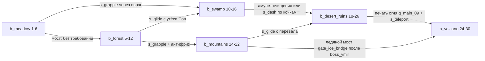

# VR-atu · Открытый мир: единый дизайн-документ (арт, мир, бой, оружие, навыки, враги)

> **Что это.** Один самодостаточный файл для переноса в основную сессию и слияния с `main`. В нём собраны пять разделов (арт/UI/звук, открытый мир, оружие, навыки и прогрессия, враги) и базовый план, сведённые в **один канон**: противоречия устранены, ID сквозные, у всех данных есть готовые ES-модули (раздел 8), валидатор перекрёстных ссылок и тесты `node --test`.
> **Статус.** Только план. Репозиторий `ansa-music/VR-atu` не менялся: нет коммитов, веток и PR. Все модули из раздела 8 проверены вне репозитория: `node --check`, импорт, `tools/validate-defs.mjs`, балансовые скрипты, 21 тест — всё зелёное (см. 0.9).
> **Язык.** Текст на русском, идентификаторы кода на английском. Время указано в Asia/Qyzylorda (UTC+5).

---

## Оглавление

- 0. Шапка: рамки, канон, порядок внедрения
  - 0.1 Назначение и рамки
  - 0.2 Факты о репозитории (`main` @ `4e75bc6`, 19.10.2026)
  - 0.3 Канон (одна строка — одно решение)
  - 0.4 Реестр префиксов ID
  - 0.5 Разрешённые конфликты
  - 0.6 Дорожная карта
  - 0.7 Раскладка модулей и точки встраивания
  - 0.8 План тестов (`node --test tests/`)
  - 0.9 Критерии приёмки
- 1. Арт-дирекшн, графика, UI/UX, звук
  - 1.1 Визуальные столпы
  - 1.2 Цвет
  - 1.3 Графическая технология (Three.js r160, без сборки)
  - 1.4 UI/UX
  - 1.5 Модели и анимации
  - 1.6 Звук
  - 1.7 Производство ассетов (без покупок, пайплайн как в репо)
  - 1.8 Порядок внедрения графики и UI (после слияния текущего большого пуша)
  - 1.9 Риски и открытые вопросы раздела
- 2. Открытый мир, исследование и техника
  - 2.1 Что есть в коде сейчас (точки опоры)
  - 2.2 Размер и раскладка мира
  - 2.3 Биомы
  - 2.4 Точки интереса (49 POI)
  - 2.5 Ограничения проходимости (метроидвания-лайт)
  - 2.6 Основная сюжетная линия (12 квестов + 6 дополнительных)
  - 2.7 Смена дня и ночи, погода
  - 2.8 Динамические события
  - 2.9 Быстрое перемещение
  - 2.10 Карта, компас и маркеры (диегетически в VR)
  - 2.11 Сохранение
  - 2.12 Сундуки, коллекционки, крафт
  - 2.13 ТЕХНИКА
- 3. Ядро боя: формула, ресурсы, статусы
  - 3.1 Формула урона (порядок фиксирован)
  - 3.2 Ресурсы игрока (L1)
  - 3.3 Потолки (`CAPS`)
  - 3.4 Кривая уровня (`LEVEL_CURVE`)
  - 3.5 Статусы (`STATUSES`)
  - 3.6 Визуальный язык урона
- 4. Оружие: 20 видов
  - 4.0 Правила, общие для всего оружия (по канону)
  - 4.1 Карточки оружия
  - 4.2 Сводная таблица баланса
  - 4.3 DPS и TTK (вывод `node tools/check-weapons.mjs`)
  - 4.4 Ступени улучшения и редкость
  - 4.5 Моды и насадки (14, совместимы между классами)
  - 4.6 Экономика патронов и энергии
  - 4.7 Сочетания с навыками и статусами (для раздела навыков)
  - 4.8 Производительность и модели (Quest)
- 5. Навыки, прогрессия, предметы, крафт
  - 5.1 Ресурсы и масштабирование
  - 5.2 Двадцать навыков: сводка
  - 5.3 Карточки навыков
  - 5.4 Матрица совместимости 20×20
  - 5.5 Именные комбо (18)
  - 5.6 Правила набора (loadout)
  - 5.7 Очки навыков, ранги и таланты
  - 5.8 Уровни 1–30: кривая опыта
  - 5.9 Экипировка: аффиксы под потолки формулы
  - 5.10 Крафт и валюты (обзор)
  - 5.11 Управление: сводка по платформам
  - 5.A Предметы, крафт, прогрессия — единый реестр
- 6. Враги: мобы, элиты, боссы, события, ИИ, спавн
  - 6.1 Итог раздела
  - 6.2 Соглашения
  - 6.3 Формула масштабирования по уровню
  - 6.4 Бестиарий по биомам (полные данные — `MOBS`, Приложение)
  - 6.5 Элитные аффиксы (`ELITE_AFFIXES`)
  - 6.6 Архитектура ИИ для Three.js без сборки
  - 6.7 Боссы (`BOSSES`)
  - 6.8 Бродячие минибоссы и мировые события (`WORLD_EVENTS`)
  - 6.9 Спавн-директор и плотность
  - 6.10 Таблицы спавна по биомам (`SPAWN_TABLES`)
  - 6.11 Проверка баланса (вывод `node tools/check-enemies.mjs`)
- 7. Единая раскладка управления (`INPUT_MAP`)
- 8. Приложение: ES-модули, валидатор, тесты
- 9. Открытые вопросы (с рекомендуемыми значениями по умолчанию)

---

# 0. Шапка: рамки, канон, порядок внедрения

## 0.1 Назначение и рамки

- **Цель.** Превратить VR-тир в **одиночную игру с открытым миром** в стилизованной тун-графике. Мир состоит из 6 биомов (1536×1536 м). В нём 49 точек интереса (POI), 32 вида мобов, 6 боссов, 2 бродячих минибосса и 12 мировых событий. Игроку доступны 20 видов оружия, 20 навыков в 4 архетипах, крафт, экипировка с аффиксами, уровни 1–30 и NG+.
- **Платформы.** VR (Quest, WebXR), ПК, телефон, Arduino-джойстик (`J,x,y,b`). У каждого действия есть ввод на всех четырёх (раздел 7).
- **Вне рамок.** Мультиплеер и PvP (`js/multiplayer*.js`, `js/pvp-*.js`, `server/`) не трогаем и в режиме `world` не импортируем.
- **Не ломать.** Текущие режимы «Тир» (`range`) и «Фэнтези» (`fantasy`), мультиплеер и существующие тесты (`pvp*.test.js`, `weapon-rules.test.js`) работают как раньше. Открытый мир — новый режим `world` с динамическим импортом. Новый баланс (HP 150, щит) действует **только** в `world`, а PvP остаётся на `WEAPON_RULES`, пока не будет отдельного решения.
- **Без сборки.** Three.js r160 через importmap. Все новые файлы — ES-модули, данные — чистые замороженные объекты без Three.js. Их можно импортировать и в браузере, и в Node.

## 0.2 Факты о репозитории (`main` @ `4e75bc6`, 19.10.2026)

| Что | Где | Что нужно для мира |
|---|---|---|
| Монолит игры (~1700 строк): цикл, движение, `ARENA`, коллайдеры | `js/main.js` | режим `world`: движение около стр. 1235, `staticColliders`/`hittables` на стр. 502–519, `setAnimationLoop` на стр. 1562 (п. 0.7) |
| Three.js r160 | `vendor/three.module.js`, `vendor/addons/webxr/VRButton.js` | **добавить** из r160 `examples/jsm`: `addons/loaders/GLTFLoader.js`, `addons/utils/BufferGeometryUtils.js`, `addons/utils/SkeletonUtils.js` (P0), `addons/libs/meshopt_decoder.module.js` (P1), postprocessing (P2, только `pc_high` вне XR) |
| Importmap | `index.html` | добавить `"three/addons/": "./vendor/addons/"` |
| 16 GLB-моделей (загрузчика нет) | `assets/models/*.glb`, генератор `generate_assets.py` | пересобрать на атлас палитры 256² (п. 1.3.3) |
| Пресеты качества low/medium/high, `lowerQuality` | `js/quality.js` | новые id `quest/phone/pc_low/pc_high` (старые остаются алиасами), таблица — `js/render/quality-presets.js` |
| Оружие: 5 стволов, баллистика | `js/arsenal.js`, `js/guns.js`, `js/weapon.js`, `js/ballistics.js` | `legacyId` в `WEAPONS` связывает 5 старых стволов с новыми карточками |
| Урон PvP (сервер) | `server/weapon-rules.js` (`calculateDamage`) | не меняем; `shared/damage.js` повторяет его шаг падения с дистанцией |
| VR-кобуры, хват, комфорт | `js/vr-holsters.js`, `js/vr-handling.js`, `js/vr-comfort.js` | новые ключи комфорта, `comfort.fade(t)` |
| Фэнтези-наруч, скрижали, синтез звука | `js/fantasy/{bracer,ui,audio}.js` | таблички «Карта/Квест/Сумка/Навыки» |
| Ввод | `js/touch.js`, `js/mk.js`, `arduino/` | `shared/defs/input-map.js`; прошивка Arduino не меняется |

## 0.3 Канон (одна строка — одно решение)

| Параметр | Значение | Где в коде |
|---|---|---|
| Режим | одиночный открытый мир, `?mode=world` | `js/main.js` |
| Игрок L1 | HP 150 (потолок 330), щит 75 (+15/с через 3 с), энергия 100 (+8/с, макс. 130), выносливость 100 (+25/с через 0,8 с), ульта 100 | `PLAYER_BASE` |
| Типы урона | `physical, fire, frost, lightning, arcane, poison` (без `true`/`kinetic`/`shock`) | `DAMAGE_TYPES` |
| Формула | base → falloff → zone → attacker (≤ +50 %) → charge → vuln (≤ +30 %) → mitigation (≤ 75 %) → shield → HP → statuses | `shared/damage.js` |
| Зоны | пуля: голова ×2,0; прочее: ×1,5; AoE ×1,0; конечности ×0,75; голова в сумме ≤ 2,4 | `ZONE`, `CAPS.headZoneMax` |
| Статусы | 6 шт.: `st_burn, st_chill, st_freeze, st_shock, st_poison, st_stagger`; контроль ≤ 1 с, после него иммунитет | `STATUSES` |
| Кривая уровня | `levelMul(L) = 1 + 0,06·(L−1)` (L30 = ×2,74) — урон оружия (ilvl), навыков и HP мобов; урон мобов `1 + 0,03·(L−1)`; ожидаемое HP игрока `150·(1 + 0,03·(L−1))` | `LEVEL_CURVE` |
| Элита | HP ×3, урон ×1,25, XP ×4, аффиксов 1/2/3 (L1/10/20) | `LEVEL_CURVE.elite` |
| Эталоны баланса | моб `m_ref` 240 HP, броня 15 % (×levelMul); босс — реальный `boss_ignarok` (16000 × 2,74 = 43 840 HP); опорный DPS 160 | `BALANCE_REF` |
| TTK | оружие по 150 HP: 0,7–1,35 с; босс 40–140 с чистого DPS | `tools/check-*.mjs` |
| Потолки ударов мобов | один удар ≤ 60 % ожидаемого HP игрока; полный канал ≤ 80 % | `CAPS.mob*OfPlayerHp` |
| Опыт | `xpToNext = round10(100·L^1.5 + 50)`, всего ≈ 190 тыс. XP ≈ 12,7 ч | `LEVEL_CURVE.xpToNext` |
| День | 40 мин: 24 день + 12 ночь + 2 рассвет + 2 закат | `WORLD_CONFIG` |
| Качество | `quest / phone / pc_low / pc_high`; дальность 150/150/220/380 м; активных мобов 18/18/25/35 слотов | `QUALITY_PRESETS`, `WORLD_CONFIG.quality`, `PERF_CAPS` |
| Очки | навыков 40 (29 за уровни + 1 старт + 5 боссов + 5 святилищ), талантов 16, характеристик 58 | `POINTS` |
| Объёмы | 6 биомов · 49 POI · 10 NPC · 6 станций · 18 квестов + 4 шаблона · 32 моба · 6 боссов · 12 событий · 10 элитных аффиксов · 20 оружий · 14 модов · 9 патронов · 20 навыков · 18 комбо · 106 предметов · 27 рецептов · 27 аффиксов экипировки | `shared/defs/*` |

## 0.4 Реестр префиксов ID

Ключ каждого реестра начинается со своего префикса. `tools/validate-defs.mjs` проверяет это и **каждую** ссылку в данных и прозе данных: 1264 ссылки, 0 ошибок.

| Префикс | Сущность | Реестр | Кол-во |
|---|---|---|---|
| `b_` | биом | `BIOMES` | 6 |
| `poi_` | точка интереса | `POIS` | 49 |
| `gate_` | барьер прогрессии | `GATES` | 2 |
| `npc_` | NPC | `NPCS` | 10 |
| `stn_` | станция (костёр, верстак, кузня, алхимия, арканный стол, рунный алтарь) | `STATIONS` | 6 |
| `q_` | квест / шаблон побочного квеста | `QUESTS`, `SIDE_QUEST_TEMPLATES` | 18 + 7 |
| `m_` | моб (+ абстрактный `m_ref` для проверок) | `MOBS` | 32 |
| `boss_` | босс / бродячий минибосс (`boss_roam_*`) | `BOSSES`, `WORLD_EVENTS` | 6 + 2 |
| `ev_` | мировое событие | `WORLD_EVENTS` | 10 |
| `aff_` | **элитный** аффикс моба | `ELITE_AFFIXES` | 10 |
| `a_` / `ba_` | атака моба / босса (уникальны внутри владельца) | в `MOBS` / `BOSSES` | — |
| `w_` | оружие | `WEAPONS` | 20 |
| `s_` | навык | `SKILLS` | 20 |
| `c_` | именное комбо | `COMBOS` | 18 |
| `t_` | талант навыка (2 на навык) | в `SKILLS[*].talents` | 40 |
| `st_` | **только статусы** | `STATUSES` | 6 |
| `it_` | предмет (материалы, патроны, моды, тома, уникальные…) | `ITEMS` | 106 |
| `af_` | аффикс **экипировки** | `GEAR_AFFIXES` | 27 |
| `rc_` | рецепт (новый префикс) | `RECIPES` | 27 |

Служебные (не ID сущностей): `ai_*` — профили ИИ, `mus_*` — музыкальные темы, `mark_scan` — Метка скана.

## 0.5 Разрешённые конфликты

| № | Конфликт (где) | Решение |
|---|---|---|
| 1 | Рост по уровню: оружие `ilvlMul` +6 %/ур.; враги — HP +10 %/ур., урон +2 %/ур., XP +15 %/ур. | Одна кривая `levelMul` (+6 %) для урона игрока и HP мобов. Урон мобов +3 %/ур., ожидаемое HP игрока +3 %/ур. → TTK обеих сторон не зависит от уровня. XP — кривая раздела навыков; XP мобов нормирован: `mobXp(xp₁, L)` |
| 2 | Элита ×4 HP и босс = 25 × «моб-эталон» (навыки) против элиты ×3 и реальных боссов (враги) | Элита ×3; босс в сценариях навыков — реальный `boss_ignarok` 43 840 HP; `m_ref` 240/15 % остаётся эталоном для оружия и навыков |
| 3 | Длина суток: 24 мин (арт) и 40 мин (мир) | 40 мин (24 + 12 + 2 + 2); `THEME.dayNight.dayLengthMin = 40` |
| 4 | `st_` — и станции (мир), и статусы | `st_` только статусы; станции `stn_*` |
| 5 | `aff_` (элиты) и аффиксы экипировки | `aff_` — элиты мобов, `af_` — экипировка |
| 6 | Статусы в PLAN (горение 6/с, озноб 2 с, заморозка 0,6 с, Метка 4 с, «Подавление») и в разделах | Канон — `statuses.js`: горение 5/с · 3 с · 3 стака; озноб −15 %/стак · 3 с → заморозка 1,0 с + иммунитет 3 с; шок +10 % vuln, +1 прыжок цепи; яд 3/с/стак · 6 с · 5 стаков, −10 %/стак лечения; оглушение 0,3–0,5 с. Метка — дебафф vuln 15 % на 6 с (не статус). «Подавления» нет |
| 7 | Шок у оружия «цепь на 2 цели по 50 %» и у навыков «+1 прыжок» | Только +1 прыжок (в потолке 4) |
| 8 | Типы урона PLAN `kinetic/shock/true` | `physical/lightning`; `true` нет. Падение и среда — урон окружения вне формулы |
| 9 | HP по архетипам (PLAN: Страж 200, Ловкач 120) | У всех 150; рост — «Стойкость» и аффиксы (потолок 330) |
| 10 | Расчёт урона на сервере (PLAN) | В одиночной игре — на клиенте, `shared/damage.js`; сервер сможет импортировать тот же модуль |
| 11 | Ввод: Q/E — поворот; `V` — альт-атака оружия и пояс 1; `G` — граната и пояс 2; Arduino «удержание ≥ 1,5 с = ульта, двойное = рывок»; Arduino «кнопка = прыжок» (мир) | Поворот — мышь/стрелки; альт-атака — СКМ; пояс 1 — `V`, пояс 2 — `Alt` (Mouse4); граната `G`. Arduino: кнопка = огонь, удержание = заряд, двойное/тройное/круг = активы 1/2/3, рывок стика = пояс, кнопка + стик вниз 1 с = ульта (раздел 7) |
| 12 | Пресеты: `low/medium/high` (код, враги), отдельная таблица мира, дальность 110 м против тумана 150 м, Quest без контура (враги) против контура ≤ 12 м (арт), 12 против 18 активных мобов | Мастер — `QUALITY_PRESETS` (`quest/phone/pc_low/pc_high`), их ключи общие для мира и врагов; `drawDistance = fogFar` (150/150/220/380), `chunkRadius = max(lodRings)`, `mobs.active = PERF_CAPS.activeMobs` (18/18/25/35); контур на Quest ≤ 12 м |
| 13 | Выдуманные ID мобов и боссов в контрах навыков (`m_thorn_wolf`, `boss_bog_mother`…) | Переписаны на реальные `m_*`/`boss_*` из раздела врагов |
| 14 | Арены и гарнизоны врагов на несуществующих POI (`elder_grove`, `drowned_temple`, `frozen_throne`, `caldera`, `goblin_camp`, `bandit_fort`, `hag_hut`, `kobold_mine`, `buried_tomb`, `fire_altar`) | Перенесены на POI мира: `poi_guardian_tree`, `poi_sunken_train`, `poi_frost_fortress`, `poi_ash_citadel`, `poi_windmill_camp`, `poi_hunter_camp`, `poi_leech_cave`, `poi_yeti_camp`, `poi_buried_vault`, `poi_magma_cave`; добавлены `poi_slime_pond` (тип `arena`) и гарнизон `poi_raider_camp` |
| 15 | Боссы мира (`boss_frost_warden`, `boss_colossus`…) и квесты на них | Квесты `q_main_*` ведут к 6 реальным боссам; `gate_ice_bridge` требует `boss_ymir` |
| 16 | Источники оружия текстом («лагерь в лесу», «босс гор») | Структура `source: {kind: start/poi/boss/craft}` с реальными POI/боссами/рецептами; у POI есть `loot`, у боссов — дроп (валидатор сверяет обе стороны) |
| 17 | Открытие навыков: места и квесты без ID | Тома `it_tome_<s_id>` у NPC хабов; ульты — квесты архетипа `q_arch_*` (L12), чужие ульты — `q_fusion` (L20); `s_dash` L11, `s_teleport` L24 |
| 18 | Легендарки навыков `it_leg_*` и уникальные дропы боссов `it_uniq_*` | Один набор `it_uniq_*` (8 шт.): эффекты легендарок привязаны к боссам; для `slime_crown` и `worm_tooth` эффекты новые |
| 19 | Дубли предметов | `it_scrap_metal→it_scrap`, `it_feather→it_mat_feather`, `it_resin→it_bog_resin`, `it_herb→it_mat_herb`, `it_heartwood→it_mat_heartwood`, `it_frost_crystal→it_mat_frost_core`, `it_sun_glass→it_mat_sun_shard`, `it_star_ore→it_star_fragment`, `it_energy_shard→it_crystal_shard`. `it_ember_core` (ковка) и `it_mat_magma_core` (материал) — разные предметы |
| 20 | События: в мире `ev_meteor_fall`, у врагов `ev_starfall`; списки событий разные | Слиты в `ev_starfall`; итого 12 записей `WORLD_EVENTS` (2 минибосса + 10 событий) |
| 21 | Аффикс «шанс статуса» против правила «у игрока нет случайных шансов» | `af_status_every`: статус оружия на 1 удар раньше (детерминированно) |
| 22 | Музыка боссов с ID `boss_*` | `mus_boss_*` |
| 23 | Ошибки печати в таблицах врагов: «7.000000000000001 %», «откат undefined», «(undefined)» | Исправлены в генераторе |
| 24 | Счётчики PERF у врагов `low/medium/high` | `quest/phone/pc_low/pc_high` |
| 25 | Мир: «Arduino — кнопка = прыжок/навык передвижения» | Кнопка = огонь (как в коде); навыки — жесты стика |
| 26 | Станции хабов и шкалы вредной среды ссылались на `st_campfire` | `stn_campfire`; противоядия, тоники и мази — предметы `ITEMS` |

## 0.6 Дорожная карта

| Фаза | Содержание | Готово, когда | Приоритет |
|---|---|---|---|
| 0. Подготовка (после слияния текущего большого пуша) | vendor (GLTFLoader, BufferGeometryUtils, SkeletonUtils), importmap `three/addons/`; `shared/defs/*`, `shared/damage.js`, `tools/*`, `tests/*` из раздела 8; CI: `node --check` по `js/**`, `shared/**` и `node --test tests/` | все старые тесты и 21 новый — зелёные; старые режимы не изменились | P0 |
| 1. Пустой мир | `js/world/{noise,heightmap,terrain-worker,chunks}.js`, режим `?mode=world`, коллизии с рельефом | бег по рельефу на Quest 72 fps | P0 |
| 2. Графика G0–G4 | тун + rim + контур, палитра, небо, день и ночь, туман, вода, трава, GPU-частицы, числа урона | ≤ 100 вызовов отрисовки на глаз на Quest | P0 |
| 3. Бой | `shared/damage.js` в оружии мира, HP 150/щит, статусы, 5 старых стволов + жезл/клинок/щит/наруч, хитмаркеры и VFX по `DAMAGE_TYPE_VFX` | TTK по таблице 4.3; тесты формулы | P0 |
| 4. Мобы и луг | ИИ (FSM + utility), спавн-директор, 6 мобов луга, `boss_slime_king`, костры, сохранение, квесты 1–4 | первая сессия 30–40 мин без ошибок | P1 |
| 5. Навыки | пояс (`s_grapple`, `s_dash`, `s_glide`, `s_teleport`), `s_scan`, 3 актива, ульта, комбо, древо, таланты; ввод на 4 платформах | 20 навыков, `tools/check-skills.mjs` зелёный | P1 |
| 6. Остальные биомы | лес → вулкан, 5 боссов, события, NPC, крафт, экипировка, аффиксы | полное прохождение L1→30 ≈ 12–15 ч | P1 |
| 7. Полировка | звук-слои G6, доступность G7, bloom на `pc_high`, NG+, баланс | 0 ошибок валидатора; замеры fps на всех пресетах | P2 |

## 0.7 Раскладка модулей и точки встраивания

```
shared/                       ← чистые данные и логика, без Three.js (браузер + node)
  damage.js                   resolveHit(): эталонная формула (раздел 3, Приложение)
  defs/
    index.js                  единая точка импорта
    core.js                   DAMAGE_TYPES, ZONE, PLAYER_BASE, CAPS, levelMul, LEVEL_CURVE, BALANCE_REF
    statuses.js               STATUSES, CONTROL_IMMUNITY_S, MARK
    ids.js                    ID_PREFIXES, hasPrefix
    world.js                  WORLD_CONFIG, BIOMES
    pois.js                   STATIONS, NPCS, POI_TYPES, POIS, GATES
    quests.js                 QUESTS, SIDE_QUEST_TEMPLATES
    enemies.js                MOBS, BOSSES, ELITE_AFFIXES, AI_PROFILES, SPAWN_TABLES, WORLD_EVENTS, PERF_CAPS, RARITY_WEIGHTS
    weapons.js                WEAPONS, STARTER_KITS, UPGRADE_TIERS, UPGRADE_STATIONS, MODS, AMMO
    skills.js                 SKILLS, COMBOS, LOADOUT, ULT_GAIN, SKILL_RANK_MULT, RANK_*
    items.js                  ITEMS (106), ITEM_CATEGORIES
    crafting.js               RECIPES, FORGE
    progression.js            POINTS, ATTRIBUTES, CONSTELLATIONS, GEAR_AFFIXES, GEAR_SLOTS
    input-map.js              INPUT_MAP, ARDUINO_GESTURES, RESERVED_PC_KEYS
    theme.js                  THEME (палитра, шрифты, редкость, биомы, звук)
    damage-vfx.js             DAMAGE_TYPE_VFX
js/render/                    toon.js, quality-presets.js, gpu-particles.js, sky.js, damage-numbers.js
js/world/                     index.js, chunks.js, heightmap.js, … (п. 2.13.9); config.js реэкспортирует shared/defs/world.js
js/world/mobs/                ai.js (FSM+utility), spawn-director.js, mob-pool.js, boss.js (п. 6.6.1)
js/skills/                    skill-runner.js, gestures.js, combos.js, loadout.js
tools/                        validate-defs.mjs, check-enemies.mjs, check-weapons.mjs, check-skills.mjs
tests/                        defs, damage, skills-caps, balance (*.test.mjs)
```

Точки встраивания (номера строк — по `4e75bc6`, после большого пуша сверить):
1. `index.html` — importmap `three/addons/`; кнопка режима «Открытый мир» (`js/ui.js`).
2. `js/main.js` — `mode = params.get('mode') || settings.mode` (`range | fantasy | world`). При `world` не вызывать `buildEnvironment`/`createRange`, а сделать `await import('./world/index.js')`. Движение (≈ стр. 1235): без `ARENA`, `world.collide(rig.position, 0.3)`, `onGround` по `world.heightAt`. `staticColliders`/`hittables` (стр. 502–519) превращаются в функцию ближних коллайдеров. `setAnimationLoop` (стр. 1562): `world?.update(dt, headPos)` до `ballistics`. Клавиши Q/E больше не поворачивают в `world` (раздел 7).
3. `js/quality.js` — id `quest/phone/pc_low/pc_high` из `js/render/quality-presets.js`, старые `low/medium/high` остаются алиасами (`legacyId`). `lowerQuality` идёт по `QUALITY_GOVERNOR.steps`.
4. `js/arsenal.js` / `js/guns.js` — у 5 стволов `legacyId` (`pm, ak, shotgun, sniper, blaster`), у фэнтези-оружия из FANTASY-PLAN — `wand, staff, blade, bow, gauntlet`. В `world` урон берётся из `WEAPONS` + `resolveHit`, в остальных режимах — как сейчас.
5. `js/vr-comfort.js` — ключи комфорта (виньетка рывка, снап-поворот, затемнение быстрого перемещения), `comfort.fade(t)`.
6. `js/fantasy/bracer.js`, `js/fantasy/ui.js` — таблички «Карта/Квест/Сумка/Навыки», `paintRuneTablet`, `loadFantasyFonts`.
7. `js/hud.js`, `js/touch.js` — компас, мини-карта, 3 кнопки активов, пояс, ульта, кнопка «глаз».
8. `js/mk.js` + `arduino/` — распознавание жестов по `ARDUINO_GESTURES`. Протокол `J,x,y,b` не меняется.
9. Мультиплеер-модули в `world` не импортируются; `server/` не меняется.

## 0.8 План тестов (`node --test tests/`)

| Файл | Что проверяет |
|---|---|
| `tests/defs.test.mjs` | валидатор = 0 ошибок (> 1000 ссылок); объёмы канона; префиксы `st_`/`stn_`/`aff_`/`af_`; единая кривая; 40-минутные сутки; ввод навыков на 4 платформах |
| `tests/damage.test.mjs` | падение с дистанцией = `calculateDamage`, зоны и потолок головы 2,4, потолки attacker/vuln/mitigation, arcane и броня, щит первым (lightning ×1,5), неуязвимость, минимум 1 |
| `tests/skills-caps.test.mjs` | 20 навыков по 5 на архетип, контроль ≤ 1 с, худший случай упирается в потолки, навык r1 не убивает `m_ref` с одного каста, ICD комбо ≥ 2 с |
| `tests/balance.test.mjs` | `tools/check-enemies.mjs`, `check-weapons.mjs`, `check-skills.mjs`, `validate-defs.mjs` завершаются с кодом 0 |
| (позже) `tests/world-*.test.mjs` | детерминизм шума (одинаковый хеш чанка для seed 1337), `heightAt`, сохранение и миграции |
| существующие | `pvp*.test.js`, `weapon-rules.test.js` — без изменений |

CI: добавить `js/**`, `shared/**`, `tools/**`, `tests/**` в `pull_request.paths`; шаги `for f in $(git ls-files '*.js' '*.mjs'); do node --check "$f"; done` и `node --test tests/`.

## 0.9 Критерии приёмки

1. `node tools/validate-defs.mjs` → `OK` (сейчас: 17 реестров, 1264 ссылки, 0 ошибок, 0 предупреждений).
2. `node tools/check-enemies.mjs` → «Ошибок: 0»: окна TTK по ролям, телеграфы, потолки удара 60 %/80 % ожидаемого HP, паки не убивают игрока быстрее 5 с, боссы 40–140 с (сейчас 56–133 с), минибоссы 15–60 с.
3. `node tools/check-weapons.mjs` → `errors=0`: нет убийства с одного попадания в корпус; голову с одного выстрела пробивают только `w_sv98`, `w_rune_bow`, `w_thunder_rail`; DPS max/min основного оружия ≤ 2,5 (сейчас 2,46).
4. `node tools/check-skills.mjs` → `ERRORS 0`: контры ссылаются на реальных мобов, потолки держат, XP 10–22 ч (сейчас 12,7 ч), 5 квестов-боссов и 5 святилищ дают очки навыков.
5. `node --test tests/` → 21/21.
6. Quest 2: ≥ 72 fps в любом биоме днём и ночью, ≤ 100 вызовов отрисовки на глаз, ≤ 150 тыс. треугольников, 0 аллокаций в кадре в бою.
7. Режимы «Тир», «Фэнтези» и мультиплеер не изменились: старые тесты зелёные, ручная проверка по чек-листу.
8. Каждое действие раздела 7 выполнимо на VR, ПК, телефоне и Arduino.
9. Контроль на игроке ≤ 1 с; в VR нет тряски камеры и полноэкранных вспышек.

---

# 1. Арт-дирекшн, графика, UI/UX, звук

> Проект VR-atu: открытый мир, одиночная игра. Мультиплеер не трогаем. Этот раздел описывает **как игра выглядит, звучит и управляется**. Механики, мобов, оружие и навыки (их ID, числа и поведение) задают другие разделы. Здесь у них только визуальный и звуковой язык.
> Основа: `main` @ `4e75bc6`. Есть Three.js r160 в `vendor/` (только `three.module.js` + `addons/webxr/VRButton.js`), `js/quality.js` (low/medium/high), `js/graphics.js` (ACES, sRGB), `js/env.js` (небо на ShaderMaterial, `THREE.Fog`), `js/fx.js` (частицы, `maxParticles`), `js/hud.js` (`hitMarker`), `js/fantasy/{ui,bracer,audio}.js` (скрижали, наруч, синтез оркестра), 16 GLB в `assets/models/` из `source/generate_assets.py` (атлас 4×4, два UV-канала: цвет и emissive).
> Общий канон: биомы `b_meadow, b_forest, b_swamp, b_mountains, b_desert_ruins, b_volcano`; типы урона `physical/fire/frost/lightning/arcane/poison`; статусы `burn/chill/shock/poison/stagger`; редкость `common/uncommon/rare/epic/legendary`; Quest 72–90 fps, ≤100 вызовов отрисовки на глаз, в VR без полноэкранной постобработки.

## 1.1 Визуальные столпы

| # | Столп | Что значит на практике | Как проверить |
|---|---|---|---|
| 1 | **Читаемость прежде красоты** | Враг, снаряд, лут и опасность читаются за 0,3 с силуэтом и цветом, даже на Quest при 72 fps в тумане. Опасное тёплое и яркое, фон холоднее и темнее. | Скриншот в градациях серого: враги и снаряды контрастнее фона минимум на 30 % по яркости. |
| 2 | **«Живая открытка»: аниме-тун на низкополигональной основе** | 3-ступенчатый тун, тёмный цветной контур (не чёрный) у героев, мобов и лута, rim-свет. Мир рисуется плоскими цветами из одной палитры, объём дают запечённый AO и vertex color. | Модель без текстур, только палитра и AO, выглядит законченной. |
| 3 | **Каждый биом с одного кадра** | У каждого биома свой «ключ»: цвет тумана, форма силуэта на горизонте и одна сигнатурная деталь (светлячки в лесу, пепел у вулкана). | По горизонту без UI биом угадывается вслепую. |
| 4 | **Магия = свет** | Эффекты делаем через emissive, аддитивные частицы, ореолы-билборды и свет из палитры. Bloom заменяем «фейковыми» ореолами, в VR без постобработки. | В VR нет `EffectComposer`, эффекты всё равно «светятся». |
| 5 | **Тело как интерфейс** | В VR интерфейс живёт на теле и в мире: наруч, пояс, свиток-карта. Плоские экраны только на ПК и телефоне. | В VR ни одного head-locked элемента, кроме субтитров (их можно выключить). |
| 6 | **Дёшево по построению** | 1 материал на палитру, склейка по чанкам, инстансинг, пулы. Бюджет считаем заранее, а не после «тормозит». | В `?debug` `renderer.info.render.calls` ≤ бюджета пресета. |

### 1.1.1 Мудборд словами
- **Луг (b_meadow):** утро в духе Ghibli. Сочная трава с ветром, белые облака-«вата», у края карты руины академии с циановыми рунами. Тени лиловые, не серые.
- **Лес (b_forest):** высокие стволы-колонны, лучи света сквозь кроны (геометрические «god rays»: аддитивные полосы-конусы), мох и грибы с бирюзовым свечением, светлячки. Вечером тёплый янтарь, ночью сине-зелёный.
- **Болото (b_swamp):** низкий жёлто-зелёный туман, кривые мангры, пузыри газа, ядовито-лаймовые акценты на фиолетово-оливковом фоне. Видимость самая короткая в игре, это часть атмосферы.
- **Горы (b_mountains):** холодный ультрамарин, снег с голубыми тенями, ветер с позёмкой, ледяные кристаллы, далёкие пики силуэтами в 3–4 слоя воздушной перспективы. Небо самое чистое.
- **Пустынные руины (b_desert_ruins):** выбеленный песок, терракота, бирюзовые изразцы, золото и обломки колоссов. Жаркое марево (дрожание вершин у земли, без постобработки), закат розово-оранжевый.
- **Вулкан (b_volcano):** чёрный базальт с трещинами лавы, пепел падает как снег, небо бордово-фиолетовое, на горизонте пульсирует свечение кратера. Самый контрастный биом, свет идёт снизу.
- **Общий референс по ощущению:** Genshin Impact и Zelda: BotW по цвету и тун-свету, Sea of Thieves по воде, Hades по читаемости VFX. Сами материалы проще, на уровне лёгких VR-игр для Quest.

---

## 1.2 Цвет

### 1.2.1 Мастер-палитра UI (продолжает CSS-переменные `index.html` и константы `js/fantasy/ui.js`)
| Токен | Hex | Где |
|---|---|---|
| `bg.deep` | `#05060f` | фон меню, «пустота» (как `roomMat` в graphics.js) |
| `bg.panel` | `#0e1430` (α 0.78) | подложка панелей, скрижали-стекло |
| `bg.panelAlt` | `#1c2130` | непрозрачные блоки, камень скрижалей |
| `line.panel` | `#7c5cff` (α 0.38) | рамки панелей |
| `text.primary` | `#f4f6ff` | основной текст |
| `text.muted` | `#a9b8dc` | второстепенный текст |
| `text.label` | `#8fd3ff` | подписи, заголовки групп |
| `accent.cyan` | `#3ec5ff` | фокус, выбор, мана, руны академии |
| `accent.violet` | `#7c5cff` | магия, навыки, бренд |
| `accent.gold` | `#ffd23f` | золото, валюта, ульта, «важное» |
| `state.ok` | `#34e89e` | лечение, успех, HP > 50 % |
| `state.warn` | `#ffb020` | предупреждение, HP 25–50 % |
| `state.danger` | `#ff5a6e` | урон по игроку, HP < 25 %, враг |
| `state.xp` | `#c78bff` | опыт, уровень |
| `hp.fill` | `#ff4d5e` → `#ff8a5c` (градиент) | полоса HP |
| `shield.fill` | `#9fe7ff` | щит/барьер |
| `mana.fill` | `#1f78d8` → `#6a4cff` | мана (как кнопки скрижалей) |
| `stamina.fill` | `#f4e27a` | выносливость/рывок |
| `ult.fill` | `#ffd23f` → `#fff3b8` | ульта |
| `outline.world` | `#1a1430` | цвет тун-контура (тёмно-фиолетовый, не чёрный) |

### 1.2.2 Редкость
Цвет всегда дублируется формой (колонка «Глиф»), поэтому редкость читается и в режимах для дальтоников.
| Редкость | Hex | Глиф/рамка | Луч лута (высота, пульс) | Звук выпадения |
|---|---|---|---|---|
| common | `#c9ced6` | без уголков, тонкая рамка | нет луча, только блик | мягкий «тук» |
| uncommon | `#3ecf6e` | 1 уголок | 1,5 м, без пульса | лёгкий колокольчик |
| rare | `#3d8bff` | 2 уголка + ромб | 3 м, медленный пульс | 2 ноты вверх |
| epic | `#b05cff` | 4 уголка + двойная рамка | 6 м, пульс + искры | арпеджио + хор «а» |
| legendary | `#ffa21c` | корона + анимированная рамка | 12 м до неба + кольцо на земле | стингер (мажорный аккорд + гонг), музыка приглушается на 1,5 с |

### 1.2.3 Типы урона и визуальный язык
Правило: **форма частиц = тип, цвет = подтверждение.** Числа урона окрашены по типу и получают маленький глиф типа слева.
| Тип | Основной | Ядро/светлый | Тёмный | Глиф | Форма VFX | Попадание | Статус и его вид на цели |
|---|---|---|---|---|---|---|---|
| physical | `#e8e2d0` | `#ffffff` | `#6b6458` | клинок ✦ | короткие белые искры по нормали, пыль и щепа по материалу (камень, дерево, плоть-«клякса») | вспышка 40 мс, искры 6–10 | **stagger** (оглушение): 3 жёлтые звёздочки по орбите над головой, цель теряет позу |
| fire | `#ff6a1f` | `#ffd36b` | `#8a1e00` | язык пламени | восходящие языки (атлас 4 кадра), угольки вверх, тепловой хвост у снаряда | оранжевый всплеск + кольцо, угольки 8 | **burn**: emissive-пульс 2 Гц по rim, 2–4 уголька/с от силуэта, чёрное «обугливание» vertex-тинтом после смерти |
| frost | `#7fd8ff` | `#e9fbff` | `#1f5d8a` | снежинка-шестигранник | гранёные осколки (instanced-тетраэдры), падающий иней, пар | хруст + веер осколков 6, синий rim | **chill**: голубой rim + иней (uniform `uFrost` 0..1 подмешивает белый сверху по нормали), анимация замедлена; на максимуме стаков ледяная корка (+1 вызов: оболочка-кристалл) |
| lightning | `#f5f04a` | `#ffffff` | `#3a7bff` (ореол) | зигзаг | ломаные линии (полоска из 8 сегментов, перестраивается каждые 50 мс), вспышка-ореол, мелкие голубые искры | белая вспышка 1 кадр + дуга к ближайшей поверхности | **shock**: 1–2 мелких дуги по силуэту раз в 0,4 с, микродрожание позы |
| arcane | `#b07cff` | `#f1e6ff` | `#3b1d8f` | кольцо-руна | вращающиеся руны-круги (атлас), спираль частиц, «стекло» с преломлением-иллюзией (сдвиг UV) | руна вспыхивает на точке попадания 150 мс | без своего статуса; на цели «трещины» из рун 0,5 с |
| poison | `#8bdc2a` | `#e2ff9a` | `#3d5a12` | капля с пузырём | пузыри вверх, капли вниз, облако-кляксы (крупные мягкие спрайты с alpha) | зелёный плевок-брызги 6 | **poison**: лаймовый vertex-тинт пятнами (шум по UV), пузыри 1/с, у HP-полосы зелёная часть «съедаемого» HP |

**Конфликты цвета:** poison и uncommon, arcane и epic, lightning и legendary близки по оттенку. Разводим так: лут всегда в рамке со светящимся лучом вертикально, урон всегда с глифом и движется по траектории. В интерфейсе цвет типа урона не используется для редкости и наоборот.

### 1.2.4 Биомы: палитра, свет, туман, небо
Туман линейный (`THREE.Fog`, дешевле `FogExp2` на мобильных GPU и проще стыкуется с дальностью прорисовки). `far` всегда ≤ `drawDistance` пресета, чтобы край мира прятался в тумане. Цвет тумана = цвет горизонта неба в этот момент.
| Биом | Земля / растения / акцент | Солнце день (цвет, инт.) | Амбиент (hemi sky/ground) | Туман день → ночь (цвет, near–far на Quest) | Небо день: зенит / горизонт | Небо ночь: зенит / горизонт | Сигнатура |
|---|---|---|---|---|---|---|---|
| b_meadow | `#7cc456` / `#4f9e3a` / `#ffe27a` (цветы) | `#fff1d6`, 1.2 | `#bfe3ff` / `#5d7a3a` | `#cfe8ff` 25–110 → `#1b2550` 15–70 | `#3d8fe0` / `#cfe8ff` | `#060a24` / `#1b2550` | облака-«вата», цветочные частицы, руины с циановыми рунами |
| b_forest | `#3e6b35` / `#2c5a2e` / `#4ff0d0` (грибы) | `#ffe0a8`, 1.0 | `#9fd3b0` / `#2a3a1e` | `#a7cfa9` 15–70 → `#0d2422` 10–45 | `#4a9a8a` / `#b8e0c0` | `#040f12` / `#0d2422` | god rays, светлячки, светящиеся грибы |
| b_swamp | `#5b5a2e` / `#6e7a30` / `#b6ff3a` | `#e8f0b0`, 0.8 | `#b8c890` / `#2e2a1c` | `#9aa66a` 8–45 → `#1c2014` 6–30 | `#7d8a5a` / `#a8b27a` | `#0a0c08` / `#1c2014` | низкий слоистый туман (2 плоскости со скроллом шума), пузыри, блуждающие огни |
| b_mountains | `#d9e6f2` (снег) / `#5a6b7d` (скала) / `#7fd8ff` (лёд) | `#ffffff`, 1.35 | `#c8e4ff` / `#6a7890` | `#dbeeff` 30–140 → `#141d3a` 20–80 | `#2f6fd6` / `#dbeeff` | `#030616` / `#141d3a` | позёмка, ледяные кристаллы, 3 слоя силуэтов гор |
| b_desert_ruins | `#e8c98f` / `#c27a4a` (терракота) / `#2fc7b4` (изразцы) | `#ffe6b0`, 1.45 | `#ffe9c4` / `#a0704a` | `#f3d9ae` 30–130 → `#2a1830` 20–80 | `#4aa3e8` / `#f8e2b8` | `#0b0820` / `#2a1830` | марево (vertex-дрожание у земли), песчаные вихри, золотые обломки |
| b_volcano | `#2a2228` (базальт) / `#5a3a2a` / `#ff5a1f` (лава) | `#ffb08a`, 0.7 (+ нижний свет от лавы `#ff5a1f`, 0.6) | `#6a3a4a` / `#ff6a2a` | `#4a2430` 12–60 → `#1a0a10` 10–45 | `#3a1430` / `#8a3a3a` | `#0c0408` / `#3a1418` | пепел-«снег», трещины лавы, пульс кратера на горизонте |

(Для b_mountains дальность тумана 140 м больше `drawDistance` Quest 110 м: на Quest `fogFar` обрезается до `drawDistance`, см. п. 3.8.)

**Смена биома:** на границе 40 м все параметры (туман, небо, свет, амбиент) интерполируются по весу биома в позиции игрока. Вес берём из карты биомов (низкое разрешение, 1 пиксель = 8 м, CPU-выборка 4 Гц). Музыку и эмбиент переключает аудио по тому же весу (п. 6).

### 1.2.5 Цикл дня и ночи
- Сутки длятся 40 мин реального времени (`WORLD_CONFIG`: день 24 мин, ночь 12 мин, рассвет и закат по 2 мин), настраивается. Ночь темнее, но **не чёрная** (минимальная яркость амбиента 0.35 от дневной, луна даёт голубой направленный свет 0.4).
- Ключевые точки: рассвет 05:00–07:00, день, закат 18:00–20:00, ночь. В каждой точке задаём `sunColor`, `sunIntensity`, `skyZenith`, `skyHorizon`, `fog`, `hemi` для каждого биома (таблица выше = день и ночь; закат = общий тёплый сдвиг горизонта к `#ff9a5a` с весом 0.6).
- Тени: в дешёвых пресетах солнце теней не бросает (блоб-тени). На `pc_high` 1 каскад, карта 2048, обновление каждые 2 кадра, солнце двигается шагами по 0,25°, чтобы тени не «плыли».
- Звёзды и луна рисуются в том же шейдере неба (шум по направлению), альфа зависит от `uNight`. Существующие `Points`-звёзды из `env.js` (stars 500–1500) на Quest можно заменить шейдерными: −1 вызов.

---

## 1.3 Графическая технология (Three.js r160, без сборки)

### 1.3.0 Что добавить в `vendor/` (копии файлов r160 из `examples/jsm`, без npm)
| Файл | Зачем | Приоритет |
|---|---|---|
| `addons/loaders/GLTFLoader.js` | загрузка GLB (сейчас GLB лежат, а загрузчика нет) | P0 |
| `addons/utils/BufferGeometryUtils.js` | `mergeGeometries` для склейки чанков, `mergeVertices` | P0 |
| `addons/utils/SkeletonUtils.js` | `clone()` для инстансов анимированных мобов | P0 |
| `addons/libs/meshopt_decoder.module.js` | GLB, сжатые meshopt через gltf-transform (−50…70 % размера) | P1 |
| `addons/webxr/XRControllerModelFactory.js` (+ `addons/libs/motion-controllers.module.js`) | модели контроллеров, если нужны вместо рук | P2 |
| `addons/postprocessing/*` (EffectComposer, RenderPass, UnrealBloomPass, OutputPass, ShaderPass + `shaders/FXAAShader.js`) | **только `pc_high`, вне XR** | P2 |
| `addons/loaders/KTX2Loader.js` + `addons/libs/basis/*` | только если текстур в GPU станет > 64 МиБ; с палитрой это не нужно | P3 |

Importmap в `index.html` уже указывает `three` → `vendor/three.module.js`. Добавить `"three/addons/": "./vendor/addons/"`.

### 1.3.1 Тун-материал (общий для всего мира)
> Код модуля — Приложение, `js/render/toon.js` (тун-материал `makeToon` и контур `makeOutlineMaterial`/`addOutline` в одном файле).
Заметки:
- `vertexColors: true` с **RGBA**: RGB = запечённый AO и тинт, A = вес ветра. В GLB это `COLOR_0` типа vec4; генератор пишет его сам (п. 7). three включает `USE_COLOR_ALPHA`, когда у атрибута 4 компоненты.
- Чанки шейдера (`#include <emissivemap_fragment>`, `normal`, `vViewPosition`) взяты из `meshtoon.glsl.js` r160. При обновлении three проверить, что имена не поменялись.
- Статусные uniform'ы (`uFrost/uBurn/uPoison/uFlash`) живут **на материале**. Поэтому у каждого «живого» моба свой клон (`material.clone()` копирует `onBeforeCompile`, а программа общая, так что клоны дешёвые). Для однотипных роёв в InstancedMesh статусы передаём instanced-атрибутом `aStatus` (vec4) вместо uniform'ов.
- `uRimPower = 0` выключает rim, ветка шейдера при этом не нужна.

### 1.3.2 Контур «вывернутой оболочкой» (inverted hull)
> Код модуля — Приложение, `js/render/toon.js` (тун-материал `makeToon` и контур `makeOutlineMaterial`/`addOutline` в одном файле).
- Толщина в метрах объекта: 0.012 для мобов ростом 1–2 м, 0.025 для боссов, 0.004 для оружия в руке. Чтобы контур был одинаковым на экране, можно умножать `uThick` на дистанцию до камеры с потолком (на CPU, раз в 4 кадра на объект; тогда материал контура у объекта свой).
- Работает со скиннингом и инстансингом: `begin_vertex` выполняется до `skinning_vertex` и `project_vertex`. У скинированного меша смещение идёт по нескинированной нормали, при малой толщине это незаметно.
- **Стоимость:** +1 вызов отрисовки на объект. Правило: контур только у **лута, мобов ближе `outline.maxDist`, оружия в руках и интерактивных объектов**. У ландшафта и пропсов контура нет: его роль играют тёмные грани в палитре.
- LOD: дальше `outline.maxDist` контур выключается (`o.visible = false`), на LOD1 и дальше остаётся только rim.

### 1.3.3 Запечённый AO, vertex color и атлас палитры
- **Атлас палитры `assets/tex/palette.png`**: 256×256, 8×8 ячеек по 32 px = 64 цвета. Ряды 0–5 — биомы (по 8 цветов: земля светлая и тёмная, растения ×2, камень ×2, акцент, тень), ряд 6 — общие (дерево, металл, золото, ткань…), ряд 7 — **светящиеся** (циан, фиолет, лава, лёд, яд, молния, золото, белый). Ряд 7 служит и `emissiveMap`, как `GLOW` во втором UV-канале `generate_assets.py`.
- Атлас **заменяет** 1024² текстуры в каждом GLB: сейчас это ~4 МиБ GPU на модель, после замены одна текстура на всё (256 КиБ). Существующие 16 GLB перегенерируются тем же скриптом с новой `PALETTE`.
- **AO в vertex color**: в Python-генераторе дешёвая оценка «высота + вогнутость»: `ao = clamp(0.55 + 0.45*(y - ymin)/(ymax - ymin)) * (1 - 0.3*concavity)`. В Blender: `Bake → Ambient Occlusion` в атрибут цвета, 64 сэмпла.
- **Ландшафт:** цвет вершин = смесь палитры биома по весам (трава, камень по наклону, песок у воды) + AO от соседних высот. Текстуры у земли нет совсем, только vertex color и тун. На `pc_high` опционально тайловая шумовая detail-текстура 128² в мультипликативном режиме.
- **Склейка:** вся статика чанка (камни, руины, пеньки) с общим материалом склеивается `mergeGeometries` в **1 меш на чанк**. Деревья и трава, которые повторяются, рисуются через `InstancedMesh`: 1 вызов на вид на кольцо видимых чанков, `instanceMatrix` пересобирается при смене чанка.

### 1.3.4 Небо (градиент + солнце + луна + звёзды), 1 вызов
```glsl
// ShaderMaterial на сфере радиусом drawDistance*0.95: depthWrite=false, fog=false, side=BackSide
// vertex: vDir = position; gl_Position = projectionMatrix * modelViewMatrix * vec4(position,1.0);
//         сфера следует за камерой по позиции (каждый кадр sky.position.copy(camera.position)).
uniform vec3 uZenith, uHorizon, uGround, uSunDir, uSunColor, uMoonDir;
uniform float uNight, uTime;
varying vec3 vDir;
float hash(vec3 p){ p = fract(p*0.3183099 + 0.1); p *= 17.0; return fract(p.x*p.y*p.z*(p.x+p.y+p.z)); }
void main(){
  vec3 d = normalize(vDir);
  float h = d.y;
  vec3 col = h > 0.0 ? mix(uHorizon, uZenith, pow(h, 0.55)) : mix(uHorizon, uGround, min(1.0, -h*4.0));
  float sd = max(dot(d, uSunDir), 0.0);
  col += uSunColor * (pow(sd, 900.0) * 6.0 + pow(sd, 12.0) * 0.35);            // диск + ореол
  float md = max(dot(d, uMoonDir), 0.0);
  col += vec3(0.8, 0.88, 1.0) * smoothstep(0.9995, 0.9997, md) * uNight;        // луна
  vec3 cell = floor(d * 220.0);
  float star = step(0.9975, hash(cell)) * smoothstep(0.0, 0.15, h);
  col += vec3(star) * uNight * (0.6 + 0.4 * sin(uTime*3.0 + hash(cell)*40.0));  // мерцание
  gl_FragColor = vec4(col, 1.0);
  #include <colorspace_fragment>
}
```
- Облака: 6–16 плоских «ватных» мешей (low-poly, тун, без контура) на кольце высотой 120 м, одной InstancedMesh, медленный дрейф по `uTime`.
- Дальние горы: 2–3 кольца-силуэта (меши с vertex color, `fog: false`, цвет подмешивается к горизонту по номеру слоя) дают воздушную перспективу за 1–3 вызова.
- CPU на кадр: только `uTime`; раз в 0,5 с пересчитать цвета по времени и весу биома. Цвет тумана = `uHorizon`.

### 1.3.5 Вода, лава, ветер (дешёвые шейдеры)
**Вода** (озёра, реки, болото): плоскость 16×16 сегментов на чанк, `ShaderMaterial`, `transparent: true`, `depthWrite: false`. Единственный большой прозрачный слой мира.
- Вершины: сумма двух синусов, амплитуда 5 см (`pc_high`: три синуса).
- Фрагмент: `mix(shallow, deep, depth01)`, где `depth01` — **запечённый атрибут вершины** (расстояние до берега считается при генерации чанка, depth texture не нужна). Пена у берега — `step(0.9, (1.0 - depth01) + noise(uv*8.0 + uTime*0.3)*0.15)`, белыми ступенями в тун-стиле. Блик солнца `pow(max(dot(reflect(-L, N), V), 0.0), 64.0)`, тоже ступенькой. Отражение — френель к uniform-цвету горизонта, без настоящих отражений.
- Болото: непрозрачное, мутное, с пузырями-частицами. На Quest вся вода может быть непрозрачной (`water: 'opaque'`).

**Лава:** непрозрачная, `toneMapped: false`. Два слоя value-noise скроллятся навстречу, `crust = smoothstep(0.45, 0.55, n)`: корка тёмная `#2a1218`, щели светятся `#ff5a1f`→`#ffd36b`, вершины колышутся по одному синусу. Свет от лавы — не точечные источники, а **нижний hemi-свет биома** + запечённый vertex color снизу у окружающих скал. На `pc_high` +1 PointLight у ближайшего озера лавы.

**Ветер растений:** `makeToon({ wind: true })` (п. 3.1): вес из `COLOR_0.a`, фаза из позиции инстанса, один uniform `uWind` на весь мир. Трава — InstancedMesh из «пучков» по 6–8 треугольников, плотность задаёт пресет, рисуется только в радиусе `grass.radius` вокруг игрока (кольцевой буфер инстансов). Кроны качаются с весом 0.3, трава с 1.0.

**Марево пустыни, пепел, снег, пыльца:** марево — `transformed.y += sin(...) * 0.02` у вершин ниже 1 м в радиусе 30 м (только ПК). Погода — один `Points`-слой вокруг камеры (200–1000 точек в кубе 30 м; позиция берётся по модулю в шейдере, CPU сдвигает только `uOrigin`).

### 1.3.6 Частицы: GPU, пулы, бюджеты
Существующий `js/fx.js` (CPU-частицы, `maxParticles`) остаётся для старых режимов. Для открытого мира добавить `js/render/gpu-particles.js`:
- **2 системы на весь мир**: `additive` (огонь, магия, искры, молния) и `alpha` (дым, пыль, яд). Каждая — один `THREE.Points` с `ShaderMaterial` и атласом 4×4 (`assets/tex/vfx-atlas.png`, 512²; кадры: 0 искра, 1 звезда, 2 руна-круг, 3 руна-ромб, 4–7 пламя, 8 осколок, 9 капля, 10 пузырь, 11 снежинка, 12–13 дым, 14 кольцо, 15 вспышка). Итого **2 вызова на все частицы**.
- Атрибуты предвыделены на `capacity`: `aPos0` (vec3), `aVel` (vec3), `aBirth`, `aLife`, `aColor` (vec4), `aSize` (vec2: старт/конец), `aFrame`, `aGrav`. Вершинный шейдер считает `p = p0 + v*t + 0.5*g*t²`, размер и альфу по `t/life`; мёртвые частицы получают `gl_PointSize = 0`. Размер точки в перспективе: `gl_PointSize = size * uScreenH / -mvPosition.z` (в XR `uScreenH` = высота буфера одного глаза).
- CPU пишет **только спавн** в кольцевой буфер и помечает диапазон: `attr.addUpdateRange(start * itemSize, count * itemSize); attr.needsUpdate = true;` (r159+; `updateRange` устарел). Аллокаций в кадре ноль.
- **Эмиттеры описаны данными** (`DAMAGE_TYPE_VFX`, Приложение, `shared/defs/damage-vfx.js`): `{count, speed, spread, life, size, frames, gravity, color}`. `spawnBurst(preset, pos, normal, scale)` выбирает систему по `blend`.
- **Бюджет и приоритеты:** когда буфер полон, вспышка урезается (`count × budgetScale`). Порядок: попадания по игроку > попадания игрока > статусы > окружение. У окружения (светлячки, пепел) свой фиксированный кусок буфера.
- **Ленты и дуги** (молния, след клинка, трассер стрелы): один `InstancedMesh` квадов-сегментов (64–256) с `aStart/aEnd/aWidth/aColor`, разворот к камере в шейдере. +1 вызов.
- **Ореолы вместо bloom**: billboard-квады с радиальной текстурой (есть `sparkTexture()` в graphics.js) на снарядах, кристаллах, лут-лучах. Это «привязанные» частицы в additive-системе: отдельный блок до 32 индексов, позиция обновляется каждый кадр.
- **Декали** (подпалины, иней, лужи яда, сколы): пул из 24–128 квадов на земле, одна InstancedMesh, `polygonOffset`, затухание 6 с, FIFO.

### 1.3.7 Отклик на попадание (hit feedback)
| Событие | ПК | Телефон | VR | Звук |
|---|---|---|---|---|
| Попадание по врагу | хитмаркер-крестик (есть `hud.hitMarker('hit')`) 120 мс, цвет по типу | то же, крупнее на 30 % | хитмаркер **в мире** в точке попадания (руна 6 см) + **хаптик** руки с оружием 0.25 / 25 мс | короткий «тик» по типу урона, 2D (не зависит от дистанции) |
| Слабое место / хедшот | золотой хитмаркер + число ×1.4 с «!» | то же | золотая руна + хаптик 0.45 / 40 мс | «динь» на 2 полутона выше |
| Убийство | хитмаркер `kill`, моб растворяется: `uFlash` → частицы-«души» цвета последнего удара | то же | то же + двойной хаптик 0.6 / 60 мс (второй через 80 мс) | низкий «тум» + вздох хора |
| Вспышка цели | `uFlash` 0→1→0 за 60 мс | то же | то же (вспышка на мобе в мире безопасна) | — |
| Число урона | world-space: всплывает на 0,6 м, гаснет за 0,8 с, цвет и глиф по типу, крит крупнее | то же, удары за 0,3 с суммируются в одно число | то же, **суммирование всегда**, размер по дистанции, всегда лицом к игроку, не ближе 1,2 м к глазам | — |
| Урон по игроку | красная виньетка по краям (CSS) + дуга направления у прицела + **тряска камеры** 0.15–0.4 (опция) | виньетка + дуга + `navigator.vibrate(30)` | **без тряски и без полноэкранной виньетки**: красная мировая дуга на 1,5 м со стороны удара + вспышка края наруча + хаптик обеих рук 0.5 / 50 мс | глухой удар; при HP < 25 % — сердцебиение |
| Статус на игроке | иконка у HP + лёгкий цвет краёв по типу | то же | иконка на наруче + частицы статуса на **руках** (видно периферией) | тихий луп статуса |
| Ульта готова | золотая пульсация полосы | то же | наруч светится + хаптик 0.3 / 30 мс один раз | стингер |

**Числа урона:** один `InstancedMesh` квадов (до 192 глифов = 32 числа × 6 символов). Атлас цифр рисуется canvas-ом шрифтом `Russo One` при запуске (0–9, «+», «!», «×» и 6 глифов типов урона), по инстансу `aGlyph/aColor/aBirth/aScale`. 1 вызов, `depthTest: false`, `renderOrder: 999`. Режим «Меньше чисел» оставляет только криты и убийства.

**Тряска (только ПК; на телефоне по умолчанию выкл.):** модель `trauma ∈ [0,1]`, смещение = `trauma² × шум Перлина`, не больше 0,6° поворота и 2 см позиции, затухание 1,5/с, ползунок 0–100 %. **В XR код тряски не вызывается вовсе.**

### 1.3.8 Пресеты качества (развивают `js/quality.js`)
Автоопределение как сейчас: `isStandaloneHeadset` → `quest`, мобильный UA → `phone`, иначе `pc_high`; при < 50 fps 3 с подряд — шаг вниз через существующий `lowerQuality`. Переопределение `?quality=` и `localStorage 'vr-tir-quality'` сохраняется, старые id `low/medium/high` остаются алиасами. Таблица = объект `QUALITY_PRESETS` (Приложение, `js/render/quality-presets.js`). Ключи пресетов общие для мира (`WORLD_CONFIG.quality`) и врагов (`PERF_CAPS`).
| Параметр | quest (VR) | phone | pc_low | pc_high |
|---|---|---|---|---|
| Цель FPS | 72 (90 по выбору) | 30–60 | 60 | 60–144 |
| pixelRatio | — | min(dpr, 1.5) | 1 | min(dpr, 2) |
| framebufferScale XR | 0.9 (Quest 3: 1.0) | — | 1.0 (ПК-VR) | 1.0 (ПК-VR) |
| Фовеация | 1.0 | — | 0.8 | 0.5 |
| Вызовов отрисовки, бюджет | ≤100 на глаз | ≤120 | ≤200 | ≤450 |
| Треугольников в кадре | ≤150 тыс. | ≤200 тыс. | ≤400 тыс. | ≤1,5 млн |
| Дальность прорисовки (= туман мира `fogFar`) | 150 м | 150 м | 220 м | 380 м |
| Радиус чанков (64 м) = max(`lodRings`) | 3 (7×7, кольца LOD 1/2/3) | 3 | 4 | 6 |
| Туман far (множитель к таблице биомов, потолок = дальность) | ×1.0 | ×1.0 | ×1.3 | ×2.0 |
| LOD0 / LOD1 / импостор, м | 15 / 40 / 70 | 18 / 45 / 80 | 25 / 60 / 110 | 40 / 100 / 200 |
| Контур | мобы ≤ 12 м, лут, оружие | ≤ 15 м | ≤ 25 м | ≤ 50 м |
| Rim-свет | да | да | да | да |
| Тени | блоб-декали | блоб | блоб | 1 каскад 2048 + блоб |
| Свет | 1 dir + hemi | 1 dir + hemi | 1 dir + hemi | 1 dir + hemi + до 4 point (лава, костры, заклинания) |
| Трава: пучков на м² / радиус | 0.6 / 18 м | 0.8 / 20 м | 1.5 / 30 м | 4 / 60 м |
| Вода | непрозрачная, 2 синуса | прозрачная, 2 синуса | прозрачная, 2 синуса | прозрачная, 3 синуса, шумовая пена |
| GPU-частицы (вместимость) | 600 | 800 | 1500 | 6000 |
| Сегментов лент и дуг | 64 | 96 | 128 | 256 |
| Погода (точек) | 200 | 250 | 400 | 1000 |
| Декали | 24 | 24 | 48 | 128 |
| Числа урона одновременно | 16, всегда суммировать | 24, суммировать | 32 | 32 |
| Макс. текстура | 512 | 512 | 1024 | 2048 |
| Анизотропия | 1 | 1 | 2 | 8 |
| Постобработка | **никогда** | нет | нет | bloom (0.6 / порог 0.85) + FXAA, только вне XR |
| Облаков | 6 | 6 | 10 | 16 |
| Мобов с AI (слоты `PERF_CAPS.activeMobs`) / видимых | 18 / 20 | 18 / 20 | 25 / 35 | 35 / 60 |
| Анимация мобов: близко / средне / далеко | 72 / 24 / 0 Гц | 30 / 15 / 0 | 60 / 30 / 10 | каждый кадр / 30 / 15 |
| Голосов звука / из них HRTF | 24 / 6 | 20 / 0 (стерео) | 32 / 8 | 48 / 16 |
| Тряска камеры | нет | нет (опция) | да | да |

### 1.3.9 Чек-лист производительности
1. `renderer.info.render.calls` и `triangles` в оверлее `?debug`, в VR — на наруче. Каждую фичу проверять на **Quest 2** (не 3) в самом тяжёлом месте: вулкан + бой с 8 мобами + 2 заклинания.
2. Один материал на атлас. Новый `Material` только ради новой **программы**: тун, тун+ветер, тун+статусы, контур, вода, лава, небо, частицы ×2, ленты, числа, UI — около 12 программ. Все прогреваются на загрузочном экране через `renderer.compile(scene, camera)`, иначе первое заклинание даст фриз.
3. Статика чанка склеена в 1–3 меша, повторяющееся — InstancedMesh. Невидимые чанки `visible = false`, а не `remove()`.
4. Никаких `new Vector3/Color/Array` в цикле кадра: временные объекты на уровне модуля, пулы мобов, снарядов, частиц, декалей, чисел и звуков.
5. Прозрачность не больше 2 слоёв на пиксель в типичной сцене (вода + частицы). Крупные дымовые спрайты на Quest урезать вдвое.
6. У InstancedMesh посчитать `boundingSphere` по всему кольцу инстансов, иначе объекты пропадают при отсечении. У частиц и чисел `frustumCulled = false`.
7. Генерацию чанков (геометрия, склейка, трава) делать порциями ≤ 2 мс на кадр (очередь с бюджетом) или в Web Worker (`postMessage` с transferable `Float32Array`), чтобы при беге не было рывков.
8. Скиннинг: ≤ 30 костей у обычного моба, 4 влияния, `AnimationMixer.update` с частотой по LOD (таблица выше); вне поля зрения анимации нет.
9. Raycast только по упрощённым коллайдерам (капсулы и боксы в хэш-сетке чанка), не по визуальным мешам.
10. Тени (`pc_high`): `shadowMap.autoUpdate = false`, ручной `needsUpdate` раз в 2 кадра. Тень отбрасывают только мобы и игрок, ландшафт только принимает.
11. Мипмапы у атласов включены, у палитры `magFilter = NearestFilter`. Canvas-UI обновляется **только при изменении данных**, как сейчас в `bracer.js`.
12. В XR не менять `framebufferScaleFactor` посреди сессии. При просадке «регулятор» раз в 2 с понижает по очереди радиус травы, частицы, дальность, дистанцию контура, фовеацию (`QUALITY_GOVERNOR`).
13. Аудио: лимит голосов, HRTF только у ближних источников, компрессор и реверб только на мастер-шине.
14. Память и загрузка: моб в GLB ≤ 300 КБ, все GLB мира ≤ 25 МБ; повторные заходы ускоряет кэш Service Worker (по желанию).

---

## 1.4 UI/UX

### 1.4.1 Принципы
- **Одна модель экрана, три подачи:** ПК (мышь, клавиатура, геймпад), телефон (касания), VR (диегетика). Данные и навигация общие (`js/ui/model.js`), рендер разный: DOM на ПК и телефоне, canvas-текстуры в VR (как сейчас в `fantasy/ui.js`).
- В бою на экране не больше 6 групп информации: HP и щит, мана, выносливость, откаты навыков, мини-карта или компас, заряд/патроны.
- **Лишнее прячется вне боя:** через 4 с без урона и каста панели навыков и полоски тускнеют до 35 %.
- Любой экран открывается из боя одним действием: инвентарь `I`/`Tab`, карта `M`, навыки `K`, пауза `Esc`. В VR — пояс, левое запястье, свиток.

### 1.4.2 Шрифты
| Роль | Шрифт | Где сейчас | Правило |
|---|---|---|---|
| Заголовки и числа | **Russo One** | `index.html`, `--head` | капс, трекинг +2 %, табличные цифры в таймерах |
| Фэнтези-заголовки (скрижали, названия биомов, легендарки) | **Ruslan Display** | `fantasy/ui.js` | только от 32 px, не для абзацев |
| Текст, описания, подсказки | **Philosopher** 400/700 | `fantasy/ui.js` | основной для фэнтези-интерфейса; на ПК допустим `system-ui` |
| Запасной | `system-ui, Segoe UI, Roboto` | — | всегда в конце стека |

- Все три шрифта под лицензией OFL. **Хостить у себя**: `assets/fonts/*.woff2`, сабсет латиница + кириллица + цифры (~25–60 КБ каждый, `pyftsubset`). Сейчас они грузятся с Google Fonts, и на Quest без сети или при медленном первом заходе canvas-тексты рисуются пустыми или запасным шрифтом. Грузить через существующий `loadFonts()` до первого рисования.
- Размеры: ПК — текст от 14 px, цифры HUD 18–28 px. Телефон — от 15 px, цели касания от 48×48 px. **VR** — высота строчных от 1° угла зрения (на 0,6 м ≈ 1 см). Наруч смотрят с ~0,35 м, поэтому кегль на канвасе от 28 px при текстуре 512 px на 12 см. Контраст текста к подложке от 4.5:1.

### 1.4.3 Иконография
- Сетка 64×64, линия 4 px, скругление 2 px. Стиль «руна в медальоне»: белый силуэт на круглой подложке цвета категории.
- Наборы, все в одном атласе `assets/ui/icons.png` 1024² (16×16 ячеек по 64 px), генерируются скриптом из SVG-путей (п. 7.1):
  - 6 типов урона (глифы из п. 2.3), 5 статусов, 5 рамок редкости;
  - 20 навыков (силуэт действия: рывок — три полосы, барьер — шестигранник-щит…), 20 оружий (силуэт под 45°);
  - ресурсы, категории инвентаря, метки карты (POI, сундук, подземелье, босс, телепорт, квест, торговец, опасность), кнопки ввода (клавиши, тачи, кнопки Quest A/B/X/Y, стики, курок, хват).
- Навык на откате: затемнение с «часовой» маской + секунды, если осталось больше 3 с. В VR то же на наруче (логика откатов уже есть в `bracer.js`).

### 1.4.4 Главное меню (ПК и телефон; в VR то же на скрижалях `fantasy/ui.js`)
```
┌──────────────────────────────────────────────────────────────────────┐
│  [живой фон: панорама луга на рассвете, облака плывут, руины с рунами] │
│                                                                      │
│      ATU · ОТКРЫТЫЙ МИР                     (Ruslan Display, золото)  │
│      ─────────────────                                               │
│      ▶ ПРОДОЛЖИТЬ        Луг · 12 ур. · 3 ч 41 мин                    │
│        НОВАЯ ИГРА                                                    │
│        ЗАГРУЗИТЬ (3 слота)                                            │
│        НАСТРОЙКИ        графика · звук · управление · доступность     │
│        ВОЙТИ В VR  ◉    (VRButton, только если XR доступен)            │
│        КЛАССИЧЕСКИЙ ТИР  (старые режимы, «Реализм»)                    │
│                                                                      │
│  [?] управление        качество: Высокое ▾        v0.x · ru ▾          │
└──────────────────────────────────────────────────────────────────────┘
```
Фон — настоящий мир с малой дальностью, камера медленно облетает сцену. Заодно прогреваются шейдеры (п. 3.9, пункт 2).

### 1.4.5 HUD на ПК
```
┌──────────────────────────────────────────────────────────────────────┐
│ ◖══ N ═══ ◇сундук ═══ E ═══ ☠ ═══ S ══◗  (компас + метки)  ☀ 14:20   │
│                                                     ┌──────────┐     │
│ Квест: Огни в лесу  ▸ 2/5 светлячков                │ мини-    │     │
│                                                     │ карта ◎  │     │
│                                                     └──────────┘     │
│                               ·   ✕  ·   (прицел + хитмаркер)         │
│                         ╭ дуга направления урона ╮                   │
│                                                                      │
│ [🔥][❄]  ← статусы                                    ПОСОХ СТИХИЙ ◆ │
│ ▓▓▓▓▓▓▓▓▓▓▓░░░ 168/200 HP   ░░░ щит                   ⚡ 24/30  [R]  │
│ ▒▒▒▒▒▒▒▒░░░░░░  мана 72      ▬▬▬ выносл.             слоты: 1 2 3 4  │
│  [Q]⟫  [E]◉  [F]⬡  [C]✶   [X]ульта ███░ 78%         ▣ 3 зелья [H]   │
│  шаг   сфера барьер копьё                                            │
│                        Получено: Кольцо ветра (rare)  ◆               │
└──────────────────────────────────────────────────────────────────────┘
```
(Клавиши и названия для примера; раскладку задаёт раздел навыков и управления.)

### 1.4.6 HUD на телефоне (альбомная ориентация, развитие `js/touch.js`)
```
┌──────────────────────────────────────────────────────────────────────┐
│ ▓▓▓▓▓▓▓░ HP   ▒▒▒▒░ мана              ◖═ N ═ ◇ ═ E ═◗      [⏸] [🗺]  │
│ [🔥]                                                                 │
│                                                                      │
│                                  ✕                                   │
│                                                                      │
│   ╭─────╮                                          (◉)сфера  (⬡)бар. │
│   │  ●  │  джойстик                       (✶)копьё     ( ОГОНЬ )     │
│   ╰─────╯  (появляется под пальцем)          (⟫)шаг      ( большая )  │
│  [зелье]                                    [ульта 78%]   [прыжок]    │
└──────────────────────────────────────────────────────────────────────┘
```
Правая половина экрана — обзор свайпом. Кнопки навыков дугой у большого пальца, от 56 px. Есть «магнит» прицела (опция, замедление чувствительности на 30 % над целью), автоподбор лута, тап по врагу ставит метку цели.

### 1.4.7 Диегетический VR-UI
| Элемент | Где | Как открыть | Что показывает | Реализация |
|---|---|---|---|---|
| **Наруч** (есть `bracer.js`) | левое предплечье, сверху | виден всегда; поворот запястья к лицу даёт полный вид | HP, щит, мана, ульта, откаты 4 навыков, статусы, часы, полоска компаса | canvas 512×256, перерисовка по изменению |
| **Меню на запястье** | внутренняя сторона левого запястья | ладонь к себе на 0,5 с → всплывают 5 кристаллов: Карта, Сумка, Навыки, Журнал, Пауза | быстрые действия | луч правой руки или касание пальцем (коллайдеры-сферы) |
| **Голо-карта** | свиток 40×30 см над левой ладонью | меню → Карта, или хват + ладонь вверх 1 с | 3D-рельеф ближних чанков (уменьшенные LOD2-меши), метки, туман войны | 1 меш рельефа (vertex color) + instanced-метки; щипок двумя руками — масштаб |
| **Пояс-инвентарь** | 6 подсумков вокруг талии (развитие `vr-holsters.js`) | опустить руку к поясу → слот подсвечивается, хват → предмет в руке | зелья, кристаллы маны, свитки, быстрые предметы | высота = рост × 0.6; следует за **корпусом** (yaw головы с задержкой 0,3 с), а не за взглядом |
| **Сумка (весь инвентарь)** | «книга-сундук» в 0,6 м перед игроком, наклон 30° | меню → Сумка или левая рука за плечо + хват | сетка как на ПК (п. 4.8) + 3D-превью выбранного предмета | canvas-скрижаль 1024×768 (как `fantasy/ui.js`); предмет можно взять рукой |
| **Древо навыков** | созвездие на куполе радиусом 1,5 м вокруг игрока | меню → Навыки | узлы-звёзды, линии связей, описание на скрижали внизу | instanced-сферы + ленты, 3 вызова |
| **Подсказки мира** | на объектах (сундук, NPC, руна) | взгляд + приближение до 2 м | «[хват] Открыть» | 1 переиспользуемый billboard |
| **Субтитры** | на 1,6 м в нижней трети поля, мягко догоняют взгляд | всегда (опция) | реплики и звуковые подписи «[рычание слева]» | единственный элемент, следующий за головой |

Правила VR: UI не ближе 0,4 м к глазам (кроме наруча); панели на 10–20° ниже горизонта, чтобы не задирать голову; пауза только из меню запястья. Что происходит с миром при открытой сумке или карте (пауза, замедление, ничего), решает раздел механик. Рекомендация: в бою мир не останавливается, но опция «щадящий режим» замедляет его до ×0.3.

### 1.4.8 Инвентарь (ПК, телефон, VR-скрижаль)
```
┌─ СУМКА ───────────────────────────────────────────── 34/48 ─ [I] ✕ ─┐
│ ┌─ Экипировка ─────────┐  ┌─ Все ▾ ─ Оружие ─ Броня ─ Зелья ─ Мат. ─┐ │
│ │      [ шлем ]        │  │ ┌──┐┌──┐┌──┐┌──┐┌──┐┌──┐┌──┐┌──┐        │ │
│ │ [амулет]  [кольцо1]  │  │ │◆ ││✦ ││▣ ││▣ ││❀ ││  ││  ││  │        │ │
│ │ [ГЛАВН.] [ДОП.]      │  │ └──┘└──┘└──┘└──┘└──┘└──┘└──┘└──┘        │ │
│ │ [  броня  ] [кольцо2]│  │  ... сетка 8×6, рамка = редкость         │ │
│ │ [перчатки] [ сапоги ]│  │                                          │ │
│ │ Пояс: [1][2][3][4][5][6] │ сорт.: редкость ▾   [Разобрать хлам]    │ │
│ └──────────────────────┘  └──────────────────────────────────────────┘ │
│ ┌─ Посох стихий ◆ epic ──────────────────────── сравнение с надетым ─┐ │
│ │  [3D-превью вращается]  Урон 22 lightning (+4 ▲)   Скор. 0,10 с     │ │
│ │                         Шанс шока 25 % (+10 ▲)     Дальн. 40 м (−5 ▼)│ │
│ │  «Гудит перед грозой».  [Надеть E]  [Сравнить Shift]  [Выбросить]    │ │
│ └────────────────────────────────────────────────────────────────────┘ │
└──────────────────────────────────────────────────────────────────────┘
```
Слоты экипировки и характеристики для примера; их состав задают разделы оружия и механик. Рост характеристики помечается ▲ зелёным `#34e89e`, падение ▼ красным `#ff5a6e` (в режимах дальтонизма — цвета из `THEME.colorblind`; стрелка остаётся всегда).

### 1.4.9 Древо навыков
```
┌─ НАВЫКИ ─────────── очков: 3 ── [K] ✕ ─────────────────────────────────┐
│  Ветви:  ⟫ ДВИЖЕНИЕ    ⬡ ЗАЩИТА    🔥 СТИХИИ    ◉ АРКАНА    ✦ ОРУЖИЕ     │
│                                                                        │
│          ●───●───◆               ●═══●═══●                              │
│         шаг  рывок  (ульта)     огн.шар  ⟍                              │
│          │                       ●───●  лёд.копьё ── ◆ синергия         │
│          ●  небесный шаг         цепн.молния     «Лёд→Молния»           │
│                                                                        │
│  ● изучен   ○ доступен   · закрыт   ◆ ключевой узел / ульта             │
│ ┌─ Цепная молния  ур. 2/3 ───────────────────────────────────────────┐ │
│ │ ⚡ 40 урона, 2 прыжка по 60 %. Откат 9 с. Мана 30.                   │ │
│ │ След. ур.: +1 прыжок.   Комбо: по цели с chill ×1,25.               │ │
│ │ Управление: VR — руна «зигзаг» | ПК — X | Тел. — кнопка | Arduino — │ │
│ │ [Изучить — 1 очко]   [В слот: 1 2 3 4]                              │ │
│ └────────────────────────────────────────────────────────────────────┘ │
└────────────────────────────────────────────────────────────────────────┘
```
Числа и названия для примера, итоговые даёт раздел навыков. Линии синергий рисуются цветом типа урона, у ветвей своя иконка.

### 1.4.10 Карта мира
```
┌─ КАРТА ── [M] ✕ ── фильтр: ◇сундуки ☠боссы ⌂лагеря ✧телепорты ? ─────┐
│ ┌──────────────────────────────────────────────────────────┐ Легенда │
│ │  ▲▲ ГОРЫ ▲▲▲         ░░░░ (туман войны)                  │ ✧ телеп.│
│ │ ▲  ✧  ▲   ☠                ░░░░░░                        │ ⌂ лагерь│
│ │   ЛЕС ♣♣♣  ⌂     ЛУГ  ◎(вы)   ◇                         │ ◇ сундук│
│ │  ♣♣ ◇ ♣♣♣        ✧                  РУИНЫ ▦▦  ☠          │ ☠ босс  │
│ │ ≈≈ БОЛОТО ≈≈   ?                       ▦ ✧               │ ? тайна │
│ │ ≈≈≈≈ ☠ ≈≈            ВУЛКАН ▲🔥▲  (ур. 25+)              │ ! квест │
│ └──────────────────────────────────────────────────────────┘         │
│  [＋][－] масштаб   [поставить метку ПКМ]   [телепорт к ✧ — Enter]      │
│  Регион: Луг · рекоменд. ур. 1–8 · открыто 64 %                         │
└────────────────────────────────────────────────────────────────────────┘
```
Расположение биомов на схеме условное, раскладку мира даёт раздел мира. Карта рисуется из тех же карт биомов и высот: одна canvas-текстура 512², раскраска палитрой биома, отмывка рельефа по нормали. Открытые клетки хранятся битовой маской 64×64 в сохранении.

### 1.4.11 Доступность и комфорт
- **Дальтонизм:** режимы `deuteranopia`, `protanopia`, `tritanopia` подменяют цвета `THEME.damage` и `THEME.rarity` (таблица `THEME.colorblind`), режим `monochromeSafe` добавляет узоры. Глифы типов и рамки редкости есть всегда, так что цвет никогда не единственный носитель смысла.
- **Субтитры:** включены по умолчанию, размер S/M/L/XL, подложка 60 %, имя говорящего его цветом. **Звуковые подписи** со стрелкой направления: «[рык ↖]», «[треск льда →]».
- **Фотосенситивность:** не больше 3 вспышек в секунду. Опция «Мягкие вспышки» ограничивает `uFlash` значением 0.4 и убирает белые кадры молнии.
- **Комфорт в VR** (существующий `vr-comfort.js`): виньетка при движении (0–100 %), плавный или щелчковый поворот (30/45/60°), телепорт или плавное движение, сидячий режим с калибровкой роста, режим левши (руки наруча и оружия меняются местами). Никакой тряски и вспышек, привязанных к голове. Рывок и шаг — с виньеткой или «морганием» (опция). На склонах камера сглаживает вертикальные ступеньки (не больше 2 см за кадр).
- **Управление:** полная переназначаемость; «удерживать или переключать» для прицела, бега и щита; автобег; помощь прицеливания 0/30/60 %; в VR режим одной руки (навыки касанием по наручу).
- **Читаемость:** масштаб UI 80–150 %, контрастные подложки, опции «Меньше частиц» (бюджет ×0.5) и «Меньше чисел урона».
- **Звук:** отдельные громкости (музыка, эффекты, голос, интерфейс, окружение), моно-режим, визуализатор звука (кольцо направлений громких событий вокруг прицела, в VR — на наруче).

---

## 1.5 Модели и анимации

### 1.5.1 Бюджеты
| Категория | LOD0, треуг. | LOD1 | LOD2 / импостор | Кости | Материалов | Текстура | Пример из репо |
|---|---|---|---|---|---|---|---|
| Оружие в руке (в VR у самых глаз) | 800–2500 | — (всегда LOD0) | иконка | 0–4 (тетива, барабан) | 1 (+ контур) | палитра + опц. 512² деталь | wand 620, staff 944 треуг. |
| Оружие на земле (лут) | тот же меш | 300 | — | 0 | 1 | палитра | |
| Руки и наруч игрока | 1500 на руку | — | — | 19 (пальцы) | 1 | палитра | |
| Мелкий моб (огонёк, слизень, крыса) | 300–900 | 150 | спрайт | 0–8 или вершинная анимация | 1 | палитра | wisp, fairy, skull |
| Средний моб (волк, гоблин, скелет) | 1500–3500 | 700 | 150 | ≤ 24 | 1 | палитра | |
| Крупный моб и элита (тролль, голем) | 3500–6000 | 1500 | 300 | ≤ 30 | 1–2 | палитра + 256² маска свечения | guardian |
| Босс | 8000–12000 | 4000 | — (вдали LOD1) | ≤ 45 | 2 | палитра + 512² | boss |
| Дерево | 300–900 | 120 | импостор (2 перекрёстных квада) | 0 | 1 | палитра | |
| Камни и пропсы | 40–600 | 50 % | — (склеены в чанк) | 0 | 1 | палитра | |
| POI (руины, башня, лагерь) | 2000–8000 (кит из модулей) | 40 % | силуэт | 0 | 1 | палитра | obelisk, platform |
| Сундук | 400–800 | 200 | — | 1–2 (крышка) | 1 | палитра | |

**Тексель.** Мир на палитре, поэтому тексельная плотность почти не важна; важен размер граней. Деталь не мельче 2 см на оружии и 5 см на мобах, иначе на Quest она мерцает. Где есть рисованная текстура: оружие ~1024 px/м (512 px на 0,5 м), мобы 256 px/м, POI 128 px/м.

### 1.5.2 Скелеты и анимации
- Кости названы по Mixamo-подобной схеме (`hips, spine, chest, neck, head, shoulder_L, upperarm_L, …`), чтобы клипы переиспользовались внутри типа тела. Типы: `humanoid` (гоблин, скелет, культист), `quadruped` (волк, кабан, ящер), `flyer` (глаз, летучая мышь, фея), `blob` (слизень: без костей, вершинная анимация), `giant` (голем, тролль, босс).
- Не больше 4 влияний на вершину, корневая кость `root` на полу (Y = 0), вперёд −Z (как в README моделей).
- Клипы в GLB с **фиксированными именами**, по ним AI-аниматор находит нужный:

| Клип | Обязателен | Длит. | Петля | Примечание |
|---|---|---|---|---|
| `idle` | да | 2–4 с | да | дыхание |
| `walk`, `run` | да | 0,8–1 с | да | скорость шага подгоняется под движение (root motion не используем) |
| `alert` | да | 0,6 с | нет | «заметил игрока», должен читаться издалека |
| `attack_a` | да | 0,6–1,4 с | нет | **окно предупреждения от 0,4 с**: оружие моба вспыхивает цветом типа урона |
| `attack_b` / `special` | элита, босс | 1–2,5 с | нет | телеграф: круг или конус декалью на земле |
| `hit` | да | 0,25 с | нет | аддитивно поверх текущего клипа |
| `stagger` | да | 0,8–1,2 с | нет | для статуса stagger |
| `death` | да | 0,8–1,5 с | нет | затем растворение тинтом + частицы |
| `spawn` | желательно | 0,6–1 с | нет | вылезает из земли, падает с неба, собирается из тумана |
| `flee`, `taunt` | по желанию | | | |

- Мелким роям (огоньки, пчёлы, рыбы) скелет не нужен: покачивание и взмахи крыльев делает вершинный шейдер по `uTime + gl_InstanceID`, весь рой — одна InstancedMesh.
- **Анимационный LOD** — таблица в п. 3.8. Вне камеры `mixer.update` не вызывается; когда моб снова в кадре, делается один «догоняющий» апдейт.

### 1.5.3 Читаемость силуэтов и цвета мобов
- **Опасность = тёплые яркие детали.** У обычного моба 1 акцент цвета его основного типа урона (глаза, оружие, руны). У элиты дополнительно ореол над головой и контур цвета типа вместо фиолетового. У босса уникальный акцент и полоса HP сверху экрана (ПК, телефон) или на арке над боссом (VR).
- Слабое место (узел `WeakPoint`, уже есть в README моделей) пульсирует циановым `#3ec5ff` с частотой 1 Гц.
- Роль видна по силуэту: мелкие юркие — округлые; танки — широкие, прямоугольные; стрелки — вытянутые, с явным «стволом»; маги — асимметричные, со свечением.

---

## 1.6 Звук

### 1.6.1 Основа
`js/fantasy/audio.js` уже синтезирует оркестр в Web Audio без файлов: пэды, виолончель, арфа, хор с формантами, тайко, колокольчики, `applyIntensity`, `muffleMusic`. В FANTASY-PLAN записано «звук только синтезом». Для открытого мира подход сохраняем: **музыка и эффекты процедурные, файлов нет** (0 КБ загрузки). Схема:

```
источники → [шина SFX] ─────┐
            [шина Ambience] ┼→ [посыл в реверб: ConvolverNode, IR генерируется шумом под зону] ─┐
            [шина Music] ───┤   (muffleMusic = LP-фильтр на шине Music)                         ├→ [Master: DynamicsCompressor → Gain] → выход
            [шина UI/Voice] ┴─────────────────────── (без реверба) ─────────────────────────────┘
```

### 1.6.2 Музыка: слои и биомы
Музыка — бесшовная машина состояний, переходы привязаны к тактам. Слои включаются громкостью, а не перезапуском.
| Слой | Когда | Состав |
|---|---|---|
| L0 Эмбиент | всегда | дрон или пэд биома + природные звуки |
| L1 Исследование | в 30 м нет врагов | мелодия биома (арфа, флейта-синус, колокольчики), разреженная |
| L2 Напряжение | враг заметил игрока или элита ближе 40 м | + пульс низких струн, лёгкая перкуссия; мелодия уходит |
| L3 Бой | был урон за последние 6 с | + тайко, остинато, хор; `applyIntensity` 0.7–1 |
| L4 Элита / босс | бой с элитой или боссом | своя тема поверх L3, удвоенные ударные |
| Стингеры | события | открытие POI, легендарный лут, новый уровень, смерть, победа над боссом |

Вверх переходим на ближайшей сильной доле (не больше такта), вниз — затуханием за 4 такта после 6 с без боя. Ночью у L1 громкость −20 % и другие инструменты (колокольчики вместо флейты).
| Биом | Лад, тоника | Темп | Инструменты-сигнатуры | Эмбиент |
|---|---|---|---|---|
| b_meadow | лидийский, D | 84 | арфа, флейта (синус + вибрато), пиццикато струн | ветер в траве (розовый шум с модуляцией LP), птицы (FM-чириканье), пчёлы |
| b_forest | дорийский, A | 72 | виолончель, колокольчики, мягкий хор «у» | листва, дятел (короткие щелчки), светлячки (тихие синус-блики) |
| b_swamp | фригийский, E | 64 | низкий дрон, расстроенная арфа, «булькающий» FM-бас | лягушки (FM), капли, пузыри (синус с падающим тоном), мухи |
| b_mountains | эолийский, B | 76 | широкий хор «а», пэды в квинту, горны (пила + LP) | вой ветра (полосовой шум с медленным свипом), хруст снега под ногами |
| b_desert_ruins | гармонический минор, C# | 90 | «уд» (щипок пилой с резонансом), дарбука (тайко выше), дрон | горячий ветер, шорох песка, далёкие колокола руин |
| b_volcano | фригийский/локрийский, F | 100 | тайко, низкий мужской хор, диссонансные пэды, медь | гул 40–60 Гц, треск лавы (шумовые импульсы), выбросы гейзеров |
| Босс (общий) | минор от тоники биома | +20 % | всё перечисленное + орган (синусы в октавах) | — |

### 1.6.3 Список SFX (всё синтезом; приоритет P0/P1/P2)
| Группа | Звуки |
|---|---|
| Игрок (P0) | шаги по 5 поверхностям (трава, камень, песок, вода/грязь, снег), прыжок, приземление, рывок/шаг (свист + «вух»), получение урона, низкое HP (сердцебиение), смерть, лечение, подбор лута по редкости (п. 2.2), новый уровень |
| Оружие (P0) | по классам: замах и удар клинка (свист + удар по 3 материалам: плоть, камень, металл), тетива, полёт стрелы, выстрел посоха по типу урона, жезл, арбалет, огнестрел (есть в `sfx.js`), перезарядка, перегрев, пустой магазин |
| Типы урона (P0) | для каждого из 6: каст, луп полёта, попадание, луп статуса (burn — треск, chill — скрип и звон, shock — электрическое жужжание, poison — бульканье, stagger — звон в ушах) |
| Навыки (P0/P1) | 20 навыков: каст + эффект; основа — существующий `playSpell(name)`, расширить таблицей пресетов |
| Мобы (P1) | на тип тела: idle-звук, alert (самый важный, чёткое «я тебя вижу»), телеграф атаки (от 0,4 с до удара), удар, ранение, смерть, шаги трёх размеров |
| Мир (P1) | сундук по редкости, рычаг, дверь, активация телепорта, костёр, водопад, река, пещера (реверб), руна POI |
| UI (P0) | наведение, выбор, отмена, открыть/закрыть, ошибка, откат готов, ульта готова, квест обновлён |
| Погода (P2) | дождь, гроза (гром с задержкой по расстоянию), метель, пеплопад, песчаная буря |

### 1.6.4 Пространственный звук и бюджет
- `PannerNode` с `panningModel: 'HRTF'` только у N ближайших и громких источников (quest 6, pc_high 16), остальным `equalpower`. `distanceModel: 'inverse'`, `refDistance: 2`, `rolloffFactor: 1`, `maxDistance: 40` (у боссов 80).
- Лимит голосов — из пресета (п. 3.8). У каждого звука **приоритет**: игрок 100, атаки по игроку 90, alert мобов 80, попадания игрока 70, навыки 60, прочие звуки мобов 40, окружение 20. При переполнении вытесняется самый низкоприоритетный и тихий.
- Повторы: один и тот же звук не чаще раза в 30 мс (дробь и частые очереди сливаются), не больше 4 копий одновременно.
- Окклюзия: 4 раза в секунду для 4 самых громких мировых источников луч до слушателя по коллайдерам; если закрыто — `BiquadFilter` LP 800 Гц и −6 дБ, плавно за 150 мс.
- Реверб по зоне: открытая местность (0,6 с, посыл 10 %), лес (1,2 с, 15 %), пещера и руины (2,5 с, 35 %), горы (эхо: `DelayNode` 0,4 с, feedback 0.25). Один `ConvolverNode` на всё; IR пересоздаётся при смене зоны (генерация шумом, ~2 мс).
- В XR позиция и ориентация слушателя каждый кадр берутся из `camera.matrixWorld` (`listener.positionX.value` и т. д.). Музыка и UI не пространственные.
- Громкость по умолчанию: музыка 0.6, эффекты 0.9, окружение 0.7, UI 0.6, голос 1.0. Компрессор на мастере (threshold −18 дБ, ratio 4) против перегруза в больших боях.

---

## 1.7 Производство ассетов (без покупок, пайплайн как в репо)

### 1.7.1 Инструменты
| Инструмент | Для чего | Как |
|---|---|---|
| `assets/models/source/generate_assets.py` (есть: Python + Pillow + NumPy, без Blender) | статичный low-poly: оружие, пропсы, кристаллы, сундуки, модули руин, деревья | расширить: новая `PALETTE` 8×8 → общий `palette.png`; запись `COLOR_0` RGBA (AO + вес ветра); `outlineNormal` не писать (считает клиент); **LOD1** через упрощение (меньше сегментов `n` у `rod()` и т. п.) |
| `tools/blender/build_mob.py` (новый; `blender -b -P tools/blender/build_mob.py -- --type quadruped --name wolf`) | мобы со скелетом и клипами | сборка из примитивов (skin-модификатор или метаболы → ремеш → децимация до бюджета), шаблонный скелет по типу тела, автовеса, клипы кодом (синус-циклы ходьбы, ключевые позы атак); экспорт `bpy.ops.export_scene.gltf(export_format='GLB', export_animations=True, export_apply=True, export_yup=True)` с экспортом атрибута цвета |
| `tools/blender/bake_ao.py` | AO в vertex color для склеиваемых китов | Cycles bake, 64 сэмпла, в атрибут цвета |
| `validate_assets.py` (есть) | проверка | добавить лимиты п. 5.1: треугольники по категории, число костей, 1 материал, имена клипов, наличие `Muzzle`/`WeakPoint`, размер файла |
| `npx @gltf-transform/cli optimize in.glb out.glb --compress meshopt --texture-compress webp --texture-size 512` | сжатие для релиза | запускается вручную, в репо сборки не появляется; в vendor нужен `meshopt_decoder` |
| `tools/icons/build_icons.py` | атлас иконок 1024² из SVG-путей (cairosvg) и глифы типов урона | один источник правды `tools/icons/icons.json` |
| Генерация изображений (по желанию) | концепты биомов, эскизы иконок | только как отправная точка; финальные иконки векторные из скрипта, чтобы стиль был единым |

### 1.7.2 Список ассетов с приоритетами
P0 — нужно для первого играбельного куска (луг + лес), P1 — весь мир, P2 — полировка.
| # | Ассет | Кол-во | Приоритет | Способ |
|---|---|---|---|---|
| 1 | `palette.png` (8×8) + `vfx-atlas.png` (4×4) + атлас цифр (canvas при запуске) | 3 | P0 | Python / canvas |
| 2 | Ландшафт чанков (процедурный, vertex color) | — | P0 | код (раздел мира) |
| 3 | Небо, облака (6 вариантов), 3 кольца силуэтов гор | 10 | P0 | шейдер + генератор |
| 4 | Деревья: луг ×2, лес ×3, болото ×2, горы ×2 (ели), пустыня ×1 (пальма), вулкан ×1 (мёртвое) + импосторы | 11 | P0 (луг, лес) / P1 | генератор |
| 5 | Трава-пучки ×3, цветы ×3, кусты ×3, грибы ×2 (светящиеся) | 11 | P0 | генератор |
| 6 | Камни: 4 размера × 3 стиля (обычный, снежный, базальт) | 12 | P0/P1 | генератор |
| 7 | Кит руин академии (колонна, арка, 2 стены, пол, лестница, обломки) с циановыми рунами | 8 | P0 | генератор (на основе obelisk/platform) |
| 8 | Сундуки 5 редкостей (форма + свечение) + луч лута | 6 | P0 | генератор |
| 9 | Оружие: 20 моделей по списку раздела оружия. 5 уже есть (wand, staff, bow, blade, gauntlet), огнестрел — в коде `guns.js`. Варианты редкости — тинт палитры и свечение рун, а не новые модели | ~14 новых | P0 (первые 6) / P1 | генератор |
| 10 | Руки и наруч для VR, модель игрока для тени на ПК | 3 | P0 | Blender-скрипт |
| 11 | Мобы: 3–4 обычных на биом + элита на биом (32 вида из раздела 6) | ~24 | P0 (луг, лес: 7) / P1 | `build_mob.py` + общие скелеты |
| 12 | Боссы, по одному на биом | 6 | P1 (2) / P2 | Blender + ручная доводка |
| 13 | Киты POI: лагерь, башня мага, святилище-телепорт, вход в пещеру, мост, алтарь босса | 6 | P1 | генератор |
| 14 | Спецобъекты биомов: мангры, ледяные кристаллы, изразцовые плиты, лавовые трещины (меш-декали) | 12 | P1 | генератор |
| 15 | Вода, лава (шейдеры), водопад (лента со скроллом) | 3 | P0/P1 | код |
| 16 | Иконки: 20 навыков, 20 оружий, 6 типов урона, 5 статусов, 5 редкостей, 12 меток карты, 24 кнопки ввода, 16 предметов | ~108 | P0 (типы, статусы, навыки MVP) / P1 | `build_icons.py` |
| 17 | Шрифты woff2 (3 семейства), сабсет | 4 файла | P0 | `pyftsubset` |
| 18 | Пресеты синтеза звуков (п. 6.3) | ~120 | P0/P1 | код (`audio.js`) |

### 1.7.3 Общие правила экспорта
Метры, Y вверх, вперёд −Z. Начало координат у моделей на полу, у оружия в центре хвата. 1 mesh / 1 primitive / 1 материал на объект (кроме боссов). Оба UV-канала, как в README моделей. `COLOR_0` RGBA. Узлы-маркеры `Muzzle, Tip, String, WeakPoint, Hand_R, Head` (над `Head` появляются числа урона и иконки статусов). Клипы по таблице п. 5.2. Без внешних файлов и обязательных расширений, кроме `EXT_meshopt_compression` в сжатой версии.

---

## 1.8 Порядок внедрения графики и UI (после слияния текущего большого пуша)
| Шаг | Содержание | Проверка |
|---|---|---|
| G0 | vendor: GLTFLoader, BufferGeometryUtils, SkeletonUtils; importmap `three/addons/`; `js/render/toon.js`; пресеты `quest/phone/pc_low/pc_high` поверх `low/medium/high` (старые id — алиасы) | старые режимы выглядят как раньше, `?debug` показывает calls |
| G1 | палитра 8×8, пересборка 16 GLB на атлас, тун + rim + контур у моделей мобов | Quest 2: сцена из 16 моделей ≤ 40 calls |
| G2 | небо, туман, день и ночь, смешивание биомов | плавные переходы, 0 аллокаций в кадре |
| G3 | GPU-частицы, ленты, числа урона, отклик на попадание, `DAMAGE_TYPE_VFX` | 600 частиц на Quest ≤ 1 мс GPU |
| G4 | чанки ландшафта, трава с ветром, вода | бег по миру без кадров дольше 20 мс |
| G5 | UI на ПК, телефоне и в VR (наруч → меню запястья → голо-карта → сумка) | каждый экран открывается с каждой платформы |
| G6 | музыка-слои по биомам, SFX, пространственный звук | Quest: ≤ 24 голосов, без треска |
| G7 | доступность, полировка, bloom на pc_high | проверка скриншотами через фильтры дальтонизма |

---

## 1.9 Риски и открытые вопросы раздела
1. **Контур удваивает вызовы.** Если мобов в кадре больше 15, на Quest контур включается только ближе 8 м. Альтернатива — контур в том же проходе (без лишнего вызова, но дороже по заполнению). Выбрать по замеру.
2. Замены в `onBeforeCompile` завязаны на имена чанков шейдеров r160. При обновлении three проверить `#include <begin_vertex>` и `#include <emissivemap_fragment>`.
3. Шрифты сейчас грузятся из сети, нужен самохостинг (п. 4.2).
4. Нужна ли озвучка NPC? Синтезом речь не сделать. План: текст + синтезированное «бормотание» и обязательные субтитры.
5. Только синтез ограничивает реализм попаданий по материалам. Если захочется сэмплов — до 1,5 МБ Opus для 20 главных звуков. Это отмена правила FANTASY-PLAN, решает пользователь.
6. Названия мобов, оружия и навыков в макетах — примеры; канонические ID — разделы 4–6 и реестр 0.4.

---


---

# 2. Открытый мир, исследование и техника

> Раздел для одиночной игры в открытом мире. Мультиплеер (`js/multiplayer*.js`, `js/pvp-*.js`, `server/`) не трогаем. Основа — состояние репозитория после PR #4 (`4e75bc6`). Идентификаторы и цифры взяты из общего канона: биомы `b_*`, POI `poi_*`, квесты `q_*`, станции `st_*`, предметы `it_*`, мобы `m_*`, боссы `boss_*`, навыки `s_*`, оружие `w_*`. Названия навыков, мобов и предметов, которых нет в разделах 03–05, считаются **предварительными**: при объединении их нужно сверить со справочниками.

## 2.1 Что есть в коде сейчас (точки опоры)

| Файл | Что там | Что делаем с открытым миром |
|---|---|---|
| `js/main.js` (1717 строк) | `rig` (Group с камерой, стр. 62), `MOVE` {walk 3.2, sprint 5.8, jump 0.5, gravity 9.81} (стр. 43), `ARENA = 11` и круговой ограничитель (стр. 1235), `staticColliders` (стр. 502), `setAnimationLoop` (стр. 1562), рекорды в `localStorage` (`vr-tir-best`, `vr-tir-top`) | В режиме `world` отключить ограничение `ARENA` и выставлять высоту `rig.position.y = terrain.heightAt(x,z)`. Вызывать `world.update(dt, headPos)` в цикле. `staticColliders` собирать из ближних чанков |
| `js/env.js` → `buildEnvironment(scene,{quality})` | Неоновый город, `scene.fog = new THREE.Fog(0x070b1a, 12, 45)`, InstancedMesh, `colliders` | Остаётся для режима «Тир». В режиме мира вместо него `createWorld()` |
| `js/quality.js` → `QUALITY.low/medium/high`, `detectQuality()`, `lowerQuality()` | pixelRatio, foveation, framebufferScale, maxParticles | Добавить поля `world: {...}` (см. `WORLD_CONFIG.quality`). Переключение вниз по fps уже есть |
| `js/vr-comfort.js` → `createVrComfort` | Виньетка, `turn: 'snap'`, затемнение при повороте, тосты, подсказки, `vr-tir-comfort` | Добавить настройки `teleport`, `snapAngle`, `heightLock`, `seatedMode`. Затемнение переиспользовать для телепорта и быстрого перемещения |
| `js/fantasy/bracer.js`, `ui.js`, `audio.js` | Наруч в VR с руническими табличками, шрифты `loadFantasyFonts`, `paintRuneTablet` | Наруч становится **диегетическим HUD** (карта, компас, квест) |
| `js/touch.js`, `js/hud.js` | Сенсорное управление, HUD на ПК | Мини-карта и компас на ПК и телефоне |
| `assets/models/*.glb` + `manifest.json` | guardian, boss, wisp, eye, fairy, skull, obelisk, seal, platform, mana-crystal, оружие | Из этого собирается первый набор мобов и POI |
| `vendor/` | только `three.module.js` и `addons/webxr/VRButton.js` | **Нет `GLTFLoader.js`** (и `BufferGeometryUtils.js`, от которого он зависит). Их нужно положить в `vendor/addons/loaders/` и `vendor/addons/utils/` из three r160 и добавить в importmap `index.html` префикс `"three/addons/": "./vendor/addons/"` |

## 2.2 Размер и раскладка мира

- **Размер:** 1536 × 1536 м (24 × 24 чанка по 64 м). Пешком (3,2 м/с) мир проходится от края до края примерно за 8 минут, бегом (5,8 м/с) за 4,5 минуты. С планированием и быстрым перемещением — меньше. Для Quest это потолок, при котором поле высот укладывается в память.
- **Высоты:** от −8 м (дно болота и лавовые озёра) до 220 м (пик Стужа).
- **Граница:** океан и туман с запада и юга, непроходимые скалы с севера, пепельная стена с востока. Невидимой круговой стены нет: ближе 40 м от края нарастает «буря», и персонажа мягко отталкивает назад.
- **Начало:** деревня Рассветный Брод (`poi_hub_dawnford`) в южной части луга.

```
            СЕВЕР (скалы)
   0    4    8    12   16   20   24  (чанки, 64 м)
 0 +----+----+----+----+----+----+
   | ГОРЫ b_mountains   ▲Пик Стужа |  ВУЛКАН
 4 |  ❄ Ледяная крепость   |b_volcano|
   |   ⛺ Перевал  ~~~~~~~ |  🌋 Кальдера
 8 +-------------+---------+ (пепел)|
   |  ЛЕС        |  ПУСТЫНЯ-РУИНЫ   |
12 |  b_forest   |  b_desert_ruins  |
   |  🌳Древо    |  🏛 Солнечный храм|
16 +------+------+----+-------------+
   |БОЛОТО| ЛУГ b_meadow   🏠Рассвет.|
20 |b_swamp| 🏠Брод  ⛩     Брод (старт)
   |  ☠   |     🗼 Вышка          |
24 +------+---------------------- -+
          ЮГ (море)
```



Зоны уровней пересекаются (5-6, 10-12, 14-16, 18-22, 24-26), чтобы переход между биомами был плавным.

## 2.3 Биомы

Общий стиль: аниме-тун на лёгкой технической основе. Материал — `MeshToonMaterial` с градиентом в 3 ступени (`gradientMap` на 3×1 px), обводка только у героев и мобов (backface inflate, 1 дополнительный draw call на модель, на Quest отключается дальше 15 м). Ландшафт закрашивается цветами вершин из палитры биома, без текстур, кроме общего атласа на 1024 px с шумом.

### b_meadow — Луга Рассвета (уровни 1-6, старт)
- **Как выглядит:** холмы, высокая трава, ветряки, руины старой линии электропередачи, светящиеся одуванчики-«искры». Небо бирюзово-персиковое.
- **Палитра:** трава `#7ED957`, тень `#3E8E41`, земля `#C89B6D`, вода `#5EC8F2`, акцент `#FFD166`, небо `#9EE7FF`→`#FFC9A8`.
- **Погода:** ясно 60 %, лёгкий дождь 30 %, гроза 10 % (молнии бьют в железные мачты, это мини-опасность и зарядка `it_storm_cell`).
- **Ориентиры:** Рассветный Брод, вышка-ретранслятор (`poi_tower_meadow`), Каменный круг, старый ветряк.
- **Опасности:** нет. Обучение механикам.

### b_forest — Шепчущий лес (5-12)
- **Как выглядит:** огромные секвойи, туман у земли, грибы-фонари, лианы для крюка, Древо-Хранитель (виден из любой точки леса, 90 м).
- **Палитра:** листва `#2F9E6B`, глубокая тень `#16423C`, кора `#6B4F3A`, грибы `#B388FF`, светлячки `#E9FF70`, туман `#A8D5BA`.
- **Погода:** туман утром (видимость ×0,6), дождь, «звездопад светлячков» ночью (собирается `it_firefly_jar`).
- **Ориентиры:** Древо-Хранитель, Утёс Сов (точка для планирования в болото), деревня Корневище.
- **Опасности:** **колючая лоза** (2 урона в секунду в зарослях; проход через `s_dash` или сжигание огнём). **Споры** у гнилых пней на 6 с понижают точность на 30 %, противоядие `it_antidote`.

### b_swamp — Гнилая топь (10-16)
- **Как выглядит:** чёрная вода, мангры, кочки, затонувшие механизмы, ядовито-зелёные огни.
- **Палитра:** вода `#2B3A2E`, ряска `#7A9E3B`, яд `#9CFF3B`, грязь `#4A3B2A`, огни `#3BFFD0`, небо `#6E7F6A`.
- **Погода:** морось, ядовитый туман (каждые ~20 минут, 3 минуты), гроза.
- **Ориентиры:** Утонувший локомотив (подземелье), хижина Ведьмы, Сваи-рынок.
- **Опасности:** **яд**. В глубокой воде (> 0,6 м) набирается шкала яда 0→100 за 10 с, при 100 — 4 урона в секунду и стамина не восстанавливается. **Контры:** `it_purity_amulet` (иммунитет к воде), `it_antidote` (сброс), `s_dash` и `s_grapple` по кочкам, костёр сбрасывает шкалу. Трясина замедляет до 50 %.

### b_mountains — Пики Стужи (14-22, мороз)
- **Как выглядит:** сине-белые скалы, ледяные кристаллы, северное сияние, заброшенная обсерватория.
- **Палитра:** снег `#EAF6FF`, тень `#8FB3D9`, скала `#5C6B7A`, лёд `#7FE3FF`, сияние `#7CFFB2`/`#C38BFF`, небо `#2A3D66`.
- **Погода:** ясно, снегопад (видимость ×0,7), метель (видимость ×0,35, скорость −15 %), сияние ночью.
- **Ориентиры:** Пик Стужа (220 м, лучший обзор), Ледяная крепость (`boss_ymir`), перевал Ветров.
- **Опасности:** **холод**. Шкала 0→100 выше 120 м (быстрее ночью и в метель). При 60 замедление 10 % и медленнее перезарядка, при 100 — 3 урона в секунду. **Контры:** костры и жаровни (зоны тепла радиусом 4 м), `it_warm_tonic` (5 минут), броня с тегом `insulated`, огненный урон по себе не наносится, но огненные навыки греют на +20. **Лавины** на отмеченных склонах срабатывают от выстрелов.

### b_desert_ruins — Солнечные руины (18-26, огонь и аркана)
- **Как выглядит:** оранжевые дюны, обломки колоссов, парящие обелиски (`obelisk.glb`), арканные печати (`seal.glb`).
- **Палитра:** песок `#F2B66D`, тень `#B5653A`, камень `#D9A37A`, аркана `#5AF2FF`, золото `#FFCF3F`, небо `#FFE0A3`.
- **Погода:** зной днём, песчаная буря (видимость ×0,3, мелкий урон по щиту 1/с без укрытия), ясная звёздная ночь (появляются арканные мобы).
- **Ориентиры:** Солнечный храм, Колосс-Хранитель, оазис Мираж (хаб).
- **Опасности:** **зной** днём вне тени (стамина восстанавливается на 50 % медленнее). Контры: тень, `it_water_flask`. **Зыбучие пески** (затягивают за 4 с, выход через прыжок, `s_dash` или `s_grapple`). **Арканные ловушки** — пол-печать, виден через `s_scan`.

### b_volcano — Сердце Пепла (24-30, финал)
- **Как выглядит:** чёрный базальт, лавовые реки, пепельный снег, огненное небо, кальдера с цитаделью.
- **Палитра:** базальт `#2A1E1E`, лава `#FF5A1F`/`#FFB01F`, пепел `#7A6F6A`, свечение `#FF2E63`, небо `#3B0F1A`.
- **Погода:** пеплопад (постоянно), огненный дождь (метеоры каждые 10–20 с в отмеченных зонах), извержение (событие).
- **Ориентиры:** Кальдера и Цитадель Пепла (`boss_ignarok`), Обсидиановый мост, Кузня Титанов.
- **Опасности:** **жар**. Шкала 0→100 возле лавы и в кальдере, при 100 — 5 урона в секунду. **Контры:** `it_frost_salve`, броня `heatproof`, ледяные навыки охлаждают, холодные гейзеры. Лава — мгновенная смерть с возвратом на 2 м назад и −30 % HP (не перезагрузка, чтобы не было фрустрации).

## 2.4 Точки интереса (49 POI)

Типы: `hub`, `camp`, `dungeon`, `shrine`, `ruin`, `tower`, `cave`, `puzzle`, `treasure`, `viewpoint`, `arena`. Башни (`tower`) открывают карту района и служат точками быстрого перемещения, `shrine` дают очко навыка или улучшение, `viewpoint` — коллекционные панорамы.

| id | Биом | Тип | Кратко | Требует |
|---|---|---|---|---|
| poi_hub_dawnford | meadow | hub | Стартовая деревня, торговец, кузня, верстак | — |
| poi_tower_meadow | meadow | tower | Ретранслятор, открывает карту луга | — |
| poi_stone_circle | meadow | shrine | Святилище первого навыка | — |
| poi_windmill_camp | meadow | camp | Лагерь бандитов-дронов | — |
| poi_old_bunker | meadow | dungeon | Бункер-обучение: стрельба, укрытия | — |
| poi_ravine_bridge | meadow | puzzle | Разрушенный мост, учит крюку | s_grapple |
| poi_lake_view | meadow | viewpoint | Озеро Зеркало | — |
| poi_sunken_chest_meadow | meadow | treasure | Сундук под водой у мельницы | — |
| poi_slime_pond | meadow | arena | Пруд слизней — арена `boss_slime_king`; после победы точка быстрого перемещения | q_side_slime_king |
| poi_hub_rootvale | forest | hub | Деревня в корнях Древа | — |
| poi_tower_forest | forest | tower | Вышка на секвойе | s_grapple |
| poi_guardian_tree | forest | dungeon | Внутри Древа-Хранителя, босс `boss_rotroot` | q_main_03 |
| poi_owl_cliff | forest | viewpoint | Утёс Сов, старт планирования | — |
| poi_mushroom_cave | forest | cave | Грибная пещера, светящиеся споры | — |
| poi_hunter_camp | forest | camp | Лагерь браконьеров | — |
| poi_wisp_shrine | forest | shrine | Святилище огоньков (`wisp.glb`), головоломка с порядком | — |
| poi_thorn_maze | forest | puzzle | Лабиринт лоз, огнём или рывком | s_dash |
| poi_fallen_titan_forest | forest | ruin | Упавший мех, лут деталей | — |
| poi_hub_stilt_market | swamp | hub | Рынок на сваях | — |
| poi_tower_swamp | swamp | tower | Ржавая водокачка | — |
| poi_sunken_train | swamp | dungeon | Утонувший локомотив, босс `boss_hydra_tinara` | q_main_05 |
| poi_witch_hut | swamp | shrine | Ведьма: зелья, амулет очищения | — |
| poi_toxic_pump | swamp | puzzle | Перекрыть насосы, чтобы снизить яд в районе | — |
| poi_leech_cave | swamp | cave | Логово пиявок | — |
| poi_bog_chest | swamp | treasure | Сундук на островке, только крюк | s_grapple |
| poi_hub_pass_camp | mountains | hub | Лагерь на перевале Ветров | — |
| poi_tower_mountains | mountains | tower | Обсерватория | — |
| poi_frost_fortress | mountains | dungeon | Ледяная крепость, `boss_ymir` | q_main_07 |
| poi_peak_stuzha | mountains | viewpoint | Пик Стужа, видно весь мир | s_grapple |
| poi_ice_cave | mountains | cave | Ледяные пещеры, головоломка отражения луча | — |
| poi_aurora_shrine | mountains | shrine | Святилище сияния, открывается только ночью | ночь |
| poi_yeti_camp | mountains | camp | Стойбище снежных зверей | — |
| poi_avalanche_gorge | mountains | puzzle | Обрушить лавину, чтобы открыть проход | — |
| poi_hub_mirage_oasis | desert_ruins | hub | Оазис Мираж | — |
| poi_tower_desert | desert_ruins | tower | Парящий обелиск | s_teleport |
| poi_sun_temple | desert_ruins | dungeon | Солнечный храм, `boss_akhmaret` | q_main_09 |
| poi_colossus_ruin | desert_ruins | ruin | Обломки Колосса, вид изнутри головы | — |
| poi_seal_puzzle | desert_ruins | puzzle | 4 печати, активировать в порядке созвездия | s_scan |
| poi_sand_cave | desert_ruins | cave | Гнездо скорпидов | — |
| poi_raider_camp | desert_ruins | camp | Лагерь пустынных налётчиков | — |
| poi_buried_vault | desert_ruins | treasure | Склеп под дюной, сначала найти через скан | s_scan |
| poi_hub_ash_forge | volcano | hub | Кузня Титанов, последний хаб | — |
| poi_tower_volcano | volcano | tower | Шпиль из обсидиана | — |
| poi_ash_citadel | volcano | dungeon | Цитадель Пепла, финальный `boss_ignarok` | q_main_11 |
| poi_obsidian_bridge | volcano | puzzle | Охладить лавовые пролёты ледяными зарядами | — |
| poi_magma_cave | volcano | cave | Лавовые трубки, кристаллы | — |
| poi_caldera_view | volcano | viewpoint | Край кальдеры | s_glide |
| poi_ember_shrine | volcano | shrine | Последнее святилище, финальное очко навыка | — |
| poi_meteor_crater | volcano | treasure | Кратер с метеоритным сундуком | — |

Всего 48: 6 хабов, 6 башен, 6 подземелий, 6 святилищ, 6 пещер, 5 лагерей, 6 головоломок, 4 сокровищницы, 5 видовых точек (+ руины). Сверх этого процедурно появляются **малые точки**: 8–12 на каждый биом (тайники, костры, малые сундуки).

## 2.5 Ограничения проходимости (метроидвания-лайт)

Правило: **в любую зону можно попасть «по-честному» с навыком, а без него — длинным обходом**, кроме трёх жёстких замков (печать вулкана, вход в подземелья по квесту, остров с сундуком). Так игрок не застревает.

| Навык или предмет | Где получают | Что открывает |
|---|---|---|
| `s_grapple` (крюк) | q_main_02, Каменный круг | Вышки на деревьях, овраг луг→болото, Пик Стужа, острова в болоте |
| `s_dash` (рывок) | q_main_04 | Колючие лозы, кочки в болоте, выход из зыбучих песков |
| `s_glide` (планирование) | q_main_06, лагерь на перевале | Утёс Сов → болото, перевал → пустыня, кальдера |
| `s_scan` (скан) | стартовый (слабый), улучшается в q_main_08 | Скрытые сундуки, арканные ловушки, порядок печатей, слабые места |
| `s_teleport` | q_main_10 | Парящий обелиск, пролёты над лавой (до 12 м) |
| `it_purity_amulet` | q_main_05 (Ведьма) или рецепт `rc_purity_amulet` | Иммунитет к болотной воде |
| `it_warm_tonic` / броня `insulated` | Лагерь на перевале | Выше 120 м в горах |
| `it_fire_seal` | Солнечный храм | Ворота вулкана |

Навыки обхода берутся **из общего пула**, но не занимают боевые слоты: у игрока есть отдельный «пояс передвижения» на 2 навыка (grapple + один из dash/glide/teleport), меняется у костра. Так метроидвания не ломает билды (руны навыков `it_skill_rune_*`, смена аффиксов — раздел 5.A).

## 2.6 Основная сюжетная линия (12 квестов + 6 дополнительных)

Сюжет: Мир «Атлас» расколот Пеплом. Игрок — Наладчик, пробудившийся в бункере. Его задача — перезапустить 6 вышек-маяков и погасить Сердце Пепла.

| id | Название | Биом | Цель | Награда |
|---|---|---|---|---|
| q_main_01 | Пробуждение | meadow | Пройти бункер, дойти до Рассветного Брода | стартовый набор архетипа (`STARTER_KITS`), 100 XP |
| q_main_02 | Первый маяк | meadow | Включить `poi_tower_meadow`, получить крюк в Каменном круге | s_grapple |
| q_main_03 | Шёпот корней | forest | Найти Корневище, 3 сердцевины для Древа | доступ в Древо |
| q_main_04 | Гниль в Древе | forest | Убить `boss_rotroot` | s_dash, it_core_shard, очко навыка |
| q_main_05 | Тонущий поезд | swamp | Получить амулет у Ведьмы, пройти локомотив, `boss_hydra_tinara` | it_purity_amulet+, очко навыка |
| q_main_06 | Ветер перевала | mountains | Дойти до лагеря, починить планер | s_glide |
| q_main_07 | Хранитель холода | mountains | Ледяная крепость, `boss_ymir` | ледяной мост к вулкану (короткий путь), очко навыка |
| q_main_08 | Глаз обсерватории | mountains | Настроить телескоп (головоломка с лучом) | улучшение s_scan, отметка храма |
| q_main_09 | Солнечная печать | desert_ruins | 4 печати + Солнечный храм, `boss_akhmaret` | it_fire_seal, очко навыка |
| q_main_10 | Шаг сквозь пустоту | desert_ruins | Обелиск-вышка | s_teleport |
| q_main_11 | Мост из обсидиана | volcano | Кузня Титанов, охладить мост | доступ в Цитадель |
| q_main_12 | Сердце Пепла | volcano | `boss_ignarok` в 3 фазах | финал, открывается NG+, очко навыка |

Дополнительные квесты (добавлены при сведении; ульты архетипов и общий босс луга):

| id | Название | Биом | Цель | Награда |
|---|---|---|---|---|
| q_side_slime_king | Король пруда | b_meadow · L6 | goto poi_slime_pond → boss poi_slime_pond boss_slime_king | xp: 500; unlock: poi_slime_pond |
| q_arch_guardian | Клятва бастиона | b_forest · L12 | talk npc_olh → kill m_thorn_treant → goto poi_wisp_shrine | xp: 1200; skills: s_territory |
| q_arch_rogue | Тени топей | b_swamp · L12 | talk npc_toad → kill m_bog_hag → goto poi_bog_chest | xp: 1200; skills: s_blade_dance |
| q_arch_mystic | Лунная академия | b_forest · L12 | goto poi_mushroom_cave → kill m_ghost_owl → puzzle poi_wisp_shrine | xp: 1200; skills: s_ki_wave |
| q_arch_gunslinger | Часы охотника | b_meadow · L12 | talk npc_bor → kill m_forest_bandit → photo poi_owl_cliff | xp: 1200; skills: s_bullet_time |
| q_fusion | Слияние | b_desert_ruins · L20 | talk npc_set → goto poi_sun_temple → kill m_stone_guardian | xp: 2500; unlock: off_archetype_ult |

После финала мир остаётся открытым, а мобы получают уровень мира +5 (NG+).

### Шаблоны побочных квестов
Генерируются из шаблонов и данных POI, у каждого биома свой пул:
1. **Охота** (`q_tpl_hunt`): убить N `m_*` или элитного моба с аффиксом.
2. **Доставка** (`q_tpl_deliver`): отнести предмет из хаба A в хаб B (учит дорогам).
3. **Сбор** (`q_tpl_gather`): N ресурсов `it_*` (травы, руда, светлячки).
4. **Спасение** (`q_tpl_rescue`): NPC в лагере врага, сопровождение до костра.
5. **Головоломка** (`q_tpl_puzzle`): решить `puzzle` POI.
6. **Фотоохота** (`q_tpl_photo`): сделать «снимок» со `viewpoint` (диегетическая камера на наруче).
7. **Зачистка лагеря** (`q_tpl_clear`): лагерь становится дружественным костром и точкой перемещения.
8. **Цепочка NPC** (3 шага, ручная): по одной на хаб, например «Ведьмины травы», «Последний конструктор», «Песня сияния».

### NPC-хабы
| Хаб | NPC | Услуги |
|---|---|---|
| Рассветный Брод | старейшина Ира (сюжет), торговец Мот, кузнец Бор | магазин, `stn_forge`, `stn_workbench`, сундук-хранилище |
| Корневище | друид Ольх, травница Мия | `stn_alchemy`, тренер навыков |
| Рынок на сваях | контрабандист Жаба, Ведьма (рядом) | редкие товары, обмен, зелья |
| Лагерь перевала | проводник Сойка | `stn_forge` T2, ремонт планера |
| Оазис Мираж | архивариус Сэт | `stn_enchant` (аркана), расшифровка |
| Кузня Титанов | титан-кузнец Горн | `stn_forge` T3, легендарки |

NPC — низкополигональные модели на основе `guardian.glb` с перекраской и одной анимацией «ожидание». Диалог показывается панелью с `paintRuneTablet` над NPC.

## 2.7 Смена дня и ночи, погода

- **Цикл:** 24 игровых часа = 40 реальных минут (день 24 мин, ночь 12 мин, рассвет и закат по 2 мин).
- **Реализация:** одна `DirectionalLight` (солнце или луна), `HemisphereLight`, небо — сфера с градиентным шейдером (3 цвета + солнечное пятно), всё без теней на Quest. На ПК тень одна, каскад 1, 2048 px, радиус 40 м. Цвета берутся из палитры биома, а на границах биомов смешиваются за 64 м.
- **Ночь:** +25 % врагов, новые ночные мобы (огоньки, нежить-черепа `skull.glb`), открывается святилище сияния, светлячки. Видимость ×0,7, но мобы и руны светятся (emissive).
- **Погода:** марковская цепь на каждый биом, состояние держится 4–10 минут, переход длится 30 с. Частицы — один `Points` на 250–600 частиц (`quality.maxParticles`), движутся вместе с камерой в кубе 30 м.
- **Влияние погоды на игру:** дождь — огненные навыки −15 %, электрические +15 %. Метель — холод быстрее. Буря — видимость. Туман — меньше дальность прорисовки мобов (и для них тоже меньше дальность обнаружения).

## 2.8 Динамические события

Планировщик раз в 90 с с вероятностью 35 % запускает событие в 150–400 м от игрока в загруженной зоне биома. Одновременно не больше 1.

| id | Тип | Биомы · ур. | Триггер | Что происходит | Награда |
|---|---|---|---|---|---|
| `boss_roam_headless` Безголовый всадник | roaming_miniboss | b_meadow, b_forest · 8–14 | ночь, шанс 15 % за ночь, маршрут по дорогам | на 50 % HP теряет коня (спешен, скорость −40 %) | 400 XP, miniboss, it_uniq_lantern, it_gear_roll |
| `boss_roam_sandworm` Великий песчаный червь | roaming_miniboss | b_desert_ruins · 22–26 | шум: 20+ выстрелов за 30 с в открытых дюнах → дрожь земли → появление через 8 с | на руинах (камень) не достаёт — тактическое укрытие | 1200 XP, miniboss, it_uniq_worm_tooth, it_gear_roll |
| `ev_goblin_caravan` Гоблинский караван | event, 120 с | b_meadow, b_forest · 3–10 | раз в ~20 мин игрового времени, маркер на компасе | повозка (HP 1500) едет к краю карты; разбить до выхода — сундук | 300 XP, elite, it_gold, it_gear_roll |
| `ev_starfall` Звездопад | event, 90 с | * · по биому | метеор падает в 150–400 м от игрока; ночью шанс ×2 (объединён с «метеоритным дождём» раздела мира) | кристалл метеора (HP 2000) защищают 2 волны; 1 элита во второй | 350 XP, elite, it_crystal_shard, it_star_fragment |
| `ev_blood_moon` Кровавая луна | event, 240 с | * · по биому | каждая 5-я ночь | шанс элиты ×3, плотность +50 % (лимиты производительности те же), XP +50 %; поверженные боссы не воскресают | x1.5 XP, elite |
| `ev_caravan_ambush` Засада на караван | event, 90 с | b_meadow, b_desert_ruins · по биому | планировщик событий | защитить караван 90 с (HP повозки 1200) | 300 XP, elite, it_gold |
| `ev_rift` Арканный разлом | event, 120 с | b_forest, b_desert_ruins · по биому | планировщик событий | 3 волны из разлома; закрыть разлом выстрелом в ядро (виден через s_scan) | 400 XP, elite, it_arcane_dust, it_gear_roll |
| `ev_bog_bloom` Цветение топи | event, 120 с | b_swamp · по биому | планировщик событий; не во время ядовитого тумана | собрать 5 цветков до прихода ядовитого тумана | 250 XP, normal, it_purity_herb |
| `ev_avalanche` Лавина | event, 30 с | b_mountains · по биому | планировщик событий или выстрелы по отмеченному склону | убежать вбок или укрыться за скалой; урон 50 physical (телеграф 2 с, гул) | 150 XP, normal, it_mat_frost_core |
| `ev_eruption` Извержение | event, 120 с | b_volcano · по биому | планировщик событий | метеоры (метки 1,2 с), лавовые ручьи меняют путь | 450 XP, elite, it_ember_core, it_mat_magma_core |
| `ev_elite_hunt` Охота на элиту | event, 300 с | * · по биому | планировщик событий | элитный моб биома с 2 аффиксами бродит по зоне, отмечен на компасе | 500 XP, elite, it_star_fragment, it_core_shard |
| `ev_lost_merchant` Бродячий торговец | event, 300 с | * · по биому | планировщик событий | мирный NPC с уникальными товарами (моды, тома навыков), исчезает через 5 мин | normal |

Подробности боёв, атаки минибоссов и составы волн — раздел 6.8.

О событии сообщает звук и столб света, видимый на 500 м, плюс отметка на компасе.

## 2.9 Быстрое перемещение

- **Точки:** 6 башен, 6 хабов, зачищенные лагеря, костры-«маяки» (по 3 на биом). Всего ~35.
- **Как:** у любого открытого костра или через карту на наруче, если врагов нет в 30 м.
- **Переход в VR:** затемнение 0,4 с (переиспользуем blink из `vr-comfort.js`), загрузка 9 чанков вокруг цели, ожидание готовности (не более 3 с, с кольцом прогресса), осветление. Без рывков камеры.
- **Стоимость:** бесплатно. Ограничение одно: нельзя в бою.

## 2.10 Карта, компас и маркеры (диегетически в VR)

- **Наруч (`js/fantasy/bracer.js`):** левая рука. Повернул запястье к лицу — открылась круглая мини-карта 256 px (CanvasTexture, обновляется 4 раза в секунду), под ней цель квеста. Сжать кулак (grip) + потянуть табличку правой рукой — большая карта-голограмма 0,6 × 0,6 м над рукой.
- **Карта мира:** заранее отрисованная текстура 1024 px. Неоткрытые районы закрыты туманом войны (маска 96 × 96, по 16 м на клетку, хранится битами в сохранении).
- **Компас:** тонкая полоса на 120° у верхнего края обзора, на расстоянии 2 м, прилеплена к направлению головы с задержкой 0,3 с (не жёстко, иначе укачивает). Иконки: цель квеста (золото), POI (белые, когда в 200 м), событие (красное), костры. На ПК и телефоне — та же полоса в DOM (`js/hud.js`).
- **Маркеры в мире:** столб света над целью квеста (аддитивный цилиндр, 1 draw call, виден сквозь туман). Скан (`s_scan`) подсвечивает предметы и слабые места через 2 с волну-кольцо.
- **Без HUD-текста на лице.** Подсказки идут через тосты `vr-comfort` (до 3 строк).

## 2.11 Сохранение

- **Хранилище:** IndexedDB (`vr-atu-world`, object store `saves`), запасной вариант — `localStorage` `vr-atu-world-save` (только последний слот, JSON < 200 КБ).
- **Слоты:** 3 ручных + автосохранение (у костра, при входе в хаб, после квеста, каждые 2 минуты не в бою). Плюс `checkpoint` при входе в подземелье.
- **Схема (версия 1):**
```text
// схема сейва (псевдокод, не модуль)
{ v: 1, seed: 1337, savedAt: 0, playTime: 0,
  player: { pos:[x,y,z], rotY, hp, shield, energy, level, xp, archetype, gold },
  inventory: [{ id:'it_…', n:1, mods:{} }], equipped: { weapons:['w_…'], skills:['s_…'], traversal:['s_grapple'] },
  world: { time: 8.5, weather: { b_meadow:'clear' }, fog: '<base64 bitmask 96x96>',
           pois: { poi_windmill_camp: { cleared: true, t: 0 } }, chests: '<base64 bitset>',
           collectibles: '<base64 bitset>', fastTravel: ['poi_tower_meadow'] },
  quests: { q_main_02: { state:'done' }, q_main_03: { state:'active', step:1, counters:{} } },
  stats: { kills:{}, deaths:0 } }
```
- **Миграция:** `migrations[v]`. Перед сохранением проверка, после — `navigator.storage.persist()` (чтобы браузер Quest не удалил).
- **Экспорт и импорт:** кнопка «Скопировать сохранение» (base64) в настройках, для переноса ПК ↔ Quest.

## 2.12 Сундуки, коллекционки, крафт

- **Сундуки (≈ 220 штук):** деревянный (часто, обычные расходники), железный (под охраной), золотой (головоломка или босс, гарантированно редкая вещь), арканный (только `s_scan`), метеоритный (событие). Позиции детерминированы от `seed` и чанка, а у ручных POI задаются вручную. Открытые хранятся битами по индексу. Уровень лута = max(уровень биома в этой точке, уровень игрока − 2).
- **Коллекционки:** 60 «Эхо-кристаллов» (`it_echo_crystal`, по 10 на биом, за каждые 10 — +5 % к максимальной энергии), 24 «Страницы Атласа» (лор), 30 видовых снимков, 6 «Сердец маяков».
- **Ресурсы:** `it_scrap`, `it_mat_herb`, `it_ore_iron`, `it_firefly_jar`, `it_bog_resin`, `it_mat_frost_core`, `it_mat_sun_shard`, `it_ember_core`, `it_star_fragment`, `it_arcane_dust`.
- **Станции:**
  - `stn_campfire` — отдых (полное восстановление, враги возрождаются), готовка еды (баффы 10 мин), смена навыков передвижения, быстрое перемещение.
  - `stn_workbench` — патроны, гранаты, ремонт, апгрейд модулей оружия T1.
  - `stn_forge` (T1/T2/T3) — уровень оружия, слоты модулей.
  - `stn_alchemy` — зелья и противоядия, `it_warm_tonic`, `it_frost_salve`.
  - `stn_enchant` — аркановые чары оружия и навыков (согласовать с разделом навыков).

## 2.13 ТЕХНИКА

### 2.13.1 Генерация ландшафта: гибрид
- **Основа детерминированная:** `seed` → simplex-шум с fBm в 4 октавы + ridged noise для гор + карта биомов. Биомы задаются **рукой** низкоразрешённой маской 96 × 96 (`assets/world/biomes.png`) с размытием 2 клетки, чтобы границы не выглядели как пиксели.
- **Ручная доработка:** `assets/world/height-override.png` (256 × 256, 16 бит в двух каналах RG) прибавляется к шуму (реки, долины, площадки под POI, дороги). Для POI — «штамп» выравнивания: плоская площадка радиуса `r` с плавным краем.
- **Почему не всё вручную:** готовая карта высот 1536 м с шагом 2 м весит 1,2 МБ в PNG и менее гибкая. А чистый шум не даёт нормальных дорог и ориентиров. Гибрид весит < 300 КБ.
- **Детерминизм:** свой PRNG (`mulberry32`) и свой simplex (около 120 строк, без зависимостей) в `js/world/noise.js`. Одинаковый результат на всех устройствах (только Float32 + Math.fround при хешировании).
- **Вычисление:** генерация чанка в **Web Worker** (`js/world/terrain-worker.js`, модульный воркер, без сборки) → `Float32Array` позиций, нормалей и цветов, передача через Transferable. На Quest 1 чанк 33×33 считается за ~3 мс.

### 2.13.2 Чанки и LOD
- **Чанк:** 64 × 64 м. Сетка LOD0 — 33 × 33 вершины (шаг 2 м), LOD1 — 17 × 17 (4 м), LOD2 — 9 × 9 (8 м). Швы закрываются «юбками» (опущенный на 2 м край), без T-стыков и сшивки.
- **Кольца (радиус в чанках от игрока):**

| | Quest (low) | Телефон (medium) | ПК (high) |
|---|---|---|---|
| LOD0 | 1 (3×3) | 1 | 2 (5×5) |
| LOD1 | 2 | 2 | 4 |
| LOD2 | 3 | 4 | 6 |
| Дальность тумана | 150 м | 220 м | 380 м |
| Чанков в сцене | 49 | 81 | 169 |

- **Склейка draw calls:** чанки одного LOD **не** объединяются по одному: дальние кольца (LOD2) склеиваются в одну геометрию при пересборке кольца (раз на смену чанка). Итого на ландшафт ≈ 9 (LOD0) + 1 (LOD1, склейка) + 1 (LOD2, склейка) = **11 draw calls**.
- **Гистерезис:** чанк выгружается, только когда игрок ушёл на радиус + 0,5 чанка. Не больше 2 загрузок чанков за кадр (время распределено по кадрам).
- **Пул:** геометрии чанков переиспользуются (`BufferAttribute.set` + `needsUpdate`), без `dispose`/new на каждом шаге — иначе на Quest будут фризы GC.
- **Дальний фон:** горы-силуэты (импостор-кольцо, 1 draw call) + вулкан-ориентир виден всегда.

### 2.13.3 Растительность и пропсы
- **InstancedMesh по типу × LOD.** На каждый тип (трава-пучок, куст, дерево биома, камень, гриб, кактус и т.п.) один `InstancedMesh` на весь видимый мир, заполняется из ближних чанков. Типов в одном биоме ≤ 6, на границе биомов ≤ 10.
- **Плотность:** раскладка по Poisson-диску от seed чанка, плотность по маске биома и наклону (на склонах > 35° деревьев нет).
- **Трава:** только LOD0-кольцо, на Quest 3 000 пучков (на ПК 20 000), колышется в вершинном шейдере (`onBeforeCompile`, sin от времени и позиции), без альфа-теста (геометрические лезвия, 3 треугольника), иначе на мобильных GPU просядет.
- **Деревья:** LOD0 — модель 300–600 треугольников, LOD1 — крестовые билборды из 2 плоскостей. Дальше 150 м не рисуются (туман).
- **Бюджет draw calls на кадр (на глаз, Quest; WebXR multiview в three r160 отрисовывает оба глаза за один проход при поддержке OVR_multiview2):**

| Что | Draw calls |
|---|---|
| Ландшафт | 11 |
| Вода (1 плоскость на биом в зоне) | 2 |
| Растительность (инстансы) | 14 |
| POI-постройки (склейка по POI) | 15 |
| Мобы (по типу инстанс или до 12 отдельных) | 20 |
| Оружие + руки + наруч | 10 |
| Эффекты, частицы, погода | 12 |
| Небо, туман, компас, маркеры | 6 |
| **Итого** | **≈ 90 ≤ 100** |

### 2.13.4 Туман, прорисовка, отсечение
- `scene.fog = new THREE.Fog(color, near, far)`, `far` по таблице, цвет — от неба и биома. Камера `far = fog.far + 20`.
- **Отсечение:** штатный frustum culling three.js по `boundingSphere` чанков и InstancedMesh (у инстансов bounding sphere нужно пересчитывать `computeBoundingSphere()` после заполнения — в r160 есть). Плюс **грубое отсечение по ячейкам**: в подземельях и пещерах (они отдельные «комнаты» под землёй или за порталом) — портальная видимость: при входе ландшафт снаружи скрывается целиком.
- **Горизонтальная окклюзия:** для каждого чанка храним max-высоту, а чанки LOD1/2, полностью закрытые хребтом по лучу от игрока (проверка 8 точек по карте высот), скрываем. Дёшево и помогает в горах и ущельях.
- **Мобы:** обновление ИИ по расстоянию: < 40 м — каждый кадр, 40–100 м — 10 Гц, > 100 м — спят (только позиция «привязки» к лагерю).

### 2.13.5 Конвейер ассетов
- Формат **glb** (уже есть в `assets/models`, `manifest.json`). Ограничения на модель: ≤ 3 000 треугольников (мобы), ≤ 8 000 (боссы), 1 материал, текстура ≤ 512 px (Quest), без PBR (на клиенте материалы заменяются на `MeshToonMaterial`).
- Сжатие: Draco/meshopt **не** включать на первом этапе (лишние декодеры в vendor). Позже — `meshopt_decoder.module.js` (≈ 20 КБ), он быстрее Draco на Quest.
- **Добавить в vendor (обязательно):** `vendor/addons/loaders/GLTFLoader.js`, `vendor/addons/utils/BufferGeometryUtils.js` (из three 0.160.0, совпадающая версия!), и для склейки — `BufferGeometryUtils.mergeGeometries`. Importmap в `index.html`: `"three/addons/": "./vendor/addons/"`.
- **Загрузчик:** `js/world/assets.js` — кэш `Map<url, Promise<gltf>>`, загрузка по требованию (по биому), выгрузка при уходе из биома дальше чем на 2 чанка + `dispose()` геометрий/текстур. Ассеты биома — 1–3 МБ.

### 2.13.6 Бюджет памяти (Quest 2/3, вкладка браузера ~1,5 ГБ, целимся ≤ 500 МБ JS + GPU)
| Что | Бюджет |
|---|---|
| Чанки ландшафта (169 макс. на ПК, 49 на Quest × ~40 КБ) | 2–7 МБ |
| Карта высот для физики (коллизии; 769 × 769 Float32 для всего мира) | 2,4 МБ |
| Растительность (матрицы инстансов) | 4 МБ |
| Модели текущего и соседнего биома | 30 МБ GPU |
| Текстуры (атлас + карты + UI) | 40 МБ GPU |
| Аудио (`js/sfx.js`, `fantasy/audio.js` — процедурные) | 10 МБ |
| Сохранение и состояние | < 1 МБ |
| **Итого** | **≈ 100–130 МБ**, запас большой |

### 2.13.7 Физика и столкновения без тяжёлых библиотек
- **Земля:** `terrain.heightAt(x,z)` — билинейная интерполяция по полной карте высот мира (шаг 2 м), считается один раз при старте в воркере (≈ 150 мс на Quest) и шарится как `Float32Array`. Нормаль — через центральные разности. Персонаж ставится на высоту + плавный подъём (не больше 0,4 м за шаг; выше — стена). Склоны > 45° — скольжение вниз.
- **Препятствия:** у POI и деревьев — простые коллайдеры (круг/капсула по XZ и AABB). Хранятся в **пространственной хеш-сетке** с ячейкой 8 м (`js/world/collision.js`). Игрок — капсула r = 0,3 м. Перемещение со скольжением вдоль стен — уже есть похожая логика `slideMovement` для PvP (импортируется в `main.js`), её можно обобщить: передавать список коллайдеров из хеш-сетки.
- **Пули:** `js/ballistics.js` уже стреляет лучами по `hittables`. Добавить: (1) перед лучом по мешам — проверка по карте высот марш-шагом 1 м (чтобы не рейкастить по ландшафту-мешу), (2) в `hittables` попадают только меши ближних чанков из хеш-сетки.
- **Мобы:** та же карта высот + хеш-сетка; простое разделение толпы (separation), навигация — поле потоков (flow field) 64×64 на ближний чанк к игроку + «прямой поиск с обходом» для остальных. NavMesh не нужен.
- **Вода:** уровень воды по биому; ниже — плавание (скорость 1,6, стамина), в болоте яд.

### 2.13.8 Передвижение и комфорт (VR)
Существующие настройки `vr-comfort.js` `{ vignette, vignetteStrength, turn:'snap', hints, blink }` расширяем:
- `move: 'smooth' | 'teleport' | 'both'` (по умолчанию `both`: стик — плавное, удержание стика вперёд > 0,4 с — дуга телепорта).
- **Телепорт:** параболическая дуга (1 линия + кольцо цели), макс. 10 м по горизонтали, ±4 м по высоте, нельзя на склоны > 35°, в воду и в лаву. Затемнение 0,12 с (как `BLINK_TIME`). Кулдаун 0,3 с. Это НЕ навык `s_teleport` (боевой) — это опция комфорта, не даёт обходить ограничения проходимости (дуга не перелетает через замкнутые проходы и не поднимается на уступы выше 1,2 м над рельефом).
- `snapAngle: 30 | 45 | 60`, плавный поворот со скоростью 90–180°/с.
- **Виньетка** усиливается при планировании, крюке и рывке (они дают самое сильное укачивание): у этих навыков есть «комфортная версия» — при крюке короткое затемнение и мгновенный перенос, если включён `comfortTraversal`.
- `seatedMode` — поднимает камеру на 0,45 м для игры сидя. `heightLock` — подстройка роста.
- Горизонт всегда ровный: рельеф не наклоняет камеру, при беге нет покачивания головы.

### 2.13.9 Файлы `js/world/*`
```
js/world/
  index.js            createWorld({scene, renderer, camera, rig, quality, settings}) → { update(dt, headPos), heightAt, colliders, dispose }
  config.js           реэкспорт WORLD_CONFIG, BIOMES из shared/defs/world.js
  pois.js             реэкспорт POIS, STATIONS, NPCS, GATES из shared/defs/pois.js
  quests.js           реэкспорт QUESTS, SIDE_QUEST_TEMPLATES из shared/defs/quests.js
  noise.js            mulberry32, simplex2D, fbm, ridged
  heightmap.js        общая карта высот, heightAt/normalAt, штампы POI
  terrain-worker.js   генерация геометрии чанков (module worker)
  chunks.js           ChunkManager: кольца LOD, пул, склейка дальних колец
  vegetation.js       InstancedMesh по типам, Poisson-раскладка
  water.js            вода по биомам (toon-шейдер с краем-пеной)
  sky.js              градиентное небо, солнце/луна, день-ночь
  weather.js          марковская погода, частицы, влияние на геймплей
  hazards.js          шкалы яда/холода/жара, зоны тепла, лава
  collision.js        хеш-сетка, капсула игрока, slide
  traversal.js        крюк/планирование/рывок/плавание (физика); логика навыков — в js/skills/*
  poi-spawner.js      загрузка POI и лагерей при подходе, сундуки
  events.js           динамические события
  quests-runtime.js   состояние квестов, триггеры, маркеры
  map.js              туман войны, мини-карта (CanvasTexture), большая карта
  compass.js          компас (XR-полоса + DOM для ПК/телефона)
  fast-travel.js      точки и переход с затемнением
  save.js             IndexedDB + localStorage, миграции, экспорт
  assets.js           GLTFLoader-кэш, перекраска в toon
  npc.js              NPC хабов и диалоги
```
Мобы (`js/world/mobs/*`) и навыки (`js/skills/*`) — разделы 03 и 04/05.

### 2.13.10 Встраивание в существующий код
1. `index.html`: добавить `three/addons/` в importmap, кнопку режима «Открытый мир» в меню (`js/ui.js`).
2. `js/main.js`:
   - `const mode = params.get('mode') || settings.mode` (`range` | `fantasy` | `world`).
   - Если `world`: не вызывать `buildEnvironment` и `createRange`, вместо них `const world = await import('./world/index.js').then(m => m.createWorld({...}))` (динамический импорт, чтобы «Тир» не грузил мир).
   - В движении (около стр. 1235): при `world` пропустить ограничение `ARENA`, после горизонтального шага — `world.collide(rig.position, 0.3)`, а `onGround` считать по `world.heightAt` вместо плоского пола y = 0.
   - `staticColliders`/`hittables` (стр. 502–519) — делать функцией, которая для `world` возвращает ближние коллайдеры.
   - В `setAnimationLoop` (стр. 1562): `world?.update(dt, headPos)` до `ballistics`.
3. `js/quality.js`: в каждый уровень добавить блок `world` (из `WORLD_CONFIG.quality`). Автопонижение (`lowerQuality`) при падении fps уменьшает сначала траву, потом кольца LOD.
4. `js/vr-comfort.js`: новые ключи в `DEFAULTS` и `KEYS` (они сохраняются в `vr-tir-comfort` автоматически), метод `comfort.fade(t)` для быстрого перемещения.
5. `js/fantasy/bracer.js`: таблички «Карта», «Квест», «Сумка» на наруче; переиспользовать `paintRuneTablet` и `loadFantasyFonts`.
6. `js/hud.js`, `js/touch.js`: компас и мини-карта на ПК и телефоне; на телефоне кнопка «Карта» и кнопка навыка передвижения.
7. Arduino-джойстик (`arduino/`): ось — движение, кнопка — огонь, навыки передвижения — рывки стика (раздел 7); прошивка не меняется.
8. Мультиплеер-модули не импортируются в режиме `world`.
9. `tests/`: добавить юнит-тесты на детерминизм шума (одинаковый хеш чанка для seed 1337), сохранение/миграции, `heightAt`.

### 2.13.11 Этапы внедрения
1. Вендоринг GLTFLoader, `noise.js`, `heightmap.js`, `chunks.js` — бегаем по пустому рельефу на Quest, меряем fps.
2. Биомы, небо, туман, растительность, вода.
3. Коллизии, хазарды, крюк и планирование.
4. POI, сундуки, костры, сохранение, быстрое перемещение.
5. Мобы и лагеря (раздел 03), квесты 1–4, карта и компас.
6. Остальные биомы и квесты, события, крафт, баланс, NG+.


> Данные мира (`WORLD_CONFIG`, `BIOMES`, `STATIONS`, `NPCS`, `POIS`, `GATES`, `QUESTS`) — Приложение, `shared/defs/world.js`, `pois.js`, `quests.js`.


---

# 3. Ядро боя: формула, ресурсы, статусы

Все числа этого раздела — из `shared/defs/core.js` и `shared/defs/statuses.js`; эталонная реализация — `shared/damage.js` (Приложение). Разделы 4–6 ссылаются только сюда.

## 3.1 Формула урона (порядок фиксирован)
```
1. base        = урон оружия × ilvlMul(ilvl) × ступень × (дробь: каждая дробина отдельно)
                 | урон навыка × SKILL_RANK_MULT[ранг] × levelMul(L игрока)      — это всё шаг 1, НЕ бонус атакующего
2. falloff     = линейно от falloff[0] до falloff[1], не ниже falloff[2] (как calculateDamage в server/weapon-rules.js)
3. zone        = голова ×2,0 (пуля) / ×1,5 (прочее) / ×1,0 (AoE); корпус ×1; конечность ×0,75; слабое место моба ×mult; голова ≤ 2,4
4. attacker    = × (1 + min(0,50, Σ бонусов атакующего))   — аффиксы, атрибуты-сродство, навыки, разница уровней ±25 %
5. charge      = 0,5…1,5 (лук, жезл, рельса, Волна ки)
6. vuln        = × (1 + min(0,30, Σ дебаффов цели))        — Метка 15 %, шок 10 %, заморозка +20 % physical, af_weaken
7. mitigation  = × (1 − min(0,75, броня[physical; arcane ×0,5] + resist[type] + защитные баффы[≤ 30 %]))
8. shield      = щит первым; lightning по щиту ×1,5 (только на этом шаге)
9. HP          = остаток; round, минимум 1
10. statuses   = навешиваются, если урон ≥ 1 и цель не неуязвима
DoT (горение, яд, лужи): только шаги 4 → 6 → 7 (без falloff, зоны и заряда).
```
Правила: бонусы внутри группы складываются, группы перемножаются. Случайных критов нет (крит = голова/слабое место). У игрока нет случайных шансов статусов: оружие вешает статус на каждый N-й удар.

## 3.2 Ресурсы игрока (L1)
| Ресурс | Значение |
|---|---|
| HP | 150 (потолок 330: «Стойкость» +4/очко ≤ +120, аффиксы ≤ +60) |
| Щит | 75, +15/с через 3 с без урона |
| Энергия | 100 (макс. 130), +8/с через 1 с |
| Выносливость | 100, +25/с через 0.8 с |
| Ульта | 100 заряда (набор — `ULT_GAIN`, раздел 5) |
| Движение | шаг 3.2 м/с, бег 5.8, плавание 1.6, прыжок 0.5 м (= `MOVE` из `js/main.js`) |

## 3.3 Потолки (`CAPS`)
| Потолок | Значение |
|---|---|
| `attackerBonus` | 0.5 |
| `vulnerability` | 0.3 |
| `mitigation` | 0.75 |
| `controlS` | 1 |
| `controlEliteMul` | 0.5 |
| `slow` | 0.5 |
| `cooldownReduction` | 0.3 |
| `energyCostReduction` | 0.25 |
| `statusDuration` | 0.3 |
| `headZoneMax` | 2.4 |
| `chainJumpsMax` | 4 |
| `dmgReductionBuffMax` | 0.3 |
| `moveSpeedBonus` | 0.15 |
| `energyRegenBonus` | 4 |
| `comboIcdS` | 2 |
| `resistMin` | -0.5 |
| `resistMax` | 0.6 |
| `mobSingleHitOfPlayerHp` | 0.6 |
| `mobChannelOfPlayerHp` | 0.8 |
| `lootLuckMax` | 1.5 |

## 3.4 Кривая уровня (`LEVEL_CURVE`)
| L | levelMul (урон игрока = HP мобов) | урон мобов | ожидаемое HP игрока | запас HP+щит | XP до след. | потолок удара моба (60 %) |
|---|---|---|---|---|---|---|
| 1 | ×1.00 | ×1.00 | 150 | 225 | 150 | 90 |
| 5 | ×1.24 | ×1.12 | 168 | 243 | 1170 | 101 |
| 10 | ×1.54 | ×1.27 | 191 | 266 | 3210 | 114 |
| 15 | ×1.84 | ×1.42 | 213 | 288 | 5860 | 128 |
| 20 | ×2.14 | ×1.57 | 235 | 311 | 8990 | 141 |
| 25 | ×2.44 | ×1.72 | 258 | 333 | 12550 | 155 |
| 30 | ×2.74 | ×1.87 | 281 | 356 | — | 168 |

Разница уровней: урон игрока по мобу ×(1 − 0,05·Δ), урон моба ×(1 + 0,06·Δ), клэмп ±25 %, входит в группу attacker. Элита: HP ×3, урон ×1.25, XP ×4. Сложность: лёгкая HP ×0,8 / урон ×0,75; тяжёлая 1,25 / 1,3; телеграфы не меняются. NG+: +5 к уровню мира.

## 3.5 Статусы (`STATUSES`)
| ID | Имя | Тип | Эффект | Длит. | Стаки | Снимается | Иммунитет |
|---|---|---|---|---|---|---|---|
| `st_burn` | Горение | fire | 5 урона/с | 3 с | 3 | frost | — |
| `st_chill` | Озноб | frost | замедление 15 %/стак; 3 стака → st_freeze 1 с | 3 с | 3 | fire | 3 с |
| `st_freeze` | Заморозка | frost | контроль; physical +20 % (vuln) | 1 с | 1 | — | 3 с |
| `st_shock` | Шок | lightning | +10 % получаемого урона (vuln); +1 прыжок цепи | 4 с | 1 | — | — |
| `st_poison` | Яд | poison | 3 урона/с за стак, лечение −10 %/стак (≤ 50 %) | 6 с | 5 | — | — |
| `st_stagger` | Оглушение | — | прерывание 0.3–0.5 с | 0.3–0.5 с | 1 | — | 2 с |

- DoT на L1 и ранге 1; итог × levelMul(уровень источника) × ранг навыка (у оружия ранг 1).
- Элиты и боссы: контроль (заморозка, оглушение, притяжение) ×0,5; любой контроль ≤ 1 с; иммунитет после контроля: st_freeze 3 с, st_stagger 2 с, pull 3 с.
- **Метка** скана (`mark_scan`) — не статус, а дебафф группы vuln: +15 % на 6 с, сама с собой не стакается.
- Огонь и мороз гасят друг друга (горение ↔ озноб) — это комбо `c_steam` (раздел 5).
- В VR оглушение игрока — раскачка оружия и замедление, камера не двигается.

## 3.6 Визуальный язык урона
Цвета, глифы, частицы, звуки и хаптика по типам — `THEME.damage` и `DAMAGE_TYPE_VFX` (раздел 1, Приложение). Режимы дальтонизма меняют только цвета; глифы и формы остаются.


---

# 4. Оружие: 20 видов

> Раздел для сборки общего файла. Только дизайн: репозиторий не менялся. Опирается на `main` @ `4e75bc6`, `server/weapon-rules.js`, `js/arsenal.js`, `docs/FANTASY-PLAN.md`, `assets/models/*.glb` и базовый план (PLAN).
> Числа проверены `tools/check-weapons.mjs` (Приложение), ошибок 0. Данные — `shared/defs/weapons.js`.

## 4.0 Правила, общие для всего оружия (по канону)

**Порядок формулы** (единый `shared/damage.js`, в одиночной игре считается на клиенте):
`base → падение с дистанцией → зона попадания → бонусы атакующего (потолок +50 %) → заряд → уязвимость цели (потолок +30 %) → броня/сопротивление (потолок 75 %) → щит, затем HP → статусы`. Случайных критов нет.

| Правило | Значение |
|---|---|
| Множители зон | **пули** (огнестрел, бластер, рельса): голова ×2,0; **остальное** (стрелы, болты, магия, ближний бой): голова ×1,5; конечности у всех ×0,75. **AoE, конус и лужи** зон не учитывают (×1,0). |
| Масштаб base | `base = def.damage × ilvlMul(il) × RARITY.dmg × TIER_DMG[ступень]`, где `ilvlMul = 1 + 0,06·(il−1)` (il 30 = ×2,74). Это шаг 1 формулы, а **не** бонус атакующего, поэтому потолок +50 % не съедается. |
| Редкость | common ×1,00 / 1 слот мода · uncommon ×1,05 / 1 · rare ×1,10 / 2 · epic ×1,16 / 3 · legendary ×1,22 / 3 + уникальное свойство |
| Ступени улучшения | I–V: урон ×1,00 / 1,04 / 1,08 / 1,12 / 1,16. На III открывается +1 слот мода (не больше 4), на V — «Пробуждение» (особое свойство класса, см. карточки) |
| Броня | режет только physical; arcane игнорирует половину брони; стихии режет только `resist[type]` |
| Статусы | Накопление **детерминированное**: «каждый N-й удар» (`every`), без случайных шансов. Числа статусов задаёт раздел статусов. Для расчётов здесь взяты предварительные: burn 6/с на стак, 3 с, до 3 стаков; poison 4/с на стак, 5 с, до 5 стаков, с 3 стаков лечение −30 %; chill −15 % скорости за стак, 3 стака → заморозка 1,0 с, затем иммунитет 3 с; shock +10 % получаемого урона (группа уязвимости) и цепь на 2 цели по 50 %; stagger прерывает действие на 0,4 с. Для элит и боссов длительность контроля ×0,5, контроль не дольше 1 с. |
| Без «ваншотов» | Ни одно оружие не убивает цель с 150 HP одним попаданием в корпус. Хедшотом убивают только СВ-98, Лук рун на полном натяжении и Рельса (проверяется скриптом). |
| Эталоны TTK | «150 HP» = игрок или гуманоид-NPC без щита. «Типичный моб» = эталон `m_ref`: 240 HP, броня 15 %, без сопротивлений, одного уровня с оружием. HP мобов растёт тем же `ilvlMul`, поэтому TTK между уровнями не меняется. TTK = (попаданий − 1) × интервал, всё в корпус, в упор, без DoT и щита. |
| Цели по TTK | основное оружие: 0,7–1,35 с по 150 HP и 1,3–2,8 с по мобу; тяжёлое и вспомогательное: до 2,1 с. Пиковый DPS основного оружия max/min ≤ 2,5 (сейчас 2,46). |
| Энергия | Базовый огонь катализаторов идёт **на нагреве** (бесплатный, как у бластера). Энергию 100 (реген 8/с) тратят только заряженные и альтернативные атаки и наруч. Так оружие не отнимает ресурс у навыков. |
| Снаряжение | 5 кобур из `vr-holsters.js`: бедро П (`hip_r`), плечо П (`shoulder_r`), спина (`back`), плечо Л (`shoulder_l`), бедро Л (`hip_l`). Плюс запястье Л (`wrist_l`: наруч **или** щит) и пояс (`belt`: гранаты). Двуручное оружие занимает обе руки, наруч и щит работают с одноручным. |

**Общее управление** (дальше в карточках только отличия):
- **VR:** взять — grip у кобуры; огонь — trigger; перезарядка — сброс магазина кнопкой B/Y, затем новый магазин с пояса (`vr-handling.js`); второй хват — grip второй рукой у цевья; смена режима — B.
- **ПК:** 1–5 слоты, `G` граната, ЛКМ огонь, ПКМ прицел, заряд или блок, `R` перезарядка, `B` режим или стихия, СКМ — альтернативная атака (`V` отдан поясу навыков, раздел 7). Ближний бой: ЛКМ = взмах по направлению движения мыши.
- **Телефон** (`touch.js`): кнопка огня (удержание = заряд), кнопка прицела, кнопка «альт.», свайп по правой половине = направление взмаха; авто-перезарядка.
- **Arduino** (`J,x,y,b`, одна кнопка): джойстик — движение и прицел (с аим-ассистом 6°); `b` — огонь; удержание `b` 0,3–1,2 с — заряженная атака (отпустить); двойное/тройное нажатие и круг стиком — активы навыков, кнопка + стик вниз 1 с — ульта (раздел 7). Ближний бой — авто-взмах по ближайшей цели в 2 м. Перезарядка и смена оружия автоматические, когда кончаются патроны.

---
## 4.1 Карточки оружия

### Огнестрел (5 стволов из кода, перебаланс; `legacyId` = старый ID в `arsenal.js`)

#### 4.1.1 `w_pm` — ПМ «Макаров»
- **Класс:** пистолет · **Архетипы:** gunslinger, rogue · **Тип:** physical
- **Урон:** 26 · интервал 160 мс (6,25 выстр./с) · магазин 8, перезарядка 1,7 с (с пустым магазином 2,1 с) · патроны `it_ammo_pistol`
- **Дальность:** до 44 м, падение 13→40 м, минимум ×0,66 · голова ×2,0 = 52, конечности ×0,75 = 19,5
- **DPS:** пик 162,5, с перезарядкой 69,8 · **TTK:** 150 HP — 6 попаданий, 0,80 с; моб — 11 попаданий, 1,6 с
- **Статус:** нет · **Заряд:** нет
- **Особенность:** «Быстрая рука»: смена на ПМ 0,2 с, огонь в движении без штрафа к разбросу. Поэтому ПМ — запасной ствол для любого класса.
- **Улучшения:** I→V: ствол, затвор, рукоять, магазин, «Пробуждение» — «Двойной щелчок»: каждый 8-й выстрел бесплатный и ×1,25 (группа заряда).
- **Где взять:** стартовый (rogue, gunslinger) · rare и выше: торговец `npc_mot` (`poi_hub_dawnford`) · минимум common
- **VR:** одна рука, бедро П; перезарядка магазином с пояса · ПК, телефон, Arduino — общие
- **Визуал и звук:** сухой хлопок, короткая вспышка-билборд, гильза (пул на 16), тун-контур. Модель: процедурная из `guns.js` → glb ≤1500 треугольников, палитра.

#### 4.1.2 `w_ak74` — АК-74М
- **Класс:** автомат · **Архетипы:** gunslinger · **Тип:** physical
- **Урон:** 19 · интервал 100 мс (600 выстр./мин), режимы авто и одиночный · магазин 30, перезарядка 2,4 с (пустой 3,1 с) · `it_ammo_rifle`
- **Дальность:** до 68 м, падение 19→58 м, минимум ×0,72 · голова 38, конечности 14,3
- **DPS:** пик 190, с перезарядкой 105,6 · **TTK:** 150 HP — 8 попаданий, 0,70 с; моб — 15, 1,4 с
- **Статус:** нет · **Особенность:** «Пробитие 1» (прошивает 1 тонкое укрытие или тело с уроном ×0,6). Разброс растёт за очередь, первые 3 пули точные.
- **Улучшения:** «Пробуждение» — «Неудержимый»: после 15 попаданий подряд отдача −40 % на 4 с.
- **Где взять:** `poi_windmill_camp` (b_meadow, сундук после зачистки лагеря (common)) · минимум common
- **VR:** две руки (цевьё — grip второй руки), плечо П · **Визуал:** трассер каждые 3 пули, оранжевая вспышка, гильзы. Модель ≤2500 треугольников.

#### 4.1.3 `w_mr133` — МР-133 «Помпа»
- **Класс:** дробовик · **Архетипы:** guardian, gunslinger · **Тип:** physical
- **Урон:** 7 × 10 дробин = 70 · цикл помпы 550 мс · магазин 6, по патрону 0,45 с (выстрел прерывает заряжание) · `it_ammo_shell`
- **Дальность:** до 28 м, падение 6→22 м, минимум ×0,35 · голова (все дробины) 140, то есть **не** убивает 150 HP с одного выстрела
- **DPS:** пик 127, с перезарядкой 70 · **TTK:** 150 HP — 3 выстрела, 1,10 с; моб — 5, 2,2 с
- **Статус:** `st_stagger`, если в цель попало ≥6 дробин
- **Особенность:** «Упор»: в упор (<3 м) цель отбрасывает на 1,5 м (элиту на 0,75 м, босса нет)
- **Улучшения:** «Пробуждение» — «Драконий заряд»: 3 дробины из 10 становятся fire, раз в 2 выстрела 1 стак burn.
- **Где взять:** `poi_fallen_titan_forest` (b_forest) · минимум common
- **VR:** помпа — второй рукой рывок цевья назад-вперёд (как сейчас в `vr-handling.js`); заряжание по патрону с пояса · **ПК:** ЛКМ, помпа автоматически · **Arduino:** авто-цикл.
- **Визуал:** конус искр, 10 трассеров-вспышек (instanced), глухой удар. Модель ≤2000 треугольников.

#### 4.1.4 `w_sv98` — СВ-98
- **Класс:** снайперская винтовка · **Архетипы:** gunslinger · **Тип:** physical
- **Урон:** 105 · цикл затвора 1300 мс · магазин 5, перезарядка 3,0 с · `it_ammo_sniper`
- **Дальность:** до 120 м, падение 48→85 м, минимум ×0,78 · **голова 210 — убивает с одного выстрела** (одно из 3 таких оружий), конечности 78,8
- **DPS:** пик 80,8, с перезарядкой 55,3 · **TTK:** 150 HP — 2 выстрела, 1,30 с; моб — 3, 2,6 с
- **Особенность:** «Пробитие 2». Прицел ×7 (поле зрения ~6°). В VR прицел — рендер-текстура 256² только при ADS и только на high; на low — увеличенный FOV-оверлей.
- **Улучшения:** «Пробуждение» — «Метка смерти»: попадание в голову вешает на цель уязвимость +15 % на 4 с (в потолке +30 %).
- **Где взять:** `poi_peak_stuzha` (b_mountains) · минимум rare
- **VR:** две руки, затвор — grip правой руки + рывок назад; прицел у глаза — автоматически по близости к HMD · **Телефон:** кнопка прицела = зум, «огонь при отпускании».
- **Визуал:** трассер каждого выстрела, след в воздухе 0,3 с, эхо в горах (реверб в `sfx.js`). Модель ≤3000 треугольников.

#### 4.1.5 `w_neon_blaster` — Бластер «Неон»
- **Класс:** энергетическое оружие · **Архетипы:** gunslinger, mystic · **Тип:** lightning
- **Урон:** 18 · 140 мс · **нагрев** 0,085 за выстрел, остывание 0,45/с после паузы 0,35 с, перегрев 2,0 с (12 выстрелов до перегрева) · патронов не нужно
- **Дальность:** до 55 м, падение 18→52 м, минимум ×0,72 · голова 36, конечности 13,5
- **DPS:** пик 128,6, с перегревом 58,7 · **TTK:** 150 HP — 9 попаданий, 1,12 с; моб — 14, 1,82 с
- **Статус:** каждый 6-й удар — 1 стак `st_shock` · **Особенность:** урон по щитам врагов ×1,5 (lightning против щита)
- **Улучшения:** «Пробуждение» — «Сброс»: ручной сброс тепла (B) до перегрева даёт следующему выстрелу ×1,5 и цепь `st_shock`.
- **Где взять:** `poi_buried_vault` (b_desert_ruins) · минимум uncommon
- **VR:** одна рука, бедро Л; при нагреве >70 % ствол светится, хаптика нарастает · **Визуал:** голубой болт (скорость 140 м/с, без гравитации), emissive-полосы, гул охлаждения.

### Фэнтези-оружие из FANTASY-PLAN (модели уже лежат в `assets/models/*.glb`)

#### 4.1.6 `w_spark_wand` — Жезл «Искра»
- **Класс:** катализатор · **Архетипы:** mystic · **Тип:** arcane (игнорирует половину брони)
- **Урон:** 22 · 180 мс · нагрев 0,06 за выстрел, перегрев 1,6 с · **заряд:** удерживать курок до 1,2 с → ×1,0…1,5, стоит 10 энергии (полный заряд = 33)
- **Дальность:** до 50 м, падение 15→45 м, минимум ×0,7 · голова 33, конечности 16,5
- **DPS:** пик 122, с нагревом 80 · **TTK:** 150 HP — 7, 1,08 с; моб — 12, 1,98 с (по мобу всего 7,5 % брони)
- **Особенность:** самонаводка 3° (помогает в VR и на Arduino); заряженный выстрел пробивает 1 цель
- **Улучшения:** «Пробуждение» — «Искрение»: полный заряд расходится на 3 стрелы по 60 %.
- **Где взять:** стартовый (mystic) · минимум common · модель `wand.glb` (620 треугольников, `Muzzle`)
- **VR:** курок; удержание — заряд, растущая сфера на `Muzzle`; отпустить — выстрел · **Arduino:** удержание `b` 0,3–1,2 с
- **Визуал:** фиолетовые стрелы-ромбы (instanced), руна-кольцо при заряде, звон.

#### 4.1.7 `w_elemental_staff` — Посох стихий
- **Класс:** катализатор (двуручный) · **Архетипы:** mystic · **Тип:** fire / frost / lightning (переключается)
- **Урон:** 16 · 110 мс · нагрев 0,05, перегрев 2,0 с
- **Дальность:** до 45 м, падение 15→40 м, минимум ×0,7 · голова 24, конечности 12
- **DPS:** пик 145,5, с нагревом 76 · **TTK:** 150 HP — 10, 0,99 с; моб — 15, 1,54 с (стихии не режутся бронёй)
- **Статус:** каждый 4-й удар — 1 стак текущей стихии (`st_burn` / `st_chill` / `st_shock`)
- **Особенность:** смена стихии 0,3 с сбрасывает счётчик статуса; против мобов с сопротивлением нужно переключаться — главный тактический инструмент мистика
- **Улучшения:** «Пробуждение» — «Тройная гармония»: если на цели висят 2 разные стихии, следующая сфера взрывается в радиусе 2 м (×1,0).
- **Где взять:** `poi_colossus_ruin` (b_desert_ruins) · минимум rare · модель `staff.glb` (`Crystal` меняет цвет)
- **VR:** две руки, стихия меняется кнопкой B или поворотом кристалла · **ПК:** `B` или колесо мыши · **Телефон:** кнопка стихии · **Arduino:** стихия меняется сама после перегрева
- **Визуал:** сферы трёх цветов из одного атласа частиц, свет кристалла меняет цвет (emissive), без лишних источников света.

#### 4.1.8 `w_soul_blade` — Клинок души
- **Класс:** ближний бой · **Архетипы:** guardian, rogue · **Тип:** physical (волна — arcane)
- **Урон:** 55 за взмах · не чаще 550 мс · сила взмаха: скорость кончика 2→4 м/с даёт ×0,7…1,3 (группа заряда; максимум 71,5)
- **Альтернатива:** «Волна-полумесяц» (сильный взмах ≥4 м/с + курок): 40 arcane, до 12 м, 15 энергии
- **Дальность:** 1,6 м · голова 82,5, конечности 41,3
- **DPS:** 100 · **TTK:** 150 HP — 3 взмаха, 1,10 с; моб — 6, 2,75 с
- **Статус:** каждый 3-й удар — `st_stagger` · **Особенность:** «Парирование»: удар клинком по вражескому снаряду отражает его (окно 0,2 с)
- **Улучшения:** «Пробуждение» — «Душа клинка»: удар по оглушённой цели восстанавливает 5 энергии.
- **Где взять:** стартовый (guardian) · минимум common · модель `blade.glb` (`Tip`)
- **VR:** физический взмах, урон по скорости `Tip`; ниже 2 м/с удара нет (защита от «тыканья») · **ПК:** ЛКМ — взмах по направлению мыши, ПКМ — блок · **Телефон:** свайп · **Arduino:** авто-взмах
- **Визуал:** шлейф-лента (1 меш, ring buffer), искры при ударе, хит-стоп 40 мс (только на ПК и телефоне, в VR вместо него хаптика).

#### 4.1.9 `w_rune_bow` — Лук рун
- **Класс:** лук · **Архетипы:** rogue, gunslinger · **Тип:** physical
- **Урон:** 80 × натяжение (0,3–1,0 с → ×0,5…1,5); на полном натяжении 120 · цикл: наложить стрелу 0,35 с + натяжение 1,0 с = 1,35 с · `it_arrow` (колчан 30)
- **Дальность:** до 110 м, падение 40→90 м, минимум ×0,75 (баллистика `ballistics.js`, скорость 35…75 м/с от натяжения) · **голова на полном натяжении 180 — убивает с одного выстрела**
- **DPS:** 88,9 · **TTK:** 150 HP — 2 полных выстрела, 1,35 с; моб — 3, 2,7 с
- **Особенность:** бесшумный (не будит соседних мобов); стрелы можно подобрать (60 %)
- **Улучшения:** «Пробуждение» — «Рунная стрела»: удержание на полном натяжении ещё 1 с превращает стрелу в arcane и даёт пробитие 3.
- **Где взять:** `poi_hunter_camp` (b_forest) · минимум uncommon · модель `bow.glb` (`String`)
- **VR:** лук в левой руке, правая берёт стрелу из-за плеча и натягивает `String` (`createBowController` → power) · **ПК:** удержание ЛКМ = натяжение · **Телефон:** удержание огня · **Arduino:** удержание `b`
- **Визуал:** светящаяся руна-прицел на дуге, траектория пунктиром только на «Лёгкой» сложности, треск тетивы.

#### 4.1.10 `w_ki_gauntlet` — Перчатка ки
- **Класс:** катализатор ближнего и среднего боя · **Архетипы:** mystic, guardian · **Тип:** arcane
- **Урон:** 30 · 250 мс · нагрев 0,09, перегрев 1,5 с
- **Дальность:** до 18 м, падение 6→15 м, минимум ×0,5 · голова 45, конечности 22,5
- **DPS:** пик 120, с нагревом 80 · **TTK:** 150 HP — 5, 1,0 с; моб — 9, 2,0 с
- **Статус:** каждый 3-й удар — `st_stagger` · **Особенность:** «Толчок ладонью»: выстрел в упор (<2 м) отбрасывает на 2 м; удар кулаком (без выстрела) 35
- **Улучшения:** «Пробуждение» — «Внутренний поток»: попадания копят шкалу ульты на +25 %.
- **Где взять:** `poi_aurora_shrine` (b_mountains) · минимум rare · модель `gauntlet.glb`
- **VR:** выстрел — толчок раскрытой ладонью вперёд (скорость руки >1,5 м/с) **или** trigger · **ПК:** ЛКМ · **Телефон:** огонь · **Arduino:** `b`
- **Визуал:** кольцевая волна (1 квад с шейдером), голубое пламя на кулаке, глухой «вумп».

#### 4.1.11 `w_arcane_bracer` — Наруч «Аркан» (боевой модуль наруча)
- **Класс:** фокус для второй руки · **Архетипы:** все (основной у mystic) · **Тип:** arcane
- Наруч-HUD из `js/fantasy/bracer.js` носят всегда; этот предмет — его боевое ядро, занимает запястье Л вместо щита
- **Урон:** рунный диск 40, отскок на 1 соседнюю цель (×0,6) · 600 мс · **4 энергии** за диск · до 30 м, падение 12→30 м, минимум ×0,7
- **DPS:** 66,7 (ограничен энергией: при регене 8/с можно бросать 2 диска в секунду) · **TTK:** 150 HP — 4, 1,8 с; моб — 7, 3,6 с
- **Пассивно:** урон навыков +10 % (в потолке +50 %), стоимость навыков −10 % — так наруч связывает оружие и навыки
- **Особенность:** можно бросать одновременно с огнём из одноручного оружия
- **Улучшения:** «Пробуждение» — «Орбита»: диск возвращается и бьёт повторно (×0,5).
- **Где взять:** стартовый (все архетипы); у всех; ступени — `stn_rune_altar` · минимум common
- **VR:** левая рука, жест «кистью от себя» + grip · **ПК:** `V` · **Телефон:** кнопка «альт.» · **Arduino:** нет
- **Визуал:** диск-руна (квад с атласом), след из `Points`, звон стекла.

### Новое оружие

#### 4.1.12 `w_harpoon_crossbow` — Арбалет-гарпун «Багор»
- **Класс:** арбалет (вспомогательный) · **Архетипы:** gunslinger, guardian · **Тип:** physical
- **Урон:** 55 · 900 мс (однозарядный, перезарядка входит в цикл) · `it_bolt`
- **Дальность:** до 30 м, падение 20→30 м, минимум ×0,8 · голова 82,5, конечности 41,3
- **DPS:** 61 · **TTK:** 150 HP — 3, 1,8 с; моб — 6, 4,5 с
- **Статус:** каждое попадание — `st_stagger` · **Особенность:** притягивает цель на 3 м (элиту на 1,5 м, босса нет); попадание в стену — «тарзанка», игрок притягивается к точке (в VR с виньеткой)
- **Улучшения:** «Пробуждение» — «Цепь»: притянутая цель получает +15 % уязвимости на 3 с.
- **Где взять:** **крафт** `rc_w_harpoon_crossbow` на `stn_workbench`: `it_wood` ×4, `it_rope` ×2, `it_mat_croc_hide` ×3, `it_alloy` ×2 (чертёж у npc_toad (poi_hub_stilt_market)) · минимум uncommon
- **VR:** две руки; перезарядка — рывок рычага второй рукой · **ПК:** ЛКМ, `V` — притянуться самому · **Arduino:** `b`
- **Визуал:** трос — 1 линия (`Line`), натягивается, лязг. Модель ≤2500 треугольников.

#### 4.1.13 `w_frost_repeater` — Самострел «Иней»
- **Класс:** многозарядный арбалет · **Архетипы:** rogue, mystic · **Тип:** frost
- **Урон:** 14 · 120 мс · магазин 12, перезарядка 2,2 с · `it_bolt`
- **Дальность:** до 40 м, падение 15→35 м, минимум ×0,7 · голова 21, конечности 10,5
- **DPS:** пик 116,7, с перезарядкой 46,2 · **TTK:** 150 HP — 11, 1,2 с; моб — 18, 2,04 с
- **Статус:** каждый 5-й удар — 1 стак `st_chill`; на 15-м попадании набирается 3 стака и срабатывает заморозка 1,0 с (у элиты 0,5 с), затем иммунитет 3 с
- **Особенность:** по замороженной цели physical-удары ×1,2 (группа уязвимости) — связка с клинком и ПМ
- **Улучшения:** «Пробуждение» — «Ледяной осколок»: снятие заморозки взрывом, 30 frost в радиусе 2 м.
- **Где взять:** `poi_yeti_camp` (b_mountains) · минимум rare
- **VR:** две руки, магазин-кассета сверху · **Визуал:** синие болты с инеем, иней на цели — vertex color, без отдельного меша.

#### 4.1.14 `w_venom_fangs` — Клыки змеи (парные кинжалы)
- **Класс:** парный ближний бой и метание · **Архетипы:** rogue · **Тип:** poison
- **Урон:** 26 за удар · 260 мс (чередуются руки) · сила взмаха 1,5→3 м/с даёт ×0,8…1,2
- **Альтернатива:** «Бросок клыка»: 30 и 2 стака poison, до 20 м, 3 заряда, по 4 с на заряд
- **Дальность:** 1,1 м · голова 39, конечности 19,5
- **DPS:** 100 + яд · **TTK:** 150 HP — 6, 1,3 с; моб — 10, 2,34 с; с ядом 5 стаков (20/с) реально около 1,9 с
- **Статус:** каждый 2-й удар — 1 стак `st_poison` (до 5) · **Особенность:** удар в спину ×1,3 (группа бонусов атакующего)
- **Улучшения:** «Пробуждение» — «Яд на крови»: убийство отравленной цели переносит её стаки на ближайшего врага в 5 м.
- **Где взять:** стартовый (rogue) · rare и выше: торговец `npc_toad` (`poi_hub_stilt_market`) · минимум common
- **VR:** по кинжалу в каждой руке, бросок — замах и отпустить grip · **ПК:** ЛКМ/ПКМ — левая и правая рука, `V` — бросок · **Телефон:** свайпы · **Arduino:** авто-удары
- **Визуал:** зелёный шлейф, капли (Points), шипение. Модель 2 × ≤600 треугольников.

#### 4.1.15 `w_thunder_hammer` — Молот грома
- **Класс:** тяжёлый ближний бой (двуручный) · **Архетипы:** guardian · **Тип:** lightning
- **Урон:** 85 · не чаще 1100 мс · сила взмаха 2,5→4,5 м/с даёт ×0,8…1,2 (максимум 102, не убивает 150 HP с одного удара)
- **Альтернатива:** «Удар оземь»: поднять молот над головой на 0,6 с, затем удар вниз; 70 lightning, AoE радиус 2,5 м, 20 энергии
- **Дальность:** 2,0 м · голова 127,5, конечности 63,8
- **DPS:** 77,3 · **TTK:** 150 HP — 2, 1,10 с; моб — 3, 2,2 с
- **Статус:** каждый удар — `st_stagger`; каждый 2-й — `st_shock` · **Особенность:** ломает щиты врагов (урон по щиту ×1,5), во время взмаха нет отбрасывания
- **Улучшения:** «Пробуждение» — «Гроза»: цель с shock при ударе бьёт молнией 2 ближайших (по 50 %).
- **Где взять:** дроп `boss_ymir` (b_mountains, 100 % при первом убийстве) · минимум epic
- **VR:** две руки (одна у навершия, другая у торца), урон от скорости головы молота · **ПК:** ЛКМ, `V` — удар оземь · **Телефон:** свайп вниз · **Arduino:** удержание `b`
- **Визуал:** молнии — 2–3 ломаные `Line`, кольцо-декаль на земле, гром с задержкой. Модель ≤3000 треугольников.

#### 4.1.16 `w_aegis_shield` — Щит «Эгида»
- **Класс:** щит (вторая рука) · **Архетипы:** guardian · **Тип:** physical
- **Урон:** удар щитом 40 · 700 мс · 1,4 м · голова 60, конечности 30
- **Блок:** спереди (120°) −60 % урона (в общем потолке 75 %), каждый принятый удар стоит 0,4 стамины на 1 урона · **Парирование:** поднять щит за 0,25 с до удара — снаряд отражается (×0,5), атакующий получает stagger
- **DPS:** 57 · **TTK:** 150 HP — 4, 2,1 с; моб — 8, 4,9 с (это защита, а не урон)
- **Статус:** каждый 2-й удар — `st_stagger`
- **Улучшения:** «Пробуждение» — «Отражение»: удачное парирование даёт игроку +20 щита.
- **Где взять:** стартовый (guardian) · минимум common
- **VR:** запястье Л, блок — просто держать щит перед собой (по физике), удар — толчок рукой · **ПК:** ПКМ — блок, ПКМ + ЛКМ — удар · **Телефон:** кнопка блока · **Arduino:** автоблок спереди, пока стоишь на месте
- **Визуал:** гексагональный сплэш при блоке (как Барьер, общий шейдер), металлический лязг. Модель ≤1500 треугольников.

#### 4.1.17 `w_dragon_breath` — Огнемёт «Дыхание дракона»
- **Класс:** тяжёлое · **Архетипы:** guardian, mystic · **Тип:** fire
- **Урон:** 6 за тик, тик 50 мс, конус 20° · топливо 100 (1 за тик = 5 с огня), перезарядка 2,5 с · `it_fuel`
- **Дальность:** до 9 м, падение 4→9 м, минимум ×0,5 · зон нет (×1,0)
- **DPS:** пик 120, с перезарядкой 80 (+ burn до 18/с) · **TTK:** 150 HP — 25 тиков, 1,2 с; моб — 40 тиков, 1,95 с
- **Статус:** каждые 10 тиков (0,5 с) — 1 стак `st_burn` · **Особенность:** поджигает траву (b_meadow, b_forest) — огонь на земле 3 с, 8/с; снимает с цели chill
- **Улучшения:** «Пробуждение» — «Синее пламя»: на 3 стаках burn урон тиков ×1,15 (группа уязвимости).
- **Где взять:** `poi_hub_ash_forge` (b_volcano, покупка у npc_gorn) · минимум epic
- **VR:** две руки, баллон на спине — визуально, топливо — канистрой с пояса · **ПК:** ЛКМ · **Arduino:** `b`
- **Визуал:** **дорогой эффект:** до 48 частиц-квадов из одного атласа, на low — 24. Без реального света, только emissive-подкраска. Рев с LFO.

#### 4.1.18 `w_thunder_rail` — Рельса «Копьё грома» (легендарная)
- **Класс:** тяжёлое · **Архетипы:** gunslinger · **Тип:** lightning
- **Урон:** 125 · **обязательный** заряд 1,0 с, цикл 1600 мс · 4 ячейки в магазине, перезарядка 3,2 с · `it_ammo_cell`
- **Дальность:** до 150 м, падение 100→150 м, минимум ×0,85 · голова ×2,0 = **250, убивает с одного попадания**, конечности 93,8
- **DPS:** пик 78, с перезарядкой 52 · **TTK:** 150 HP — 2, 1,6 с; моб — 2, 1,6 с
- **Статус:** каждое попадание — `st_shock` · **Особенность:** пробивает всех на линии и тонкие стены, по щиту ×1,5; во время заряда видна линия луча — враги-снайперы её видят
- **Улучшения:** уникальное свойство legendary — «Перегрузка»: попадание в 3+ целей сразу возвращает ячейку.
- **Где взять:** дроп `boss_ignarok` (b_volcano, 100 % при первом убийстве) · минимум legendary
- **VR:** две руки, заряд — удерживать курок, ячейка вставляется сбоку · **ПК:** удержание ЛКМ · **Телефон:** удержание огня · **Arduino:** удержание `b` ≥1,0 с (ульта только с 1,5 с — граница 0,5 с)
- **Визуал:** луч — 1 цилиндр с аддитивным шейдером на 0,15 с, дугогасительные искры, звук «вжжж» с повышением. Модель ≤4000 треугольников.

#### 4.1.19 `w_rune_grenades` — Рунные гранаты
- **Класс:** метательное · **Архетипы:** все · **Тип:** fire / frost / poison (руна выбирается при крафте)
- **Урон:** в центре 80, на краю радиуса 3,5 м — 30 (×0,375) · бросок раз в 1,0 с · запал 1,5 с (можно «подержать» в руке) · в поясе до 4 · `it_rune_grenade`
- **DPS:** 80 (2 штуки на цель в центре) · **TTK:** 150 HP — 2, 1,0 с; моб — 3, 2,0 с
- **Статус:** 2 стака стихии руны · **Особенность:** самоурон ×0,5 (не больше 40) — честно, но не наказывает до смерти
- **Улучшения:** вместо ступеней — рецепты: «кластер» (3 малые по 30), «липкая», «ледяная мина»
- **Где взять:** **крафт** `rc_rune_grenade` на `stn_workbench`: `it_gunpowder` ×2, `it_crystal_shard` ×1, `it_mat_herb` ×1 · минимум common
- **VR:** взять с пояса (grip), сжатие курка — «выдернуть чеку», бросок рукой, траектория — по реальной скорости руки · **ПК:** `G` (удержание — дуга) · **Телефон:** кнопка + дуга по направлению взгляда · **Arduino:** нет
- **Визуал:** вспышка-сфера (1 меш, масштаб по времени) + декаль. Звук зависит от стихии.

#### 4.1.20 `w_swamp_censer` — Кадило топей
- **Класс:** катализатор · **Архетипы:** mystic, rogue · **Тип:** poison
- **Урон:** 34 сгусток · 400 мс · нагрев 0,1, перегрев 1,8 с · оставляет лужу радиусом 1,5 м на 2 с, 16/с (зон нет)
- **Дальность:** до 30 м, падение 10→25 м, минимум ×0,6 · голова 51, конечности 25,5
- **DPS:** пик 85, с нагревом 58,6 (без луж и яда) · **TTK:** 150 HP — 5, 1,6 с; моб — 8, 2,8 с; с ядом и лужей около 1,9 с
- **Статус:** каждое попадание — 1 стак `st_poison` (до 5, с 3 стаков лечение −30 %) — контрит мобов-лекарей
- **Улучшения:** «Пробуждение» — «Гниль»: лужи сливаются в одну, урон 24/с.
- **Где взять:** дроп `boss_hydra_tinara` (b_swamp, 100 % при первом убийстве) · минимум epic
- **VR:** одна рука, бросок — махнуть кадилом на цепи (физика маятника, урон от скорости) **или** trigger · **ПК:** ЛКМ · **Arduino:** `b`
- **Визуал:** зелёный дым — Points с атласом, лужа — декаль с анимированными UV. Модель ≤1500 треугольников.

---
## 4.2 Сводная таблица баланса

| # | ID | Название | Класс | Архетипы | Тип | Слот | Мин. редкость | Где взять |
|---|---|---|---|---|---|---|---|---|
| 1 | `w_pm` | ПМ «Макаров» | pistol | gunslinger, rogue | physical | hip_r | common | старт |
| 2 | `w_ak74` | АК-74М | rifle | gunslinger | physical | shoulder_r | common | poi_windmill_camp · b_meadow |
| 3 | `w_mr133` | МР-133 | shotgun | guardian, gunslinger | physical | back | common | poi_fallen_titan_forest · b_forest |
| 4 | `w_sv98` | СВ-98 | sniper | gunslinger | physical | shoulder_l | rare | poi_peak_stuzha · b_mountains |
| 5 | `w_neon_blaster` | Бластер «Неон» | energy_gun | gunslinger, mystic | lightning | hip_l | uncommon | poi_buried_vault · b_desert_ruins |
| 6 | `w_spark_wand` | Жезл «Искра» | catalyst | mystic | arcane | hip_r | common | старт |
| 7 | `w_elemental_staff` | Посох стихий | catalyst 2H | mystic | fire/frost/lightning | shoulder_r | rare | poi_colossus_ruin · b_desert_ruins |
| 8 | `w_soul_blade` | Клинок души | melee | guardian, rogue | physical (+arcane) | back | common | старт |
| 9 | `w_rune_bow` | Лук рун | bow | rogue, gunslinger | physical | shoulder_l | uncommon | poi_hunter_camp · b_forest |
| 10 | `w_ki_gauntlet` | Перчатка ки | catalyst_melee | mystic, guardian | arcane | hip_l | rare | poi_aurora_shrine · b_mountains |
| 11 | `w_arcane_bracer` | Наруч «Аркан» | offhand_focus | все | arcane | wrist_l | common | старт, stn_rune_altar |
| 12 | `w_harpoon_crossbow` | Арбалет «Багор» | crossbow | gunslinger, guardian | physical | back | uncommon | крафт · b_forest |
| 13 | `w_frost_repeater` | Самострел «Иней» | crossbow | rogue, mystic | frost | shoulder_r | rare | poi_yeti_camp · b_mountains |
| 14 | `w_venom_fangs` | Клыки змеи | melee_dual | rogue | poison | hip_l | common | старт; poi_hub_stilt_market · b_swamp |
| 15 | `w_thunder_hammer` | Молот грома | melee_heavy | guardian | lightning | back | epic | босс b_mountains |
| 16 | `w_aegis_shield` | Щит «Эгида» | shield | guardian | physical | wrist_l | common | старт |
| 17 | `w_dragon_breath` | «Дыхание дракона» | heavy | guardian, mystic | fire | back | epic | poi_hub_ash_forge · b_volcano |
| 18 | `w_thunder_rail` | Рельса «Копьё грома» | heavy | gunslinger | lightning | back | legendary | босс b_volcano |
| 19 | `w_rune_grenades` | Рунные гранаты | throwable | все | fire/frost/poison | belt | common | крафт · b_meadow |
| 20 | `w_swamp_censer` | Кадило топей | catalyst | mystic, rogue | poison | hip_r | epic | босс b_swamp |

**Покрытие:** physical 8 · lightning 3 (+посох) · arcane 3 (+волна клинка) · fire 1 (+посох, гранаты) · frost 1 (+посох, гранаты) · poison 2 (+гранаты). У каждого архетипа ≥5 видов оружия и ≥3 типа урона. **По биомам:** meadow 8 (6 стартовых + АК + гранаты), forest 3, swamp 1–2, mountains 4, desert_ruins 2, volcano 2 — новое оружие появляется в каждом биоме.

**Стартовые наборы (`STARTER_KITS`):** guardian — Клинок души + Щит «Эгида» + Наруч «Аркан»; rogue — Клыки змеи (парные) + ПМ «Макаров» + Наруч «Аркан»; mystic — Жезл «Искра» + Наруч «Аркан»; gunslinger — ПМ «Макаров» + Наруч «Аркан». АК-74М (common) лежит в сундуке первого лагеря `poi_windmill_camp` (L4) — это вторая пушка стрелка. Наруч-HUD есть у всех.

## 4.3 DPS и TTK (вывод `node tools/check-weapons.mjs`)
Корпус, в упор, common, il 1, без DoT и щита; у лука — полное натяжение, у рельсы — обязательный заряд, у жезла — без заряда. «Устойчивый» DPS учитывает перезарядку или перегрев. «Моб» = 240 HP, броня 15 % (arcane — 7,5 %). Последняя колонка — TTK по 150 HP на дальности конца падения. ⚠ = убивает 150 HP хедшотом (разрешено только трём видам оружия).

| ID | Тип | Удар (корпус) | Голова | Конечн. | Интервал, с | DPS пик | DPS устойч. | Попаданий 150 HP | TTK 150 HP, с | Попаданий моб 240/15% | TTK моб, с | TTK на конце падения, с |
|---|---|---|---|---|---|---|---|---|---|---|---|---|
| `w_pm` | physical | 26 | 52 | 19.5 | 0.16 | 162.5 | 69.8 | 6 | 0.8 | 11 | 1.6 | 1.28 |
| `w_ak74` | physical | 19 | 38 | 14.3 | 0.1 | 190 | 105.6 | 8 | 0.7 | 15 | 1.4 | 1 |
| `w_mr133` | physical | 70 | 140 | 52.5 | 0.55 | 127.3 | 70 | 3 | 1.1 | 5 | 2.2 | 3.3 |
| `w_sv98` | physical | 105 | 210 ⚠ | 78.8 | 1.3 | 80.8 | 55.3 | 2 | 1.3 | 3 | 2.6 | 1.3 |
| `w_neon_blaster` | lightning | 18 | 36 | 13.5 | 0.14 | 128.6 | 58.7 | 9 | 1.12 | 14 | 1.82 | 1.54 |
| `w_spark_wand` | arcane | 22 | 33 | 16.5 | 0.18 | 122.2 | 80.3 | 7 | 1.08 | 12 | 1.98 | 1.62 |
| `w_elemental_staff` | fire | 16 | 24 | 12 | 0.11 | 145.5 | 76.2 | 10 | 0.99 | 15 | 1.54 | 1.43 |
| `w_soul_blade` | physical | 55 | 82.5 | 41.3 | 0.55 | 100 | 100 | 3 | 1.1 | 6 | 2.75 | 1.1 |
| `w_rune_bow` | physical | 120 | 180 ⚠ | 90 | 1.35 | 88.9 | 88.9 | 2 | 1.35 | 3 | 2.7 | 1.35 |
| `w_ki_gauntlet` | arcane | 30 | 45 | 22.5 | 0.25 | 120 | 80 | 5 | 1 | 9 | 2 | 2.25 |
| `w_arcane_bracer` | arcane | 40 | 60 | 30 | 0.6 | 66.7 | 66.7 | 4 | 1.8 | 7 | 3.6 | 3 |
| `w_harpoon_crossbow` | physical | 55 | 82.5 | 41.3 | 0.9 | 61.1 | 61.1 | 3 | 1.8 | 6 | 4.5 | 2.7 |
| `w_frost_repeater` | frost | 14 | 21 | 10.5 | 0.12 | 116.7 | 46.2 | 11 | 1.2 | 18 | 2.04 | 1.8 |
| `w_venom_fangs` | poison | 26 | 39 | 19.5 | 0.26 | 100 | 100 | 6 | 1.3 | 10 | 2.34 | 1.3 |
| `w_thunder_hammer` | lightning | 85 | 127.5 | 63.8 | 1.1 | 77.3 | 77.3 | 2 | 1.1 | 3 | 2.2 | 1.1 |
| `w_aegis_shield` | physical | 40 | 60 | 30 | 0.7 | 57.1 | 57.1 | 4 | 2.1 | 8 | 4.9 | 2.1 |
| `w_dragon_breath` | fire | 6 | 6 | 6 | 0.05 | 120 | 80 | 25 | 1.2 | 40 | 1.95 | 2.45 |
| `w_thunder_rail` | lightning | 125 | 250 ⚠ | 93.8 | 1.6 | 78.1 | 52.1 | 2 | 1.6 | 2 | 1.6 | 1.6 |
| `w_rune_grenades` | fire | 80 | 80 | 80 | 1 | 80 | 80 | 2 | 1 | 3 | 2 | 4 |
| `w_swamp_censer` | poison | 34 | 51 | 25.5 | 0.4 | 85 | 58.6 | 5 | 1.6 | 8 | 2.8 | 2.8 |

`maxDPS/minDPS (основное) = 190/77.3 = 2.46; errors=0` · предупреждения: TTK out of 0.5–2.0 w_aegis_shield 2.0999999999999996

maxDPS/minDPS (основное) = 190/77.3 = 2.46; errors=0

**Проверки** (скрипт, все пройдены): 20 ID, все `^w_[a-z0-9_]+$`; ни одного убийства 150 HP с одного попадания в корпус; хедшот убивает только у `w_sv98`, `w_rune_bow`, `w_thunder_rail`; TTK по 150 HP у всех от 0,70 до 1,80 с, кроме щита (2,1 с — это защитный предмет); пиковый DPS основного оружия (без наруча, щита, гранат и гарпуна) max/min = 190/77,3 = **2,46** ≤ 2,5.

**Чтение таблицы:** самый быстрый TTK — АК (0,70) и жезл/посох/перчатка (около 1,0), самый медленный — тяжёлое оружие и оружие с зарядом (1,3–1,6). Тяжёлое оружие компенсирует это пробитием, AoE и статусами. Против брони physical теряет 15 %, поэтому в поздних биомах мобы с броней подталкивают переходить на стихии и arcane. Это сознательная кривая: мобы раздела «мобы» задают `armor` и `resist`, оружие — тип.

---
## 4.4 Ступени улучшения и редкость

| Ступень | Урон | Что ещё | Материалы (общие) + по биому |
|---|---|---|---|
| I | ×1,00 | — | — |
| II | ×1,04 | −5 % перезарядки или нагрева | `it_scrap ×4` + материал биома получения |
| III | ×1,08 | **+1 слот мода** (не больше 4) | `it_scrap ×8`, `it_crystal_shard ×2` + `it_*` биома |
| IV | ×1,12 | +10 % к дальности падения | `it_alloy ×3`, `it_crystal_shard ×4` |
| V | ×1,16 | **«Пробуждение»** (свойство из карточки) | `it_alloy ×5`, `it_essence_<тип урона> ×3`, `it_core_shard` с элиты или босса |

- Улучшают у `stn_workbench` (огнестрел, арбалеты, щит, молот, огнемёт) или у `stn_rune_altar` (катализаторы, лук, наруч, кинжалы) — `UPGRADE_STATIONS`.
- **Перенос:** при замене на оружие того же ID и большего уровня предмета ступень переносится за 50 % материалов. Так находка не обнуляет вложения.
- Уровень предмета дропа = уровень зоны ±1 (не больше 30). У легендарных уникальное свойство фиксировано, «Пробуждение» добавляется к нему.
- Итоговый множитель легендарного оружия ступени V = 1,22 × 1,16 = **×1,415 к base**. Это не бонус атакующего, поэтому навыки и моды по-прежнему могут дать до +50 %.

## 4.5 Моды и насадки (14, совместимы между классами)

Слоты: **ствол/лезвие** (barrel), **прицел/фокус** (optic), **магазин/резервуар** (mag), **рукоять** (grip), **ядро-руна** (core). Число слотов задаёт редкость (п. 4.0) + ступень III. **На оружие ставится одно ядро-руну.** Все процентные бонусы урона идут в группу «бонусы атакующего» (потолок +50 %), уязвимость — в группу уязвимости (+30 %).

| ID | Название | Слот | Подходит | Эффект | Где взять |
|---|---|---|---|---|---|
| `it_mod_extended_mag` | Удлинённый магазин | mag | pistol, rifle, shotgun, sniper, crossbow, heavy | магазин +40 % (дробовик +2, рельса +1) | крафт, b_forest |
| `it_mod_heat_sink` | Радиатор | mag | energy_gun, catalyst, catalyst_melee | перегрев −25 % по времени, нагрев за выстрел −15 % | b_desert_ruins |
| `it_mod_scope_x4` | Оптика ×4 / Рунная линза | optic | rifle, sniper, bow, crossbow, catalyst | ADS ×4, раскачка −30 %; в VR — линза-оверлей | b_forest, b_mountains |
| `it_mod_compensator` | Компенсатор | barrel | pistol, rifle, energy_gun, crossbow | отдача и разброс −25 % | крафт, b_meadow |
| `it_mod_long_barrel` | Длинный ствол / Удлинённая тетива | barrel | все дистанционные | начало и конец падения +20 % | b_forest |
| `it_mod_silencer` | Глушитель / Тихие перья | barrel | pistol, rifle, sniper, bow, crossbow | выстрел не будит мобов дальше 10 м; урон −5 % | b_swamp |
| `it_mod_quick_grip` | Быстрая рукоять | grip | все | смена и перезарядка −20 % | крафт, b_meadow |
| `it_mod_balance_weight` | Противовес | grip | melee, melee_dual, melee_heavy, shield | порог скорости взмаха −25 % (**VR-комфорт**: меньше махать), стамина на блок −20 % | b_mountains |
| `it_mod_rune_fire` | Руна огня | core | все, кроме катализаторов со стихией | 25 % урона становится fire; каждый 8-й удар — 1 стак burn | b_volcano, крафт |
| `it_mod_rune_frost` | Руна инея | core | то же | 25 % → frost; каждый 8-й удар — 1 стак chill | b_mountains |
| `it_mod_rune_storm` | Руна бури | core | то же | 25 % → lightning; каждый 8-й удар — shock | b_desert_ruins |
| `it_mod_rune_venom` | Руна яда | core | то же | 25 % → poison; каждый 6-й удар — poison | b_swamp |
| `it_mod_hunter_sigil` | Печать охотника | core | все | +15 % урона по элитам и боссам (группа атакующего) | элиты, любой биом |
| `it_mod_leech_crystal` | Кристалл-пиявка | optic | все | 6 % нанесённого урона → энергия (не больше 10/с) — мост к навыкам | b_swamp, b_desert_ruins |

Правила совместимости: руна-ядро на оружии со своим статусом складывает счётчики **по отдельности** (у Посоха с руной огня статус стихии и burn от руны считаются независимо). Две руны на одно оружие не ставятся. Конвертация типа считается до брони и сопротивлений: 25 % урона уходит другой стихией, и каждая часть режется своим сопротивлением. Моды хранятся в инвентаре как `it_`-предметы, снимаются бесплатно — эксперименты поощряются.

## 4.6 Экономика патронов и энергии

| Ресурс | ID | Носимый максимум | Дроп | Крафт (у костра или верстака) |
|---|---|---|---|---|
| Пистолетные | `it_ammo_pistol` | 96 | гуманоиды 6–12, ящики 16 | `it_scrap ×1` + `it_gunpowder ×1` → 16 |
| Винтовочные | `it_ammo_rifle` | 180 | 10–20 | то же → 20 |
| Дробь | `it_ammo_shell` | 36 | 3–6 | `it_scrap ×1` + `it_gunpowder ×2` → 8 |
| Снайперские | `it_ammo_sniper` | 25 | 2–4 (редко) | `it_alloy ×1` + `it_gunpowder ×2` → 5 |
| Стрелы | `it_arrow` | 30 | подбор 60 %, 3–6 с лучников | `it_wood ×1` + `it_mat_feather ×1` → 6 |
| Болты | `it_bolt` | 48 | 4–8 | `it_wood ×1` + `it_scrap ×1` → 8 |
| Топливо | `it_fuel` | 300 (3 канистры) | огненные мобы b_volcano | `it_bog_resin ×2` + `it_essence_fire ×1` → 100 |
| Ячейки | `it_ammo_cell` | 12 | только b_volcano и элиты | `it_alloy ×2` + `it_essence_lightning ×1` → 2 |
| Гранаты | `it_rune_grenade` | 4 (пояс) | редко | `it_gunpowder ×2` + `it_crystal_shard ×1` + трава → 1 |
| Энергия | — | 100, реген 8/с | `it_mana_crystal` (+40, кристалл на поясе из FANTASY-PLAN) | `it_crystal_shard ×2` → 1 кристалл |

- **Бесконечная база:** нагревное оружие (бластер, жезл, посох, перчатка, кадило) и ближний бой не тратят ресурсов. В любом биоме можно воевать без патронов, но слабее: устойчивый DPS 58–100 против 105 у АК.
- **Сколько хватает:** полный запас АК (180) — около 6 магазинов, примерно на 12 мобов уровня `m_ref`. Цель — 1 пополнение на POI. Дроп патронов идёт в первую очередь на оружие из **экипированных** слотов (умный лут, 70 %).
- **Энергия:** альтернативные атаки (10–20) и наруч (4) рассчитаны так, чтобы при регене 8/с можно было постоянно бросать наруч ИЛИ раз в 2 с делать заряженный выстрел, оставляя около 50 % на навыки. `it_mod_leech_crystal` даёт +3–6/с при активной стрельбе.
- **Лагерь и костёр** (раздел мира): быстрый крафт патронов, у костра пополняется 50 % стрел и болтов.

## 4.7 Сочетания с навыками и статусами (для раздела навыков)
- **Лёд → physical:** Самострел «Иней» замораживает, Клинок, ПМ и СВ-98 бьют ×1,2 (уязвимость; со shock и метками не больше +30 %).
- **Притяжение (гарпун или навык) → дробовик в упор / Молот (удар оземь).**
- **Яд + лечение мобов:** Кадило и Клыки режут лечение — контр к мобам-шаманам в b_swamp.
- **Shock + цепь:** Бластер, Посох (молния) и Молот вешают shock, Цепная молния (раздел навыков) по такой цели прыгает дальше.
- **Наруч:** +10 % урона навыков и −10 % стоимости — стандартный выбор mystic, но открыт всем.
- **Огонь снимает chill и наоборот:** fire по цели с chill снимает все стаки chill, frost по горящей цели снимает burn. Поэтому нельзя одновременно держать заморозку и максимальное горение: это ограничение, а не баг.
- Все бонусы от оружия, модов и навыков укладываются в канонические потолки: +50 % атакующего, +30 % уязвимости, 75 % снижения, контроль ≤1 с, для элит и боссов ×0,5.

## 4.8 Производительность и модели (Quest)
- Все модели — glb, один материал на палитру (стиль A на основе C из PLAN), тун-контур в виде backface-оболочки только у оружия **в руках** (в кобуре без контура). Бюджет: одноручное ≤1500 треугольников, двуручное ≤3000, тяжёлое ≤4000 (FANTASY-PLAN: оружие ≤5000). Узлы `Muzzle` / `Tip` / `String` / `Crystal` по договору FANTASY-PLAN; новые: `Grip2` (вторая рука), `MagSocket`, `Head` (молот, кадило).
- Снаряды и болты — `InstancedMesh` (1 вызов отрисовки на тип), частицы — общий атлас 4×4 и пул без аллокаций. Огнемёт ≤48 частиц на low/medium, ≤96 на high.
- Ни одно оружие не добавляет источник света: вспышки — emissive + билборд-ореол. Прицел СВ-98 рендерит текстуру только на high (на low — FOV-зум).
- Отбрасывание и рывки в VR («тарзанка» гарпуна, толчок) — с виньеткой `vr-comfort.js`, хит-стоп в VR не используется.

---

---

# 5. Навыки, прогрессия, предметы, крафт

Только план, репозиторий не трогали. База — базовый план (PLAN, §3–4) и `main` @ `4e75bc6`. Мультиплеер и PvP из этой части убраны полностью.
Связи с другими разделами (после сведения):
- **Раздел 2 (мир).** ID навыков обхода `s_grapple`, `s_dash`, `s_glide`, `s_teleport`, `s_scan` и места, где их получают (q_main_02/04/06/10/08). Пояс передвижения на 2 слота меняют у `stn_campfire`. Станции `stn_workbench/forge/alchemy/enchant`, ресурсы `it_*`, мобы `m_*` и боссы `boss_*`, хабы `poi_hub_*`.
- **Раздел 4 (оружие).** Рост урона по уровню `ilvlMul = 1 + 0,06·(L−1)` (L30 = ×2,74). Его же берём для навыков как `levelMul(уровень игрока)`. Зоны: пули — голова ×2,0, остальное ×1,5, конечности ×0,75, АоЕ ×1,0. Эталонный моб для проверок — 240 HP и броня 15 %. Пассивка наруча `w_arcane_bracer` (+10 % к урону навыков) идёт в группу attacker.

Обозначения: **r1–r5** — ранги навыка, **L** — уровень игрока, **ОН / ОТ / ОХ** — очки навыков, талантов и характеристик.


## 5.1 Ресурсы и масштабирование

| Ресурс | Значение (канон) | Правила этой части |
|---|---|---|
| HP | 150 | Растёт только от характеристики «Стойкость» (+4 за очко, до +120) и аффиксов (+60 максимум). На L30 потолок 330 HP. |
| Щит | до 75 | Восстанавливается 15/с через 3 с без урона. Навыки и аффиксы ускоряют восстановление и сокращают задержку, но не поднимают максимум выше 75. |
| Энергия | 100, +8/с | После каста восстановление стоит 1 с. Эхо-кристаллы из раздела 2 дают +5 % максимума за каждые 10 (до 130). Бонус к восстановлению — не больше +4/с. |
| Стамина | 100 | Бег, рывок, парение, плавание. Предлагаю восстановление 25/с через 0,8 с (сверить с частью 02, там это не задано). |
| Ульта | 0–100 | +1 за каждый 1 % макс. HP цели (не больше 8 за удар), +4 за обычного моба, +15 за элиту, +25 за фазу босса, +10 за идеальный блок. Во время ульты шкала не растёт. Вне боя не убывает. |

**Урон навыка, шаг 1 формулы:** `base = damage.base × SKILL_RANK_MULT[rank] × levelMul(L)`, где `SKILL_RANK_MULT = [1.00, 1.12, 1.24, 1.36, 1.50]`. Это база, а не бонус атакующего, поэтому в потолок +50 % она не входит, ровно как редкость и ступень у оружия в разделе 4. Дальше всё по канону: falloff (только у снарядов дальше 20 м) → зона (только у навыков с `zone: 'bullet'`, остальные ×1,0) → attacker (до +50 %) → заряд → vuln (до +30 %) → броня и сопротивление (до 75 %) → щит → HP → статусы.

**DoT** (горение, яд) проходит только шаги 4, 6 и 7: бонус атакующего, уязвимость и снижение. Падение урона, зоны и заряд на него не действуют. База DoT умножается на `levelMul` и ранг навыка, который его повесил.

**Статусы** (ориентир для `shared/status.js`; если в части статусов числа другие, верны её числа):
| Статус | Число | Длит. | Стаки | Особое |
|---|---|---|---|---|
| `st_burn` | 5 fire/с | 3 с | 3, обновление | Пар: гасится frost-уроном |
| `st_chill` | −15 % скорости за стак | 3 с | 3 | На 3 стаках заморозка 1,0 с (элита и босс 0,5 с), потом иммунитет к chill 3 с |
| `st_shock` | +10 % получаемого урона (группа vuln) | 4 с | 1 | Следующий lightning-удар: +1 прыжок цепи |
| `st_poison` | 3 poison/с за стак | 6 с | 5 | −10 % лечения за стак, не больше −50 % |
| `st_stagger` | прерывание 0,3–0,5 с | — | — | Потом иммунитет 2 с; у элит и боссов вдвое короче |

«Метка» навыка `s_scan` — не шестой статус, а дебафф в группе vuln (+15 %, 6 с, сам с собой не стакается).

---
## 5.2 Двадцать навыков: сводка

| # | ID | Название | Архетип | Тип | Энергия | Откат r1→r5, с | Урон (тип, база r1 L1) | Открытие |
|---|---|---|---|---|---|---|---|---|
| 1 | `s_grapple` | Крюк-якорь | Страж | перемещение (пояс) | 10 | 6→4 | physical 18 + стаггер | L2, q_main_02 (всем) |
| 2 | `s_barrier` | Барьер | Страж | активный | 30 | 14→10 | поглощение 120→200 ×lvl, отражение 50 % | L1, старт Стража |
| 3 | `s_gravity_well` | Гравиколодец | Страж | активный | 30 | 12→10 | arcane 28, притяжение 0,5 с | L4 |
| 4 | `s_bulwark` | Стойкость | Страж | пассивный | — | — | броня +8→16 %, реген вне боя | L7 |
| 5 | `s_territory` | Территория | Страж | ульта | 100 ульты | — | frost 15 каждые 2 с, −20→28 % получаемого урона | L12, квест архетипа |
| 6 | `s_dash` | Рывок | Ловкач | перемещение (пояс) | стамина 25 | 3→2, 2–3 заряда | physical 20 + стаггер | L9, q_main_04 (всем) |
| 7 | `s_venom_blades` | Ядовитые клинки | Ловкач | активный | 25 | 15→12 | st_poison за попадание | L1, старт Ловкача |
| 8 | `s_toxic_smoke` | Ядовитый туман | Ловкач | активный | 30 | 16→12 | яд 1 стак/с, невидимость | L4 |
| 9 | `s_second_wind` | Второе дыхание | Ловкач | пассивный | — | — | щит 15→35 за убийство | L7 |
| 10 | `s_blade_dance` | Танец клинков | Ловкач | ульта | 100 ульты | — | physical 70 × 5–7 целей | L12, квест архетипа |
| 11 | `s_teleport` | Мгновенный шаг | Мистик | перемещение (пояс) | 15 | 3→2,5, 2–3 заряда | — (Мистик: вспышка arcane 15) | L20, q_main_10 (всем); Мистик — с L6 |
| 12 | `s_fireball` | Огненный шар | Мистик | активный | 25 | 6→4,5 | fire 45 + 30 по области, горение | L1, старт Мистика |
| 13 | `s_chain_lightning` | Цепная молния | Мистик | активный | 30 | 9→7 | lightning 40, 2–3 прыжка | L4 |
| 14 | `s_resonance` | Резонанс | Мистик | пассивный | — | — | +4→8 % за статус (≤ 3 статусов) | L7 |
| 15 | `s_ki_wave` | Волна ки | Мистик | ульта | 100 ульты | — | arcane 140, луч 40 м | L12, квест архетипа |
| 16 | `s_glide` | Парение | Стрелок | перемещение (пояс) | стамина 8→4/с | 1 | — | L15, q_main_06 (всем) |
| 17 | `s_scan` | Взор охотника | Стрелок | утилита (врождённый) | 10 | 20→14 (вне боя ×0,5) | — / Метка +15 % | L1, у всех |
| 18 | `s_frost_shot` | Ледяной выстрел | Стрелок | активный | 25 | 8→6 | frost 50 (пуля), chill 2–3 | L1, старт Стрелка |
| 19 | `s_steady_hand` | Твёрдая рука | Стрелок | пассивный | — | — | голова +0,10→0,20 | L7 |
| 20 | `s_bullet_time` | Ускорение восприятия | Стрелок | ульта | 100 ульты | — | мир ×0,3 на 4→6 с | L12, квест архетипа |

Что изменилось относительно PLAN.md:
- Убрано: Небесный шаг (его роль в исследовании берут Парение и Крюк), Притяжение (стало Гравиколодцем), Метка охотника (вошла в Скан), Исцеляющая руна (лечение перешло в расходники и пассивки), Пиявка маны (теперь талант Резонанса).
- Энергосфера из FANTASY-PLAN стала талантом Огненного шара.
- Добавлены Крюк, Парение, Скан, Ядовитые клинки и Ядовитый туман.
- PvP-оговорки сняты. Ускорение восприятия теперь замедляет мир.

**Распределение по типам:** перемещение 4 (по одному на архетип), активных 7, утилита 1, пассивных 4, ульт 4. Навыки пояса и Скан получают все игроки по сюжету. Архетип даёт только **бонус сродства**: строка «Особенность» в карточке.

---
## 5.3 Карточки навыков
Поле «Урон по рангам» показано для L1. Для любого уровня число умножается на `levelMul(L)`: L10 ×1,54, L20 ×2,14, L30 ×2,74.
«Резонанс усиливает (статус)» значит, что навык вешает статус и Резонанс с ним работает. Синергии «Раскол ← Крюк» и «Раскол ← Танец» включаются только с талантами «Гарпун» и «Иней».


#### Крюк-якорь — `s_grapple`
| Поле | Значение |
|---|---|
| Архетип / тип | Страж / перемещение (пояс) |
| Стоимость | энергия 10 |
| Откат (ранги 1→5) | 6 / 5.5 / 5 / 4.5 / 4 с; заряды 1 |
| Урон | physical, база 18; по рангам 18 / 20 / 22 / 24 / 27 (L1), × levelMul(L) |
| Статус / контроль | st_stagger 0.4 с; контроль pull ≤ 0.4 с |
| Радиус / время / прочее | дальность 24 / 26 / 28 / 30 / 32 м |
| Особенность | Страж: тянет и тяжёлых (heavy, не элиту/босса) к себе; ранг 5 — 2 заряда. |
| Открытый мир | Якорные точки (лианы, вышки, уступы), перелёт оврагов, снятие лута/рычагов с 24–32 м. |
| Синергии | Раскол ← Цепная молния; Поток убийств ← Второе дыхание; Таран якорем ← Гравиколодец; Резонанс усиливает (статус) |
| Потолки | стаггер 0,4 с (элита 0,2), иммунитет к притяжению 3 с |
| Контры (мобы) | `m_wisp`, `m_ice_wraith`, `m_ghost_owl` — крюк проходит насквозь; `m_yeti`, `m_lava_golem`, `m_stone_guardian` — вместо притяжения тянет игрока к цели |
| Открытие | ур. 2: q_main_02, poi_stone_circle (всем) |
| VR | бросок левой рукой сверху (скорость >2,5 м/с) в цель, хват держит трос, отпустить — отцепиться |
| ПК | V (пояс 1) / Alt (пояс 2) |
| Телефон | кнопка пояса 1 + прицел взглядом |
| Arduino | рывок стика вперёд-назад <150 мс |
| Таланты (ранг 3, выбрать 1) | **Гарпун** (`t_grapple_harpoon`): притянутый моб получает 1 стак st_chill; **Маятник** (`t_grapple_swing`): можно раскачиваться: +30 % скорости после отцепления на 1,5 с |

#### Барьер — `s_barrier`
| Поле | Значение |
|---|---|
| Архетип / тип | Страж / активный |
| Стоимость | энергия 30 |
| Откат (ранги 1→5) | 14 / 13 / 12 / 11 / 10 с |
| Урон | отражённый снаряд: 50 % сырого урона (100 % при идеальном блоке), шаги 4–9 |
| Статус / контроль | —; контроль stagger_melee_on_perfect ≤ 0.5 с |
| Радиус / время / прочее | длительность 2.5 с; поглощение 120 / 135 / 150 / 170 / 200 × levelMul |
| Особенность | отражение 50 %, идеальный блок 0.25 с |
| Открытый мир | Блокирует снаряды ловушек и плевки, гасит st_burn/st_poison от новых попаданий во время действия. |
| Синергии | Непоколебимость ← Стойкость |
| Потолки | поглощение — до HP и щита; отражение ≤ 100 % сырого урона снаряда; идеальный блок 1 раз в 2 с |
| Контры (мобы) | `boss_hydra_tinara` — lightning по барьеру ×1.5 (и разряды элит aff_storm); `m_goblin_slinger`, `m_spitter_toad`, `m_lava_golem` — навесные снаряды обходят фронт барьера |
| Открытие | ур. 1: стартовый навык Стража; остальным — it_tome_s_barrier (кузнец Бор, poi_hub_dawnford, L6) |
| VR | ладонь левой руки вперёд + хват (держать) |
| ПК | Q / E / X (слот актива 1/2/3) |
| Телефон | кнопка актива, удержание |
| Arduino | по слоту: двойное нажатие / тройное нажатие / круг стиком; авто-каст (настройка) при входящем снаряде |
| Таланты (ранг 3, выбрать 1) | **Сброс** (`t_barrier_nova`): по окончании — физ. волна R 3 м = 25 % поглощённого; **Купол** (`t_barrier_bubble`): сфера вокруг (360°), absorb −30 % |

#### Гравиколодец — `s_gravity_well`
| Поле | Значение |
|---|---|
| Архетип / тип | Страж / активный |
| Стоимость | энергия 30 |
| Откат (ранги 1→5) | 12 / 11.5 / 11 / 10.5 / 10 с |
| Урон | arcane, база 28; по рангам 28 / 31 / 35 / 38 / 42 (L1), × levelMul(L) — схлопывание в конце |
| Статус / контроль | st_stagger 0.4 с; контроль pull ≤ 0.5 с |
| Радиус / время / прочее | дальность 18 м; радиус 5 / 5.25 / 5.5 / 5.75 / 6 м; длительность 2 с |
| Особенность | — |
| Открытый мир | Стягивает лут и ресурсы в радиусе к центру; сбивает летающих на землю на 2 с. |
| Синергии | Сингулярность ← Огненный шар; Таран якорем ← Крюк-якорь; Резонанс усиливает (статус) |
| Потолки | slow 30 % в общем потолке 50 %; притяжение 0,5 с (элита 0,25 с), затем иммунитет к притяжению 3 с |
| Контры (мобы) | `m_yeti`, `m_lava_golem`, `boss_akhmaret` — не притягиваются, только slow 15 %; `m_sand_scorpion` — зарывается и выходит из зоны |
| Открытие | ур. 4: архетип Стража; остальным it_tome_s_gravity_well (poi_hub_mirage_oasis, L18) |
| VR | указать лучом точку, сжать кулак и потянуть на себя |
| ПК | Q / E / X (слот актива 1/2/3) |
| Телефон | кнопка актива: тап по месту |
| Arduino | по слоту: двойное нажатие / тройное нажатие / круг стиком; авто-каст по настройке «Помощь» при энергии > 60 |
| Таланты (ранг 3, выбрать 1) | **Давление** (`t_well_crush`): урон схлопывания +25 % (база); **Якорь** (`t_well_anchor`): длительность +1 с, slow 40 % |

#### Стойкость — `s_bulwark`
| Поле | Значение |
|---|---|
| Архетип / тип | Страж / пассивный |
| Стоимость | — |
| Откат (ранги 1→5) | — |
| Урон | — |
| Статус / контроль | — |
| Радиус / время / прочее | снижение урона 8 / 10 / 12 / 14 / 16 %; реген вне боя 2 / 3 / 4 / 5 / 6 HP/с |
| Особенность | — |
| Открытый мир | Падение с высоты: урон −30 %, порог падения +3 м. |
| Синергии | Непоколебимость ← Волна ки; Непоколебимость ← Барьер |
| Потолки | броня-бонус в общем потолке снижения 75 % |
| Контры (мобы) | `m_sand_scorpion` — удар жалом игнорирует половину бонуса брони; `m_spitter_toad`, `m_mosquito_cloud` — яд режет регенерацию (до −50 %) |
| Открытие | ур. 7: архетип Стража; остальным it_tome_s_bulwark (poi_hub_pass_camp, L15) |
| VR | — |
| ПК | — |
| Телефон | — |
| Arduino | — |
| Таланты (ранг 3, выбрать 1) | **Шипы** (`t_bulwark_thorns`): ближний удар по игроку: 10 физ. атакующему; **Последний рубеж** (`t_bulwark_last`): при HP<25 % — +25 щита, откат 60 с |

#### Территория — `s_territory`
| Поле | Значение |
|---|---|
| Архетип / тип | Страж / ульта |
| Стоимость | ульта 100 |
| Откат (ранги 1→5) | — |
| Урон | frost, база 15; по рангам 15 / 17 / 19 / 20 / 23 (L1), × levelMul(L) — импульс каждые 2 с |
| Статус / контроль | st_chill ×1 каждые 2 с; контроль freeze_via_chill ≤ 1 с |
| Радиус / время / прочее | радиус 6 / 6.5 / 7 / 7.5 / 8 м; длительность 8 / 8.5 / 9 / 9.5 / 10 с; снижение урона 20 / 22 / 24 / 26 / 28 % |
| Особенность | — |
| Открытый мир | Внутри купола гаснет хазард биома (жар/яд/холод) — можно переждать. |
| Синергии | Раскол/Грозовая крепость ← Цепная молния; Резонанс усиливает (статус) |
| Потолки | снижение урона ≤ 30 % (потолок баффов) внутри 75 %; slow в потолке 50 %; заморозка 1 с → иммунитет 3 с |
| Контры (мобы) | `m_ice_wraith`, `m_yeti`, `m_frost_wolf` — frost resist 50–60 %: импульсы почти не ранят; `m_flying_eye`, `m_forest_bandit` — стреляют снаружи купола |
| Открытие | ур. 12: квест архетипа «Клятва бастиона» (q_arch_guardian), poi_hub_rootvale; чужим — L20 «Слияние» (q_fusion) |
| VR | обе руки над головой + оба хвата 0,5 с |
| ПК | Z (удерж. 0,4 с) или Q+E вместе |
| Телефон | кнопка ульты |
| Arduino | кнопка + стик вниз 1 с |
| Таланты (ранг 3, выбрать 1) | **Грозовая крепость** (`t_territory_storm`): импульсы lightning вместо frost (st_shock); **Убежище** (`t_territory_haven`): внутри +4 HP/с, урон импульса −50 % |

#### Рывок — `s_dash`
| Поле | Значение |
|---|---|
| Архетип / тип | Ловкач / перемещение (пояс) |
| Стоимость | стамина 25 |
| Откат (ранги 1→5) | 3 / 2.75 / 2.5 / 2.25 / 2 с; заряды 2 / 2 / 2 / 3 / 3 |
| Урон | physical, база 20; по рангам 20 / 22 / 25 / 27 / 30 (L1), × levelMul(L) — плечом сквозь врага |
| Статус / контроль | st_stagger 0.3 с; контроль stagger ≤ 0.3 с |
| Радиус / время / прочее | дистанция 6 / 6.5 / 7 / 7.5 / 8 м |
| Особенность | Ловкач: проход сквозь мелких мобов и колючую лозу без урона; −5 стамины. |
| Открытый мир | Колючие лозы, кочки болота, выход из зыбучих песков (часть мира). |
| Синергии | Поток убийств ← Второе дыхание; Резонанс усиливает (статус) |
| Потолки | i-frames не стыкуются: между окнами ≥ 0,5 с |
| Контры (мобы) | `m_yeti`, `m_lava_golem` — нельзя пройти насквозь — упор; `m_bog_drowner` — «Хватка» прерывает рывок |
| Открытие | ур. 11: q_main_04 (boss_rotroot), всем |
| VR | двойной толчок левого стика в сторону (виньетка) |
| ПК | V (пояс 1) / Alt (пояс 2) + направление |
| Телефон | двойной тап по джойстику движения |
| Arduino | рывок стика вбок <150 мс |
| Таланты (ранг 3, выбрать 1) | **Ядовитый след** (`t_dash_venom`): след 2 с: 1 стак st_poison; **Воздушный рывок** (`t_dash_air`): можно в воздухе 1 раз |

#### Ядовитые клинки — `s_venom_blades`
| Поле | Значение |
|---|---|
| Архетип / тип | Ловкач / активный |
| Стоимость | энергия 25 |
| Откат (ранги 1→5) | 15 / 14 / 13 / 12.5 / 12 с |
| Урон | урон наносит st_poison: 3/с за стак × rank × levelMul |
| Статус / контроль | st_poison ×1 |
| Радиус / время / прочее | длительность 8 / 9 / 10 / 11 / 12 с |
| Особенность | — |
| Открытый мир | Отравленный сигнальщик лагеря не поднимает тревогу 4 с (m_goblin_slinger не зовёт сородичей). |
| Синергии | Ядовитое пламя ← Огненный шар; Проводимость ← Цепная молния; Удар из тени ← Ядовитый туман; Казнь ← Танец клинков; Резонанс усиливает (статус) |
| Потолки | яд ≤ 5 стаков; ≤ 1 стак за выстрел (дробь) |
| Контры (мобы) | `m_stone_guardian`, `m_lava_golem`, `m_cursed_skull`, `m_wisp`, `m_flame_djinn` — poison resist 60 %; `m_bog_drowner`, `m_spitter_toad`, `m_mosquito_cloud` — poison resist 50–60 % |
| Открытие | ур. 1: стартовый навык Ловкача; остальным it_tome_s_venom_blades (контрабандист Жаба, L10) |
| VR | провести ладонью вдоль ствола/клинка |
| ПК | Q / E / X (слот актива 1/2/3) |
| Телефон | кнопка актива |
| Arduino | по слоту: двойное нажатие / тройное нажатие / круг стиком; авто: при перезарядке, если энергия >60 |
| Таланты (ранг 3, выбрать 1) | **Двойная доза** (`t_blades_double`): хедшот/удар в спину: 2 стака; **Кровопийца** (`t_blades_leech`): 15 % урона ядом → щит (до 25 за применение) |

#### Ядовитый туман — `s_toxic_smoke`
| Поле | Значение |
|---|---|
| Архетип / тип | Ловкач / активный |
| Стоимость | энергия 30 |
| Откат (ранги 1→5) | 16 / 15 / 14 / 13 / 12 с |
| Урон | 1 стак st_poison/с врагам внутри |
| Статус / контроль | st_poison ×1 каждые 1 с; контроль stagger ≤ 0.5 с |
| Радиус / время / прочее | радиус 4 / 4.25 / 4.5 / 4.75 / 5 м; длительность 5 / 5.5 / 6 / 6.5 / 7 с |
| Особенность | невидимость в облаке и 2 с после выхода |
| Открытый мир | Скрытность: мобы снаружи теряют игрока; можно пройти лагерь и вскрыть сундук без боя. |
| Синергии | Ядовитое пламя ← Огненный шар; Проводимость ← Цепная молния; Удар из тени ← Ядовитые клинки; Казнь ← Танец клинков; Резонанс усиливает (статус) |
| Потолки | +20 % засады — в attacker (потолок 50 %); 1 засада на цель за 6 с |
| Контры (мобы) | `m_sand_scorpion`, `m_mire_croc` — чуют вибрацию в 6 м — видят в тумане; wind — в b_mountains ветер: длительность ×0.5; `m_stone_guardian` — видит в тумане, яд почти не действует (poison +60 %) |
| Открытие | ур. 4: архетип Ловкача; остальным it_tome_s_toxic_smoke (Ведьма, poi_witch_hut, L12) |
| VR | бросить вниз к ногам (рука от пояса вниз) |
| ПК | Q / E / X (слот актива 1/2/3) |
| Телефон | кнопка актива |
| Arduino | по слоту: двойное нажатие / тройное нажатие / круг стиком; авто-каст по настройке «Помощь» при энергии > 60 |
| Таланты (ранг 3, выбрать 1) | **Слепота** (`t_smoke_blind`): мобы внутри −40 % точности, яд −50 %; **Шлейф** (`t_smoke_mobile`): облако движется с игроком 3 с, R −1 м |

#### Второе дыхание — `s_second_wind`
| Поле | Значение |
|---|---|
| Архетип / тип | Ловкач / пассивный |
| Стоимость | — |
| Откат (ранги 1→5) | — |
| Урон | — |
| Статус / контроль | — |
| Радиус / время / прочее | щит за убийство 15 / 20 / 25 / 30 / 35 |
| Особенность | — |
| Открытый мир | Бег/плавание −30 % стамины — дальние переходы без остановок. |
| Синергии | Поток убийств ← Рывок; Поток убийств ← Мгновенный шаг; Поток убийств ← Танец клинков; Поток убийств ← Крюк-якорь |
| Потолки | щит не выше 75; срабатывание не чаще 1 раза в 1 с |
| Контры (мобы) | `m_bog_hag`, `m_meadow_slime` — призванные утопленники и отделившиеся слизни не считаются убийством |
| Открытие | ур. 7: архетип Ловкача; остальным it_tome_s_second_wind (торговец Мот, L8) |
| VR | — |
| ПК | — |
| Телефон | — |
| Arduino | — |
| Таланты (ранг 3, выбрать 1) | **Серия** (`t_wind_chain`): убийство за 3 с после прошлого: +5 % attacker на 4 с (до 3 раз); **Глубокий вдох** (`t_wind_breath`): макс. стамина +25 |

#### Танец клинков — `s_blade_dance`
| Поле | Значение |
|---|---|
| Архетип / тип | Ловкач / ульта |
| Стоимость | ульта 100 |
| Откат (ранги 1→5) | — |
| Урон | physical, база 70; по рангам 70 / 78 / 87 / 95 / 105 (L1), × levelMul(L) — каждый удар |
| Статус / контроль | st_poison ×2 |
| Радиус / время / прочее | дальность 12 м; целей 5 / 5 / 6 / 6 / 7 |
| Особенность | — |
| Открытый мир | Можно перепрыгивать по целям через пропасть (каждый удар — телепорт к цели). |
| Синергии | Раскол/Проводимость ← Цепная молния; Ядовитое пламя ← Огненный шар; Казнь ← Ядовитые клинки; Казнь ← Ядовитый туман; Поток убийств ← Второе дыхание; Резонанс усиливает (статус) |
| Потолки | по боссу ≤ 2 удара; яд ≤ 5 стаков |
| Контры (мобы) | `m_wisp`, `m_ice_wraith`, `m_ghost_owl` — физ. урон −50 %; `boss_hydra_tinara`, `boss_ignarok` — босс принимает максимум 2 удара |
| Открытие | ур. 12: квест архетипа «Тени топей» (q_arch_rogue), poi_hub_stilt_market; чужим — L20 «Слияние» |
| VR | скрестить руки на груди + оба курка |
| ПК | Z (удерж. 0,4 с) или Q+E вместе |
| Телефон | кнопка ульты |
| Arduino | кнопка + стик вниз 1 с |
| Таланты (ранг 3, выбрать 1) | **Иней** (`t_dance_frost`): удары frost вместо physical, 1 стак st_chill вместо яда; **Финал** (`t_dance_finale`): последний удар ×2 базы, целей −2 |

#### Мгновенный шаг — `s_teleport`
| Поле | Значение |
|---|---|
| Архетип / тип | Мистик / перемещение (пояс) |
| Стоимость | энергия 15 |
| Откат (ранги 1→5) | 3 / 3 / 2.75 / 2.5 / 2.5 с; заряды 2 / 2 / 2 / 3 / 3 |
| Урон | — |
| Статус / контроль | — |
| Радиус / время / прочее | дистанция 10 / 10.5 / 11 / 11.5 / 12 м |
| Особенность | Мистик: в точке выхода — вспышка arcane 15 R 2 м; −5 энергии. |
| Открытый мир | Пролёты над лавой до 12 м, парящий обелиск (часть мира); телепорт только в видимую точку, не сквозь стены. |
| Синергии | Падение метеора ← Огненный шар; Поток убийств ← Второе дыхание |
| Потолки | i-frames только от снарядов; ≥ 0,5 с между окнами i-frames с Рывком/Танцем |
| Контры (мобы) | `m_stone_guardian` — в поле печати 8 м (во время «Удара печатью») телепорт недоступен |
| Открытие | ур. 24: q_main_10, poi_tower_desert (всем); Мистику — с L6 короткая версия 6 м через poi_wisp_shrine |
| VR | левый стик вперёд → дуга → отпустить (как в FANTASY-PLAN) |
| ПК | V (пояс 1) / Alt (пояс 2) |
| Телефон | свайп вверх по джойстику |
| Arduino | рывок стика вперёд <150 мс |
| Таланты (ранг 3, выбрать 1) | **Эхо** (`t_tp_echo`): послеобраз взрывается через 1 с: arcane 20 R 2 м; **Возврат** (`t_tp_return`): повторное нажатие за 2 с — назад |

#### Огненный шар — `s_fireball`
| Поле | Значение |
|---|---|
| Архетип / тип | Мистик / активный |
| Стоимость | энергия 25 |
| Откат (ранги 1→5) | 6 / 5.6 / 5.2 / 4.8 / 4.5 с |
| Урон | fire, база 45 (+30 по области); по рангам 45 / 50 / 56 / 61 / 68 (L1), × levelMul(L) |
| Статус / контроль | st_burn ×2 |
| Радиус / время / прочее | радиус 2.5 / 2.75 / 3 / 3.25 / 3.5 м |
| Особенность | — |
| Открытый мир | Сжигает лозы и паутину, зажигает жаровни-головоломки, топит ледяные стены; огненная лужа — восходящий поток для s_glide. |
| Синергии | Перегрузка ← Цепная молния; Ядовитое пламя ← Ядовитые клинки; Ядовитое пламя ← Ядовитый туман; Ядовитое пламя ← Танец клинков; Сингулярность ← Гравиколодец; Падение метеора ← Парение; Падение метеора ← Мгновенный шаг; Резонанс усиливает (статус) |
| Потолки | горение ≤ 3 стаков; лужа не стакается сама с собой |
| Контры (мобы) | `m_magma_imp`, `m_salamander`, `m_lava_golem`, `m_flame_djinn`, `boss_ignarok` — fire resist 60 %; `m_spitter_toad`, `m_bog_drowner` — st_burn длится вдвое меньше |
| Открытие | ур. 1: стартовый навык Мистика; остальным it_tome_s_fireball (травница Мия, poi_hub_rootvale, L8) |
| VR | руна «треугольник» свободной рукой при зажатом курке, или ладонь вверх + хват → бросок |
| ПК | Q / E / X (слот актива 1/2/3) |
| Телефон | кнопка актива |
| Arduino | по слоту: двойное нажатие / тройное нажатие / круг стиком; авто-каст по настройке «Помощь» при энергии > 60 |
| Таланты (ранг 3, выбрать 1) | **Энергосфера** (`t_fireball_sphere`): тип arcane, без горения, радиус +30 %, удержание заряда ×1.0–1.5 (из FANTASY-PLAN); **Метеор** (`t_fireball_meteor`): заряд 1 с обязателен, база +40 %, откат +3 с |

#### Цепная молния — `s_chain_lightning`
| Поле | Значение |
|---|---|
| Архетип / тип | Мистик / активный |
| Стоимость | энергия 30 |
| Откат (ранги 1→5) | 9 / 8.5 / 8 / 7.5 / 7 с |
| Урон | lightning, база 40; по рангам 40 / 45 / 50 / 54 / 60 (L1), × levelMul(L) |
| Статус / контроль | st_shock ×1 |
| Радиус / время / прочее | прыжков 2 / 2 / 2 / 3 / 3 по 60 % |
| Особенность | — |
| Открытый мир | Запитывает древние генераторы и двери (POI-головоломки); вода проводит: цели в воде +1 прыжок. |
| Синергии | Раскол ← Крюк-якорь; Раскол/Грозовая крепость ← Территория; Раскол/Проводимость ← Танец клинков; Раскол ← Ледяной выстрел; Перегрузка ← Огненный шар; Проводимость ← Ядовитые клинки; Проводимость ← Ядовитый туман; Небесный шторм ← Парение; Приговор ← Взор охотника; Резонанс усиливает (статус) |
| Потолки | прыжков ≤ 4 из всех источников; по щиту ×1,5 только на шаге «щит» |
| Контры (мобы) | storm — элиты с aff_storm: lightning resist +30 %; `m_kobold_icecaller` — плюс: щиты кобольда и aff_shielded получают ×1.5 |
| Открытие | ур. 4: архетип Мистика; остальным it_tome_s_chain_lightning (poi_aurora_shrine, L16) |
| VR | руна «зигзаг» при зажатом курке |
| ПК | Q / E / X (слот актива 1/2/3) |
| Телефон | кнопка актива |
| Arduino | по слоту: двойное нажатие / тройное нажатие / круг стиком; авто по ближайшей цели, если энергия >60 |
| Таланты (ранг 3, выбрать 1) | **Развилка** (`t_chain_fork`): первый прыжок раздваивается (в пределах cap 4); **Перезаряд** (`t_chain_overcharge`): прыжки 75 %, прыжков −1 |

#### Резонанс — `s_resonance`
| Поле | Значение |
|---|---|
| Архетип / тип | Мистик / пассивный |
| Стоимость | — |
| Откат (ранги 1→5) | — |
| Урон | — |
| Статус / контроль | — |
| Радиус / время / прочее | +4 / 5 / 6 / 7 / 8 % за статус |
| Особенность | — |
| Открытый мир | Скан (s_scan) дополнительно показывает, какие статусы уже висят на цели и какой комбо ближе всего. |
| Синергии | статус от «Крюк-якорь»; статус от «Гравиколодец»; статус от «Территория»; статус от «Рывок»; статус от «Ядовитые клинки»; статус от «Ядовитый туман»; статус от «Танец клинков»; статус от «Огненный шар»; статус от «Цепная молния»; статус от «Волна ки»; статус от «Ледяной выстрел» |
| Потолки | ≤ +24 % (3 статуса × 8 %) внутри attacker 50 % |
| Контры (мобы) | `m_obsidian_priest` — «Обсидиановый покров» −25 % урона гасит выгоду от статусов |
| Открытие | ур. 7: архетип Мистика; остальным it_tome_s_resonance (архивариус Сэт, L18) |
| VR | — |
| ПК | — |
| Телефон | — |
| Arduino | — |
| Таланты (ранг 3, выбрать 1) | **Пиявка маны** (`t_res_leech`): 8 % урона по целям со статусом → энергия; **Фокус** (`t_res_focus`): считает только 2 статуса, но +10 % за каждый |

#### Волна ки — `s_ki_wave`
| Поле | Значение |
|---|---|
| Архетип / тип | Мистик / ульта |
| Стоимость | ульта 100 |
| Откат (ранги 1→5) | — |
| Урон | arcane, база 140; по рангам 140 / 157 / 174 / 190 / 210 (L1), × levelMul(L) |
| Статус / контроль | st_stagger 0.5 с; контроль stagger ≤ 0.5 с |
| Радиус / время / прочее | луч 40×1.5 м |
| Особенность | — |
| Открытый мир | Ломает «проклятые печати» и завалы — открывает короткие пути. |
| Синергии | Непоколебимость ← Стойкость; Резонанс усиливает (статус) |
| Потолки | заряд прерывается стаггером; урон по каждой цели 1 раз |
| Контры (мобы) | `m_ghost_owl`, `m_cursed_skull`, `m_obsidian_priest` — arcane resist 40–50 %; `m_forest_wolf`, `m_frost_wolf` — уходят с линии за время заряда |
| Открытие | ур. 12: квест архетипа «Лунная академия» (q_arch_mystic), poi_hub_rootvale; чужим — L20 «Слияние» |
| VR | обе руки у пояса, оба хвата 1,5 с, толчок вперёд |
| ПК | Z (удерж. 0,4 с; удерж. — заряд, отпустить — выстрел) или Q+E вместе |
| Телефон | кнопка ульты (удерж.) |
| Arduino | кнопка + стик вниз 1,5 с |
| Таланты (ранг 3, выбрать 1) | **Взмах** (`t_ki_sweep`): луч можно вести 1 с (длина 25 м); **Мгновенная** (`t_ki_quick`): заряд 0,5 с, база −25 % |

#### Парение — `s_glide`
| Поле | Значение |
|---|---|
| Архетип / тип | Стрелок / перемещение (пояс) |
| Стоимость | стамина 8 / 7 / 6 / 5 / 4/с |
| Откат (ранги 1→5) | 1 с |
| Урон | — |
| Статус / контроль | — |
| Радиус / время / прочее | падение 2 / 1.8 / 1.6 / 1.4 / 1.2 м/с, полёт 8 / 8.5 / 9 / 9.5 / 10 м/с |
| Особенность | Стрелок: стрельба в парении без штрафа разброса и раскачки; прицел с увеличением замедляет падение ещё на 30 %. |
| Открытый мир | Утёс Сов → болото, перевал → пустыня, кальдера (часть мира); восходящие потоки от огня/гейзеров +6 м/с. |
| Синергии | Падение метеора ← Огненный шар; Небесный шторм ← Цепная молния; Небесный шторм ← Ледяной выстрел |
| Потолки | скорость ≤ 10 м/с горизонт.; нельзя активировать ниже 2 м над землёй |
| Контры (мобы) | `m_harpy`, `m_ash_wyvern`, `m_flying_eye` — атакуют парящего: +25 % по нему (их attacker-бонус) |
| Открытие | ур. 15: q_main_06, poi_hub_pass_camp (всем) |
| VR | в воздухе развести руки в стороны (контроллеры >1,2 м, на уровне плеч); виньетка; «комфортный режим» — фиксированный горизонт |
| ПК | V (пояс 1) / Alt (пояс 2) или удерж. Пробел в воздухе |
| Телефон | удерж. кнопку прыжка в воздухе |
| Arduino | удерж. стик вверх в воздухе |
| Таланты (ранг 3, выбрать 1) | **Пике** (`t_glide_dive`): стик вниз: пике 20 м/с, приземление — физ. 30 R 3 м; **Термики** (`t_glide_thermals`): восходящий поток ×1.5, стамина в потоке не тратится |

#### Взор охотника — `s_scan`
| Поле | Значение |
|---|---|
| Архетип / тип | Стрелок / утилита (врождённый) |
| Стоимость | энергия 10 |
| Откат (ранги 1→5) | 20 / 18 / 16 / 15 / 14 с |
| Урон | — |
| Статус / контроль | — |
| Радиус / время / прочее | радиус 30 / 40 / 45 / 50 / 60 м; длительность 8 с |
| Особенность | Стрелок: цель в прицеле при скане получает «Метку» (+15 % получаемого урона, группа vuln), на ранге 4–5 — до 2–3 элит. |
| Открытый мир | Скрытые и арканные сундуки, ресурсы, арканные ловушки, порядок печатей, иконки слабостей/резистов и слабых мест (часть мира). |
| Синергии | Приговор ← Цепная молния |
| Потолки | Метка +15 % в группе vuln (потолок 30 %); не стакается сама с собой |
| Контры (мобы) | `m_weaver_spider`, `m_mire_croc` — скрытые видны только в 15 м; `m_flame_djinn`, `m_bog_hag` — метка спадает при телепорте |
| Открытие | ур. 1: врождённый у всех (ранг 1); ранг 2 бесплатно за q_main_08 (обсерватория) |
| VR | коснуться контроллером виска/шлема на 0,3 с |
| ПК | T |
| Телефон | кнопка «глаз» над миникартой |
| Arduino | удерж. стик назад 1 с |
| Таланты (ранг 3, выбрать 1) | **Анатомия** (`t_scan_weakpoint`): слабые места подсвечены 8 с: попадание в них = зона «голова» (×1.5 для не-пуль); **Старатель** (`t_scan_prospector`): радиус +50 % вне боя, ресурсы видны на миникарте 60 с |

#### Ледяной выстрел — `s_frost_shot`
| Поле | Значение |
|---|---|
| Архетип / тип | Стрелок / активный |
| Стоимость | энергия 25 |
| Откат (ранги 1→5) | 8 / 7.5 / 7 / 6.5 / 6 с |
| Урон | frost, база 50; по рангам 50 / 56 / 62 / 68 / 75 (L1), × levelMul(L) |
| Статус / контроль | st_chill ×2 |
| Радиус / время / прочее | — |
| Особенность | — |
| Открытый мир | Выстрел в воду — ледяная платформа R 2 м на 12 с; гасит огненные ловушки и лаву-лужи на 6 с. |
| Синергии | Раскол ← Цепная молния; Небесный шторм ← Парение; Резонанс усиливает (статус) |
| Потолки | chill ≤ 3 стака; заморозка ≤ 1 с (элита 0,5) |
| Контры (мобы) | `m_ice_wraith`, `m_yeti`, `m_frost_wolf`, `boss_ymir` — frost resist 50–60 %; `m_magma_imp`, `m_flame_djinn`, `m_lava_golem` — слабость к frost (res −0,3…−0,4); лавовый голем «остывает» |
| Открытие | ур. 1: стартовый навык Стрелка; остальным it_tome_s_frost_shot (друид Ольх, L8) |
| VR | коснуться ствола левой ладонью (зарядить), затем курок |
| ПК | Q / E / X (слот актива 1/2/3) |
| Телефон | кнопка актива → огонь |
| Arduino | по слоту: двойное нажатие / тройное нажатие / круг стиком; авто-каст по настройке «Помощь» при энергии > 60 |
| Таланты (ранг 3, выбрать 1) | **Осколки** (`t_frost_shatter`): по замороженной цели — осколки 3 × 12 frost R 3 м; **Дуплет** (`t_frost_twin`): 2 заряженных выстрела, база каждого −35 % |

#### Твёрдая рука — `s_steady_hand`
| Поле | Значение |
|---|---|
| Архетип / тип | Стрелок / пассивный |
| Стоимость | — |
| Откат (ранги 1→5) | — |
| Урон | — |
| Статус / контроль | — |
| Радиус / время / прочее | голова +0.1 / 0.12 / 0.14 / 0.17 / 0.2 |
| Особенность | — |
| Открытый мир | Прицел показывает дистанцию до точки и упреждение для стрел/болтов. |
| Синергии | Мгновение ← Ускорение восприятия |
| Потолки | итоговый множитель головы ≤ 2,4 |
| Контры (мобы) | `m_cursed_skull`, `m_wisp`, `m_mosquito_cloud`, `m_scarab_swarm` — нет зоны головы — бонус не работает; `m_stone_guardian` — голова только ×1.2 |
| Открытие | ур. 7: архетип Стрелка; остальным it_tome_s_steady_hand (кузнец Бор, L10) |
| VR | — |
| ПК | — |
| Телефон | — |
| Arduino | — |
| Таланты (ранг 3, выбрать 1) | **Неподвижность** (`t_steady_still`): стоя на месте 1 с: +10 % attacker к оружию; **Быстрая рука** (`t_steady_quickdraw`): смена оружия ×2, первый выстрел после смены без разброса |

#### Ускорение восприятия — `s_bullet_time`
| Поле | Значение |
|---|---|
| Архетип / тип | Стрелок / ульта |
| Стоимость | ульта 100 |
| Откат (ранги 1→5) | — |
| Урон | — |
| Статус / контроль | — |
| Радиус / время / прочее | длительность 4 / 4.5 / 5 / 5.5 / 6 с |
| Особенность | мир ×0.3, перезарядка ×0.5 |
| Открытый мир | Пролёт сквозь вращающиеся ловушки, ловля падающих платформ. |
| Синергии | Мгновение ← Твёрдая рука |
| Потолки | мир ×0,3 (боссы ×0,6); продление ≤ +1,5 с |
| Контры (мобы) | `boss_akhmaret`, `boss_ignarok` — замедление ×0.6 вместо ×0.3 (контроль ×0.5) |
| Открытие | ур. 12: квест архетипа «Часы охотника» (q_arch_gunslinger), poi_hub_dawnford; чужим — L20 «Слияние» |
| VR | коснуться наруча другой рукой (FANTASY-PLAN); мир десатурируется, без движения камеры |
| ПК | Z (удерж. 0,4 с) или Q+E вместе |
| Телефон | кнопка ульты |
| Arduino | кнопка + стик вниз 1 с |
| Таланты (ранг 3, выбрать 1) | **Стрелок-призрак** (`t_bt_marksman`): каждый хедшот в ульте накладывает Метку; **Поток** (`t_bt_flow`): длительность −1 с, энергия не тратится |

---
## 5.4 Матрица совместимости 20×20

Обозначения: **✔** — эффекты складываются полностью, независимо друг от друга. **★** — есть именное комбо или синергия (см. §5), складываются. **◐N** — складываются частично, правило PN ниже. **✖** — вместе не работают, потому что занимают один слот.
Сокращения: Крю — Крюк-якорь, Бар — Барьер, Грв — Гравиколодец, Стк — Стойкость, Тер — Территория, Рыв — Рывок, ЯдК — Ядовитые клинки, Тум — Ядовитый туман, ВтД — Второе дыхание, Тан — Танец клинков, Тлп — Мгновенный шаг, Огн — Огненный шар, Мол — Цепная молния, Рез — Резонанс, Ки — Волна ки, Пар — Парение, Скн — Взор охотника, Лёд — Ледяной выстрел, ТвР — Твёрдая рука, Уск — Ускорение восприятия.


| | Крю | Бар | Грв | Стк | Тер | Рыв | ЯдК | Тум | ВтД | Тан | Тлп | Огн | Мол | Рез | Ки | Пар | Скн | Лёд | ТвР | Уск |
|---|---|---|---|---|---|---|---|---|---|---|---|---|---|---|---|---|---|---|---|---|
| **Крю** | — | ✔ | ★ | ✔ | ✔ | ◐8 | ✔ | ✔ | ★ | ✔ | ◐8 | ✔ | ★ | ★ | ✔ | ◐8 | ✔ | ✔ | ✔ | ✔ |
| **Бар** | ✔ | — | ✔ | ★ | ✔ | ◐7 | ✔ | ✔ | ✔ | ✔ | ◐7 | ✔ | ✔ | ✔ | ◐6 | ✔ | ✔ | ✔ | ✔ | ✔ |
| **Грв** | ★ | ✔ | — | ✔ | ◐1 | ✔ | ✔ | ✔ | ✔ | ✔ | ✔ | ★ | ✔ | ★ | ✔ | ✔ | ✔ | ◐1 | ✔ | ✔ |
| **Стк** | ✔ | ★ | ✔ | — | ◐4 | ✔ | ✔ | ✔ | ✔ | ✔ | ✔ | ✔ | ✔ | ✔ | ★ | ✔ | ✔ | ✔ | ✔ | ✔ |
| **Тер** | ✔ | ✔ | ◐1 | ◐4 | — | ✔ | ✔ | ✔ | ✔ | ✖ | ✔ | ◐3 | ★ | ★ | ✖ | ✔ | ✔ | ◐2 | ✔ | ✖ |
| **Рыв** | ◐8 | ◐7 | ✔ | ✔ | ✔ | — | ✔ | ✔ | ★ | ✔ | ✖ | ✔ | ✔ | ★ | ✔ | ✖ | ✔ | ✔ | ✔ | ✔ |
| **ЯдК** | ✔ | ✔ | ✔ | ✔ | ✔ | ✔ | — | ★ | ✔ | ◐9 | ✔ | ★ | ★ | ★ | ✔ | ✔ | ✔ | ✔ | ✔ | ◐11 |
| **Тум** | ✔ | ✔ | ✔ | ✔ | ✔ | ✔ | ★ | — | ✔ | ★ | ✔ | ★ | ★ | ◐5 | ✔ | ✔ | ✔ | ✔ | ✔ | ◐11 |
| **ВтД** | ★ | ✔ | ✔ | ✔ | ✔ | ★ | ✔ | ✔ | — | ★ | ★ | ✔ | ✔ | ✔ | ✔ | ✔ | ✔ | ✔ | ✔ | ✔ |
| **Тан** | ✔ | ✔ | ✔ | ✔ | ✖ | ✔ | ◐9 | ★ | ★ | — | ✔ | ★ | ★ | ★ | ✖ | ✔ | ✔ | ✔ | ✔ | ✖ |
| **Тлп** | ◐8 | ◐7 | ✔ | ✔ | ✔ | ✖ | ✔ | ✔ | ★ | ✔ | — | ★ | ✔ | ✔ | ✔ | ✖ | ✔ | ✔ | ✔ | ✔ |
| **Огн** | ✔ | ✔ | ★ | ✔ | ◐3 | ✔ | ★ | ★ | ✔ | ★ | ★ | — | ★ | ★ | ✔ | ★ | ✔ | ◐3 | ✔ | ✔ |
| **Мол** | ★ | ✔ | ✔ | ✔ | ★ | ✔ | ★ | ★ | ✔ | ★ | ✔ | ★ | — | ★ | ✔ | ★ | ★ | ★ | ✔ | ✔ |
| **Рез** | ★ | ✔ | ★ | ✔ | ★ | ★ | ★ | ◐5 | ✔ | ★ | ✔ | ★ | ★ | — | ★ | ✔ | ✔ | ★ | ✔ | ✔ |
| **Ки** | ✔ | ◐6 | ✔ | ★ | ✖ | ✔ | ✔ | ✔ | ✔ | ✖ | ✔ | ✔ | ✔ | ★ | — | ✔ | ✔ | ✔ | ✔ | ✖ |
| **Пар** | ◐8 | ✔ | ✔ | ✔ | ✔ | ✖ | ✔ | ✔ | ✔ | ✔ | ✖ | ★ | ★ | ✔ | ✔ | — | ✔ | ★ | ✔ | ✔ |
| **Скн** | ✔ | ✔ | ✔ | ✔ | ✔ | ✔ | ✔ | ✔ | ✔ | ✔ | ✔ | ✔ | ★ | ✔ | ✔ | ✔ | — | ✔ | ◐10 | ✔ |
| **Лёд** | ✔ | ✔ | ◐1 | ✔ | ◐2 | ✔ | ✔ | ✔ | ✔ | ✔ | ✔ | ◐3 | ★ | ★ | ✔ | ★ | ✔ | — | ✔ | ✔ |
| **ТвР** | ✔ | ✔ | ✔ | ✔ | ✔ | ✔ | ✔ | ✔ | ✔ | ✔ | ✔ | ✔ | ✔ | ✔ | ✔ | ✔ | ◐10 | ✔ | — | ★ |
| **Уск** | ✔ | ✔ | ✔ | ✔ | ✖ | ✔ | ◐11 | ◐11 | ✔ | ✖ | ✔ | ✔ | ✔ | ✔ | ✖ | ✔ | ✔ | ✔ | ★ | — |

Итого пар: ✔ 128, ★ 36, ◐ 17, ✖ 9 (из 190).


**Пары ★ по комбо** (кроме Резонанса — он работает с любым навыком, который вешает статус):
- Мол+Крю: Раскол
- Мол+Тер: Раскол, Грозовая крепость
- Тан+Мол: Раскол, Проводимость
- Мол+Лёд: Раскол
- Мол+Огн: Перегрузка
- Огн+ЯдК: Ядовитое пламя
- Огн+Тум: Ядовитое пламя
- Тан+Огн: Ядовитое пламя
- Мол+ЯдК: Проводимость
- Мол+Тум: Проводимость
- Огн+Грв: Сингулярность
- Тум+ЯдК: Удар из тени
- Тан+Тум: Казнь
- Огн+Пар: Падение метеора
- Огн+Тлп: Падение метеора
- Уск+ТвР: Мгновение
- Мол+Пар: Небесный шторм
- Лёд+Пар: Небесный шторм
- Стк+Ки: Непоколебимость
- Бар+Стк: Непоколебимость
- Рыв+ВтД: Поток убийств
- ВтД+Тлп: Поток убийств
- Тан+ВтД: Поток убийств
- Крю+ВтД: Поток убийств
- Крю+Грв: Таран якорем
- Мол+Скн: Приговор


**Правила для ◐:**
- **P1 — Колодец + Территория / Ледяной выстрел.** Замедления складываются, но не больше 50 %. Притяжение колодца и заморозка — оба контроль: второй не продлевает первый, а после окончания контроля действует иммунитет 3 с.
- **P2 — Территория + Ледяной выстрел.** Стаки `st_chill` общие. Заморозка от любого источника включает иммунитет к chill на 3 с сразу для всех источников. Замедление купола при этом сохраняется.
- **P3 — Огненный шар + Ледяной выстрел / Территория.** Огонь и лёд на одной цели дают «Пар»: оба статуса гаснут, урон DoT пропадает, взамен игрок получает скрытность. Чтобы этого избежать, можно бить разные цели или взять талант «Энергосфера» (arcane).
- **P4 — Стойкость + Территория.** Оба снижают урон. Территория ограничена потолком защитных баффов 30 %, а всё вместе — общим потолком 75 %.
- **P5 — Резонанс + Туман.** Оба дают бонус в группе attacker, вместе не больше 50 %. Сам туман статус не вешает, его вешает яд.
- **P6 — Барьер + Волна ки.** В VR для заряда Волны нужны обе руки, поэтому она снимает Барьер. На ПК и телефоне можно держать оба.
- **P7 — Барьер + Рывок / Мгновенный шаг.** Перемещение снимает фронтальный Барьер. С талантом «Купол» — не снимает.
- **P8 — Крюк + Рывок / Шаг / Парение.** Оба навыка стоят на поясе. Пока игрок летит на тросе, рывок и шаг недоступны (кроме таланта «Воздушный рывок»). Сразу после отцепления можно перейти в парение: это связка «Взлёт» для исследования мира.
- **P9 — Клинки + Танец клинков.** Удар Танца вешает свои 2 стака яда. Клинки поверх них ничего не добавляют, но уже висящие стаки дают «Казнь».
- **P10 — Скан + Твёрдая рука.** Слабые места от таланта «Анатомия» считаются зоной «голова». Для пуль множитель 2,0 второй раз не применяется, итог не больше 2,4.
- **P11 — Ускорение восприятия + DoT и облака.** Таймеры на мобах идут в мировом времени (×0,3): в реальную секунду урона меньше, суммарный урон тот же. Невидимость в тумане не держится дольше 7 с реального времени.

**Общие правила совместимости:**
1. Внутри одной группы формулы (attacker, vuln, снижение урона) бонусы складываются, а группы между собой перемножаются. Потолки: +50 %, +30 % и 75 %.
2. Один и тот же бафф или дебафф из одного источника обновляется, но не стакается. Метка, Сингулярность и засада из тумана считаются по одному разу.
3. Комбо-удар не запускает другие комбо. Исключение — явно разрешённая цепочка «Грозовая крепость → Раскол».
4. Любой контроль длится не больше 1 с (элиты и боссы — 0,5 с), затем иммунитет к этому виду контроля: заморозка 3 с, стаггер 2 с, притяжение 3 с.
5. Окна неуязвимости (Рывок, Шаг, Танец) не идут подряд: между ними минимум 0,5 с.
6. Ульта одна. Во время ульты активные навыки работают, другую ульту включить нельзя.

---
## 5.5 Именные комбо (18)

Комбо-удар бьёт отдельно: `база × levelMul(L) × ранг навыка-триггера`, а дальше идёт по шагам 4–9 со всеми потолками. Модификатор комбо попадает в свою группу формулы и делит её общий потолок.

| # | ID | Название | Условие → триггер | Эффект (база L1 r1) | Внутр. откат | Потолки |
|---|---|---|---|---|---|---|
| 1 | `c_shatter` | Раскол | chill ≥ 2 → lightning-удар | frost **25 × стаков** (заморозка = 75), R 2,5 м, chill снимается | 3 с | после — иммунитет к chill 3 с |
| 2 | `c_overload` | Перегрузка | shock → fire-удар | fire **40**, R 3 м, +1 горение всем, shock снимается | 2 с | горение ≤ 3 стаков |
| 3 | `c_toxic_flame` | Ядовитое пламя | poison ≥ 2 → fire-удар | fire **12 × стаков** (≤ 60), R 2 м, яд снимается. Облако Тумана + огонь: **50** fire, R 4 м, один раз | 3 с | — |
| 4 | `c_steam` | Пар | burn ← frost или chill ← fire | урона нет: облако R 3 м на 3 с, мобы внутри видят на 40 %, игрок скрыт | 4 с | гасит оба статуса |
| 5 | `c_conduction` | Проводимость | poison → Цепная молния | +1 прыжок по отравленным, прыжок 70 % вместо 60 % | — | прыжков ≤ 4 |
| 6 | `c_singularity` | Сингулярность | зона Колодца → Огненный шар | радиус ×1,5, **+20 %** attacker, горение всем стянутым | — | attacker ≤ 50 % |
| 7 | `c_anchor_slam` | Таран якорем | Крюк тянет моба в стену, другого моба или Колодец | physical **35**, R 1,5 м, стаггер 0,5 с (элита 0,25) | 4 с | контроль ≤ 1 с |
| 8 | `c_mirror` | Зеркальный щит | идеальный Барьер (≤ 0,25 с до попадания) | отражение **100 %**, +10 ульты, стаггер 0,5 с атакующему в ближнем бою | 2 с | отражение ≤ сырого урона |
| 9 | `c_verdict` | Приговор | Метка (Скан) + shock | уязвимость **15 + 10 = 25 %** | — | vuln ≤ 30 % |
| 10 | `c_shadow_strike` | Удар из тени | скрытность в Тумане + Клинки → первый удар | **+20 %** attacker, +2 стака яда, стаггер 0,5 с | 6 с на цель | attacker ≤ 50 % |
| 11 | `c_execution` | Казнь | poison ≥ 3 → удар Танца клинков | сразу наносит остаток DoT яда **×1,5** (≤ 135 при 5 стаках), яд снимается | 2 с | — |
| 12 | `c_storm_fortress` | Грозовая крепость | Цепная молния внутри Территории | +2 прыжка, каждый вешает +1 chill (открывает Раскол) | — | прыжков ≤ 4 |
| 13 | `c_meteor_dive` | Падение метеора | Огненный шар с высоты ≥ 4 м над целью (Парение или Шаг) | радиус ×1,25, стаггер 0,4 с, огненная лужа даёт восходящий поток | — | — |
| 14 | `c_frozen_bridge` | Ледяной мост | frost по воде (Ледяной выстрел, Территория) | ледяная платформа R 2 м на 12 с | — | исследование |
| 15 | `c_time_snipe` | Мгновение | хедшот в Ускорении восприятия + Твёрдая рука | +0,3 с к ульте | — | всего ≤ +1,5 с |
| 16 | `c_storm_glide` | Небесный шторм | Молния или Ледяной выстрел из Парения, ≥ 4 м над целью | **+10 %** attacker | — | attacker ≤ 50 % |
| 17 | `c_unshaken` | Непоколебимость | Стойкость + Волна ки или Барьер | заряд Волны сбивает только стаггер ≥ 0,4 с; Барьер поглощает +15 % | — | — |
| 18 | `c_kill_flow` | Поток убийств | Второе дыхание + убийство | откат навыков пояса −50 %; убийство в Танце даёт +1 цель | 1 с | целей Танца ≤ 7 |

**Что попадает в каждую группу потолка:**
- **attacker (+50 %):** Резонанс до 24 %, засада из Тумана 20 %, Сингулярность 20 %, Небесный шторм 10 %, наруч 10 %, характеристики до 15 %, аффиксы, еда.
- **vuln (+30 %):** Метка 15 %, shock 10 %, слабость моба к типу урона (отрицательное сопротивление переносим сюда), аффикс «Ослабление» 5 %.
- **снижение (75 %):** броня, сопротивления, Стойкость, Территория.

### Проверка чисел (`node tools/check-skills.mjs`, без ошибок)

### Урон навыков (база после ранга и уровня / итог по мобу-эталону 240×levelMul HP, броня 15 % (% его HP))
| Навык | Тип | L1 r1 | L10 r3 | L20 r4 | L30 r5 | Урон/энергия (L1) |
|---|---|---|---|---|---|---|
| `s_grapple` | physical | 18 / 15 (6 %) | 34 / 29 (8 %) | 52 / 45 (9 %) | 74 / 63 (10 %) | 1.8 |
| `s_gravity_well` | arcane | 28 / 26 (11 %) | 53 / 49 (13 %) | 81 / 75 (15 %) | 115 / 106 (16 %) | 0.93 |
| `s_territory` | frost | 15 / 15 (6 %) | 29 / 29 (8 %) | 44 / 44 (9 %) | 62 / 62 (9 %) | — |
| `s_dash` | physical | 20 / 17 (7 %) | 38 / 32 (9 %) | 58 / 49 (10 %) | 82 / 70 (11 %) | — |
| `s_blade_dance` | physical | 70 / 60 (25 %) | 134 / 114 (31 %) | 204 / 173 (34 %) | 288 / 245 (37 %) | — |
| `s_fireball` | fire | 45 / 45 (19 %) | 86 / 86 (23 %) | 131 / 131 (26 %) | 185 / 185 (28 %) | 1.8 |
| `s_chain_lightning` | lightning | 40 / 40 (17 %) | 76 / 76 (21 %) | 116 / 116 (23 %) | 164 / 164 (25 %) | 1.33 |
| `s_ki_wave` | arcane | 140 / 130 (54 %) | 267 / 247 (67 %) | 407 / 377 (73 %) | 575 / 532 (81 %) | — |
| `s_frost_shot` | frost | 50 / 50 (21 %) | 95 / 95 (26 %) | 146 / 146 (28 %) | 206 / 206 (31 %) | 2 |

DoT: горение 3 стака за 3 с — L1 r1 45, L30 r5 185; яд 5 стаков за 6 с — L1 r1 90, L30 r5 370.

### Комбо в худшем случае (L30, ранг 5, экипировка +25 %, атрибуты +15 %, наруч +10 %, Резонанс +24 %; элита = 1973 HP, босс = 43840 HP, без брони)
| Сценарий | Итог урона | % HP элиты | % HP босса | Разбивка |
|---|---|---|---|---|
| Раскол: Ледяной выстрел (хедшот, 3 chill) → Цепная молния | 1938 | 98.2 | 4.4 | Ледяной выстрел ×2.2 голова: 780 (attacker 74%→50%); Молния: 284 (attacker 74%→50%); Раскол 3×25: 578 (attacker 74%→50%); 2 прыжка ×0.6: 296 (attacker 74%→50%) |
| Перегрузка: Цепная молния → Огненный шар | 1100 | 55.8 | 2.5 | Молния: 247 (attacker 74%→50%); Шар прямой: 305 (attacker 74%→50%); Перегрузка: 271 (attacker 74%→50%); Горение 3 стака 3 с: 277 (attacker 74%→50%) |
| Сингулярность: Гравиколодец + Огненный шар (по 1 цели в центре) | 450 | 22.8 | 1 | Шар +20 % сингулярность: 277 (attacker 94%→50%); Схлопывание: 173 (attacker 74%→50%) |
| Удар из тени + Казнь: Туман → Клинки → Танец клинков (1 цель, 5 стаков) | 1695 | 85.9 | 3.9 | Танец: 2 удара по элите: 863 (attacker 94%→50%); Казнь 5 стаков: 832 (attacker 74%→50%) |
| Приговор + Волна ки (метка 15 % + шок 10 % + слабость 30 %) | 1122 | 56.9 | 2.6 | Волна ки: 1122 (attacker 74%→50%) (vuln 55%→30%) |
| Ядовитое пламя: 5 стаков яда → Огненный шар | 647 | 32.8 | 1.5 | Шар: 277; Ядовитое пламя 5×12: 370 |

### Нагрузочные проверки потолков
| Проверка | Сумма без потолка | Потолок | Итог |
|---|---|---|---|
| attacker: Резонанс 24 + Туман 20 + Сингулярность 20 + экипировка 25 + атрибуты 15 + наруч 10 | 114% | 50% | 50% |
| vuln: Метка 15 + Шок 10 + слабость к типу 30 + аффикс «Ослабление» 5 | 60% | 30% | 30% |
| замедление: Колодец 30 + Территория 25 + 3×chill 45 | 100% | 50% | 50% |
| прыжки цепи: 3 + Проводимость 1 + Грозовая крепость 2 + Развилка 1 | 7 шт. | 4 шт. | 4 шт. |
| снижение урона игрока: Стойкость 16 + Территория 28 + броня экипировки 30 + резист 20 | 94% | 75% | 75% |
| зона «голова»: пуля 2.0 + Твёрдая рука 0.20 + аффикс 0.15 | 2.35× | 2.4× | 2.35× |
| контроль: заморозка 1.0 с (элита/босс 0.5) | 1 с | 1 с | 1 с |
| откаты: аффиксы 3×10 + талант созвездия 10 | 40% | 30% | 30% |

Энергия: 3 самых «дорогих в секунду» актива тратят 10.63 энергии/с при регене 8/с → непрерывный спам невозможен, ротация упирается в энергию через ≈ 38 с.

Опыт: всего до 30 уровня 190490 XP ≈ 2286 «убийств-эквивалентов» ≈ 12.7 ч при 180 эквивалентах/ч (убийства + POI + квесты).

**Вывод.** Даже при всех источниках бонусов сразу (L30, r5, полная экипировка) самое сильное комбо, Раскол, снимает ≈ 74 % HP элиты и ≈ 12 % HP босса. Это примерно 1,8 с стрельбы из легендарного оружия L30 (≈ 740 DPS × 1,5), то есть навыки дают всплеск урона и контроль, а не заменяют оружие. Без потолков сумма бонусов была бы +114 % и +60 %; потолки срезают её до +50 % и +30 %.

---
## 5.6 Правила набора (loadout)

| Слоты | Кол-во | Что ставится | Где менять |
|---|---|---|---|
| Пояс передвижения | 2 | слот 1 — `s_grapple`, слот 2 — один из `s_dash` / `s_glide` / `s_teleport` (как в разделе 2) | только у `stn_campfire` |
| Врождённый | 1 | `s_scan`, всегда на месте, слота не занимает | — |
| Активные | 3 | любые из 7 активных | вне боя (5 с без урона), через наруч |
| Пассивные | 2 | любые из 4 | вне боя |
| Ульта | 1 | любая из 4 | у `stn_campfire` |

**Чужие архетипы.** Архетип выбирают в начале и меняют у тренера в `poi_hub_rootvale`: первый раз бесплатно, потом 200 золота × L/10.
- Навыки своего архетипа работают по таблице.
- Чужие **активные** навыки стоят ×1,2 энергии и откат у них ×1,2. Чужие **пассивные** действуют на 70 %.
- Чужих навыков среди активных и пассивных — не больше 3 из 5.
- Чужую **ульту** можно взять с L20 после квеста «Слияние» (`poi_sun_temple`). Она стоит 120 ульты вместо 100.
- Навыки пояса и Скан общие: штрафа нет, но бонус сродства («Особенность») работает только у своего архетипа.

**Примеры сборок:**
- *Криомант* (Стрелок): Ледяной выстрел, Цепная молния ×1,2, Огненный шар ×1,2, Твёрдая рука, Резонанс ×0,7, Ускорение восприятия. Ротация: Раскол → Перегрузка.
- *Отравитель* (Ловкач): Клинки, Туман, Огненный шар ×1,2, Второе дыхание, Резонанс ×0,7, Танец клинков. Ротация: Удар из тени → Ядовитое пламя или Казнь.
- *Крепость* (Страж): Барьер, Колодец, Цепная молния ×1,2, Стойкость, Резонанс ×0,7, Территория. Ротация: Грозовая крепость → Раскол.

---
## 5.7 Очки навыков, ранги и таланты

**Очки навыков (ОН), всего 40.** 1 на старте и 1 за каждый уровень 2–30 (29), 1 за каждого из 5 сюжетных боссов (`q_main_04` `boss_rotroot`, `q_main_05` `boss_hydra_tinara`, `q_main_07` `boss_ymir`, `q_main_09` `boss_akhmaret`, `q_main_12` `boss_ignarok`) и 1 за каждое из 5 скрытых святилищ (`poi_wisp_shrine`, `poi_toxic_pump`, `poi_aurora_shrine`, `poi_seal_puzzle`, `poi_ember_shrine`). Данные — `POINTS`.
- Открыть навык стоит 1 ОН. Стартовые навыки и навыки пояса из сюжетных квестов бесплатны.
- Ранги 2, 3, 4, 5 стоят 1, 1, 2 и 2 ОН, итого 7 ОН на навык до максимума.
- Ранг ограничен уровнем игрока: r2 с L3, r3 с L8, r4 с L15, r5 с L22.
- Набор из 9 навыков (2 пояса, 3 активных, 2 пассивных, ульта, Скан) до максимума стоил бы около 60 ОН, а есть 40. Поэтому приходится выбирать, что качать.
- Скан r2 бесплатно даёт q_main_08 (обсерватория).

**Таланты навыков.** На ранге 3 у каждого навыка выбирается один из двух талантов (A или B), список в карточках. Переключить можно бесплатно у `stn_campfire`.

**Созвездия (ОТ), всего 16.** 1 за каждые 3 уровня (10) и 1 за каждое из 6 «Испытаний» (элитная арена, по одной на биом). У каждого архетипа 2 ветки по 4 узла стоимостью 1, 1, 2 и 2 ОТ, то есть 12 ОТ на архетип целиком. Плюс общая ветка «Странник» из 6 узлов по 1 ОТ. Брать узлы чужого архетипа можно за 1 дополнительный ОТ за узел.
Сброс делается в `poi_hub_rootvale` за `it_lethe_water`.

| Архетип | Ветка A (узлы 1→4) | Ветка B (узлы 1→4) |
|---|---|---|
| Страж | «Бастион»: восст. щита +3/с → Барьер +10 % поглощения → броня +4 % (группа снижения) → окно идеального блока +0,1 с | «Земля»: откат Крюка −0,5 с → радиус Колодца +0,5 м → стаггер +0,1 с (≤ 1 с) → Территория +1 с |
| Ловкач | «Яд»: урон яда +10 % (база) → Клинки +2 с → радиус Тумана +0,5 м → Казнь ×1,75 вместо ×1,5 | «Тень»: стамина Рывка −5 → скрытность после выхода из Тумана +1 с → щит Второго дыхания +5 (≤ 75) → неуязвимость после Танца +0,5 с |
| Мистик | «Стихии»: огненная лужа +1 с → прыжок Молнии +2 м → радиус Перегрузки +1 м → горение +1 с | «Аркана»: Шаг +1 м → заряд Волны −0,3 с → arcane игнорирует ещё 10 % брони → стоимость навыков −5 % (потолок −25 %) |
| Стрелок | «Глаз»: откат Скана −2 с → Метка +2 с → голова +0,03 (≤ 2,4) → Ускорение +0,5 с | «Небо»: стамина Парения −1/с → Ледяной выстрел пробивает +1 цель → Небесный шторм +5 % (attacker) → перезарядка в воздухе ×1,25 |
| Странник (общая) | стамина +15 · урон от падения −25 % · плавание +20 % · радиус подбора лута +2 м · еда у костра действует +50 % дольше · радиус Скана вне боя +25 % | — |

---
## 5.8 Уровни 1–30: кривая опыта

`xpToNext(L) = round10(100 · L^1.5 + 50)`; опыт за моба `mobXp = 10 + 4 · уровень моба` (элита ×5, босс ×50).
- Если моб на 5+ уровней ниже игрока, опыт ×0,25. Если на 3+ выше — ×1,25.
- За первое открытие POI: 20 × L. Квест: 150 × L (сюжет) или 60 × L (побочный).
- Всего до L30 нужно ≈ 190 тыс. XP. При темпе 180 «убийств-эквивалентов» в час (убийства + POI + квесты) это ≈ 12–13 ч основной игры. В NG+ (+5 уровней мира, раздел 2) уровень остаётся 30, опыт идёт в «Звёзды мастерства»: +1 ОТ за каждые 20 тыс. XP, не больше +6.


| Ур. | XP до след. | XP всего (на входе) | Убийств моба своего уровня | Биом-ориентир | ОН | ОТ | ОХ |
|---|---|---|---|---|---|---|---|
| 1 | 150 | 0 | 11 | b_meadow | 1 (старт) |  |  |
| 2 | 330 | 150 | 19 | b_meadow | 1 |  | 2 |
| 3 | 570 | 480 | 26 | b_meadow | 1 | 1 | 2 |
| 4 | 850 | 1050 | 33 | b_meadow | 1 |  | 2 |
| 5 | 1170 | 1900 | 39 | b_meadow | 1 |  | 2 |
| 6 | 1520 | 3070 | 45 | b_forest | 1 | 1 | 2 |
| 7 | 1900 | 4590 | 50 | b_forest | 1 |  | 2 |
| 8 | 2310 | 6490 | 55 | b_forest | 1 |  | 2 |
| 9 | 2750 | 8800 | 60 | b_forest | 1 | 1 | 2 |
| 10 | 3210 | 11550 | 65 | b_forest | 1 |  | 2 |
| 11 | 3700 | 14760 | 69 | b_forest | 1 |  | 2 |
| 12 | 4210 | 18460 | 73 | b_swamp | 1 | 1 | 2 |
| 13 | 4740 | 22670 | 77 | b_swamp | 1 |  | 2 |
| 14 | 5290 | 27410 | 81 | b_swamp | 1 |  | 2 |
| 15 | 5860 | 32700 | 84 | b_swamp | 1 | 1 | 2 |
| 16 | 6450 | 38560 | 88 | b_mountains | 1 |  | 2 |
| 17 | 7060 | 45010 | 91 | b_mountains | 1 |  | 2 |
| 18 | 7690 | 52070 | 94 | b_mountains | 1 | 1 | 2 |
| 19 | 8330 | 59760 | 97 | b_mountains | 1 |  | 2 |
| 20 | 8990 | 68090 | 100 | b_mountains | 1 |  | 2 |
| 21 | 9670 | 77080 | 103 | b_mountains | 1 | 1 | 2 |
| 22 | 10370 | 86750 | 106 | b_desert_ruins | 1 |  | 2 |
| 23 | 11080 | 97120 | 109 | b_desert_ruins | 1 |  | 2 |
| 24 | 11810 | 108200 | 112 | b_desert_ruins | 1 | 1 | 2 |
| 25 | 12550 | 120010 | 115 | b_desert_ruins | 1 |  | 2 |
| 26 | 13310 | 132560 | 117 | b_volcano | 1 |  | 2 |
| 27 | 14080 | 145870 | 120 | b_volcano | 1 | 1 | 2 |
| 28 | 14870 | 159950 | 122 | b_volcano | 1 |  | 2 |
| 29 | 15670 | 174820 | 125 | b_volcano | 1 |  | 2 |
| 30 | — | 190490 | — | b_volcano | 1 | 1 | 2 |

**Характеристики (ОХ):** 2 очка за уровень с L2, всего 58. В одну характеристику — не больше 30. Сброс — `it_lethe_water`.
| Характеристика | За 1 очко | При 30 очках | Сродство (бонус attacker к навыкам архетипа) |
|---|---|---|---|
| Стойкость (`vit`) | +4 макс. HP | +120 HP | +0,5 % к навыкам Стража (до 15 %) |
| Ловкость (`agi`) | +2 стамины, +0,3 % скорости бега | +60 стамины, +9 % (потолок скорости +15 %) | +0,5 % к навыкам Ловкача |
| Воля (`wil`) | +0,1 восст. энергии/с, +0,5 % длительности статусов | +3/с (потолок +4), +15 % (потолок +30 %) | +0,5 % к навыкам Мистика |
| Меткость (`pre`) | +0,005 к множителю головы, +1 % к дальности до падения урона | +0,15 (итог ≤ 2,4), +30 % | +0,5 % к навыкам Стрелка и урону оружия |

Сродство учитывается только для навыков своего архетипа. Очки в «чужую» характеристику дают только её базовый эффект.

---
## 5.9 Экипировка: аффиксы под потолки формулы

**Слоты:** оружие ×5 (кобуры, раздел 4), наруч (фокус навыков, `w_arcane_bracer` из раздела 4), голова, тело, руки, ноги, амулет, 2 кольца.
**Число аффиксов по редкости:** common 1, uncommon 2, rare 3, epic 4, legendary 4 + уникальный эффект.
**Ступень аффикса** определяется уровнем предмета: T1 (il 1–6), T2 (5–12), T3 (10–18), T4 (16–24), T5 (22–30).
UI показывает предупреждение, если сумма в группе упирается в потолок: «сверх потолка, не работает».

Полная таблица аффиксов (`af_*`, тиры, слоты, потолки) — **5.A.8**. Уникальные предметы боссов (бывшие легендарки `it_leg_*`, теперь `it_uniq_*` с теми же эффектами) — **5.A.2**.

---
## 5.10 Крафт и валюты (обзор)

Валюты и материалы — реестр `ITEMS` (5.A.1), рецепты — `RECIPES` (5.A.4).

**Операции:**
- **Разбор:** предмет превращается в материалы по редкости.
- **Улучшение уровня предмета** до уровня игрока: `il +1` стоит scrap × il.
- **Ступень оружия I→V** — по правилам раздела 4.
- **Смена аффикса:** первая стоит 1 пыль, каждая следующая на этом предмете — ×2. Закрепить остальные аффиксы стоит +2 пыли за каждый.
- **Повышение редкости:** `it_star_fragment` × (3 + 2 × текущая ступень). Добавляет 1 случайный аффикс; не выше epic.
- **Чары навыков** (`stn_enchant`, Оазис Мираж): руны в наруч, 2 слота (3 у легендарки).

Разделы 2 и 4 крафт оружия уже задали, здесь он не дублируется. Добавлены только правила для навыков и аффиксов.

---
## 5.11 Управление: сводка по платформам

Сводка управления перенесена в **раздел 7** (`INPUT_MAP`) — там уже учтены решения: активы Q/E/X, ульта Z или Q+E, пояс `V`/`Alt`, скан `T`, древо `K`, взаимодействие `F`, поворот только мышью и стрелками; Arduino — двойное/тройное нажатие и круг стиком для активов, рывок стика для пояса, кнопка + стик вниз для ульты.

---
## 5.A Предметы, крафт, прогрессия — единый реестр

### 5.A.1 Предметы (`ITEMS`, 106)
| Категория | Кол-во | ID |
|---|---|---|
| currency | 1 | `it_gold` |
| virtual | 3 | `it_gear_roll`, `it_skill_tome`, `it_ammo_pouch` |
| material | 19 | `it_mat_slime_gel`, `it_mat_tusk`, `it_mat_wisp_ember`, `it_mat_herb`, `it_mat_wolf_pelt`, `it_mat_heartwood`, `it_mat_silk`, `it_mat_venom_gland`, `it_mat_feather`, `it_mat_bog_moss`, `it_mat_croc_hide`, `it_mat_frost_core`, `it_mat_yeti_fur`, `it_mat_chitin`, `it_mat_rune_stone`, `it_mat_sun_shard`, `it_mat_magma_core`, `it_mat_obsidian`, `it_mat_wyvern_scale` |
| resource | 15 | `it_scrap`, `it_wood`, `it_ore_iron`, `it_alloy`, `it_gunpowder`, `it_rope`, `it_bog_resin`, `it_storm_cell`, `it_firefly_jar`, `it_purity_herb`, `it_crystal_shard`, `it_arcane_dust`, `it_star_fragment`, `it_ember_core`, `it_core_shard` |
| essence | 6 | `it_essence_physical`, `it_essence_fire`, `it_essence_frost`, `it_essence_lightning`, `it_essence_arcane`, `it_essence_poison` |
| consumable | 8 | `it_potion_hp_s`, `it_food_meat`, `it_antidote`, `it_warm_tonic`, `it_frost_salve`, `it_water_flask`, `it_mana_crystal`, `it_lethe_water` |
| key | 3 | `it_purity_amulet`, `it_fire_seal`, `it_parcel` |
| collectible | 3 | `it_beacon_heart`, `it_echo_crystal`, `it_atlas_page` |
| skill_rune | 6 | `it_skill_rune_physical`, `it_skill_rune_fire`, `it_skill_rune_frost`, `it_skill_rune_lightning`, `it_skill_rune_arcane`, `it_skill_rune_poison` |
| ammo | 9 | `it_ammo_pistol`, `it_ammo_rifle`, `it_ammo_shell`, `it_ammo_sniper`, `it_arrow`, `it_bolt`, `it_fuel`, `it_ammo_cell`, `it_rune_grenade` |
| mod | 14 | `it_mod_extended_mag`, `it_mod_heat_sink`, `it_mod_scope_x4`, `it_mod_compensator`, `it_mod_long_barrel`, `it_mod_silencer`, `it_mod_quick_grip`, `it_mod_balance_weight`, `it_mod_rune_fire`, `it_mod_rune_frost`, `it_mod_rune_storm`, `it_mod_rune_venom`, `it_mod_hunter_sigil`, `it_mod_leech_crystal` |
| tome | 11 | `it_tome_s_barrier`, `it_tome_s_gravity_well`, `it_tome_s_bulwark`, `it_tome_s_venom_blades`, `it_tome_s_toxic_smoke`, `it_tome_s_second_wind`, `it_tome_s_fireball`, `it_tome_s_chain_lightning`, `it_tome_s_resonance`, `it_tome_s_frost_shot`, `it_tome_s_steady_hand` |
| unique | 8 | `it_uniq_slime_crown`, `it_uniq_rotroot_heart`, `it_uniq_hydra_fang`, `it_uniq_ymir_core`, `it_uniq_sun_mask`, `it_uniq_ignarok_heart`, `it_uniq_lantern`, `it_uniq_worm_tooth` |

### 5.A.2 Уникальные предметы боссов (`it_uniq_*`)
| ID | Имя | Слот | Босс | Эффект |
|---|---|---|---|---|
| `it_uniq_slime_crown` | Корона Булька | head | `boss_slime_king` | подбор лута +3 м; зелья лечат на 15 % больше (группа лечения) |
| `it_uniq_rotroot_heart` | Сердце Гнилокорня | amulet | `boss_rotroot` | Гравиколодец оставляет корни: ещё 1 с slow 20 % (в потолке 50 %) |
| `it_uniq_hydra_fang` | Клык Тинары | head | `boss_hydra_tinara` | яд от любого источника +1 стак при хедшоте |
| `it_uniq_ymir_core` | Ядро Ймира | body | `boss_ymir` | при заморозке врага рядом +15 щита (щит ≤ 75) |
| `it_uniq_sun_mask` | Маска Ахмарета | bracer | `boss_akhmaret` | +1 прыжок Цепной молнии (потолок 4), радиус Перегрузки +1 м |
| `it_uniq_ignarok_heart` | Сердце Игнарока | body | `boss_ignarok` | иммунитет к жару вулкана; Огненный шар ×1,15 (база) |
| `it_uniq_lantern` | Фонарь всадника | ring | `boss_roam_headless` | Ускорение восприятия +1 с; при включении Метка на всех в 15 м |
| `it_uniq_worm_tooth` | Зуб червя | ring | `boss_roam_sandworm` | выход из зыбучих песков мгновенный; +10 % урона по зарытым/подземным целям (attacker) |

### 5.A.3 Расходники и ключевые предметы
| ID | Имя | Эффект |
|---|---|---|
| `it_gold` | Золото | при подборе зачисляется в player.gold |
| `it_gear_roll` | Случайная экипировка | создаёт оружие/снаряжение уровня моба, редкость по профилю rw |
| `it_skill_tome` | Свиток навыка (случайный) | превращается в том (it_tome_ + id навыка) ещё не открытого навыка |
| `it_ammo_pouch` | Подсумок | патроны для экипированного оружия (умный лут 70 %) |
| `it_potion_hp_s` | Малое зелье здоровья | +60 HP |
| `it_food_meat` | Мясо | — |
| `it_antidote` | Противоядие | снимает st_poison, spores, swamp_poison |
| `it_warm_tonic` | Согревающий тоник | иммунитет: cold 5 мин |
| `it_frost_salve` | Морозная мазь | иммунитет: heat 5 мин |
| `it_water_flask` | Фляга воды | иммунитет: heat_sun 5 мин |
| `it_mana_crystal` | Кристалл маны | +40 энергии |
| `it_lethe_water` | Вода Леты | сброс: attributes, constellations |
| `it_purity_amulet` | Амулет очищения | иммунитет: swamp |
| `it_fire_seal` | Печать огня | открывает `gate_volcano` |
| `it_parcel` | Посылка | — |
| `it_beacon_heart` | Сердце маяка | всего 6 |
| `it_echo_crystal` | Эхо-кристалл | всего 60 |
| `it_atlas_page` | Страница Атласа | всего 24 |

### 5.A.4 Рецепты (`RECIPES`, 27)
| ID | Станция | Вход | Выход | Прим. |
|---|---|---|---|---|
| `rc_ammo_pistol` | `stn_workbench` | it_scrap ×1, it_gunpowder ×1 | it_ammo_pistol ×16 | — |
| `rc_ammo_rifle` | `stn_workbench` | it_scrap ×1, it_gunpowder ×1 | it_ammo_rifle ×20 | — |
| `rc_ammo_shell` | `stn_workbench` | it_scrap ×1, it_gunpowder ×2 | it_ammo_shell ×8 | — |
| `rc_ammo_sniper` | `stn_workbench` | it_alloy ×1, it_gunpowder ×2 | it_ammo_sniper ×5 | — |
| `rc_arrow` | `stn_campfire` | it_wood ×1, it_mat_feather ×1 | it_arrow ×6 | — |
| `rc_bolt` | `stn_workbench` | it_wood ×1, it_scrap ×1 | it_bolt ×8 | — |
| `rc_fuel` | `stn_workbench` | it_bog_resin ×2, it_essence_fire ×1 | it_fuel ×100 | — |
| `rc_ammo_cell` | `stn_workbench` | it_alloy ×2, it_essence_lightning ×1 | it_ammo_cell ×2 | — |
| `rc_rune_grenade` | `stn_workbench` | it_gunpowder ×2, it_crystal_shard ×1, it_mat_herb ×1 | it_rune_grenade ×1 | стихия (fire/frost/poison) выбирается при крафте |
| `rc_w_harpoon_crossbow` | `stn_workbench` | it_wood ×4, it_rope ×2, it_mat_croc_hide ×3, it_alloy ×2 | w_harpoon_crossbow ×1 | чертёж у npc_toad (poi_hub_stilt_market) |
| `rc_mod_extended_mag` | `stn_workbench` | it_scrap ×6, it_alloy ×1 | it_mod_extended_mag ×1 | — |
| `rc_mod_compensator` | `stn_workbench` | it_scrap ×5, it_ore_iron ×2 | it_mod_compensator ×1 | — |
| `rc_mod_quick_grip` | `stn_workbench` | it_wood ×2, it_mat_wolf_pelt ×2 | it_mod_quick_grip ×1 | — |
| `rc_mod_rune_fire` | `stn_rune_altar` | it_mat_rune_stone ×2, it_essence_fire ×3 | it_mod_rune_fire ×1 | — |
| `rc_alloy` | `stn_forge` | it_ore_iron ×3, it_scrap ×2 | it_alloy ×1 | — |
| `rc_gunpowder` | `stn_alchemy` | it_wood ×1, it_mat_wisp_ember ×1 | it_gunpowder ×3 | — |
| `rc_rope` | `stn_campfire` | it_mat_silk ×2 | it_rope ×1 | — |
| `rc_mana_crystal` | `stn_alchemy` | it_crystal_shard ×2 | it_mana_crystal ×1 | — |
| `rc_potion_hp_s` | `stn_alchemy` | it_mat_herb ×2, it_mat_slime_gel ×1 | it_potion_hp_s ×1 | — |
| `rc_antidote` | `stn_alchemy` | it_purity_herb ×1, it_mat_venom_gland ×1 | it_antidote ×1 | — |
| `rc_warm_tonic` | `stn_alchemy` | it_mat_herb ×1, it_mat_wisp_ember ×2 | it_warm_tonic ×1 | — |
| `rc_frost_salve` | `stn_alchemy` | it_mat_herb ×1, it_mat_frost_core ×1 | it_frost_salve ×1 | — |
| `rc_water_flask` | `stn_alchemy` | it_mat_herb ×1 | it_water_flask ×2 | — |
| `rc_lethe_water` | `stn_alchemy` | it_arcane_dust ×3, it_purity_herb ×2, it_gold ×300 | it_lethe_water ×1 | — |
| `rc_purity_amulet` | `stn_enchant` | it_purity_herb ×5, it_bog_resin ×3, it_arcane_dust ×2 | it_purity_amulet ×1 | квест q_main_05 |
| `rc_food_meat` | `stn_campfire` | it_mat_tusk ×1 | it_food_meat ×2 | +10 % стамины на 10 мин |
| `rc_skill_rune` | `stn_enchant` | it_mat_rune_stone ×1, it_arcane_dust ×2 | it_skill_rune_physical ×1 | тип = эссенция (+2 it_essence_<type>) → it_skill_rune_<type> |

Кузня и чары (`FORGE`): разбор — common/uncommon в `it_scrap`, rare+ в `it_arcane_dust`; уровень предмета +1 — `it_scrap` × il (не выше уровня игрока); повышение редкости (до epic, +1 аффикс) — `it_star_fragment` × (3 + 2 × ступень редкости); легендарная ковка (кузня T3) — `it_ember_core` + 3 `it_star_fragment` + 2 `it_core_shard`; смена аффикса (`stn_enchant`) — 1 `it_arcane_dust`, каждая следующая на том же предмете ×2, закрепить прочие — +2 пыли за аффикс; слоты рун навыков в наруче — 2 (3 у легендарного). Ступени оружия — раздел 4 (`UPGRADE_TIERS`).

### 5.A.5 Станции
| ID | Название | Что делает |
|---|---|---|
| `stn_campfire` | Костёр | rest, cook, swap_belt, swap_ult, swap_talents, fast_travel, craft_ammo_basic, refill_arrows_50 |
| `stn_workbench` | Верстак | craft_ammo, craft_grenades, repair, upgrade_t1, upgrade_firearms, craft_weapon |
| `stn_forge` | Кузня | item_level, weapon_tiers, mod_slots, rarity_up, legendary_forge_t3 |
| `stn_alchemy` | Алхимический стол | potions, antidote, it_warm_tonic, it_frost_salve, it_lethe_water, it_water_flask |
| `stn_enchant` | Арканный стол | reroll_affix, skill_runes, bracer_slots |
| `stn_rune_altar` | Рунный алтарь | upgrade_catalysts, upgrade_bows, upgrade_bracer, upgrade_daggers |

### 5.A.6 Очки и характеристики (`POINTS`, `ATTRIBUTES`)
- **Очки навыков (ОН):** 1 за уровень (29) + 1 на старте + 5 за сюжетных боссов (q_main_04, q_main_05, q_main_07, q_main_09, q_main_12) + 5 святилищ (poi_wisp_shrine, poi_toxic_pump, poi_aurora_shrine, poi_seal_puzzle, poi_ember_shrine) = **40**.
- **Очки талантов (ОТ):** каждые 3 уровня с L10 + 6 испытаний (poi_windmill_camp, poi_hunter_camp, poi_leech_cave, poi_yeti_camp, poi_raider_camp, poi_magma_cave) = **16**.
- **Очки характеристик (ОХ):** 2 за уровень с L2 = **58**, не больше 30 в одну.
- **NG+:** очко мастерства за каждые 20000 XP, до 6. **Сброс:** `it_lethe_water` (характеристики и созвездия), смена архетипа в `poi_hub_rootvale` (первая бесплатно, далее 20 золота × L).

| Характеристика | За очко | Сродство |
|---|---|---|
| `vit` Стойкость | hp +4 | guardian: +0,5 %/очко к навыкам архетипа (≤ 15 %, группа attacker) |
| `agi` Ловкость | stamina +2, moveSpeed +0.003 | rogue: +0,5 %/очко к навыкам архетипа (≤ 15 %, группа attacker) |
| `wil` Воля | energyRegen +0.1, statusDuration +0.005 | mystic: +0,5 %/очко к навыкам архетипа (≤ 15 %, группа attacker) |
| `pre` Меткость | headZone +0.005, falloffRange +0.01 | gunslinger: +0,5 %/очко к навыкам архетипа (≤ 15 %, группа attacker) |

### 5.A.7 Созвездия (`CONSTELLATIONS`)
Стоимость узлов 1 / 1 / 2 / 2 ОТ; узел чужого архетипа +1 ОТ.
| Архетип | Ветка | Узлы |
|---|---|---|
| guardian | Бастион | восст. щита +3/с → Барьер +10 % поглощения → броня +4 % (снижение) → окно идеального блока +0,1 с |
| guardian | Земля | откат Крюка −0,5 с → радиус Колодца +0,5 м → стаггер +0,1 с (≤ 1 с) → Территория +1 с |
| rogue | Яд | урон яда +10 % (база) → Клинки +2 с → радиус Тумана +0,5 м → Казнь ×1,75 вместо ×1,5 |
| rogue | Тень | стамина Рывка −5 → скрытность после Тумана +1 с → щит Второго дыхания +5 (≤ 75) → неуязвимость после Танца +0,5 с |
| mystic | Стихии | огненная лужа +1 с → прыжок Молнии +2 м → радиус Перегрузки +1 м → горение +1 с |
| mystic | Аркана | Шаг +1 м → заряд Волны −0,3 с → arcane игнорирует ещё 10 % брони → стоимость навыков −5 % (≤ −25 %) |
| gunslinger | Глаз | откат Скана −2 с → Метка +2 с → голова +0,03 (≤ 2,4) → Ускорение +0,5 с |
| gunslinger | Небо | стамина Парения −1/с → Ледяной выстрел +1 пробитие → Небесный шторм +5 % (attacker) → перезарядка в воздухе ×1,25 |
| все | Странник | стамина +15; урон от падения −25 %; плавание +20 %; радиус подбора +2 м; еда у костра +50 % дольше; радиус Скана вне боя +25 % (по 1 ОТ) |

### 5.A.8 Аффиксы экипировки (`GEAR_AFFIXES`, префикс `af_`)
Число аффиксов по редкости: common 1, uncommon 2, rare 3, epic 4, legendary 4. Слоты: weapon, bracer, head, body, hands, legs, amulet, ring1, ring2. Тиры T1–T5 привязаны к уровню предмета (T1 il 1–6 … T5 il 22–30).
| ID | Группа формулы | T1 → T5 | Слоты | Потолок |
|---|---|---|---|---|
| `af_dmg_type` (по типу урона) | attacker | 0.03 / 0.048 / 0.065 / 0.083 / 0.1 | weapon, bracer, ring | attacker 50 % |
| `af_skill_dmg` | attacker | 0.03 / 0.042 / 0.055 / 0.068 / 0.08 | bracer, amulet | attacker 50 % |
| `af_weapon_dmg` | attacker | 0.03 / 0.042 / 0.055 / 0.068 / 0.08 | hands, ring | attacker 50 % |
| `af_vs_status` | attacker | 0.02 / 0.03 / 0.04 / 0.05 / 0.06 | amulet | attacker 50 % |
| `af_airborne` | attacker | 0.03 / 0.042 / 0.055 / 0.068 / 0.08 | legs | attacker 50 % |
| `af_weaken` | vuln | 0.02 / 0.028 / 0.035 / 0.043 / 0.05 | weapon | vuln 30 %; «Ослабление» на 3 с, раз в 6 с |
| `af_head_mult` | zone | 0.03 / 0.042 / 0.055 / 0.068 / 0.08 | head, weapon | голова ≤ 2,4 |
| `af_armor` | mitigation | 0.03 / 0.048 / 0.065 / 0.083 / 0.1 | body, head, legs | снижение 75 % |
| `af_resist` (по типу урона) | mitigation | 0.04 / 0.068 / 0.095 / 0.122 / 0.15 | armor, ring | снижение 75 % |
| `af_hp` | base | 8 / 13.5 / 19 / 24.5 / 30 | body, amulet | +60 в сумме |
| `af_shield_regen` | resource | 1 / 1.75 / 2.5 / 3.25 / 4 | body, amulet | щит ≤ 75 |
| `af_shield_delay` | resource | 0.2 / 0.3 / 0.4 / 0.5 / 0.6 | head | задержка ≥ 1,5 с |
| `af_energy_regen` | resource | 0.3 / 0.525 / 0.75 / 0.975 / 1.2 | bracer, amulet | +4/с |
| `af_energy_cost` | resource | 0.02 / 0.03 / 0.04 / 0.05 / 0.06 | bracer | −25 % |
| `af_cdr` | resource | 0.02 / 0.03 / 0.04 / 0.05 / 0.06 | head, bracer, ring | −30 % |
| `af_status_dur` | status | 0.03 / 0.048 / 0.065 / 0.083 / 0.1 | weapon, amulet | +30 %, контроль ≤ 1 с |
| `af_status_every` | status | 0 / 0.25 / 0.5 / 0.75 / 1 | weapon | интервал ≥ 2; статус оружия на 1 удар раньше (T5) |
| `af_cc_reduction` | defense | 0.05 / 0.075 / 0.1 / 0.125 / 0.15 | legs, amulet | −50 % |
| `af_stamina` | resource | 5 / 8.75 / 12.5 / 16.25 / 20 | legs, body | +60 в сумме |
| `af_move_speed` | movement | 0.01 / 0.018 / 0.025 / 0.033 / 0.04 | legs | +15 % |
| `af_glide` | movement | 0.05 / 0.075 / 0.1 / 0.125 / 0.15 | body | −40 % |
| `af_ult_gain` | resource | 0.03 / 0.048 / 0.065 / 0.083 / 0.1 | amulet | +25 % |
| `af_heal_received` | defense | 0.04 / 0.06 / 0.08 / 0.1 / 0.12 | body | яд режет после бонуса |
| `af_hazard` | world | 0.2 / 0.3 / 0.4 / 0.5 / 0.6 | armor | 100 % = иммунитет (легендарки, it_purity_amulet) |
| `af_loot_find` | world | 0.02 / 0.035 / 0.05 / 0.065 / 0.08 | ring | +25 % |
| `af_xp` | world | 0.02 / 0.028 / 0.035 / 0.043 / 0.05 | amulet | +15 % |
| `af_skill_rank` | skill | 1 / 1 / 1 / 1 / 1 | bracer | ранг ≤ 5; только epic/legendary |


---

# 6. Враги: мобы, элиты, боссы, события, ИИ, спавн

> Раздел для общего файла плана VR-atu (одиночный открытый мир, без мультиплеера). Репозиторий не менялся: это только план и данные.

## 6.1 Итог раздела

- **32 вида мобов**: на лугу 6 (включая бонусную золотую фею, она есть во всех биомах), в остальных пяти биомах по 5. Роли: swarm, melee, ranged, caster, support, tank, flyer.
- **10 элитных аффиксов**. Элита получает ×3 HP и ×1,25 урона. Число аффиксов растёт с уровнем: 1 / 2 / 3. Несовместимые пары заданы явно.
- **6 боссов**, по одному на биом. У каждого 3 фазы, арена, enrage-таймер и полоса оглушения (stagger). Ещё есть **2 бродячих минибосса** и **10 мировых событий** (`WORLD_EVENTS`, всего 12 записей вместе с минибоссами).
- **ИИ** работает без сборки: FSM плюс utility-выбор атаки, тик 10/4/1 Гц в зависимости от дистанции. Спавн-директор следит за «напряжением». Лимит — 18/18/25/35 слотов активных мобов (`quest/phone/pc_low/pc_high`), есть пулы, LOD и VAT-инстансинг.
- **Масштабирование** (единая кривая, раздел 3.4): HP мобов растёт так же, как урон оружия и навыков (`levelMul`, +6 %/ур.), а урон мобов — мягче (+3 %/ур.), как и ожидаемое HP игрока.

## 6.2 Соглашения

### 6.2.1 Поля моба
| Поле | Смысл |
|---|---|
| `hp` | HP на **уровне 1**. На уровне L: `hp × LEVEL_CURVE.hpMult(L)` |
| `res` | Снижение урона по типу, от −0,5 (уязвимость) до +0,6. **`res.physical` — это и есть броня.** Arcane игнорирует половину physical (как в PLAN §3.2). Общий потолок снижения — 75 % (шаг формулы «armor/resist») |
| `zones` | Множители зоны попадания (шаг «hit zone»): `head`, `body`=1, `limb`, `weak` — слабое место. Это **зона, а не уязвимость**, поэтому потолок vuln +30 % на неё не действует. Множитель зоны ≤ 2,5 |
| `attacks[]` | `dmg` (за удар или за тик, если есть `tick`), `type`, `tele` — телеграф в секундах, `cd`, `range`, `aoe` (радиус), `count` (снарядов), `status` |
| `ai` | Профиль поведения из `AI_PROFILES` (§6) |
| `aggro / leash` | Радиус обнаружения и радиус «поводка» от точки спавна, в метрах |
| `group` | Размер группы [min, max] |
| `loot` | `rw` — профиль весов редкости (`RARITY_WEIGHTS`), `items` — пары `[itemId, вес]` |

### 6.2.2 Правила читаемости для VR (обязательные)
1. **Удары ≥ 25 базового урона телеграфируются не меньше 0,6 с**, у боссов — все удары не меньше 0,6 с, у «больших» механик 1,0–2,5 с. Минимальный телеграф любого удара — 0,3 с. Скрипт это проверяет.
2. Телеграф всегда идёт **по трём каналам**: свечение тела цветом типа урона, декаль на земле (кольцо или полоса с заполнением по времени) и 3D-звук с панорамой. В VR дополнительно — тонкая вибрация контроллера со стороны угрозы.
3. Аффиксы, ярость и сложность **никогда не сокращают телеграф**: ускоряются откаты и перемещение, а не замах.
4. Контроль над игроком (stagger, freeze) длится ≤ 1 с и не двигает камеру. Stagger в VR — это раскачка оружия и замедление на 0,3–0,5 с, без рывка головы. Тряски камеры нет: вместо неё виньетка и вибрация.
5. Никаких телепортов вплотную за спину игрока. Только сбоку и на расстоянии ≥ 4 м, с мерцанием 0,6 с.
6. Один удар (даже элиты на верхнем уровне биома) не превышает 90 урона, то есть 60 % HP. От полного HP с одного удара умереть нельзя.

### 6.2.3 Цветовой код типов урона (тело, снаряды, декали, иконки статусов)
| Тип | Цвет | Пример формы телеграфа |
|---|---|---|
| physical | белый / серый, пыль | пыль под ногами, белый контур |
| fire | оранжевый, искры | раскалённый круг, дрожь воздуха |
| frost | голубой, иней | кольцо инея, пар изо рта |
| lightning | жёлтый, дуги | зигзаги по земле, треск |
| arcane | фиолетовый / маджента | руны-печати, низкий гул |
| poison | ядовито-зелёный | пузыри, капли, лужа |

Элита — цветная аура аффикса и золотая рамка таблички. Босс — полоса HP у верхнего края зрения (в VR — на наруче и как парящая лента над боссом).

### 6.2.4 Статусы на мобах (канон)
`st_burn`, `st_chill` (3 стака → `st_freeze` ≤ 1,0 с, затем 3 с иммунитета), `st_shock`, `st_poison`, `st_stagger`. Элиты и боссы получают **половину** длительности контроля. Особые реакции: у `m_lava_golem` вместо заморозки срабатывает «остывание» — броня падает до 0,05 на 4 с. Утопленник не встаёт снова, если добит огнём. Обрубки голов гидры не отрастают, если их прижечь огнём.

## 6.3 Формула масштабирования по уровню

```
hpMob(L)    = hp₁ × levelMul(L) = hp₁ × (1 + 0.06·(L−1))   // = ilvlMul оружия и levelMul навыков (LEVEL_CURVE.hpMult)
dmgMob(L)   = dmg₁ × (1 + 0.03·(L−1))           // = рост ожидаемого HP игрока 150·(1 + 0.03·(L−1)) (LEVEL_CURVE.dmgMult)
xp(L)       = round(xp₁/10 × (10 + 4·L))        // LEVEL_CURVE.mobXp; моб на 5+ ниже ×0.25, на 3+ выше ×1.25
Δ = L_моба − L_игрока:
  урон игрока по мобу   × (1 − 0.05·Δ), клэмп ±25 %   → в группу attacker-бонуса игрока (общий потолок +50 %)
  урон моба по игроку   × (1 + 0.06·Δ), клэмп ±25 %   → в группу attacker-бонуса моба
Элита: HP ×3, урон ×1.25, XP ×4, аффиксов: L1–9 → 1, L10–19 → 2, L20–30 → 3
Сложность: лёгкая HP ×0.8 / урон ×0.75; норма 1/1; тяжёлая 1.25/1.3. Телеграфы не меняются.
Уровень моба в чанке = уровень зоны (растёт от входа в биом к его центру/боссу) + шум ±1, клэмп в диапазон биома и моба.
```
Поскольку HP мобов и урон оружия растут с одной скоростью, **TTK моба своей роли почти постоянен на всех уровнях**. Прогресс чувствуется через редкость оружия, навыки, статусы и игру по слабым местам. Опорный DPS игрока в проверке — 160 на уровне 1 (× levelMul на уровне L), это середина канона 115–214 (150 HP / 0,7–1,3 с).

**Целевые окна TTK** (опорный DPS, попадания в корпус physical, тот же уровень): swarm 0,15–0,6 с · flyer 0,25–1,2 · ranged 0,5–1,2 · caster/support 0,6–1,4 · melee 0,7–1,7 · tank 2–5 с (по слабому месту ≤ 2,5 с) · элита ×3 · босс 40–140 с чистого DPS (≈ 1,5–3,5 мин реального боя) · минибосс 15–60 с.
**Окно угрозы**: стандартный пак на верхнем уровне биома убивает игрока без брони, который стоит на месте, не быстрее чем за 5 с (при 50 % времени атаки). Взрывной урон пака < 60 % запаса HP + щит.

## 6.4 Бестиарий по биомам (полные данные — `MOBS`, Приложение)

### 6.4.1 Луга (1–6)

| ID / имя | Роль · ИИ | Ур. | HP₁ | Сопротивления, % | Зоны (голова / конечн. / слабое место) | Атаки | Скорость · aggro/leash | Группа · XP₁ | Модель, цвет · SFX |
|---|---|---|---|---|---|---|---|---|---|
| `m_meadow_slime`<br>**Луговой слизень** | swarm · ai_swarm | 1–4 | 60 | огонь -25, мороз +10, яд +50 | ×1 / ×1 / Ядро (видно сквозь желе) ×1.8 | Прыжок-шлепок: 8 physical, телегр. 0.45 с, откат 1.8 с<br>*при смерти делится на 2 (HP 33 %)* | 2.5 м/с · 12/30 м | 3–6 · 4 | капля-полусфера с глазками; зелёный полупрозрачный (poison); ≤400 тр. · squish_hop, blob_split |
| `m_tusk_boar`<br>**Клыкач** | melee · ai_charger | 2–6 | 170 | физ +10 | ×1.6 / ×0.75 | Таранный рывок: 22 physical, телегр. 0.7 с, откат 5 с [st_stagger 0.4 с]<br>Удар клыком: 12 physical, телегр. 0.4 с, откат 1.6 с<br>*Промах рывка → врезается в препятствие, «оглушён» 1,2 с: vuln +20 %.* | 4.5 м/с · 14/35 м | 1–3 · 10 | горбатый кабан, огромные клыки; бурый + белые клыки (physical); ≤1500 тр. · boar_snort, hoof_scrape, charge_rumble |
| `m_wisp`<br>**Огонёк** | flyer · ai_flyer | 1–6 | 42 | огонь +60, мороз -30, аркана +20, яд +60 | ×1 / ×1 | Искра: 6 fire, телегр. 0.35 с, откат 2.2 с [st_burn×1]<br>*Уклон вбок при наведении прицела > 0,4 с (откат 3 с).* | 5 м/с · 16/30 м | 3–5 · 3 | светящаяся капля с хвостом; оранжевый emissive (fire); ≤120 тр. · wisp_hum, ember_pop |
| `m_goblin_slinger`<br>**Гоблин-пращник** | ranged · ai_kiter | 2–6 | 110 | яд -20 | ×2 / ×0.75 | Камень из пращи: 10 physical, телегр. 0.5 с, откат 2 с<br>Горшок с маслом: 18 fire, телегр. 0.8 с, откат 9 с, R 2.5 м [st_burn×1]<br>*При 20 % HP бежит к ближайшему лагерю и зовёт до 2 сородичей.* | 4 м/с · 20/40 м | 2–4 · 9 | мелкий, огромные уши, праща над головой; зелёная кожа, коричневая кожанка; ≤1800 тр. · goblin_cackle, sling_whirl |
| `m_mushroom_shaman`<br>**Грибной шаман** | support · ai_support | 3–6 | 130 | огонь -30, аркана +10, яд +60 | ×1.8 / ×0.75 / Шляпка (светится при касте) ×1.8 | Споровое облако: 5/1 с ×3 с poison, телегр. 0.7 с, откат 7 с, R 3 м [st_poison×1]<br>Грибной отвар (лечит союзника 30 за 2 с; прерывается stagger или уроном ≥ 25), телегр. 0.8 с, откат 8 с | 3 м/с · 18/35 м | 1–1 · 12 | гриб-человечек с посохом; красная шляпка в зелёную крапинку (poison); ≤1600 тр. · shaman_chant, spore_puff |
| `m_gold_fairy`<br>**Золотая фея** | flyer · ai_bonus | 1–30 | 40 | — | ×1 / ×1 | нет<br>*Бонус-цель: улетает, исчезает через 6 с. Встречается во всех биомах (редко).* | 6 м/с · 10/60 м | 1–1 · 25 | фея со шлейфом искр; золото + белый ореол; ≤300 тр. · fairy_chime, fairy_giggle |

Лут: `m_meadow_slime` → trash: it_gold 60, it_mat_slime_gel 35, it_potion_hp_s 5; `m_tusk_boar` → normal: it_gold 50, it_mat_tusk 40, it_food_meat 10; `m_wisp` → trash: it_gold 40, it_mat_wisp_ember 50, it_crystal_shard 10; `m_goblin_slinger` → normal: it_gold 70, it_ammo_pouch 20, it_gear_roll 10; `m_mushroom_shaman` → normal: it_mat_herb 50, it_potion_hp_s 30, it_gold 20; `m_gold_fairy` → elite: it_gold 70, it_crystal_shard 25, it_skill_tome 5.

### 6.4.2 Лес (5–12)

| ID / имя | Роль · ИИ | Ур. | HP₁ | Сопротивления, % | Зоны (голова / конечн. / слабое место) | Атаки | Скорость · aggro/leash | Группа · XP₁ | Модель, цвет · SFX |
|---|---|---|---|---|---|---|---|---|---|
| `m_forest_wolf`<br>**Лесной волк** | melee · ai_pack | 5–10 | 140 | физ +5, огонь -15, мороз +10 | ×1.6 / ×0.75 | Укус: 12 physical, телегр. 0.4 с, откат 1.4 с<br>Прыжок к горлу: 20 physical, телегр. 0.6 с, откат 6 с [st_stagger 0.3 с]<br>*Стая окружает; одновременно атакуют не больше 2. Вой при 1 оставшемся → бегство.* | 6.5 м/с · 22/45 м | 3–5 · 10 | поджарый волк, длинная морда; серо-синий; ≤1800 тр. · wolf_howl, wolf_snarl |
| `m_thorn_treant`<br>**Терновый энт** | tank · ai_tank | 7–12 | 520 | физ +30, огонь -40, мороз +20, яд +50 | ×1.3 / ×0.6 / Янтарное сердце (открыто 2 с после удара корнями) ×2.2 | Удар корнями: 35 physical, телегр. 1 с, откат 7 с, R 1.5 м [st_stagger 0.5 с]<br>Залп шипов: 8×3 physical, телегр. 0.6 с, откат 5 с<br>Взмах ветвью: 18 physical, телегр. 0.6 с, откат 2.5 с | 2 м/с · 16/30 м | 1–1 · 30 | широкое дерево-гуманоид, корни-ноги; тёмная кора, янтарное сердце; ≤2800 тр. · wood_creak, root_rumble |
| `m_weaver_spider`<br>**Паук-ткач** | ranged · ai_ambush | 6–12 | 120 | огонь -30, яд +60 | ×1.5 / ×0.6 / Брюшко-фонарь ×1.8 | Паутина: 4 physical, телегр. 0.5 с, откат 6 с [st_chill×1]<br>Ядовитый плевок: 9 poison, телегр. 0.45 с, откат 2.2 с [st_poison×1]<br>*Сидит в кроне (hidden), спускается на нити при приближении игрока ≤ 10 м.* | 5 м/с · 10/30 м | 1–3 · 10 | длинные ноги, круглое брюшко; чёрный + зелёное брюшко (poison); ≤1500 тр. · spider_skitter, web_thwip |
| `m_forest_bandit`<br>**Разбойник-лучник** | ranged · ai_kiter | 5–12 | 130 | физ +10 | ×2 / ×0.75 | Стрела: 14 physical, телегр. 0.55 с, откат 2.2 с<br>Прицельный выстрел: 30 physical, телегр. 1 с, откат 8 с<br>*Ищет укрытие; перекат в сторону при попадании (откат 4 с).* | 4.5 м/с · 28/45 м | 2–4 · 11 | капюшон, длинный лук; зелёно-коричневый плащ; ≤2200 тр. · bow_creak, bandit_shout |
| `m_ghost_owl`<br>**Сова-призрак** | flyer · ai_flyer | 8–12 | 90 | физ +20, молния -30, аркана +40, яд +30 | ×2 / ×0.6 | Пикирование: 18 arcane, телегр. 0.7 с, откат 5 с<br>*Ночью +1 к размеру группы. Полупрозрачна вне атаки.* | 7 м/с · 25/50 м | 1–2 · 12 | большая сова с рваными крыльями; бледно-фиолетовый (arcane); ≤1200 тр. · owl_screech, ghost_whoosh |

Лут: `m_forest_wolf` → normal: it_mat_wolf_pelt 55, it_gold 35, it_food_meat 10; `m_thorn_treant` → tank: it_mat_heartwood 50, it_gold 25, it_gear_roll 25; `m_weaver_spider` → normal: it_mat_silk 55, it_mat_venom_gland 25, it_gold 20; `m_forest_bandit` → normal: it_gold 60, it_ammo_pouch 20, it_gear_roll 20; `m_ghost_owl` → normal: it_mat_feather 55, it_crystal_shard 25, it_gold 20.

### 6.4.3 Болото (10–16)

| ID / имя | Роль · ИИ | Ур. | HP₁ | Сопротивления, % | Зоны (голова / конечн. / слабое место) | Атаки | Скорость · aggro/leash | Группа · XP₁ | Модель, цвет · SFX |
|---|---|---|---|---|---|---|---|---|---|
| `m_bog_drowner`<br>**Утопленник** | melee · ai_ambush | 10–16 | 180 | физ +5, огонь -20, молния -20, яд +50 | ×1.8 / ×0.75 | Когти: 14 physical, телегр. 0.45 с, откат 1.6 с<br>Хватка: 10 physical, телегр. 0.7 с, откат 8 с [st_stagger 0.5 с]<br>*Встаёт один раз с 40 HP, если не добит огнём или хедшотом.* | 2.8 м/с · 12/30 м | 3–6 · 12 | сутулый, длинные руки, тина свисает; серо-зелёный; ≤1800 тр. · drowner_gurgle, water_burst |
| `m_spitter_toad`<br>**Жаба-плевун** | ranged · ai_kiter | 10–15 | 150 | мороз -30, яд +60 | ×1.4 / ×0.75 / Горловой мешок (раздут 0,8 с перед плевком) ×2 | Кислотный ком: 16 poison, телегр. 0.8 с, откат 4 с, R 2 м [st_poison×1]<br>Язык: 12 physical, телегр. 0.6 с, откат 7 с<br>*Попадание в раздутый мешок прерывает плевок и взрывает его (25 poison по соседям).* | 3.5 м/с · 18/30 м | 1–3 · 12 | круглая жаба, огромный рот; болотно-зелёная + жёлтый мешок (poison); ≤1400 тр. · toad_croak, acid_splat |
| `m_mosquito_cloud`<br>**Комариный рой** | swarm · ai_swarm | 10–16 | 50 | физ +40, огонь -50, яд +60 | ×1 / ×1 | Укусы: 3/0.5 с ×пока внутри poison, телегр. 0.3 с, откат 0 с [st_poison×1]<br>*Одна сущность = облако из 40 частиц (InstancedMesh). Огонь и АоЕ — лучший ответ.* | 4 м/с · 14/25 м | 1–2 · 6 | облако точек; тёмный с зелёными искрами; ≤40 тр. · mosquito_buzz_loop |
| `m_bog_hag`<br>**Болотная ведьма** | caster · ai_caster | 12–16 | 170 | огонь -20, аркана +20, яд +40 | ×1.8 / ×0.75 | Порча: 18 arcane, телегр. 0.6 с, откат 3 с<br>Гнилое проклятие (игроку vuln +15 % на 4 с (в потолке 30 %); снимается очищением), телегр. 0.8 с, откат 12 с<br>Зов топи (summon), телегр. 1.2 с, откат 20 с<br>*Телепорт между лужами топи (мерцание 0,6 с).* | 3 м/с · 24/35 м | 1–1 · 18 | сгорбленная, длинный нос, посох-коряга; фиолетовые огни (arcane); ≤2200 тр. · hag_cackle, curse_whisper |
| `m_mire_croc`<br>**Тинный крокодил** | tank · ai_ambush | 12–16 | 480 | физ +35, мороз -20, молния -25, яд +40 | ×1.2 / ×0.6 / Открытая пасть (во время телеграфа укуса) ×2.5 | Укус: 32 physical, телегр. 0.8 с, откат 4 с<br>Удар хвостом: 20 physical, телегр. 0.7 с, откат 6 с, R 3 м [st_stagger 0.4 с]<br>*Скрыт под водой (только глаза и пузыри), рывок 9 м/с из воды.* | 3 м/с · 10/25 м | 1–1 · 30 | низкий длинный силуэт, гребень; тёмно-оливковый; ≤2600 тр. · croc_hiss, water_lunge |

Лут: `m_bog_drowner` → normal: it_mat_bog_moss 50, it_gold 40, it_potion_hp_s 10; `m_spitter_toad` → normal: it_mat_venom_gland 45, it_mat_bog_moss 30, it_gold 25; `m_mosquito_cloud` → trash: it_gold 60, it_mat_bog_moss 40; `m_bog_hag` → tank: it_skill_tome 5, it_mat_venom_gland 30, it_gold 40, it_gear_roll 25; `m_mire_croc` → tank: it_mat_croc_hide 50, it_gold 25, it_gear_roll 25.

### 6.4.4 Горы (14–22, мороз)

| ID / имя | Роль · ИИ | Ур. | HP₁ | Сопротивления, % | Зоны (голова / конечн. / слабое место) | Атаки | Скорость · aggro/leash | Группа · XP₁ | Модель, цвет · SFX |
|---|---|---|---|---|---|---|---|---|---|
| `m_frost_wolf`<br>**Снежный волк** | melee · ai_pack | 14–20 | 160 | физ +5, огонь -30, мороз +50 | ×1.6 / ×0.75 | Ледяной укус: 12 frost, телегр. 0.4 с, откат 1.4 с [st_chill×1]<br>Прыжок из метели: 20 physical, телегр. 0.6 с, откат 6 с [st_chill×1]<br>*Как лесной волк; в метель aggro −30 %.* | 7 м/с · 22/45 м | 3–5 · 12 | волк с ледяными наростами на хребте; белый + голубой (frost); ≤1800 тр. · wolf_howl_echo, ice_crack |
| `m_yeti`<br>**Ледяной йети** | tank · ai_tank | 16–22 | 600 | физ +25, огонь -35, мороз +60, яд +10 | ×1.8 / ×0.7 | Удар по земле: 38 physical, телегр. 1 с, откат 7 с, R 4 м [st_stagger 0.5 с]<br>Бросок глыбы: 28 physical, телегр. 0.9 с, откат 6 с<br>Мах лапой: 16 physical, телегр. 0.5 с, откат 2 с<br>*Ярость при 30 % HP: скорость +25 %, телеграфы те же.* | 3.5 м/с · 20/35 м | 1–1 · 34 | огромные плечи, маленькая голова; белая шерсть, голубые кристаллы; ≤2900 тр. · yeti_roar, slam_thud |
| `m_ice_wraith`<br>**Ледяной дух** | caster · ai_caster | 15–22 | 140 | физ +20, огонь -40, мороз +60, аркана -20, яд +60 | ×1 / ×0.6 / Ледяное ядро ×2 | Ледяная стрела: 14 frost, телегр. 0.5 с, откат 2.5 с [st_chill×1]<br>Ледяное кольцо: 26 frost, телегр. 1 с, откат 9 с, R 3 м [st_chill×2]<br>*После 3 попаданий подряд становится бесплотным на 1 с и отлетает.* | 4 м/с · 24/40 м | 1–2 · 16 | балахон без ног, длинные рукава; голубой emissive (frost); ≤900 тр. · wraith_wail, ice_chime |
| `m_harpy`<br>**Гарпия** | flyer · ai_flyer | 14–20 | 110 | мороз +20, молния -30 | ×1.8 / ×0.6 | Пике когтями: 20 physical, телегр. 0.7 с, откат 5 с<br>Перья-лезвия: 6×4 physical, телегр. 0.5 с, откат 6 с | 7.5 м/с · 26/50 м | 2–4 · 12 | крылья-руки, птичьи ноги; серо-синие перья, жёлтые когти; ≤1700 тр. · harpy_shriek, wing_flap |
| `m_kobold_icecaller`<br>**Кобольд-ледозов** | support · ai_support | 15–22 | 130 | огонь -30, мороз +40 | ×1.8 / ×0.75 | Сосулька: 10 frost, телегр. 0.45 с, откат 2.2 с<br>Ледяной панцирь (щит 60 на союзника на 6 с; lightning ×1,5 по щиту), телегр. 0.8 с, откат 10 с<br>Ледяная стена (стена 4×2 м (HP 150), перекрывает линию огня), телегр. 1 с, откат 15 с | 4 м/с · 22/35 м | 1–1 · 16 | ящероподобный коротышка, посох-сосулька; синяя чешуя, белый мех; ≤1500 тр. · kobold_yip, ice_form |

Лут: `m_frost_wolf` → normal: it_mat_wolf_pelt 40, it_mat_frost_core 20, it_gold 40; `m_yeti` → tank: it_mat_yeti_fur 50, it_mat_frost_core 25, it_gear_roll 25; `m_ice_wraith` → normal: it_mat_frost_core 45, it_crystal_shard 30, it_gold 25; `m_harpy` → normal: it_mat_feather 50, it_gold 40, it_gear_roll 10; `m_kobold_icecaller` → normal: it_mat_frost_core 40, it_skill_tome 3, it_gold 57.

### 6.4.5 Пустынные руины (18–26, огонь/аркана)

| ID / имя | Роль · ИИ | Ур. | HP₁ | Сопротивления, % | Зоны (голова / конечн. / слабое место) | Атаки | Скорость · aggro/leash | Группа · XP₁ | Модель, цвет · SFX |
|---|---|---|---|---|---|---|---|---|---|
| `m_scarab_swarm`<br>**Скарабеи** | swarm · ai_swarm | 18–26 | 45 | физ +20, огонь +30, мороз -30 | ×1 / ×1 | Жвалы: 7 physical, телегр. 0.35 с, откат 1.2 с<br>*Вылезают из песка группами 6–10. VAT-анимация на InstancedMesh.* | 5.5 м/с · 14/25 м | 6–10 · 4 | жук с блестящим панцирем; тёмно-синий металлик + золото; ≤200 тр. · scarab_click_swarm |
| `m_stone_guardian`<br>**Каменный страж** | tank · ai_tank | 19–26 | 470 | физ +40, огонь +30, аркана -20, яд +60 | ×1.2 / ×0.6 / Руна на груди (открыта, когда поднимает щит для удара) ×2.5 | Удар щитом: 22 physical, телегр. 0.6 с, откат 3 с [st_stagger 0.4 с]<br>Удар печатью: 40 arcane, телегр. 1.1 с, откат 8 с, R 3.5 м<br>*Фронтальный щит — отдельный коллайдер (HP 200, восст. через 6 с): блокирует снаряды спереди.* | 2.2 м/с · 15/25 м | 1–2 · 38 | квадратный голем со щитом-плитой; песчаник + фиолетовая руна (arcane); ≤3000 тр. · stone_grind, rune_hum |
| `m_flying_eye`<br>**Летучий глаз** | flyer · ai_flyer | 18–26 | 100 | огонь +50, молния -40, аркана +30, яд +30 | ×1 / ×0.6 / Зрачок (только когда глаз открыт) ×2.2 | Огненный шар: 15 fire, телегр. 0.6 с, откат 2.8 с [st_burn×1]<br>Взгляд: 8/0.25 с ×1.5 с arcane, телегр. 1 с, откат 10 с | 4 м/с · 26/40 м | 1–3 · 14 | шар-глаз с щупальцами; кожистый + оранжевая радужка (fire); ≤800 тр. · eye_squelch, beam_charge |
| `m_sand_scorpion`<br>**Песчаный скорпион** | melee · ai_melee | 18–25 | 180 | физ +30, огонь +20, мороз -30, яд +60 | ×1.3 / ×0.6 / Жало (когда хвост поднят) ×2 | Клешни: 14 physical, телегр. 0.45 с, откат 1.6 с<br>Удар жалом: 28 poison, телегр. 0.8 с, откат 6 с [st_poison×2]<br>*Зарывается и выныривает рядом (облако песка 0,6 с до выхода).* | 4.5 м/с · 16/30 м | 1–3 · 16 | низкий, высокий изогнутый хвост; охра + зелёное жало (poison); ≤2200 тр. · scorpion_click, sand_burrow |
| `m_cursed_skull`<br>**Проклятый череп** | swarm · ai_kamikaze | 18–26 | 50 | физ -20, огонь +50, аркана +50, яд +60 | ×1 / ×1 | Взрыв проклятия: 30 arcane, телегр. 0.8 с, откат 0 с, R 3 м<br>*Сбит дальше 3 м — не взрывается; ближе — взрыв с 50 % урона.* | 7 м/с · 22/40 м | 2–4 · 6 | летающий череп с пламенем; кость + фиолетовое пламя (arcane); ≤500 тр. · skull_scream, curse_blast |
| `m_flame_djinn`<br>**Пламенный джинн** | caster · ai_caster | 20–26 | 190 | физ +10, огонь +60, мороз -40, аркана +30, яд +60 | ×1.8 / ×0.6 / Сердце-лампа ×2 | Огненные сферы: 12×3 fire, телегр. 0.6 с, откат 4 с<br>Колонна пламени: 34 fire, телегр. 1 с, откат 8 с, R 2 м [st_burn×2]<br>*Телепорт-вспышка (0,6 с мерцания) каждые 7 с, если игрок ближе 8 м.* | 4 м/с · 26/40 м | 1–1 · 20 | торс на вихре пламени, рога; оранжевый + фиолетовые глаза; ≤1800 тр. · djinn_laugh, fire_whoosh |

Лут: `m_scarab_swarm` → trash: it_mat_chitin 50, it_gold 50; `m_stone_guardian` → tank: it_mat_rune_stone 50, it_gear_roll 30, it_gold 20; `m_flying_eye` → normal: it_mat_sun_shard 40, it_crystal_shard 30, it_gold 30; `m_sand_scorpion` → normal: it_mat_chitin 40, it_mat_venom_gland 30, it_gold 30; `m_cursed_skull` → trash: it_crystal_shard 40, it_gold 60; `m_flame_djinn` → tank: it_mat_sun_shard 40, it_skill_tome 5, it_gear_roll 25, it_gold 30.

### 6.4.6 Вулкан (24–30)

| ID / имя | Роль · ИИ | Ур. | HP₁ | Сопротивления, % | Зоны (голова / конечн. / слабое место) | Атаки | Скорость · aggro/leash | Группа · XP₁ | Модель, цвет · SFX |
|---|---|---|---|---|---|---|---|---|---|
| `m_magma_imp`<br>**Магмовый бес** | swarm · ai_swarm | 24–30 | 60 | огонь +60, мороз -40, яд +30 | ×1.6 / ×1 | Раскалённые когти: 8 fire, телегр. 0.35 с, откат 1.3 с [st_burn×1]<br>*при смерти лужа fire 6/с 2 с* | 6 м/с · 18/30 м | 4–7 · 5 | чертёнок с хвостом; чёрная корка + оранжевые трещины (fire); ≤600 тр. · imp_giggle, lava_hiss |
| `m_lava_golem`<br>**Лавовый голем** | tank · ai_tank | 25–30 | 500 | физ +35, огонь +60, мороз -30, яд +60 | ×1.2 / ×0.6 / Магмовое ядро ×2.2 | Магмовый кулак: 36 fire, телегр. 1 с, откат 7 с, R 3 м [st_burn×1]<br>Плевок лавой: 18 fire, телегр. 0.7 с, откат 5 с, R 2 м<br>Топот: 14 physical, телегр. 0.6 с, откат 4 с, R 2.5 м<br>*Остывание: 3 стака chill → вместо заморозки броня 0,35→0,05 на 4 с (корка чернеет).* | 2.2 м/с · 16/25 м | 1–1 · 40 | грубый массивный голем; обсидиан + текущая лава; ≤3000 тр. · magma_bubble, rock_grind |
| `m_salamander`<br>**Огненная саламандра** | melee · ai_melee | 24–30 | 220 | физ +10, огонь +60, мороз -35, яд +20 | ×1.7 / ×0.75 | Огненное дыхание: 5/0.2 с ×1.2 с fire, телегр. 0.7 с, откат 7 с [st_burn×1]<br>Укус: 15 physical, телегр. 0.45 с, откат 1.6 с | 5 м/с · 18/30 м | 1–3 · 18 | длинная ящерица, гребень из пламени; красно-оранжевая (fire); ≤2000 тр. · sala_hiss, flame_roar |
| `m_ash_wyvern`<br>**Пепельная виверна** | flyer · ai_flyer | 26–30 | 170 | физ +10, огонь +50, мороз -20, молния -25, яд +30 | ×1.7 / ×0.6 / Перепонки крыльев (80 урона по обоим → падение 3 с, vuln +15 %) ×1 | Огненный заход: 24 fire, телегр. 0.9 с, откат 8 с, R 2 м [st_burn×1]<br>Пике: 22 physical, телегр. 0.7 с, откат 5 с | 9 м/с · 35/60 м | 1–1 · 30 | двуногий дракон, огромные крылья; пепельно-серый + тлеющие края; ≤2900 тр. · wyvern_roar, wing_gust |
| `m_obsidian_priest`<br>**Обсидиановый жрец** | support · ai_support | 25–30 | 180 | физ +15, огонь +40, молния -20, аркана +40, яд +30 | ×1.8 / ×0.75 | Обсидиановый осколок: 14 arcane, телегр. 0.5 с, откат 2.5 с<br>Благословение пламени (союзник +20 % урона 6 с (группа attacker, потолок +50 %); видимый луч), телегр. 1 с, откат 12 с<br>Обсидиановый покров (союзник −25 % получаемого урона 5 с (в потолке 75 %)), телегр. 0.8 с, откат 14 с<br>*Приоритетная цель: прерывание каста stagger или уроном ≥ 40.* | 3.5 м/с · 24/35 м | 1–1 · 22 | высокий капюшон, посох-обелиск; чёрный + фиолетово-оранжевые руны; ≤2400 тр. · priest_chant, obsidian_ring |

Лут: `m_magma_imp` → trash: it_mat_magma_core 30, it_gold 70; `m_lava_golem` → tank: it_mat_magma_core 45, it_mat_obsidian 25, it_gear_roll 30; `m_salamander` → normal: it_mat_magma_core 30, it_mat_wyvern_scale 10, it_gold 60; `m_ash_wyvern` → tank: it_mat_wyvern_scale 50, it_gear_roll 30, it_gold 20; `m_obsidian_priest` → tank: it_mat_obsidian 40, it_skill_tome 6, it_gear_roll 24, it_gold 30.

### 6.4.7 Профили весов редкости (`RARITY_WEIGHTS`)
| Профиль | common | uncommon | rare | epic | legendary |
|---|---|---|---|---|---|
| trash | 80 | 17 | 3 | 0 | 0 |
| normal | 68 | 25 | 6 | 1 | 0 |
| tank | 50 | 32 | 14 | 4 | 0 |
| elite | 0 | 45 | 38 | 14 | 3 |
| miniboss | 0 | 15 | 45 | 32 | 8 |
| boss | 0 | 0 | 45 | 40 | 15 |

Выпадение: каждый моб бросает **1 ролл** по `items` (веса), элита — 2, минибосс — 3, босс — все гарантированные плюс 2 ролла `it_gear_roll`. `it_gear_roll` создаёт случайное оружие или снаряжение уровня моба; редкость берётся из профиля `rw`. Удача и бонусы находок умножают только веса rare+ и ограничены ×1,5. Названия `it_` — ссылки; их состав и описание задаёт раздел «Предметы/лут», при слиянии нужно сверить список: it_gold, it_potion_hp_s, it_crystal_shard, it_ammo_pouch, it_food_meat, it_skill_tome, it_gear_roll, it_star_fragment, материалы it_mat_* (slime_gel, tusk, wisp_ember, herb, wolf_pelt, heartwood, silk, venom_gland, feather, bog_moss, croc_hide, frost_core, yeti_fur, chitin, rune_stone, sun_shard, magma_core, obsidian, wyvern_scale), уникальные предметы боссов it_uniq_*.

## 6.5 Элитные аффиксы (`ELITE_AFFIXES`)

| ID | Имя | Эффект | Аура | Несовместим |
|---|---|---|---|---|
| `aff_burning` | Пылающий | сопр. огонь +30, мороз -20; при ударе  [st_burn×1]; след fire 4/с 3 с | оранжевый | aff_frozen |
| `aff_frozen` | Ледяной | сопр. мороз +30, огонь -20; при ударе  [st_chill×1]; при смерти нова frost 20, R 4, телегр. 0.8 с | голубой | aff_burning |
| `aff_storm` | Грозовой | сопр. молния +30; каждые 6 с разряд 15 lightning R 8 м, телегр. 0.7 с | жёлтый | — |
| `aff_venom` | Ядовитый | сопр. яд +30; при ударе  [st_poison×1]; лужи яда 5/с каждые 5 с | зелёный | — |
| `aff_shielded` | Щитоносец | щит 40 % HP, восст. через 4 с; lightning ×1,5 по щиту | белый пузырь | aff_vampiric |
| `aff_vampiric` | Вампир | вампиризм 25 %; лечение −50 %, пока горит или отравлен | тёмно-красный | aff_shielded |
| `aff_swift` | Стремительный | скорость ×1.3; откаты ×0.8; телеграфы НЕ сокращаются (правило VR) | следы-шлейфы | aff_juggernaut |
| `aff_juggernaut` | Колосс | скорость ×0.85; HP ×1.6, размер ×1.25, иммунитет к stagger | каменная корка | aff_swift, aff_blinker |
| `aff_blinker` | Призрачный | телепорт каждые 8 с (мерцание 0.6 с, ≥ 4 м); никогда не телепортируется вплотную за спину в VR (только сбоку, ≥ 4 м) | фиолетовая рябь | aff_juggernaut |
| `aff_summoner` | Призыватель | призыв 2 (swarm-моб биома) каждые 12 с, макс. 4 | круг рун под ногами | роль swarm |

Правила элит: имя собирается как «<аффикс> <имя моба>», например «Пылающий Клыкач». Аффиксы тянутся по весам, без повторов и несовместимых пар. На swarm-мобах элиты не бывает, кроме роя-вожака события. На поле одновременно не больше 2 элит (на кровавой луне — 4). Статусы и контроль по элите идут с половинной длительностью. Сопротивления от аффиксов складываются с базовыми и обрезаются в [−0,5; +0,6]. Счётчики: `aff_storm` → иконка молнии над целью, `aff_shielded` → отдельная белая полоса щита.

## 6.6 Архитектура ИИ для Three.js без сборки

### 6.6.1 Модули (ES-модули, импорт из `vendor/three.module.js`, без бандлера)
| Файл | Что делает |
|---|---|
| `shared/defs/enemies.js` | данные из Приложения (замороженные объекты, без Three.js) |
| `js/world/enemies/registry.js` | создаёт экземпляры по ID, применяет уровень, элиту и сложность (`LEVEL_CURVE`) |
| `js/world/enemies/brain.js` | FSM-движок: `{ state, enter, update(dt), exit }` по профилю `AI_PROFILES`; utility-оценка выбора атаки |
| `js/world/enemies/perception.js` | пространственный хеш (ячейка 8 м), проверка aggro, бюджет лучей видимости: **≤ 8 raycast за кадр**, только по упрощённым коллайдерам (капсулы и боксы чанка, не по визуальным мешам) |
| `js/world/enemies/nav.js` | навсетка чанка: 2 м, проходимость из heightmap и наклона ≤ 35°. Один **flow field к игроку на всех** обновляется раз в 0,25 с и используется swarm/melee. Точечный A* (≤ 2 запроса за кадр) — для tank/caster к позиции укрытия. Steering: разделение (separation), обход и прижатие к земле по heightmap |
| `js/world/enemies/telegraph.js` | единая система телеграфов: инстансированные декали (кольцо, конус, линия, круг), заполнение через uniform `progress`, свечение тела, 3D-звук, вибрация |
| `js/world/enemies/projectiles.js` | пул снарядов (InstancedMesh на тип), ballistic/homing, попадание отрезком к капсуле игрока; отражение для навыка Барьер |
| `js/world/enemies/director.js` | спавн-директор (§9) |
| `js/world/enemies/render.js` | LOD, инстансинг, VAT, контуры, пул эффектов |
| `shared/damage.js` | общий `resolveHit` из канона: мобы бьют игрока по той же формуле, игрок мобов — тоже |

### 6.6.2 FSM + utility
- **Общие состояния:** `idle → patrol/wander → alert (0,4–0,8 с, «!» над головой и звук) → combat-состояния роли → return (поводок) → dead`. `return` срабатывает, если цель дальше `leash` от точки спавна или пропала из вида на 6 с. На обратном пути моб быстро регенерирует (25 %/с) и неуязвим к дебаффам, чтобы его нельзя было убивать «из-за поводка».
- **Выбор атаки (utility):** `score = базовый вес × fit(дистанция) × готовность(cd) × (1 + 0,5·[цель под статусом]) × токен`. Выбирается максимум. При равенстве — случайность с seed по id моба, чтобы поведение было воспроизводимым для тестов.
- **Токены атаки:** у игрока есть **3 токена ближнего боя и 2 дальнего**. Моб начинает атаку только с токеном, а у стаи одновременно атакуют не больше 2. Это главное средство читаемости в VR: удары не накладываются, а большие телеграфы получают приоритет и исключают одновременные большие удары.
- **Особенности профилей:**
  - `ai_pack` окружает по секторам по 60°.
  - `ai_kiter` держит дистанцию `prefRange`, ищет укрытие (точки укрытий запекаются в данных чанка) и делает перекат при попадании.
  - `ai_charger`: `windup → charge` по прямой, промах → `stuck` (vuln +20 %).
  - `ai_tank`: состояние `exposed` открывает слабое место после большого удара.
  - `ai_support` выбирает союзника с наименьшим HP или высшей угрозой и бежит от игрока ближе 6 м.
  - `ai_flyer`: `hover` на высоте 4–9 м, затем `dive`. После атаки `climb`, при сбитых крыльях `grounded`.
  - `ai_ambush` ждёт в `hidden` (без рендера скелета, только «пузыри» или «тень»), а `reveal` даёт 0,6 с предупреждения.
  - `ai_kamikaze`: `lockOn` (звуковой сигнал) → `prime` 0,8 с → `explode`.
- **Частота тика** зависит от дистанции до игрока: < `aiFullTickRadius` → 10 Гц; до 60 м → 4 Гц; дальше → 1 Гц (только патруль и поводок). Вне радиуса спавна моб «засыпает» (снимается с симуляции, его состояние сохраняется в чанк). Анимация и интерполяция позиций идут каждый кадр, а решения — на тике. Тики распределены по кадрам: `id % N`.
- **Детерминизм и тесты:** `brain.js` не трогает Three.js, поэтому решения можно проверять в `node --test` на фиктивном мире.

### 6.6.3 Рендер и производительность (бюджет пресета `quest`: 72 fps, ≤ 100 вызовов отрисовки на глаз, ≤ 150 тыс. треугольников в кадре)
- **Лимиты** (`PERF_CAPS`): слотов активных мобов `quest/phone/pc_low/pc_high` = 18/18/25/35. Swarm-моб занимает 0,5 слота, босс — 6. Видимых skinned-мешей — 8/8/12/20, снарядов — 48/48/64/128, частиц врагов (доля общего бюджета GPU-частиц пресета) — 300/400/600/1500.
- **LOD:**
  - L0 (< 15 м): SkinnedMesh, `MeshToonMaterial`, контур через обратную оболочку. На low контура нет.
  - L1 (15–40 м): упрощённая геометрия, 30 % треугольников, без контура. Скелет обновляется через кадр.
  - L2 (> 40 м): **VAT (vertex animation texture)** на `InstancedMesh`: одна текстура анимации на тип, шаг 15 fps, кадр задаётся per-instance атрибутом.
  - Дальше 80 м: импостор-билборд или вообще ничего (за туманом).
- **Swarm** (слизни-малыши, скарабеи, бесы, рой комаров, огоньки) всегда рисуется через VAT/шейдер на `InstancedMesh`: один draw call на тип, без скелета. Попадания проверяются по сферам в хеше.
- **Батчинг:** в Three.js r160 есть `BatchedMesh` (с r159) — им можно собирать статичные части врагов и декор лагерей. Один материал-палитра на биом (текстура-градиент 256×1 + палитра 64×64).
- **Пулы без аллокаций в кадре:** мобы (по типам, прогрев при входе в биом), снаряды, декали телеграфов, частицы, всплывающие цифры урона (canvas-атлас), лут-капли. `Vector3` и `Quaternion` — модульные временные объекты.
- **Звук:** Web Audio, синтез (как в `js/fantasy/audio.js`). Не больше 12 одновременных голосов врагов, приоритет у телеграфов. Остальные звуки тише или пропускаются.
- **Деградация:** если fps < 68 в течение 2 с, то сначала лимит мобов −20 %, потом L1 с 10 м, потом выключение частиц статусов (иконки остаются).

## 6.7 Боссы (`BOSSES`)

### `boss_slime_king` — Бульк, Король слизней · Луга (1–6) · ур. 6
HP₁ 9000 (на уровне — 11700); сопр.: огонь -20, мороз +10, яд +60; слабое место: Ядро-корона (видна внутри) ×2. Арена: `poi_slime_pond`, R 22 м, лужи слизи −25 % скорости. Оглушение: полоса 600 урона по слабому месту или контролем → 3 с. Модель: огромная капля в короне; зелёное желе, золото; ≤8000 тр. Музыка: mus_boss_bouncy_waltz.

| Фаза (с % HP) | Механика | Атаки |
|---|---|---|
| 100 % · Прыгучий | базовый набор | Прыжок-плюх: 30 physical, телегр. 1.2 с, откат 6 с, R 5 м<br>Дождь капель: 10×5 poison, телегр. 0.8 с, откат 8 с, R 1.5 м |
| 60 % · Деление | каждые 15 % HP сбрасывает 4 m_meadow_slime; катится волной от края к краю (перепрыгнуть/шагнуть в сторону) | Накат: 26 physical, телегр. 1.2 с, откат 12 с |
| 30 % · Корона | размер −30 %, скорость +30 %, ядро открыто (×2,0 постоянно) | — |

Ярость (enrage) на 240 с: арена заливается слизью: −40 % скорости игрока, +50 % урона босса. Награда: 500 XP, профиль boss, it_uniq_slime_crown, it_skill_tome, it_gold; первое убийство: открывает быстрое перемещение к poi_slime_pond.

### `boss_rotroot` — Гнилокорень, древний энт · Лес (5–12) · ур. 12
HP₁ 13000 (на уровне — 21580); сопр.: физ +30, огонь -30, мороз +20, яд +60; слабое место: Гнилое сердце (открыто после удара корнями и в оглушении) ×2.2. Арена: `poi_guardian_tree`, R 26 м, споровый туман в фазе 2. Оглушение: полоса 900 урона по слабому месту или контролем → 3 с. Модель: гигантское дерево с лицом; кора + гнилостно-зелёное сердце; ≤11000 тр. Музыка: mus_boss_forest_drums.

| Фаза (с % HP) | Механика | Атаки |
|---|---|---|
| 100 % · Корни | базовый набор | Корневые линии: 34×3 physical, телегр. 1 с, откат 7 с, R 1.5 м<br>Шипы: 8×6 physical, телегр. 0.6 с, откат 6 с |
| 60 % · Споры | 3 корня-якоря (HP 600, fire −40 %): сжечь все → босс оглушён 6 с, сердце открыто; призывает 2 m_thorn_treant (уменьшенных, HP 50 %) | Споровый туман: 6/1 с ×5 с poison, телегр. 0.8 с, откат 12 с, R 6 м [st_poison×1] |
| 25 % · Вырванный | вырывает корни и ходит по арене | Сокрушающий шаг: 40 physical, телегр. 1 с, откат 5 с, R 4 м [st_stagger 0.5 с] |

Ярость (enrage) на 300 с: вся арена — корни: 15/с physical вне 3 безопасных пятен. Награда: 900 XP, профиль boss, it_uniq_rotroot_heart, it_skill_tome, it_gear_roll.

### `boss_hydra_tinara` — Тинара, трёхглавая гидра · Болото (10–16) · ур. 16
HP₁ 16000 (на уровне — 30400); сопр.: физ +20, огонь -20, молния -10, яд +60; слабое место: Сердце в груди (только когда все головы срублены) ×2.5. Арена: `poi_sunken_train`, R 24 м, глубокая вода −30 % скорости по краям. Оглушение: полоса 1000 урона по слабому месту или контролем → 3 с. Модель: туша в воде, три длинные шеи; зелёная, жёлтая (молния), серая шея; ≤12000 тр. Музыка: mus_boss_swamp_choir. Головы: 3 отдельных хитбокса по 18 % HP (poison/lightning/physical), отрастают за 20 с — попасть огнём по обрубку за 4 с.

| Фаза (с % HP) | Механика | Атаки |
|---|---|---|
| 100 % · Три головы | базовый набор | Кислотное дыхание: 6/0.25 с ×1.5 с poison, телегр. 0.9 с, откат 8 с<br>Грозовой плевок: 22 lightning, телегр. 0.8 с, откат 6 с, R 2.5 м [st_shock×1]<br>Укус головы: 30 physical, телегр. 0.8 с, откат 4 с |
| 50 % · Ярость топи | отросшие головы +20 % урона; вода поднимается, на арене остаются 4 островка | — |
| 20 % · Обезглавлена | без голов — сердце открыто, бьёт хвостом | Хвост-волна: 36 physical, телегр. 1 с, откат 6 с, R 6 м [st_stagger 0.5 с] |

Ярость (enrage) на 330 с: все головы отрастают мгновенно, урон +50 %. Награда: 1300 XP, профиль boss, it_uniq_hydra_fang, w_swamp_censer, it_skill_tome, it_gear_roll.

### `boss_ymir` — Ймир, хрустальный колосс · Горы (14–22, мороз) · ур. 22
HP₁ 13400 (на уровне — 30284); сопр.: физ +30, огонь -30, мороз +60, яд +60; слабое место: Ледяное ядро (открыто 4 с после оглушения) ×2.2. Арена: `poi_frost_fortress`, R 30 м, метель в фазе 3 (видимость 25 м, без чёрного тумана). Оглушение: полоса 1200 урона по слабому месту или контролем → 4 с. Модель: гигант из камня и кристаллов (развитие «Колосса»); серый камень + голубые кристаллы (frost); ≤12000 тр. Музыка: mus_boss_mountain_horns.

| Фаза (с % HP) | Механика | Атаки |
|---|---|---|
| 100 % · Страж вершины | базовый набор | Удар по земле: 45 physical, телегр. 1.2 с, откат 7 с, R 6 м [st_stagger 0.5 с]<br>Ледяные шипы: 28 frost, телегр. 0.9 с, откат 6 с [st_chill×1]<br>Морозное дыхание: 7/0.25 с ×2 с frost, телегр. 1 с, откат 10 с [st_chill×1] |
| 65 % · Кристаллы | 4 кристалла (HP 800) дают боссу щит 3000; lightning ×1,5 по щиту; лавина каждые 25 с (укрыться за скалами) | Лавина: 50 physical, телегр. 2 с, откат 25 с |
| 30 % · Метель | аура холода: 1 стак chill каждые 4 с в 8 м; ядро открывается после оглушения | — |

Ярость (enrage) на 360 с: вечная заморозка арены: chill каждые 1,5 с, урон +50 %. Награда: 1900 XP, профиль boss, it_uniq_ymir_core, w_thunder_hammer, it_skill_tome, it_gear_roll.

### `boss_akhmaret` — Ахмарет, солнечный фараон · Пустынные руины (18–26, огонь/аркана) · ур. 26
HP₁ 15000 (на уровне — 37500); сопр.: физ +20, огонь +40, мороз -20, аркана +20, яд +60; слабое место: Солнечный диск на груди (после отражённого луча) ×2.2. Арена: `poi_sun_temple`, R 28 м, 4 обелиска-зеркала. Оглушение: полоса 1300 урона по слабому месту или контролем → 3 с. Модель: высокий фараон, солнечный диск за спиной; золото + фиолетовый (arcane) + оранжевый (fire); ≤12000 тр. Музыка: mus_boss_desert_ney.

| Фаза (с % HP) | Механика | Атаки |
|---|---|---|
| 100 % · Полдень | базовый набор | Вращающиеся лучи: 25 fire, телегр. 1.2 с, откат 14 с<br>Зов скарабеев, телегр. 1 с, откат 20 с<br>Суд солнца: 40 arcane, телегр. 1.2 с, откат 9 с, R 3 м |
| 60 % · Зеркала | телепортируется между обелисками; попасть по светящемуся обелиску → луч отражается в босса: оглушение 4 с, vuln +30 % | — |
| 25 % · Затмение | арена темнеет; 3 самонаводящиеся сферы arcane по 18 урона (сбиваются); стоять в световых кругах = −50 % получаемого урона от сфер | Сферы затмения: 18×3 arcane, телегр. 0.8 с, откат 8 с |

Ярость (enrage) на 360 с: полное затмение: световые круги исчезают, урон +50 %. Награда: 2300 XP, профиль boss, it_uniq_sun_mask, it_skill_tome, it_gear_roll.

### `boss_ignarok` — Игнарок, пепельный дракон · Вулкан (24–30) · ур. 30
HP₁ 16000 (на уровне — 43840); сопр.: физ +25, огонь +60, мороз -30, молния -10, яд +50; слабое место: Щель в чешуе на груди ×2. Арена: `poi_ash_citadel`, R 40 м, поднимающаяся лава, 4 баллисты-гарпуна, обсидиановые колонны. Оглушение: полоса 1800 урона по слабому месту или контролем → 4 с. Модель: четырёхлапый дракон, рога-короны; пепел + раскалённое брюхо (fire); ≤12000 тр. Музыка: mus_boss_final_orchestra.

| Фаза (с % HP) | Механика | Атаки |
|---|---|---|
| 100 % · На земле | базовый набор | Когти: 28×2 physical, телегр. 0.8 с, откат 5 с<br>Хвост: 34 physical, телегр. 0.9 с, откат 7 с, R 6 м [st_stagger 0.5 с]<br>Пламя: 7/0.2 с ×2 с fire, телегр. 1 с, откат 10 с [st_burn×1] |
| 65 % · В небе | огненные заходы, метеоритный дождь (метки 1,2 с); баллиста-гарпун (2 попадания) роняет его на 8 с, vuln +30 % | Огненный заход: 30 fire, телегр. 1.2 с, откат 10 с<br>Метеоры: 35×6 fire, телегр. 1.2 с, откат 12 с, R 2.5 м |
| 30 % · Расплавленный | трещины лавы; каждые 20 с «Сверхнова» 55 fire по всей арене — спрятаться за обсидиановую колонну; 4 m_magma_imp каждые 25 с | Сверхнова: 55 fire, телегр. 2.5 с, откат 20 с |

Ярость (enrage) на 420 с: огненное небо: 20/с fire без укрытия, урон +50 %. Награда: 3500 XP, профиль boss, it_uniq_ignarok_heart, w_thunder_rail, it_ember_core, it_skill_tome, it_gear_roll; первое убийство: финал основной ветки + титул.

Общие правила боссов: во время боя спавн мира выключен в радиусе арены + 30 м. Выйти из арены можно, но при выходе дальше чем на 1,5 радиуса босс за 10 с восстанавливает полное HP и сбрасывает фазу (а не убивает игрока). Респаун босса — через 1 игровую ночь, повторные награды без `it_uniq_` идут по профилю elite. В VR есть безопасная зона без механик у входа на арену, а камера не трясётся даже на «Сверхнове».

## 6.8 Бродячие минибоссы и мировые события (`WORLD_EVENTS`)

| ID | Тип | Где · ур. | Триггер | Механика / атаки | Награда |
|---|---|---|---|---|---|
| `boss_roam_headless` **Безголовый всадник** | roaming_miniboss, HP₁ 4000 | b_meadow, b_forest · 8–14 | ночь, шанс 15 % за ночь, маршрут по дорогам | на 50 % HP теряет коня (спешен, скорость −40 %)<br>Таран всадника: 32 physical, телегр. 1 с, откат 8 с<br>Тыква-бомба: 28 fire, телегр. 1 с, откат 7 с, R 3 м [st_burn×1]<br>Коса: 20 physical, телегр. 0.6 с, откат 3 с | 400 XP, miniboss: it_uniq_lantern, it_gear_roll |
| `boss_roam_sandworm` **Великий песчаный червь** | roaming_miniboss, HP₁ 6000 | b_desert_ruins · 22–26 | шум: 20+ выстрелов за 30 с в открытых дюнах → дрожь земли → появление через 8 с | на руинах (камень) не достаёт — тактическое укрытие<br>Выныривание: 42 physical, телегр. 1.5 с, откат 9 с, R 5 м<br>Песчаный залп: 14×3 physical, телегр. 0.7 с, откат 6 с | 1200 XP, miniboss: it_uniq_worm_tooth, it_gear_roll |
| `ev_goblin_caravan` **Гоблинский караван** | event, 120 с | b_meadow, b_forest · 3–10 | раз в ~20 мин игрового времени, маркер на компасе | повозка (HP 1500) едет к краю карты; разбить до выхода — сундук<br>спавн: m_goblin_slinger×4, m_tusk_boar×2 | 300 XP, elite: it_gold, it_gear_roll |
| `ev_starfall` **Звездопад** | event, 90 с | * · по биому | метеор падает в 150–400 м от игрока; ночью шанс ×2 (объединён с «метеоритным дождём» раздела мира) | кристалл метеора (HP 2000) защищают 2 волны; 1 элита во второй<br>спавн: m_wisp×6, m_cursed_skull×3 | 350 XP, elite: it_crystal_shard, it_star_fragment |
| `ev_blood_moon` **Кровавая луна** | event, 240 с | * · по биому | каждая 5-я ночь | шанс элиты ×3, плотность +50 % (лимиты производительности те же), XP +50 %; поверженные боссы не воскресают | x1.5 XP, elite |
| `ev_caravan_ambush` **Засада на караван** | event, 90 с | b_meadow, b_desert_ruins · по биому | планировщик событий | защитить караван 90 с (HP повозки 1200)<br>спавн: m_goblin_slinger×3, m_tusk_boar×2 | 300 XP, elite: it_gold |
| `ev_rift` **Арканный разлом** | event, 120 с | b_forest, b_desert_ruins · по биому | планировщик событий | 3 волны из разлома; закрыть разлом выстрелом в ядро (виден через s_scan)<br>спавн: m_ghost_owl×2, m_wisp×4 | 400 XP, elite: it_arcane_dust, it_gear_roll |
| `ev_bog_bloom` **Цветение топи** | event, 120 с | b_swamp · по биому | планировщик событий; не во время ядовитого тумана | собрать 5 цветков до прихода ядовитого тумана<br>спавн: m_mosquito_cloud×2 | 250 XP, normal: it_purity_herb |
| `ev_avalanche` **Лавина** | event, 30 с | b_mountains · по биому | планировщик событий или выстрелы по отмеченному склону | убежать вбок или укрыться за скалой; урон 50 physical (телеграф 2 с, гул)<br>спавн:  | 150 XP, normal: it_mat_frost_core |
| `ev_eruption` **Извержение** | event, 120 с | b_volcano · по биому | планировщик событий | метеоры (метки 1,2 с), лавовые ручьи меняют путь<br>спавн: m_magma_imp×6 | 450 XP, elite: it_ember_core, it_mat_magma_core |
| `ev_elite_hunt` **Охота на элиту** | event, 300 с | * · по биому | планировщик событий | элитный моб биома с 2 аффиксами бродит по зоне, отмечен на компасе<br>спавн:  | 500 XP, elite: it_star_fragment, it_core_shard |
| `ev_lost_merchant` **Бродячий торговец** | event, 300 с | * · по биому | планировщик событий | мирный NPC с уникальными товарами (моды, тома навыков), исчезает через 5 мин<br>спавн:  | 0 XP, normal |

Префикс `ev_` утверждён в реестре ID (раздел 0.4).

## 6.9 Спавн-директор и плотность

- **Мир делится на чанки 64×64 м.** У каждого чанка есть `biome`, `zoneLevel` (растёт от входа в биом к логову босса), seed, точки спавна (запекаются генератором мира: ровные, не в воде, кроме ambush-водных, не ближе 25 м к безопасным зонам `poi_` — деревням и кострам) и точки укрытий.
- **Активная область:** чанки в радиусе `spawnRadius` (70/90/120 м). Паки ставятся на краю области и вне поля зрения (за спиной или за препятствием), не ближе 30 м к игроку, а летуны — не ближе 40 м.
- **Бюджет плотности:** `packsPerChunk` из таблицы, но общий потолок задаёт `PERF_CAPS.activeMobs`. Если слотов не хватает, пак не спавнится, и в очередь ставится чанк по направлению взгляда.
- **Напряжение (по образцу L4D):** `tension += полученный урон/10 + убийства·0,5 + элиты·3`, спад 1/с. Выше 60 — фаза отдыха: новых паков нет 30–45 с, только патрули далеко. Ниже 20 — разрешены ambush-паки и элиты. На уровне сложности «лёгкая» порог 45.
- **Респаун:** зачищенный чанк восстанавливается через `respawn` с (180–260) **и** только когда игрок дальше 120 м. POI-гарнизоны восстанавливаются раз в игровой день.
- **Ночь:** добавки из `night.add`, шанс событий — 20 % за ночь на одно событие из `night.events` (кровавая луна — по своему расписанию). Огоньки и совы ночью светятся сильнее: это и ориентир, и угроза.
- **Защита от «гринда у входа»:** если уровень моба на 5 и больше ниже уровня игрока, моб даёт ×0,2 XP и не роняет it_gear_roll.
- **Сохранение:** мёртвые паки и элиты хранятся в `localStorage` по чанку (seed + время смерти), а боссы — флагом в сейве.

## 6.10 Таблицы спавна по биомам (`SPAWN_TABLES`)

| Биом | Паков на чанк | Шанс элиты | Респаун, с | Паки (вес: состав) | Ночью | POI-гарнизоны | Босс |
|---|---|---|---|---|---|---|---|
| `b_meadow` 1–6 | 1–3 | 4 % | 180 | 30: meadow_slime 3–6<br>20: tusk_boar 1–2<br>20: wisp 3–5<br>15: goblin_slinger 2–3 + tusk_boar 0–1<br>12: mushroom_shaman 1–1 + meadow_slime 3–4<br>3: gold_fairy 1–1 | +wisp×2; boss_roam_headless, ev_starfall | poi_windmill_camp: goblin_slinger 4–6 + tusk_boar 1–2 | boss_slime_king |
| `b_forest` 5–12 | 1–3 | 6 % | 200 | 30: forest_wolf 3–5<br>20: forest_bandit 2–3 + forest_wolf 0–2<br>20: weaver_spider 1–3<br>15: thorn_treant 1–1 + weaver_spider 0–2<br>13: ghost_owl 1–2<br>2: gold_fairy 1–1 | +ghost_owl×1; boss_roam_headless, ev_starfall | poi_hunter_camp: forest_bandit 5–7 + forest_wolf 2–3 | boss_rotroot |
| `b_swamp` 10–16 | 1–3 | 7 % | 200 | 30: bog_drowner 3–5<br>20: spitter_toad 1–3 + mosquito_cloud 0–1<br>20: mosquito_cloud 1–2<br>15: bog_hag 1–1 + bog_drowner 2–3<br>13: mire_croc 1–1<br>2: gold_fairy 1–1 | +bog_drowner×2; ev_starfall | poi_leech_cave: bog_hag 1–1 + bog_drowner 4–6 | boss_hydra_tinara |
| `b_mountains` 14–22 | 1–2 | 8 % | 240 | 28: frost_wolf 3–5<br>22: harpy 2–4<br>18: ice_wraith 1–2 + frost_wolf 0–2<br>15: yeti 1–1<br>15: kobold_icecaller 1–1 + frost_wolf 2–3<br>2: gold_fairy 1–1 | +ice_wraith×1; ev_starfall | poi_yeti_camp: kobold_icecaller 2–2 + frost_wolf 3–4 | boss_ymir |
| `b_desert_ruins` 18–26 | 1–3 | 9 % | 240 | 25: scarab_swarm 6–10<br>18: sand_scorpion 1–3<br>18: flying_eye 1–3 + cursed_skull 0–2<br>15: stone_guardian 1–2<br>12: flame_djinn 1–1 + cursed_skull 2–3<br>10: cursed_skull 2–4<br>2: gold_fairy 1–1 | +cursed_skull×2; boss_roam_sandworm, ev_starfall | poi_buried_vault: stone_guardian 2–2 + scarab_swarm 8–10<br>poi_raider_camp: flame_djinn 1–1 + sand_scorpion 2–3 + cursed_skull 2–3 | boss_akhmaret |
| `b_volcano` 24–30 | 1–2 | 10 % | 260 | 28: magma_imp 4–7<br>22: salamander 1–3<br>18: lava_golem 1–1 + magma_imp 0–3<br>15: ash_wyvern 1–1<br>15: obsidian_priest 1–1 + salamander 1–2<br>2: gold_fairy 1–1 | +magma_imp×2; ev_starfall | poi_magma_cave: obsidian_priest 1–1 + lava_golem 1–1 + magma_imp 4–6 | boss_ignarok |

## 6.11 Проверка баланса (вывод `node tools/check-enemies.mjs`)

Скрипт проверяет:
- окна TTK по ролям, в том числе по слабому месту у танков (≤ 2,5 с);
- диапазоны сопротивлений;
- правило телеграфа (урон ≥ 25 → ≥ 0,6 с; у боссов все удары ≥ 0,6 с);
- максимальный удар элиты или босса на верхнем уровне (≤ 60 % ожидаемого HP игрока этого уровня) и полный канал (≤ 80 %);
- время, за которое каждый пак из таблиц убивает игрока (≥ 5 с), и взрывной урон (< 60 % запаса);
- TTK боссов (40–140 с) и минибоссов (15–60 с);
- ссылки ID (мобы, события, боссы, призывы) и симметричность несовместимости аффиксов;
- уровни мобов внутри биома и контроль ≤ 1 с.

Опорный DPS — 160 (канон 115–214), HP растёт синхронно с уроном оружия.

```
Ref DPS 160 (канон 115–214), масштаб HP = масштаб урона оружия по уровню

| Моб | Роль | Ур. | TTK phys | TTK лучш. тип | TTK худш. тип | TTK слаб. место | Элита phys | DPS моба | Макс. удар элиты |
|---|---|---|---|---|---|---|---|---|---|
| m_meadow_slime | swarm | 3 | 0.38 | 0.30 | 0.75 | 0.21 | 1.13 | 3.9 | 11 |
| m_tusk_boar | melee | 4 | 1.18 | 1.06 | 1.18 | — | 3.54 | 11.3 | 32 |
| m_wisp | flyer | 4 | 0.26 | 0.20 | 0.66 | — | 0.79 | 2.7 | 9 |
| m_goblin_slinger | ranged | 4 | 0.69 | 0.57 | 0.69 | — | 2.06 | 6.7 | 26 |
| m_mushroom_shaman | support | 5 | 0.81 | 0.62 | 2.03 | 0.45 | 2.44 | 2.2 | 22 |
| m_gold_fairy | flyer | 16 | 0.25 | 0.25 | 0.25 | — | 0.75 | 0.0 | 0 |
| m_forest_wolf | melee | 8 | 0.92 | 0.76 | 0.97 | — | 2.76 | 12.3 | 32 |
| m_thorn_treant | tank | 10 | 4.64 | 2.32 | 6.50 | 2.11 | 13.93 | 19.2 | 58 |
| m_weaver_spider | ranged | 9 | 0.75 | 0.58 | 1.87 | 0.42 | 2.25 | 5.3 | 15 |
| m_forest_bandit | ranged | 9 | 0.90 | 0.81 | 0.90 | — | 2.71 | 11.2 | 50 |
| m_ghost_owl | flyer | 10 | 0.70 | 0.43 | 1.13 | — | 2.11 | 4.2 | 30 |
| m_bog_drowner | melee | 13 | 1.18 | 0.94 | 2.25 | — | 3.55 | 11.6 | 25 |
| m_spitter_toad | ranged | 13 | 0.94 | 0.72 | 2.34 | 0.47 | 2.81 | 7.0 | 28 |
| m_mosquito_cloud | swarm | 13 | 0.52 | 0.21 | 0.78 | — | 1.56 | 8.7 | 5 |
| m_bog_hag | caster | 14 | 1.06 | 0.89 | 1.77 | — | 3.19 | 7.2 | 33 |
| m_mire_croc | tank | 14 | 4.62 | 2.40 | 5.00 | 1.85 | 13.85 | 14.0 | 58 |
| m_frost_wolf | melee | 17 | 1.05 | 0.77 | 2.00 | — | 3.16 | 15.2 | 39 |
| m_yeti | tank | 19 | 5.00 | 2.78 | 9.38 | — | 15.00 | 24.8 | 77 |
| m_ice_wraith | caster | 19 | 1.09 | 0.63 | 2.19 | 0.55 | 3.28 | 11.8 | 53 |
| m_harpy | flyer | 17 | 0.69 | 0.53 | 0.86 | — | 2.06 | 11.3 | 47 |
| m_kobold_icecaller | support | 19 | 0.81 | 0.63 | 1.35 | — | 2.44 | 6.2 | 20 |
| m_scarab_swarm | swarm | 22 | 0.35 | 0.22 | 0.40 | — | 1.05 | 7.9 | 15 |
| m_stone_guardian | tank | 23 | 4.90 | 2.94 | 7.34 | 1.96 | 14.69 | 18.4 | 88 |
| m_flying_eye | flyer | 22 | 0.63 | 0.45 | 1.25 | 0.28 | 1.88 | 15.4 | 105 |
| m_sand_scorpion | melee | 22 | 1.61 | 0.87 | 2.81 | 0.80 | 4.82 | 18.8 | 60 |
| m_cursed_skull | swarm | 22 | 0.26 | 0.26 | 0.78 | — | 0.78 | 52.5 | 66 |
| m_flame_djinn | caster | 23 | 1.32 | 0.85 | 2.97 | 0.66 | 3.96 | 20.3 | 79 |
| m_magma_imp | swarm | 27 | 0.37 | 0.27 | 0.94 | — | 1.12 | 9.1 | 19 |
| m_lava_golem | tank | 28 | 4.81 | 2.40 | 7.81 | 2.19 | 14.42 | 20.0 | 84 |
| m_salamander | melee | 27 | 1.53 | 1.02 | 3.44 | — | 4.58 | 21.0 | 70 |
| m_ash_wyvern | flyer | 28 | 1.18 | 0.85 | 2.13 | — | 3.54 | 12.3 | 56 |
| m_obsidian_priest | support | 28 | 1.32 | 0.94 | 2.14 | — | 3.97 | 8.7 | 33 |

| Биом | Пак (макс., ур. = верх биома) | Мобов | Взрывной урон | Игрок без брони умирает за, с | Пак умирает за, с |
|---|---|---|---|---|---|
| b_meadow | meadow_slime×6 | 6 | — | 21.3 | 2.3 |
| b_meadow | tusk_boar×2 | 2 | — | 21.8 | 2.4 |
| b_meadow | wisp×5 | 5 | — | 36.6 | 1.3 |
| b_meadow | goblin_slinger×3 + tusk_boar×1 | 4 | — | 15.7 | 3.2 |
| b_meadow | mushroom_shaman×1 + meadow_slime×4 | 5 | — | 27.9 | 2.3 |
| b_forest | forest_wolf×5 | 5 | — | 8.9 | 4.6 |
| b_forest | forest_bandit×3 + forest_wolf×2 | 5 | — | 9.4 | 4.6 |
| b_forest | weaver_spider×3 | 3 | — | 34.3 | 2.3 |
| b_forest | thorn_treant×1 + weaver_spider×2 | 3 | — | 18.4 | 6.1 |
| b_forest | ghost_owl×2 | 2 | — | 65.4 | 1.4 |
| b_swamp | bog_drowner×5 | 5 | — | 10.1 | 5.9 |
| b_swamp | spitter_toad×3 + mosquito_cloud×1 | 4 | — | 19.7 | 3.3 |
| b_swamp | mosquito_cloud×2 | 2 | — | 33.6 | 1.0 |
| b_swamp | bog_hag×1 + bog_drowner×3 | 4 | — | 13.9 | 4.6 |
| b_swamp | mire_croc×1 | 1 | — | 41.8 | 4.6 |
| b_mountains | frost_wolf×5 | 5 | — | 8.4 | 5.3 |
| b_mountains | harpy×4 | 4 | — | 14.1 | 2.8 |
| b_mountains | ice_wraith×2 + frost_wolf×2 | 4 | — | 11.8 | 4.3 |
| b_mountains | yeti×1 | 1 | — | 25.8 | 5.0 |
| b_mountains | kobold_icecaller×1 + frost_wolf×3 | 4 | — | 12.3 | 4.0 |
| b_desert_ruins | scarab_swarm×10 | 10 | — | 8.5 | 3.5 |
| b_desert_ruins | sand_scorpion×3 | 3 | — | 11.9 | 4.8 |
| b_desert_ruins | flying_eye×3 + cursed_skull×2 | 5 | 53 | 12.4 | 2.4 |
| b_desert_ruins | stone_guardian×2 | 2 | — | 18.4 | 9.8 |
| b_desert_ruins | flame_djinn×1 + cursed_skull×3 | 4 | 79 | 25.5 | 2.1 |
| b_desert_ruins | cursed_skull×4 | 4 | 105 | ∞ | 1.0 |
| b_volcano | magma_imp×7 | 7 | — | 11.2 | 2.6 |
| b_volcano | salamander×3 | 3 | — | 11.3 | 4.6 |
| b_volcano | lava_golem×1 + magma_imp×3 | 4 | — | 15.1 | 5.9 |
| b_volcano | ash_wyvern×1 | 1 | — | 58.0 | 1.2 |
| b_volcano | obsidian_priest×1 + salamander×2 | 3 | — | 14.0 | 4.4 |

| Босс | Ур. | HP на уровне | Чистый TTK, с | Реальный (65 % аптайм), с |
|---|---|---|---|---|
| boss_slime_king | 6 | 11700 | 56 | 87 |
| boss_rotroot | 12 | 21580 | 116 | 179 |
| boss_hydra_tinara | 16 | 30400 | 125 | 192 |
| boss_ymir | 22 | 30284 | 120 | 184 |
| boss_akhmaret | 26 | 37500 | 117 | 180 |
| boss_ignarok | 30 | 43840 | 133 | 205 |
| boss_roam_headless | 14 | 7120 | 31 | 48 |
| boss_roam_sandworm | 26 | 15000 | 54 | 82 |

Ошибок: 0
```

> Данные — `shared/defs/enemies.js`; проверка — `tools/check-enemies.mjs` (Приложение).


---

# 7. Единая раскладка управления (`INPUT_MAP`)

Источник правды — `shared/defs/input-map.js`. Карточки навыков (раздел 5) и оружия (раздел 4) используют эти же назначения; где в тексте разделов встречается иное, приоритет у этой таблицы.

| Действие | ПК | Телефон | VR | Arduino (`J,x,y,b`) |
|---|---|---|---|---|
| `move` | WASD | левый джойстик | левый стик (плавно/телепорт по комфорту) | стик |
| `turn` | мышь / ← → | свайп правой половины | правый стик (снап 30°/плавно) | — |
| `jump` | Пробел | кнопка прыжка | A | — |
| `sprint` | Shift | джойстик до края | нажатие левого стика | стик до края 1 с |
| `crouch` | C | кнопка присед | физически присесть / B (удерж.) | — |
| `fire` | ЛКМ | кнопка огня | курок | кнопка b |
| `aim` | ПКМ | кнопка прицела | поднести к глазу / второй хват | — |
| `weaponAlt` | СКМ (колесо-клик) | кнопка «альт.» | жест оружия (карточка) | — |
| `charge` | удерж. ЛКМ | удерж. огня | удерж. курка | удерж. b (заряд оружия) |
| `reload` | R | авто | B/Y сброс + магазин с пояса | авто |
| `fireMode` | B / колесо | кнопка стихии | B / поворот кристалла | авто (после перегрева) |
| `weaponSlots` | 1–5 | свайп по иконке оружия | кобуры/спина/пояс | — |
| `grenade` | G (удерж. — дуга) | кнопка + дуга | взять с пояса, бросок | — |
| `belt1` | V | свайп вверх по джойстику / кнопка пояса 1 | жест навыка | рывок стика <150 мс (направление — по навыку) |
| `belt2` | Alt (запасной — Mouse4) | кнопка пояса 2 | жест навыка | рывок стика <150 мс (направление — по навыку) |
| `glide` | удерж. Пробел в воздухе | удерж. прыжок в воздухе | раскинуть руки | удерж. стик вверх в воздухе |
| `active1` | Q | кнопка актива 1 | руна/жест свободной рукой | двойное нажатие b |
| `active2` | E | кнопка актива 2 | руна/жест | тройное нажатие b |
| `active3` | X | кнопка актива 3 | руна/жест; дубль — круговое меню (нажатие левого стика) | круг стиком 360° < 0,6 с |
| `ultimate` | Z (удерж. 0,4 с) или Q+E | кнопка ульты | жест обеими руками | b + стик вниз 1 с (Волна ки — 1,5 с) |
| `scan` | T | кнопка «глаз» | коснуться виска | стик назад 1 с |
| `interact` | F | контекстная кнопка | grip у объекта | авто при остановке рядом 1 с |
| `skillTree` | K | значок наруча | скрижаль на наруче | — |
| `inventory` | Tab | кнопка сумки | сумка за плечом | — |
| `map` | M | миникарта (тап) | карта на левом запястье | — |
| `menu` | Esc | пауза | Menu | — |

Жесты Arduino: рывок ≤ 150 мс, окно двойного/тройного нажатия 350 мс, круг ≤ 600 мс, удержание стика 1000 мс; авто-каст «Помощь» при энергии > 60. Направление рывка для пояса: Крюк — вперёд-назад, Рывок — вбок, Шаг — вперёд; Парение — удержание стика вверх в воздухе.

Что изменилось относительно кода и разделов:
- Q/E больше не поворачивают (в режиме `world`); поворот — мышь и стрелки.
- Альтернативная атака оружия переехала с `V` на СКМ; `V` — пояс 1, `Alt` (запасной Mouse4) — пояс 2; `G` остаётся гранатой.
- Arduino: удержание кнопки = заряд оружия (раньше «≥ 1,5 с = ульта»), двойное нажатие = актив 1 (раньше «рывок»). Прошивку менять не нужно.
- R (перезарядка), B (режим/стихия), C (присед), Shift (бег), 1–5 (оружие), Tab/Esc не меняются; F — взаимодействие, K — древо, M — карта, T — скан.


---

# 8. Приложение: ES-модули, валидатор, тесты

Каждый блок — готовый файл; путь указан в заголовке. Перенос: скопировать блоки в репозиторий по путям, затем выполнить `node tools/validate-defs.mjs && node --test tests/`. Модули не зависят от Three.js, кроме `js/render/toon.js`.

| Файл | Строк |
|---|---|
| `shared/defs/core.js` | 68 |
| `shared/defs/statuses.js` | 22 |
| `shared/defs/ids.js` | 8 |
| `shared/defs/world.js` | 103 |
| `shared/defs/pois.js` | 90 |
| `shared/defs/quests.js` | 75 |
| `shared/defs/enemies.js` | 572 |
| `shared/defs/weapons.js` | 140 |
| `shared/defs/skills.js` | 261 |
| `shared/defs/items.js` | 69 |
| `shared/defs/crafting.js` | 47 |
| `shared/defs/progression.js` | 69 |
| `shared/defs/input-map.js` | 33 |
| `shared/defs/theme.js` | 149 |
| `shared/defs/damage-vfx.js` | 89 |
| `shared/defs/index.js` | 14 |
| `shared/damage.js` | 56 |
| `js/render/quality-presets.js` | 79 |
| `js/render/toon.js` | 109 |
| `tools/validate-defs.mjs` | 114 |
| `tools/check-enemies.mjs` | 93 |
| `tools/check-weapons.mjs` | 34 |
| `tools/check-skills.mjs` | 238 |
| `tests/defs.test.mjs` | 30 |
| `tests/damage.test.mjs` | 26 |
| `tests/skills-caps.test.mjs` | 43 |
| `tests/balance.test.mjs` | 9 |

## 8.1 `shared/defs/core.js`

```js
// shared/defs/core.js — общий канон боя открытого мира VR-atu (одиночная игра).
// Чистые данные и маленькие функции, без Three.js. Импортируется клиентом, тестами и инструментами.
// Порядок формулы урона (shared/damage.js):
// base → falloff → zone → attacker (≤ +50 %) → charge → vuln (≤ +30 %) → mitigation (≤ 75 %) → shield → HP → statuses.

export const DAMAGE_TYPES = Object.freeze(['physical', 'fire', 'frost', 'lightning', 'arcane', 'poison']);
export const ARCHETYPES = Object.freeze(['guardian', 'rogue', 'mystic', 'gunslinger']);
export const RARITIES = Object.freeze(['common', 'uncommon', 'rare', 'epic', 'legendary']);

// Зоны попадания (шаг 3). Пули (огнестрел, бластер, рельса) — голова ×2,0; остальное ×1,5; AoE/конус/лужи — ×1,0.
export const ZONE = Object.freeze({
  bullet: Object.freeze({ head: 2.0, body: 1, limb: 0.75 }),
  other: Object.freeze({ head: 1.5, body: 1, limb: 0.75 }),
  aoe: Object.freeze({ head: 1.0, body: 1, limb: 1.0 }),
});

export const PLAYER_BASE = Object.freeze({
  hp: 150, hpMax: 330,            // 150 на L1; растёт только от «Стойкости» (+4/очко, ≤ +120) и аффиксов (≤ +60)
  shieldMax: 75, shieldRegen: 15, shieldDelayS: 3,
  energy: 100, energyMax: 130, energyRegen: 8, energyRegenDelayS: 1.0, // +5 % максимума за каждые 10 эхо-кристаллов
  stamina: 100, staminaRegen: 25, staminaRegenDelayS: 0.8,
  ult: 100,
  move: Object.freeze({ walk: 3.2, sprint: 5.8, swim: 1.6, jump: 0.5, gravity: 9.81 }), // = MOVE из js/main.js
});

// Потолки формулы и систем. damage.js, статусы и UI обязаны их применять.
export const CAPS = Object.freeze({
  attackerBonus: 0.50, vulnerability: 0.30, mitigation: 0.75,
  controlS: 1.0, controlEliteMul: 0.5,
  slow: 0.50, cooldownReduction: 0.30, energyCostReduction: 0.25, statusDuration: 0.30,
  headZoneMax: 2.4, chainJumpsMax: 4, dmgReductionBuffMax: 0.30, moveSpeedBonus: 0.15,
  energyRegenBonus: 4, comboIcdS: 2, resistMin: -0.5, resistMax: 0.6,
  mobSingleHitOfPlayerHp: 0.6,   // один удар моба ≤ 60 % ожидаемого HP игрока своего уровня
  mobChannelOfPlayerHp: 0.8,     // полный канал (лучи, дыхание) ≤ 80 %
  lootLuckMax: 1.5,
});

// ЕДИНАЯ кривая уровней (решение конфликта №1).
// Урон игрока (оружие: ilvlMul предмета, навыки: levelMul игрока) и HP мобов растут ОДИНАКОВО: 1 + 0,06·(L−1), L30 = ×2,74.
// Урон мобов растёт мягче: 1 + 0,03·(L−1), L30 = ×1,87. Ожидаемое HP игрока растёт так же (150 → 280 на L30, потолок 330),
// поэтому «сколько ударов держит игрок» и «сколько секунд живёт моб» почти не зависят от уровня.
const clampL = (L) => Math.min(30, Math.max(1, L));
export const levelMul = (L) => 1 + 0.06 * (clampL(L) - 1);
export const LEVEL_CURVE = Object.freeze({
  maxLevel: 30,
  playerDmgMult: levelMul,                              // = ilvlMul оружия и levelMul навыков
  hpMult: levelMul,                                     // HP мобов и боссов
  dmgMult: (L) => 1 + 0.03 * (clampL(L) - 1),           // урон мобов (≤ 1 + 0,03·(L−1) по требованию прогрессии)
  playerHpRef: (L) => 150 * (1 + 0.03 * (clampL(L) - 1)), // ожидаемое HP игрока (для проверок баланса)
  playerPoolRef: (L) => 150 * (1 + 0.03 * (clampL(L) - 1)) + 75,
  xpToNext: (L) => Math.round((100 * Math.pow(L, 1.5) + 50) / 10) * 10,
  mobXp: (xp1, L) => Math.round((xp1 / 10) * (10 + 4 * clampL(L))), // xp1 = 10 у «обычного» моба
  xpLevelDelta: { lowerBy5: 0.25, higherBy3: 1.25 },    // моб на 5+ ниже — ×0,25 и без it_gear_roll; на 3+ выше — ×1,25
  levelDelta: { playerToMobPerLvl: -0.05, mobToPlayerPerLvl: 0.06, clampLow: -0.25, clampHigh: 0.25 }, // входит в группу attacker
  elite: { hp: 3.0, dmg: 1.25, xp: 4, affixesByLevel: [[1, 1], [10, 2], [20, 3]] },
  difficulty: { easy: { hp: 0.8, dmg: 0.75 }, normal: { hp: 1, dmg: 1 }, hard: { hp: 1.25, dmg: 1.3 } }, // телеграфы не меняются никогда
  ngPlusWorldLevel: 5,
});

// Эталоны для проверок (решение конфликта №2).
export const BALANCE_REF = Object.freeze({
  targetHp: 150,                       // игрок/гуманоид без щита
  mobRef: Object.freeze({ id: 'm_ref', hp: 240, armor: 0.15 }), // абстрактный «типичный моб» для оружия и навыков, × hpMult
  eliteHpMul: 3,                       // = LEVEL_CURVE.elite.hp (аффикс aff_juggernaut даёт ещё ×1,6)
  bossRef: 'boss_ignarok',             // реальный босс L30 для худших сценариев навыков
  refDps: 160,                         // опорный DPS игрока на L1 (канон 115–214 = 150 HP / 0,7–1,3 с)
  ttkWeapon150: [0.7, 1.35], ttkWeaponMob: [1.3, 2.8], peakDpsRatioMax: 2.5,
});
```

## 8.2 `shared/defs/statuses.js`

```js
// shared/defs/statuses.js — ЕДИНЫЙ канон статусов (решение конфликта №6). Все разделы ссылаются только сюда.
// Числа DoT — на L1 и ранге 1; итог = dps × levelMul(уровень источника) × ранг навыка-источника (у оружия ранг = 1).
// DoT проходит только шаги attacker → vuln → mitigation (без falloff, зон и заряда).
// Накопление у оружия детерминированное («каждый N-й удар»), случайных шансов у игрока нет.
export const STATUSES = Object.freeze({
  st_burn: Object.freeze({ name: 'Горение', type: 'fire', dps: 5, durS: 3, maxStacks: 3, refresh: true,
    removedBy: ['frost'], note: 'frost-урон гасит горение (комбо c_steam)' }),
  st_chill: Object.freeze({ name: 'Озноб', type: 'frost', slowPerStack: 0.15, durS: 3, maxStacks: 3, refresh: true,
    freezeAt: 3, freezeS: 1.0, immunityS: 3, removedBy: ['fire'], note: '3 стака → st_freeze; fire снимает все стаки (комбо c_steam)' }),
  st_freeze: Object.freeze({ name: 'Заморозка', type: 'frost', control: true, durS: 1.0, immunityS: 3,
    physicalVuln: 0.2, note: 'наступает от 3 стаков st_chill; physical по замороженной цели +20 % (группа vuln)' }),
  st_shock: Object.freeze({ name: 'Шок', type: 'lightning', vuln: 0.10, durS: 4, maxStacks: 1, refresh: true,
    chainBonusJumps: 1, note: 'следующий lightning-удар по цели получает +1 прыжок цепи (в потолке 4)' }),
  st_poison: Object.freeze({ name: 'Яд', type: 'poison', dpsPerStack: 3, durS: 6, maxStacks: 5, refresh: true,
    healingCutPerStack: 0.10, healingCutMax: 0.5 }),
  st_stagger: Object.freeze({ name: 'Оглушение', control: true, interruptS: 0.4, minS: 0.3, maxS: 0.5, immunityS: 2,
    note: 'источник задаёт 0,3–0,5 с; в VR — раскачка оружия и замедление, камера не двигается' }),
});
// Элиты и боссы: длительность контроля (st_freeze, st_stagger, притяжение) ×0,5; любой контроль ≤ 1 с (CAPS.controlS).
export const CONTROL_IMMUNITY_S = Object.freeze({ st_freeze: 3, st_stagger: 2, pull: 3 });
// Скан-«Метка» — НЕ статус, а дебафф группы vuln: +15 % на 6 с, сам с собой не стакается.
export const MARK = Object.freeze({ id: 'mark_scan', vuln: 0.15, durS: 6 });
```

## 8.3 `shared/defs/ids.js`

```js
// shared/defs/ids.js — реестр префиксов ID (раздел 0.4). validate-defs.mjs проверяет, что каждый ключ имеет свой префикс.
export const ID_PREFIXES = Object.freeze({
  b_: 'биом', poi_: 'точка интереса', gate_: 'барьер прогрессии', npc_: 'NPC', stn_: 'станция крафта/отдыха',
  q_: 'квест', m_: 'моб', boss_: 'босс / бродячий минибосс', ev_: 'событие мира', aff_: 'элитный аффикс моба',
  a_: 'атака моба', ba_: 'атака босса', w_: 'оружие', s_: 'навык', c_: 'комбо навыков', t_: 'талант',
  st_: 'статус (ТОЛЬКО статусы)', it_: 'предмет', af_: 'аффикс экипировки', rc_: 'рецепт',
});
export const hasPrefix = (id, p) => typeof id === 'string' && id.startsWith(p) && /^[a-z0-9_]+$/.test(id);
```

## 8.4 `shared/defs/world.js`

```js
// shared/defs/world.js — конфигурация мира и биомов (раздел 2). Используется js/world/*.
// Координаты в метрах, (0,0) — северо-западный угол, ось Z — на юг. y берётся по рельефу.
export const WORLD_CONFIG = Object.freeze({
  seed: 1337,
  size: 1536, chunkSize: 64, chunks: 24, heightStep: 2, heightRange: [-8, 220], seaLevel: 0, borderSoft: 40,
  spawn: { poi: 'poi_hub_dawnford', pos: [1180, 0, 1300] },
  lodVerts: [33, 17, 9], maxChunkBuildsPerFrame: 2, unloadHysteresis: 0.5,
  // Сутки (решение конфликта №3): 40 реальных минут = 24 игровых часа; день 24 мин, ночь 12 мин, рассвет и закат по 2 мин.
  dayLengthMin: 40, dayMin: 24, nightMin: 12, dawnMin: 2, duskMin: 2, startTime: 8.5,
  weatherMinMin: 4, weatherMaxMin: 10, weatherBlendS: 30,
  eventIntervalS: 90, eventChance: 0.35, eventRange: [150, 400], maxConcurrentEvents: 1,
  autosaveS: 120, saveVersion: 1,
  storage: { idb: 'vr-atu-world', store: 'saves', lsKey: 'vr-atu-world-save', slots: 3 },
  fogOfWarGrid: 96,
  collision: { cell: 8, playerRadius: 0.3, stepUp: 0.4, maxSlopeDeg: 45 },
  teleportComfort: { maxDist: 10, maxRise: 4, maxSlopeDeg: 35, fadeS: 0.12, cooldownS: 0.3 },
  fastTravel: { fadeS: 0.4, preloadChunks: 9, maxWaitS: 3, noEnemiesRadius: 30 },
  aiTiers: [{ dist: 40, hz: 60 }, { dist: 100, hz: 10 }, { dist: Infinity, hz: 0 }],
  hazard: { fillTimeS: 10, decayPerS: 15 },
  // Ключи = id пресетов QUALITY_PRESETS (quest/phone/pc_low/pc_high). Лимиты мобов — в PERF_CAPS (enemies.js).
  quality: {
    quest:   { lodRings: [1, 2, 3], fogFar: 150, grassMaxInstances: 3000,  treesLod0Dist: 40, outlineDist: 12, weatherParticles: 200, drawCallBudget: 100 },
    phone:   { lodRings: [1, 2, 3], fogFar: 150, grassMaxInstances: 4000,  treesLod0Dist: 45, outlineDist: 15, weatherParticles: 250, drawCallBudget: 120 },
    pc_low:  { lodRings: [1, 2, 4], fogFar: 220, grassMaxInstances: 8000,  treesLod0Dist: 60, outlineDist: 25, weatherParticles: 400, drawCallBudget: 200 },
    pc_high: { lodRings: [2, 4, 6], fogFar: 380, grassMaxInstances: 20000, treesLod0Dist: 90, outlineDist: 50, weatherParticles: 1000, drawCallBudget: 450 },
  },
  weatherEffects: { rain: { fire: -0.15, lightning: 0.15 }, blizzard: { coldFillMul: 1.5 }, fog: { mobSightMul: 0.6 } },
});

export const BIOMES = Object.freeze({
  b_meadow: {
    name: 'Луга Рассвета', levels: [1, 6], heightRange: [0, 40], noise: { amp: 18, freq: 0.004, ridged: 0 },
    palette: { ground: '#7ED957', shade: '#3E8E41', soil: '#C89B6D', water: '#5EC8F2', accent: '#FFD166', skyTop: '#9EE7FF', skyHorizon: '#FFC9A8', fog: '#CDEFFF' },
    weather: { clear: 0.6, rain: 0.3, storm: 0.1 },
    hazard: null,
    vegetation: ['grass_tuft', 'flower_spark', 'bush_round', 'tree_oak_toon', 'rock_small'],
    mobs: ['m_meadow_slime', 'm_tusk_boar', 'm_wisp', 'm_goblin_slinger', 'm_mushroom_shaman', 'm_gold_fairy'],
    boss: 'boss_slime_king',
    landmarks: ['poi_hub_dawnford', 'poi_tower_meadow', 'poi_stone_circle'],
    resources: ['it_mat_herb', 'it_scrap', 'it_wood', 'it_storm_cell'],
    music: 'meadow_day',
  },
  b_forest: {
    name: 'Шепчущий лес', levels: [5, 12], heightRange: [10, 70], noise: { amp: 30, freq: 0.006, ridged: 0.2 },
    palette: { ground: '#2F9E6B', shade: '#16423C', soil: '#6B4F3A', water: '#3FA7A0', accent: '#B388FF', glow: '#E9FF70', skyTop: '#6FC3A0', skyHorizon: '#D6F5C9', fog: '#A8D5BA' },
    weather: { clear: 0.4, fog: 0.35, rain: 0.25 },
    hazard: { type: 'thorns', dps: 2, counters: ['s_dash', 'fire'], spores: { accuracyMul: 0.7, durS: 6, cure: 'it_antidote' } },
    vegetation: ['tree_sequoia', 'fern', 'mushroom_lamp', 'vine_hook', 'log_moss', 'grass_tuft'],
    mobs: ['m_forest_wolf', 'm_thorn_treant', 'm_weaver_spider', 'm_forest_bandit', 'm_ghost_owl', 'm_gold_fairy'],
    boss: 'boss_rotroot',
    landmarks: ['poi_guardian_tree', 'poi_owl_cliff', 'poi_hub_rootvale'],
    resources: ['it_wood', 'it_mat_herb', 'it_firefly_jar', 'it_mat_heartwood'],
    music: 'forest',
  },
  b_swamp: {
    name: 'Гнилая топь', levels: [10, 16], heightRange: [-8, 15], noise: { amp: 6, freq: 0.01, ridged: 0 }, waterLevel: 1.2,
    palette: { ground: '#4A3B2A', shade: '#2B3A2E', duckweed: '#7A9E3B', poison: '#9CFF3B', water: '#2B3A2E', accent: '#3BFFD0', skyTop: '#6E7F6A', skyHorizon: '#A9B89A', fog: '#6F8668' },
    weather: { drizzle: 0.45, toxicFog: 0.25, storm: 0.3 },
    hazard: { type: 'poison', deepWater: 0.6, fillS: 10, dps: 4, staminaRegen: 0, slowMud: 0.5, counters: ['it_purity_amulet', 'it_antidote', 's_dash', 's_grapple', 'stn_campfire'] },
    vegetation: ['mangrove', 'reed', 'bog_bulb', 'stump_rot', 'lily_pad'],
    mobs: ['m_bog_drowner', 'm_spitter_toad', 'm_mosquito_cloud', 'm_bog_hag', 'm_mire_croc', 'm_gold_fairy'],
    boss: 'boss_hydra_tinara',
    landmarks: ['poi_sunken_train', 'poi_witch_hut', 'poi_hub_stilt_market'],
    resources: ['it_bog_resin', 'it_purity_herb', 'it_mat_bog_moss'],
    music: 'swamp',
  },
  b_mountains: {
    name: 'Пики Стужи', levels: [14, 22], heightRange: [60, 220], noise: { amp: 140, freq: 0.003, ridged: 0.8 },
    palette: { ground: '#EAF6FF', shade: '#8FB3D9', rock: '#5C6B7A', ice: '#7FE3FF', aurora1: '#7CFFB2', aurora2: '#C38BFF', skyTop: '#2A3D66', skyHorizon: '#B9D4F0', fog: '#DCE9F7' },
    weather: { clear: 0.35, snow: 0.4, blizzard: 0.25 },
    hazard: { type: 'cold', aboveY: 120, fillS: 10, slowAt: 60, slowMul: 0.9, dps: 3, nightMul: 1.5, counters: ['stn_campfire', 'brazier', 'it_warm_tonic', 'armor:insulated', 'fire_skills:+20'], avalanche: true },
    vegetation: ['pine_snow', 'ice_crystal', 'rock_big', 'frost_shrub'],
    mobs: ['m_frost_wolf', 'm_yeti', 'm_ice_wraith', 'm_harpy', 'm_kobold_icecaller', 'm_gold_fairy'],
    boss: 'boss_ymir',
    landmarks: ['poi_peak_stuzha', 'poi_frost_fortress', 'poi_hub_pass_camp'],
    resources: ['it_ore_iron', 'it_mat_frost_core'],
    music: 'mountains',
  },
  b_desert_ruins: {
    name: 'Солнечные руины', levels: [18, 26], heightRange: [20, 80], noise: { amp: 22, freq: 0.005, ridged: 0.1, dunes: true },
    palette: { ground: '#F2B66D', shade: '#B5653A', stone: '#D9A37A', arcane: '#5AF2FF', gold: '#FFCF3F', skyTop: '#FF9F5A', skyHorizon: '#FFE0A3', fog: '#F7D9A8' },
    weather: { heat: 0.5, sandstorm: 0.2, clearNight: 0.3 },
    hazard: { type: 'heat_sun', staminaRegenMul: 0.5, counters: ['shade', 'it_water_flask'], quicksand: { sinkS: 4, escape: ['jump', 's_dash', 's_grapple'] }, arcaneTraps: { reveal: 's_scan' }, sandstormShieldDps: 1 },
    vegetation: ['cactus_toon', 'dry_bush', 'pillar_broken', 'obelisk_small', 'palm'],
    mobs: ['m_scarab_swarm', 'm_stone_guardian', 'm_flying_eye', 'm_sand_scorpion', 'm_cursed_skull', 'm_flame_djinn', 'm_gold_fairy'],
    boss: 'boss_akhmaret',
    landmarks: ['poi_sun_temple', 'poi_colossus_ruin', 'poi_hub_mirage_oasis'],
    resources: ['it_mat_sun_shard', 'it_arcane_dust', 'it_gunpowder'],
    music: 'desert',
  },
  b_volcano: {
    name: 'Сердце Пепла', levels: [24, 30], heightRange: [30, 180], noise: { amp: 110, freq: 0.004, ridged: 0.6, crater: true }, lavaLevel: 32,
    palette: { ground: '#2A1E1E', shade: '#140D0D', lava1: '#FF5A1F', lava2: '#FFB01F', ash: '#7A6F6A', glow: '#FF2E63', skyTop: '#3B0F1A', skyHorizon: '#B23A2E', fog: '#4A2A26' },
    weather: { ashfall: 0.6, meteorRain: 0.3, eruption: 0.1 },
    hazard: { type: 'heat', nearLava: 8, fillS: 10, dps: 5, lavaContact: { respawnBackM: 2, hpLoss: 0.3 }, counters: ['it_frost_salve', 'armor:heatproof', 'frost_skills', 'cold_geyser'] },
    vegetation: ['basalt_column', 'ember_shrub', 'obsidian_shard', 'dead_tree'],
    mobs: ['m_magma_imp', 'm_lava_golem', 'm_salamander', 'm_ash_wyvern', 'm_obsidian_priest', 'm_gold_fairy'],
    boss: 'boss_ignarok',
    landmarks: ['poi_ash_citadel', 'poi_obsidian_bridge', 'poi_hub_ash_forge'],
    resources: ['it_mat_magma_core', 'it_mat_obsidian', 'it_ember_core', 'it_alloy'],
    music: 'volcano',
  },
});
```

## 8.5 `shared/defs/pois.js`

```js
// shared/defs/pois.js — точки интереса, станции, NPC и гейты (раздел 2).
// pos — [x, z] в метрах, y по рельефу; r — радиус выравнивания площадки. fastTravel — точка перемещения после открытия.
// Станции — префикс stn_ (решение конфликта №4: st_ зарезервирован за статусами).
export const STATIONS = Object.freeze({
  stn_campfire:   { name: 'Костёр', does: ['rest', 'cook', 'swap_belt', 'swap_ult', 'swap_talents', 'fast_travel', 'craft_ammo_basic', 'refill_arrows_50'] },
  stn_workbench:  { name: 'Верстак', does: ['craft_ammo', 'craft_grenades', 'repair', 'upgrade_t1', 'upgrade_firearms', 'craft_weapon'] },
  stn_forge:      { name: 'Кузня', tiers: 3, does: ['item_level', 'weapon_tiers', 'mod_slots', 'rarity_up', 'legendary_forge_t3'] },
  stn_alchemy:    { name: 'Алхимический стол', does: ['potions', 'antidote', 'it_warm_tonic', 'it_frost_salve', 'it_lethe_water', 'it_water_flask'] },
  stn_enchant:    { name: 'Арканный стол', does: ['reroll_affix', 'skill_runes', 'bracer_slots'] },
  stn_rune_altar: { name: 'Рунный алтарь', does: ['upgrade_catalysts', 'upgrade_bows', 'upgrade_bracer', 'upgrade_daggers'] },
});

export const NPCS = Object.freeze({
  npc_ira:   { name: 'Старейшина Ира', hub: 'poi_hub_dawnford', role: 'story' },
  npc_mot:   { name: 'Торговец Мот', hub: 'poi_hub_dawnford', role: 'vendor' },
  npc_bor:   { name: 'Кузнец Бор', hub: 'poi_hub_dawnford', role: 'smith' },
  npc_olh:   { name: 'Друид Ольх', hub: 'poi_hub_rootvale', role: 'story_trainer' },
  npc_mia:   { name: 'Травница Мия', hub: 'poi_hub_rootvale', role: 'alchemist' },
  npc_toad:  { name: 'Контрабандист Жаба', hub: 'poi_hub_stilt_market', role: 'vendor_rare' },
  npc_witch: { name: 'Ведьма', hub: 'poi_witch_hut', role: 'alchemist' },
  npc_soyka: { name: 'Проводник Сойка', hub: 'poi_hub_pass_camp', role: 'guide_smith' },
  npc_set:   { name: 'Архивариус Сэт', hub: 'poi_hub_mirage_oasis', role: 'enchanter' },
  npc_gorn:  { name: 'Титан-кузнец Горн', hub: 'poi_hub_ash_forge', role: 'smith_legendary' },
});

const P = (id, biome, type, pos, extra = {}) => Object.freeze({ id, biome, type, pos, r: 12, ...extra });
export const POI_TYPES = Object.freeze(['hub', 'camp', 'dungeon', 'arena', 'shrine', 'ruin', 'tower', 'cave', 'puzzle', 'treasure', 'viewpoint']);
export const POIS = Object.freeze([
  // --- b_meadow ---
  P('poi_hub_dawnford', 'b_meadow', 'hub', [1180, 1300], { r: 40, fastTravel: true, stations: ['stn_campfire', 'stn_workbench', 'stn_forge'], forgeTier: 1, npcs: ['npc_ira', 'npc_mot', 'npc_bor'] }),
  P('poi_tower_meadow', 'b_meadow', 'tower', [980, 1240], { fastTravel: true, revealRadius: 300, grants: 'it_beacon_heart' }),
  P('poi_stone_circle', 'b_meadow', 'shrine', [880, 1360], { grants: 's_grapple', quest: 'q_main_02', stations: ['stn_rune_altar'] }),
  P('poi_windmill_camp', 'b_meadow', 'camp', [1060, 1120], { level: 4, garrison: true, trial: true, respawnMin: 20, loot: ['w_ak74'] }),
  P('poi_old_bunker', 'b_meadow', 'dungeon', [1300, 1420], { level: 1, quest: 'q_main_01', interior: 'bunker' }),
  P('poi_ravine_bridge', 'b_meadow', 'puzzle', [720, 1180], { requires: ['s_grapple'] }),
  P('poi_lake_view', 'b_meadow', 'viewpoint', [1240, 1150], { collectible: 'photo' }),
  P('poi_sunken_chest_meadow', 'b_meadow', 'treasure', [1120, 1200], { chest: 'iron' }),
  P('poi_slime_pond', 'b_meadow', 'arena', [820, 1460], { r: 22, level: 6, boss: 'boss_slime_king', quest: 'q_side_slime_king' }),
  // --- b_forest ---
  P('poi_hub_rootvale', 'b_forest', 'hub', [360, 760], { r: 30, fastTravel: true, stations: ['stn_campfire', 'stn_alchemy'], npcs: ['npc_olh', 'npc_mia'], trainer: true }),
  P('poi_tower_forest', 'b_forest', 'tower', [520, 640], { fastTravel: true, requires: ['s_grapple'], revealRadius: 300, grants: 'it_beacon_heart' }),
  P('poi_guardian_tree', 'b_forest', 'dungeon', [300, 600], { r: 26, level: 12, boss: 'boss_rotroot', requires: ['q_main_03'] }),
  P('poi_owl_cliff', 'b_forest', 'viewpoint', [140, 880], { collectible: 'photo', glideStart: true }),
  P('poi_mushroom_cave', 'b_forest', 'cave', [560, 860], { level: 8 }),
  P('poi_hunter_camp', 'b_forest', 'camp', [640, 760], { level: 9, garrison: true, trial: true, loot: ['w_rune_bow'] }),
  P('poi_wisp_shrine', 'b_forest', 'shrine', [440, 560], { puzzle: 'order', grants: 'skill_point', stations: ['stn_rune_altar'] }),
  P('poi_thorn_maze', 'b_forest', 'puzzle', [200, 700], { requires: ['s_dash'] }),
  P('poi_fallen_titan_forest', 'b_forest', 'ruin', [660, 600], { loot: ['it_scrap', 'it_core_shard', 'w_mr133'] }),
  // --- b_swamp ---
  P('poi_hub_stilt_market', 'b_swamp', 'hub', [220, 1180], { r: 30, fastTravel: true, stations: ['stn_campfire', 'stn_workbench'], npcs: ['npc_toad'] }),
  P('poi_tower_swamp', 'b_swamp', 'tower', [120, 1300], { fastTravel: true, revealRadius: 300, grants: 'it_beacon_heart' }),
  P('poi_sunken_train', 'b_swamp', 'dungeon', [300, 1380], { r: 24, level: 16, boss: 'boss_hydra_tinara', requires: ['q_main_05'], interior: 'flooded_depot' }),
  P('poi_witch_hut', 'b_swamp', 'shrine', [80, 1100], { npcs: ['npc_witch'], stations: ['stn_alchemy', 'stn_rune_altar'], grants: 'it_purity_amulet' }),
  P('poi_toxic_pump', 'b_swamp', 'puzzle', [380, 1260], { effect: 'reduce_poison_area', grants: 'skill_point' }),
  P('poi_leech_cave', 'b_swamp', 'cave', [160, 1440], { level: 14, garrison: true, trial: true }),
  P('poi_bog_chest', 'b_swamp', 'treasure', [420, 1460], { chest: 'gold', requires: ['s_grapple'] }),
  // --- b_mountains ---
  P('poi_hub_pass_camp', 'b_mountains', 'hub', [620, 360], { r: 25, fastTravel: true, stations: ['stn_campfire', 'stn_forge'], forgeTier: 2, npcs: ['npc_soyka'], warmZone: 12 }),
  P('poi_tower_mountains', 'b_mountains', 'tower', [400, 200], { fastTravel: true, revealRadius: 350, grants: 'it_beacon_heart' }),
  P('poi_frost_fortress', 'b_mountains', 'dungeon', [260, 300], { r: 30, level: 22, boss: 'boss_ymir', requires: ['q_main_07'] }),
  P('poi_peak_stuzha', 'b_mountains', 'viewpoint', [520, 140], { requires: ['s_grapple'], collectible: 'photo', revealRadius: 600, loot: ['w_sv98'] }),
  P('poi_ice_cave', 'b_mountains', 'cave', [760, 220], { level: 17, puzzle: 'light_beam' }),
  P('poi_aurora_shrine', 'b_mountains', 'shrine', [180, 140], { onlyNight: true, grants: 'skill_point', stations: ['stn_rune_altar'], loot: ['w_ki_gauntlet'] }),
  P('poi_yeti_camp', 'b_mountains', 'camp', [700, 460], { level: 19, garrison: true, trial: true, loot: ['w_frost_repeater'] }),
  P('poi_avalanche_gorge', 'b_mountains', 'puzzle', [840, 380], { effect: 'open_path_to_desert' }),
  // --- b_desert_ruins ---
  P('poi_hub_mirage_oasis', 'b_desert_ruins', 'hub', [1100, 700], { r: 30, fastTravel: true, stations: ['stn_campfire', 'stn_enchant', 'stn_rune_altar'], npcs: ['npc_set'] }),
  P('poi_tower_desert', 'b_desert_ruins', 'tower', [900, 600], { fastTravel: true, requires: ['s_teleport'], revealRadius: 350, grants: 'it_beacon_heart' }),
  P('poi_sun_temple', 'b_desert_ruins', 'dungeon', [1200, 820], { r: 30, level: 26, boss: 'boss_akhmaret', requires: ['q_main_09'] }),
  P('poi_colossus_ruin', 'b_desert_ruins', 'ruin', [960, 860], { collectible: 'photo', loot: ['w_elemental_staff'] }),
  P('poi_seal_puzzle', 'b_desert_ruins', 'puzzle', [1300, 640], { requires: ['s_scan'], seals: 4, grants: 'skill_point' }),
  P('poi_sand_cave', 'b_desert_ruins', 'cave', [1360, 900], { level: 21 }),
  P('poi_raider_camp', 'b_desert_ruins', 'camp', [1000, 940], { level: 22, garrison: true, trial: true }),
  P('poi_buried_vault', 'b_desert_ruins', 'treasure', [1420, 760], { chest: 'arcane', requires: ['s_scan'], garrison: true, loot: ['w_neon_blaster'] }),
  // --- b_volcano ---
  P('poi_hub_ash_forge', 'b_volcano', 'hub', [1240, 420], { r: 30, fastTravel: true, stations: ['stn_campfire', 'stn_forge', 'stn_workbench'], npcs: ['npc_gorn'], forgeTier: 3, loot: ['w_dragon_breath'] }),
  P('poi_tower_volcano', 'b_volcano', 'tower', [1100, 300], { fastTravel: true, revealRadius: 350, grants: 'it_beacon_heart' }),
  P('poi_ash_citadel', 'b_volcano', 'dungeon', [1300, 180], { r: 40, level: 30, boss: 'boss_ignarok', requires: ['q_main_11'] }),
  P('poi_obsidian_bridge', 'b_volcano', 'puzzle', [1280, 300], { quest: 'q_main_11' }),
  P('poi_magma_cave', 'b_volcano', 'cave', [1440, 360], { level: 27, garrison: true, trial: true }),
  P('poi_caldera_view', 'b_volcano', 'viewpoint', [1380, 240], { requires: ['s_glide'], collectible: 'photo' }),
  P('poi_ember_shrine', 'b_volcano', 'shrine', [1000, 200], { grants: 'skill_point', stations: ['stn_rune_altar'] }),
  P('poi_meteor_crater', 'b_volcano', 'treasure', [1460, 480], { chest: 'meteor' }),
]);

// Гейты биомов (проверка при входе в «жёсткие» зоны). requires: предмет, босс (повержен) или квест (выполнен).
export const GATES = Object.freeze([
  { id: 'gate_volcano', from: 'b_desert_ruins', to: 'b_volcano', requires: ['it_fire_seal'] },
  { id: 'gate_ice_bridge', from: 'b_mountains', to: 'b_volcano', requires: ['boss_ymir'] },
]);
```

## 8.6 `shared/defs/quests.js`

```js
// shared/defs/quests.js — сюжет, квесты архетипов и шаблоны побочных квестов (разделы 2 и 5).
// step.type: goto | interact | kill | collect | boss | puzzle | talk | photo | escort
// rewards: xp, items[], skills[] (выдаёт навык), skillPoints (ОН), unlock[] (poi_/gate_/feature), upgrade {skill, rank}, startKit (набор по архетипу, weapons.js)
export const QUESTS = Object.freeze({
  q_main_01: { title: 'Пробуждение', kind: 'main', biome: 'b_meadow', level: 1, giver: null,
    steps: [{ type: 'goto', poi: 'poi_old_bunker' }, { type: 'kill', mob: 'm_meadow_slime', n: 3 }, { type: 'goto', poi: 'poi_hub_dawnford' }],
    rewards: { xp: 100, startKit: true }, next: 'q_main_02' },
  q_main_02: { title: 'Первый маяк', kind: 'main', biome: 'b_meadow', level: 2, giver: 'npc_ira',
    steps: [{ type: 'interact', poi: 'poi_tower_meadow' }, { type: 'goto', poi: 'poi_stone_circle' }],
    rewards: { xp: 250, skills: ['s_grapple'] }, next: 'q_main_03' },
  q_main_03: { title: 'Шёпот корней', kind: 'main', biome: 'b_forest', level: 6, giver: 'npc_ira',
    steps: [{ type: 'goto', poi: 'poi_hub_rootvale' }, { type: 'collect', item: 'it_mat_heartwood', n: 3 }, { type: 'talk', npc: 'npc_olh' }],
    rewards: { xp: 500, unlock: ['poi_guardian_tree'] }, next: 'q_main_04' },
  q_main_04: { title: 'Гниль в Древе', kind: 'main', biome: 'b_forest', level: 11,
    steps: [{ type: 'boss', boss: 'boss_rotroot', poi: 'poi_guardian_tree' }],
    rewards: { xp: 900, skills: ['s_dash'], items: ['it_core_shard'], skillPoints: 1 }, next: 'q_main_05' },
  q_main_05: { title: 'Тонущий поезд', kind: 'main', biome: 'b_swamp', level: 15, giver: 'npc_olh',
    steps: [{ type: 'talk', npc: 'npc_witch' }, { type: 'collect', item: 'it_purity_herb', n: 4 }, { type: 'boss', boss: 'boss_hydra_tinara', poi: 'poi_sunken_train' }],
    rewards: { xp: 1400, items: ['it_purity_amulet'], skillPoints: 1 }, next: 'q_main_06' },
  q_main_06: { title: 'Ветер перевала', kind: 'main', biome: 'b_mountains', level: 15,
    steps: [{ type: 'goto', poi: 'poi_hub_pass_camp' }, { type: 'collect', item: 'it_mat_frost_core', n: 5 }, { type: 'talk', npc: 'npc_soyka' }],
    rewards: { xp: 1600, skills: ['s_glide'] }, next: 'q_main_07' },
  q_main_07: { title: 'Хранитель холода', kind: 'main', biome: 'b_mountains', level: 21,
    steps: [{ type: 'boss', boss: 'boss_ymir', poi: 'poi_frost_fortress' }],
    rewards: { xp: 2200, unlock: ['gate_ice_bridge'], skillPoints: 1 }, next: 'q_main_08' },
  q_main_08: { title: 'Глаз обсерватории', kind: 'main', biome: 'b_mountains', level: 20,
    steps: [{ type: 'interact', poi: 'poi_tower_mountains' }, { type: 'puzzle', poi: 'poi_ice_cave' }],
    rewards: { xp: 2000, upgrade: { skill: 's_scan', rank: 2 }, mark: 'poi_sun_temple' }, next: 'q_main_09' },
  q_main_09: { title: 'Солнечная печать', kind: 'main', biome: 'b_desert_ruins', level: 25, giver: 'npc_set',
    steps: [{ type: 'puzzle', poi: 'poi_seal_puzzle' }, { type: 'boss', boss: 'boss_akhmaret', poi: 'poi_sun_temple' }],
    rewards: { xp: 3000, items: ['it_fire_seal'], skillPoints: 1 }, next: 'q_main_10' },
  q_main_10: { title: 'Шаг сквозь пустоту', kind: 'main', biome: 'b_desert_ruins', level: 24,
    steps: [{ type: 'interact', poi: 'poi_tower_desert' }],
    rewards: { xp: 2500, skills: ['s_teleport'] }, next: 'q_main_11' },
  q_main_11: { title: 'Мост из обсидиана', kind: 'main', biome: 'b_volcano', level: 27, giver: 'npc_gorn',
    steps: [{ type: 'goto', poi: 'poi_hub_ash_forge' }, { type: 'collect', item: 'it_ember_core', n: 3 }, { type: 'puzzle', poi: 'poi_obsidian_bridge' }],
    rewards: { xp: 3500, unlock: ['poi_ash_citadel'] }, next: 'q_main_12' },
  q_main_12: { title: 'Сердце Пепла', kind: 'main', biome: 'b_volcano', level: 30,
    steps: [{ type: 'boss', boss: 'boss_ignarok', poi: 'poi_ash_citadel', phases: 3 }],
    rewards: { xp: 6000, unlock: ['ng_plus'], skillPoints: 1 }, next: null },

  // Необязательный босс лугов (обучение механикам фаз). Не даёт ОН.
  q_side_slime_king: { title: 'Король пруда', kind: 'side', biome: 'b_meadow', level: 6, giver: 'npc_mot',
    steps: [{ type: 'goto', poi: 'poi_slime_pond' }, { type: 'boss', boss: 'boss_slime_king', poi: 'poi_slime_pond' }],
    rewards: { xp: 500, unlock: ['poi_slime_pond'] }, next: null },

  // Квесты архетипов (L12): открывают ульту своего архетипа.
  q_arch_guardian: { title: 'Клятва бастиона', kind: 'archetype', archetype: 'guardian', biome: 'b_forest', level: 12, giver: 'npc_olh',
    steps: [{ type: 'talk', npc: 'npc_olh' }, { type: 'kill', mob: 'm_thorn_treant', n: 2 }, { type: 'goto', poi: 'poi_wisp_shrine' }],
    rewards: { xp: 1200, skills: ['s_territory'] }, next: null },
  q_arch_rogue: { title: 'Тени топей', kind: 'archetype', archetype: 'rogue', biome: 'b_swamp', level: 12, giver: 'npc_toad',
    steps: [{ type: 'talk', npc: 'npc_toad' }, { type: 'kill', mob: 'm_bog_hag', n: 1 }, { type: 'goto', poi: 'poi_bog_chest' }],
    rewards: { xp: 1200, skills: ['s_blade_dance'] }, next: null },
  q_arch_mystic: { title: 'Лунная академия', kind: 'archetype', archetype: 'mystic', biome: 'b_forest', level: 12, giver: 'npc_olh',
    steps: [{ type: 'goto', poi: 'poi_mushroom_cave' }, { type: 'kill', mob: 'm_ghost_owl', n: 3 }, { type: 'puzzle', poi: 'poi_wisp_shrine' }],
    rewards: { xp: 1200, skills: ['s_ki_wave'] }, next: null },
  q_arch_gunslinger: { title: 'Часы охотника', kind: 'archetype', archetype: 'gunslinger', biome: 'b_meadow', level: 12, giver: 'npc_bor',
    steps: [{ type: 'talk', npc: 'npc_bor' }, { type: 'kill', mob: 'm_forest_bandit', n: 5 }, { type: 'photo', poi: 'poi_owl_cliff' }],
    rewards: { xp: 1200, skills: ['s_bullet_time'] }, next: null },
  // «Слияние» (L20): разрешает брать ульту чужого архетипа (стоит 120 ульты вместо 100).
  q_fusion: { title: 'Слияние', kind: 'archetype', archetype: null, biome: 'b_desert_ruins', level: 20, giver: 'npc_set',
    steps: [{ type: 'talk', npc: 'npc_set' }, { type: 'goto', poi: 'poi_sun_temple' }, { type: 'kill', mob: 'm_stone_guardian', n: 2 }],
    rewards: { xp: 2500, unlock: ['off_archetype_ult'] }, next: null },
});

export const SIDE_QUEST_TEMPLATES = Object.freeze([
  { id: 'q_tpl_hunt',    title: 'Охота: {mob}',      steps: [{ type: 'kill', mob: '{biomeMob}', n: '{5-12}' }], reward: { xpMul: 1, gold: [40, 120] } },
  { id: 'q_tpl_deliver', title: 'Посылка для {npc}', steps: [{ type: 'collect', item: 'it_parcel', n: 1 }, { type: 'talk', npc: '{otherHubNpc}' }], reward: { xpMul: 0.6, gold: [60, 150] } },
  { id: 'q_tpl_gather',  title: 'Сбор: {item}',      steps: [{ type: 'collect', item: '{biomeResource}', n: '{4-10}' }], reward: { xpMul: 0.7, items: ['{consumable}'] } },
  { id: 'q_tpl_rescue',  title: 'Спасти {npc}',      steps: [{ type: 'goto', poi: '{camp}' }, { type: 'kill', mob: 'any', n: 'all' }, { type: 'escort', to: 'nearest_campfire' }], reward: { xpMul: 1.3, gold: [100, 250] } },
  { id: 'q_tpl_puzzle',  title: 'Загадка: {poi}',    steps: [{ type: 'puzzle', poi: '{puzzlePoi}' }], reward: { xpMul: 1.2, chest: 'gold' } },
  { id: 'q_tpl_photo',   title: 'Снимок с {poi}',    steps: [{ type: 'photo', poi: '{viewpoint}' }], reward: { xpMul: 0.5, items: ['it_atlas_page'] } },
  { id: 'q_tpl_clear',   title: 'Зачистить {poi}',   steps: [{ type: 'kill', mob: 'any', n: 'all', poi: '{camp}' }], reward: { xpMul: 1.5, unlockFastTravel: true } },
]);
// XP квестов: сюжет ≈ 150 × L, побочные 60 × L (раздел 5); значения xp выше — ручная доводка поверх этой формулы.
```

## 8.7 `shared/defs/enemies.js`

```js
// shared/defs/enemies.js — данные врагов открытого мира VR-atu (одиночная игра)
// Чистые данные, без Three.js. Все числа HP/урона даны на уровне 1; масштаб — LEVEL_CURVE (core.js).
// Статусы — канон shared/defs/statuses.js. Предметы лута — shared/defs/items.js. POI — shared/defs/pois.js.
// res: доля снижения урона по типу (-0.5..0.6). res.physical == «броня» (arcane игнорирует половину physical).
// zones: множители зоны попадания (шаг 3 формулы). weak — слабое место (тоже зона, НЕ уязвимость).
// attacks: dmg — урон за удар (или за тик, если есть tick), tele — телеграф, с; cd — откат, с.
// status: { st_id: стаки } или { st_stagger: секунды }. chance — шанс навесить (по умолчанию 1).

import { LEVEL_CURVE } from './core.js';
export { LEVEL_CURVE }; // единая кривая уровней — shared/defs/core.js (HP мобов ×levelMul, урон мобов 1+0,03·(L−1))

export const RARITY_WEIGHTS = Object.freeze({
  trash:    { common: 80, uncommon: 17, rare: 3,  epic: 0,  legendary: 0 },
  normal:   { common: 68, uncommon: 25, rare: 6,  epic: 1,  legendary: 0 },
  tank:     { common: 50, uncommon: 32, rare: 14, epic: 4,  legendary: 0 },
  elite:    { common: 0,  uncommon: 45, rare: 38, epic: 14, legendary: 3 },
  miniboss: { common: 0,  uncommon: 15, rare: 45, epic: 32, legendary: 8 },
  boss:     { common: 0,  uncommon: 0,  rare: 45, epic: 40, legendary: 15 },
});

// Профили поведения (FSM + utility-выбор атаки). Описание состояний — в тексте раздела.
export const AI_PROFILES = Object.freeze({
  ai_swarm:    { states: ['idle', 'wander', 'chase', 'attack', 'scatter', 'dead'], flowField: true, separation: 1.2, tickNear: 10 },
  ai_melee:    { states: ['idle', 'patrol', 'alert', 'chase', 'attack', 'recover', 'return', 'dead'], circleStrafe: true, tickNear: 10 },
  ai_pack:     { states: ['idle', 'patrol', 'alert', 'surround', 'attack', 'recover', 'flee', 'return', 'dead'], maxSimultaneousAttackers: 2, tickNear: 10 },
  ai_charger:  { states: ['idle', 'graze', 'alert', 'windup', 'charge', 'stuck', 'melee', 'return', 'dead'], tickNear: 10 },
  ai_kiter:    { states: ['idle', 'patrol', 'alert', 'keepRange', 'aim', 'fire', 'dodge', 'seekCover', 'flee', 'return', 'dead'], prefRange: [10, 18], tickNear: 10 },
  ai_caster:   { states: ['idle', 'alert', 'keepRange', 'cast', 'blink', 'return', 'dead'], prefRange: [12, 20], tickNear: 10 },
  ai_support:  { states: ['idle', 'follow', 'buffAlly', 'healAlly', 'keepRange', 'flee', 'return', 'dead'], prefRange: [12, 22], tickNear: 6 },
  ai_tank:     { states: ['idle', 'patrol', 'alert', 'advance', 'attack', 'exposed', 'enrage', 'return', 'dead'], tickNear: 6 },
  ai_flyer:    { states: ['idle', 'circle', 'alert', 'hover', 'dive', 'climb', 'grounded', 'return', 'dead'], hoverHeight: [4, 9], tickNear: 10 },
  ai_ambush:   { states: ['hidden', 'reveal', 'chase', 'attack', 'submerge', 'return', 'dead'], tickNear: 6 },
  ai_kamikaze: { states: ['idle', 'drift', 'lockOn', 'prime', 'explode', 'dead'], tickNear: 10 },
  ai_bonus:    { states: ['idle', 'flee', 'despawn', 'dead'], tickNear: 6 },
});

const z = (head, limb, weak) => ({ head, body: 1, limb, ...(weak ? { weak } : {}) });

export const MOBS = Object.freeze({
  // ───────────── b_meadow (1–6) ─────────────
  m_meadow_slime: { name: 'Луговой слизень', biome: 'b_meadow', lvl: [1, 4], role: 'swarm', ai: 'ai_swarm',
    hp: 60, res: { physical: 0, fire: -0.25, frost: 0.1, lightning: 0, arcane: 0, poison: 0.5 },
    zones: z(1, 1, { name: 'Ядро (видно сквозь желе)', mult: 1.8 }),
    attacks: [{ id: 'a_slap', name: 'Прыжок-шлепок', kind: 'melee', type: 'physical', dmg: 8, tele: 0.45, cd: 1.8, range: 1.5 }],
    onDeath: { split: { count: 2, hpFrac: 0.33, dmgFrac: 0.5, once: true } },
    speed: 2.5, aggro: 12, leash: 30, group: [3, 6], xp: 4,
    loot: { rw: 'trash', items: [['it_gold', 60], ['it_mat_slime_gel', 35], ['it_potion_hp_s', 5]] },
    model: { tris: 400, sil: 'капля-полусфера с глазками', color: 'зелёный полупрозрачный (poison)', anim: 'squash&stretch шейдером, без скелета' },
    sfx: ['squish_hop', 'blob_split'] },
  m_tusk_boar: { name: 'Клыкач', biome: 'b_meadow', lvl: [2, 6], role: 'melee', ai: 'ai_charger',
    hp: 170, res: { physical: 0.1, fire: 0, frost: 0, lightning: 0, arcane: 0, poison: 0 },
    zones: z(1.6, 0.75),
    attacks: [
      { id: 'a_charge', name: 'Таранный рывок', kind: 'dash', type: 'physical', dmg: 22, tele: 0.7, cd: 5, range: 12, status: { st_stagger: 0.4 }, note: 'роет копытом, пыль, прямая линия-декаль' },
      { id: 'a_gore', name: 'Удар клыком', kind: 'melee', type: 'physical', dmg: 12, tele: 0.4, cd: 1.6, range: 2 }],
    special: 'Промах рывка → врезается в препятствие, «оглушён» 1,2 с: vuln +20 %.',
    speed: 4.5, aggro: 14, leash: 35, group: [1, 3], xp: 10,
    loot: { rw: 'normal', items: [['it_gold', 50], ['it_mat_tusk', 40], ['it_food_meat', 10]] },
    model: { tris: 1500, sil: 'горбатый кабан, огромные клыки', color: 'бурый + белые клыки (physical)' }, sfx: ['boar_snort', 'hoof_scrape', 'charge_rumble'] },
  m_wisp: { name: 'Огонёк', biome: 'b_meadow', lvl: [1, 6], role: 'flyer', ai: 'ai_flyer',
    hp: 42, res: { physical: 0, fire: 0.6, frost: -0.3, lightning: 0, arcane: 0.2, poison: 0.6 },
    zones: z(1, 1),
    attacks: [{ id: 'a_ember', name: 'Искра', kind: 'proj', type: 'fire', dmg: 6, tele: 0.35, cd: 2.2, range: 14, projSpeed: 12, status: { st_burn: 1 }, chance: 0.25 }],
    special: 'Уклон вбок при наведении прицела > 0,4 с (откат 3 с).',
    speed: 5, aggro: 16, leash: 30, group: [3, 5], xp: 3,
    loot: { rw: 'trash', items: [['it_gold', 40], ['it_mat_wisp_ember', 50], ['it_crystal_shard', 10]] },
    model: { tris: 120, sil: 'светящаяся капля с хвостом', color: 'оранжевый emissive (fire)', anim: 'инстансы + шейдер покачивания' }, sfx: ['wisp_hum', 'ember_pop'] },
  m_goblin_slinger: { name: 'Гоблин-пращник', biome: 'b_meadow', lvl: [2, 6], role: 'ranged', ai: 'ai_kiter',
    hp: 110, res: { physical: 0, fire: 0, frost: 0, lightning: 0, arcane: 0, poison: -0.2 },
    zones: z(2.0, 0.75),
    attacks: [
      { id: 'a_sling', name: 'Камень из пращи', kind: 'proj', type: 'physical', dmg: 10, tele: 0.5, cd: 2.0, range: 22, projSpeed: 22 },
      { id: 'a_oil_pot', name: 'Горшок с маслом', kind: 'lob', type: 'fire', dmg: 18, tele: 0.8, cd: 9, range: 18, aoe: 2.5, status: { st_burn: 1 }, note: 'дуга + круг на земле' }],
    special: 'При 20 % HP бежит к ближайшему лагерю и зовёт до 2 сородичей.',
    speed: 4, aggro: 20, leash: 40, group: [2, 4], xp: 9,
    loot: { rw: 'normal', items: [['it_gold', 70], ['it_ammo_pouch', 20], ['it_gear_roll', 10]] },
    model: { tris: 1800, sil: 'мелкий, огромные уши, праща над головой', color: 'зелёная кожа, коричневая кожанка' }, sfx: ['goblin_cackle', 'sling_whirl'] },
  m_mushroom_shaman: { name: 'Грибной шаман', biome: 'b_meadow', lvl: [3, 6], role: 'support', ai: 'ai_support',
    hp: 130, res: { physical: 0, fire: -0.3, frost: 0, lightning: 0, arcane: 0.1, poison: 0.6 },
    zones: z(1.8, 0.75, { name: 'Шляпка (светится при касте)', mult: 1.8 }),
    attacks: [
      { id: 'a_spore_cloud', name: 'Споровое облако', kind: 'aoe', type: 'poison', dmg: 5, tick: 1, dur: 3, tele: 0.7, cd: 7, range: 14, aoe: 3, status: { st_poison: 1 } },
      { id: 'a_mend', name: 'Грибной отвар', kind: 'buff', type: 'none', dmg: 0, heal: 30, tele: 0.8, cd: 8, range: 10, note: 'лечит союзника 30 за 2 с; прерывается stagger или уроном ≥ 25' }],
    speed: 3, aggro: 18, leash: 35, group: [1, 1], xp: 12,
    loot: { rw: 'normal', items: [['it_mat_herb', 50], ['it_potion_hp_s', 30], ['it_gold', 20]] },
    model: { tris: 1600, sil: 'гриб-человечек с посохом', color: 'красная шляпка в зелёную крапинку (poison)' }, sfx: ['shaman_chant', 'spore_puff'] },
  m_gold_fairy: { name: 'Золотая фея', biome: 'b_meadow', lvl: [1, 30], role: 'flyer', ai: 'ai_bonus',
    hp: 40, res: { physical: 0, fire: 0, frost: 0, lightning: 0, arcane: 0, poison: 0 },
    zones: z(1, 1), attacks: [],
    special: 'Бонус-цель: улетает, исчезает через 6 с. Встречается во всех биомах (редко).',
    speed: 6, aggro: 10, leash: 60, group: [1, 1], xp: 25,
    loot: { rw: 'elite', items: [['it_gold', 70], ['it_crystal_shard', 25], ['it_skill_tome', 5]] },
    model: { tris: 300, sil: 'фея со шлейфом искр', color: 'золото + белый ореол' }, sfx: ['fairy_chime', 'fairy_giggle'] },

  // ───────────── b_forest (5–12) ─────────────
  m_forest_wolf: { name: 'Лесной волк', biome: 'b_forest', lvl: [5, 10], role: 'melee', ai: 'ai_pack',
    hp: 140, res: { physical: 0.05, fire: -0.15, frost: 0.1, lightning: 0, arcane: 0, poison: 0 },
    zones: z(1.6, 0.75),
    attacks: [
      { id: 'a_bite', name: 'Укус', kind: 'melee', type: 'physical', dmg: 12, tele: 0.4, cd: 1.4, range: 2 },
      { id: 'a_lunge', name: 'Прыжок к горлу', kind: 'dash', type: 'physical', dmg: 20, tele: 0.6, cd: 6, range: 6, status: { st_stagger: 0.3 }, note: 'приседает, глаза вспыхивают' }],
    special: 'Стая окружает; одновременно атакуют не больше 2. Вой при 1 оставшемся → бегство.',
    speed: 6.5, aggro: 22, leash: 45, group: [3, 5], xp: 10,
    loot: { rw: 'normal', items: [['it_mat_wolf_pelt', 55], ['it_gold', 35], ['it_food_meat', 10]] },
    model: { tris: 1800, sil: 'поджарый волк, длинная морда', color: 'серо-синий' }, sfx: ['wolf_howl', 'wolf_snarl'] },
  m_thorn_treant: { name: 'Терновый энт', biome: 'b_forest', lvl: [7, 12], role: 'tank', ai: 'ai_tank',
    hp: 520, res: { physical: 0.3, fire: -0.4, frost: 0.2, lightning: 0, arcane: 0, poison: 0.5 },
    zones: z(1.3, 0.6, { name: 'Янтарное сердце (открыто 2 с после удара корнями)', mult: 2.2 }),
    attacks: [
      { id: 'a_root_slam', name: 'Удар корнями', kind: 'line', type: 'physical', dmg: 35, tele: 1.0, cd: 7, range: 8, aoe: 1.5, status: { st_stagger: 0.5 }, note: 'корни ползут по земле декалью' },
      { id: 'a_thorn_volley', name: 'Залп шипов', kind: 'proj', type: 'physical', dmg: 8, count: 3, tele: 0.6, cd: 5, range: 20, projSpeed: 18 },
      { id: 'a_swipe', name: 'Взмах ветвью', kind: 'melee', type: 'physical', dmg: 18, tele: 0.6, cd: 2.5, range: 3 }],
    speed: 2, aggro: 16, leash: 30, group: [1, 1], xp: 30,
    loot: { rw: 'tank', items: [['it_mat_heartwood', 50], ['it_gold', 25], ['it_gear_roll', 25]] },
    model: { tris: 2800, sil: 'широкое дерево-гуманоид, корни-ноги', color: 'тёмная кора, янтарное сердце' }, sfx: ['wood_creak', 'root_rumble'] },
  m_weaver_spider: { name: 'Паук-ткач', biome: 'b_forest', lvl: [6, 12], role: 'ranged', ai: 'ai_ambush',
    hp: 120, res: { physical: 0, fire: -0.3, frost: 0, lightning: 0, arcane: 0, poison: 0.6 },
    zones: z(1.5, 0.6, { name: 'Брюшко-фонарь', mult: 1.8 }),
    attacks: [
      { id: 'a_web', name: 'Паутина', kind: 'proj', type: 'physical', dmg: 4, tele: 0.5, cd: 6, range: 16, projSpeed: 14, status: { st_chill: 1 }, note: 'замедление визуально — паутина, механически стак chill' },
      { id: 'a_venom_spit', name: 'Ядовитый плевок', kind: 'proj', type: 'poison', dmg: 9, tele: 0.45, cd: 2.2, range: 18, projSpeed: 16, status: { st_poison: 1 } }],
    special: 'Сидит в кроне (hidden), спускается на нити при приближении игрока ≤ 10 м.',
    speed: 5, aggro: 10, leash: 30, group: [1, 3], xp: 10,
    loot: { rw: 'normal', items: [['it_mat_silk', 55], ['it_mat_venom_gland', 25], ['it_gold', 20]] },
    model: { tris: 1500, sil: 'длинные ноги, круглое брюшко', color: 'чёрный + зелёное брюшко (poison)' }, sfx: ['spider_skitter', 'web_thwip'] },
  m_forest_bandit: { name: 'Разбойник-лучник', biome: 'b_forest', lvl: [5, 12], role: 'ranged', ai: 'ai_kiter',
    hp: 130, res: { physical: 0.1, fire: 0, frost: 0, lightning: 0, arcane: 0, poison: 0 },
    zones: z(2.0, 0.75),
    attacks: [
      { id: 'a_arrow', name: 'Стрела', kind: 'proj', type: 'physical', dmg: 14, tele: 0.55, cd: 2.2, range: 30, projSpeed: 35, note: 'скрип тетивы + блик' },
      { id: 'a_aimed_shot', name: 'Прицельный выстрел', kind: 'proj', type: 'physical', dmg: 30, tele: 1.0, cd: 8, range: 40, projSpeed: 50, note: 'красная линия прицела' }],
    special: 'Ищет укрытие; перекат в сторону при попадании (откат 4 с).',
    speed: 4.5, aggro: 28, leash: 45, group: [2, 4], xp: 11,
    loot: { rw: 'normal', items: [['it_gold', 60], ['it_ammo_pouch', 20], ['it_gear_roll', 20]] },
    model: { tris: 2200, sil: 'капюшон, длинный лук', color: 'зелёно-коричневый плащ' }, sfx: ['bow_creak', 'bandit_shout'] },
  m_ghost_owl: { name: 'Сова-призрак', biome: 'b_forest', lvl: [8, 12], role: 'flyer', ai: 'ai_flyer',
    hp: 90, res: { physical: 0.2, fire: 0, frost: 0, lightning: -0.3, arcane: 0.4, poison: 0.3 },
    zones: z(2.0, 0.6),
    attacks: [{ id: 'a_spectral_dive', name: 'Пикирование', kind: 'dash', type: 'arcane', dmg: 18, tele: 0.7, cd: 5, range: 15, note: 'крик + горящие глаза, крылья складываются' }],
    special: 'Ночью +1 к размеру группы. Полупрозрачна вне атаки.',
    speed: 7, aggro: 25, leash: 50, group: [1, 2], xp: 12,
    loot: { rw: 'normal', items: [['it_mat_feather', 55], ['it_crystal_shard', 25], ['it_gold', 20]] },
    model: { tris: 1200, sil: 'большая сова с рваными крыльями', color: 'бледно-фиолетовый (arcane)' }, sfx: ['owl_screech', 'ghost_whoosh'] },

  // ───────────── b_swamp (10–16) ─────────────
  m_bog_drowner: { name: 'Утопленник', biome: 'b_swamp', lvl: [10, 16], role: 'melee', ai: 'ai_ambush',
    hp: 180, res: { physical: 0.05, fire: -0.2, frost: 0, lightning: -0.2, arcane: 0, poison: 0.5 },
    zones: z(1.8, 0.75),
    attacks: [
      { id: 'a_claw', name: 'Когти', kind: 'melee', type: 'physical', dmg: 14, tele: 0.45, cd: 1.6, range: 2 },
      { id: 'a_grab', name: 'Хватка', kind: 'melee', type: 'physical', dmg: 10, tele: 0.7, cd: 8, range: 2, status: { st_stagger: 0.5 } }],
    special: 'Встаёт один раз с 40 HP, если не добит огнём или хедшотом.',
    speed: 2.8, aggro: 12, leash: 30, group: [3, 6], xp: 12,
    loot: { rw: 'normal', items: [['it_mat_bog_moss', 50], ['it_gold', 40], ['it_potion_hp_s', 10]] },
    model: { tris: 1800, sil: 'сутулый, длинные руки, тина свисает', color: 'серо-зелёный' }, sfx: ['drowner_gurgle', 'water_burst'] },
  m_spitter_toad: { name: 'Жаба-плевун', biome: 'b_swamp', lvl: [10, 15], role: 'ranged', ai: 'ai_kiter',
    hp: 150, res: { physical: 0, fire: 0, frost: -0.3, lightning: 0, arcane: 0, poison: 0.6 },
    zones: z(1.4, 0.75, { name: 'Горловой мешок (раздут 0,8 с перед плевком)', mult: 2.0 }),
    attacks: [
      { id: 'a_acid_glob', name: 'Кислотный ком', kind: 'lob', type: 'poison', dmg: 16, tele: 0.8, cd: 4, range: 20, aoe: 2, status: { st_poison: 1 }, note: 'оставляет лужу 2 с, 4/с' },
      { id: 'a_tongue', name: 'Язык', kind: 'melee', type: 'physical', dmg: 12, tele: 0.6, cd: 7, range: 7, note: 'подтягивает на 2 м' }],
    special: 'Попадание в раздутый мешок прерывает плевок и взрывает его (25 poison по соседям).',
    speed: 3.5, aggro: 18, leash: 30, group: [1, 3], xp: 12,
    loot: { rw: 'normal', items: [['it_mat_venom_gland', 45], ['it_mat_bog_moss', 30], ['it_gold', 25]] },
    model: { tris: 1400, sil: 'круглая жаба, огромный рот', color: 'болотно-зелёная + жёлтый мешок (poison)' }, sfx: ['toad_croak', 'acid_splat'] },
  m_mosquito_cloud: { name: 'Комариный рой', biome: 'b_swamp', lvl: [10, 16], role: 'swarm', ai: 'ai_swarm',
    hp: 50, res: { physical: 0.4, fire: -0.5, frost: 0, lightning: 0, arcane: 0, poison: 0.6 },
    zones: z(1, 1),
    attacks: [{ id: 'a_bites', name: 'Укусы', kind: 'aura', type: 'poison', dmg: 3, tick: 0.5, tele: 0.3, cd: 0, range: 1.5, status: { st_poison: 1 }, chance: 0.15 }],
    special: 'Одна сущность = облако из 40 частиц (InstancedMesh). Огонь и АоЕ — лучший ответ.',
    speed: 4, aggro: 14, leash: 25, group: [1, 2], xp: 6,
    loot: { rw: 'trash', items: [['it_gold', 60], ['it_mat_bog_moss', 40]] },
    model: { tris: 40, sil: 'облако точек', color: 'тёмный с зелёными искрами' }, sfx: ['mosquito_buzz_loop'] },
  m_bog_hag: { name: 'Болотная ведьма', biome: 'b_swamp', lvl: [12, 16], role: 'caster', ai: 'ai_caster',
    hp: 170, res: { physical: 0, fire: -0.2, frost: 0, lightning: 0, arcane: 0.2, poison: 0.4 },
    zones: z(1.8, 0.75),
    attacks: [
      { id: 'a_curse_bolt', name: 'Порча', kind: 'proj', type: 'arcane', dmg: 18, tele: 0.6, cd: 3, range: 24, projSpeed: 14 },
      { id: 'a_rot_curse', name: 'Гнилое проклятие', kind: 'debuff', type: 'arcane', dmg: 0, tele: 0.8, cd: 12, range: 20, note: 'игроку vuln +15 % на 4 с (в потолке 30 %); снимается очищением' },
      { id: 'a_summon_drowners', name: 'Зов топи', kind: 'summon', type: 'none', dmg: 0, tele: 1.2, cd: 20, summon: ['m_bog_drowner', 2], maxAlive: 4 }],
    special: 'Телепорт между лужами топи (мерцание 0,6 с).',
    speed: 3, aggro: 24, leash: 35, group: [1, 1], xp: 18,
    loot: { rw: 'tank', items: [['it_skill_tome', 5], ['it_mat_venom_gland', 30], ['it_gold', 40], ['it_gear_roll', 25]] },
    model: { tris: 2200, sil: 'сгорбленная, длинный нос, посох-коряга', color: 'фиолетовые огни (arcane)' }, sfx: ['hag_cackle', 'curse_whisper'] },
  m_mire_croc: { name: 'Тинный крокодил', biome: 'b_swamp', lvl: [12, 16], role: 'tank', ai: 'ai_ambush',
    hp: 480, res: { physical: 0.35, fire: 0, frost: -0.2, lightning: -0.25, arcane: 0, poison: 0.4 },
    zones: z(1.2, 0.6, { name: 'Открытая пасть (во время телеграфа укуса)', mult: 2.5 }),
    attacks: [
      { id: 'a_jaw', name: 'Укус', kind: 'melee', type: 'physical', dmg: 32, tele: 0.8, cd: 4, range: 3, note: 'пасть раскрывается — читаемо в VR' },
      { id: 'a_tail_sweep', name: 'Удар хвостом', kind: 'arc', type: 'physical', dmg: 20, tele: 0.7, cd: 6, range: 3, aoe: 3, status: { st_stagger: 0.4 } }],
    special: 'Скрыт под водой (только глаза и пузыри), рывок 9 м/с из воды.',
    speed: 3, aggro: 10, leash: 25, group: [1, 1], xp: 30,
    loot: { rw: 'tank', items: [['it_mat_croc_hide', 50], ['it_gold', 25], ['it_gear_roll', 25]] },
    model: { tris: 2600, sil: 'низкий длинный силуэт, гребень', color: 'тёмно-оливковый' }, sfx: ['croc_hiss', 'water_lunge'] },

  // ───────────── b_mountains (14–22, frost) ─────────────
  m_frost_wolf: { name: 'Снежный волк', biome: 'b_mountains', lvl: [14, 20], role: 'melee', ai: 'ai_pack',
    hp: 160, res: { physical: 0.05, fire: -0.3, frost: 0.5, lightning: 0, arcane: 0, poison: 0 },
    zones: z(1.6, 0.75),
    attacks: [
      { id: 'a_frost_bite', name: 'Ледяной укус', kind: 'melee', type: 'frost', dmg: 12, tele: 0.4, cd: 1.4, range: 2, status: { st_chill: 1 }, chance: 0.5 },
      { id: 'a_frost_lunge', name: 'Прыжок из метели', kind: 'dash', type: 'physical', dmg: 20, tele: 0.6, cd: 6, range: 7, status: { st_chill: 1 } }],
    special: 'Как лесной волк; в метель aggro −30 %.',
    speed: 7, aggro: 22, leash: 45, group: [3, 5], xp: 12,
    loot: { rw: 'normal', items: [['it_mat_wolf_pelt', 40], ['it_mat_frost_core', 20], ['it_gold', 40]] },
    model: { tris: 1800, sil: 'волк с ледяными наростами на хребте', color: 'белый + голубой (frost)' }, sfx: ['wolf_howl_echo', 'ice_crack'] },
  m_yeti: { name: 'Ледяной йети', biome: 'b_mountains', lvl: [16, 22], role: 'tank', ai: 'ai_tank',
    hp: 600, res: { physical: 0.25, fire: -0.35, frost: 0.6, lightning: 0, arcane: 0, poison: 0.1 },
    zones: z(1.8, 0.7),
    attacks: [
      { id: 'a_ground_slam', name: 'Удар по земле', kind: 'aoe', type: 'physical', dmg: 38, tele: 1.0, cd: 7, range: 4, aoe: 4, status: { st_stagger: 0.5 }, note: 'обе руки вверх, кольцо на земле' },
      { id: 'a_boulder', name: 'Бросок глыбы', kind: 'proj', type: 'physical', dmg: 28, tele: 0.9, cd: 6, range: 28, projSpeed: 16, note: 'поднимает глыбу над головой; глыбу можно сбить (60 урона)' },
      { id: 'a_yeti_swipe', name: 'Мах лапой', kind: 'melee', type: 'physical', dmg: 16, tele: 0.5, cd: 2, range: 3 }],
    special: 'Ярость при 30 % HP: скорость +25 %, телеграфы те же.',
    speed: 3.5, aggro: 20, leash: 35, group: [1, 1], xp: 34,
    loot: { rw: 'tank', items: [['it_mat_yeti_fur', 50], ['it_mat_frost_core', 25], ['it_gear_roll', 25]] },
    model: { tris: 2900, sil: 'огромные плечи, маленькая голова', color: 'белая шерсть, голубые кристаллы' }, sfx: ['yeti_roar', 'slam_thud'] },
  m_ice_wraith: { name: 'Ледяной дух', biome: 'b_mountains', lvl: [15, 22], role: 'caster', ai: 'ai_caster',
    hp: 140, res: { physical: 0.2, fire: -0.4, frost: 0.6, lightning: 0, arcane: -0.2, poison: 0.6 },
    zones: z(1, 0.6, { name: 'Ледяное ядро', mult: 2.0 }),
    attacks: [
      { id: 'a_frost_bolt', name: 'Ледяная стрела', kind: 'proj', type: 'frost', dmg: 14, tele: 0.5, cd: 2.5, range: 24, projSpeed: 18, status: { st_chill: 1 } },
      { id: 'a_frost_ring', name: 'Ледяное кольцо', kind: 'aoe', type: 'frost', dmg: 26, tele: 1.0, cd: 9, range: 20, aoe: 3, status: { st_chill: 2 }, note: 'кольцо инея под игроком' }],
    special: 'После 3 попаданий подряд становится бесплотным на 1 с и отлетает.',
    speed: 4, aggro: 24, leash: 40, group: [1, 2], xp: 16,
    loot: { rw: 'normal', items: [['it_mat_frost_core', 45], ['it_crystal_shard', 30], ['it_gold', 25]] },
    model: { tris: 900, sil: 'балахон без ног, длинные рукава', color: 'голубой emissive (frost)' }, sfx: ['wraith_wail', 'ice_chime'] },
  m_harpy: { name: 'Гарпия', biome: 'b_mountains', lvl: [14, 20], role: 'flyer', ai: 'ai_flyer',
    hp: 110, res: { physical: 0, fire: 0, frost: 0.2, lightning: -0.3, arcane: 0, poison: 0 },
    zones: z(1.8, 0.6),
    attacks: [
      { id: 'a_talon_dive', name: 'Пике когтями', kind: 'dash', type: 'physical', dmg: 20, tele: 0.7, cd: 5, range: 16 },
      { id: 'a_feather_barrage', name: 'Перья-лезвия', kind: 'proj', type: 'physical', dmg: 6, count: 4, tele: 0.5, cd: 6, range: 22, projSpeed: 24 }],
    speed: 7.5, aggro: 26, leash: 50, group: [2, 4], xp: 12,
    loot: { rw: 'normal', items: [['it_mat_feather', 50], ['it_gold', 40], ['it_gear_roll', 10]] },
    model: { tris: 1700, sil: 'крылья-руки, птичьи ноги', color: 'серо-синие перья, жёлтые когти' }, sfx: ['harpy_shriek', 'wing_flap'] },
  m_kobold_icecaller: { name: 'Кобольд-ледозов', biome: 'b_mountains', lvl: [15, 22], role: 'support', ai: 'ai_support',
    hp: 130, res: { physical: 0, fire: -0.3, frost: 0.4, lightning: 0, arcane: 0, poison: 0 },
    zones: z(1.8, 0.75),
    attacks: [
      { id: 'a_icicle', name: 'Сосулька', kind: 'proj', type: 'frost', dmg: 10, tele: 0.45, cd: 2.2, range: 20, projSpeed: 20 },
      { id: 'a_ice_armor', name: 'Ледяной панцирь', kind: 'buff', type: 'none', dmg: 0, shield: 60, tele: 0.8, cd: 10, range: 15, note: 'щит 60 на союзника на 6 с; lightning ×1,5 по щиту' },
      { id: 'a_ice_wall', name: 'Ледяная стена', kind: 'summon', type: 'none', dmg: 0, tele: 1.0, cd: 15, note: 'стена 4×2 м (HP 150), перекрывает линию огня' }],
    speed: 4, aggro: 22, leash: 35, group: [1, 1], xp: 16,
    loot: { rw: 'normal', items: [['it_mat_frost_core', 40], ['it_skill_tome', 3], ['it_gold', 57]] },
    model: { tris: 1500, sil: 'ящероподобный коротышка, посох-сосулька', color: 'синяя чешуя, белый мех' }, sfx: ['kobold_yip', 'ice_form'] },

  // ───────────── b_desert_ruins (18–26, fire/arcane) ─────────────
  m_scarab_swarm: { name: 'Скарабеи', biome: 'b_desert_ruins', lvl: [18, 26], role: 'swarm', ai: 'ai_swarm',
    hp: 45, res: { physical: 0.2, fire: 0.3, frost: -0.3, lightning: 0, arcane: 0, poison: 0 },
    zones: z(1, 1),
    attacks: [{ id: 'a_mandible', name: 'Жвалы', kind: 'melee', type: 'physical', dmg: 7, tele: 0.35, cd: 1.2, range: 1.2 }],
    special: 'Вылезают из песка группами 6–10. VAT-анимация на InstancedMesh.',
    speed: 5.5, aggro: 14, leash: 25, group: [6, 10], xp: 4,
    loot: { rw: 'trash', items: [['it_mat_chitin', 50], ['it_gold', 50]] },
    model: { tris: 200, sil: 'жук с блестящим панцирем', color: 'тёмно-синий металлик + золото' }, sfx: ['scarab_click_swarm'] },
  m_stone_guardian: { name: 'Каменный страж', biome: 'b_desert_ruins', lvl: [19, 26], role: 'tank', ai: 'ai_tank',
    hp: 470, res: { physical: 0.4, fire: 0.3, frost: 0, lightning: 0, arcane: -0.2, poison: 0.6 },
    zones: z(1.2, 0.6, { name: 'Руна на груди (открыта, когда поднимает щит для удара)', mult: 2.5 }),
    attacks: [
      { id: 'a_shield_bash', name: 'Удар щитом', kind: 'melee', type: 'physical', dmg: 22, tele: 0.6, cd: 3, range: 3, status: { st_stagger: 0.4 } },
      { id: 'a_seal_slam', name: 'Удар печатью', kind: 'aoe', type: 'arcane', dmg: 40, tele: 1.1, cd: 8, range: 4, aoe: 3.5, note: 'печать-круг на земле' }],
    special: 'Фронтальный щит — отдельный коллайдер (HP 200, восст. через 6 с): блокирует снаряды спереди.',
    speed: 2.2, aggro: 15, leash: 25, group: [1, 2], xp: 38,
    loot: { rw: 'tank', items: [['it_mat_rune_stone', 50], ['it_gear_roll', 30], ['it_gold', 20]] },
    model: { tris: 3000, sil: 'квадратный голем со щитом-плитой', color: 'песчаник + фиолетовая руна (arcane)' }, sfx: ['stone_grind', 'rune_hum'] },
  m_flying_eye: { name: 'Летучий глаз', biome: 'b_desert_ruins', lvl: [18, 26], role: 'flyer', ai: 'ai_flyer',
    hp: 100, res: { physical: 0, fire: 0.5, frost: 0, lightning: -0.4, arcane: 0.3, poison: 0.3 },
    zones: z(1, 0.6, { name: 'Зрачок (только когда глаз открыт)', mult: 2.2 }),
    attacks: [
      { id: 'a_fireball', name: 'Огненный шар', kind: 'proj', type: 'fire', dmg: 15, tele: 0.6, cd: 2.8, range: 26, projSpeed: 14, status: { st_burn: 1 }, note: 'радужка светится оранжевым' },
      { id: 'a_gaze', name: 'Взгляд', kind: 'beam', type: 'arcane', dmg: 8, tick: 0.25, dur: 1.5, tele: 1.0, cd: 10, range: 25, note: 'тонкая линия → толстый луч; можно уйти с линии' }],
    speed: 4, aggro: 26, leash: 40, group: [1, 3], xp: 14,
    loot: { rw: 'normal', items: [['it_mat_sun_shard', 40], ['it_crystal_shard', 30], ['it_gold', 30]] },
    model: { tris: 800, sil: 'шар-глаз с щупальцами', color: 'кожистый + оранжевая радужка (fire)' }, sfx: ['eye_squelch', 'beam_charge'] },
  m_sand_scorpion: { name: 'Песчаный скорпион', biome: 'b_desert_ruins', lvl: [18, 25], role: 'melee', ai: 'ai_melee',
    hp: 180, res: { physical: 0.3, fire: 0.2, frost: -0.3, lightning: 0, arcane: 0, poison: 0.6 },
    zones: z(1.3, 0.6, { name: 'Жало (когда хвост поднят)', mult: 2.0 }),
    attacks: [
      { id: 'a_pincer', name: 'Клешни', kind: 'melee', type: 'physical', dmg: 14, tele: 0.45, cd: 1.6, range: 2.5 },
      { id: 'a_tail_sting', name: 'Удар жалом', kind: 'melee', type: 'poison', dmg: 28, tele: 0.8, cd: 6, range: 3.5, status: { st_poison: 2 }, note: 'хвост поднят, жало светится зелёным' }],
    special: 'Зарывается и выныривает рядом (облако песка 0,6 с до выхода).',
    speed: 4.5, aggro: 16, leash: 30, group: [1, 3], xp: 16,
    loot: { rw: 'normal', items: [['it_mat_chitin', 40], ['it_mat_venom_gland', 30], ['it_gold', 30]] },
    model: { tris: 2200, sil: 'низкий, высокий изогнутый хвост', color: 'охра + зелёное жало (poison)' }, sfx: ['scorpion_click', 'sand_burrow'] },
  m_cursed_skull: { name: 'Проклятый череп', biome: 'b_desert_ruins', lvl: [18, 26], role: 'swarm', ai: 'ai_kamikaze',
    hp: 50, res: { physical: -0.2, fire: 0.5, frost: 0, lightning: 0, arcane: 0.5, poison: 0.6 },
    zones: z(1, 1),
    attacks: [{ id: 'a_explode', name: 'Взрыв проклятия', kind: 'aoe', type: 'arcane', dmg: 30, tele: 0.8, cd: 0, range: 2, aoe: 3, note: 'визг, дрожь, фиолетовое свечение' }],
    special: 'Сбит дальше 3 м — не взрывается; ближе — взрыв с 50 % урона.',
    speed: 7, aggro: 22, leash: 40, group: [2, 4], xp: 6,
    loot: { rw: 'trash', items: [['it_crystal_shard', 40], ['it_gold', 60]] },
    model: { tris: 500, sil: 'летающий череп с пламенем', color: 'кость + фиолетовое пламя (arcane)' }, sfx: ['skull_scream', 'curse_blast'] },
  m_flame_djinn: { name: 'Пламенный джинн', biome: 'b_desert_ruins', lvl: [20, 26], role: 'caster', ai: 'ai_caster',
    hp: 190, res: { physical: 0.1, fire: 0.6, frost: -0.4, lightning: 0, arcane: 0.3, poison: 0.6 },
    zones: z(1.8, 0.6, { name: 'Сердце-лампа', mult: 2.0 }),
    attacks: [
      { id: 'a_fire_orbs', name: 'Огненные сферы', kind: 'proj', type: 'fire', dmg: 12, count: 3, tele: 0.6, cd: 4, range: 24, projSpeed: 15 },
      { id: 'a_flame_pillar', name: 'Колонна пламени', kind: 'aoe', type: 'fire', dmg: 34, tele: 1.0, cd: 8, range: 22, aoe: 2, status: { st_burn: 2 } }],
    special: 'Телепорт-вспышка (0,6 с мерцания) каждые 7 с, если игрок ближе 8 м.',
    speed: 4, aggro: 26, leash: 40, group: [1, 1], xp: 20,
    loot: { rw: 'tank', items: [['it_mat_sun_shard', 40], ['it_skill_tome', 5], ['it_gear_roll', 25], ['it_gold', 30]] },
    model: { tris: 1800, sil: 'торс на вихре пламени, рога', color: 'оранжевый + фиолетовые глаза' }, sfx: ['djinn_laugh', 'fire_whoosh'] },

  // ───────────── b_volcano (24–30) ─────────────
  m_magma_imp: { name: 'Магмовый бес', biome: 'b_volcano', lvl: [24, 30], role: 'swarm', ai: 'ai_swarm',
    hp: 60, res: { physical: 0, fire: 0.6, frost: -0.4, lightning: 0, arcane: 0, poison: 0.3 },
    zones: z(1.6, 1),
    attacks: [{ id: 'a_hot_claw', name: 'Раскалённые когти', kind: 'melee', type: 'fire', dmg: 8, tele: 0.35, cd: 1.3, range: 1.5, status: { st_burn: 1 }, chance: 0.2 }],
    onDeath: { puddle: { type: 'fire', dps: 6, dur: 2, r: 1.5 } },
    speed: 6, aggro: 18, leash: 30, group: [4, 7], xp: 5,
    loot: { rw: 'trash', items: [['it_mat_magma_core', 30], ['it_gold', 70]] },
    model: { tris: 600, sil: 'чертёнок с хвостом', color: 'чёрная корка + оранжевые трещины (fire)' }, sfx: ['imp_giggle', 'lava_hiss'] },
  m_lava_golem: { name: 'Лавовый голем', biome: 'b_volcano', lvl: [25, 30], role: 'tank', ai: 'ai_tank',
    hp: 500, res: { physical: 0.35, fire: 0.6, frost: -0.3, lightning: 0, arcane: 0, poison: 0.6 },
    zones: z(1.2, 0.6, { name: 'Магмовое ядро', mult: 2.2 }),
    attacks: [
      { id: 'a_magma_fist', name: 'Магмовый кулак', kind: 'aoe', type: 'fire', dmg: 36, tele: 1.0, cd: 7, range: 3, aoe: 3, status: { st_burn: 1 } },
      { id: 'a_lava_spit', name: 'Плевок лавой', kind: 'lob', type: 'fire', dmg: 18, tele: 0.7, cd: 5, range: 22, aoe: 2 },
      { id: 'a_golem_stomp', name: 'Топот', kind: 'aoe', type: 'physical', dmg: 14, tele: 0.6, cd: 4, range: 2.5, aoe: 2.5 }],
    special: 'Остывание: 3 стака chill → вместо заморозки броня 0,35→0,05 на 4 с (корка чернеет).',
    speed: 2.2, aggro: 16, leash: 25, group: [1, 1], xp: 40,
    loot: { rw: 'tank', items: [['it_mat_magma_core', 45], ['it_mat_obsidian', 25], ['it_gear_roll', 30]] },
    model: { tris: 3000, sil: 'грубый массивный голем', color: 'обсидиан + текущая лава' }, sfx: ['magma_bubble', 'rock_grind'] },
  m_salamander: { name: 'Огненная саламандра', biome: 'b_volcano', lvl: [24, 30], role: 'melee', ai: 'ai_melee',
    hp: 220, res: { physical: 0.1, fire: 0.6, frost: -0.35, lightning: 0, arcane: 0, poison: 0.2 },
    zones: z(1.7, 0.75),
    attacks: [
      { id: 'a_flame_breath', name: 'Огненное дыхание', kind: 'cone', type: 'fire', dmg: 5, tick: 0.2, dur: 1.2, tele: 0.7, cd: 7, range: 6, status: { st_burn: 1 }, note: 'вдох — горло светится' },
      { id: 'a_sala_bite', name: 'Укус', kind: 'melee', type: 'physical', dmg: 15, tele: 0.45, cd: 1.6, range: 2 }],
    speed: 5, aggro: 18, leash: 30, group: [1, 3], xp: 18,
    loot: { rw: 'normal', items: [['it_mat_magma_core', 30], ['it_mat_wyvern_scale', 10], ['it_gold', 60]] },
    model: { tris: 2000, sil: 'длинная ящерица, гребень из пламени', color: 'красно-оранжевая (fire)' }, sfx: ['sala_hiss', 'flame_roar'] },
  m_ash_wyvern: { name: 'Пепельная виверна', biome: 'b_volcano', lvl: [26, 30], role: 'flyer', ai: 'ai_flyer',
    hp: 170, res: { physical: 0.1, fire: 0.5, frost: -0.2, lightning: -0.25, arcane: 0, poison: 0.3 },
    zones: z(1.7, 0.6, { name: 'Перепонки крыльев (80 урона по обоим → падение 3 с, vuln +15 %)', mult: 1.0 }),
    attacks: [
      { id: 'a_fire_run', name: 'Огненный заход', kind: 'line', type: 'fire', dmg: 24, tele: 0.9, cd: 8, range: 30, aoe: 2, status: { st_burn: 1 }, note: 'линия пепла на земле до залпа' },
      { id: 'a_wyv_dive', name: 'Пике', kind: 'dash', type: 'physical', dmg: 22, tele: 0.7, cd: 5, range: 18 }],
    speed: 9, aggro: 35, leash: 60, group: [1, 1], xp: 30,
    loot: { rw: 'tank', items: [['it_mat_wyvern_scale', 50], ['it_gear_roll', 30], ['it_gold', 20]] },
    model: { tris: 2900, sil: 'двуногий дракон, огромные крылья', color: 'пепельно-серый + тлеющие края' }, sfx: ['wyvern_roar', 'wing_gust'] },
  m_obsidian_priest: { name: 'Обсидиановый жрец', biome: 'b_volcano', lvl: [25, 30], role: 'support', ai: 'ai_support',
    hp: 180, res: { physical: 0.15, fire: 0.4, frost: 0, lightning: -0.2, arcane: 0.4, poison: 0.3 },
    zones: z(1.8, 0.75),
    attacks: [
      { id: 'a_obsidian_shard', name: 'Обсидиановый осколок', kind: 'proj', type: 'arcane', dmg: 14, tele: 0.5, cd: 2.5, range: 24, projSpeed: 20 },
      { id: 'a_empower', name: 'Благословение пламени', kind: 'buff', type: 'none', dmg: 0, tele: 1.0, cd: 12, range: 18, note: 'союзник +20 % урона 6 с (группа attacker, потолок +50 %); видимый луч' },
      { id: 'a_obsidian_veil', name: 'Обсидиановый покров', kind: 'buff', type: 'none', dmg: 0, tele: 0.8, cd: 14, range: 18, note: 'союзник −25 % получаемого урона 5 с (в потолке 75 %)' }],
    special: 'Приоритетная цель: прерывание каста stagger или уроном ≥ 40.',
    speed: 3.5, aggro: 24, leash: 35, group: [1, 1], xp: 22,
    loot: { rw: 'tank', items: [['it_mat_obsidian', 40], ['it_skill_tome', 6], ['it_gear_roll', 24], ['it_gold', 30]] },
    model: { tris: 2400, sil: 'высокий капюшон, посох-обелиск', color: 'чёрный + фиолетово-оранжевые руны' }, sfx: ['priest_chant', 'obsidian_ring'] },
});

export const ELITE_AFFIXES = Object.freeze({
  aff_burning:  { name: 'Пылающий', res: { fire: 0.3, frost: -0.2 }, onHit: { st_burn: 1 }, trail: { type: 'fire', dps: 4, dur: 3 }, aura: 'оранжевый', excl: ['aff_frozen'] },
  aff_frozen:   { name: 'Ледяной', res: { frost: 0.3, fire: -0.2 }, onHit: { st_chill: 1 }, onDeath: { nova: { type: 'frost', dmg: 20, r: 4, tele: 0.8, status: { st_chill: 2 } } }, aura: 'голубой', excl: ['aff_burning'] },
  aff_storm:    { name: 'Грозовой', res: { lightning: 0.3 }, periodic: { every: 6, type: 'lightning', dmg: 15, r: 8, tele: 0.7, status: { st_shock: 1 }, note: 'кольцо-молния под игроком' }, aura: 'жёлтый', excl: [] },
  aff_venom:    { name: 'Ядовитый', res: { poison: 0.3 }, onHit: { st_poison: 1 }, pools: { every: 5, dps: 5, dur: 4, r: 2 }, aura: 'зелёный', excl: [] },
  aff_shielded: { name: 'Щитоносец', shieldFrac: 0.4, shieldRegenDelay: 4, note: 'lightning ×1,5 по щиту', aura: 'белый пузырь', excl: ['aff_vampiric'] },
  aff_vampiric: { name: 'Вампир', lifesteal: 0.25, note: 'лечение −50 %, пока горит или отравлен', aura: 'тёмно-красный', excl: ['aff_shielded'] },
  aff_swift:    { name: 'Стремительный', moveMult: 1.3, cdMult: 0.8, note: 'телеграфы НЕ сокращаются (правило VR)', aura: 'следы-шлейфы', excl: ['aff_juggernaut'] },
  aff_juggernaut: { name: 'Колосс', hpMult: 1.6, moveMult: 0.85, scale: 1.25, staggerImmune: true, aura: 'каменная корка', excl: ['aff_swift', 'aff_blinker'] },
  aff_blinker:  { name: 'Призрачный', blink: { every: 8, tele: 0.6, minDist: 4 }, note: 'никогда не телепортируется вплотную за спину в VR (только сбоку, ≥ 4 м)', aura: 'фиолетовая рябь', excl: ['aff_juggernaut'] },
  aff_summoner: { name: 'Призыватель', summon: { every: 12, count: 2, max: 4, from: 'swarm-моб биома' }, aura: 'круг рун под ногами', excl: [], notFor: ['swarm'] },
});

export const BOSSES = Object.freeze({
  boss_slime_king: { name: 'Бульк, Король слизней', biome: 'b_meadow', lvl: 6, hp: 9000,
    res: { physical: 0, fire: -0.2, frost: 0.1, lightning: 0, arcane: 0, poison: 0.6 },
    zones: { body: 1, weak: { name: 'Ядро-корона (видна внутри)', mult: 2.0 } },
    arena: { poi: 'poi_slime_pond', radius: 22, hazards: 'лужи слизи −25 % скорости' },
    phases: [
      { from: 1.0, name: 'Прыгучий', attacks: [
        { id: 'ba_belly_slam', name: 'Прыжок-плюх', type: 'physical', dmg: 30, tele: 1.2, cd: 6, aoe: 5, note: 'тень растёт под игроком' },
        { id: 'ba_glob_rain', name: 'Дождь капель', type: 'poison', dmg: 10, count: 5, tele: 0.8, cd: 8, aoe: 1.5 }] },
      { from: 0.6, name: 'Деление', mech: 'каждые 15 % HP сбрасывает 4 m_meadow_slime; катится волной от края к краю (перепрыгнуть/шагнуть в сторону)', attacks: [
        { id: 'ba_roll_wave', name: 'Накат', type: 'physical', dmg: 26, tele: 1.2, cd: 12, note: 'полоса на земле' }] },
      { from: 0.3, name: 'Корона', mech: 'размер −30 %, скорость +30 %, ядро открыто (×2,0 постоянно)', attacks: [] }],
    enrage: { time: 240, effect: 'арена заливается слизью: −40 % скорости игрока, +50 % урона босса' },
    stagger: { bar: 600, dur: 3 }, control: 'длительность контроля ×0,5',
    rewards: { xp: 500, rw: 'boss', items: [['it_uniq_slime_crown', 100], ['it_skill_tome', 100], ['it_gold', 100]], firstKill: 'открывает быстрое перемещение к poi_slime_pond', fastTravel: 'poi_slime_pond' },
    model: { tris: 8000, sil: 'огромная капля в короне', color: 'зелёное желе, золото' }, music: 'mus_boss_bouncy_waltz' },
  boss_rotroot: { name: 'Гнилокорень, древний энт', biome: 'b_forest', lvl: 12, hp: 13000,
    res: { physical: 0.3, fire: -0.3, frost: 0.2, lightning: 0, arcane: 0, poison: 0.6 },
    zones: { body: 1, limb: 0.6, weak: { name: 'Гнилое сердце (открыто после удара корнями и в оглушении)', mult: 2.2 } },
    arena: { poi: 'poi_guardian_tree', radius: 26, hazards: 'споровый туман в фазе 2' },
    phases: [
      { from: 1.0, name: 'Корни', attacks: [
        { id: 'ba_root_lines', name: 'Корневые линии', type: 'physical', dmg: 34, count: 3, tele: 1.0, cd: 7, aoe: 1.5, note: '3 линии веером, попадает максимум одна' },
        { id: 'ba_thorn_storm', name: 'Шипы', type: 'physical', dmg: 8, count: 6, tele: 0.6, cd: 6 }] },
      { from: 0.6, name: 'Споры', mech: '3 корня-якоря (HP 600, fire −40 %): сжечь все → босс оглушён 6 с, сердце открыто; призывает 2 m_thorn_treant (уменьшенных, HP 50 %)', attacks: [
        { id: 'ba_spore_fog', name: 'Споровый туман', type: 'poison', dmg: 6, tick: 1, dur: 5, tele: 0.8, cd: 12, aoe: 6, status: { st_poison: 1 } }] },
      { from: 0.25, name: 'Вырванный', mech: 'вырывает корни и ходит по арене', attacks: [
        { id: 'ba_stomp', name: 'Сокрушающий шаг', type: 'physical', dmg: 40, tele: 1.0, cd: 5, aoe: 4, status: { st_stagger: 0.5 } }] }],
    enrage: { time: 300, effect: 'вся арена — корни: 15/с physical вне 3 безопасных пятен' },
    stagger: { bar: 900, dur: 3 }, control: '×0,5',
    rewards: { xp: 900, rw: 'boss', items: [['it_uniq_rotroot_heart', 100], ['it_skill_tome', 100], ['it_gear_roll', 100]] },
    model: { tris: 11000, sil: 'гигантское дерево с лицом', color: 'кора + гнилостно-зелёное сердце' }, music: 'mus_boss_forest_drums' },
  boss_hydra_tinara: { name: 'Тинара, трёхглавая гидра', biome: 'b_swamp', lvl: 16, hp: 16000,
    res: { physical: 0.2, fire: -0.2, frost: 0, lightning: -0.1, arcane: 0, poison: 0.6 },
    zones: { body: 1, head: 1.5, weak: { name: 'Сердце в груди (только когда все головы срублены)', mult: 2.5 } },
    heads: { count: 3, hpEach: 0.18, types: ['poison', 'lightning', 'physical'], regrow: 20, burnToStop: 'попасть огнём по обрубку за 4 с' },
    arena: { poi: 'poi_sunken_train', radius: 24, hazards: 'глубокая вода −30 % скорости по краям' },
    phases: [
      { from: 1.0, name: 'Три головы', attacks: [
        { id: 'ba_acid_breath', name: 'Кислотное дыхание', type: 'poison', dmg: 6, tick: 0.25, dur: 1.5, tele: 0.9, cd: 8, note: 'конус' },
        { id: 'ba_storm_spit', name: 'Грозовой плевок', type: 'lightning', dmg: 22, tele: 0.8, cd: 6, aoe: 2.5, status: { st_shock: 1 } },
        { id: 'ba_head_bite', name: 'Укус головы', type: 'physical', dmg: 30, tele: 0.8, cd: 4 }] },
      { from: 0.5, name: 'Ярость топи', mech: 'отросшие головы +20 % урона; вода поднимается, на арене остаются 4 островка', attacks: [] },
      { from: 0.2, name: 'Обезглавлена', mech: 'без голов — сердце открыто, бьёт хвостом', attacks: [
        { id: 'ba_tail_quake', name: 'Хвост-волна', type: 'physical', dmg: 36, tele: 1.0, cd: 6, aoe: 6, status: { st_stagger: 0.5 } }] }],
    enrage: { time: 330, effect: 'все головы отрастают мгновенно, урон +50 %' },
    stagger: { bar: 1000, dur: 3 }, control: '×0,5',
    rewards: { xp: 1300, rw: 'boss', items: [['it_uniq_hydra_fang', 100], ['w_swamp_censer', 100], ['it_skill_tome', 100], ['it_gear_roll', 100]] },
    model: { tris: 12000, sil: 'туша в воде, три длинные шеи', color: 'зелёная, жёлтая (молния), серая шея' }, music: 'mus_boss_swamp_choir' },
  boss_ymir: { name: 'Ймир, хрустальный колосс', biome: 'b_mountains', lvl: 22, hp: 13400,
    res: { physical: 0.3, fire: -0.3, frost: 0.6, lightning: 0, arcane: 0, poison: 0.6 },
    zones: { body: 1, limb: 0.6, weak: { name: 'Ледяное ядро (открыто 4 с после оглушения)', mult: 2.2 } },
    arena: { poi: 'poi_frost_fortress', radius: 30, hazards: 'метель в фазе 3 (видимость 25 м, без чёрного тумана)' },
    phases: [
      { from: 1.0, name: 'Страж вершины', attacks: [
        { id: 'ba_colossus_slam', name: 'Удар по земле', type: 'physical', dmg: 45, tele: 1.2, cd: 7, aoe: 6, status: { st_stagger: 0.5 }, note: 'уйти шагом' },
        { id: 'ba_ice_spikes', name: 'Ледяные шипы', type: 'frost', dmg: 28, tele: 0.9, cd: 6, note: 'линии шипов из земли', status: { st_chill: 1 } },
        { id: 'ba_frost_breath', name: 'Морозное дыхание', type: 'frost', dmg: 7, tick: 0.25, dur: 2, tele: 1.0, cd: 10, status: { st_chill: 1 } }] },
      { from: 0.65, name: 'Кристаллы', mech: '4 кристалла (HP 800) дают боссу щит 3000; lightning ×1,5 по щиту; лавина каждые 25 с (укрыться за скалами)', attacks: [
        { id: 'ba_avalanche', name: 'Лавина', type: 'physical', dmg: 50, tele: 2.0, cd: 25, note: 'гул + снежная стена с края арены' }] },
      { from: 0.3, name: 'Метель', mech: 'аура холода: 1 стак chill каждые 4 с в 8 м; ядро открывается после оглушения', attacks: [] }],
    enrage: { time: 360, effect: 'вечная заморозка арены: chill каждые 1,5 с, урон +50 %' },
    stagger: { bar: 1200, dur: 4 }, control: '×0,5',
    rewards: { xp: 1900, rw: 'boss', items: [['it_uniq_ymir_core', 100], ['w_thunder_hammer', 100], ['it_skill_tome', 100], ['it_gear_roll', 100]] },
    model: { tris: 12000, sil: 'гигант из камня и кристаллов (развитие «Колосса»)', color: 'серый камень + голубые кристаллы (frost)' }, music: 'mus_boss_mountain_horns' },
  boss_akhmaret: { name: 'Ахмарет, солнечный фараон', biome: 'b_desert_ruins', lvl: 26, hp: 15000,
    res: { physical: 0.2, fire: 0.4, frost: -0.2, lightning: 0, arcane: 0.2, poison: 0.6 },
    zones: { body: 1, head: 1.5, weak: { name: 'Солнечный диск на груди (после отражённого луча)', mult: 2.2 } },
    arena: { poi: 'poi_sun_temple', radius: 28, hazards: '4 обелиска-зеркала' },
    phases: [
      { from: 1.0, name: 'Полдень', attacks: [
        { id: 'ba_sun_beams', name: 'Вращающиеся лучи', type: 'fire', dmg: 25, tele: 1.2, cd: 14, note: '2 луча по кругу 4 с: шагнуть/перепрыгнуть; контакт 25, затем 1 с иммунитета к лучу' },
        { id: 'ba_scarab_call', name: 'Зов скарабеев', type: 'none', dmg: 0, tele: 1.0, cd: 20, summon: ['m_scarab_swarm', 6] },
        { id: 'ba_judgement', name: 'Суд солнца', type: 'arcane', dmg: 40, tele: 1.2, cd: 9, aoe: 3 }] },
      { from: 0.6, name: 'Зеркала', mech: 'телепортируется между обелисками; попасть по светящемуся обелиску → луч отражается в босса: оглушение 4 с, vuln +30 %', attacks: [] },
      { from: 0.25, name: 'Затмение', mech: 'арена темнеет; 3 самонаводящиеся сферы arcane по 18 урона (сбиваются); стоять в световых кругах = −50 % получаемого урона от сфер', attacks: [
        { id: 'ba_dark_orbs', name: 'Сферы затмения', type: 'arcane', dmg: 18, count: 3, tele: 0.8, cd: 8 }] }],
    enrage: { time: 360, effect: 'полное затмение: световые круги исчезают, урон +50 %' },
    stagger: { bar: 1300, dur: 3 }, control: '×0,5',
    rewards: { xp: 2300, rw: 'boss', items: [['it_uniq_sun_mask', 100], ['it_skill_tome', 100], ['it_gear_roll', 100]] },
    model: { tris: 12000, sil: 'высокий фараон, солнечный диск за спиной', color: 'золото + фиолетовый (arcane) + оранжевый (fire)' }, music: 'mus_boss_desert_ney' },
  boss_ignarok: { name: 'Игнарок, пепельный дракон', biome: 'b_volcano', lvl: 30, hp: 16000,
    res: { physical: 0.25, fire: 0.6, frost: -0.3, lightning: -0.1, arcane: 0, poison: 0.5 },
    zones: { body: 1, head: 1.5, limb: 0.6, weak: { name: 'Щель в чешуе на груди', mult: 2.0 } },
    arena: { poi: 'poi_ash_citadel', radius: 40, hazards: 'поднимающаяся лава, 4 баллисты-гарпуна, обсидиановые колонны' },
    phases: [
      { from: 1.0, name: 'На земле', attacks: [
        { id: 'ba_claw_combo', name: 'Когти', type: 'physical', dmg: 28, count: 2, tele: 0.8, cd: 5 },
        { id: 'ba_tail_sweep', name: 'Хвост', type: 'physical', dmg: 34, tele: 0.9, cd: 7, aoe: 6, status: { st_stagger: 0.5 } },
        { id: 'ba_breath_cone', name: 'Пламя', type: 'fire', dmg: 7, tick: 0.2, dur: 2, tele: 1.0, cd: 10, status: { st_burn: 1 } }] },
      { from: 0.65, name: 'В небе', mech: 'огненные заходы, метеоритный дождь (метки 1,2 с); баллиста-гарпун (2 попадания) роняет его на 8 с, vuln +30 %', attacks: [
        { id: 'ba_strafe', name: 'Огненный заход', type: 'fire', dmg: 30, tele: 1.2, cd: 10, note: 'линия пепла' },
        { id: 'ba_meteors', name: 'Метеоры', type: 'fire', dmg: 35, count: 6, tele: 1.2, cd: 12, aoe: 2.5 }] },
      { from: 0.3, name: 'Расплавленный', mech: 'трещины лавы; каждые 20 с «Сверхнова» 55 fire по всей арене — спрятаться за обсидиановую колонну; 4 m_magma_imp каждые 25 с', attacks: [
        { id: 'ba_supernova', name: 'Сверхнова', type: 'fire', dmg: 55, tele: 2.5, cd: 20, note: 'обратный отсчёт + колонны подсвечены' }] }],
    enrage: { time: 420, effect: 'огненное небо: 20/с fire без укрытия, урон +50 %' },
    stagger: { bar: 1800, dur: 4 }, control: '×0,5',
    rewards: { xp: 3500, rw: 'boss', items: [['it_uniq_ignarok_heart', 100], ['w_thunder_rail', 100], ['it_ember_core', 100], ['it_skill_tome', 100], ['it_gear_roll', 100]], firstKill: 'финал основной ветки + титул' },
    model: { tris: 12000, sil: 'четырёхлапый дракон, рога-короны', color: 'пепел + раскалённое брюхо (fire)' }, music: 'mus_boss_final_orchestra' },
});

// Бродячие минибоссы (boss_roam_*) и ВСЕ динамические события мира (ev_*). Префикс ev_ утверждён в реестре ID.
// Планировщик (раздел 2): раз в 90 с шанс 35 % в 150–400 м от игрока, одновременно ≤ 1 события (кровавая луна — по своему расписанию).
export const WORLD_EVENTS = Object.freeze({
  boss_roam_headless: { kind: 'roaming_miniboss', name: 'Безголовый всадник', biomes: ['b_meadow', 'b_forest'], lvl: [8, 14], hp: 4000,
    res: { physical: 0.2, fire: 0, frost: 0, lightning: 0, arcane: 0.4, poison: 0.6 },
    zones: { body: 1, weak: { name: 'Тыква-фонарь в руке', mult: 2.0 } },
    trigger: 'ночь, шанс 15 % за ночь, маршрут по дорогам', attacks: [
      { id: 'ba_charge_ride', name: 'Таран всадника', type: 'physical', dmg: 32, tele: 1.0, cd: 8, note: 'стук копыт + огни на дороге' },
      { id: 'ba_pumpkin_bomb', name: 'Тыква-бомба', type: 'fire', dmg: 28, tele: 1.0, cd: 7, aoe: 3, status: { st_burn: 1 } },
      { id: 'ba_scythe', name: 'Коса', type: 'physical', dmg: 20, tele: 0.6, cd: 3 }],
    mech: 'на 50 % HP теряет коня (спешен, скорость −40 %)', rewards: { xp: 400, rw: 'miniboss', items: [['it_uniq_lantern', 100], ['it_gear_roll', 100]] } },
  boss_roam_sandworm: { kind: 'roaming_miniboss', name: 'Великий песчаный червь', biomes: ['b_desert_ruins'], lvl: [22, 26], hp: 6000,
    res: { physical: 0.3, fire: 0.3, frost: -0.2, lightning: 0, arcane: 0, poison: 0.5 },
    zones: { body: 1, weak: { name: 'Пасть (когда открыта)', mult: 2.5 } },
    trigger: 'шум: 20+ выстрелов за 30 с в открытых дюнах → дрожь земли → появление через 8 с', attacks: [
      { id: 'ba_burst', name: 'Выныривание', type: 'physical', dmg: 42, tele: 1.5, cd: 9, aoe: 5, note: 'кольцо песка растёт под игроком' },
      { id: 'ba_sand_spit', name: 'Песчаный залп', type: 'physical', dmg: 14, count: 3, tele: 0.7, cd: 6 }],
    mech: 'на руинах (камень) не достаёт — тактическое укрытие', rewards: { xp: 1200, rw: 'miniboss', items: [['it_uniq_worm_tooth', 100], ['it_gear_roll', 100]] } },
  ev_goblin_caravan: { kind: 'event', name: 'Гоблинский караван', biomes: ['b_meadow', 'b_forest'], lvl: [3, 10], duration: 120,
    trigger: 'раз в ~20 мин игрового времени, маркер на компасе', spawns: [['m_goblin_slinger', 4], ['m_tusk_boar', 2]], mech: 'повозка (HP 1500) едет к краю карты; разбить до выхода — сундук', rewards: { xp: 300, rw: 'elite', items: [['it_gold', 100], ['it_gear_roll', 100]] } },
  ev_starfall: { kind: 'event', name: 'Звездопад', biomes: ['*'], lvl: 'по биому', duration: 90,
    trigger: 'метеор падает в 150–400 м от игрока; ночью шанс ×2 (объединён с «метеоритным дождём» раздела мира)', spawns: [['m_wisp', 6], ['m_cursed_skull', 3]], mech: 'кристалл метеора (HP 2000) защищают 2 волны; 1 элита во второй', rewards: { xp: 350, rw: 'elite', items: [['it_crystal_shard', 100], ['it_star_fragment', 100]] } },
  ev_blood_moon: { kind: 'event', name: 'Кровавая луна', biomes: ['*'], lvl: 'по биому', duration: 240,
    trigger: 'каждая 5-я ночь', mech: 'шанс элиты ×3, плотность +50 % (лимиты производительности те же), XP +50 %; поверженные боссы не воскресают', rewards: { xp: 'x1.5', rw: 'elite' } },
  ev_caravan_ambush: { kind: 'event', name: 'Засада на караван', biomes: ['b_meadow', 'b_desert_ruins'], lvl: 'по биому', duration: 90,
    trigger: 'планировщик событий', spawns: [['m_goblin_slinger', 3], ['m_tusk_boar', 2]], spawnsByBiome: { b_desert_ruins: [['m_sand_scorpion', 2], ['m_cursed_skull', 3]] }, mech: 'защитить караван 90 с (HP повозки 1200)', rewards: { xp: 300, rw: 'elite', items: [['it_gold', 100]], perk: 'скидка 10 % в ближайшем хабе на 1 игровой день' } },
  ev_rift: { kind: 'event', name: 'Арканный разлом', biomes: ['b_forest', 'b_desert_ruins'], lvl: 'по биому', duration: 120,
    trigger: 'планировщик событий', spawns: [['m_ghost_owl', 2], ['m_wisp', 4]], spawnsByBiome: { b_desert_ruins: [['m_flying_eye', 2], ['m_cursed_skull', 4]] }, mech: '3 волны из разлома; закрыть разлом выстрелом в ядро (виден через s_scan)', rewards: { xp: 400, rw: 'elite', items: [['it_arcane_dust', 100], ['it_gear_roll', 30]] } },
  ev_bog_bloom: { kind: 'event', name: 'Цветение топи', biomes: ['b_swamp'], lvl: 'по биому', duration: 120,
    trigger: 'планировщик событий; не во время ядовитого тумана', spawns: [['m_mosquito_cloud', 2]], mech: 'собрать 5 цветков до прихода ядовитого тумана', rewards: { xp: 250, rw: 'normal', items: [['it_purity_herb', 100]] } },
  ev_avalanche: { kind: 'event', name: 'Лавина', biomes: ['b_mountains'], lvl: 'по биому', duration: 30,
    trigger: 'планировщик событий или выстрелы по отмеченному склону', spawns: [], mech: 'убежать вбок или укрыться за скалой; урон 50 physical (телеграф 2 с, гул)', rewards: { xp: 150, rw: 'normal', items: [['it_mat_frost_core', 100]] } },
  ev_eruption: { kind: 'event', name: 'Извержение', biomes: ['b_volcano'], lvl: 'по биому', duration: 120,
    trigger: 'планировщик событий', spawns: [['m_magma_imp', 6]], mech: 'метеоры (метки 1,2 с), лавовые ручьи меняют путь', rewards: { xp: 450, rw: 'elite', items: [['it_ember_core', 100], ['it_mat_magma_core', 100]] } },
  ev_elite_hunt: { kind: 'event', name: 'Охота на элиту', biomes: ['*'], lvl: 'по биому', duration: 300,
    trigger: 'планировщик событий', spawns: [], eliteAffixes: 2, mech: 'элитный моб биома с 2 аффиксами бродит по зоне, отмечен на компасе', rewards: { xp: 500, rw: 'elite', items: [['it_star_fragment', 100], ['it_core_shard', 50]] } },
  ev_lost_merchant: { kind: 'event', name: 'Бродячий торговец', biomes: ['*'], lvl: 'по биому', duration: 300,
    trigger: 'планировщик событий', spawns: [], mech: 'мирный NPC с уникальными товарами (моды, тома навыков), исчезает через 5 мин', rewards: { xp: 0, rw: 'normal', shop: ['it_skill_tome', 'it_mod_hunter_sigil', 'it_lethe_water'] } },
});

// Таблицы спавна. Чанк 64×64 м. packs: w — вес, mobs: [id, min, max]. lvl моба = уровень чанка ±1 в пределах биома.
export const SPAWN_TABLES = Object.freeze({
  b_meadow: { lvl: [1, 6], packsPerChunk: [1, 3], eliteChance: 0.04, respawn: 180, packs: [
    { w: 30, mobs: [['m_meadow_slime', 3, 6]] },
    { w: 20, mobs: [['m_tusk_boar', 1, 2]] },
    { w: 20, mobs: [['m_wisp', 3, 5]] },
    { w: 15, mobs: [['m_goblin_slinger', 2, 3], ['m_tusk_boar', 0, 1]] },
    { w: 12, mobs: [['m_mushroom_shaman', 1, 1], ['m_meadow_slime', 3, 4]] },
    { w: 3,  mobs: [['m_gold_fairy', 1, 1]] }],
    night: { add: [['m_wisp', 2]], events: ['boss_roam_headless', 'ev_starfall'] }, poi: { poi_windmill_camp: [['m_goblin_slinger', 4, 6], ['m_tusk_boar', 1, 2]] }, boss: 'boss_slime_king' },
  b_forest: { lvl: [5, 12], packsPerChunk: [1, 3], eliteChance: 0.06, respawn: 200, packs: [
    { w: 30, mobs: [['m_forest_wolf', 3, 5]] },
    { w: 20, mobs: [['m_forest_bandit', 2, 3], ['m_forest_wolf', 0, 2]] },
    { w: 20, mobs: [['m_weaver_spider', 1, 3]] },
    { w: 15, mobs: [['m_thorn_treant', 1, 1], ['m_weaver_spider', 0, 2]] },
    { w: 13, mobs: [['m_ghost_owl', 1, 2]] },
    { w: 2,  mobs: [['m_gold_fairy', 1, 1]] }],
    night: { add: [['m_ghost_owl', 1]], events: ['boss_roam_headless', 'ev_starfall'] }, poi: { poi_hunter_camp: [['m_forest_bandit', 5, 7], ['m_forest_wolf', 2, 3]] }, boss: 'boss_rotroot' },
  b_swamp: { lvl: [10, 16], packsPerChunk: [1, 3], eliteChance: 0.07, respawn: 200, packs: [
    { w: 30, mobs: [['m_bog_drowner', 3, 5]] },
    { w: 20, mobs: [['m_spitter_toad', 1, 3], ['m_mosquito_cloud', 0, 1]] },
    { w: 20, mobs: [['m_mosquito_cloud', 1, 2]] },
    { w: 15, mobs: [['m_bog_hag', 1, 1], ['m_bog_drowner', 2, 3]] },
    { w: 13, mobs: [['m_mire_croc', 1, 1]] },
    { w: 2,  mobs: [['m_gold_fairy', 1, 1]] }],
    night: { add: [['m_bog_drowner', 2]], events: ['ev_starfall'] }, poi: { poi_leech_cave: [['m_bog_hag', 1, 1], ['m_bog_drowner', 4, 6]] }, boss: 'boss_hydra_tinara' },
  b_mountains: { lvl: [14, 22], packsPerChunk: [1, 2], eliteChance: 0.08, respawn: 240, packs: [
    { w: 28, mobs: [['m_frost_wolf', 3, 5]] },
    { w: 22, mobs: [['m_harpy', 2, 4]] },
    { w: 18, mobs: [['m_ice_wraith', 1, 2], ['m_frost_wolf', 0, 2]] },
    { w: 15, mobs: [['m_yeti', 1, 1]] },
    { w: 15, mobs: [['m_kobold_icecaller', 1, 1], ['m_frost_wolf', 2, 3]] },
    { w: 2,  mobs: [['m_gold_fairy', 1, 1]] }],
    night: { add: [['m_ice_wraith', 1]], events: ['ev_starfall'] }, poi: { poi_yeti_camp: [['m_kobold_icecaller', 2, 2], ['m_frost_wolf', 3, 4]] }, boss: 'boss_ymir' },
  b_desert_ruins: { lvl: [18, 26], packsPerChunk: [1, 3], eliteChance: 0.09, respawn: 240, packs: [
    { w: 25, mobs: [['m_scarab_swarm', 6, 10]] },
    { w: 18, mobs: [['m_sand_scorpion', 1, 3]] },
    { w: 18, mobs: [['m_flying_eye', 1, 3], ['m_cursed_skull', 0, 2]] },
    { w: 15, mobs: [['m_stone_guardian', 1, 2]] },
    { w: 12, mobs: [['m_flame_djinn', 1, 1], ['m_cursed_skull', 2, 3]] },
    { w: 10, mobs: [['m_cursed_skull', 2, 4]] },
    { w: 2,  mobs: [['m_gold_fairy', 1, 1]] }],
    night: { add: [['m_cursed_skull', 2]], events: ['boss_roam_sandworm', 'ev_starfall'] }, poi: { poi_buried_vault: [['m_stone_guardian', 2, 2], ['m_scarab_swarm', 8, 10]], poi_raider_camp: [['m_flame_djinn', 1, 1], ['m_sand_scorpion', 2, 3], ['m_cursed_skull', 2, 3]] }, boss: 'boss_akhmaret' },
  b_volcano: { lvl: [24, 30], packsPerChunk: [1, 2], eliteChance: 0.10, respawn: 260, packs: [
    { w: 28, mobs: [['m_magma_imp', 4, 7]] },
    { w: 22, mobs: [['m_salamander', 1, 3]] },
    { w: 18, mobs: [['m_lava_golem', 1, 1], ['m_magma_imp', 0, 3]] },
    { w: 15, mobs: [['m_ash_wyvern', 1, 1]] },
    { w: 15, mobs: [['m_obsidian_priest', 1, 1], ['m_salamander', 1, 2]] },
    { w: 2,  mobs: [['m_gold_fairy', 1, 1]] }],
    night: { add: [['m_magma_imp', 2]], events: ['ev_starfall'] }, poi: { poi_magma_cave: [['m_obsidian_priest', 1, 1], ['m_lava_golem', 1, 1], ['m_magma_imp', 4, 6]] }, boss: 'boss_ignarok' },
});

// Лимиты производительности по уровню quality (js/quality.js)
export const PERF_CAPS = Object.freeze({
  // ключи = QUALITY_PRESETS (quest/phone/pc_low/pc_high); activeMobs — «слоты» (swarm 0,5, босс 6)
  quest:   { activeMobs: 18, skinnedVisible: 8,  aiFullTickRadius: 20, projectiles: 48,  particles: 300,  outline: true, spawnRadius: 70 },
  phone:   { activeMobs: 18, skinnedVisible: 8,  aiFullTickRadius: 20, projectiles: 48,  particles: 400,  outline: true,  spawnRadius: 70 },
  pc_low:  { activeMobs: 25, skinnedVisible: 12, aiFullTickRadius: 25, projectiles: 64,  particles: 600,  outline: true,  spawnRadius: 90 },
  pc_high: { activeMobs: 35, skinnedVisible: 20, aiFullTickRadius: 35, projectiles: 128, particles: 1500, outline: true,  spawnRadius: 120 },
  swarmEntityCost: 0.5,
  bossCost: 6,          // во время боя с боссом спавн мира выключен в радиусе арены + 30 м
});
```

## 8.8 `shared/defs/weapons.js`

```js
// shared/defs/weapons.js — 20 видов оружия открытого мира (раздел 4). Значения = common, item level 1, ступень I.
// Урон: shared/damage.js по канону (core.js). base = damage × ilvlMul(il) × RARITY.dmg × TIER_DMG — шаг 1 (base), НЕ attacker-бонус.
// ilvlMul = LEVEL_CURVE.playerDmgMult = 1 + 0,06·(il−1) (il30 = ×2,74) — тот же множитель, что у HP мобов.
// status.every = каждый N-й удар (0 = нет), числа статусов — statuses.js. source — откуда берётся (POI/босс/крафт/старт).
import { DAMAGE_TYPES, ZONE, levelMul } from './core.js';
export { DAMAGE_TYPES, ZONE };
export const RARITY = Object.freeze({
  common:    { dmg: 1.00, modSlots: 1, color: '#c8c8c8' },
  uncommon:  { dmg: 1.05, modSlots: 1, color: '#5fd35f' },
  rare:      { dmg: 1.10, modSlots: 2, color: '#4aa8ff' },
  epic:      { dmg: 1.16, modSlots: 3, color: '#b36bff' },
  legendary: { dmg: 1.22, modSlots: 3, color: '#ffb02e', unique: true },
});
export const TIER_DMG = Object.freeze([1.00, 1.04, 1.08, 1.12, 1.16]); // ступени I..V
export const ilvlMul = levelMul; // il30 = ×2.74
// итоговый base = def.damage × ilvlMul × RARITY.dmg × TIER_DMG — всё это шаг 1 (base), НЕ attacker-бонус

const W = (o) => Object.freeze(o);
export const WEAPONS = Object.freeze({
  // ── огнестрел (5 из кода, перебаланс) ──
  w_pm: W({ id: 'w_pm', vendor: 'npc_mot', legacyId: 'pm', name: 'ПМ «Макаров»', cls: 'pistol', zone: 'bullet', arch: ['gunslinger', 'rogue'], type: 'physical',
    damage: 26, pellets: 1, intervalMs: 160, mag: 8, reloadS: 1.7, ammo: 'it_ammo_pistol', range: 44, falloff: [13, 40, 0.66],
    status: { id: 'st_stagger', every: 0 }, hands: 1, holster: 'hip_r', minRarity: 'common', source: { kind: 'start' } }),
  w_ak74: W({ id: 'w_ak74', legacyId: 'ak', name: 'АК-74М', cls: 'rifle', zone: 'bullet', arch: ['gunslinger'], type: 'physical',
    damage: 19, pellets: 1, intervalMs: 100, mag: 30, reloadS: 2.4, ammo: 'it_ammo_rifle', range: 68, falloff: [19, 58, 0.72],
    hands: 2, holster: 'shoulder_r', minRarity: 'common', source: { kind: 'poi', poi: 'poi_windmill_camp', note: 'сундук после зачистки лагеря (common)' } }),
  w_mr133: W({ id: 'w_mr133', legacyId: 'shotgun', name: 'МР-133 «Помпа»', cls: 'shotgun', zone: 'bullet', arch: ['guardian', 'gunslinger'], type: 'physical',
    damage: 7, pellets: 10, intervalMs: 550, mag: 6, reloadS: 0.45, reloadPer: 'shell', ammo: 'it_ammo_shell', range: 28, falloff: [6, 22, 0.35],
    status: { id: 'st_stagger', every: 1, minPellets: 6 }, hands: 2, holster: 'back', minRarity: 'common', source: { kind: 'poi', poi: 'poi_fallen_titan_forest' } }),
  w_sv98: W({ id: 'w_sv98', legacyId: 'sniper', name: 'СВ-98', cls: 'sniper', zone: 'bullet', arch: ['gunslinger'], type: 'physical',
    damage: 105, pellets: 1, intervalMs: 1300, mag: 5, reloadS: 3.0, ammo: 'it_ammo_sniper', range: 120, falloff: [48, 85, 0.78], pierce: 2,
    hands: 2, holster: 'shoulder_l', minRarity: 'rare', source: { kind: 'poi', poi: 'poi_peak_stuzha' } }),
  w_neon_blaster: W({ id: 'w_neon_blaster', legacyId: 'blaster', name: 'Бластер «Неон»', cls: 'energy_gun', zone: 'bullet', arch: ['gunslinger', 'mystic'], type: 'lightning',
    damage: 18, pellets: 1, intervalMs: 140, heat: { perShot: 0.085, cool: 0.45, delay: 0.35, overheatS: 2.0 }, range: 55, falloff: [18, 52, 0.72],
    status: { id: 'st_shock', every: 6, stacks: 1 }, hands: 1, holster: 'hip_l', minRarity: 'uncommon', source: { kind: 'poi', poi: 'poi_buried_vault' } }),
  // ── фэнтези-набор из FANTASY-PLAN ──
  w_spark_wand: W({ id: 'w_spark_wand', legacyId: 'wand', name: 'Жезл «Искра»', cls: 'catalyst', zone: 'other', arch: ['mystic'], type: 'arcane',
    damage: 22, pellets: 1, intervalMs: 180, heat: { perShot: 0.06, cool: 0.5, delay: 0.3, overheatS: 1.6 }, range: 50, falloff: [15, 45, 0.7],
    charge: { maxS: 1.2, min: 1.0, max: 1.5, energy: 10 }, hands: 1, holster: 'hip_r', minRarity: 'common', source: { kind: 'start' } }),
  w_elemental_staff: W({ id: 'w_elemental_staff', legacyId: 'staff', name: 'Посох стихий', cls: 'catalyst', zone: 'other', arch: ['mystic'], type: 'fire', elements: ['fire', 'frost', 'lightning'],
    damage: 16, pellets: 1, intervalMs: 110, heat: { perShot: 0.05, cool: 0.4, delay: 0.4, overheatS: 2.0 }, range: 45, falloff: [15, 40, 0.7],
    status: { id: 'by_element', every: 4, stacks: 1 }, hands: 2, holster: 'shoulder_r', minRarity: 'rare', source: { kind: 'poi', poi: 'poi_colossus_ruin' } }),
  w_soul_blade: W({ id: 'w_soul_blade', legacyId: 'blade', name: 'Клинок души', cls: 'melee', zone: 'other', arch: ['guardian', 'rogue'], type: 'physical',
    damage: 55, pellets: 1, intervalMs: 550, range: 1.6, falloff: [1.6, 1.6, 1],
    swing: { minTipSpeed: 2.0, strongTipSpeed: 4.0, min: 0.7, max: 1.3 }, alt: { name: 'Волна-полумесяц', damage: 40, type: 'arcane', energy: 15, range: 12 },
    status: { id: 'st_stagger', every: 3 }, hands: 1, holster: 'back', minRarity: 'common', source: { kind: 'start' } }),
  w_rune_bow: W({ id: 'w_rune_bow', legacyId: 'bow', name: 'Лук рун', cls: 'bow', zone: 'other', arch: ['rogue', 'gunslinger'], type: 'physical',
    damage: 80, pellets: 1, intervalMs: 1350, mag: 1, ammo: 'it_arrow', range: 110, falloff: [40, 90, 0.75],
    charge: { maxS: 1.0, minS: 0.3, min: 0.5, max: 1.5 }, hands: 2, holster: 'shoulder_l', minRarity: 'uncommon', source: { kind: 'poi', poi: 'poi_hunter_camp' } }),
  w_ki_gauntlet: W({ id: 'w_ki_gauntlet', legacyId: 'gauntlet', name: 'Перчатка ки', cls: 'catalyst_melee', zone: 'other', arch: ['mystic', 'guardian'], type: 'arcane',
    damage: 30, pellets: 1, intervalMs: 250, heat: { perShot: 0.09, cool: 0.6, delay: 0.25, overheatS: 1.5 }, range: 18, falloff: [6, 15, 0.5],
    status: { id: 'st_stagger', every: 3 }, hands: 1, holster: 'hip_l', minRarity: 'rare', source: { kind: 'poi', poi: 'poi_aurora_shrine' } }),
  w_arcane_bracer: W({ id: 'w_arcane_bracer', name: 'Наруч «Аркан»', cls: 'offhand_focus', zone: 'other', arch: ['mystic', 'guardian', 'rogue', 'gunslinger'], type: 'arcane',
    damage: 40, pellets: 1, intervalMs: 600, energy: 4, range: 30, falloff: [12, 30, 0.7], ricochet: { targets: 1, mul: 0.6 },
    passive: { skillDmg: 0.10, skillCost: -0.10 }, hands: 0, holster: 'wrist_l', minRarity: 'common', source: { kind: 'start', note: 'у всех; ступени — stn_rune_altar' } }),
  // ── новые ──
  w_harpoon_crossbow: W({ id: 'w_harpoon_crossbow', name: 'Арбалет-гарпун «Багор»', cls: 'crossbow', zone: 'other', arch: ['gunslinger', 'guardian'], type: 'physical',
    damage: 55, pellets: 1, intervalMs: 900, mag: 1, ammo: 'it_bolt', range: 30, falloff: [20, 30, 0.8], pull: { m: 3, eliteMul: 0.5, boss: false },
    status: { id: 'st_stagger', every: 1 }, hands: 2, holster: 'back', minRarity: 'uncommon', source: { kind: 'craft', recipe: 'rc_w_harpoon_crossbow', station: 'stn_workbench' } }),
  w_frost_repeater: W({ id: 'w_frost_repeater', name: 'Самострел «Иней»', cls: 'crossbow', zone: 'other', arch: ['rogue', 'mystic'], type: 'frost',
    damage: 14, pellets: 1, intervalMs: 120, mag: 12, reloadS: 2.2, ammo: 'it_bolt', range: 40, falloff: [15, 35, 0.7],
    status: { id: 'st_chill', every: 5, stacks: 1 }, hands: 2, holster: 'shoulder_r', minRarity: 'rare', source: { kind: 'poi', poi: 'poi_yeti_camp' } }),
  w_venom_fangs: W({ id: 'w_venom_fangs', vendor: 'npc_toad', name: 'Клыки змеи (парные)', cls: 'melee_dual', zone: 'other', arch: ['rogue'], type: 'poison',
    damage: 26, pellets: 1, intervalMs: 260, range: 1.1, falloff: [1.1, 1.1, 1], swing: { minTipSpeed: 1.5, strongTipSpeed: 3.0, min: 0.8, max: 1.2 },
    alt: { name: 'Бросок клыка', damage: 30, type: 'poison', charges: 3, rechargeS: 4, range: 20, stacks: 2 },
    status: { id: 'st_poison', every: 2, stacks: 1 }, hands: 1, holster: 'hip_l', minRarity: 'common', source: { kind: 'start' } }),
  w_thunder_hammer: W({ id: 'w_thunder_hammer', name: 'Молот грома', cls: 'melee_heavy', zone: 'other', arch: ['guardian'], type: 'lightning',
    damage: 85, pellets: 1, intervalMs: 1100, range: 2.0, falloff: [2, 2, 1], swing: { minTipSpeed: 2.5, strongTipSpeed: 4.5, min: 0.8, max: 1.2 },
    alt: { name: 'Удар оземь', damage: 70, type: 'lightning', energy: 20, aoeR: 2.5, chargeS: 0.6 },
    status: { id: 'st_stagger', every: 1 }, status2: { id: 'st_shock', every: 2, stacks: 1 }, hands: 2, holster: 'back', minRarity: 'epic', source: { kind: 'boss', boss: 'boss_ymir' } }),
  w_aegis_shield: W({ id: 'w_aegis_shield', name: 'Щит «Эгида»', cls: 'shield', zone: 'other', arch: ['guardian'], type: 'physical',
    damage: 40, pellets: 1, intervalMs: 700, range: 1.4, falloff: [1.4, 1.4, 1], block: { frontal: 0.6, parryS: 0.25, reflectMul: 0.5, staminaPerHit: 0.4 },
    status: { id: 'st_stagger', every: 2 }, hands: 0, holster: 'wrist_l', minRarity: 'common', source: { kind: 'start' } }),
  w_dragon_breath: W({ id: 'w_dragon_breath', name: 'Огнемёт «Дыхание дракона»', cls: 'heavy', zone: 'aoe', arch: ['guardian', 'mystic'], type: 'fire',
    damage: 6, pellets: 1, intervalMs: 50, mag: 100, reloadS: 2.5, ammo: 'it_fuel', range: 9, falloff: [4, 9, 0.5], cone: 20,
    status: { id: 'st_burn', every: 10, stacks: 1 }, hands: 2, holster: 'back', minRarity: 'epic', source: { kind: 'poi', poi: 'poi_hub_ash_forge', note: 'покупка у npc_gorn' } }),
  w_thunder_rail: W({ id: 'w_thunder_rail', name: 'Рельса «Копьё грома»', cls: 'heavy', zone: 'bullet', arch: ['gunslinger'], type: 'lightning',
    damage: 125, pellets: 1, intervalMs: 1600, mag: 4, reloadS: 3.2, ammo: 'it_ammo_cell', range: 150, falloff: [100, 150, 0.85], pierce: 99, shieldMul: 1.5,
    charge: { maxS: 1.0, min: 1.0, max: 1.0, required: true }, status: { id: 'st_shock', every: 1, stacks: 1 }, hands: 2, holster: 'back', minRarity: 'legendary', source: { kind: 'boss', boss: 'boss_ignarok' } }),
  w_rune_grenades: W({ id: 'w_rune_grenades', name: 'Рунные гранаты', cls: 'throwable', zone: 'aoe', arch: ['mystic', 'guardian', 'rogue', 'gunslinger'], type: 'fire', elements: ['fire', 'frost', 'poison'],
    damage: 80, pellets: 1, intervalMs: 1000, mag: 4, ammo: 'it_rune_grenade', range: 25, falloff: [0, 3.5, 0.375], fuseS: 1.5,
    status: { id: 'by_element', every: 1, stacks: 2 }, hands: 1, holster: 'belt', minRarity: 'common', source: { kind: 'craft', recipe: 'rc_rune_grenade', station: 'stn_workbench' } }),
  w_swamp_censer: W({ id: 'w_swamp_censer', name: 'Кадило топей', cls: 'catalyst', zone: 'other', arch: ['mystic', 'rogue'], type: 'poison',
    damage: 34, pellets: 1, intervalMs: 400, heat: { perShot: 0.1, cool: 0.5, delay: 0.3, overheatS: 1.8 }, range: 30, falloff: [10, 25, 0.6],
    puddle: { dps: 16, s: 2, r: 1.5 }, status: { id: 'st_poison', every: 1, stacks: 1 }, hands: 1, holster: 'hip_r', minRarity: 'epic', source: { kind: 'boss', boss: 'boss_hydra_tinara' } }),
});

// Стартовые наборы (q_main_01 → rewards.startKit). Наруч-HUD есть у всех; боевой модуль w_arcane_bracer — у всех со старта.
export const STARTER_KITS = Object.freeze({
  guardian:   ['w_soul_blade', 'w_aegis_shield', 'w_arcane_bracer'],
  rogue:      ['w_venom_fangs', 'w_pm', 'w_arcane_bracer'],
  mystic:     ['w_spark_wand', 'w_arcane_bracer'],
  gunslinger: ['w_pm', 'w_arcane_bracer'],   // АК-74М (common) лежит в первом лагере poi_windmill_camp
});

// Ступени улучшения I–V. Огнестрел, арбалеты, щит, молот, огнемёт — stn_workbench; катализаторы, лук, наруч, кинжалы — stn_rune_altar.
export const UPGRADE_TIERS = Object.freeze([
  { tier: 1, dmg: 1.00, extra: null, cost: [] },
  { tier: 2, dmg: 1.04, extra: 'reload_or_heat_-5%', cost: [['it_scrap', 4], ['biome_material', 2]] },
  { tier: 3, dmg: 1.08, extra: 'mod_slot_+1', cost: [['it_scrap', 8], ['it_crystal_shard', 2], ['biome_material', 4]] },
  { tier: 4, dmg: 1.12, extra: 'falloff_+10%', cost: [['it_alloy', 3], ['it_crystal_shard', 4]] },
  { tier: 5, dmg: 1.16, extra: 'awakening', cost: [['it_alloy', 5], ['essence_of_weapon_type', 3], ['it_core_shard', 1]] },
]);
// biome_material = материал биома, где оружие получено (BIOMES[b].resources[0]); essence_of_weapon_type = it_essence_<type>.
export const UPGRADE_STATIONS = Object.freeze({
  stn_workbench: ['pistol', 'rifle', 'shotgun', 'sniper', 'energy_gun', 'crossbow', 'shield', 'melee_heavy', 'heavy', 'melee'],
  stn_rune_altar: ['catalyst', 'catalyst_melee', 'bow', 'offhand_focus', 'melee_dual'],
});

// Моды (14). Слоты: barrel, optic, mag, grip, core (одно ядро-руна на оружие). Бонусы % урона — группа attacker (≤ +50 %).
export const MODS = Object.freeze({
  it_mod_extended_mag:   { slot: 'mag',    fits: ['pistol', 'rifle', 'shotgun', 'sniper', 'crossbow', 'heavy'], effect: { magMul: 1.4, shotgunPlus: 2, railPlus: 1 }, source: { craft: 'rc_mod_extended_mag', biome: 'b_forest' } },
  it_mod_heat_sink:      { slot: 'mag',    fits: ['energy_gun', 'catalyst', 'catalyst_melee'], effect: { overheatTimeMul: 0.75, heatPerShotMul: 0.85 }, source: { biome: 'b_desert_ruins' } },
  it_mod_scope_x4:       { slot: 'optic',  fits: ['rifle', 'sniper', 'bow', 'crossbow', 'catalyst'], effect: { ads: 4, swayMul: 0.7 }, source: { biome: 'b_forest' } },
  it_mod_compensator:    { slot: 'barrel', fits: ['pistol', 'rifle', 'energy_gun', 'crossbow'], effect: { recoilMul: 0.75, spreadMul: 0.75 }, source: { craft: 'rc_mod_compensator', biome: 'b_meadow' } },
  it_mod_long_barrel:    { slot: 'barrel', fits: ['ranged'], effect: { falloffMul: 1.2 }, source: { biome: 'b_forest' } },
  it_mod_silencer:       { slot: 'barrel', fits: ['pistol', 'rifle', 'sniper', 'bow', 'crossbow'], effect: { wakeRadiusM: 10, dmgMul: 0.95 }, source: { biome: 'b_swamp' } },
  it_mod_quick_grip:     { slot: 'grip',   fits: ['all'], effect: { swapReloadMul: 0.8 }, source: { craft: 'rc_mod_quick_grip', biome: 'b_meadow' } },
  it_mod_balance_weight: { slot: 'grip',   fits: ['melee', 'melee_dual', 'melee_heavy', 'shield'], effect: { swingThresholdMul: 0.75, blockStaminaMul: 0.8 }, source: { biome: 'b_mountains' } },
  it_mod_rune_fire:      { slot: 'core',   fits: ['all_except_element_catalyst'], effect: { convert: { type: 'fire', share: 0.25 }, status: { id: 'st_burn', every: 8, stacks: 1 } }, source: { craft: 'rc_mod_rune_fire', biome: 'b_volcano' } },
  it_mod_rune_frost:     { slot: 'core',   fits: ['all_except_element_catalyst'], effect: { convert: { type: 'frost', share: 0.25 }, status: { id: 'st_chill', every: 8, stacks: 1 } }, source: { biome: 'b_mountains' } },
  it_mod_rune_storm:     { slot: 'core',   fits: ['all_except_element_catalyst'], effect: { convert: { type: 'lightning', share: 0.25 }, status: { id: 'st_shock', every: 8, stacks: 1 } }, source: { biome: 'b_desert_ruins' } },
  it_mod_rune_venom:     { slot: 'core',   fits: ['all_except_element_catalyst'], effect: { convert: { type: 'poison', share: 0.25 }, status: { id: 'st_poison', every: 6, stacks: 1 } }, source: { biome: 'b_swamp' } },
  it_mod_hunter_sigil:   { slot: 'core',   fits: ['all'], effect: { attackerVsEliteBoss: 0.15 }, source: { drop: 'elite' } },
  it_mod_leech_crystal:  { slot: 'optic',  fits: ['all'], effect: { dmgToEnergy: 0.06, maxPerS: 10 }, source: { biome: 'b_swamp' } },
});

// Боеприпасы и энергия. carry — носимый максимум.
export const AMMO = Object.freeze({
  it_ammo_pistol:  { carry: 96,  drop: [6, 12],  recipe: 'rc_ammo_pistol' },
  it_ammo_rifle:   { carry: 180, drop: [10, 20], recipe: 'rc_ammo_rifle' },
  it_ammo_shell:   { carry: 36,  drop: [3, 6],   recipe: 'rc_ammo_shell' },
  it_ammo_sniper:  { carry: 25,  drop: [2, 4],   recipe: 'rc_ammo_sniper' },
  it_arrow:        { carry: 30,  drop: [3, 6],   recipe: 'rc_arrow', pickupChance: 0.6 },
  it_bolt:         { carry: 48,  drop: [4, 8],   recipe: 'rc_bolt' },
  it_fuel:         { carry: 300, drop: [20, 40], recipe: 'rc_fuel' },
  it_ammo_cell:    { carry: 12,  drop: [1, 2],   recipe: 'rc_ammo_cell' },
  it_rune_grenade: { carry: 4,   drop: [1, 1],   recipe: 'rc_rune_grenade' },
});
// it_ammo_pouch (лут мобов) превращается в патроны экипированного оружия (умный лут, 70 % — для экипированных слотов).
```

## 8.9 `shared/defs/skills.js`

```js
// shared/defs/skills.js — 20 навыков, комбо, правила набора (раздел 5). Открытый мир, одиночная игра.
// Чистые данные без Three.js. base навыка = damage.base × SKILL_RANK_MULT[rank-1] × levelMul(уровень игрока) — шаг 1, НЕ attacker.
// levelMul = 1 + 0,06·(L−1) (core.js) — общий множитель урона игрока и HP мобов. Статусы — statuses.js. Потолки — core.js CAPS.
import { DAMAGE_TYPES, ARCHETYPES, CAPS, PLAYER_BASE, levelMul } from './core.js';
import { STATUSES } from './statuses.js';
export { DAMAGE_TYPES, ARCHETYPES, CAPS, PLAYER_BASE, levelMul };
export const STATUS_DEFAULTS = STATUSES; // совместимость со старым именем; канон — STATUSES
export const SKILL_TYPES = Object.freeze(['movement', 'utility', 'active', 'passive', 'ultimate']);
export const SKILL_RANK_MULT = Object.freeze([1.0, 1.12, 1.24, 1.36, 1.5]);
export const RANK_LEVEL_REQ = Object.freeze([1, 3, 8, 15, 22]);     // r1..r5
export const RANK_COST_SP = Object.freeze([1, 1, 1, 2, 2]);        // открыть (r1) = 1 ОН; стартовые и сюжетные навыки бесплатны

const S = (o) => Object.freeze(o);
// Поля: energy/stamina/cooldownS/charges — массивы по рангам 1..5 или число; damage.base — ранг 1, уровень 1.
// mods.* — вклад в группы формулы (attacker/vuln/mitigation/slow/...), проверяется скриптом.
export const SKILLS = Object.freeze({
  // ───────────── СТРАЖ (guardian) ─────────────
  s_grapple: S({ id: 's_grapple', name: 'Крюк-якорь', archetype: 'guardian', type: 'movement', belt: true,
    energy: 10, stamina: 0, cooldownS: [6, 5.5, 5, 4.5, 4], charges: 1, rangeM: [24, 26, 28, 30, 32], pullSpeed: 16,
    damage: { type: 'physical', base: 18 }, status: { id: 'st_stagger', sec: 0.4 }, control: { kind: 'pull', sec: 0.4 },
    affinity: 'Страж: тянет и тяжёлых (heavy, не элиту/босса) к себе; ранг 5 — 2 заряда.',
    utility: 'Якорные точки (лианы, вышки, уступы), перелёт оврагов, снятие лута/рычагов с 24–32 м.',
    counters: [{ tags: ['ethereal'], mobs: ['m_wisp', 'm_ice_wraith', 'm_ghost_owl'], effect: 'крюк проходит насквозь' }, { tags: ['heavy', 'elite', 'boss'], mobs: ['m_yeti', 'm_lava_golem', 'm_stone_guardian'], effect: 'вместо притяжения тянет игрока к цели' }],
    unlock: { level: 2, quest: 'q_main_02', poi: 'poi_stone_circle', free: true, how: 'q_main_02, poi_stone_circle (всем)' },
    input: { vr: 'бросок левой рукой сверху (скорость >2,5 м/с) в цель, хват держит трос, отпустить — отцепиться', pc: 'V (пояс 1) / Alt (пояс 2)', phone: 'кнопка пояса 1 + прицел взглядом', arduino: 'рывок стика вперёд-назад <150 мс' },
    talents: [{ id: 't_grapple_harpoon', name: 'Гарпун', effect: 'притянутый моб получает 1 стак st_chill' }, { id: 't_grapple_swing', name: 'Маятник', effect: 'можно раскачиваться: +30 % скорости после отцепления на 1,5 с' }] }),

  s_barrier: S({ id: 's_barrier', name: 'Барьер', archetype: 'guardian', type: 'active',
    energy: 30, cooldownS: [14, 13, 12, 11, 10], durationS: 2.5, absorb: [120, 135, 150, 170, 200], absorbScalesWithLevel: true,
    reflect: 0.5, perfectBlockS: 0.25, damage: { type: 'physical', base: 0, note: 'отражённый снаряд: 50 % сырого урона (100 % при идеальном блоке), шаги 4–9' },
    status: null, control: { kind: 'stagger_melee_on_perfect', sec: 0.5 },
    utility: 'Блокирует снаряды ловушек и плевки, гасит st_burn/st_poison от новых попаданий во время действия.',
    counters: [{ tags: ['storm'], mobs: ['boss_hydra_tinara'], effect: 'lightning по барьеру ×1.5 (и разряды элит aff_storm)' }, { tags: ['lobber'], mobs: ['m_goblin_slinger', 'm_spitter_toad', 'm_lava_golem'], effect: 'навесные снаряды обходят фронт барьера' }],
    unlock: { level: 1, start: 'guardian', tome: { poi: 'poi_hub_dawnford', npc: 'npc_bor', level: 6 }, how: 'стартовый навык Стража; остальным — it_tome_s_barrier (кузнец Бор, poi_hub_dawnford, L6)' },
    input: { vr: 'ладонь левой руки вперёд + хват (держать)', pc: 'Q / E / X (слот актива 1/2/3)', phone: 'кнопка актива, удержание', arduino: 'по слоту: двойное нажатие / тройное нажатие / круг стиком; авто-каст (настройка) при входящем снаряде' },
    talents: [{ id: 't_barrier_nova', name: 'Сброс', effect: 'по окончании — физ. волна R 3 м = 25 % поглощённого' }, { id: 't_barrier_bubble', name: 'Купол', effect: 'сфера вокруг (360°), absorb −30 %' }] }),

  s_gravity_well: S({ id: 's_gravity_well', name: 'Гравиколодец', archetype: 'guardian', type: 'active',
    energy: 30, cooldownS: [12, 11.5, 11, 10.5, 10], rangeM: 18, radiusM: [5, 5.25, 5.5, 5.75, 6], durationS: 2.0,
    damage: { type: 'arcane', base: 28, when: 'схлопывание в конце' }, status: { id: 'st_stagger', sec: 0.4 },
    control: { kind: 'pull', sec: 0.5 }, mods: { slow: 0.30 },
    utility: 'Стягивает лут и ресурсы в радиусе к центру; сбивает летающих на землю на 2 с.',
    counters: [{ tags: ['heavy', 'boss'], mobs: ['m_yeti', 'm_lava_golem', 'boss_akhmaret'], effect: 'не притягиваются, только slow 15 %' }, { tags: ['burrower'], mobs: ['m_sand_scorpion'], effect: 'зарывается и выходит из зоны' }],
    unlock: { level: 4, tome: { poi: 'poi_hub_mirage_oasis', npc: 'npc_set', level: 18 }, how: 'архетип Стража; остальным it_tome_s_gravity_well (poi_hub_mirage_oasis, L18)' },
    input: { vr: 'указать лучом точку, сжать кулак и потянуть на себя', pc: 'Q / E / X (слот актива 1/2/3)', phone: 'кнопка актива: тап по месту', arduino: 'по слоту: двойное нажатие / тройное нажатие / круг стиком; авто-каст по настройке «Помощь» при энергии > 60' },
    talents: [{ id: 't_well_crush', name: 'Давление', effect: 'урон схлопывания +25 % (база)' }, { id: 't_well_anchor', name: 'Якорь', effect: 'длительность +1 с, slow 40 %' }] }),

  s_bulwark: S({ id: 's_bulwark', name: 'Стойкость', archetype: 'guardian', type: 'passive',
    mods: { mitigation: [0.08, 0.10, 0.12, 0.14, 0.16] }, regenOutOfCombatHp: [2, 3, 4, 5, 6], selfStaggerMul: 0.7, knockbackImmune: true,
    utility: 'Падение с высоты: урон −30 %, порог падения +3 м.',
    counters: [{ tags: ['armor_pierce'], mobs: ['m_sand_scorpion'], effect: 'удар жалом игнорирует половину бонуса брони' }, { tags: ['poison'], mobs: ['m_spitter_toad', 'm_mosquito_cloud'], effect: 'яд режет регенерацию (до −50 %)' }],
    unlock: { level: 7, tome: { poi: 'poi_hub_pass_camp', npc: 'npc_soyka', level: 15 }, how: 'архетип Стража; остальным it_tome_s_bulwark (poi_hub_pass_camp, L15)' },
    input: { vr: '—', pc: '—', phone: '—', arduino: '—' },
    talents: [{ id: 't_bulwark_thorns', name: 'Шипы', effect: 'ближний удар по игроку: 10 физ. атакующему' }, { id: 't_bulwark_last', name: 'Последний рубеж', effect: 'при HP<25 % — +25 щита, откат 60 с' }] }),

  s_territory: S({ id: 's_territory', name: 'Территория', archetype: 'guardian', type: 'ultimate',
    ultCost: 100, radiusM: [6, 6.5, 7, 7.5, 8], durationS: [8, 8.5, 9, 9.5, 10],
    damage: { type: 'frost', base: 15, when: 'импульс каждые 2 с' }, status: { id: 'st_chill', stacks: 1, everyS: 2 },
    control: { kind: 'freeze_via_chill', sec: 1.0 }, mods: { mitigation: [0.20, 0.22, 0.24, 0.26, 0.28], slow: 0.25 }, shieldRegenNoDelay: true, enemyProjectileSlow: 0.5,
    utility: 'Внутри купола гаснет хазард биома (жар/яд/холод) — можно переждать.',
    counters: [{ tags: ['frost'], mobs: ['m_ice_wraith', 'm_yeti', 'm_frost_wolf'], effect: 'frost resist 50–60 %: импульсы почти не ранят' }, { tags: ['ranged'], mobs: ['m_flying_eye', 'm_forest_bandit'], effect: 'стреляют снаружи купола' }],
    unlock: { level: 12, quest: 'q_arch_guardian', offArchetypeQuest: 'q_fusion', how: 'квест архетипа «Клятва бастиона» (q_arch_guardian), poi_hub_rootvale; чужим — L20 «Слияние» (q_fusion)' },
    input: { vr: 'обе руки над головой + оба хвата 0,5 с', pc: 'Z (удерж. 0,4 с) или Q+E вместе', phone: 'кнопка ульты', arduino: 'кнопка + стик вниз 1 с' },
    talents: [{ id: 't_territory_storm', name: 'Грозовая крепость', effect: 'импульсы lightning вместо frost (st_shock)' }, { id: 't_territory_haven', name: 'Убежище', effect: 'внутри +4 HP/с, урон импульса −50 %' }] }),

  // ───────────── ЛОВКАЧ (rogue) ─────────────
  s_dash: S({ id: 's_dash', name: 'Рывок', archetype: 'rogue', type: 'movement', belt: true,
    energy: 0, stamina: 25, cooldownS: [3, 2.75, 2.5, 2.25, 2], charges: [2, 2, 2, 3, 3], distanceM: [6, 6.5, 7, 7.5, 8], timeS: 0.2,
    iframesS: [0.2, 0.2, 0.25, 0.25, 0.3], damage: { type: 'physical', base: 20, when: 'плечом сквозь врага' }, status: { id: 'st_stagger', sec: 0.3 },
    control: { kind: 'stagger', sec: 0.3 },
    affinity: 'Ловкач: проход сквозь мелких мобов и колючую лозу без урона; −5 стамины.',
    utility: 'Колючие лозы, кочки болота, выход из зыбучих песков (часть мира).',
    counters: [{ tags: ['heavy'], mobs: ['m_yeti', 'm_lava_golem'], effect: 'нельзя пройти насквозь — упор' }, { tags: ['grabber'], mobs: ['m_bog_drowner'], effect: '«Хватка» прерывает рывок' }],
    unlock: { level: 11, quest: 'q_main_04', free: true, how: 'q_main_04 (boss_rotroot), всем' },
    input: { vr: 'двойной толчок левого стика в сторону (виньетка)', pc: 'V (пояс 1) / Alt (пояс 2) + направление', phone: 'двойной тап по джойстику движения', arduino: 'рывок стика вбок <150 мс' },
    talents: [{ id: 't_dash_venom', name: 'Ядовитый след', effect: 'след 2 с: 1 стак st_poison' }, { id: 't_dash_air', name: 'Воздушный рывок', effect: 'можно в воздухе 1 раз' }] }),

  s_venom_blades: S({ id: 's_venom_blades', name: 'Ядовитые клинки', archetype: 'rogue', type: 'active',
    energy: 25, cooldownS: [15, 14, 13, 12.5, 12], durationS: [8, 9, 10, 11, 12],
    damage: { type: 'poison', base: 0, note: 'урон наносит st_poison: 3/с за стак × rank × levelMul' }, status: { id: 'st_poison', stacks: 1, perHit: true, perShotMax: 1 },
    utility: 'Отравленный сигнальщик лагеря не поднимает тревогу 4 с (m_goblin_slinger не зовёт сородичей).',
    counters: [{ tags: ['poison_resist'], mobs: ['m_stone_guardian', 'm_lava_golem', 'm_cursed_skull', 'm_wisp', 'm_flame_djinn'], effect: 'poison resist 60 %' }, { tags: ['swamp'], mobs: ['m_bog_drowner', 'm_spitter_toad', 'm_mosquito_cloud'], effect: 'poison resist 50–60 %' }],
    unlock: { level: 1, start: 'rogue', tome: { poi: 'poi_hub_stilt_market', npc: 'npc_toad', level: 10 }, how: 'стартовый навык Ловкача; остальным it_tome_s_venom_blades (контрабандист Жаба, L10)' },
    input: { vr: 'провести ладонью вдоль ствола/клинка', pc: 'Q / E / X (слот актива 1/2/3)', phone: 'кнопка актива', arduino: 'по слоту: двойное нажатие / тройное нажатие / круг стиком; авто: при перезарядке, если энергия >60' },
    talents: [{ id: 't_blades_double', name: 'Двойная доза', effect: 'хедшот/удар в спину: 2 стака' }, { id: 't_blades_leech', name: 'Кровопийца', effect: '15 % урона ядом → щит (до 25 за применение)' }] }),

  s_toxic_smoke: S({ id: 's_toxic_smoke', name: 'Ядовитый туман', archetype: 'rogue', type: 'active',
    energy: 30, cooldownS: [16, 15, 14, 13, 12], radiusM: [4, 4.25, 4.5, 4.75, 5], durationS: [5, 5.5, 6, 6.5, 7],
    damage: { type: 'poison', base: 0, note: '1 стак st_poison/с врагам внутри' }, status: { id: 'st_poison', stacks: 1, everyS: 1 },
    stealth: { inside: true, afterS: 2, ambushAttackerBonus: 0.20, ambushStagger: 0.5 }, mods: { attacker: 0.20 }, control: { kind: 'stagger', sec: 0.5 },
    utility: 'Скрытность: мобы снаружи теряют игрока; можно пройти лагерь и вскрыть сундук без боя.',
    counters: [{ tags: ['tremorsense'], mobs: ['m_sand_scorpion', 'm_mire_croc'], effect: 'чуют вибрацию в 6 м — видят в тумане' }, { tags: ['wind'], mobs: [], effect: 'в b_mountains ветер: длительность ×0.5' }, { tags: ['construct'], mobs: ['m_stone_guardian'], effect: 'видит в тумане, яд почти не действует (poison +60 %)' }],
    unlock: { level: 4, tome: { poi: 'poi_witch_hut', npc: 'npc_witch', level: 12 }, how: 'архетип Ловкача; остальным it_tome_s_toxic_smoke (Ведьма, poi_witch_hut, L12)' },
    input: { vr: 'бросить вниз к ногам (рука от пояса вниз)', pc: 'Q / E / X (слот актива 1/2/3)', phone: 'кнопка актива', arduino: 'по слоту: двойное нажатие / тройное нажатие / круг стиком; авто-каст по настройке «Помощь» при энергии > 60' },
    talents: [{ id: 't_smoke_blind', name: 'Слепота', effect: 'мобы внутри −40 % точности, яд −50 %' }, { id: 't_smoke_mobile', name: 'Шлейф', effect: 'облако движется с игроком 3 с, R −1 м' }] }),

  s_second_wind: S({ id: 's_second_wind', name: 'Второе дыхание', archetype: 'rogue', type: 'passive',
    onKill: { shield: [15, 20, 25, 30, 35], stamina: 20, beltCooldownRefund: 0.5, icdS: 1 }, onEliteKill: { energy: 20 }, sprintStaminaMul: 0.7,
    utility: 'Бег/плавание −30 % стамины — дальние переходы без остановок.',
    counters: [{ tags: ['summoner'], mobs: ['m_bog_hag', 'm_meadow_slime'], effect: 'призванные утопленники и отделившиеся слизни не считаются убийством' }],
    unlock: { level: 7, tome: { poi: 'poi_hub_dawnford', npc: 'npc_mot', level: 8 }, how: 'архетип Ловкача; остальным it_tome_s_second_wind (торговец Мот, L8)' },
    input: { vr: '—', pc: '—', phone: '—', arduino: '—' },
    talents: [{ id: 't_wind_chain', name: 'Серия', effect: 'убийство за 3 с после прошлого: +5 % attacker на 4 с (до 3 раз)' }, { id: 't_wind_breath', name: 'Глубокий вдох', effect: 'макс. стамина +25' }] }),

  s_blade_dance: S({ id: 's_blade_dance', name: 'Танец клинков', archetype: 'rogue', type: 'ultimate',
    ultCost: 100, targets: [5, 5, 6, 6, 7], rangeM: 12, strikeIntervalS: 0.2, invulnerable: true,
    damage: { type: 'physical', base: 70, when: 'каждый удар' }, status: { id: 'st_poison', stacks: 2 },
    utility: 'Можно перепрыгивать по целям через пропасть (каждый удар — телепорт к цели).',
    counters: [{ tags: ['ethereal'], mobs: ['m_wisp', 'm_ice_wraith', 'm_ghost_owl'], effect: 'физ. урон −50 %' }, { tags: ['boss'], mobs: ['boss_hydra_tinara', 'boss_ignarok'], effect: 'босс принимает максимум 2 удара' }],
    unlock: { level: 12, quest: 'q_arch_rogue', offArchetypeQuest: 'q_fusion', how: 'квест архетипа «Тени топей» (q_arch_rogue), poi_hub_stilt_market; чужим — L20 «Слияние»' },
    input: { vr: 'скрестить руки на груди + оба курка', pc: 'Z (удерж. 0,4 с) или Q+E вместе', phone: 'кнопка ульты', arduino: 'кнопка + стик вниз 1 с' },
    talents: [{ id: 't_dance_frost', name: 'Иней', effect: 'удары frost вместо physical, 1 стак st_chill вместо яда' }, { id: 't_dance_finale', name: 'Финал', effect: 'последний удар ×2 базы, целей −2' }] }),

  // ───────────── МИСТИК (mystic) ─────────────
  s_teleport: S({ id: 's_teleport', name: 'Мгновенный шаг', archetype: 'mystic', type: 'movement', belt: true,
    energy: 15, cooldownS: [3, 3, 2.75, 2.5, 2.5], charges: [2, 2, 2, 3, 3], distanceM: [10, 10.5, 11, 11.5, 12], projectileIframesS: 0.25,
    damage: null, status: null, afterimageTauntS: 1,
    affinity: 'Мистик: в точке выхода — вспышка arcane 15 R 2 м; −5 энергии.',
    utility: 'Пролёты над лавой до 12 м, парящий обелиск (часть мира); телепорт только в видимую точку, не сквозь стены.',
    counters: [{ tags: ['anti_magic'], mobs: ['m_stone_guardian'], effect: 'в поле печати 8 м (во время «Удара печатью») телепорт недоступен' }],
    unlock: { level: 24, quest: 'q_main_10', poi: 'poi_tower_desert', free: true, mysticEarly: { level: 6, poi: 'poi_wisp_shrine', distanceM: 6 }, how: 'q_main_10, poi_tower_desert (всем); Мистику — с L6 короткая версия 6 м через poi_wisp_shrine' },
    input: { vr: 'левый стик вперёд → дуга → отпустить (как в FANTASY-PLAN)', pc: 'V (пояс 1) / Alt (пояс 2)', phone: 'свайп вверх по джойстику', arduino: 'рывок стика вперёд <150 мс' },
    talents: [{ id: 't_tp_echo', name: 'Эхо', effect: 'послеобраз взрывается через 1 с: arcane 20 R 2 м' }, { id: 't_tp_return', name: 'Возврат', effect: 'повторное нажатие за 2 с — назад' }] }),

  s_fireball: S({ id: 's_fireball', name: 'Огненный шар', archetype: 'mystic', type: 'active',
    energy: 25, cooldownS: [6, 5.6, 5.2, 4.8, 4.5], radiusM: [2.5, 2.75, 3, 3.25, 3.5], projectileSpeed: 30,
    damage: { type: 'fire', base: 45, splash: 30 }, status: { id: 'st_burn', stacks: 2, splashStacks: 1 },
    firePatch: { radiusM: 2, durationS: 3, burnEveryS: 1, updraft: 6 },
    utility: 'Сжигает лозы и паутину, зажигает жаровни-головоломки, топит ледяные стены; огненная лужа — восходящий поток для s_glide.',
    counters: [{ tags: ['fire'], mobs: ['m_magma_imp', 'm_salamander', 'm_lava_golem', 'm_flame_djinn', 'boss_ignarok'], effect: 'fire resist 60 %' }, { tags: ['wet'], mobs: ['m_spitter_toad', 'm_bog_drowner'], effect: 'st_burn длится вдвое меньше' }],
    unlock: { level: 1, start: 'mystic', tome: { poi: 'poi_hub_rootvale', npc: 'npc_mia', level: 8 }, how: 'стартовый навык Мистика; остальным it_tome_s_fireball (травница Мия, poi_hub_rootvale, L8)' },
    input: { vr: 'руна «треугольник» свободной рукой при зажатом курке, или ладонь вверх + хват → бросок', pc: 'Q / E / X (слот актива 1/2/3)', phone: 'кнопка актива', arduino: 'по слоту: двойное нажатие / тройное нажатие / круг стиком; авто-каст по настройке «Помощь» при энергии > 60' },
    talents: [{ id: 't_fireball_sphere', name: 'Энергосфера', effect: 'тип arcane, без горения, радиус +30 %, удержание заряда ×1.0–1.5 (из FANTASY-PLAN)' }, { id: 't_fireball_meteor', name: 'Метеор', effect: 'заряд 1 с обязателен, база +40 %, откат +3 с' }] }),

  s_chain_lightning: S({ id: 's_chain_lightning', name: 'Цепная молния', archetype: 'mystic', type: 'active',
    energy: 30, cooldownS: [9, 8.5, 8, 7.5, 7], jumps: [2, 2, 2, 3, 3], jumpRangeM: 6, jumpFalloff: 0.6,
    damage: { type: 'lightning', base: 40 }, status: { id: 'st_shock', stacks: 1 }, vsShieldMul: 1.5,
    utility: 'Запитывает древние генераторы и двери (POI-головоломки); вода проводит: цели в воде +1 прыжок.',
    counters: [{ tags: ['storm'], mobs: [], effect: 'элиты с aff_storm: lightning resist +30 %' }, { tags: ['shield_breaker'], mobs: ['m_kobold_icecaller'], effect: 'плюс: щиты кобольда и aff_shielded получают ×1.5' }],
    unlock: { level: 4, tome: { poi: 'poi_aurora_shrine', level: 16, found: 'алтарь святилища (ночью)' }, how: 'архетип Мистика; остальным it_tome_s_chain_lightning (poi_aurora_shrine, L16)' },
    input: { vr: 'руна «зигзаг» при зажатом курке', pc: 'Q / E / X (слот актива 1/2/3)', phone: 'кнопка актива', arduino: 'по слоту: двойное нажатие / тройное нажатие / круг стиком; авто по ближайшей цели, если энергия >60' },
    talents: [{ id: 't_chain_fork', name: 'Развилка', effect: 'первый прыжок раздваивается (в пределах cap 4)' }, { id: 't_chain_overcharge', name: 'Перезаряд', effect: 'прыжки 75 %, прыжков −1' }] }),

  s_resonance: S({ id: 's_resonance', name: 'Резонанс', archetype: 'mystic', type: 'passive',
    perStatusAttacker: [0.04, 0.05, 0.06, 0.07, 0.08], maxStatuses: 3, mods: { attacker: [0.12, 0.15, 0.18, 0.21, 0.24] }, energyRegenBonus: 1, energyRegenCondition: 'цель ≤20 м с ≥2 статусами',
    utility: 'Скан (s_scan) дополнительно показывает, какие статусы уже висят на цели и какой комбо ближе всего.',
    counters: [{ tags: ['warder'], mobs: ['m_obsidian_priest'], effect: '«Обсидиановый покров» −25 % урона гасит выгоду от статусов' }],
    unlock: { level: 7, tome: { poi: 'poi_hub_mirage_oasis', npc: 'npc_set', level: 18 }, how: 'архетип Мистика; остальным it_tome_s_resonance (архивариус Сэт, L18)' },
    input: { vr: '—', pc: '—', phone: '—', arduino: '—' },
    talents: [{ id: 't_res_leech', name: 'Пиявка маны', effect: '8 % урона по целям со статусом → энергия' }, { id: 't_res_focus', name: 'Фокус', effect: 'считает только 2 статуса, но +10 % за каждый' }] }),

  s_ki_wave: S({ id: 's_ki_wave', name: 'Волна ки', archetype: 'mystic', type: 'ultimate',
    ultCost: 100, chargeS: 1.5, interruptible: true, lengthM: 40, widthM: 1.5, pierce: true,
    damage: { type: 'arcane', base: 140 }, status: { id: 'st_stagger', sec: 0.5 }, control: { kind: 'stagger', sec: 0.5 },
    utility: 'Ломает «проклятые печати» и завалы — открывает короткие пути.',
    counters: [{ tags: ['arcane_resist'], mobs: ['m_ghost_owl', 'm_cursed_skull', 'm_obsidian_priest'], effect: 'arcane resist 40–50 %' }, { tags: ['fast'], mobs: ['m_forest_wolf', 'm_frost_wolf'], effect: 'уходят с линии за время заряда' }],
    unlock: { level: 12, quest: 'q_arch_mystic', offArchetypeQuest: 'q_fusion', how: 'квест архетипа «Лунная академия» (q_arch_mystic), poi_hub_rootvale; чужим — L20 «Слияние»' },
    input: { vr: 'обе руки у пояса, оба хвата 1,5 с, толчок вперёд', pc: 'Z (удерж. 0,4 с; удерж. — заряд, отпустить — выстрел) или Q+E вместе', phone: 'кнопка ульты (удерж.)', arduino: 'кнопка + стик вниз 1,5 с' },
    talents: [{ id: 't_ki_sweep', name: 'Взмах', effect: 'луч можно вести 1 с (длина 25 м)' }, { id: 't_ki_quick', name: 'Мгновенная', effect: 'заряд 0,5 с, база −25 %' }] }),

  // ───────────── СТРЕЛОК (gunslinger) ─────────────
  s_glide: S({ id: 's_glide', name: 'Парение', archetype: 'gunslinger', type: 'movement', belt: true,
    energy: 0, staminaPerS: [8, 7, 6, 5, 4], fallSpeed: [2.0, 1.8, 1.6, 1.4, 1.2], airSpeed: [8, 8.5, 9, 9.5, 10], cooldownS: 1, updraft: true,
    damage: null, status: null,
    affinity: 'Стрелок: стрельба в парении без штрафа разброса и раскачки; прицел с увеличением замедляет падение ещё на 30 %.',
    utility: 'Утёс Сов → болото, перевал → пустыня, кальдера (часть мира); восходящие потоки от огня/гейзеров +6 м/с.',
    counters: [{ tags: ['flying'], mobs: ['m_harpy', 'm_ash_wyvern', 'm_flying_eye'], effect: 'атакуют парящего: +25 % по нему (их attacker-бонус)' }],
    unlock: { level: 15, quest: 'q_main_06', poi: 'poi_hub_pass_camp', free: true, how: 'q_main_06, poi_hub_pass_camp (всем)' },
    input: { vr: 'в воздухе развести руки в стороны (контроллеры >1,2 м, на уровне плеч); виньетка; «комфортный режим» — фиксированный горизонт', pc: 'V (пояс 1) / Alt (пояс 2) или удерж. Пробел в воздухе', phone: 'удерж. кнопку прыжка в воздухе', arduino: 'удерж. стик вверх в воздухе' },
    talents: [{ id: 't_glide_dive', name: 'Пике', effect: 'стик вниз: пике 20 м/с, приземление — физ. 30 R 3 м' }, { id: 't_glide_thermals', name: 'Термики', effect: 'восходящий поток ×1.5, стамина в потоке не тратится' }] }),

  s_scan: S({ id: 's_scan', name: 'Взор охотника', archetype: 'gunslinger', type: 'utility', innate: true,
    energy: 10, cooldownS: [20, 18, 16, 15, 14], outOfCombatCooldownMul: 0.5, radiusM: [30, 40, 45, 50, 60], durationS: 8, revealDelayS: 2,
    mark: { vuln: 0.15, durationS: 6, targets: [1, 1, 1, 2, 3], affinityOnly: true }, mods: { vuln: 0.15 },
    damage: null, status: null,
    affinity: 'Стрелок: цель в прицеле при скане получает «Метку» (+15 % получаемого урона, группа vuln), на ранге 4–5 — до 2–3 элит.',
    utility: 'Скрытые и арканные сундуки, ресурсы, арканные ловушки, порядок печатей, иконки слабостей/резистов и слабых мест (часть мира).',
    counters: [{ tags: ['stealthy'], mobs: ['m_weaver_spider', 'm_mire_croc'], effect: 'скрытые видны только в 15 м' }, { tags: ['blinker'], mobs: ['m_flame_djinn', 'm_bog_hag'], effect: 'метка спадает при телепорте' }],
    unlock: { level: 1, innate: true, rank2Quest: 'q_main_08', how: 'врождённый у всех (ранг 1); ранг 2 бесплатно за q_main_08 (обсерватория)' },
    input: { vr: 'коснуться контроллером виска/шлема на 0,3 с', pc: 'T', phone: 'кнопка «глаз» над миникартой', arduino: 'удерж. стик назад 1 с' },
    talents: [{ id: 't_scan_weakpoint', name: 'Анатомия', effect: 'слабые места подсвечены 8 с: попадание в них = зона «голова» (×1.5 для не-пуль)' }, { id: 't_scan_prospector', name: 'Старатель', effect: 'радиус +50 % вне боя, ресурсы видны на миникарте 60 с' }] }),

  s_frost_shot: S({ id: 's_frost_shot', name: 'Ледяной выстрел', archetype: 'gunslinger', type: 'active',
    energy: 25, cooldownS: [8, 7.5, 7, 6.5, 6], armWindowS: 5, pierce: [1, 1, 1, 2, 2], zone: 'bullet',
    damage: { type: 'frost', base: 50 }, status: { id: 'st_chill', stacks: 2, headshotStacks: 3 },
    utility: 'Выстрел в воду — ледяная платформа R 2 м на 12 с; гасит огненные ловушки и лаву-лужи на 6 с.',
    counters: [{ tags: ['frost'], mobs: ['m_ice_wraith', 'm_yeti', 'm_frost_wolf', 'boss_ymir'], effect: 'frost resist 50–60 %' }, { tags: ['fire'], mobs: ['m_magma_imp', 'm_flame_djinn', 'm_lava_golem'], effect: 'слабость к frost (res −0,3…−0,4); лавовый голем «остывает»' }],
    unlock: { level: 1, start: 'gunslinger', tome: { poi: 'poi_hub_rootvale', npc: 'npc_olh', level: 8 }, how: 'стартовый навык Стрелка; остальным it_tome_s_frost_shot (друид Ольх, L8)' },
    input: { vr: 'коснуться ствола левой ладонью (зарядить), затем курок', pc: 'Q / E / X (слот актива 1/2/3)', phone: 'кнопка актива → огонь', arduino: 'по слоту: двойное нажатие / тройное нажатие / круг стиком; авто-каст по настройке «Помощь» при энергии > 60' },
    talents: [{ id: 't_frost_shatter', name: 'Осколки', effect: 'по замороженной цели — осколки 3 × 12 frost R 3 м' }, { id: 't_frost_twin', name: 'Дуплет', effect: '2 заряженных выстрела, база каждого −35 %' }] }),

  s_steady_hand: S({ id: 's_steady_hand', name: 'Твёрдая рука', archetype: 'gunslinger', type: 'passive',
    headZoneBonus: [0.10, 0.12, 0.14, 0.17, 0.20], swayMul: 0.7, holdBreathBonusS: 1, falloffRangeMul: 1.1,
    utility: 'Прицел показывает дистанцию до точки и упреждение для стрел/болтов.',
    counters: [{ tags: ['no_head'], mobs: ['m_cursed_skull', 'm_wisp', 'm_mosquito_cloud', 'm_scarab_swarm'], effect: 'нет зоны головы — бонус не работает' }, { tags: ['helmet'], mobs: ['m_stone_guardian'], effect: 'голова только ×1.2' }],
    unlock: { level: 7, tome: { poi: 'poi_hub_dawnford', npc: 'npc_bor', level: 10 }, how: 'архетип Стрелка; остальным it_tome_s_steady_hand (кузнец Бор, L10)' },
    input: { vr: '—', pc: '—', phone: '—', arduino: '—' },
    talents: [{ id: 't_steady_still', name: 'Неподвижность', effect: 'стоя на месте 1 с: +10 % attacker к оружию' }, { id: 't_steady_quickdraw', name: 'Быстрая рука', effect: 'смена оружия ×2, первый выстрел после смены без разброса' }] }),

  s_bullet_time: S({ id: 's_bullet_time', name: 'Ускорение восприятия', archetype: 'gunslinger', type: 'ultimate',
    ultCost: 100, worldTimeScale: 0.3, bossTimeScale: 0.6, durationS: [4, 4.5, 5, 5.5, 6], reloadMul: 0.5,
    headshotExtendS: 0.3, extendMaxS: 1.5, damage: null, status: null,
    utility: 'Пролёт сквозь вращающиеся ловушки, ловля падающих платформ.',
    counters: [{ tags: ['boss', 'elite'], mobs: ['boss_akhmaret', 'boss_ignarok'], effect: 'замедление ×0.6 вместо ×0.3 (контроль ×0.5)' }],
    unlock: { level: 12, quest: 'q_arch_gunslinger', offArchetypeQuest: 'q_fusion', how: 'квест архетипа «Часы охотника» (q_arch_gunslinger), poi_hub_dawnford; чужим — L20 «Слияние»' },
    input: { vr: 'коснуться наруча другой рукой (FANTASY-PLAN); мир десатурируется, без движения камеры', pc: 'Z (удерж. 0,4 с) или Q+E вместе', phone: 'кнопка ульты', arduino: 'кнопка + стик вниз 1 с' },
    talents: [{ id: 't_bt_marksman', name: 'Стрелок-призрак', effect: 'каждый хедшот в ульте накладывает Метку' }, { id: 't_bt_flow', name: 'Поток', effect: 'длительность −1 с, энергия не тратится' }] }),
});

// ───────────── КОМБО ─────────────
// Комбо = либо отдельный «комбо-удар» (своя база × levelMul × rankMul навыка-триггера, далее шаги 4–9 со всеми потолками),
// либо модификатор в существующей группе формулы (attacker/vuln) — тогда он входит в общий потолок.
const C = (o) => Object.freeze(o);
export const COMBOS = Object.freeze({
  c_shatter: C({ id: 'c_shatter', name: 'Раскол', requires: { status: 'st_chill', minStacks: 2 }, trigger: { dmgType: ['lightning'] },
    hit: { type: 'frost', basePerStack: 25, radiusM: 2.5 }, consumes: ['st_chill'], icdS: 3, note: 'заморозка = 3 стака → 75 базы; после — иммунитет к chill 3 с' }),
  c_overload: C({ id: 'c_overload', name: 'Перегрузка', requires: { status: 'st_shock' }, trigger: { dmgType: ['fire'] },
    hit: { type: 'fire', base: 40, radiusM: 3 }, applies: { id: 'st_burn', stacks: 1 }, consumes: ['st_shock'], icdS: 2 }),
  c_toxic_flame: C({ id: 'c_toxic_flame', name: 'Ядовитое пламя', requires: { status: 'st_poison', minStacks: 2 }, trigger: { dmgType: ['fire'] },
    hit: { type: 'fire', basePerStack: 12, radiusM: 2 }, consumes: ['st_poison'], icdS: 3, cloudVariant: { skill: 's_toxic_smoke', type: 'fire', base: 50, radiusM: 4, once: true } }),
  c_steam: C({ id: 'c_steam', name: 'Пар', requires: { statusAny: ['st_burn', 'st_chill'] }, trigger: { dmgTypeOpposite: { st_burn: 'frost', st_chill: 'fire' } },
    hit: null, cloud: { radiusM: 3, durationS: 3, mobSightMul: 0.4, playerStealth: true }, consumes: ['st_burn', 'st_chill'], icdS: 4, note: 'огонь и лёд гасят друг друга: урон статусов пропадает, взамен — скрытность' }),
  c_conduction: C({ id: 'c_conduction', name: 'Проводимость', requires: { status: 'st_poison' }, trigger: { skill: ['s_chain_lightning'] },
    mod: { extraJumps: 1, jumpFalloff: 0.7 }, icdS: 0, note: 'прыжки только по отравленным, общий потолок 4 прыжка' }),
  c_singularity: C({ id: 'c_singularity', name: 'Сингулярность', requires: { zone: 's_gravity_well' }, trigger: { skill: ['s_fireball'] },
    mod: { radiusMul: 1.5, attacker: 0.20, burnToAll: 1 }, icdS: 0, note: '+20 % — в группе attacker (потолок 50 %)' }),
  c_anchor_slam: C({ id: 'c_anchor_slam', name: 'Таран якорем', requires: { skill: 's_grapple', pulledInto: ['wall', 'mob', 's_gravity_well'] }, trigger: { collision: true },
    hit: { type: 'physical', base: 35, radiusM: 1.5 }, applies: { id: 'st_stagger', sec: 0.5 }, icdS: 4 }),
  c_mirror: C({ id: 'c_mirror', name: 'Зеркальный щит', requires: { skill: 's_barrier', perfectBlock: true }, trigger: { incoming: 'projectile' },
    mod: { reflect: 1.0, ultGain: 10, staggerMeleeS: 0.5 }, icdS: 2 }),
  c_verdict: C({ id: 'c_verdict', name: 'Приговор', requires: { mark: 's_scan', status: 'st_shock' }, trigger: { any: true },
    mod: { vuln: 0.25 }, icdS: 0, note: 'метка 15 % + шок 10 % = 25 % из потолка 30 %' }),
  c_shadow_strike: C({ id: 'c_shadow_strike', name: 'Удар из тени', requires: { stealth: 's_toxic_smoke', buff: 's_venom_blades' }, trigger: { firstHit: true },
    mod: { attacker: 0.20 }, applies: [{ id: 'st_poison', stacks: 2 }, { id: 'st_stagger', sec: 0.5 }], icdS: 6 }),
  c_execution: C({ id: 'c_execution', name: 'Казнь', requires: { status: 'st_poison', minStacks: 3 }, trigger: { skill: ['s_blade_dance'] },
    hit: { type: 'poison', fromRemainingDot: 1.5 }, consumes: ['st_poison'], icdS: 2, note: 'остаток DoT яда ×1.5 мгновенно; max 5 стаков × 3/с × 6 с × 1.5 = 135 базы' }),
  c_storm_fortress: C({ id: 'c_storm_fortress', name: 'Грозовая крепость', requires: { zone: 's_territory' }, trigger: { skill: ['s_chain_lightning'] },
    mod: { extraJumps: 2, appliesChill: 1 }, icdS: 0, note: 'прыжки внутри купола + 1 chill → открывает Раскол; потолок 4 прыжка' }),
  c_meteor_dive: C({ id: 'c_meteor_dive', name: 'Падение метеора', requires: { airborneAboveM: 4, skillAny: ['s_glide', 's_teleport'] }, trigger: { skill: ['s_fireball'] },
    mod: { radiusMul: 1.25, stagger: 0.4, updraftLoop: true }, icdS: 0 }),
  c_frozen_bridge: C({ id: 'c_frozen_bridge', name: 'Ледяной мост', requires: { surface: 'water' }, trigger: { dmgType: ['frost'], skill: ['s_frost_shot', 's_territory'] },
    hit: null, platform: { radiusM: 2, durationS: 12 }, icdS: 0, note: 'исследование: тропа через болото и озёра' }),
  c_time_snipe: C({ id: 'c_time_snipe', name: 'Мгновение', requires: { skill: 's_bullet_time', passive: 's_steady_hand' }, trigger: { headshot: true },
    mod: { extendS: 0.3, extendMaxS: 1.5 }, icdS: 0 }),
  c_storm_glide: C({ id: 'c_storm_glide', name: 'Небесный шторм', requires: { airborne: 's_glide' }, trigger: { skill: ['s_chain_lightning', 's_frost_shot'] },
    mod: { attacker: 0.10 }, icdS: 0, note: 'атака сверху (≥4 м над целью) +10 % attacker' }),
  c_unshaken: C({ id: 'c_unshaken', name: 'Непоколебимость', requires: { passive: 's_bulwark' }, trigger: { skill: ['s_ki_wave', 's_barrier'] },
    mod: { interruptOnlyIfStaggerS: 0.4, barrierAbsorbMul: 1.15 }, icdS: 0, note: 'заряд Волны ки не сбивается коротким стаггером; Барьер +15 % поглощения' }),
  c_kill_flow: C({ id: 'c_kill_flow', name: 'Поток убийств', requires: { passive: 's_second_wind' }, trigger: { skill: ['s_dash', 's_teleport', 's_blade_dance', 's_grapple'] },
    mod: { beltCooldownRefund: 0.5, bladeDanceExtraTargetOnKill: 1 }, icdS: 1, note: 'убийство в Танце клинков: +1 цель (потолок 7)' }),
});

// Правила набора (loadout) — см. раздел «Правила набора».
export const LOADOUT = Object.freeze({
  belt: 2, active: 3, passive: 2, ultimate: 1, innate: ['s_scan'],
  offArchetype: { energyMul: 1.2, cooldownMul: 1.2, passiveEffectMul: 0.7, maxNonUlt: 3, ultFromLevel: 20, beltExempt: true },
  swapAt: ['stn_campfire'], swapOutOfCombatS: 5, beltSwapAt: ['stn_campfire'],
});

export const ULT_GAIN = Object.freeze({ perPctTargetHp: 1, perHitMax: 8, killCommon: 4, killElite: 15, bossPhase: 25, perfectBlock: 10, whileActive: 0 });
```

## 8.10 `shared/defs/items.js`

```js
// shared/defs/items.js — ЕДИНЫЙ реестр предметов it_* (решение конфликта №5). Любой it_, упомянутый в данных, обязан быть здесь
// (проверяет tools/validate-defs.mjs). Моды и патроны описаны подробно в weapons.js (MODS, AMMO), здесь — их карточки реестра.
import { DAMAGE_TYPES } from './core.js';
import { MODS, AMMO } from './weapons.js';
import { SKILLS } from './skills.js';

const I = (name, cat, extra = {}) => Object.freeze({ name, cat, stack: 99, ...extra });
const base = {
  // валюта и «виртуальные» предметы лута
  it_gold:        I('Золото', 'currency', { stack: Infinity, note: 'при подборе зачисляется в player.gold' }),
  it_gear_roll:   I('Случайная экипировка', 'virtual', { note: 'создаёт оружие/снаряжение уровня моба, редкость по профилю rw' }),
  it_skill_tome:  I('Свиток навыка (случайный)', 'virtual', { note: 'превращается в том (it_tome_ + id навыка) ещё не открытого навыка' }),
  it_ammo_pouch:  I('Подсумок', 'virtual', { note: 'патроны для экипированного оружия (умный лут 70 %)' }),
  // материалы с мобов (it_mat_*)
  it_mat_slime_gel: I('Слизь', 'material'), it_mat_tusk: I('Клык кабана', 'material'), it_mat_wisp_ember: I('Уголёк огонька', 'material'),
  it_mat_herb: I('Трава', 'material'), it_mat_wolf_pelt: I('Волчья шкура', 'material'), it_mat_heartwood: I('Сердцевина', 'material'),
  it_mat_silk: I('Паучий шёлк', 'material'), it_mat_venom_gland: I('Ядовитая железа', 'material'), it_mat_feather: I('Перо', 'material'),
  it_mat_bog_moss: I('Болотный мох', 'material'), it_mat_croc_hide: I('Крокодилья кожа', 'material'), it_mat_frost_core: I('Ледяное ядро', 'material'),
  it_mat_yeti_fur: I('Мех йети', 'material'), it_mat_chitin: I('Хитин', 'material'), it_mat_rune_stone: I('Рунный камень', 'material'),
  it_mat_sun_shard: I('Солнечный осколок', 'material'), it_mat_magma_core: I('Магмовое ядро', 'material'), it_mat_obsidian: I('Обсидиан', 'material'),
  it_mat_wyvern_scale: I('Чешуя виверны', 'material'),
  // ресурсы мира и крафта
  it_scrap: I('Лом', 'resource'), it_wood: I('Древесина', 'resource'), it_ore_iron: I('Железная руда', 'resource'), it_alloy: I('Сплав', 'resource'),
  it_gunpowder: I('Порох', 'resource'), it_rope: I('Верёвка', 'resource'), it_bog_resin: I('Болотная смола', 'resource'),
  it_storm_cell: I('Грозовая ячейка', 'resource'), it_firefly_jar: I('Банка светлячков', 'resource'), it_purity_herb: I('Трава очищения', 'resource'),
  it_crystal_shard: I('Осколок кристалла', 'resource', { note: '×2 → it_mana_crystal' }), it_arcane_dust: I('Арканная пыль', 'resource'),
  it_star_fragment: I('Звёздный осколок', 'resource', { note: 'повышение редкости (stn_forge, до epic)' }),
  it_ember_core: I('Ядро углей', 'resource', { note: 'ковка легендарки (stn_forge T3), квест q_main_11' }),
  it_core_shard: I('Осколок ядра', 'resource', { note: 'элиты и боссы; ступень V оружия' }),
  // расходники
  it_potion_hp_s: I('Малое зелье здоровья', 'consumable', { heal: 60 }), it_food_meat: I('Мясо', 'consumable', { cookBuffMin: 10 }),
  it_antidote: I('Противоядие', 'consumable', { cures: ['st_poison', 'spores', 'swamp_poison'] }),
  it_warm_tonic: I('Согревающий тоник', 'consumable', { hazardImmunity: 'cold', durMin: 5 }),
  it_frost_salve: I('Морозная мазь', 'consumable', { hazardImmunity: 'heat', durMin: 5 }),
  it_water_flask: I('Фляга воды', 'consumable', { hazardImmunity: 'heat_sun', durMin: 5 }),
  it_mana_crystal: I('Кристалл маны', 'consumable', { energy: 40, stack: 3 }),
  it_lethe_water: I('Вода Леты', 'consumable', { respec: ['attributes', 'constellations'] }),
  // ключевые и квестовые
  it_purity_amulet: I('Амулет очищения', 'key', { stack: 1, slot: 'amulet', hazardImmunity: 'swamp' }),
  it_fire_seal: I('Печать огня', 'key', { stack: 1, opens: 'gate_volcano' }),
  it_parcel: I('Посылка', 'key', { stack: 1 }),
  it_beacon_heart: I('Сердце маяка', 'collectible', { total: 6 }),
  it_echo_crystal: I('Эхо-кристалл', 'collectible', { total: 60, perTen: { energyMaxPct: 5 } }),
  it_atlas_page: I('Страница Атласа', 'collectible', { total: 24 }),
};
// эссенции по типам урона (ступень V оружия, топливо, ячейки, руны)
for (const t of DAMAGE_TYPES) base[`it_essence_${t}`] = I(`Эссенция: ${t}`, 'essence');
// руны навыков для наруча (stn_enchant): +5 % урона типа (attacker) или +1 к радиусу/длительности навыка этого типа
for (const t of DAMAGE_TYPES) base[`it_skill_rune_${t}`] = I(`Руна навыков: ${t}`, 'skill_rune', { stack: 1, bracerSlot: true });
// патроны и моды (подробности — weapons.js)
for (const id of Object.keys(AMMO)) base[id] = I(id.replace('it_', ''), 'ammo', { stack: AMMO[id].carry });
for (const id of Object.keys(MODS)) base[id] = I(id.replace('it_mod_', 'мод: '), 'mod', { stack: 1, slot: MODS[id].slot });
// тома навыков чужих архетипов
for (const s of Object.values(SKILLS)) if (s.unlock?.tome) base[`it_tome_${s.id}`] = I(`Том: ${s.name}`, 'tome', { stack: 1, skill: s.id });

// Уникальные предметы боссов (it_uniq_*) — бывшие «легендарки» раздела навыков, привязаны к реальным боссам.
const U = (name, slot, boss, effect) => I(name, 'unique', { stack: 1, rarity: 'legendary', slot, boss, effect });
Object.assign(base, {
  it_uniq_slime_crown:   U('Корона Булька', 'head', 'boss_slime_king', 'подбор лута +3 м; зелья лечат на 15 % больше (группа лечения)'),
  it_uniq_rotroot_heart: U('Сердце Гнилокорня', 'amulet', 'boss_rotroot', 'Гравиколодец оставляет корни: ещё 1 с slow 20 % (в потолке 50 %)'),
  it_uniq_hydra_fang:    U('Клык Тинары', 'head', 'boss_hydra_tinara', 'яд от любого источника +1 стак при хедшоте'),
  it_uniq_ymir_core:     U('Ядро Ймира', 'body', 'boss_ymir', 'при заморозке врага рядом +15 щита (щит ≤ 75)'),
  it_uniq_sun_mask:      U('Маска Ахмарета', 'bracer', 'boss_akhmaret', '+1 прыжок Цепной молнии (потолок 4), радиус Перегрузки +1 м'),
  it_uniq_ignarok_heart: U('Сердце Игнарока', 'body', 'boss_ignarok', 'иммунитет к жару вулкана; Огненный шар ×1,15 (база)'),
  it_uniq_lantern:       U('Фонарь всадника', 'ring', 'boss_roam_headless', 'Ускорение восприятия +1 с; при включении Метка на всех в 15 м'),
  it_uniq_worm_tooth:    U('Зуб червя', 'ring', 'boss_roam_sandworm', 'выход из зыбучих песков мгновенный; +10 % урона по зарытым/подземным целям (attacker)'),
});
export const ITEMS = Object.freeze(base);
export const ITEM_CATEGORIES = Object.freeze(['currency', 'virtual', 'material', 'resource', 'essence', 'consumable', 'key', 'collectible', 'skill_rune', 'ammo', 'mod', 'tome', 'unique']);
```

## 8.11 `shared/defs/crafting.js`

```js
// shared/defs/crafting.js — все рецепты rc_* (новый префикс, внесён в реестр ID). out: [itemId|weaponId, кол-во].
// Патроны совпадают с таблицей «Экономика патронов» (раздел 4); базовые патроны и стрелы можно делать и у stn_campfire.
// Улучшение оружия по ступеням — weapons.js UPGRADE_TIERS; повышение редкости/уровня предмета — FORGE ниже.
const R = (station, inp, out, extra = {}) => Object.freeze({ station, in: inp, out, ...extra });
export const RECIPES = Object.freeze({
  // патроны
  rc_ammo_pistol:  R('stn_workbench', [['it_scrap', 1], ['it_gunpowder', 1]], ['it_ammo_pistol', 16]),
  rc_ammo_rifle:   R('stn_workbench', [['it_scrap', 1], ['it_gunpowder', 1]], ['it_ammo_rifle', 20]),
  rc_ammo_shell:   R('stn_workbench', [['it_scrap', 1], ['it_gunpowder', 2]], ['it_ammo_shell', 8]),
  rc_ammo_sniper:  R('stn_workbench', [['it_alloy', 1], ['it_gunpowder', 2]], ['it_ammo_sniper', 5]),
  rc_arrow:        R('stn_campfire',  [['it_wood', 1], ['it_mat_feather', 1]], ['it_arrow', 6]),
  rc_bolt:         R('stn_workbench', [['it_wood', 1], ['it_scrap', 1]], ['it_bolt', 8]),
  rc_fuel:         R('stn_workbench', [['it_bog_resin', 2], ['it_essence_fire', 1]], ['it_fuel', 100]),
  rc_ammo_cell:    R('stn_workbench', [['it_alloy', 2], ['it_essence_lightning', 1]], ['it_ammo_cell', 2]),
  rc_rune_grenade: R('stn_workbench', [['it_gunpowder', 2], ['it_crystal_shard', 1], ['it_mat_herb', 1]], ['it_rune_grenade', 1], { variants: 'стихия (fire/frost/poison) выбирается при крафте' }),
  // оружие и моды
  rc_w_harpoon_crossbow: R('stn_workbench', [['it_wood', 4], ['it_rope', 2], ['it_mat_croc_hide', 3], ['it_alloy', 2]], ['w_harpoon_crossbow', 1], { unlock: 'чертёж у npc_toad (poi_hub_stilt_market)' }),
  rc_mod_extended_mag:   R('stn_workbench', [['it_scrap', 6], ['it_alloy', 1]], ['it_mod_extended_mag', 1]),
  rc_mod_compensator:    R('stn_workbench', [['it_scrap', 5], ['it_ore_iron', 2]], ['it_mod_compensator', 1]),
  rc_mod_quick_grip:     R('stn_workbench', [['it_wood', 2], ['it_mat_wolf_pelt', 2]], ['it_mod_quick_grip', 1]),
  rc_mod_rune_fire:      R('stn_rune_altar', [['it_mat_rune_stone', 2], ['it_essence_fire', 3]], ['it_mod_rune_fire', 1]),
  // переработка
  rc_alloy:        R('stn_forge', [['it_ore_iron', 3], ['it_scrap', 2]], ['it_alloy', 1]),
  rc_gunpowder:    R('stn_alchemy', [['it_wood', 1], ['it_mat_wisp_ember', 1]], ['it_gunpowder', 3]),
  rc_rope:         R('stn_campfire', [['it_mat_silk', 2]], ['it_rope', 1]),
  rc_mana_crystal: R('stn_alchemy', [['it_crystal_shard', 2]], ['it_mana_crystal', 1]),
  // алхимия
  rc_potion_hp_s:  R('stn_alchemy', [['it_mat_herb', 2], ['it_mat_slime_gel', 1]], ['it_potion_hp_s', 1]),
  rc_antidote:     R('stn_alchemy', [['it_purity_herb', 1], ['it_mat_venom_gland', 1]], ['it_antidote', 1]),
  rc_warm_tonic:   R('stn_alchemy', [['it_mat_herb', 1], ['it_mat_wisp_ember', 2]], ['it_warm_tonic', 1]),
  rc_frost_salve:  R('stn_alchemy', [['it_mat_herb', 1], ['it_mat_frost_core', 1]], ['it_frost_salve', 1]),
  rc_water_flask:  R('stn_alchemy', [['it_mat_herb', 1]], ['it_water_flask', 2]),
  rc_lethe_water:  R('stn_alchemy', [['it_arcane_dust', 3], ['it_purity_herb', 2], ['it_gold', 300]], ['it_lethe_water', 1]),
  rc_purity_amulet: R('stn_enchant', [['it_purity_herb', 5], ['it_bog_resin', 3], ['it_arcane_dust', 2]], ['it_purity_amulet', 1], { unlock: 'квест q_main_05' }),
  // костёр
  rc_food_meat:    R('stn_campfire', [['it_mat_tusk', 1]], ['it_food_meat', 2], { buff: '+10 % стамины на 10 мин' }),
  // зачарование
  rc_skill_rune:   R('stn_enchant', [['it_mat_rune_stone', 1], ['it_arcane_dust', 2]], ['it_skill_rune_physical', 1], { variants: 'тип = эссенция (+2 it_essence_<type>) → it_skill_rune_<type>' }),
});
export const FORGE = Object.freeze({
  salvage: { note: 'разбор: common/uncommon → it_scrap, rare+ → it_arcane_dust' },
  itemLevelUp: { station: 'stn_forge', cost: (il) => [['it_scrap', il]], max: 'уровень игрока' },
  rarityUp: { station: 'stn_forge', cost: (rarityIndex) => [['it_star_fragment', 3 + 2 * rarityIndex]], maxRarity: 'epic', addsAffix: 1 },
  legendary: { station: 'stn_forge', tier: 3, cost: [['it_ember_core', 1], ['it_star_fragment', 3], ['it_core_shard', 2]] },
  reroll: { station: 'stn_enchant', firstCost: [['it_arcane_dust', 1]], nextMul: 2, lockPerAffix: [['it_arcane_dust', 2]], note: 'один аффикс af_*; каждая следующая смена на том же предмете ×2' },
  bracerRuneSlots: { base: 2, legendary: 3 },
});
```

## 8.12 `shared/defs/progression.js`

```js
// shared/defs/progression.js — уровни, очки, характеристики, созвездия, аффиксы экипировки (раздел 5).
// Кривая опыта и опыт за мобов — LEVEL_CURVE в core.js.
export const POINTS = Object.freeze({
  skillPoints: { perLevel: 1, total: 40,
    bossQuests: ['q_main_04', 'q_main_05', 'q_main_07', 'q_main_09', 'q_main_12'],                      // 5 сюжетных боссов
    shrines: ['poi_wisp_shrine', 'poi_toxic_pump', 'poi_aurora_shrine', 'poi_seal_puzzle', 'poi_ember_shrine'] }, // 5 скрытых святилищ
  talentPoints: { everyLevels: 3, fromLevels: 10, trials: 6, total: 16,
    trialPois: ['poi_windmill_camp', 'poi_hunter_camp', 'poi_leech_cave', 'poi_yeti_camp', 'poi_raider_camp', 'poi_magma_cave'] },
  attributePoints: { perLevelFrom2: 2, total: 58, maxPerAttribute: 30 },
  ngPlusMastery: { xpPerPoint: 20000, maxPoints: 6 },
  respec: { item: 'it_lethe_water', poi: 'poi_hub_rootvale', archetypeChange: { firstFree: true, goldPerLevel: 20 } }, // 200 × L/10
});

export const ATTRIBUTES = Object.freeze({
  vit: { name: 'Стойкость', perPoint: { hp: 4 }, affinity: 'guardian' },
  agi: { name: 'Ловкость', perPoint: { stamina: 2, moveSpeed: 0.003 }, affinity: 'rogue' },
  wil: { name: 'Воля', perPoint: { energyRegen: 0.1, statusDuration: 0.005 }, affinity: 'mystic' },
  pre: { name: 'Меткость', perPoint: { headZone: 0.005, falloffRange: 0.01 }, affinity: 'gunslinger' },
  affinityPerPoint: 0.005, affinityMax: 0.15, // бонус attacker к навыкам своего архетипа
});

// Созвездия: 2 ветки × 4 узла на архетип (стоимость 1, 1, 2, 2 ОТ) + общая ветка «Странник» (6 узлов по 1 ОТ). Чужой узел +1 ОТ.
export const CONSTELLATIONS = Object.freeze({
  guardian: { A: { name: 'Бастион', nodes: ['восст. щита +3/с', 'Барьер +10 % поглощения', 'броня +4 % (снижение)', 'окно идеального блока +0,1 с'] },
              B: { name: 'Земля', nodes: ['откат Крюка −0,5 с', 'радиус Колодца +0,5 м', 'стаггер +0,1 с (≤ 1 с)', 'Территория +1 с'] } },
  rogue:    { A: { name: 'Яд', nodes: ['урон яда +10 % (база)', 'Клинки +2 с', 'радиус Тумана +0,5 м', 'Казнь ×1,75 вместо ×1,5'] },
              B: { name: 'Тень', nodes: ['стамина Рывка −5', 'скрытность после Тумана +1 с', 'щит Второго дыхания +5 (≤ 75)', 'неуязвимость после Танца +0,5 с'] } },
  mystic:   { A: { name: 'Стихии', nodes: ['огненная лужа +1 с', 'прыжок Молнии +2 м', 'радиус Перегрузки +1 м', 'горение +1 с'] },
              B: { name: 'Аркана', nodes: ['Шаг +1 м', 'заряд Волны −0,3 с', 'arcane игнорирует ещё 10 % брони', 'стоимость навыков −5 % (≤ −25 %)'] } },
  gunslinger: { A: { name: 'Глаз', nodes: ['откат Скана −2 с', 'Метка +2 с', 'голова +0,03 (≤ 2,4)', 'Ускорение +0,5 с'] },
                B: { name: 'Небо', nodes: ['стамина Парения −1/с', 'Ледяной выстрел +1 пробитие', 'Небесный шторм +5 % (attacker)', 'перезарядка в воздухе ×1,25'] } },
  wanderer: { name: 'Странник', nodes: ['стамина +15', 'урон от падения −25 %', 'плавание +20 %', 'радиус подбора +2 м', 'еда у костра +50 % дольше', 'радиус Скана вне боя +25 %'] },
  nodeCost: [1, 1, 2, 2], offArchetypeExtra: 1,
});

// Аффиксы экипировки — префикс af_ (НЕ путать с aff_ — элитные аффиксы мобов, enemies.js).
// tiers: значения T1..T5 (T1 il 1–6, T2 5–12, T3 10–18, T4 16–24, T5 22–30). group — группа формулы/ресурса.
export const AFFIX_COUNT_BY_RARITY = Object.freeze({ common: 1, uncommon: 2, rare: 3, epic: 4, legendary: 4 });
export const GEAR_SLOTS = Object.freeze(['weapon', 'bracer', 'head', 'body', 'hands', 'legs', 'amulet', 'ring1', 'ring2']);
const A = (group, t1, t5, slots, cap, extra = {}) => Object.freeze({ group, tiers: [t1, +(t1 + (t5 - t1) * 0.25).toFixed(3), +(t1 + (t5 - t1) * 0.5).toFixed(3), +(t1 + (t5 - t1) * 0.75).toFixed(3), t5], slots, cap, ...extra });
export const GEAR_AFFIXES = Object.freeze({
  af_dmg_type:      A('attacker', 0.03, 0.10, ['weapon', 'bracer', 'ring'], 'attacker 50 %', { perType: true }),
  af_skill_dmg:     A('attacker', 0.03, 0.08, ['bracer', 'amulet'], 'attacker 50 %'),
  af_weapon_dmg:    A('attacker', 0.03, 0.08, ['hands', 'ring'], 'attacker 50 %'),
  af_vs_status:     A('attacker', 0.02, 0.06, ['amulet'], 'attacker 50 %'),
  af_airborne:      A('attacker', 0.03, 0.08, ['legs'], 'attacker 50 %'),
  af_weaken:        A('vuln', 0.02, 0.05, ['weapon'], 'vuln 30 %', { note: '«Ослабление» на 3 с, раз в 6 с' }),
  af_head_mult:     A('zone', 0.03, 0.08, ['head', 'weapon'], 'голова ≤ 2,4'),
  af_armor:         A('mitigation', 0.03, 0.10, ['body', 'head', 'legs'], 'снижение 75 %'),
  af_resist:        A('mitigation', 0.04, 0.15, ['armor', 'ring'], 'снижение 75 %', { perType: true }),
  af_hp:            A('base', 8, 30, ['body', 'amulet'], '+60 в сумме'),
  af_shield_regen:  A('resource', 1, 4, ['body', 'amulet'], 'щит ≤ 75'),
  af_shield_delay:  A('resource', 0.2, 0.6, ['head'], 'задержка ≥ 1,5 с'),
  af_energy_regen:  A('resource', 0.3, 1.2, ['bracer', 'amulet'], '+4/с'),
  af_energy_cost:   A('resource', 0.02, 0.06, ['bracer'], '−25 %'),
  af_cdr:           A('resource', 0.02, 0.06, ['head', 'bracer', 'ring'], '−30 %'),
  af_status_dur:    A('status', 0.03, 0.10, ['weapon', 'amulet'], '+30 %, контроль ≤ 1 с'),
  af_status_every:  A('status', 0, 1, ['weapon'], 'интервал ≥ 2', { note: 'статус оружия на 1 удар раньше (T5)' }),
  af_cc_reduction:  A('defense', 0.05, 0.15, ['legs', 'amulet'], '−50 %'),
  af_stamina:       A('resource', 5, 20, ['legs', 'body'], '+60 в сумме'),
  af_move_speed:    A('movement', 0.01, 0.04, ['legs'], '+15 %'),
  af_glide:         A('movement', 0.05, 0.15, ['body'], '−40 %'),
  af_ult_gain:      A('resource', 0.03, 0.10, ['amulet'], '+25 %'),
  af_heal_received: A('defense', 0.04, 0.12, ['body'], 'яд режет после бонуса'),
  af_hazard:        A('world', 0.2, 0.6, ['armor'], '100 % = иммунитет (легендарки, it_purity_amulet)', { perHazard: ['heatproof', 'insulated', 'swamp'] }),
  af_loot_find:     A('world', 0.02, 0.08, ['ring'], '+25 %'),
  af_xp:            A('world', 0.02, 0.05, ['amulet'], '+15 %'),
  af_skill_rank:    Object.freeze({ group: 'skill', tiers: [1, 1, 1, 1, 1], slots: ['bracer'], cap: 'ранг ≤ 5; только epic/legendary', perSkill: true }),
});
```

## 8.13 `shared/defs/input-map.js`

```js
// shared/defs/input-map.js — ЕДИНАЯ раскладка (раздел 7). Источник правды для js/main.js, js/touch.js, vr-handling.js, arduino-парсера.
// Arduino-протокол не меняется: J,x,y,b (кнопка = огонь). Все жесты распознаются по осям стика и таймингу кнопки.
export const INPUT_MAP = Object.freeze({
  move:        { pc: 'WASD', phone: 'левый джойстик', vr: 'левый стик (плавно/телепорт по комфорту)', arduino: 'стик' },
  turn:        { pc: 'мышь / ← →', phone: 'свайп правой половины', vr: 'правый стик (снап 30°/плавно)', arduino: '—' },
  jump:        { pc: 'Пробел', phone: 'кнопка прыжка', vr: 'A', arduino: '—' },
  sprint:      { pc: 'Shift', phone: 'джойстик до края', vr: 'нажатие левого стика', arduino: 'стик до края 1 с' },
  crouch:      { pc: 'C', phone: 'кнопка присед', vr: 'физически присесть / B (удерж.)', arduino: '—' },
  fire:        { pc: 'ЛКМ', phone: 'кнопка огня', vr: 'курок', arduino: 'кнопка b' },
  aim:         { pc: 'ПКМ', phone: 'кнопка прицела', vr: 'поднести к глазу / второй хват', arduino: '—' },
  weaponAlt:   { pc: 'СКМ (колесо-клик)', phone: 'кнопка «альт.»', vr: 'жест оружия (карточка)', arduino: '—', note: 'было V в разделе оружия — V отдан поясу' },
  charge:      { pc: 'удерж. ЛКМ', phone: 'удерж. огня', vr: 'удерж. курка', arduino: 'удерж. b (заряд оружия)' },
  reload:      { pc: 'R', phone: 'авто', vr: 'B/Y сброс + магазин с пояса', arduino: 'авто' },
  fireMode:    { pc: 'B / колесо', phone: 'кнопка стихии', vr: 'B / поворот кристалла', arduino: 'авто (после перегрева)' },
  weaponSlots: { pc: '1–5', phone: 'свайп по иконке оружия', vr: 'кобуры/спина/пояс', arduino: '—' },
  grenade:     { pc: 'G (удерж. — дуга)', phone: 'кнопка + дуга', vr: 'взять с пояса, бросок', arduino: '—' },
  belt1:       { pc: 'V', phone: 'свайп вверх по джойстику / кнопка пояса 1', vr: 'жест навыка', arduino: 'рывок стика <150 мс (направление — по навыку)' },
  belt2:       { pc: 'Alt (запасной — Mouse4)', phone: 'кнопка пояса 2', vr: 'жест навыка', arduino: 'рывок стика <150 мс (направление — по навыку)' },
  glide:       { pc: 'удерж. Пробел в воздухе', phone: 'удерж. прыжок в воздухе', vr: 'раскинуть руки', arduino: 'удерж. стик вверх в воздухе' },
  active1:     { pc: 'Q', phone: 'кнопка актива 1', vr: 'руна/жест свободной рукой', arduino: 'двойное нажатие b' },
  active2:     { pc: 'E', phone: 'кнопка актива 2', vr: 'руна/жест', arduino: 'тройное нажатие b' },
  active3:     { pc: 'X', phone: 'кнопка актива 3', vr: 'руна/жест; дубль — круговое меню (нажатие левого стика)', arduino: 'круг стиком 360° < 0,6 с' },
  ultimate:    { pc: 'Z (удерж. 0,4 с) или Q+E', phone: 'кнопка ульты', vr: 'жест обеими руками', arduino: 'b + стик вниз 1 с (Волна ки — 1,5 с)' },
  scan:        { pc: 'T', phone: 'кнопка «глаз»', vr: 'коснуться виска', arduino: 'стик назад 1 с' },
  interact:    { pc: 'F', phone: 'контекстная кнопка', vr: 'grip у объекта', arduino: 'авто при остановке рядом 1 с' },
  skillTree:   { pc: 'K', phone: 'значок наруча', vr: 'скрижаль на наруче', arduino: '—' },
  inventory:   { pc: 'Tab', phone: 'кнопка сумки', vr: 'сумка за плечом', arduino: '—' },
  map:         { pc: 'M', phone: 'миникарта (тап)', vr: 'карта на левом запястье', arduino: '—' },
  menu:        { pc: 'Esc', phone: 'пауза', vr: 'Menu', arduino: '—' },
});
// Удалено старое правило Arduino «удерж. ≥1,5 с = ульта, двойное = рывок»: удержание = заряд, двойное = актив 1.
export const ARDUINO_GESTURES = Object.freeze({ flickMaxMs: 150, multiPressWindowMs: 350, circleMaxMs: 600, holdStickMs: 1000, assistAutoCastEnergy: 60 });
export const RESERVED_PC_KEYS = Object.freeze(['W', 'A', 'S', 'D', 'Space', 'Shift', 'C', 'R', 'B', 'G', 'V', 'Alt', 'Q', 'E', 'X', 'Z', 'T', 'F', 'K', 'M', 'Tab', 'Esc', '1', '2', '3', '4', '5']);
```

## 8.14 `shared/defs/theme.js`

```js
// shared/defs/theme.js — палитра, шрифты, редкость, биомы, звук (раздел 1).
export const THEME = {
  id: 'atu-openworld-v1',
  fonts: {
    head: "'Russo One', 'Arial Black', Impact, system-ui, sans-serif",
    fantasyHead: "'Ruslan Display', 'Russo One', serif",
    body: "'Philosopher', system-ui, -apple-system, 'Segoe UI', Roboto, sans-serif",
    files: {
      'Russo One': 'assets/fonts/russo-one-cyr-lat.woff2',
      'Ruslan Display': 'assets/fonts/ruslan-display-cyr-lat.woff2',
      'Philosopher': 'assets/fonts/philosopher-400-cyr-lat.woff2',
      'Philosopher:700': 'assets/fonts/philosopher-700-cyr-lat.woff2',
    },
    minPx: { pc: 14, phone: 15, vrCanvas: 28 },
  },
  ui: {
    bgDeep: '#05060f', bgPanel: 'rgba(14,20,48,0.78)', bgPanelAlt: '#1c2130',
    linePanel: 'rgba(124,92,255,0.38)',
    text: '#f4f6ff', textMuted: '#a9b8dc', textLabel: '#8fd3ff',
    cyan: '#3ec5ff', violet: '#7c5cff', gold: '#ffd23f',
    ok: '#34e89e', warn: '#ffb020', danger: '#ff5a6e', xp: '#c78bff',
    hp: ['#ff4d5e', '#ff8a5c'], shield: '#9fe7ff', mana: ['#1f78d8', '#6a4cff'],
    stamina: '#f4e27a', ult: ['#ffd23f', '#fff3b8'],
    statUp: '#34e89e', statDown: '#ff5a6e',
    outlineWorld: '#1a1430', weakPoint: '#3ec5ff',
    radius: 12, touchMinPx: 48, touchSkillPx: 56,
    idleFadeAfterS: 4, idleFadeOpacity: 0.35,
    vr: { minDistM: 0.4, panelBelowHorizonDeg: [10, 20], bagDistM: 0.6, beltHeightK: 0.6, beltYawLagS: 0.3, subtitleDistM: 1.6 },
  },
  rarity: {
    common:    { color: '#c9ced6', corners: 0, beamM: 0,   pulseHz: 0,   sparks: false, sfx: 'loot_common' },
    uncommon:  { color: '#3ecf6e', corners: 1, beamM: 1.5, pulseHz: 0,   sparks: false, sfx: 'loot_uncommon' },
    rare:      { color: '#3d8bff', corners: 2, beamM: 3,   pulseHz: 0.5, sparks: false, sfx: 'loot_rare' },
    epic:      { color: '#b05cff', corners: 4, beamM: 6,   pulseHz: 1,   sparks: true,  sfx: 'loot_epic' },
    legendary: { color: '#ffa21c', corners: 4, beamM: 12,  pulseHz: 1.5, sparks: true,  sfx: 'loot_legendary', crown: true, groundRing: true, duckMusicS: 1.5 },
  },
  damage: {
    physical:  { color: '#e8e2d0', core: '#ffffff', dark: '#6b6458', glyph: 'blade' },
    fire:      { color: '#ff6a1f', core: '#ffd36b', dark: '#8a1e00', glyph: 'flame' },
    frost:     { color: '#7fd8ff', core: '#e9fbff', dark: '#1f5d8a', glyph: 'snowflake' },
    lightning: { color: '#f5f04a', core: '#ffffff', dark: '#3a7bff', glyph: 'zigzag' },
    arcane:    { color: '#b07cff', core: '#f1e6ff', dark: '#3b1d8f', glyph: 'rune' },
    poison:    { color: '#8bdc2a', core: '#e2ff9a', dark: '#3d5a12', glyph: 'drop' },
  },
  status: {
    burn:    { color: '#ff6a1f', icon: 'st_burn',    from: 'fire' },
    chill:   { color: '#7fd8ff', icon: 'st_chill',   from: 'frost' },
    shock:   { color: '#f5f04a', icon: 'st_shock',   from: 'lightning' },
    poison:  { color: '#8bdc2a', icon: 'st_poison',  from: 'poison' },
    stagger: { color: '#ffe9a0', icon: 'st_stagger', from: 'physical' },
  },
  // Подмены для режимов дальтонизма. Глифы и рамки показываются всегда.
  colorblind: {
    deuteranopia: {
      damage: { physical: '#e8e2d0', fire: '#ff8c00', frost: '#56b4e9', lightning: '#f0e442', arcane: '#cc79a7', poison: '#009e73' },
      rarity: { uncommon: '#009e73', rare: '#0072b2', epic: '#cc79a7', legendary: '#e69f00' },
      ok: '#56b4e9', danger: '#e69f00',
    },
    protanopia: {
      damage: { physical: '#e8e2d0', fire: '#e69f00', frost: '#56b4e9', lightning: '#f0e442', arcane: '#9d7cff', poison: '#2bb3a0' },
      rarity: { uncommon: '#2bb3a0', rare: '#0072b2', epic: '#9d7cff', legendary: '#e69f00' },
      ok: '#56b4e9', danger: '#f0e442',
    },
    tritanopia: {
      damage: { physical: '#e8e2d0', fire: '#ff4f4f', frost: '#4fd8d8', lightning: '#ff9ad5', arcane: '#a06cff', poison: '#5bd16b' },
      rarity: { uncommon: '#5bd16b', rare: '#4fd8d8', epic: '#ff9ad5', legendary: '#ff4f4f' },
      ok: '#5bd16b', danger: '#ff4f4f',
    },
    monochromeSafe: { patternsOnly: true },
  },
  biomes: {
    b_meadow: {
      ground: '#7cc456', foliage: '#4f9e3a', accent: '#ffe27a',
      sun: { color: '#fff1d6', intensity: 1.2 }, hemi: { sky: '#bfe3ff', ground: '#5d7a3a', intensity: 0.7 },
      day:   { zenith: '#3d8fe0', horizon: '#cfe8ff', fog: '#cfe8ff', fogNear: 25, fogFar: 110 },
      night: { zenith: '#060a24', horizon: '#1b2550', fog: '#1b2550', fogNear: 15, fogFar: 70 },
      rim: '#fff4c8', weather: 'pollen', music: 'meadow',
    },
    b_forest: {
      ground: '#3e6b35', foliage: '#2c5a2e', accent: '#4ff0d0',
      sun: { color: '#ffe0a8', intensity: 1.0 }, hemi: { sky: '#9fd3b0', ground: '#2a3a1e', intensity: 0.65 },
      day:   { zenith: '#4a9a8a', horizon: '#b8e0c0', fog: '#a7cfa9', fogNear: 15, fogFar: 70 },
      night: { zenith: '#040f12', horizon: '#0d2422', fog: '#0d2422', fogNear: 10, fogFar: 45 },
      rim: '#c8ffe8', weather: 'fireflies', music: 'forest', godRays: true,
    },
    b_swamp: {
      ground: '#5b5a2e', foliage: '#6e7a30', accent: '#b6ff3a',
      sun: { color: '#e8f0b0', intensity: 0.8 }, hemi: { sky: '#b8c890', ground: '#2e2a1c', intensity: 0.6 },
      day:   { zenith: '#7d8a5a', horizon: '#a8b27a', fog: '#9aa66a', fogNear: 8, fogFar: 45 },
      night: { zenith: '#0a0c08', horizon: '#1c2014', fog: '#1c2014', fogNear: 6, fogFar: 30 },
      rim: '#e2ff9a', weather: 'spores', music: 'swamp', groundFogLayers: 2,
    },
    b_mountains: {
      ground: '#d9e6f2', foliage: '#5a6b7d', accent: '#7fd8ff',
      sun: { color: '#ffffff', intensity: 1.35 }, hemi: { sky: '#c8e4ff', ground: '#6a7890', intensity: 0.8 },
      day:   { zenith: '#2f6fd6', horizon: '#dbeeff', fog: '#dbeeff', fogNear: 30, fogFar: 140 },
      night: { zenith: '#030616', horizon: '#141d3a', fog: '#141d3a', fogNear: 20, fogFar: 80 },
      rim: '#e9fbff', weather: 'snow', music: 'mountains', silhouetteLayers: 3,
    },
    b_desert_ruins: {
      ground: '#e8c98f', foliage: '#c27a4a', accent: '#2fc7b4',
      sun: { color: '#ffe6b0', intensity: 1.45 }, hemi: { sky: '#ffe9c4', ground: '#a0704a', intensity: 0.75 },
      day:   { zenith: '#4aa3e8', horizon: '#f8e2b8', fog: '#f3d9ae', fogNear: 30, fogFar: 130 },
      night: { zenith: '#0b0820', horizon: '#2a1830', fog: '#2a1830', fogNear: 20, fogFar: 80 },
      rim: '#ffe2b0', weather: 'sand', music: 'desert', heatHaze: true,
    },
    b_volcano: {
      ground: '#2a2228', foliage: '#5a3a2a', accent: '#ff5a1f',
      sun: { color: '#ffb08a', intensity: 0.7 }, hemi: { sky: '#6a3a4a', ground: '#ff6a2a', intensity: 0.75 },
      day:   { zenith: '#3a1430', horizon: '#8a3a3a', fog: '#4a2430', fogNear: 12, fogFar: 60 },
      night: { zenith: '#0c0408', horizon: '#3a1418', fog: '#1a0a10', fogNear: 10, fogFar: 45 },
      rim: '#ffb08a', weather: 'ash', music: 'volcano', lavaUnderlight: { color: '#ff5a1f', intensity: 0.6 },
    },
  },
  dayNight: {
    dayLengthMin: 40, // канон: WORLD_CONFIG.dayLengthMin (24 мин день + 12 ночь + 2+2 сумерки) nightMinAmbient: 0.35, moon: { color: '#bcd4ff', intensity: 0.4 },
    keys: [ // час → доля «дня» и тёплый сдвиг горизонта
      { h: 0, day: 0, warm: 0 }, { h: 5, day: 0, warm: 0 }, { h: 6, day: 0.5, warm: 0.6 },
      { h: 7, day: 1, warm: 0.2 }, { h: 17, day: 1, warm: 0.1 }, { h: 19, day: 0.5, warm: 0.6 },
      { h: 20, day: 0, warm: 0.1 }, { h: 24, day: 0, warm: 0 },
    ],
    warmHorizon: '#ff9a5a', biomeBlendM: 40, sampleHz: 4, colorUpdateS: 0.5,
  },
  feedback: {
    hitMarkerMs: 120, critScale: 1.4, flashMs: 60,
    damageNumbers: { riseM: 0.6, lifeS: 0.8, mergeWindowS: 0.3, minDistM: 1.2, maxGlyphs: 192 },
    haptics: { hit: [0.25, 25], crit: [0.45, 40], kill: [0.6, 60, 2], hurt: [0.5, 50], ultReady: [0.3, 30] }, // [сила, мс, повторов]
    shakePC: { maxRotDeg: 0.6, maxPosM: 0.02, decayPerS: 1.5, hurt: 0.3, explosionNear: 0.5 },
    maxFlashesPerS: 3, softFlashMax: 0.4,
  },
  audio: {
    defaults: { music: 0.6, sfx: 0.9, ambience: 0.7, ui: 0.6, voice: 1.0 },
    music: {
      meadow:    { mode: 'lydian',        root: 'D',  bpm: 84 },
      forest:    { mode: 'dorian',        root: 'A',  bpm: 72 },
      swamp:     { mode: 'phrygian',      root: 'E',  bpm: 64 },
      mountains: { mode: 'aeolian',       root: 'B',  bpm: 76 },
      desert:    { mode: 'harmonicMinor', root: 'C#', bpm: 90 },
      volcano:   { mode: 'phrygian',      root: 'F',  bpm: 100 },
      bossTempoMul: 1.2,
    },
    layers: { exploreNoEnemyM: 30, tensionAlertM: 40, combatHoldS: 6, fadeDownBars: 4 },
    spatial: { refDistance: 2, rolloffFactor: 1, maxDistance: 40, bossMaxDistance: 80, sameSoundMinMs: 30, sameSoundMaxCopies: 4,
      occlusion: { sources: 4, hz: 4, lowpassHz: 800, gainDb: -6, rampMs: 150 } },
    priority: { player: 100, enemyAttackOnPlayer: 90, mobAlert: 80, playerHit: 70, skill: 60, mobOther: 40, ambience: 20 },
    reverb: { open: [0.6, 0.10], forest: [1.2, 0.15], cave: [2.5, 0.35], mountainEcho: { delayS: 0.4, feedback: 0.25 } },
    master: { compThresholdDb: -18, compRatio: 4 },
  },
};
```

## 8.15 `shared/defs/damage-vfx.js`

```js
// shared/defs/damage-vfx.js — визуальный язык 6 типов урона.
export const DAMAGE_TYPE_VFX = {
  physical: {
    color: '#e8e2d0', core: '#ffffff', glyph: 'blade',
    projectile: { trail: 'ribbon', width: 0.02, life: 0.12, halo: null },
    hit: [
      { blend: 'additive', frames: [0], count: 8, speed: [2, 5], spread: 55, life: [0.12, 0.25], size: [0.05, 0.0], gravity: 6, color: '#fff4dc' },
      { blend: 'alpha', frames: [12, 13], count: 3, speed: [0.3, 0.8], spread: 80, life: [0.4, 0.7], size: [0.12, 0.35], gravity: -0.5, color: '#b8ad98', byMaterial: true },
    ],
    flash: { color: '#ffffff', ms: 40 },
    decal: { kind: 'chip', lifeS: 6 },
    status: { id: 'stagger', onTarget: { orbitStars: 3, frame: 1, color: '#ffe9a0', radius: 0.25, hz: 1.5 }, tint: null },
    sfx: { cast: 'swing', hit: 'impact_phys', loop: null },
    haptic: [0.3, 25],
  },
  fire: {
    color: '#ff6a1f', core: '#ffd36b', glyph: 'flame',
    projectile: { trail: 'particles', emitPerS: 40, frames: [4, 5, 6, 7], halo: { size: 0.5, color: '#ff8a2a' } },
    hit: [
      { blend: 'additive', frames: [4, 5, 6, 7], count: 10, speed: [1, 3], spread: 70, life: [0.3, 0.6], size: [0.25, 0.05], gravity: -2, color: '#ff8a2a' },
      { blend: 'additive', frames: [0], count: 8, speed: [2, 4], spread: 90, life: [0.5, 1.0], size: [0.04, 0.0], gravity: -1, color: '#ffd36b' },
      { blend: 'additive', frames: [14], count: 1, speed: [0, 0], spread: 0, life: [0.25, 0.25], size: [0.2, 1.2], gravity: 0, color: '#ff6a1f', faceNormal: true },
    ],
    flash: { color: '#ffb060', ms: 60 },
    decal: { kind: 'scorch', lifeS: 8 },
    status: { id: 'burn', onTarget: { emitPerS: 3, frames: [4, 5, 6, 7], color: '#ff8a2a' }, tint: { uniform: 'uBurn', value: 1 }, deathTint: '#1a0e0a' },
    sfx: { cast: 'fire_cast', hit: 'fire_hit', loop: 'burn_loop' },
    haptic: [0.35, 35],
  },
  frost: {
    color: '#7fd8ff', core: '#e9fbff', glyph: 'snowflake',
    projectile: { trail: 'particles', emitPerS: 25, frames: [11, 8], halo: { size: 0.35, color: '#bfefff' } },
    hit: [
      { blend: 'additive', frames: [8], count: 6, speed: [2, 4], spread: 60, life: [0.3, 0.5], size: [0.08, 0.02], gravity: 5, color: '#e9fbff', mesh: 'shard' },
      { blend: 'alpha', frames: [12], count: 3, speed: [0.2, 0.5], spread: 90, life: [0.6, 1.0], size: [0.2, 0.5], gravity: 0.5, color: '#cfefff' },
      { blend: 'additive', frames: [11], count: 6, speed: [0.3, 1], spread: 120, life: [0.8, 1.4], size: [0.05, 0.03], gravity: 0.6, color: '#ffffff' },
    ],
    flash: { color: '#cfefff', ms: 60 },
    decal: { kind: 'frost', lifeS: 6 },
    status: { id: 'chill', onTarget: { emitPerS: 2, frames: [11], color: '#e9fbff' }, tint: { uniform: 'uFrost', perStack: 0.33 }, animSpeedMulPerStack: -0.15, iceShellAtMaxStacks: true },
    sfx: { cast: 'frost_cast', hit: 'ice_crack', loop: 'chill_loop' },
    haptic: [0.4, 30],
  },
  lightning: {
    color: '#f5f04a', core: '#ffffff', glyph: 'zigzag',
    projectile: { trail: 'arc', segments: 8, rebuildMs: 50, width: 0.04, halo: { size: 0.4, color: '#9fc4ff' } },
    hit: [
      { blend: 'additive', frames: [15], count: 1, speed: [0, 0], spread: 0, life: [0.06, 0.06], size: [0.8, 0.8], gravity: 0, color: '#ffffff', softModeScale: 0.4 },
      { blend: 'additive', frames: [0], count: 12, speed: [3, 7], spread: 100, life: [0.1, 0.25], size: [0.03, 0.0], gravity: 2, color: '#9fc4ff' },
      { blend: 'arc', toNearestSurface: true, count: 2, life: [0.12, 0.12], width: 0.025, color: '#f5f04a' },
    ],
    flash: { color: '#ffffff', ms: 30, softModeMax: 0.4 },
    decal: { kind: 'scorch_small', lifeS: 4 },
    status: { id: 'shock', onTarget: { arcEveryS: 0.4, arcs: [1, 2], color: '#f5f04a' }, tint: null, jitterPoseM: 0.01 },
    chain: { arcWidth: 0.05, segments: 10, lifeS: 0.18 },
    sfx: { cast: 'zap_cast', hit: 'zap_hit', loop: 'shock_buzz' },
    haptic: [0.5, 20],
  },
  arcane: {
    color: '#b07cff', core: '#f1e6ff', glyph: 'rune',
    projectile: { trail: 'particles', emitPerS: 30, frames: [2, 3], spiral: true, halo: { size: 0.45, color: '#b07cff' } },
    hit: [
      { blend: 'additive', frames: [2], count: 1, speed: [0, 0], spread: 0, life: [0.15, 0.15], size: [0.3, 0.6], gravity: 0, color: '#f1e6ff', faceNormal: true },
      { blend: 'additive', frames: [3, 1], count: 10, speed: [1, 3], spread: 360, life: [0.3, 0.6], size: [0.06, 0.0], gravity: 0, color: '#b07cff', spiral: 2 },
    ],
    flash: { color: '#e0ccff', ms: 50 },
    decal: { kind: 'rune_circle', lifeS: 3 },
    status: { id: null, onTarget: { runeCracksS: 0.5, color: '#f1e6ff' }, tint: null },
    sfx: { cast: 'arcane_cast', hit: 'arcane_hit', loop: null },
    haptic: [0.3, 40],
  },
  poison: {
    color: '#8bdc2a', core: '#e2ff9a', glyph: 'drop',
    projectile: { trail: 'particles', emitPerS: 20, frames: [9, 10], halo: { size: 0.3, color: '#b6ff3a' } },
    hit: [
      { blend: 'alpha', frames: [9], count: 6, speed: [1.5, 3], spread: 70, life: [0.3, 0.6], size: [0.08, 0.03], gravity: 7, color: '#8bdc2a' },
      { blend: 'alpha', frames: [12, 13], count: 2, speed: [0.2, 0.4], spread: 90, life: [1.0, 1.8], size: [0.3, 0.8], gravity: -0.2, color: '#6e9a1a' },
      { blend: 'additive', frames: [10], count: 4, speed: [0.2, 0.6], spread: 60, life: [0.6, 1.0], size: [0.05, 0.08], gravity: -1, color: '#e2ff9a' },
    ],
    flash: { color: '#d8ff9a', ms: 50 },
    decal: { kind: 'puddle', lifeS: 6 },
    status: { id: 'poison', onTarget: { emitPerS: 1, frames: [10], color: '#e2ff9a' }, tint: { uniform: 'uPoison', value: 1 } },
    sfx: { cast: 'poison_cast', hit: 'splat', loop: 'poison_bubble' },
    haptic: [0.25, 45],
  },
};
// Правила: count × particleBudgetScale пресета; опция «Меньше частиц» — ещё ×0.5;
// крит/слабое место — count ×1.5, size ×1.2; убийство — + вспышка 'kill' (частицы-«души» цвета типа, 12 шт., gravity −1.5).
// Режим дальтонизма меняет только color/core (из THEME.colorblind), формы и глифы не меняются.
```

## 8.16 `shared/defs/index.js`

```js
// shared/defs/index.js — единая точка импорта данных открытого мира.
export * from './core.js';
export * from './statuses.js';
export * from './ids.js';
export * from './world.js';
export * from './pois.js';
export * from './quests.js';
export { MOBS, BOSSES, ELITE_AFFIXES, AI_PROFILES, SPAWN_TABLES, WORLD_EVENTS, PERF_CAPS, RARITY_WEIGHTS } from './enemies.js';
export * from './weapons.js';
export * from './skills.js';
export * from './items.js';
export * from './crafting.js';
export * from './progression.js';
export * from './input-map.js';
```

## 8.17 `shared/damage.js`

```js
// shared/damage.js — эталонная реализация формулы урона (раздел 3). Чистая функция, без Three.js.
// base → falloff → zone → attacker (≤ +50 %) → charge → vuln (≤ +30 %) → mitigation (≤ 75 %) → shield → HP → statuses.
import { CAPS, ZONE } from './defs/core.js';

const sum = (a = []) => a.reduce((x, y) => x + y, 0);
/** Линейное падение: до start — 1, после end — min (как calculateDamage в server/weapon-rules.js). */
export function falloffMul(falloff, range) {
  if (!falloff) return 1;
  const [start, end, min] = falloff;
  if (range <= start) return 1;
  return 1 - (1 - min) * Math.min(1, (range - start) / Math.max(1e-6, end - start));
}
/**
 * @param {object} p
 * @param {number} p.base           урон до формулы (уже × ilvlMul / levelMul × ранг)
 * @param {string} p.type           physical | fire | frost | lightning | arcane | poison
 * @param {string} [p.zoneKind]     bullet | other | aoe
 * @param {string} [p.zone]         head | body | limb | weak
 * @param {number} [p.weakMult]     множитель слабого места (вместо head)
 * @param {number} [p.headBonus]    прибавка к голове (Твёрдая рука, аффиксы); итог ≤ CAPS.headZoneMax
 * @param {number[]} [p.falloff]    [start, end, min]; range — дистанция
 * @param {number[]} [p.attacker]   аддитивные бонусы атакующего (уровень, аффиксы, навыки)
 * @param {number} [p.charge]       0.5..1.5
 * @param {number[]} [p.vuln]       дебаффы цели (Метка, шок, слабость, заморозка для physical)
 * @param {object} p.target         { hp, shield, armor, res: {type: v}, defBuffs: number[], invulnerable }
 * @param {boolean} [p.dot]         DoT: без falloff/зоны/заряда
 */
export function resolveHit(p) {
  const t = p.target;
  if (t.invulnerable) return { dmg: 0, shieldDmg: 0, hpDmg: 0, applyStatuses: false };
  let d = p.base;
  if (!p.dot) {
    d *= falloffMul(p.falloff, p.range ?? 0);
    const z = ZONE[p.zoneKind || 'other'];
    let zm = p.zone === 'weak' ? (p.weakMult || 1) : p.zone ? z[p.zone] : 1;
    if (p.zone === 'head') zm = Math.min(CAPS.headZoneMax, zm + (p.headBonus || 0));
    d *= zm;
  }
  d *= 1 + Math.min(CAPS.attackerBonus, sum(p.attacker));
  if (!p.dot) d *= p.charge ?? 1;
  d *= 1 + Math.min(CAPS.vulnerability, sum(p.vuln));
  const res = Math.max(CAPS.resistMin, Math.min(CAPS.resistMax, t.res?.[p.type] || 0));
  const arm = p.type === 'physical' ? (t.armor || 0) : p.type === 'arcane' ? (t.armor || 0) / 2 : 0;
  const mit = Math.min(CAPS.mitigation, arm + res + sum(t.defBuffs));
  d *= 1 - mit;
  const dmg = Math.max(1, Math.round(d));
  // щит первым; lightning по щиту ×1,5 (только на этом шаге)
  let shieldDmg = 0, left = dmg;
  if (t.shield > 0) {
    const k = p.type === 'lightning' ? 1.5 : 1;
    shieldDmg = Math.min(t.shield, Math.round(left * k));
    left = Math.max(0, left - Math.round(shieldDmg / k));
  }
  const hpDmg = Math.min(t.hp, left);
  return { dmg, shieldDmg, hpDmg, applyStatuses: dmg >= 1 };
}
```

## 8.18 `js/render/quality-presets.js`

```js
// js/render/quality-presets.js — МАСТЕР-таблица качества (ключи quest/phone/pc_low/pc_high общие для world.js и enemies.js).
// drawDistance = WORLD_CONFIG.quality[*].fogFar, chunkRadius = max(lodRings); mobs.active = PERF_CAPS.activeMobs (слоты).
export const QUALITY_PRESETS = {
  quest: {
    id: 'quest', label: 'VR (Quest)', legacyId: 'low', targetFps: 72,
    pixelRatio: 1, framebufferScale: 0.9, foveation: 1.0,
    budget: { drawCallsPerEye: 100, triangles: 150000 },
    drawDistance: 150, chunkRadius: 3, fogFarMul: 1.0,
    lod: { lod0: 15, lod1: 40, impostor: 70 },
    outline: { enabled: true, maxDist: 12 }, rim: true,
    shadows: 'blob', shadowMapSize: 0, pointLights: 0,
    grass: { density: 0.6, radius: 18 }, water: 'opaque', waterWaves: 2, waterFoamNoise: false,
    particles: 600, particleBudgetScale: 0.6, ribbonSegments: 64, weatherPoints: 200, decals: 24,
    damageNumbers: { max: 16, alwaysMerge: true },
    maxTextureSize: 512, anisotropy: 1, postFX: null, clouds: 6,
    mobs: { active: 18, visible: 20, animHz: [72, 24, 0] },
    audio: { voices: 24, hrtf: 6 }, cameraShake: false, heatHaze: false,
  },
  phone: {
    id: 'phone', label: 'Телефон', legacyId: 'medium', targetFps: 60,
    pixelRatio: 1.5, framebufferScale: 1, foveation: 0,
    budget: { drawCallsPerEye: 120, triangles: 200000 },
    drawDistance: 150, chunkRadius: 3, fogFarMul: 1.0,
    lod: { lod0: 18, lod1: 45, impostor: 80 },
    outline: { enabled: true, maxDist: 15 }, rim: true,
    shadows: 'blob', shadowMapSize: 0, pointLights: 0,
    grass: { density: 0.8, radius: 20 }, water: 'transparent', waterWaves: 2, waterFoamNoise: false,
    particles: 800, particleBudgetScale: 0.7, ribbonSegments: 96, weatherPoints: 250, decals: 24,
    damageNumbers: { max: 24, alwaysMerge: true },
    maxTextureSize: 512, anisotropy: 1, postFX: null, clouds: 6,
    mobs: { active: 18, visible: 20, animHz: [30, 15, 0] },
    audio: { voices: 20, hrtf: 0 }, cameraShake: false, heatHaze: false,
  },
  pc_low: {
    id: 'pc_low', label: 'ПК — низкое', legacyId: 'medium', targetFps: 60,
    pixelRatio: 1, framebufferScale: 1.0, foveation: 0.8,
    budget: { drawCallsPerEye: 200, triangles: 400000 },
    drawDistance: 220, chunkRadius: 4, fogFarMul: 1.3,
    lod: { lod0: 25, lod1: 60, impostor: 110 },
    outline: { enabled: true, maxDist: 25 }, rim: true,
    shadows: 'blob', shadowMapSize: 0, pointLights: 0,
    grass: { density: 1.5, radius: 30 }, water: 'transparent', waterWaves: 2, waterFoamNoise: false,
    particles: 1500, particleBudgetScale: 1.0, ribbonSegments: 128, weatherPoints: 400, decals: 48,
    damageNumbers: { max: 32, alwaysMerge: false },
    maxTextureSize: 1024, anisotropy: 2, postFX: null, clouds: 10,
    mobs: { active: 25, visible: 35, animHz: [60, 30, 10] },
    audio: { voices: 32, hrtf: 8 }, cameraShake: true, heatHaze: true,
  },
  pc_high: {
    id: 'pc_high', label: 'ПК — высокое', legacyId: 'high', targetFps: 60,
    pixelRatio: 2, framebufferScale: 1.0, foveation: 0.5,
    budget: { drawCallsPerEye: 450, triangles: 1500000 },
    drawDistance: 380, chunkRadius: 6, fogFarMul: 2.0,
    lod: { lod0: 40, lod1: 100, impostor: 200 },
    outline: { enabled: true, maxDist: 50 }, rim: true,
    shadows: 'cascade1', shadowMapSize: 2048, shadowUpdateEvery: 2, pointLights: 4,
    grass: { density: 4, radius: 60 }, water: 'transparent', waterWaves: 3, waterFoamNoise: true,
    particles: 6000, particleBudgetScale: 1.5, ribbonSegments: 256, weatherPoints: 1000, decals: 128,
    damageNumbers: { max: 32, alwaysMerge: false },
    maxTextureSize: 2048, anisotropy: 8,
    postFX: { bloom: { strength: 0.6, radius: 0.4, threshold: 0.85 }, fxaa: true, disableInXR: true },
    clouds: 16,
    mobs: { active: 35, visible: 60, animHz: [0, 30, 15] }, // 0 = каждый кадр
    audio: { voices: 48, hrtf: 16 }, cameraShake: true, heatHaze: true,
  },
};
// В XR-сессии postFX и cameraShake выключаются принудительно для любого пресета.
// Итоговый fogFar = min(biome.fogFar * fogFarMul, drawDistance * 0.95).
export const QUALITY_ORDER = ['quest', 'phone', 'pc_low', 'pc_high'];
export const QUALITY_GOVERNOR = {
  checkEveryS: 2, dropBelowFpsRatio: 0.9, raiseAboveFpsRatio: 1.0, raiseAfterS: 10,
  steps: [ // по очереди, пока fps ниже цели; обратно — в обратном порядке
    { path: 'grass.radius', mul: 0.75 },
    { path: 'particles', mul: 0.7 },
    { path: 'drawDistance', mul: 0.85 },
    { path: 'outline.maxDist', mul: 0.6 },
    { path: 'foveation', set: 1 },
  ],
};
```

## 8.19 `js/render/toon.js`

```js
// js/render/toon.js  (новый модуль)
import * as THREE from 'three';

// 3 ступени: тень / полутон / свет. NearestFilter обязателен, иначе ступени размываются.
export function makeGradientMap(steps = [70, 160, 255]) {
  const tex = new THREE.DataTexture(new Uint8Array(steps), steps.length, 1, THREE.RedFormat);
  tex.minFilter = tex.magFilter = THREE.NearestFilter;
  tex.generateMipmaps = false;
  tex.needsUpdate = true;
  return tex;
}
const GRADIENT = makeGradientMap();

// Общие uniform'ы, их меняют день/ночь и биом. Один объект на все материалы.
export const SHARED = {
  uTime:     { value: 0 },
  uRimColor: { value: new THREE.Color(0xbfe3ff) },
  uRimPower: { value: 0.6 },                      // 0 = выкл
  uWind:     { value: new THREE.Vector3(1, 0, 0.3) },
  uWindStr:  { value: 0.5 },
};

/** Тун + rim + (опц.) ветер + (опц.) статусы. Новых вызовов отрисовки не добавляет. */
export function makeToon({ map = null, color = 0xffffff, vertexColors = true,
                           wind = false, statusFx = false } = {}) {
  const m = new THREE.MeshToonMaterial({ map, color, gradientMap: GRADIENT, vertexColors });
  const status = statusFx ? { uFrost: { value: 0 }, uBurn: { value: 0 }, uPoison: { value: 0 }, uFlash: { value: 0 } } : null;
  m.userData.status = status;                      // сюда пишет игровой код
  m.onBeforeCompile = (s) => {
    Object.assign(s.uniforms, SHARED, status || {});
    s.vertexShader = s.vertexShader
      .replace('#include <common>', `#include <common>
        uniform float uTime; uniform vec3 uWind; uniform float uWindStr;`)
      .replace('#include <begin_vertex>', `#include <begin_vertex>
      #if ${wind ? 1 : 0}
        #ifdef USE_INSTANCING
          vec2 ph = instanceMatrix[3].xz;
        #else
          vec2 ph = modelMatrix[3].xz;
        #endif
        #ifdef USE_COLOR_ALPHA
          float w = color.a;          // вес ветра: 0 у корня, 1 у верхушки (COLOR_0.a)
        #else
          float w = clamp(position.y * 0.5, 0.0, 1.0);
        #endif
        float sw = sin(uTime * 1.7 + dot(ph, vec2(0.37, 0.21)) + position.y * 0.8);
        transformed.xz += uWind.xz * (sw * 0.6 + 0.4) * uWindStr * w * 0.12;
      #endif`);
    s.fragmentShader = s.fragmentShader
      .replace('#include <common>', `#include <common>
        uniform vec3 uRimColor; uniform float uRimPower; uniform float uTime;
        ${status ? 'uniform float uFrost; uniform float uBurn; uniform float uPoison; uniform float uFlash;' : ''}`)
      .replace('#include <emissivemap_fragment>', `#include <emissivemap_fragment>
        float rimF = 1.0 - saturate(dot(normalize(-vViewPosition), normal));
        totalEmissiveRadiance += uRimColor * smoothstep(0.55, 0.85, rimF) * uRimPower;
        ${status ? `
        diffuseColor.rgb = mix(diffuseColor.rgb, vec3(0.85, 0.97, 1.0), uFrost * smoothstep(0.2, 0.9, normal.y * 0.5 + 0.5));
        totalEmissiveRadiance += vec3(1.0, 0.42, 0.12) * uBurn * (0.5 + 0.5 * sin(uTime * 12.0)) * smoothstep(0.4, 0.9, rimF);
        diffuseColor.rgb = mix(diffuseColor.rgb, vec3(0.55, 0.86, 0.16), uPoison * 0.45);
        totalEmissiveRadiance += vec3(uFlash);      // белая вспышка попадания 60 мс` : ''}`);
  };
  // Разные варианты = разные программы. Без ключа three может переиспользовать чужой шейдер.
  m.customProgramCacheKey = () => `toon-w${+wind}-s${+statusFx}`;
  return m;
}

// --- контур (inverted hull), тот же модуль js/render/toon.js ---
// Контур: второй проход той же геометрии, задние грани, раздутые по сглаженной нормали.
export function makeOutlineMaterial({ color = 0x1a1430, thickness = 0.012 } = {}) {
  const m = new THREE.MeshBasicMaterial({ color, side: THREE.BackSide });
  m.onBeforeCompile = (s) => {
    s.uniforms.uThick = { value: thickness };
    s.vertexShader = s.vertexShader
      .replace('#include <common>', '#include <common>\nuniform float uThick;\nattribute vec3 outlineNormal;')
      .replace('#include <begin_vertex>', `#include <begin_vertex>
        transformed += normalize(outlineNormal) * uThick;`);
  };
  m.customProgramCacheKey = () => 'outline';
  return m;
}

// У low-poly flat-моделей нормали разрезаны по граням, и без этого контур рвётся на углах.
// Усредняем нормали по совпадающим позициям и кладём в отдельный атрибут (один раз при загрузке).
export function computeOutlineNormals(geo) {
  const pos = geo.attributes.position, nor = geo.attributes.normal;
  const acc = new Map();
  const key = (i) => `${Math.round(pos.getX(i) * 1e4)},${Math.round(pos.getY(i) * 1e4)},${Math.round(pos.getZ(i) * 1e4)}`;
  for (let i = 0; i < pos.count; i++) {
    const k = key(i), a = acc.get(k) || [0, 0, 0];
    a[0] += nor.getX(i); a[1] += nor.getY(i); a[2] += nor.getZ(i); acc.set(k, a);
  }
  const out = new Float32Array(pos.count * 3);
  for (let i = 0; i < pos.count; i++) out.set(acc.get(key(i)), i * 3);
  geo.setAttribute('outlineNormal', new THREE.BufferAttribute(out, 3));
}

export function addOutline(mesh, mat) {
  if (!mesh.geometry.attributes.outlineNormal) computeOutlineNormals(mesh.geometry);
  let o;
  if (mesh.isSkinnedMesh) { o = new THREE.SkinnedMesh(mesh.geometry, mat); o.bind(mesh.skeleton, mesh.bindMatrix); }
  else if (mesh.isInstancedMesh) { o = new THREE.InstancedMesh(mesh.geometry, mat, mesh.count); o.instanceMatrix = mesh.instanceMatrix; }
  else o = new THREE.Mesh(mesh.geometry, mat);
  o.renderOrder = mesh.renderOrder - 1;
  o.frustumCulled = mesh.frustumCulled;
  o.userData.isOutline = true;
  // Обычный и скинированный меш: ребёнок (наследует трансформ). InstancedMesh: сосед в том же parent.
  (mesh.isInstancedMesh ? mesh.parent : mesh).add(o);
  return o;
}
```

## 8.20 `tools/validate-defs.mjs`

```js
// tools/validate-defs.mjs — перекрёстная проверка всех ID и структурных правил открытого мира.
// Запуск: node tools/validate-defs.mjs  (exit 1 при ошибках). Также экспортирует validateDefs() для тестов.
import * as D from '../shared/defs/index.js';
import { QUALITY_PRESETS } from '../js/render/quality-presets.js';
import { THEME } from '../shared/defs/theme.js';
import { DAMAGE_TYPE_VFX } from '../shared/defs/damage-vfx.js';

export function validateDefs() {
  const errors = [], warn = [];
  const err = (m) => errors.push(m);
  const keys = (o) => new Set(Object.keys(o));
  const POI = Object.fromEntries(D.POIS.map((p) => [p.id, p]));
  const reg = {
    b_: keys(D.BIOMES), poi_: keys(POI), gate_: new Set(Object.values(D.GATES).map((g) => g.id)), npc_: keys(D.NPCS),
    stn_: keys(D.STATIONS), q_: new Set([...Object.keys(D.QUESTS), ...D.SIDE_QUEST_TEMPLATES.map((t) => t.id)]),
    m_: new Set([...Object.keys(D.MOBS), D.BALANCE_REF.mobRef.id]), boss_: new Set([...Object.keys(D.BOSSES), ...Object.keys(D.WORLD_EVENTS).filter((k) => k.startsWith('boss_'))]),
    ev_: new Set(Object.keys(D.WORLD_EVENTS).filter((k) => k.startsWith('ev_'))), aff_: keys(D.ELITE_AFFIXES), w_: keys(D.WEAPONS),
    s_: keys(D.SKILLS), c_: new Set(Object.values(D.COMBOS).map((c) => c.id)), st_: keys(D.STATUSES), it_: keys(D.ITEMS),
    af_: keys(D.GEAR_AFFIXES), rc_: keys(D.RECIPES),
  };
  // 1) ключи реестров имеют свой префикс
  for (const [p, set] of Object.entries(reg)) for (const id of set) if (!D.hasPrefix(id, p) && !(p === 'm_' && id === 'm_ref')) err(`registry ${p}: bad key ${id}`);
  for (const p of Object.keys(reg)) if (!D.ID_PREFIXES[p]) err(`prefix ${p} not in ID_PREFIXES`);
  // 2) все ссылки (целые строки и вхождения в прозе) существуют
  const defOnly = /^(a_|ba_|t_)/; const ignore = new Set(['st_', 'it_']);
  const prefixes = Object.keys(reg).sort((a, b) => b.length - a.length);
  const rx = new RegExp(`\\b(?:${prefixes.join('|')})[a-z0-9_]*[a-z0-9]`, 'g');
  let refs = 0; const seen = new WeakSet();
  const walk = (v, path) => {
    if (typeof v === 'string') {
      for (const mm of v.matchAll(rx)) {
        const id = mm[0]; if (v[mm.index + id.length] === '_') continue; // шаблон вида it_essence_<type>
        if (defOnly.test(id) || ignore.has(id)) continue;
        const p = prefixes.find((x) => id.startsWith(x));
        if (p === 's_' && /^s_(?:id)$/.test(id)) continue;
        refs++; if (!reg[p].has(id)) err(`${path}: unknown ${id}`);
      }
    } else if (v && typeof v === 'object' && !seen.has(v)) { seen.add(v); for (const [k, x] of Object.entries(v)) walk(x, `${path}.${k}`); }
  };
  const roots = ['BIOMES', 'POIS', 'GATES', 'NPCS', 'STATIONS', 'QUESTS', 'SIDE_QUEST_TEMPLATES', 'MOBS', 'BOSSES', 'ELITE_AFFIXES', 'SPAWN_TABLES', 'WORLD_EVENTS',
    'WEAPONS', 'STARTER_KITS', 'UPGRADE_TIERS', 'UPGRADE_STATIONS', 'MODS', 'AMMO', 'SKILLS', 'COMBOS', 'LOADOUT', 'ITEMS', 'RECIPES', 'FORGE', 'POINTS', 'STATUSES', 'WORLD_CONFIG'];
  for (const r of roots) walk(D[r], r);
  // ключи-ссылки (лут POI по ключам SPAWN_TABLES.poi, статусы как ключи onHit)
  for (const [b, t] of Object.entries(D.SPAWN_TABLES)) { if (!reg.b_.has(b)) err(`SPAWN_TABLES key ${b}`); for (const p of Object.keys(t.poi || {})) if (!reg.poi_.has(p)) err(`SPAWN_TABLES.${b}.poi ${p}`); }
  // 3) структура мира
  for (const [id, p] of Object.entries(POI)) {
    if (!reg.b_.has(p.biome)) err(`${id}: biome ${p.biome}`);
    if (!D.POI_TYPES.includes(p.type)) err(`${id}: type ${p.type}`);
    for (const s of p.stations || []) if (!reg.stn_.has(s)) err(`${id}: station ${s}`);
    for (const n of p.npcs || []) if (D.NPCS[n]?.hub !== id) err(`${id}: npc ${n} hub mismatch`);
  }
  for (const [id, n] of Object.entries(D.NPCS)) if (!POI[n.hub]) err(`${id}: hub ${n.hub}`);
  for (const [id, b] of Object.entries(D.BOSSES)) {
    const a = POI[b.arena.poi]; if (!a) { err(`${id}: arena ${b.arena.poi}`); continue; }
    if (a.biome !== b.biome) err(`${id}: arena biome ${a.biome} != ${b.biome}`);
    if (D.BIOMES[b.biome].boss !== id) err(`${id}: BIOMES.${b.biome}.boss = ${D.BIOMES[b.biome].boss}`);
    if (D.SPAWN_TABLES[b.biome].boss !== id) err(`${id}: SPAWN_TABLES boss mismatch`);
  }
  for (const [qid, q] of Object.entries(D.QUESTS)) for (const s of q.steps) if (s.type === 'boss' && s.poi && D.BOSSES[s.boss]?.arena.poi !== s.poi) err(`${qid}: boss ${s.boss} poi ${s.poi} != arena`);
  for (const [id, m] of Object.entries(D.MOBS)) {
    if (!reg.b_.has(m.biome)) err(`${id}: biome`);
    const inTable = Object.values(D.SPAWN_TABLES).some((t) => JSON.stringify(t).includes(`"${id}"`)) || Object.values(D.WORLD_EVENTS).some((e) => JSON.stringify(e).includes(`"${id}"`)) || JSON.stringify(D.BOSSES).includes(`"${id}"`);
    if (!inTable) err(`${id}: never spawned`);
    if (!D.BIOMES[m.biome].mobs.includes(id)) warn.push(`${id}: not listed in BIOMES.${m.biome}.mobs`);
  }
  // 4) оружие: источники согласованы с POI/боссами/рецептами
  for (const [id, w] of Object.entries(D.WEAPONS)) {
    const s = w.source;
    if (s.kind === 'poi' && !(POI[s.poi]?.loot || []).includes(id) && !s.note?.includes('npc_')) err(`${id}: POI ${s.poi} loot lacks weapon`);
    if (s.kind === 'boss' && !D.BOSSES[s.boss]?.rewards.items.some(([x]) => x === id)) err(`${id}: boss ${s.boss} does not drop it`);
    if (s.kind === 'craft' && D.RECIPES[s.recipe]?.out[0] !== id && !D.AMMO[D.RECIPES[s.recipe]?.out[0]]) err(`${id}: recipe ${s.recipe}`);
    if (s.kind === 'craft' && s.station && D.RECIPES[s.recipe]?.station !== s.station) err(`${id}: station ${s.station} != recipe station`);
    if (w.vendor && !D.NPCS[w.vendor]) err(`${id}: vendor ${w.vendor}`);
    if (w.ammo && !reg.it_.has(w.ammo)) err(`${id}: ammo ${w.ammo}`);
    if (w.status && !String(w.status.id).match(/^(st_|by_element$)/)) err(`${id}: status ${w.status.id}`);
  }
  for (const [id, p] of Object.entries(POI)) for (const x of p.loot || []) if (x.startsWith('w_') && D.WEAPONS[x]?.source.poi !== id) err(`${id}: loot ${x} but weapon source differs`);
  // 5) навыки: тома и квесты
  for (const [id, s] of Object.entries(D.SKILLS)) {
    const u = s.unlock || {};
    if (u.tome) { if (!POI[u.tome.poi] || (u.tome.npc ? !D.NPCS[u.tome.npc] : !u.tome.found)) err(`${id}: tome place`); if (!D.ITEMS[`it_tome_${id}`]) err(`${id}: tome item missing`); }
    for (const q of [u.quest, u.offArchetypeQuest].filter(Boolean)) if (!D.QUESTS[q]) err(`${id}: quest ${q}`);
    if (s.type !== 'passive' && !s.input?.pc) err(`${id}: no pc input`);
  }
  // 6) рецепты
  for (const [id, r] of Object.entries(D.RECIPES)) { if (!reg.stn_.has(r.station)) err(`${id}: station`); for (const [x] of [...r.in, r.out]) if (!reg.it_.has(x) && !reg.w_.has(x)) err(`${id}: ${x}`); }
  for (const [id, a] of Object.entries(D.AMMO)) if (!D.RECIPES[a.recipe]) err(`${id}: recipe ${a.recipe}`);
  // 7) статусы и типы урона
  for (const [id, st] of Object.entries(D.STATUSES)) if (st.id && st.id !== id) err(`${id}: id field ${st.id}`);
  for (const t of D.DAMAGE_TYPES) { if (!THEME.damage[t]) err(`THEME.damage.${t}`); if (!DAMAGE_TYPE_VFX[t]) err(`VFX.${t}`); }
  // 8) пресеты качества — одни ключи везде; дальность = туман мира
  const qk = Object.keys(QUALITY_PRESETS).join();
  for (const [n, o] of [['WORLD_CONFIG.quality', D.WORLD_CONFIG.quality], ['PERF_CAPS', Object.fromEntries(Object.entries(D.PERF_CAPS).filter(([, v]) => typeof v === 'object'))]]) if (Object.keys(o).join() !== qk) err(`${n} keys ${Object.keys(o)} != ${qk}`);
  for (const [k, q] of Object.entries(QUALITY_PRESETS)) {
    const w = D.WORLD_CONFIG.quality[k]; if (q.drawDistance !== w.fogFar) err(`${k}: drawDistance ${q.drawDistance} != fogFar ${w.fogFar}`);
    if (q.chunkRadius !== Math.max(...w.lodRings)) err(`${k}: chunkRadius`);
    if (q.mobs.active !== D.PERF_CAPS[k].activeMobs) err(`${k}: mobs.active`);
  }
  if (THEME.dayNight.dayLengthMin !== D.WORLD_CONFIG.dayLengthMin) err('day length mismatch');
  // 9) раскладка: без дублей клавиш ПК среди одиночных действий
  const pcKeys = {}; for (const [a, v] of Object.entries(D.INPUT_MAP)) { const k = v.pc.split(' ')[0]; if (/^[A-Z0-9]$|^(Alt|Tab|Esc)$/.test(k)) { if (pcKeys[k]) err(`INPUT_MAP: ${k} used by ${pcKeys[k]} and ${a}`); pcKeys[k] = a; } }
  // 10) уровни
  for (const [id, b] of Object.entries(D.BIOMES)) { const t = D.SPAWN_TABLES[id]; if (t.lvl[0] !== b.levels[0] || t.lvl[1] !== b.levels[1]) warn.push(`${id}: spawn lvl ${t.lvl} vs biome ${b.levels}`); }
  return { errors, warn, refs, counts: Object.fromEntries(Object.entries(reg).map(([p, s]) => [p, s.size])) };
}

if (import.meta.url === `file://${process.argv[1]}`) {
  const r = validateDefs();
  console.log('registries:', JSON.stringify(r.counts)); console.log('refs checked:', r.refs);
  for (const w of r.warn) console.log('WARN', w);
  for (const e of r.errors) console.log('ERR ', e);
  console.log(r.errors.length ? `FAIL ${r.errors.length} errors` : 'OK');
  process.exit(r.errors.length ? 1 : 0);
}
```

## 8.21 `tools/check-enemies.mjs`

```js
// tools/check-enemies.mjs — баланс врагов по ЕДИНОЙ кривой (core.js): HP мобов ×levelMul = урон игрока ×levelMul;
// запас игрока = playerPoolRef(L); потолки удара = CAPS × playerHpRef(L). Запуск: node tools/check-enemies.mjs
import { LEVEL_CURVE as LC, CAPS, BALANCE_REF, MOBS, BOSSES, ELITE_AFFIXES, SPAWN_TABLES, WORLD_EVENTS, BIOMES } from '../shared/defs/index.js';
const TYPES = ['physical', 'fire', 'frost', 'lightning', 'arcane', 'poison'];
const BIOME = Object.fromEntries(Object.entries(BIOMES).map(([k, b]) => [k, b.levels]));
const REF_DPS = BALANCE_REF.refDps; // 160: середина канона 150 HP / 0,94 с (115–215)
const hitCap = (L) => CAPS.mobSingleHitOfPlayerHp * LC.playerHpRef(L), chanCap = (L) => CAPS.mobChannelOfPlayerHp * LC.playerHpRef(L);
const errs = []; const warn = [];
const mitig = (res, t) => Math.min(0.75, Math.max(-0.5, t === 'arcane' ? (res.arcane || 0) + 0.5 * (res.physical || 0) : (res[t] || 0)));
const ttk = (hp, L, res, t, zone = 1, dps = REF_DPS) => hp * LC.hpMult(L) / (dps * LC.playerDmgMult(L) * zone * (1 - mitig(res, t)));
const WIN = { swarm: [0.15, 0.6], flyer: [0.25, 1.2], ranged: [0.5, 1.2], caster: [0.6, 1.4], support: [0.6, 1.4], melee: [0.7, 1.7], tank: [2.0, 5.0] };
const perUse = (a) => (a.dmg || 0) * (a.aoe ? 1 : (a.count || 1)) * (a.tick && a.dur ? a.dur / a.tick : 1);
const rows = [];
for (const [id, m] of Object.entries(MOBS)) {
  const [a, b] = m.lvl, L = Math.round((a + b) / 2), br = BIOME[m.biome];
  if (id !== 'm_gold_fairy' && (a < br[0] || b > br[1])) errs.push(`${id}: уровни ${a}-${b} вне биома ${br}`);
  for (const t of TYPES) { const v = m.res[t]; if (v === undefined || v < -0.5 || v > 0.6) errs.push(`${id}: res.${t}=${v}`); }
  const phys = ttk(m.hp, L, m.res, 'physical');
  const all = TYPES.map((t) => ttk(m.hp, L, m.res, t)); const best = Math.min(...all), worst = Math.max(...all);
  const weak = m.zones.weak && m.zones.weak.mult > 1 ? ttk(m.hp, L, m.res, 'physical', m.zones.weak.mult) : null;
  const [lo, hi] = WIN[m.role];
  if (phys < lo || phys > hi) errs.push(`${id}: TTK(phys) ${phys.toFixed(2)} вне окна ${m.role} ${lo}-${hi}`);
  if (m.role === 'tank' && weak && weak > 2.5) errs.push(`${id}: TTK по слабому месту ${weak.toFixed(2)} > 2.5`);
  const elite = phys * LC.elite.hp;
  let maxHit = 0, dps = 0;
  for (const at of m.attacks) {
    if ((at.dmg || 0) >= 25 && at.tele < 0.6) errs.push(`${id}.${at.id}: урон ${at.dmg} с телеграфом ${at.tele} < 0.6`);
    if (at.dmg > 0 && at.tele < 0.3) errs.push(`${id}.${at.id}: телеграф < 0.3`);
    if (at.status?.st_stagger > 1) errs.push(`${id}.${at.id}: контроль > 1 с`);
    const u = perUse(at) * LC.dmgMult(b) * LC.elite.dmg; maxHit = Math.max(maxHit, u);
    if (at.dmg > 0) dps += perUse(at) * LC.dmgMult(b) / ((at.cd || at.tick || 1) + (at.cd ? at.tele : 0));
  }
  if (maxHit > hitCap(b)) errs.push(`${id}: макс. удар элиты на ур.${b} = ${maxHit.toFixed(0)} > ${hitCap(b).toFixed(0)}`);
  rows.push({ id, role: m.role, L, phys, best, worst, weak, elite, dps, maxHit });
}
// паки: время убийства игрока без брони (при 50 % времени атак — реальная доля из-за перемещений/телеграфов)
const packRows = [];
for (const [bid, st] of Object.entries(SPAWN_TABLES)) {
  for (const p of st.packs) {
    let dps = 0, hp = 0, n = 0, burst = 0;
    for (const [mid, , max] of p.mobs) {
      const m = MOBS[mid]; if (!m) { errs.push(`${bid}: нет моба ${mid}`); continue; }
      const r = rows.find((x) => x.id === mid); n += max;
      if (m.ai === 'ai_kamikaze') burst += m.attacks[0].dmg * LC.dmgMult(st.lvl[1]) * max * 0.5; // половина долетает
      else dps += r.dps * max * 0.5;
      hp += m.hp * LC.hpMult(st.lvl[1]) / (1 - mitig(m.res, 'physical')) * max;
    }
    if (!dps && !burst) continue;
    const PLAYER_POOL = LC.playerPoolRef(st.lvl[1]);
    if (burst >= PLAYER_POOL * 0.6) errs.push(`${bid}: взрывной урон пака ${burst.toFixed(0)} ≥ 60 % запаса`);
    const tPlayer = dps ? (PLAYER_POOL - burst) / dps : Infinity, tPack = hp / (REF_DPS * LC.playerDmgMult(st.lvl[1]));
    if (tPlayer < 5) errs.push(`${bid} пак [${p.mobs.map((x) => x[0]).join(',')}]: игрок умирает за ${tPlayer.toFixed(1)} с < 5`);
    packRows.push({ bid, pack: p.mobs.map((x) => `${x[0].slice(2)}×${x[2]}`).join(' + '), n, tPlayer, tPack, burst });
  }
  for (const list of Object.values(st.poi || {})) for (const [mid] of list) if (!MOBS[mid]) errs.push(`${bid}.poi: нет ${mid}`);
  for (const e of st.night.events) if (!WORLD_EVENTS[e]) errs.push(`${bid}: нет события ${e}`);
  if (!BOSSES[st.boss]) errs.push(`${bid}: нет босса ${st.boss}`);
}
const bossRows = [];
const bossCheck = (id, b, L) => {
  const pure = ttk(b.hp, L, b.res, 'physical'); const real = pure / 0.65;
  const atks = b.phases ? b.phases.flatMap((p) => p.attacks) : b.attacks;
  for (const at of atks) {
    if (at.dmg > 0 && at.tele < 0.6) errs.push(`${id}.${at.id}: телеграф ${at.tele} < 0.6`);
    const hit = (at.tick ? at.dmg * at.dur / at.tick : at.aoe ? at.dmg : at.dmg * (at.count || 1)) * LC.dmgMult(L);
    if (hit > hitCap(L) && !at.tick) errs.push(`${id}.${at.id}: удар ${hit.toFixed(0)} > ${hitCap(L).toFixed(0)}`);
    if (at.tick && hit > chanCap(L)) errs.push(`${id}.${at.id}: полный канал ${hit.toFixed(0)} > ${chanCap(L).toFixed(0)}`);
    if (at.summon && !MOBS[at.summon[0]]) errs.push(`${id}: призыв неизвестного ${at.summon[0]}`);
  }
  bossRows.push({ id, L, pure, real, hpL: Math.round(b.hp * LC.hpMult(L)) });
};
for (const [id, b] of Object.entries(BOSSES)) bossCheck(id, b, b.lvl);
for (const [id, e] of Object.entries(WORLD_EVENTS)) if (e.kind === 'roaming_miniboss') bossCheck(id, e, e.lvl[1]);
for (const r of bossRows) {
  const mini = r.id.startsWith('boss_roam');
  const [lo, hi] = mini ? [15, 60] : [40, 140];
  if (r.pure < lo || r.pure > hi) errs.push(`${r.id}: чистый TTK ${r.pure.toFixed(0)} с вне ${lo}-${hi}`);
}
for (const [id, a] of Object.entries(ELITE_AFFIXES)) for (const x of a.excl) if (!ELITE_AFFIXES[x]?.excl.includes(id)) errs.push(`${id}: несимметричная несовместимость с ${x}`);
// оружие канона: окно 0,7–1,3 с по 150 HP → проверка, что ref DPS лежит в окне
const wLo = 150 / 1.3, wHi = 150 / 0.7;
const f = (x) => (x == null ? '—' : x.toFixed(2));
console.log(`Ref DPS ${REF_DPS} (канон ${wLo.toFixed(0)}–${wHi.toFixed(0)}), масштаб HP = масштаб урона оружия по уровню\n`);
console.log('| Моб | Роль | Ур. | TTK phys | TTK лучш. тип | TTK худш. тип | TTK слаб. место | Элита phys | DPS моба | Макс. удар элиты |');
console.log('|---|---|---|---|---|---|---|---|---|---|');
for (const r of rows) console.log(`| ${r.id} | ${r.role} | ${r.L} | ${f(r.phys)} | ${f(r.best)} | ${f(r.worst)} | ${f(r.weak)} | ${f(r.elite)} | ${r.dps.toFixed(1)} | ${r.maxHit.toFixed(0)} |`);
console.log('\n| Биом | Пак (макс., ур. = верх биома) | Мобов | Взрывной урон | Игрок без брони умирает за, с | Пак умирает за, с |\n|---|---|---|---|---|---|');
for (const p of packRows) console.log(`| ${p.bid} | ${p.pack} | ${p.n} | ${p.burst ? p.burst.toFixed(0) : '—'} | ${isFinite(p.tPlayer) ? p.tPlayer.toFixed(1) : '∞'} | ${p.tPack.toFixed(1)} |`);
console.log('\n| Босс | Ур. | HP на уровне | Чистый TTK, с | Реальный (65 % аптайм), с |\n|---|---|---|---|---|');
for (const r of bossRows) console.log(`| ${r.id} | ${r.L} | ${r.hpL} | ${r.pure.toFixed(0)} | ${r.real.toFixed(0)} |`);
console.log(`\nОшибок: ${errs.length}`); errs.forEach((e) => console.log(' ✗ ' + e));
process.exitCode = errs.length ? 1 : 0;
export const ENEMY_ERRORS = errs;
```

## 8.22 `tools/check-weapons.mjs`

```js
// tools/check-weapons.mjs — DPS/TTK оружия на L1 (на любом L масштаб оружия = масштаб HP мобов, levelMul). Запуск: node tools/check-weapons.mjs
import { WEAPONS, ZONE, PLAYER_BASE, BALANCE_REF } from '../shared/defs/index.js';
const HP = PLAYER_BASE.hp, MOB = BALANCE_REF.mobRef;
const mit = (t) => t === 'physical' ? 1 - MOB.armor : t === 'arcane' ? 1 - MOB.armor / 2 : 1;
const fo = (w, r) => { const [s, e, m] = w.falloff; return r <= s ? 1 : 1 - (1 - m) * Math.min(1, (r - s) / Math.max(1e-6, e - s)); };
const rows = []; let bad = 0;
for (const w of Object.values(WEAPONS)) {
  const chargeMul = w.charge && (w.cls === 'bow' || w.charge.required) ? w.charge.max : 1;
  const hit = w.damage * w.pellets * chargeMul;            // корпус, в упор, полный заряд
  const per = w.intervalMs / 1000;
  const burst = hit / per;
  let sus = burst;
  if (w.mag && w.reloadS) sus = w.reloadPer === 'shell' ? (w.mag * hit) / (w.mag * per + w.mag * w.reloadS) : (w.mag * hit) / (w.mag * per + w.reloadS);
  if (w.heat) { const n = Math.ceil(1 / w.heat.perShot); sus = (n * hit) / (n * per + w.heat.overheatS); }
  if (w.energy) sus = Math.min(burst, (8 / w.energy) * hit);
  const shots = Math.ceil(HP / hit), ttk = (shots - 1) * per;
  const mh = Math.round(hit * mit(w.type) * 100) / 100, mshots = Math.ceil(MOB.hp / mh), mttk = (mshots - 1) * per;
  const z = ZONE[w.zone]; const head = hit * z.head;
  const farHit = hit * fo(w, w.falloff[1]); const farShots = Math.ceil(HP / farHit);
  const oneShotBody = hit >= HP, oneShotHead = head >= HP;
  rows.push({ id: w.id, type: w.type, hit, head: +head.toFixed(1), limb: +(hit * z.limb).toFixed(1), per, burst: +burst.toFixed(1), sus: +sus.toFixed(1), shots, ttk: +ttk.toFixed(2), mshots, mttk: +mttk.toFixed(2), farShots, farTtk: +((farShots - 1) * per).toFixed(2), oneShotHead });
  if (oneShotBody) { bad++; console.error('ONE-SHOT BODY', w.id); }
  if (oneShotHead && !['w_sv98', 'w_rune_bow', 'w_thunder_rail'].includes(w.id)) { bad++; console.error('ONE-SHOT HEAD', w.id); }
  if (ttk > 2.0 || (ttk < 0.5 && shots > 1)) console.warn('TTK out of 0.5–2.0', w.id, ttk);
}
const ids = Object.keys(WEAPONS); if (ids.length !== 20) { bad++; console.error('count', ids.length); }
for (const k of ids) if (!/^w_[a-z0-9_]+$/.test(k) || WEAPONS[k].id !== k) { bad++; console.error('id', k); }
const prim = rows.filter(r => !['w_arcane_bracer', 'w_aegis_shield', 'w_rune_grenades', 'w_harpoon_crossbow'].includes(r.id));
const mx = Math.max(...prim.map(r => r.burst)), mn = Math.min(...prim.map(r => r.burst));
console.log('| ID | Тип | Удар (корпус) | Голова | Конечн. | Интервал, с | DPS пик | DPS устойч. | Попаданий 150 HP | TTK 150 HP, с | Попаданий моб 240/15% | TTK моб, с | TTK на конце падения, с |');
console.log('|---|---|---|---|---|---|---|---|---|---|---|---|---|');
for (const r of rows) console.log(`| \`${r.id}\` | ${r.type} | ${r.hit} | ${r.head}${r.oneShotHead ? ' ⚠' : ''} | ${r.limb} | ${r.per} | ${r.burst} | ${r.sus} | ${r.shots} | ${r.ttk} | ${r.mshots} | ${r.mttk} | ${r.farTtk} |`);
console.log(`\nmaxDPS/minDPS (основное) = ${mx}/${mn} = ${(mx / mn).toFixed(2)}; errors=${bad}`);
process.exit(bad ? 1 : 0);
```

## 8.23 `tools/check-skills.mjs`

```js
// tools/check-skills.mjs — проверка навыков, потолков, комбо и XP + генерация карточек/матрицы (Markdown).
// Запуск: node tools/check-skills.mjs [--md <каталог>]  (без --md только печать и код выхода)
import { SKILLS, COMBOS, CAPS, SKILL_RANK_MULT as RM, levelMul, STATUS_DEFAULTS as SD, LOADOUT, MOBS, BOSSES, WORLD_EVENTS, BALANCE_REF, LEVEL_CURVE, QUESTS, POIS } from '../shared/defs/index.js';
import fs from 'node:fs';
const out = {}; const err = []; const warn = [];
const ids = Object.keys(SKILLS); const sk = Object.values(SKILLS);
const KNOWN_MOBS = [...Object.keys(MOBS), ...Object.keys(BOSSES), ...Object.keys(WORLD_EVENTS).filter((k) => k.startsWith('boss_'))];
const STATUSES = Object.keys(SD); const TYPES = ['physical','fire','frost','lightning','arcane','poison'];
const r = (x, d = 0) => +x.toFixed(d);
const at = (v, i) => Array.isArray(v) ? v[i] : v;
// ── 1. структура
if (ids.length !== 20) err.push('count ' + ids.length);
for (const a of ['guardian','rogue','mystic','gunslinger']) { const n = sk.filter(s => s.archetype === a).length; if (n !== 5) err.push(a + ' ' + n); }
for (const s of sk) {
  if (!/^s_[a-z0-9_]+$/.test(s.id) || SKILLS[s.id] !== s) err.push('id ' + s.id);
  if (s.damage && s.damage.type && !TYPES.includes(s.damage.type)) err.push('type ' + s.id);
  if (s.status && !STATUSES.includes(s.status.id)) err.push('status ' + s.id);
  if (s.control && s.control.sec > CAPS.controlS) err.push('control>1s ' + s.id);
  if (s.status?.sec > CAPS.controlS) err.push('stagger>1s ' + s.id);
  for (const c of s.counters || []) for (const m of c.mobs) if (!KNOWN_MOBS.includes(m)) err.push(`моб ${m} (${s.id}) нет в enemies.js`);
  for (const k of ['vr','pc','phone','arduino']) if (!s.input?.[k]) err.push('input ' + k + ' ' + s.id);
  if (!s.unlock?.level) err.push('unlock ' + s.id);
  if ((s.talents || []).length !== 2) err.push('talents ' + s.id);
}
for (const c of Object.values(COMBOS)) {
  if (!/^c_[a-z_]+$/.test(c.id)) err.push('combo id ' + c.id);
  if (c.icdS < CAPS.comboIcdS && c.hit) err.push('combo icd<2 with hit ' + c.id);
  for (const k of ['skill','zone','stealth','buff','mark','passive']) { const v = c.requires?.[k]; if (v && !SKILLS[v]) err.push('combo ref ' + c.id + ' ' + v); }
  for (const v of c.trigger?.skill || []) if (!SKILLS[v]) err.push('combo trig ' + c.id + ' ' + v);
}
// ── 2. формула
const MOB = (L, mul = 1) => ({ hp: BALANCE_REF.mobRef.hp * levelMul(L) * mul, armor: BALANCE_REF.mobRef.armor });
function resolve({ base, type, zone = 1, attacker = [], charge = 1, vuln = [], armor = 0, resist = 0, buffs = [] }) {
  const aSum = attacker.reduce((a, b) => a + b, 0), vSum = vuln.reduce((a, b) => a + b, 0);
  const aM = 1 + Math.min(CAPS.attackerBonus, aSum), vM = 1 + Math.min(CAPS.vulnerability, vSum);
  const arm = type === 'physical' ? armor : type === 'arcane' ? armor / 2 : 0;
  const mit = Math.min(CAPS.mitigation, arm + resist + buffs.reduce((a, b) => a + b, 0));
  return { dmg: Math.max(1, Math.round(base * zone * aM * charge * vM * (1 - mit))), aSum, vSum, aM, vM, mit };
}
const skillBase = (s, rank, L, extra = 1) => (s.damage?.base || 0) * RM[rank - 1] * levelMul(L) * extra;
// таблица урона навыков
const dmgRows = [];
for (const s of sk) {
  if (!s.damage || !s.damage.base) continue;
  const row = { id: s.id, type: s.damage.type };
  for (const [L, rk] of [[1,1],[10,3],[20,4],[30,5]]) {
    const b = skillBase(s, rk, L); const m = MOB(L);
    const d = resolve({ base: b, type: s.damage.type, armor: m.armor }).dmg;
    row[`L${L}r${rk}`] = `${r(b)} / ${d} (${r(100 * d / m.hp)} %)`;
  }
  const e = at(s.energy, 0) || 0; row.dpe = e ? r(s.damage.base / e, 2) : '—';
  dmgRows.push(row);
}
// DoT
const burnTotal = (L, rk) => SD.st_burn.dps * SD.st_burn.durS * levelMul(L) * RM[rk - 1];
const poisonTotal = (L, rk, st) => SD.st_poison.dpsPerStack * st * SD.st_poison.durS * levelMul(L) * RM[rk - 1];
// ── 3. комбо: сценарии в худшем случае (L30, ранг 5, все потолки насыщены, моб без брони/резиста)
const L = 30, RK = 5, gearA = 0.25, attrA = 0.15, bracerA = 0.10; // экипировка/атрибуты/наруч — до потолка
const allA = [gearA, attrA, bracerA];
const elite = MOB(L, LEVEL_CURVE.elite.hp), boss = { hp: BOSSES[BALANCE_REF.bossRef].hp * LEVEL_CURVE.hpMult(BOSSES[BALANCE_REF.bossRef].lvl), armor: 0 };
const scen = [];
function sc(name, parts, note = '') {
  let total = 0; const det = [];
  for (const p of parts) { const x = resolve(p); total += x.dmg; det.push(`${p.label}: ${x.dmg}${x.aSum > CAPS.attackerBonus ? ` (attacker ${r(x.aSum*100)}%→50%)` : ''}${x.vSum > CAPS.vulnerability ? ` (vuln ${r(x.vSum*100)}%→30%)` : ''}`); }
  scen.push({ name, total, det, pctElite: r(100 * total / elite.hp, 1), pctBoss: r(100 * total / boss.hp, 1), note });
  return total;
}
const lm = levelMul(L), rm = RM[RK - 1];
const RES = SKILLS.s_resonance.mods.attacker[4];
sc('Раскол: Ледяной выстрел (хедшот, 3 chill) → Цепная молния', [
  { label: 'Ледяной выстрел ×2.2 голова', base: 50 * rm * lm, type: 'frost', zone: 2.0 + 0.20, attacker: [...allA, RES], vuln: [0.15] },
  { label: 'Молния', base: 40 * rm * lm, type: 'lightning', attacker: [...allA, RES], vuln: [0.15] },
  { label: 'Раскол 3×25', base: 75 * rm * lm, type: 'frost', attacker: [...allA, RES], vuln: [0.15, 0.10] },
  { label: '2 прыжка ×0.6', base: 2 * 0.6 * 40 * rm * lm, type: 'lightning', attacker: [...allA, RES] },
]);
sc('Перегрузка: Цепная молния → Огненный шар', [
  { label: 'Молния', base: 40 * rm * lm, type: 'lightning', attacker: [...allA, RES] },
  { label: 'Шар прямой', base: 45 * rm * lm, type: 'fire', attacker: [...allA, RES], vuln: [0.10] },
  { label: 'Перегрузка', base: 40 * rm * lm, type: 'fire', attacker: [...allA, RES], vuln: [0.10] },
  { label: 'Горение 3 стака 3 с', base: 3 * burnTotal(L, RK), type: 'fire', attacker: [...allA, RES] },
]);
sc('Сингулярность: Гравиколодец + Огненный шар (по 1 цели в центре)', [
  { label: 'Шар +20 % сингулярность', base: 45 * rm * lm, type: 'fire', attacker: [...allA, RES, 0.20] },
  { label: 'Схлопывание', base: 28 * rm * lm, type: 'arcane', attacker: [...allA, RES] },
]);
sc('Удар из тени + Казнь: Туман → Клинки → Танец клинков (1 цель, 5 стаков)', [
  { label: 'Танец: 2 удара по элите', base: 2 * 70 * rm * lm, type: 'physical', attacker: [...allA, 0.20, RES] },
  { label: 'Казнь 5 стаков', base: 3 * 5 * 6 * 1.5 * rm * lm, type: 'poison', attacker: [...allA, RES] },
]);
sc('Приговор + Волна ки (метка 15 % + шок 10 % + слабость 30 %)', [
  { label: 'Волна ки', base: 140 * rm * lm, type: 'arcane', attacker: [...allA, RES], vuln: [0.15, 0.10, 0.30] },
]);
sc('Ядовитое пламя: 5 стаков яда → Огненный шар', [
  { label: 'Шар', base: 45 * rm * lm, type: 'fire', attacker: [...allA] },
  { label: 'Ядовитое пламя 5×12', base: 60 * rm * lm, type: 'fire', attacker: [...allA] },
]);
// бурст-ротация мистика за 3 с (энергия 100): молния 30 + шар 25 + колодец(чужой, ×1.2=36) = 91
const mystic3s = scen.slice(0, 3).map(s => s.total);
// ── 4. потолки (нагрузочные проверки)
const capChecks = [];
const chk = (name, raw, cap, unit = '%') => { capChecks.push({ name, raw, cap, final: Math.min(raw, cap), unit }); };
chk('attacker: Резонанс 24 + Туман 20 + Сингулярность 20 + экипировка 25 + атрибуты 15 + наруч 10', 114, 50);
chk('vuln: Метка 15 + Шок 10 + слабость к типу 30 + аффикс «Ослабление» 5', 60, 30);
chk('замедление: Колодец 30 + Территория 25 + 3×chill 45', 100, 50);
chk('прыжки цепи: 3 + Проводимость 1 + Грозовая крепость 2 + Развилка 1', 7, 4, ' шт.');
chk('снижение урона игрока: Стойкость 16 + Территория 28 + броня экипировки 30 + резист 20', 94, 75);
chk('зона «голова»: пуля 2.0 + Твёрдая рука 0.20 + аффикс 0.15', 2.35, 2.4, '×');
chk('контроль: заморозка 1.0 с (элита/босс 0.5)', 1.0, 1.0, ' с');
chk('откаты: аффиксы 3×10 + талант созвездия 10', 40, 30);
for (const c of capChecks) if (c.final > c.cap) err.push('cap ' + c.name);
// ── 5. экономика энергии
const econ = sk.filter(s => s.type === 'active' && s.damage?.base).map(s => ({ id: s.id, e: at(s.energy, 0), cd: at(s.cooldownS, 0), perS: r(at(s.energy, 0) / at(s.cooldownS, 0), 2) }));
const loadEnergy = econ.sort((a, b) => b.perS - a.perS).slice(0, 3).reduce((a, b) => a + b.perS, 0);
if (loadEnergy > 8 * 1.0) warn.push('3 самых дорогих актива тратят ' + r(loadEnergy, 2) + ' энергии/с > реген 8/с (это ок: спам ограничен энергией)');
// ── 6. XP
const xpNext = LEVEL_CURVE.xpToNext;
const mobXp = (L) => 10 + 4 * L; // «эквивалент убийства» своего уровня (до нормировки mobXp core.js)
const BIOME_BY_L = (L) => L <= 5 ? 'b_meadow' : L <= 11 ? 'b_forest' : L <= 15 ? 'b_swamp' : L <= 21 ? 'b_mountains' : L <= 25 ? 'b_desert_ruins' : 'b_volcano';
let cum = 0, killEq = 0; const xp = [];
for (let l = 1; l <= 30; l++) {
  const n = l < 30 ? xpNext(l) : 0; const k = n ? Math.ceil(n / mobXp(l)) : 0;
  xp.push({ l, n, cum, k, biome: BIOME_BY_L(l), sp: l === 1 ? 1 : 1, tp: l % 3 === 0 ? 1 : 0, ap: l === 1 ? 0 : 2 }); cum += n; killEq += k;
}
const hours = killEq / 180;
if (hours < 10 || hours > 22) err.push('XP hours ' + hours);
for (const q of ['q_main_04', 'q_main_05', 'q_main_07', 'q_main_09', 'q_main_12']) if (!QUESTS[q]?.rewards?.skillPoints) err.push('skill point quest ' + q);
if (POIS.filter((p) => p.grants === 'skill_point').length !== 5) err.push('skill point shrines != 5');
// ── 7. матрица
const short = { s_grapple: 'Крю', s_barrier: 'Бар', s_gravity_well: 'Грв', s_bulwark: 'Стк', s_territory: 'Тер', s_dash: 'Рыв', s_venom_blades: 'ЯдК', s_toxic_smoke: 'Тум', s_second_wind: 'ВтД', s_blade_dance: 'Тан', s_teleport: 'Тлп', s_fireball: 'Огн', s_chain_lightning: 'Мол', s_resonance: 'Рез', s_ki_wave: 'Ки', s_glide: 'Пар', s_scan: 'Скн', s_frost_shot: 'Лёд', s_steady_hand: 'ТвР', s_bullet_time: 'Уск' };
const applies = (s) => { const a = new Set(); if (s.status) a.add(s.status.id); if (s.talents.some(t => /st_chill/.test(t.effect))) a.add('st_chill'); return a; };
const dtype = (s) => s.damage?.type;
const key = (a, b) => [a, b].sort().join('|');
const partial = {
  [key('s_gravity_well','s_territory')]: 'P1', [key('s_gravity_well','s_frost_shot')]: 'P1',
  [key('s_territory','s_frost_shot')]: 'P2', [key('s_fireball','s_frost_shot')]: 'P3', [key('s_fireball','s_territory')]: 'P3',
  [key('s_bulwark','s_territory')]: 'P4', [key('s_resonance','s_toxic_smoke')]: 'P5', [key('s_barrier','s_ki_wave')]: 'P6',
  [key('s_barrier','s_dash')]: 'P7', [key('s_barrier','s_teleport')]: 'P7', [key('s_grapple','s_dash')]: 'P8', [key('s_grapple','s_teleport')]: 'P8', [key('s_grapple','s_glide')]: 'P8',
  [key('s_venom_blades','s_blade_dance')]: 'P9', [key('s_steady_hand','s_scan')]: 'P10', [key('s_bullet_time','s_venom_blades')]: 'P11', [key('s_bullet_time','s_toxic_smoke')]: 'P11',
};
const beltExcl = ['s_dash', 's_glide', 's_teleport'];
const star = {};
const addStar = (a, b, tag) => { if (a === b || !SKILLS[a] || !SKILLS[b]) return; const k = key(a, b); (star[k] ||= new Set()).add(tag); };
// по комбо-данным
for (const c of Object.values(COMBOS)) {
  const reqFix = [c.requires?.skill, c.requires?.zone, c.requires?.stealth, c.requires?.buff, c.requires?.mark, c.requires?.passive, c.requires?.airborne].filter(Boolean); const req = [...reqFix, ...(c.requires?.skillAny || [])];
  const trg = c.trigger?.skill || [];
  for (const a of req) for (const b of trg) addStar(a, b, c.name);
  if (reqFix.length > 1) addStar(reqFix[0], reqFix[1], c.name);
  // статус + тип урона
  if (c.requires?.status && c.trigger?.dmgType) for (const a of sk) if (applies(a).has(c.requires.status)) for (const b of sk) if (c.trigger.dmgType.includes(dtype(b))) addStar(a.id, b.id, c.name);
  if (c.requires?.status && trg.length) for (const a of sk) if (applies(a).has(c.requires.status)) for (const b of trg) addStar(a.id, b, c.name);
}
addStar('s_grapple', 's_gravity_well', 'Таран якорем'); addStar('s_scan', 's_chain_lightning', 'Приговор');
for (const a of sk) if (a.id !== 's_resonance' && applies(a).size) addStar('s_resonance', a.id, 'Резонанс');
const cell = (a, b) => {
  if (a === b) return '—';
  if (SKILLS[a].type === 'ultimate' && SKILLS[b].type === 'ultimate') return '✖';
  if (beltExcl.includes(a) && beltExcl.includes(b)) return '✖';
  const k = key(a, b);
  if (partial[k]) return '◐' + partial[k].slice(1);
  if (star[k]) return '★';
  return '✔';
};
const order = ['s_grapple','s_barrier','s_gravity_well','s_bulwark','s_territory','s_dash','s_venom_blades','s_toxic_smoke','s_second_wind','s_blade_dance','s_teleport','s_fireball','s_chain_lightning','s_resonance','s_ki_wave','s_glide','s_scan','s_frost_shot','s_steady_hand','s_bullet_time'];
let mx = '| | ' + order.map(i => short[i]).join(' | ') + ' |\n|---|' + order.map(() => '---').join('|') + '|\n';
const cnt = { '✔': 0, '★': 0, '◐': 0, '✖': 0 };
for (const a of order) { mx += `| **${short[a]}** | ` + order.map(b => { const c = cell(a, b); if (a < b) cnt[c[0]] = (cnt[c[0]] || 0) + 1; return c; }).join(' | ') + ' |\n'; }
const starList = Object.entries(star).filter(([k]) => { const [a, b] = k.split('|'); const c = cell(a, b); return c === '★'; }).map(([k, v]) => `${k.split('|').map(i => short[i]).join('+')}: ${[...v].join(', ')}`);

// ── 8. карточки навыков
const AR = { guardian: 'Страж', rogue: 'Ловкач', mystic: 'Мистик', gunslinger: 'Стрелок' };
const TY = { movement: 'перемещение (пояс)', utility: 'утилита (врождённый)', active: 'активный', passive: 'пассивный', ultimate: 'ульта' };
const fmt = (v, u = '') => v === undefined || v === null ? '—' : Array.isArray(v) ? v.join(' / ') + u : v + u;
const capNotes = {
  s_barrier: 'поглощение — до HP и щита; отражение ≤ 100 % сырого урона снаряда; идеальный блок 1 раз в 2 с',
  s_gravity_well: 'slow 30 % в общем потолке 50 %; притяжение 0,5 с (элита 0,25 с), затем иммунитет к притяжению 3 с',
  s_bulwark: 'броня-бонус в общем потолке снижения 75 %', s_territory: 'снижение урона ≤ 30 % (потолок баффов) внутри 75 %; slow в потолке 50 %; заморозка 1 с → иммунитет 3 с',
  s_dash: 'i-frames не стыкуются: между окнами ≥ 0,5 с', s_venom_blades: 'яд ≤ 5 стаков; ≤ 1 стак за выстрел (дробь)', s_toxic_smoke: '+20 % засады — в attacker (потолок 50 %); 1 засада на цель за 6 с',
  s_second_wind: 'щит не выше 75; срабатывание не чаще 1 раза в 1 с', s_blade_dance: 'по боссу ≤ 2 удара; яд ≤ 5 стаков', s_teleport: 'i-frames только от снарядов; ≥ 0,5 с между окнами i-frames с Рывком/Танцем',
  s_fireball: 'горение ≤ 3 стаков; лужа не стакается сама с собой', s_chain_lightning: 'прыжков ≤ 4 из всех источников; по щиту ×1,5 только на шаге «щит»',
  s_resonance: '≤ +24 % (3 статуса × 8 %) внутри attacker 50 %', s_ki_wave: 'заряд прерывается стаггером; урон по каждой цели 1 раз',
  s_glide: 'скорость ≤ 10 м/с горизонт.; нельзя активировать ниже 2 м над землёй', s_scan: 'Метка +15 % в группе vuln (потолок 30 %); не стакается сама с собой',
  s_frost_shot: 'chill ≤ 3 стака; заморозка ≤ 1 с (элита 0,5)', s_steady_hand: 'итоговый множитель головы ≤ 2,4', s_bullet_time: 'мир ×0,3 (боссы ×0,6); продление ≤ +1,5 с', s_grapple: 'стаггер 0,4 с (элита 0,2), иммунитет к притяжению 3 с',
};
const synBy = {}; for (const [k, v] of Object.entries(star)) { const [a, b] = k.split('|'); for (const [x, y] of [[a, b], [b, a]]) (synBy[x] ||= []).push(y === 's_resonance' ? 'Резонанс усиливает (статус)' : x === 's_resonance' ? `статус от «${SKILLS[y].name}»` : `${[...v].join('/')} ← ${SKILLS[y].name}`); }
const cards = [];
for (const id of order) {
  const s = SKILLS[id]; const d = s.damage;
  const dmg = d && d.base ? `${d.type}, база ${d.base}${d.splash ? ` (+${d.splash} по области)` : ''}; по рангам ${RM.map(m => r(d.base * m)).join(' / ')} (L1), × levelMul(L)${d.when ? ' — ' + d.when : ''}` : d?.note ? d.note : '—';
  const st = s.status ? `${s.status.id}${s.status.stacks ? ' ×' + s.status.stacks : ''}${s.status.sec ? ' ' + s.status.sec + ' с' : ''}${s.status.everyS ? ' каждые ' + s.status.everyS + ' с' : ''}` : '—';
  const geo = [s.rangeM && `дальность ${fmt(s.rangeM, ' м')}`, s.radiusM && `радиус ${fmt(s.radiusM, ' м')}`, s.distanceM && `дистанция ${fmt(s.distanceM, ' м')}`, s.durationS && `длительность ${fmt(s.durationS, ' с')}`, s.lengthM && `луч ${s.lengthM}×${s.widthM} м`, s.targets && `целей ${fmt(s.targets)}`, s.absorb && `поглощение ${fmt(s.absorb)} × levelMul`, s.mods?.mitigation && `снижение урона ${fmt(s.mods.mitigation.map(x => +(x * 100).toFixed(1)), ' %')}`, s.perStatusAttacker && `+${fmt(s.perStatusAttacker.map(x => +(x * 100).toFixed(1)), ' %')} за статус`, s.headZoneBonus && `голова +${fmt(s.headZoneBonus)}`, s.onKill && `щит за убийство ${fmt(s.onKill.shield)}`, s.fallSpeed && `падение ${fmt(s.fallSpeed, ' м/с')}, полёт ${fmt(s.airSpeed, ' м/с')}`, s.regenOutOfCombatHp && `реген вне боя ${fmt(s.regenOutOfCombatHp, ' HP/с')}`, s.jumps && `прыжков ${fmt(s.jumps)} по ${s.jumpFalloff * 100} %`].filter(Boolean).join('; ');
  const cost = s.type === 'ultimate' ? `ульта ${s.ultCost}` : [s.energy ? `энергия ${fmt(s.energy)}` : null, s.stamina ? `стамина ${fmt(s.stamina)}` : null, s.staminaPerS ? `стамина ${fmt(s.staminaPerS, '/с')}` : null].filter(Boolean).join(', ') || '—';
  cards.push(`#### ${s.name} — \`${s.id}\`
| Поле | Значение |
|---|---|
| Архетип / тип | ${AR[s.archetype]} / ${TY[s.type]} |
| Стоимость | ${cost} |
| Откат (ранги 1→5) | ${s.cooldownS ? fmt(s.cooldownS, ' с') : '—'}${s.charges ? `; заряды ${fmt(s.charges)}` : ''} |
| Урон | ${dmg} |
| Статус / контроль | ${st}${s.control ? `; контроль ${s.control.kind} ≤ ${s.control.sec} с` : ''} |
| Радиус / время / прочее | ${geo || '—'} |
| Особенность | ${s.affinity || s.note || [s.reflect && 'отражение ' + s.reflect * 100 + ' %, идеальный блок ' + s.perfectBlockS + ' с', s.stealth && 'невидимость в облаке и ' + s.stealth.afterS + ' с после выхода', s.mark && 'Метка +' + s.mark.vuln * 100 + ' % на ' + s.mark.durationS + ' с', s.worldTimeScale && 'мир ×' + s.worldTimeScale + ', перезарядка ×' + s.reloadMul].filter(Boolean).join('; ') || '—'} |
| Открытый мир | ${s.utility} |
| Синергии | ${(synBy[id] || []).join('; ') || '—'} |
| Потолки | ${capNotes[id] || '—'} |
| Контры (мобы) | ${s.counters.map(c => `${c.mobs.length ? c.mobs.map(m => '`' + m + '`').join(', ') : c.tags.join(', ')} — ${c.effect}`).join('; ')} |
| Открытие | ур. ${s.unlock.level}: ${s.unlock.how} |
| VR | ${s.input.vr} |
| ПК | ${s.input.pc} |
| Телефон | ${s.input.phone} |
| Arduino | ${s.input.arduino} |
| Таланты (ранг 3, выбрать 1) | ${s.talents.map(t => `**${t.name}** (\`${t.id}\`): ${t.effect}`).join('; ')} |
`);
}
out.cards = cards.join('\n');

// ── вывод
const md = [];
md.push('### Урон навыков (база после ранга и уровня / итог по мобу-эталону 240×levelMul HP, броня 15 % (% его HP))');
md.push('| Навык | Тип | L1 r1 | L10 r3 | L20 r4 | L30 r5 | Урон/энергия (L1) |\n|---|---|---|---|---|---|---|');
for (const x of dmgRows) md.push(`| \`${x.id}\` | ${x.type} | ${x.L1r1} | ${x.L10r3} | ${x.L20r4} | ${x.L30r5} | ${x.dpe} |`);
md.push(`\nDoT: горение 3 стака за 3 с — L1 r1 ${r(3*burnTotal(1,1))}, L30 r5 ${r(3*burnTotal(30,5))}; яд 5 стаков за 6 с — L1 r1 ${r(poisonTotal(1,1,5))}, L30 r5 ${r(poisonTotal(30,5,5))}.`);
md.push(`\n### Комбо в худшем случае (L30, ранг 5, экипировка +25 %, атрибуты +15 %, наруч +10 %, Резонанс +24 %; элита = ${r(elite.hp)} HP, босс = ${r(boss.hp)} HP, без брони)`);
md.push('| Сценарий | Итог урона | % HP элиты | % HP босса | Разбивка |\n|---|---|---|---|---|');
for (const s of scen) md.push(`| ${s.name} | ${s.total} | ${s.pctElite} | ${s.pctBoss} | ${s.det.join('; ')} |`);
md.push('\n### Нагрузочные проверки потолков\n| Проверка | Сумма без потолка | Потолок | Итог |\n|---|---|---|---|');
for (const c of capChecks) md.push(`| ${c.name} | ${c.raw}${c.unit} | ${c.cap}${c.unit} | ${c.final}${c.unit} |`);
md.push(`\nЭнергия: 3 самых «дорогих в секунду» актива тратят ${r(loadEnergy, 2)} энергии/с при регене 8/с → непрерывный спам невозможен, ротация упирается в энергию через ≈ ${r(100 / Math.max(0.01, loadEnergy - 8), 1)} с.`);
md.push(`\nОпыт: всего до 30 уровня ${cum} XP ≈ ${killEq} «убийств-эквивалентов» ≈ ${r(hours, 1)} ч при 180 эквивалентах/ч (убийства + POI + квесты).`);
out.dmg = md.join('\n');
out.matrix = mx + `\nИтого пар: ✔ ${cnt['✔']}, ★ ${cnt['★']}, ◐ ${cnt['◐']}, ✖ ${cnt['✖']} (из 190).`;
out.stars = starList.map(s => '- ' + s).join('\n');
out.xp = '| Ур. | XP до след. | XP всего (на входе) | Убийств моба своего уровня | Биом-ориентир | ОН | ОТ | ОХ |\n|---|---|---|---|---|---|---|---|\n' + xp.map(x => `| ${x.l} | ${x.n || '—'} | ${x.cum} | ${x.k || '—'} | ${x.biome} | ${x.l === 1 ? '1 (старт)' : 1} | ${x.tp || ''} | ${x.ap || ''} |`).join('\n');
const mdDir = process.argv.includes('--md') ? process.argv[process.argv.indexOf('--md') + 1] : null;
if (mdDir) for (const [k, v] of Object.entries(out)) fs.writeFileSync(`${mdDir}/out_${k}.md`, v);
console.log(out.dmg); console.log(out.matrix); console.log(out.stars);
console.log('WARN', warn); console.log('ERRORS', err.length, err);
process.exitCode = err.length ? 1 : 0;
```

## 8.24 `tests/defs.test.mjs`

```js
// tests/defs.test.mjs — перекрёстные ссылки и структура данных открытого мира
import test from 'node:test';
import assert from 'node:assert/strict';
import { validateDefs } from '../tools/validate-defs.mjs';
import * as D from '../shared/defs/index.js';

test('validate-defs: 0 ошибок', () => { const r = validateDefs(); assert.deepEqual(r.errors, []); assert.ok(r.refs > 1000); });
test('объёмы канона', () => {
  assert.equal(Object.keys(D.WEAPONS).length, 20); assert.equal(Object.keys(D.SKILLS).length, 20);
  assert.equal(Object.keys(D.BIOMES).length, 6); assert.equal(Object.keys(D.BOSSES).length, 6);
  assert.equal(D.POIS.length, 49); assert.equal(Object.keys(D.WORLD_EVENTS).length, 12);
  assert.equal(Object.keys(D.STATUSES).length, 6);
});
test('st_ только статусы, stn_ только станции, aff_ ≠ af_', () => {
  for (const k of Object.keys(D.STATUSES)) assert.match(k, /^st_[a-z]+$/);
  for (const k of Object.keys(D.STATIONS)) assert.match(k, /^stn_/);
  for (const k of Object.keys(D.ELITE_AFFIXES)) assert.match(k, /^aff_/);
  for (const k of Object.keys(D.GEAR_AFFIXES)) assert.match(k, /^af_/);
});
test('единая кривая уровня', () => {
  assert.equal(D.levelMul(1), 1); assert.ok(Math.abs(D.levelMul(30) - 2.74) < 1e-9);
  assert.equal(D.ilvlMul, D.levelMul); assert.equal(D.LEVEL_CURVE.hpMult(30), D.levelMul(30));
  assert.equal(D.LEVEL_CURVE.elite.hp, 3); assert.equal(D.BALANCE_REF.eliteHpMul, 3);
  assert.equal(D.LEVEL_CURVE.playerPoolRef(1), 225);
});
test('день 40 минут', () => assert.equal(D.WORLD_CONFIG.dayMin + D.WORLD_CONFIG.nightMin + D.WORLD_CONFIG.dawnMin + D.WORLD_CONFIG.duskMin, D.WORLD_CONFIG.dayLengthMin));
test('у каждого навыка (кроме пассивов) раскладка на 4 платформы', () => {
  for (const s of Object.values(D.SKILLS)) if (s.type !== 'passive') for (const k of ['vr', 'pc', 'phone', 'arduino']) assert.ok(s.input[k] && s.input[k] !== '—', `${s.id}.${k}`);
  for (const s of Object.values(D.SKILLS)) if (s.type === 'active') assert.match(s.input.pc, /Q \/ E \/ X/);
});
```

## 8.25 `tests/damage.test.mjs`

```js
// tests/damage.test.mjs — шаги формулы и потолки
import test from 'node:test';
import assert from 'node:assert/strict';
import { resolveHit, falloffMul } from '../shared/damage.js';
const T = (o = {}) => ({ hp: 150, shield: 0, armor: 0, res: {}, defBuffs: [], ...o });

test('падение с дистанцией как calculateDamage', () => { assert.equal(falloffMul([13, 40, 0.66], 5), 1); assert.equal(falloffMul([13, 40, 0.66], 40), 0.66); });
test('зона: пуля в голову ×2, потолок 2,4', () => {
  assert.equal(resolveHit({ base: 26, type: 'physical', zoneKind: 'bullet', zone: 'head', target: T() }).dmg, 52);
  assert.equal(resolveHit({ base: 100, type: 'physical', zoneKind: 'bullet', zone: 'head', headBonus: 1, target: T() }).dmg, 240);
});
test('attacker ≤ +50 %, vuln ≤ +30 %, снижение ≤ 75 %', () => {
  assert.equal(resolveHit({ base: 100, type: 'fire', attacker: [0.4, 0.4], vuln: [0.2, 0.2], target: T() }).dmg, 195);
  assert.equal(resolveHit({ base: 100, type: 'physical', target: T({ armor: 0.4, defBuffs: [0.5] }) }).dmg, 25);
});
test('arcane игнорирует половину брони', () => assert.equal(resolveHit({ base: 100, type: 'arcane', target: T({ armor: 0.2 }) }).dmg, 90));
test('щит первым, lightning по щиту ×1,5', () => {
  const r = resolveHit({ base: 40, type: 'lightning', target: T({ shield: 75 }) });
  assert.equal(r.shieldDmg, 60); assert.equal(r.hpDmg, 0);
  const r2 = resolveHit({ base: 100, type: 'physical', target: T({ shield: 75 }) });
  assert.equal(r2.shieldDmg, 75); assert.equal(r2.hpDmg, 25);
});
test('неуязвимость обнуляет; минимум 1', () => {
  assert.equal(resolveHit({ base: 50, type: 'fire', target: T({ invulnerable: true }) }).dmg, 0);
  assert.equal(resolveHit({ base: 0.2, type: 'fire', target: T() }).dmg, 1);
});
```

## 8.26 `tests/skills-caps.test.mjs`

```js
// tests/skills-caps.test.mjs — навыки и потолки формулы (node --test tests/)
import test from 'node:test';
import assert from 'node:assert/strict';
import { SKILLS, COMBOS, CAPS, SKILL_RANK_MULT as RM, levelMul } from '../shared/defs/index.js';
import { BALANCE_REF } from '../shared/defs/core.js';

const resolve = ({ base, type, zone = 1, attacker = [], charge = 1, vuln = [], armor = 0, resist = 0, buffs = [] }) => {
  const sum = (a) => a.reduce((x, y) => x + y, 0);
  const aM = 1 + Math.min(CAPS.attackerBonus, sum(attacker));
  const vM = 1 + Math.min(CAPS.vulnerability, sum(vuln));
  const arm = type === 'physical' ? armor : type === 'arcane' ? armor / 2 : 0;
  const mit = Math.min(CAPS.mitigation, arm + resist + sum(buffs));
  return Math.max(1, Math.round(base * Math.min(zone, CAPS.headZoneMax) * aM * charge * vM * (1 - mit)));
};

test('20 навыков, по 5 на архетип, id snake_case', () => {
  const s = Object.values(SKILLS);
  assert.equal(s.length, 20);
  for (const a of ['guardian', 'rogue', 'mystic', 'gunslinger']) assert.equal(s.filter((x) => x.archetype === a).length, 5);
  for (const [k, v] of Object.entries(SKILLS)) { assert.match(k, /^s_[a-z0-9_]+$/); assert.equal(v.id, k); }
});
test('контроль ≤ 1 с', () => {
  for (const s of Object.values(SKILLS)) { assert.ok(!(s.control?.sec > CAPS.controlS), s.id); assert.ok(!(s.status?.sec > CAPS.controlS), s.id); }
});
test('потолки формулы держат худший случай', () => {
  const b = 50 * RM[4] * levelMul(30);
  const capped = resolve({ base: b, type: 'frost', zone: 2.2, attacker: [0.24, 0.2, 0.2, 0.25, 0.15, 0.1], vuln: [0.15, 0.1, 0.3, 0.05] });
  assert.equal(capped, Math.round(b * 2.2 * 1.5 * 1.3));
  assert.equal(resolve({ base: 100, type: 'fire', buffs: [0.5, 0.5] }), 25); // снижение ≤ 75 %
});
test('ни один навык 1 ранга не убивает моба своего уровня (m_ref 240×levelMul) с одного каста; ульта ≤ 100 %', () => {
  for (const s of Object.values(SKILLS)) {
    if (!s.damage?.base) continue;
    for (const L of [1, 15, 30]) {
      const d = resolve({ base: s.damage.base * levelMul(L), type: s.damage.type, armor: 0.15 });
      const hp = BALANCE_REF.mobRef.hp * levelMul(L);
      assert.ok(d < (s.type === 'ultimate' ? hp : hp * 0.5), `${s.id} L${L} ${d}/${hp}`);
    }
  }
});
test('комбо с собственным ударом имеют ICD ≥ 2 с', () => {
  for (const c of Object.values(COMBOS)) if (c.hit) assert.ok(c.icdS >= CAPS.comboIcdS, c.id);
});
```

## 8.27 `tests/balance.test.mjs`

```js
// tests/balance.test.mjs — балансовые скрипты должны завершаться с кодом 0
import test from 'node:test';
import assert from 'node:assert/strict';
import { execFileSync } from 'node:child_process';
import { fileURLToPath } from 'node:url';
const root = fileURLToPath(new URL('..', import.meta.url));
for (const s of ['tools/check-enemies.mjs', 'tools/check-weapons.mjs', 'tools/check-skills.mjs', 'tools/validate-defs.mjs']) {
  test(s, () => { assert.doesNotThrow(() => execFileSync(process.execPath, [s], { cwd: root, stdio: 'pipe' })); });
}
```


---

# 9. Открытые вопросы (с рекомендуемыми значениями по умолчанию)

Если пользователь не решит иначе, при внедрении действуют значения из колонки «По умолчанию».

| № | Вопрос | Варианты | По умолчанию (рекомендация) |
|---|---|---|---|
| 1 | **Звук: только синтез или сэмплы** | (а) только WebAudio-синтез, как в FANTASY-PLAN; (б) до 1,5 МБ Opus для ~20 главных звуков (попадания по материалам, взрывы, рёв боссов) | **(а) только синтез** на всех фазах. Опцию (б) держим готовой: `THEME.audio` и список SFX не зависят от источника. Включать по отдельному решению после фазы 7 (это отмена правила FANTASY-PLAN) |
| 2 | **Озвучка NPC** | (а) нет; (б) текст + синтезированное «бормотание» + субтитры; (в) TTS/запись | **(б)**: субтитры обязательны (VR — 1,6 м перед игроком, `THEME.ui.vr.subtitleDistM`), у каждого NPC своё «бормотание» (высота и тембр) |
| 3 | **Навыки в режиме «Реализм» (Тир)** | (а) навыки везде; (б) только в «Фэнтези» и «Открытом мире» | **(б)**: в «Тире» навыки выключены; там остаются старые 5 стволов и `WEAPON_RULES`. Это не задевает PvP и старые тесты |
| 4 | Новый баланс (HP 150, щит) в PvP | (а) оставить старый; (б) перенести | **(а)** до отдельного решения: мир изолирован, `shared/damage.js` готов к импорту сервером |
| 5 | Контур на Quest при > 15 мобах в кадре | контур ≤ 8 м / контур в том же проходе | ≤ 8 м; решить по замеру фазы 2 |
| 6 | Уровень мира в NG+ | +5 / +10 | +5 (`LEVEL_CURVE.ngPlusWorldLevel`) |
| 7 | Кто делает 3D-модели | генератор `generate_assets.py` / Blender / ИИ-генерация | генератор + атлас палитры (п. 1.7) |
